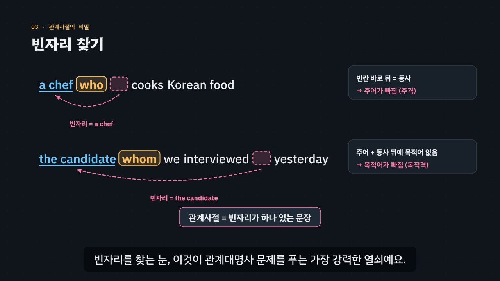

# 영어 튜토리얼

한림대학교 영어영문학과 학생들이 영어 실력을 **빠르고 확실하게** 다질 수 있도록 만든 인터랙티브 튜토리얼 모음입니다.
문법은 감으로 고르지 않고 **원리로** 풀 수 있게, 짧은 모션그래픽 영상과 직접 해 보기, 단계별 힌트가 있는 연습 문제로 익힙니다.



## 튜토리얼

| 영역 | 튜토리얼 | 길이 | 내용 |
| --- | --- | --- | --- |
| 토익 문법 | [관계대명사, 빈자리를 찾아라](relative-pronouns/) | 6:36 · 12장면 | 꾸미는 말의 자리, 두 문장 합치기, 빈자리 찾기, 주격·목적격·소유격, what, that을 못 쓰는 자리, 3단계 풀이법, 실전 문제 |
| 토익 문법 | [빈칸의 자리가 품사를 정한다](parts-of-speech/) | 6:22 · 12장면 | 낱말 가족, 꼬리표(접미사)와 꼬리가 속이는 말, 문장의 뼈대, 명사·형용사·보어·부사 자리, 복합명사와 사람 명사, 3단계 풀이법, 3초 품사 감각 훈련 |
| 토익 문법 | [주어가 수를, 목적어가 태를 정한다](verb-agreement-voice/) | 6:29 · 12장면 | 한국어와 다른 수 일치, 수식어를 지워 진짜 주어 찾기, a number of · the number of · each, 덩어리 주어, 능동·수동과 빈칸 뒤 목적어, 4·5형식 수동태, 수동태가 없는 자동사, 3단계 풀이법, 능동·수동 변환기 |
| 토익 문법 | [시간선 위에 동사를 놓아라](verb-tense/) | 6:26 · 12장면 | 시간선 위의 과거·현재·미래, 한국어 ‘-했다’와 현재완료, 시간 단서, 부사절의 현재 시제, 미래완료·과거완료, 요구·제안 that절의 동사원형, 시제와 짝인 부사, 3단계 풀이법, 시간선 시제 기계 |
| 토익 문법 | [접속사냐 전치사냐, 빈칸 뒤가 답한다](connectors/) | 5:52 · 11장면 | 접속사·전치사·접속부사 세 갈래, 명사구냐 절이냐, 같은 뜻 세 갈래 표, 뜻으로 고르는 접속사, 짝 접속사, 덩어리 전치사, 3단계 풀이법, 연결어 조립대 |
| 토익 문법 | [명사 검문소를 통과하라](nouns-articles/) | 6:02 · 11장면 | 한국어 ‘책 샀어’와 a book · the book · books, 명사 검문소의 세 문, 셀 수 있는 단수와 한정사, 셀 수 없는 명사(묶음의 이름), each · several · much의 짝, almost · most · most of, 숫자-하이픈과 another · other, 3단계 풀이법, 명사 검문소 놀이터 |
| 토익 문법 | [진짜 동사는 하나, 나머지는 to와 -ing](infinitives-gerunds/) | 6:24 · 12장면 | 한 문장에 진짜 동사 하나, 동사 자리가 비었을 때와 동사가 둘일 때, 타동사·자동사(discuss about ×), to부정사를 고르는 동사·-ing를 고르는 동사, 전치사 to + -ing, 형용사·명사 + to, 목적어 + to·원형, 3단계 풀이법, 동사 옷 입히기 |
| 토익 문법 | [-ing냐 -ed냐, 주인에게 물어라](participles/) | 6:36 · 12장면 | 명사를 꾸미는 분사, 하는 쪽 -ing · 당하는 쪽 -ed(관계 그림), 때가 아니라 관계(남은 좌석의 함정), 명사 뒤 분사구, 감정 분사와 한국어 ‘지루하다’, 분사구문의 주인, 접속사 + 분사, 3단계 풀이법, 주인 바꾸기 실험실 |
| 토익 문법 | [빈자리가 있느냐 없느냐, 그것이 문제로다](relative-adverbs-noun-clauses/) | 6:34 · 12장면 | 대명사가 빠지면 빈자리 · 부사가 빠지면 완전한 문장, 한국어 ‘예약한 호텔 · 열리는 도시’와 which · where, 관계부사 = 전치사 + which, the way how, whoever · whatever, however + 형용사 · wherever · whenever, 명사절 that vs what, whether vs if, 의문사 명사절의 어순, 3단계 풀이법, 빈자리 탐지기 |
| 토익 문법 | [가리키는 말이 줄을, 자리가 칸을 정한다](pronouns/) | 6:30 · 12장면 | 대명사는 화살표(가리키는 말), 대명사 표의 줄(사람·사물, 하나·여럿, 회사 → it)과 칸(주격·목적격·소유격·소유대명사, 한국어 조사와 비교), its와 it’s, 재귀대명사와 한국어 ‘자기’, one · another · the other, others와 the others, 되풀이 대신 that · those, 3단계 풀이법, 대명사 표 놀이터 |
| 상황별 영어 회화 | 준비 중 | | 공항, 카페, 호텔 같은 장소의 대화 연습 |

모든 튜토리얼에 자막과 음성 해설(한국어는 한국어 음성, 영어는 영어 음성), 발음 듣기, 장면별 ‘직접 해 보기’, 놀이터, 연습 문제, 퀴즈, 핵심 정리가 있습니다.

## 보는 방법

- **내 컴퓨터에서**: 저장소를 내려받아 맨 위의 `index.html`을 더블클릭하세요. 설치할 것이 없고, 인터넷이 없으면 글꼴만 기본 글꼴로 바뀝니다.
- **웹 주소**: 저장소 **Settings → Pages**에서 *Deploy from a branch* → 기본 브랜치 / `(root)`를 고르면 `https://vadoro.github.io/eng_tutorials/` 에서 열립니다.

## 앞으로의 계획

단계별로 하나씩 만들어 갑니다.

1. **토익 문법** — 자주 틀리는 유형 100개를 21개 카테고리, 튜토리얼 17개로 정리했어요: [docs/toeic-100-types.md](docs/toeic-100-types.md). 관계대명사(T01)와 품사 자리(T02)를 만들었고, 다음은 동사 ① 수 일치와 능동·수동(T03)이에요.
2. **상황별 영어 회화** — 공항, 카페처럼 특정 장소에서 오가는 대화를 듣고 따라 말하며 연습합니다.
3. **새 영역** — 필요할 때마다 `assets/catalog.js`의 `tracks`에 영역을 더해 넓혀 갑니다.

## 구조

```
index.html              사이트 첫 화면 (영역별 튜토리얼 카드)
assets/catalog.js       영역(tracks)과 튜토리얼 목록 — 새 튜토리얼은 여기에 한 항목 추가
assets/site-bar.js      각 튜토리얼 위에 붙는 공통 상단 바
assets/site.css         첫 화면 디자인
assets/favicon.svg      파비콘
shared/narration.js     공통 부품: 음성 해설(한·영 나눠 읽기) + 발음 듣기 (EN.narration, EN.say)
shared/drill.js         공통 부품: 토익 Part 5 연습 문제, 단계별 힌트 (EN.drill)
shared/quiz.js          공통 부품: 퀴즈 (EN.quiz)
shared/components.css   공통 부품 모양
tools/render-video.cjs  어느 튜토리얼이든 MP4 · 자막 원고 · 미리보기 그림으로 내보내기
relative-pronouns/      관계대명사, 빈자리를 찾아라 (토익 문법 T01)
parts-of-speech/        빈칸의 자리가 품사를 정한다 (토익 문법 T02)
verb-agreement-voice/   주어가 수를, 목적어가 태를 정한다 (토익 문법 T03)
verb-tense/             시간선 위에 동사를 놓아라 (토익 문법 T04)
connectors/             접속사냐 전치사냐, 빈칸 뒤가 답한다 (토익 문법 T05)
nouns-articles/         명사 검문소를 통과하라 (토익 문법 T06)
infinitives-gerunds/    진짜 동사는 하나, 나머지는 to와 -ing (토익 문법 T07)
participles/            -ing냐 -ed냐, 주인에게 물어라 (토익 문법 T08)
relative-adverbs-noun-clauses/ 빈자리가 있느냐 없느냐, 그것이 문제로다 (토익 문법 T09)
pronouns/               가리키는 말이 줄을, 자리가 칸을 정한다 (토익 문법 T10)
docs/toeic-100-types.md 토익에서 자주 틀리는 100개 유형, 21개 카테고리, 튜토리얼 17개 계획
CLAUDE.md               새 튜토리얼을 만들 때 지킬 규칙과 확인 목록
```

튜토리얼마다 폴더 안에서 완결되고, 사이트 공통 파일(`assets/`, `shared/`)만 `../`로 불러옵니다. 각 폴더의 README에 장면 구성, 조작법, 영상 다시 만드는 법이 있어요.

## 튜토리얼 추가하기

1. 가장 가까운 튜토리얼 폴더를 복사해 시작합니다: `cp -r relative-pronouns <새-폴더>`.
2. `grammar.js`(규칙 엔진과 예문), `scenes.js`(장면·자막), `app.js`(직접 해 보기·놀이터·퀴즈), `index.html`(제목·핵심 정리)을 내용에 맞게 바꿉니다.
3. 미리보기 그림과 자막 원고를 만듭니다(Node.js, ffmpeg, Playwright 필요).
   ```bash
   node tools/render-video.cjs <새-폴더> --poster 30   # → <새-폴더>/docs/poster.jpg
   node tools/render-video.cjs <새-폴더> --srt         # → <새-폴더>/video/<새-폴더>.srt
   ```
4. `assets/catalog.js`에 항목을 추가하면 첫 화면에 카드가 생깁니다. 이 README의 표에도 한 줄을 추가합니다.

자세한 규칙(장면 형식, 음성 해설, 공통 부품, 영상 렌더링, 확인 목록)은 [CLAUDE.md](CLAUDE.md)에 있습니다.

## 만든 방식

[DH 튜토리얼](https://vadoro.github.io/dh_tutorials/)의 인터랙티브 모션그래픽 형식(시간 t만으로 그리는 캔버스 영상, 장면별 실습, 놀이터, 퀴즈, MP4 추출)을 바탕으로, 영어 교육에 맞게 한·영 음성 해설, 발음 듣기, 문법 역할 색, 규칙 엔진, 단계별 힌트 연습 문제를 더했습니다.
