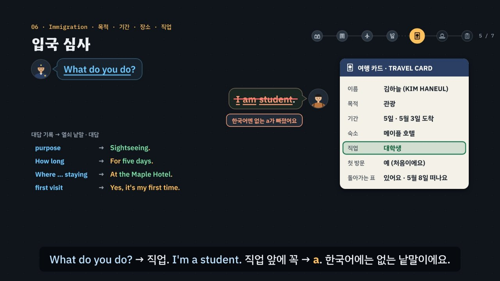

# 공항, 질문은 정해져 있다

> [영어 튜토리얼](../README.md) 모음의 **상황별 영어 회화** 첫 꼭지이자 시범 튜토리얼입니다(영역: `talk`). 다음 회화 튜토리얼(카페 · 호텔 · 식당 · 길 묻기 · 쇼핑 …)은 이 형식을 따라요. 형식의 결정은 [CLAUDE.md](../CLAUDE.md)의 ‘회화 튜토리얼이 갖출 것’에 적었어요.

공항에서는 처음 듣는 영어가 쏟아질 것 같지만, 일곱 곳(체크인 · 보안 검색 · 탑승구 · 기내 · 입국 심사 · 수하물 · 세관)에서 듣는 질문은 거의 정해져 있어요. 한국 학생이 자주 막히는 곳은 두 군데예요. 한국어로 먼저 생각해 낱말 그대로 옮기거나(*My purpose is trip.* · *During five days.* · *I am student.* · *Give me water.*), 질문을 못 알아듣고 얼어붙거나 그냥 *Yes*라고 하는 것. 이 튜토리얼은 약 6분 30초짜리 인터랙티브 모션그래픽으로 **3단계 말하기 법**을 가르쳐요.

- ① **열쇠 낱말 잡기** — 무엇을 묻나? *purpose* → 목적, *How long* → 기간, *Where … staying* → 장소, *Window or aisle* → 고르기, *declare* → 확인, *Take off …* → 지시
- ② **틀에 내 정보 넣기** — 짧은 대답 틀 + 사실과 맞는 정보. *For* + 기간, *At* + 장소, *I'm here* + 목적, *Could I have ___, please?* 문장 전체가 아니어도 돼요(*Sightseeing.*).
- ③ **공손하게 끝내기** — *please · thank you · Could I …?* 못 알아들었으면 짐작하지 말고 *Sorry? Could you say that again, please?* · *Could you speak more slowly, please?*



## 바로 보기

`index.html`을 더블클릭하면 끝이에요. 설치도, 서버도 필요 없어요.

## 소리와 마이크에 대해 (꼭 읽어 주세요)

- 녹음 파일이 없어요. 영어는 모두 **브라우저에 들어 있는 음성(speechSynthesis)** 으로 읽어요. 기기마다 목소리가 다르고 실제 공항의 소리와도 달라요.
- 튜토리얼 전용 목소리 부품 `assets/js/voices.js`(`APV`)가 곳마다 직원에게 다른 영어 목소리(en-US · en-GB · en-AU · en-CA)를, 여행자(나)에게는 직원과 다른 목소리를 골라요. 없으면 다른 영어 목소리의 높낮이 · 빠르기를 바꿔 구별해요. ‘아주 빠르게’ 문제는 일부러 빠르게(1.35배) 읽고, 화면 글과 읽는 글이 다르면 공항식으로 읽어요(*Flight 207* → two-oh-seven). 공통 부품(`shared/`)은 바꾸지 않았어요.
- 소리가 겹치지 않게: 대화를 읽기 전에 발음 듣기 · 음성 해설 · 녹음 재생을 멈추고 영상을 일시정지해요. 음성 인식을 시작할 때도 다른 소리를 모두 멈춰요.
- **따라 말하기 · 말로 대답하기**: 브라우저에 음성 인식(`SpeechRecognition` · `webkitSpeechRecognition`)이 있으면 말을 글로 바꿔 **낱말만** 맞춰 봐요(발음의 질은 판정하지 않아요). 크롬(Chrome) 같은 브라우저는 소리를 브라우저 회사의 서버로 보내 글로 바꿔요. 음성 인식이 없으면 녹음(`MediaRecorder`)으로 ‘내 목소리’와 ‘원래 문장’을 이어서 들어요. 둘 다 없으면 마이크 단추를 숨기고 ‘세 번 소리 내어 따라 해 보세요’라고 안내해요. 이 사이트는 소리도 글도 저장하지 않아요(녹음은 화면에만 잠깐 있다가 페이지를 닫으면 사라져요).
- 공항 절차와 규정(기내 액체 용기, 입국 심사 질문 등)은 나라와 공항마다 달라요. 여기서는 어디서나 자주 듣는 질문을 골라 미국식 입국 심사를 예로 들었어요. 항공편(207편) · 호텔 · 사람 이름은 모두 지어낸 것이고, 대화는 직접 만들었어요.

## 무엇을 배우나요

| 장 | 시각 | 내용 | 직접 해 보기 |
| --- | --- | --- | --- |
| 00 들어가며 | 0:00 | 입국 심사 한 장면: *What's the purpose of your visit?* → 한국어 그대로 *My purpose is trip.* → *I'm here for sightseeing.* → *Sightseeing.*, 3단계 | 먼저 대답해 보기 (듣고 대답 고르기) |
| 01 공항 길 지도 | 0:26 | 일곱 곳과 곳마다 두세 질문, 절차는 나라마다 다름 | 곳을 골라 질문 듣기 (지도의 곳을 눌러도 됨) |
| 02 체크인 카운터 | 0:56 | *Passport, please.* · *Window or aisle?* · *Are you checking any bags?*, 탑승권 읽기(탑승 시작 ≠ 출발, 그룹, 좌석) | 탑승권 칸 눌러 듣기, 언제까지 탑승구에? |
| 03 보안 검색대 | 1:30 | 지시는 동사로 시작, 대답은 *Okay.* + 행동, *please* + 명령문은 공손한 말, *Any liquids?* | 지시를 듣고 할 일 고르기 |
| 04 탑승구와 안내 방송 | 2:00 | 방송에서 숫자 셋(항공편 · 탑승구 · 시각), *fifteen · fifty*의 힘주는 곳, *boarding · delayed · final call*, 안내판, *Excuse me, is this Gate 50?* | 숫자 짝 고르고 듣기 문제 |
| 05 기내에서 | 2:34 | *Chicken or beef?* → 고른 것 + *please*, *Could I have ___, please?*, *Give me water.* · *I want water.*의 말투 | 부탁하는 말 만들기 (틀 · 칸 · 상황) |
| 06 입국 심사 | 3:06 | 여행 카드와 여섯 질문(목적 · 기간 · 장소 · 첫 방문 · 직업 · 돌아가는 표), *During five days.* · *I am student.* 함정, 대답 기록 | 여행 카드 보고 대답하기 |
| 07 수하물 찾기와 분실 | 3:42 | 벨트 번호, *My suitcase didn't come out.*(↔ *My bag is not come.*), 가방 묘사 크기 → 색 → 물건 + *with* 특징 | 가방 묘사 만들기 (누르는 차례대로, 순서 판정과 가방 그림) |
| 08 세관 · 못 알아들었을 때 | 4:16 | *Anything to declare?*, 빠른 말에 그냥 *Yes*는 위험, *Sorry? · Could you say that again, please? · Could you speak more slowly, please?* | 듣고 대답 고르기 (빠른 말) |
| 09 3단계 말하기 법 | 4:50 | 상자 셋, 일곱 곳에 한 줄씩 단계별로 채워짐 | 곳을 골라 3단계 보기 |
| 10 실전 대화 | 5:18 | 여행 카드 하나로 입국 심사 셋 + 수하물 하나, 보기마다 엔진이 몇 단계에서 지우는지 | 대화 골라 보기 |
| 11 정리 | 6:08 | 곳 · 열쇠 낱말 · 대답 틀 표 | 아래 칸으로 가는 길 |

영상 아래에는 다섯 가지가 더 있어요.

- **놀이터 — 입국 심사 시뮬레이터**: 누를 때마다 새 여행 카드(목적 · 기간 · 숙소 · 직업 · 첫 방문 · 돌아가는 날)가 만들어져요. 심사관이 여권을 달라고 한 뒤 질문 넷을 무작위 차례로 해요. 대답은 ① 대답 틀 칩(맞는 틀 하나 · 한국어 그대로 옮긴 틀 하나 · 다른 질문의 틀 하나, 첫 방문은 사실이 반대인 틀 하나 더)과 ② 칸 칩(카드의 값 + 다른 값 둘)으로 만들어요. 엔진이 ①에서 걸리면 심사관이 열쇠 낱말을 다시 물어요(*Sorry, I asked: …*), ②에서 걸리면 *Sorry?*(어색한 틀) 또는 *Hmm. Are you sure?*(카드와 다름), ③이면 *… Okay.*(말투). 매번 단계와 까닭, 모범 대답(듣기)을 보여 줘요. 음성 인식이 있으면 마이크로 말해서 대답할 수 있어요(다시 묻는 말을 하면 심사관이 천천히 다시 물어요). 끝나면 입국 도장 *ADMITTED*, 한 번에 통과한 수, 대화 전체와 듣기. 키보드: R 듣기 · S 천천히 · T 대본 · 1~4 대답 틀 · A~C 내 정보 · Enter 대답하기 · Backspace 지우기 · M 말로 대답하기 · N 새 카드.
- **공항 표현 따라 말하기**: 곳마다 직원의 말과 내 말 28문장. 듣기 · 천천히 · 따라 말하기(음성 인식 → 녹음 → 소리 내어 따라 하기). 인식 결과는 원래 문장의 낱말마다 초록(들림) · 주황(빠짐)으로 보여 줘요.
- **듣고 대답 고르기**(튜토리얼 전용, `EN.drill`과 같은 모양 · 키보드): 16문제, 일곱 곳 + 다시 묻기 둘, 정답 위치 A · B · C · D 넷씩. 문제마다 곳 아이콘과 한 줄 상황, 직원의 말은 소리 먼저(글은 답한 뒤 또는 대본 보기), 대답 넷은 글. 힌트 = 3단계 — ① 열쇠 낱말(가려진 직원 말에서 드러남) ② 틀 · 칸(함정은 주황) ③ 공손한 말(보라)과 정답. 답하면 보기마다 엔진의 까닭, 해석, 줄마다 듣기, 대화 듣기(직원 → 나). 키보드: A~D(1~4) 고르기 · H 힌트 · R 다시 듣기 · S 천천히 · T 대본 · Enter/→ 다음(다음 문제는 저절로 들려줘요).
- **퀴즈**: 10문제(그림 문제 3개: 공항 길에서 *Anything to declare?*를 듣는 곳, 탑승권에서 탑승 시작 시각 누르기, 가방 찾는 표지판 고르기).
- **핵심 정리**: 곳 × 열쇠 낱말 × 대답 틀 표, 용어(① 열쇠 낱말 · ② 대답 틀 · ③ 공손한 말 · ④ 한국어와 다른 점).

### 플레이어 조작

다른 튜토리얼과 같아요. 스페이스(재생/일시정지), ← →(5초), Shift + ← →(장), C(자막), V(음성 해설), F(전체 화면). 화면 속 말풍선을 누르면 그 사람의 목소리로, 영어 칩을 누르면 발음을 들려줘요. 01장 지도의 곳 · 02장 탑승권의 칸을 누르면 직접 해 보기와 함께 바뀌어요. 주소 끝에 `#c-장면이름`(예: `index.html#c-immig`)을 붙이면 그 장면에서 시작해요.

음성 해설은 자막의 `(A)`~`(D)`를 ‘에이 · 비 · 씨 · 디’, `10:20`을 ‘10시 20분’, `fif-TEEN` · `FIF-ty`를 fifteen · fifty, `Flight 207`을 two-oh-seven으로 읽어요.

## 무엇이 규칙 계산인가요

- **규칙 엔진** `assets/js/grammar.js`가 맞고 틀림과 까닭, 3단계 가운데 몇 단계에서 걸리는지를 정해요. 영상 속 ✓·×와 실전 대화에서 지워지는 순서, 직접 해 보기 채점, 시뮬레이터의 판정과 심사관의 반응, 듣고 대답 고르기의 힌트와 보기별 해설, 퀴즈 대부분의 정답이 모두 여기서 나와요.
  - 질문(`AP.Q`)마다 곳 · 뜻(`intent`: 목적 · 기간 · 장소 · 직업 · 자리 고르기 · 지시 …) · 열쇠 낱말(`key`, 질문 안에 꼭 있음) · 빠른 말(`fast`)을 적었어요.
  - 대답은 틀(`AP.FRAME`) + 칸 값(`AP.SLOT`)이에요. 틀 글의 `___`은 내 정보 칸, `{…}`는 공손한 말이고, 틀마다 표시가 있어요: ok · literal(한국어를 그대로 옮김) · wrong(틀린 문장) · blunt(명령 · 조르기 · 따지기) · plain(please 없이 끊김).
  - `AP.judge(질문, 대답, 카드)` — ① 틀의 뜻이 질문의 뜻과 같나(빠른 말이면 다시 묻는 말만 통과) ② 틀이 literal · wrong이면 탈락, 칸의 정보가 카드(또는 상황)의 사실과 다르면 탈락, 가방 묘사는 `AP.bagOrder`로 순서 확인 ③ blunt · plain이면 탈락. 남은 것이 자연스러운 대답이에요. `AP.model`은 카드에 맞는 모범 대답, `AP.steps`는 힌트 세 단계와 색칠할 낱말을 만들어요.
  - `AP.matchSpoken(들린 글, 질문, 카드)` — 음성 인식이 글로 바꾼 말에 그 질문의 표시 낱말과 카드의 사실이 들어 있으면 받아들여요(숫자는 낱말로, 줄임말은 풀어서 비교). 한국어 그대로의 꼴(*my purpose is* · *during* · 관사 없는 직업)이 들리면 알림만 붙여요.
  - `AP.compareWords(원래 문장, 들린 글)` — 낱말마다 맞춤(가장 긴 공통 부분열).
- **어긋남 경고** `AP.check()`: 열쇠 낱말이 질문에 없거나, 사전에 없는 뜻 · 칸을 쓰거나, 함정 틀에 까닭이 없거나, 맞는 보기가 하나가 아니거나 정답과 다르거나, 정답 위치가 몰리거나, 곳 · 다시 묻기 문제가 빠지면 콘솔에 경고가 떠요. 영상 · 직접 해 보기의 대화, 실전 대화에서 단계마다 지워지는 보기와 화면 글, 시뮬레이터 카드 40장(모범 대답은 통과하는지, 틀 칩 가운데 맞는 것이 하나뿐인지, 모범 대답을 말로 해도 통과하는지), 따라 말하기 문장도 점검하고, 퀴즈 정답은 `app.js`에서 따로 점검해요.
- **단순하게 줄인 부분**
  - 엔진은 소리를 듣지 않아요. 질문의 뜻과 열쇠 낱말, 대답의 틀과 칸은 사람이 적어 두었고, 엔진은 그것을 카드의 사실과 맞춰요.
  - 대답 틀은 공항에서 자주 쓰는 것만 골랐어요. 같은 뜻의 다른 자연스러운 대답도 많아요.
  - please 없이 고르는 말(*Window.*), *Give me · I want*로 하는 부탁은 ③단계에서 ‘더 공손하게’로 봤어요. 실제로는 말투와 표정으로도 공손함이 전해져요. 심사관의 질문에는 please 없이 짧게 답해도 공손하다고 봤어요.
  - 가방 묘사의 순서(크기 → 색 → 재료 → 물건)는 흔한 경우를 단순하게 줄인 규칙이에요.
  - 말로 대답하기와 따라 말하기는 낱말만 맞춰요. 발음과 공손함은 판정하지 않고, 음성 인식이 *a · the* 같은 짧은 낱말을 빼거나 더할 수도 있어요.
  - 사람과 물건은 도형으로 그린 그림이에요.
- **예문과 대화**: 모두 직접 만든 것이에요.

이웃 튜토리얼: 듣기 요령은 토익 듣기 [T15](../listening-part1-2/) · [T16](../listening-part3-4/)에서도 다뤄요(*Window or aisle?* 같은 선택 의문문, 들린 말을 바꿔 말하기).

## 폴더 구조

```
index.html              페이지 (영상 · 직접 해 보기 · 입국 심사 시뮬레이터 · 따라 말하기 · 듣고 대답 고르기 · 퀴즈 · 핵심 정리)
assets/js/grammar.js    규칙 엔진(AP.judge · AP.model · AP.matchSpoken · AP.compareWords · AP.bagOrder), 곳(AP.PLACES) · 질문(AP.Q) · 틀(AP.FRAME) · 칸(AP.SLOT),
                        연습 문제(AP.DRILL), 영상 대화(AP.INTRO · AP.IMMIG · AP.SCENE · AP.METHOD · AP.PRACTICE), 여행 카드(AP.newCard), 따라 말하기(AP.SHADOW), 힌트(AP.steps), 점검(AP.check)
assets/js/voices.js     대화 목소리(APV): 직원마다 · 여행자(나) 다른 영어 목소리, 빠른 말, 공항식 숫자 읽기, 다른 소리와 겹치지 않게
assets/js/scenes.js     영상 장면 12개, 장 목록과 자막, 곳 아이콘(APS.ICON · APS.iconSVG), 얼굴(avatar), 말풍선(talk · answer), 낱말 조각(lay · morph),
                        공항 길 띠(strip), 탑승권(boardingPass), 여행 카드(travelCard), 가방(suitcase), 수하물 벨트(carousel)
assets/js/app.js        플레이어, 직접 해 보기, 듣고 대답 고르기(ADrill), 입국 심사 시뮬레이터, 따라 말하기(음성 인식 · 녹음), 퀴즈, 영상 추출(EN_EXPORT)
video/                  자막 원고(SRT)
docs/poster.jpg         사이트 카드 그림
```

## 영상 다시 만들기

```bash
node tools/render-video.cjs airport                      # → airport/video/airport.mp4 + .srt
node tools/render-video.cjs airport --frames 213,184     # 몇 장면만 그림으로
node tools/render-video.cjs airport --poster 213         # 카드 그림
node tools/render-video.cjs airport --srt                # 자막 원고만
```

MP4에는 소리가 없어요(자막이 그림에 들어가요). 말은 말풍선 속 낱말이 하나씩 나타나는 모습으로 보여 줘요.
