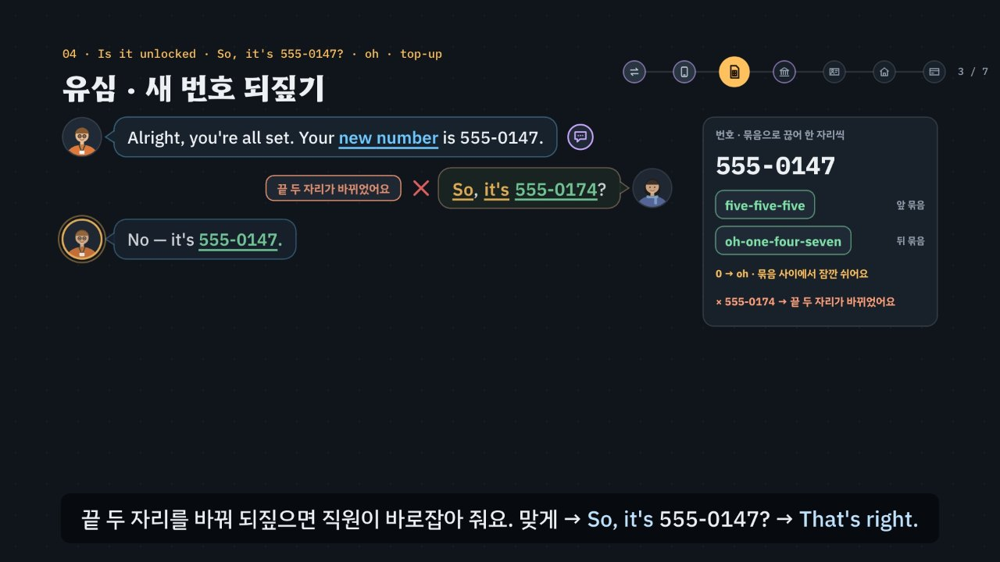

# 은행 · 환전 · 휴대폰, 서류는 내밀고 숫자는 끊어 말한다

> [영어 튜토리얼](../README.md) 모음의 **상황별 영어 회화** 아홉 번째 꼭지입니다(영역: `talk`). 형식은 [공항](../airport/) · [카페](../cafe/) · [호텔](../hotel/) · [식당](../restaurant/) · [길 묻기](../directions/) · [쇼핑](../shopping/) · [대중교통](../transit/) · [약국 · 병원](../pharmacy/)을 따르고(약국 · 병원을 복사해 시작, 공항의 ‘정해진 질문’과 호텔의 ‘부탁은 질문으로’를 섞음), 형식의 결정은 [CLAUDE.md](../CLAUDE.md)의 ‘회화 튜토리얼이 갖출 것’에 적었어요.

> **지어낸 예시예요.** 은행(*Kellport Harbor Bank*) · 휴대폰 가게(*Kellport Mobile*) · 학교(*Kellport University*) 이름, 환율(1달러 = 1,250원) · 요금제 값 · 수수료, 기숙사 주소 · 우편번호 · 전화번호(555-01xx) · 비밀번호는 모두 말하기 연습을 위해 지어낸 것이에요. 실제 은행 · 가게의 서류와 절차는 나라 · 은행 · 가게마다 달라요. 페이지 · 영상(01장) · 직접 해 보기 · 시뮬레이터의 영수증에도 같은 알림이 있어요.

교환학생으로 도착하면 처음 며칠 동안 **환전 창구 → 휴대폰 가게 → 은행 창구**를 차례로 가요. 세 곳 모두 **내가 먼저** 용건을 말하고(*How can I help you today?* → *I'd like to open a bank account, please.*), 그다음은 공항처럼 **정해진 질문**이 이어져요. 대답은 대부분 **서류와 숫자**예요. 서류를 달라는 말에는 있다고만 하지 말고 **내밀면서** 말해요(*I have passport.* × → *Sure. Here's my passport.*). 숫자는 영어식으로 **끊어** 말해요 — 큰 금액은 세 자리씩(30만 원 → *Thirty man won?* × → *three hundred thousand won*), 전화번호는 묶음으로 한 자리씩(*555-0147* → *five-five-five, oh-one-four-seven*, 0은 *oh*), 주소는 **작은 곳에서 큰 곳으로**(*It's Room 412, Maple Hall, 200 College Avenue, Kellport, 40213.*). 상대가 알려 준 숫자(받을 달러 · 요금 · **새 전화번호**)는 그냥 *Okay. Thanks.*로 넘기지 말고 **되짚어요**(*So, that's $240?* · *So, it's 555-0147?*) — 휴대폰 가게에서 받은 새 번호를 나중에 은행 서류에 써야 하니까요. 서류가 없으면 사실에 부탁을 붙여요(*No, I don't. Would a letter from my university work?*). 여기에 한국어를 그대로 옮긴 말(이거 달러로 바꿔요 → *Change this into dollars.* · 개통 → *open my phone* · 유심 → *USIM card* · 무제한 → *data free* · 동안 → *During six months* · 통장 → *bankbook* · 기숙사 서류 → *dormitory paper* · 서명 → *I'll do my sign.* · 체크카드 → *check card*)과 헷갈리는 숫자(*forty* · *fourteen*, *thirty* · *thirteen*, 끝 두 자리를 바꾼 번호, 421호와 412호)를 더했어요. 약 6분 37초짜리 인터랙티브 모션그래픽으로 **3단계 말하기 법**을 가르쳐요.

- ① **열쇠 낱말 + 질문의 모양 잡기** — 무엇을 묻나, 그리고 어떤 모양인가? *or*가 들리면 고르는 질문(*Prepaid or monthly? · Large bills or small bills? · Checking or savings?*), *how much · how long · what's*로 시작하면 정보 질문, *Is your phone · Are you · Do you have*면 Yes/No 질문(첫 낱말이 짧은 대답의 짝 → *Is it …? → Yes, it is.* · *Are you …? → Yes, I am.* · *Do you …? → Yes, I do.*). 물음표가 없는 안내(*That comes to $240. · Your new number is 555-0147. · Please enter a four-digit PIN.*)는 들은 숫자를 되짚거나 짧게 답할 차례예요. 환전 창구 · 휴대폰 가게 · 은행 창구에서는 **내가 먼저** 용건을 말해요. 모양마다 그림 표시가 있어요: 스위치(Yes/No) · 갈림길(고르기) · 빈 상자(정보) · 말풍선(안내).
- ② **틀에 서류 · 숫자 넣기 · 들은 숫자 되짚기** — 짧은 대답 틀 + 내 카드와 맞는 정보. *Six hundred thousand won, please. · Small bills, please. · 15 GB, please. · For six months. · A checking account, please. · Sure. Here's my student ID. · It's 555-0147.* 주소는 **조각으로 한 줄**을 만들어요: It's → 방 번호 → 건물 → 번지 + 길 → 도시 + 우편번호. 엔진이 조각마다 맞춰 보고, 틀린 조각에는 그 조각만 다시 물어요(*Sorry — Room 421? Could you check that for me?*).
- ③ **공손하게 끝내기** — 용건과 부탁은 질문 · 부탁 틀로(*I'd like to …, please. · Could you tell me where the nearest ATM is? · Would a letter from my university work?*), *please · thank you.* 못 알아들었으면 *Sorry? Could you say that again, please?* 일부만 들렸으면 *Sorry, how much data?* 번호를 놓쳤으면 *Sorry, could you say the number again, slowly?* 모르는 낱말이면 *Sorry, what does top-up mean?* 비밀번호는 **말하지 않고** 숫자판에 눌러요.



## 바로 보기

`index.html`을 더블클릭하면 끝이에요. 설치도, 서버도 필요 없어요.

## 소리와 마이크에 대해 (꼭 읽어 주세요)

- 녹음 파일이 없어요. 영어는 모두 **합성 음성**이에요. 글이 정해진 말(영상의 말풍선 · 영어 칩, 직접 해 보기의 듣기, 듣고 대답 고르기, 따라 말하기)은 **VoiceStudio로 미리 만든 목소리**(`audio/dialogue/`)로, 은행 · 휴대폰 시뮬레이터처럼 카드마다 바뀌는 말과 내가 칩으로 만든 문장은 **브라우저에 들어 있는 음성(speechSynthesis)** 으로 읽어요. 브라우저 음성은 기기마다 목소리가 다르고, 둘 다 실제 은행 · 가게의 소리와는 달라요.
- 튜토리얼 전용 목소리 부품 `assets/js/voices.js`(`BKV`)가 말하는 사람마다 목소리를 정해요. 미리 만든 목소리는 은행 창구 직원 = 미국 남성 · 계좌 담당 직원 = 캐나다 여성 · 휴대폰 가게 직원 = 호주 남성 · 환전 창구 직원 = 영국 여성 · 손님(나) = 미국 여성, 화면의 영어 칩(발음 듣기)과 음성 해설의 영어는 밝은 미국 여성 선생님 목소리예요(길 묻기 · 식당 · 쇼핑 · 대중교통 · 약국 · 병원과 같은 목소리들). 한 번에 읽는 줄 안에서 한 사람의 말 중 하나라도 파일이 없으면 그 사람의 말은 모두 브라우저 음성으로 읽고(한 사람의 목소리가 중간에 바뀌지 않게), 시뮬레이터는 처음부터 끝까지 브라우저 음성이에요. 브라우저 음성은 은행 창구 직원(en-US) · 계좌 담당 직원(en-CA) · 휴대폰 가게 직원(en-AU) · 환전 창구 직원(en-GB) · 손님(나, 상대와 다른 목소리)을 골라요. 없으면 다른 영어 목소리의 높낮이 · 빠르기를 바꿔 구별해요. ‘아주 빠르게’ 문제는 일부러 빠르게 읽어요. 숫자는 은행 · 가게에서 말하는 꼴로 읽어요(`BK.spoken`): *$240* → two hundred forty dollars, *300,000 won* → three hundred thousand won, *555-0147* → five-five-five, oh-one-four-seven, *Room 412* → Room four-twelve, *40213* → four-oh-two-one-three, *15 GB* → fifteen gigabytes. 공통 부품(`shared/`)은 바꾸지 않았어요.
- 소리가 겹치지 않게: 대화를 읽기 전에 발음 듣기 · 음성 해설 · 녹음 재생을 멈추고 영상을 일시정지해요. 음성 인식을 시작할 때도 다른 소리를 모두 멈춰요.
- **따라 말하기 · 말로 대답하기**: 브라우저에 음성 인식(`SpeechRecognition` · `webkitSpeechRecognition`)이 있으면 말을 글로 바꿔 **낱말만** 맞춰 봐요(발음의 질은 판정하지 않아요). 금액은 *300,000*이든 *three hundred thousand*든, 번호는 *555-0147*이든 *five five five oh one four seven*이든 같은 것으로 맞춰요(`BK.canon`). 크롬(Chrome) 같은 브라우저는 소리를 브라우저 회사의 서버로 보내 글로 바꿔요. 음성 인식이 없으면 녹음(`MediaRecorder`)으로 ‘내 목소리’와 ‘원래 문장’을 이어서 들어요. 둘 다 없으면 마이크 단추를 숨기고 ‘세 번 소리 내어 따라 해 보세요’라고 안내해요. 이 사이트는 소리도 글도 저장하지 않아요(녹음은 화면에만 잠깐 있다가 페이지를 닫으면 사라져요). 도시 이름(*Kellport*) · 기숙사 이름(*Maple Hall*) · 길 이름(*College Avenue*) · 숫자는 인식이 다르게 적기 쉬워서 따라 말하기에서 알림을 붙여요.
- **비밀번호는 연습에서도 말하지 않아요.** 영상 · 시뮬레이터에서 비밀번호를 소리 내어 말하는 대답(*It's 7-3-9-1.*)은 함정이에요. 시뮬레이터의 카드에 적힌 비밀번호도 지어낸 네 자리예요. 실제 비밀번호를 화면이나 마이크에 넣지 마세요.
- 환전은 수수료 없이 지어낸 환율 하나로만 계산해요. 휴대폰 개통에 필요한 서류, 은행 계좌를 열 때 필요한 서류(여권 · 두 번째 신분증 · 주소 증명)와 학생 계좌의 조건은 나라 · 은행마다 달라요. 영국은 *current account*, 미국은 *checking account*라고 하고, 휴대폰 요금제는 영국에서 *pay as you go · contract*, 미국에서 *prepaid · monthly plan*이라고도 해요. 주소를 적는 차례도 나라마다 조금씩 달라요.

## 무엇을 배우나요

| 장 | 시각 | 내용 | 직접 해 보기 |
| --- | --- | --- | --- |
| 00 들어가며 | 0:00 | 30만 원을 *Thirty man won?*으로 말하면 못 알아들음 → *three hundred thousand won*, 여권을 달라는 말에 *I have passport.* → 내밀면서 *Sure. Here's my passport.*, 새 번호를 *Okay. Thanks.*로 넘기지 말고 되짚기, 3단계 | 먼저 골라서 대답해 보기 (듣고 대답 고르기) |
| 01 환전 창구에서 은행까지 | 0:26 | 환전 창구 하나 · 휴대폰 가게 둘(요금제 · 유심과 새 번호) · 은행 넷(용건 · 서류 · 주소와 연락처 · 카드)의 일곱 곳, 곳마다 한두 마디, 내가 먼저 말을 꺼내는 곳(보라 테두리), **은행 이름 · 환율 · 요금 · 주소 · 전화번호는 지어낸 예시** | 곳을 골라 한두 마디 듣기 (지도의 곳을 눌러도 됨) |
| 02 환전 창구 · 만 → thousand | 0:56 | *Change this into dollars.* ×(명령처럼 들림) → *I'd like to change 300,000 won into US dollars, please.*, *How much would you like to change?* → *thirty man won* ×, *thirty thousand*(3만) · *three million*(300만)과 견주기 → *three hundred thousand won*, *Large bills or small bills?* → *Yes, please.* × → *Small bills, please.*(*paper* 아니고 *bills*), *That comes to $240.* → *So, that's $240?*(*forty* 앞을 세게 · *fourteen* 뒤를 세게) | 바꿀 금액 — 만은 thousand로 (바꿀 돈 · 읽는 법 넷 → 엔진의 판정, 지폐 고르기, 환율로 계산한 받을 금액 되짚기, -teen · -ty 짝 듣기) |
| 03 휴대폰 가게 · 요금제 고르기 | 1:36 | *I want to open my phone.* × · *USIM card, please.* × → *I'd like to get a SIM card for my phone, please.*, *Prepaid or monthly?*(이어져 들리는 *pre-PAI-dor*) → *Prepaid, please.*, *How much data do you need?* → *data free* × → *15 GB, please.*, *How long are you staying?* → *During six months.* × → *For six months.*, 빠른 말 *How much data d'you reckon you need?* → *Sorry, how much data?*, *That's $30 for the first month.*(*thirteen* · *thirty*) → *Can I pay by card?* | 질문의 모양 맞히기 · 요금제 (상대의 말을 골라 모양 맞히기 → *Yes, please.*로 대답하면 엔진의 판정, 데이터 · 머무는 기간 · *for*와 *during*, 요금 듣기) |
| 04 유심 · 새 번호 되짚기 | 2:15 | *Is your phone unlocked?* → *Yes, it is.*(*Yes, I am.* ×), *Your new number is 555-0147.* → *Okay. Thanks.* ×(되짚지 않음), *five hundred fifty-five* ×(큰 수처럼) → *five-five-five, oh-one-four-seven*, 끝 두 자리를 바꿔 되짚으면 *No — it's 555-0147.*, 빠른 말 *Righto, new number's …* → *Sorry, could you say the number again, slowly?*, *auto top-up* → *Sorry, what does top-up mean?* → *No, thanks. I'll top it up myself.* | 새 번호 듣고 되짚기 (번호 여섯 가운데 하나 · 대답 넷 → 엔진의 판정과 직원의 반응, *Is it …?*의 짝, 모르는 낱말 묻기) |
| 05 은행 창구 · 계좌 열기 | 2:48 | *I want to make a bankbook.* × · *Make me an account.* ×(명령) · *I'm an exchange student.*(사실만) → *I'd like to open a bank account, please.*, *Checking or savings?* → *A checking account, please.*, *Are you a student?* → *Yes, I do.* × → *Yes, I am. I'm an exchange student at Kellport University.* | 용건 · 통장 고르기 · Yes/No의 짝 (말하는 방법 · 통장 → 엔진의 판정, 질문마다 첫 낱말로 짝 맞추기) |
| 06 서류 · 내밀면서 말하기 | 3:16 | *Can I see your passport, please?* → *I have passport.* × → *Sure. Here's my passport.*, *Do you have a second form of ID?* → *Yes, I have.* × · *Yes, I am.* × → *Yes, I do. Here's my student ID.*, *Do you have proof of address?* → *dormitory paper* × → *my housing contract*, 서류가 없으면 *No, I don't. Would a letter from my university work?*, 빠른 말 *Got some ID?* → *Sorry, did you ask for my ID?*, 서류 넷(여권 · 학생증 · 기숙사 계약서 · 학교 확인서) | 서류 — 내밀면서 Here's … (질문 셋 × 주소 증명 서류가 있나 → 대답 고르기, 엔진의 판정과 직원의 반응) |
| 07 주소 · 전화번호 · 서명 | 3:50 | *What's your address here?* → *I live in a dormitory.*(주소가 없음), 한국 주소처럼 큰 곳부터 ×, *College Avenue 200* ×(번지는 길 앞에), 방 번호를 421로 잘못 → 직원이 그 조각만 다시 물음, *It's Room 412, Maple Hall, 200 College Avenue, Kellport, 40213.*, *What's a good phone number for you?* → 휴대폰 가게에서 되짚어 둔 번호 *It's 555-0147.*, *Please sign here.* → *I'll do my sign.* × → *Sure. Right here?*, 빠른 말 *And what's the address there?* | 주소 한 줄 — 작은 곳에서 큰 곳으로 (방 번호 · 기숙사 → 조각을 누르는 차례대로 `BK.checkLine`의 판정과 직원이 다시 묻는 말, 전화번호 대답 고르기, 서명) |
| 08 카드 · 비밀번호 · ATM | 4:29 | *Would you like a debit card with your account?* → *check card* × → *Yes, please.*, *Please enter a four-digit PIN on the keypad.* → *It's 7-3-9-1.* ×(비밀번호를 소리 내어) → 누르기만 하고 *Okay. Thank you.*, *Is there anything else I can help you with?* → *Yes.*만 × · *Where is ATM?* ×(툭 던지는 말) → *Yes. Could you tell me where the nearest ATM is?* | 직불 카드 · 비밀번호 · 마무리 (직불 카드가 필요한가 · 비밀번호를 누르나 말하나 · 물어볼 것 → 엔진의 판정과 직원의 반응) |
| 09 3단계 말하기 법 | 4:57 | 상자 셋, 일곱 곳에 한 줄씩 모양 표시와 함께 단계별로 채워짐 | 곳을 골라 3단계 보기 |
| 10 실전 환전 · 휴대폰 · 은행 | 5:25 | 내 카드 하나(60만 원 · 새 번호 555-0162 · 주소 증명 없음 · Cedar Hall 315호)로 넷(바꿀 금액 · 새 번호 되짚기 · 주소 증명 · 주소 한 줄), 보기마다 엔진이 ①②③ 몇 단계에서 지우는지 | 대화 골라 보기 |
| 11 정리 | 6:15 | 곳 · 열쇠 낱말과 모양 · 대답 틀 표 + 주소 한 줄 + 못 알아들었을 때 | 아래 칸으로 가는 길 |

영상 아래에는 다섯 가지가 더 있어요.

- **놀이터 — 은행 · 휴대폰 시뮬레이터**: 누를 때마다 새 카드(바꿀 원 · 큰 지폐나 작은 지폐, 선불이나 월 요금제 · 데이터 · 머무는 기간 · 내는 방법 · 자동 충전, 통장 종류 · 두 번째 신분증이나 학생인지 · 주소 증명 서류가 있나 · 기숙사와 방 번호, 직불 카드 · 비밀번호 · 물어볼 것)가 만들어져요. 차례(20번 안팎): 환전 창구(**내가 먼저** 용건 → 얼마 → 지폐 → 받을 달러 되짚기) → 휴대폰 가게(**내가 먼저** 용건 → 요금제 → 데이터 → 요금 듣기 · 내기 → 잠금 해제 → **새 번호 되짚기** → 자동 충전) → 은행 창구(**내가 먼저** 용건 → 통장 → 학생인지나 두 번째 신분증 → 여권 → 주소 증명 → **주소 한 줄** → 전화번호 → 직불 카드 → 비밀번호 → 더 물어볼 것). 받을 달러 · 요금 · **새 전화번호**는 카드에 없어요 — 상대가 말한 것을 듣고 써야 하고, 새 번호는 은행에서 *What's a good phone number for you?*에 다시 써야 해요. 대답은 ① 대답 틀 칩(맞는 틀 하나 · 함정 하나(Yes만 · 한국어 그대로 · 짝이 다른 짧은 대답 · 명령처럼 들리는 말) · 다른 질문의 틀 하나)과 ② 칸 칩(카드의 값 + 헷갈리기 쉬운 이웃 값: 3만 · 300만, *$240* · *$214*, *$30* · *$13*, 끝 두 자리를 바꾼 번호, 다른 서류)으로 만들어요. 주소에서는 조각 칩(*It's* · 방 번호 · 건물 · 번지 + 길 · 도시 + 우편번호, 함정 *College Avenue 200* · 421호 · 40231)을 말하는 차례대로 누르고(Backspace 하나 지우기), 틀린 조각이 있으면 직원이 그 조각만 다시 물어요. 엔진이 ①에서 걸리면 상대가 질문만 다시 말하고, ②에서 걸리면 *No — it's 555-0147.* · *Sorry — how much was that, in won?* · *Hmm, is that the number from the phone shop?* 같은 반응, ③이면 *… Okay.* 매번 단계와 까닭, 모범 대답(듣기)을 보여 줘요. 다시 묻기(*Sorry, did you say $30?* · *Sorry, what does top-up mean?* · *Could you say that again?*)에는 상대가 확인해 주거나 쉬운 말로 풀어 주거나 천천히 한 번 더 말해요. 음성 인식이 있으면 마이크로 말해서 대답할 수 있어요. 끝나면 영수증(바꾼 돈과 받은 달러 · 요금제와 새 번호 · 계좌와 주소 · 카드, 지어낸 예시라는 알림), 한 번에 통과한 수, 대화 전체와 듣기. 키보드: R 듣기 · S 천천히 · T 대본 · 1~4 대답 틀 · A~C 내 정보 · Enter 대답하기(주소에서는 한 줄 말하기) · Backspace 지우기(주소에서는 조각 하나) · M 말로 대답하기 · N 새 카드.
- **은행 · 휴대폰 표현 따라 말하기**: 곳마다 넷씩, 직원의 말과 내 말 28문장. 듣기 · 천천히 · 따라 말하기(음성 인식 → 녹음 → 소리 내어 따라 하기). 인식 결과는 원래 문장의 낱말마다 초록(들림) · 주황(빠짐)으로 보여 줘요.
- **듣고 대답 고르기**(튜토리얼 전용 `BDrill`, `EN.drill`과 같은 모양 · 키보드): 16문제, 일곱 곳 + 빠른 말, 정답 위치 A · B · C · D 넷씩. 문제마다 곳 아이콘과 한 줄 상황, 상대의 말은 소리 먼저(글은 답한 뒤 또는 대본 보기), 대답 넷은 글. 되짚기 · 주소 문제는 보기마다 한 조각만 달라요. 힌트 = 3단계 — ① 열쇠 낱말과 질문의 모양(상대의 말 옆에 모양 표시) ② 틀 · 칸 · 서류와 숫자(함정은 주황) ③ 공손한 말(보라)과 정답. 답하면 보기마다 엔진의 까닭, 해석, 줄마다 듣기, 대화 듣기(상대 → 나). 키보드: A~D(1~4) 고르기 · H 힌트 · R 다시 듣기 · S 천천히 · T 대본 · Enter/→ 다음.
- **퀴즈**: 10문제(그림 문제 4개: 환율로 받을 달러 넷 가운데 들은 금액 누르기, *prepaid or monthly* 질문의 모양 표시 고르기, 두 번째 신분증으로 내밀 서류 누르기, 주소 한 줄 넷 가운데 영어 차례가 맞는 것 누르기).
- **핵심 정리**: 곳 × 열쇠 낱말 · 모양 × 대답 틀 표 + 주소 한 줄, 용어(① 내가 먼저 · 용건은 부탁 틀 · 정보 질문 · 고르는 질문 · Yes/No 질문의 짝 · ② 서류는 내밀면서 · 큰 금액 · 헷갈리는 숫자 · 전화번호와 우편번호 · 주소 한 줄 · ③ 부탁은 질문으로 · 다시 묻기 · 비밀번호 · 마무리 · ④ 한국어와 다른 점 · 콩글리시).

### 플레이어 조작

다른 튜토리얼과 같아요. 스페이스(재생/일시정지), ← →(5초), Shift + ← →(장), C(자막), V(음성 해설), F(전체 화면). 화면 속 말풍선을 누르면 그 사람의 목소리로, 영어 칩을 누르면 발음을 들려줘요. 01장 지도의 곳을 누르면 직접 해 보기와 함께 바뀌어요. 주소 끝에 `#c-장면이름`(예: `index.html#c-form`)을 붙이면 그 장면에서 시작해요.

음성 해설은 자막의 `(A)`~`(D)`를 ‘에이 · 비 · 씨 · 디’로 읽고, 영어 문장 속 금액(*$240* · *300,000 won*) · 번호(*555-0147*) · 방 번호(*Room 412*) · 번지(*200 College Avenue*) · 우편번호(*40213*) · 데이터(*15 GB*)는 영어 낱말로 읽어요. 함정으로 보여 주는 비밀번호(*7-3-9-1*)는 한 자리씩(*seven three nine one*) 읽고, `Yes/No`는 *Yes or No*로 읽어요. 한국어 속 숫자(30만 원 · 315호)는 한국어로 읽어요.

**미리 만든 목소리**: VoiceStudio(OmniVoice 엔진, 비상업용 라이선스)로 만든 합성 음성 파일이에요. 파일이 없거나 못 읽으면 그 줄 · 조각만 브라우저 음성으로 읽어요.
- 음성 해설(`audio/narration/`): 한국어 조각은 「튜토리얼 내레이터 (젊은 여성)」, 영어 조각(본보기 영어 문장)은 「영어 선생님 (밝은 미국 여성)」. 화면의 영어 칩(발음 듣기, 말하는 사람 `tc`)도 같은 목소리예요(다른 회화 · 토익 튜토리얼과 같음).
- 대화(`audio/dialogue/`): 말하는 사람 → 프로필은 `voices.json`(길 묻기와 같은 프로필 — 이름의 ‘길 묻기’는 처음 만든 곳일 뿐이에요). 프로필은 VoiceStudio 목소리 보관함(archetype)에서 고른 목소리를 한 번 만든 소리로 복제(clone)한 것이라, 줄마다 같은 사람 목소리가 나요. 파일 이름은 말하는 사람과 읽을 글로 정해져요(`BKV.lineId`). 숫자는 읽을 글(`BK.spoken`)로 만들어요(*$240* → *two hundred forty dollars*, *555-0147* → *five-five-five, oh-one-four-seven*, *Room 412* → *Room four-twelve*).
- 합성 엔진은 가끔 무음 · 잡음을 내거나, 세 낱말 이하의 짧은 말을 0.3초 안에 뭉개 읽어요. 도구가 말소리 1초에 읽은 글자 수로 이런 소리를 걸러 seed를 바꿔 다시 만들고(짧은 말은 다섯 번까지), 그래도 이상하면 ‘확인 필요’로 알려 줘요. 지금 파일은 받아쓰기(Whisper)와 높낮이로 모두 다시 확인했어요(영어 547개 · 한국어 122개). 밝은 선생님 목소리로 속삭이듯 읽은 *Yes, I am.* · *Sure.*와 아주 높게 끽 소리를 낸 *paper* · *A checking account, please.*는 seed를 바꿔 다시 만들었어요. *Yes, I do.*는 seed 열 개가 모두 높게 끽 소리를 내거나 속삭여서, 읽을 글 끝에 쉼표를 붙여(*Yes, I do,*) 다시 만들었어요. 받아쓰기가 *or*를 *your*로 들은 *Checking or savings?*도 다시 만들었어요. 밝은 목소리라 짧은 말(*forty* · *fifty* · *Right here?*)은 원래 높게 읽어요. 받아쓰기가 금액 · 번호를 *300,000 won* · *555-0147*로, *won*을 *one*으로 적는 것은 적는 방식만 다를 뿐이고, 빠르게 이어지는 소리를 글자로 적은 *pre-PAI-dor*는 낱말이 아니어서 받아쓰기가 다른 말로 적어요. 한국어 조각은 받아쓰기가 *되짚어*를 *돼지퍼*처럼 소리가 같은 말로 적었을 뿐이라 그대로 두었어요. 교환학생 생활 튜토리얼부터는 받아쓰기는 맞지만 속삭이듯 읽은 소리까지 찾으려고 말하는 사람마다 목소리가 울린(성대가 떨린) 비율도 함께 재요. 이 튜토리얼도 그렇게 다시 확인해서 속삭이듯 읽거나 아주 높게 끽 소리를 낸 선생님 조각(*During my stay.* · *I'm an exchange student.* · *Yes, I have.* · *Yes.* · *Okay, thanks.* · *auto top-up* · *signature, Sure.* · *Sure.* · *Is* · *or* · *oh*)과 호주 남성 목소리의 *That's right.*, 미국 남성 목소리의 *Perfect.*, 나의 *Okay. Thanks.* · *Yes.*를 다시 만들었어요. seed를 바꿔도 낫지 않던 짧은 말은 읽을 글 끝에 쉼표를 붙이거나(*signature, sure,* · *Sure,*) *Perfect.*를 *Perfect!*로 바꿔 읽혀 다시 만들었어요. 화면의 글은 그대로예요. 그 뒤 모든 튜토리얼을 다시 살펴보면서 숨소리가 섞인 정도(소리가 얼마나 고르게 되풀이되는지 보는 자기상관 · 켑스트럼 피크, s 소리가 긴 짧은 말은 모음 부분만)까지 재서 파일 7개(*Yes.* · *Thanks.* · *fifty* · *sixty* · *Perfect.*)를 더 다시 만들고 받아쓰기로 낱말을 확인했어요. 한 파일만 다시 만들려면 그 파일을 지우고 `--seed`를 바꿔 다시 실행하세요.

만드는 법(VoiceStudio가 있는 맥에서, 이미 만든 파일은 건너뛰어요):

```bash
node tools/narration-pieces.cjs bank     # 해설의 읽기 조각 목록 (자막을 고쳤을 때만, 클라우드에서도 됨)
node tools/dialogue-lines.cjs bank       # 대화 줄 목록 (대화 · 문제 · 따라 말하기를 고쳤을 때만, 클라우드에서도 됨)
python3 tools/voicestudio-narration.py bank --en-profile "영어 선생님 (밝은 미국 여성)"   # 해설 (한국어 + 영어 조각)
python3 tools/voicestudio-dialogue.py bank             # 대화
```

## 무엇이 규칙 계산인가요

- **규칙 엔진** `assets/js/grammar.js`가 맞고 틀림과 까닭, 3단계 가운데 몇 단계에서 걸리는지를 정해요. 영상 속 ✓·×와 실전에서 지워지는 순서, 질문의 모양과 짧은 대답의 짝, 환율 계산과 받을 달러, 요금제 값, 새 번호와 헷갈리는 번호, 주소 한 줄의 판정과 다시 묻는 말, 직접 해 보기 채점, 시뮬레이터의 판정과 상대의 반응, 듣고 대답 고르기의 힌트와 보기별 해설, 퀴즈 대부분의 정답이 여기서 나와요.
  - 상대의 말(`BK.Q`)마다 곳 · 뜻(`intent`) · **모양**(`shape`: `yn` · `or` · `wh` · `note`, 고르는 질문은 고를 것 `choices`) · Yes/No 질문의 **짧은 대답 짝**(`aux`) · 열쇠 낱말(`key`, 말 안에 꼭 있음) · 빠른 말(`fast`) · 알려 준 사실(`fact`: 받을 달러 · 요금 · 새 번호)을 적었어요. `BK.shapeGuess`(마지막 물음 문장 → *or*가 있으면 고르기, 의문사로 시작하면 정보, 나머지는 Yes/No, 물음표가 없으면 안내)가 글과 맞는지, 적어 둔 짝이 첫 낱말과 맞는지 점검해요.
  - 대답은 틀(`BK.FRAME`) + 칸 값(`BK.SLOT`)이에요. 틀 글의 `___`은 내 정보 칸, `{…}`는 공손한 말이고, 틀마다 표시가 있어요: ok · literal(한국어를 그대로 옮김 · 콩글리시) · wrong(틀린 문장) · blunt(명령 · 툭 던지는 말) · plain(그냥 *Yes.*로 끊김). **Yes · No만 하는 대답**은 `bare` 틀(*Yes. · Yes, please. · No, thanks.*), 사실만 말하고 용건 · 부탁이 빠진 말은 `half` 틀(*I'm an exchange student.* · *No, I don't.*), 짧은 대답의 짝은 `aux`(*Yes, it is.* · *Yes, I am.* · *Yes, I do.*)예요.
  - **숫자** — 큰 금액 `BK.wonWords`(300,000 → *three hundred thousand*, 한국어 `BK.manKo` → 30만) · 헷갈리는 금액 `BK.wonTraps`(3만 · 300만), 환율 `BK.RATE`와 받을 달러 `BK.fx`(원 ÷ 1,250, 지어낸 환율), 달러 읽기 `BK.priceWords` · `BK.money` · 헷갈리는 값 `BK.moneyTrap` · `BK.usdTrap`(*-teen* · *-ty* 바꾸기), 요금제 값 `BK.planCost`(`BK.PLANS` × `BK.DATA`, 지어낸 값), 전화번호 `BK.digits`(묶음으로 한 자리씩, 0 → *oh*) · 큰 수처럼 잘못 읽기 `BK.bigRead` · 끝 두 자리를 바꾼 번호 `BK.phoneTrap`, 방 번호 `BK.roomWords`(412 → *four-twelve*) · `BK.roomTrap`(421), 우편번호 `BK.zipTrap`, 읽을 글 `BK.spoken`, 숫자 낱말을 숫자로 모으기 `BK.canon`. 영상의 환전 판 · 지폐 · 요금제 판 · 휴대폰 화면 · 신청서 · 영수증 · 퀴즈 그림이 모두 이 계산을 그려요.
  - **주소 한 줄** `BK.checkLine(줄, 카드)` — 조각(`BK.OW`: 여는 말 *It's* / 방 번호 *Room 412* / 건물 *Maple Hall* / 번지 + 길 *200 College Avenue* / 도시 + 우편번호 *Kellport, 40213*)을 누르는 차례대로 이은 줄을 판정해요. 갈래(`BK.OCAT`)마다 한 번, 차례는 작은 곳에서 큰 곳으로, 여는 말 *It's*가 있어야 하고, 길 이름 뒤에 번지를 붙인 조각(*College Avenue 200*)은 ②(한국어 차례를 옮긴 말). 카드와 다른 조각(421호 · 다른 건물 · 40231)이 있으면 첫 번째 틀린 조각과 직원이 다시 묻는 말(`BK.fixLine` → *Sorry — Room 421? Could you check that for me?*)을 돌려주고, 한국식으로 큰 곳부터 말하거나 차례가 뒤섞이면 차례를, 빠진 조각이 있으면 그 갈래를 알려 줘요.
  - `BK.judge(말, 대답, 카드)` — ① 빠른 말이면 다시 묻는 말만 통과, **Yes · No만 하는 대답은 고르는 질문 · 정보 질문 · 안내에서 탈락**, 고르는 질문에서 상대가 말하지 않은 것을 고르면 탈락, 다른 질문의 대답이면 탈락 ② 틀이 literal · wrong이거나 Yes/No 질문의 짝이 다르면(*Are you …? → Yes, I do.*) 탈락, 칸의 정보가 카드(또는 상대가 말한 받을 달러 · 요금 · 새 번호)와 다르면 탈락, 사실만 말하고 부탁이 빠지면 탈락, 들은 숫자를 되짚지 않으면(*Okay. Thanks.*) 탈락 ③ blunt · plain이면 탈락. 들은 숫자를 되짚는 말(*So, that's $240? · So, it's 555-0147? · Sorry, did you say $30?*)은 상대가 말한 숫자와 같으면 통과해요. `BK.model`은 카드에 맞는 모범 대답(주소는 한 줄), `BK.steps`는 힌트 세 단계와 색칠할 낱말을 만들어요. `BK.REACT` · `BK.reply`가 단계마다 상대의 반응을 만들어요.
  - `BK.matchSpoken(들린 글, 말, 카드)` — 음성 인식이 글로 바꾼 말에 그 말의 표시 낱말과 카드의 사실이 들어 있으면 받아들여요. **모양 규칙도 같아요**: 고르는 질문 · 정보 질문에 *yes* · *no*만 들리면 ①. 숫자 낱말은 숫자로 모아(`BK.canon`) 금액 · 번호를 맞추고, 주소 한 줄은 들린 글에서 조각을 찾아(`BK.parseLine`) `BK.checkLine`으로 판정해요. 다른 값(*thirty thousand* · 끝을 바꾼 번호) · *man* · *bankbook*은 ②, 다른 질문의 대답만 들리면 ①. 말투는 판정하지 않아요.
  - `BK.compareWords(원래 문장, 들린 글)` — 낱말마다 맞춤(가장 긴 공통 부분열, 숫자는 같은 숫자로).
- **어긋남 경고** `BK.check()`: 열쇠 낱말이 말에 없거나, 적어 둔 모양 · 짝이 글과 다르거나, 고르는 질문에 고를 것이 없거나, 사전에 없는 뜻 · 칸 · 조각을 쓰거나, 함정 틀 · 조각에 까닭이 없거나, 맞는 보기가 하나가 아니거나 정답과 다르거나, 정답 위치가 4/4/4/4가 아니면 콘솔에 경고가 떠요. 숫자 읽기와 맞추기(금액 · 달러 · 번호 · 방 번호 · 우편번호), 환율과 요금(바꿀 원마다 받을 달러, 헷갈리는 값이 다른지), 주소 한 줄(맞는 줄 · 방 번호 · 건물 · 번지가 뒤에 온 줄 · 우편번호 · 빠진 조각 · 한국식 차례 · 뒤섞인 차례), 영상 · 직접 해 보기의 대화(02~08장), 실전에서 단계마다 지워지는 보기와 화면 글, 시뮬레이터 카드 여러 장(모범 대답이 통과하는지, 말로 해도 통과하는지, 틀 칩 가운데 맞는 것이 하나뿐인지, 조각 칩으로 모범 줄을 만들 수 있는지), 말로 한 대답 여러 가지, 따라 말하기 문장(곳마다 넷)도 점검하고, 퀴즈 정답은 `app.js`에서 따로 점검해요.
- **단순하게 줄인 부분과 엄격함의 기준** (상대가 틀리다 · 헷갈린다 · 무례하다고 느낄 말만 거르고, 알아듣지만 더 흔한 말이 있으면 통과 + 알림)
  - 엔진은 소리를 듣지 않아요. 말의 뜻 · 모양 · 열쇠 낱말, 대답의 틀과 칸은 사람이 적어 두었고, 엔진은 그것을 카드의 사실과 맞춰요. 대답 틀은 은행 · 가게에서 자주 쓰는 것만 골랐어요. 같은 뜻의 다른 자연스러운 대답도 많아요(*I'd like to open a bank account.* 말고도 *I'm here to open an account.* · *Could I open a checking account?*).
  - **환율 · 요금 · 주소는 지어낸 예시예요.** 환율은 하나(1달러 = 1,250원)로 고정하고 수수료 · 끝수 처리는 다루지 않아요. 요금제는 둘(선불 · 월) × 데이터 셋, 기숙사 셋 · 방 다섯, 우편번호 하나, 새 번호 여섯(555-01xx, 북미에서 지어낸 예시에 쓰도록 비워 둔 번호 묶음)만 두었어요.
  - **주소의 차례**(It's → 방 번호 → 건물 → 번지 + 길 → 도시 + 우편번호)는 미국식 주소를 단순하게 줄인 규칙이에요. 실제로는 주(state) 이름이 들어가거나, 방 번호를 끝에 붙이기도 해요(*200 College Avenue, Room 412*).
  - **질문의 모양 (①)**: 고르는 질문(*Prepaid or monthly? · Checking or savings? · Large bills or small bills?*)과 정보 질문(*How much would you like to change? · How much data do you need? · What's your address here?*)에 *Yes.*만 하면 ①. *Is there anything else I can help you with?*는 Yes/No 모양이지만, 물어볼 것이 있으면 *Yes.*만 하고 끝내면 ②예요(→ *Yes. Could you tell me where the nearest ATM is?*).
  - **짝 · 콩글리시 · 한국어 그대로 (②)**: *Thirty man won.* · *thirty thousand won*(30만인데) · *paper* · *I want to open my phone.* · *USIM card* · *data free* · *During six months.* · *five hundred fifty-five*(번호를 큰 수처럼) · *I want to make a bankbook.* · *I have passport.* · *Yes, I have.* · *dormitory paper* · *I live in a dormitory.*(주소가 없음) · *College Avenue 200* · 한국식 차례의 주소 · *I'll do my sign.* · *a check card* · 비밀번호를 소리 내어 말하기 · 짝이 다른 짧은 대답(*Is it …? → Yes, I am.* · *Are you …? → Yes, I do.*).
  - **공손함 (③)**: *Change this into dollars.* · *Make me an account.* · *Where is ATM?* · *What?*은 ③. 실제로는 말투 · 표정으로도 공손함이 전해져요. 말로 한 대답은 말투를 판정하지 않아요.
  - **되짚지 않기**: 받을 달러와 새 번호에 *Okay. Thanks.*만 하면 ②로 걸러요 — 새 번호는 은행 서류에 다시 써야 해서, 되짚지 않으면 틀린 번호를 적게 돼요.
  - 시뮬레이터의 상대는 늘 같은 차례에 작은 변화만 주게 만들었어요(학생인지 묻거나 두 번째 신분증을 묻거나, 직불 카드를 거절하면 비밀번호는 묻지 않음). 실제 은행 · 가게에서는 차례가 바뀌거나 묻지 않고 넘어가기도 해요.
  - 말로 대답하기와 따라 말하기는 낱말만 맞춰요. 발음과 공손함은 판정하지 않고, 음성 인식이 숫자 · 이름을 다르게 적을 수도 있어요.
  - 사람 · 창구 · 휴대폰 · 서류 · 카드 · 숫자판은 도형으로 그린 그림이에요. 이어서 들리는 소리 상자(*pre-PAI-dor*)는 대략의 모양이에요.
- **예문과 대화**: 모두 직접 만든 것이에요.

이웃 튜토리얼: 같은 형식의 [공항](../airport/) · [카페](../cafe/) · [호텔](../hotel/) · [식당](../restaurant/) · [길 묻기](../directions/) · [쇼핑](../shopping/) · [대중교통](../transit/) · [약국 · 병원](../pharmacy/). 정해진 질문에 서류 · 정보로 답하기는 공항에서, 부탁은 질문으로는 호텔에서, 들은 숫자 되짚기는 대중교통 · 약국에서, 질문의 모양(Yes/No · 고르기 · 정보)은 식당에서, *forty*와 *fourteen*은 토익 듣기 [T15](../listening-part1-2/)에서도 다뤄요.

## 폴더 구조

```
index.html              페이지 (영상 · 직접 해 보기 · 은행 · 휴대폰 시뮬레이터 · 따라 말하기 · 듣고 대답 고르기 · 퀴즈 · 핵심 정리)
assets/js/grammar.js    규칙 엔진(BK.judge · BK.model · BK.shapeGuess · BK.checkLine · BK.fixLine · BK.matchSpoken · BK.parseLine · BK.compareWords · BK.canon),
                        숫자(BK.numWord · BK.wonWords · BK.manKo · BK.wonKo · BK.money · BK.priceWords · BK.digits · BK.bigRead · BK.roomWords · BK.spoken · BK.teenSwap · BK.tailSwap),
                        환전 · 요금 · 서류 · 주소(BK.RATE · BK.WONS · BK.fx · BK.wonTraps · BK.BILLS · BK.PLANS · BK.DATA · BK.COST · BK.planCost · BK.PHONES · BK.phoneTrap · BK.DOCS · BK.HALLS · BK.ROOMS · BK.ZIP · BK.addrEn · BK.addrKo · BK.PINS),
                        곳(BK.PLACES) · 모양(BK.SHAPE · BK.AUX) · 말(BK.Q) · 틀(BK.FRAME) · 칸(BK.SLOT) · 주소 조각(BK.OW · BK.OCAT · BK.lineWords),
                        연습 문제(BK.DRILL), 영상 대화(BK.INTRO · BK.SCENE · BK.METHOD · BK.PRACTICE · BK.DEMO · BK.PCARD), 내 카드(BK.newCard · BK.simQs · BK.simQ · BK.simFrames · BK.lineChips),
                        따라 말하기(BK.SHADOW), 힌트(BK.steps), 반응(BK.REACT · BK.reply), 점검(BK.check)
assets/js/voices.js     대화 목소리(BKV): 은행 창구 직원 · 계좌 담당 직원 · 휴대폰 가게 직원 · 환전 창구 직원 · 손님(나) 다른 영어 목소리(미리 만든 파일 → 없으면 브라우저 음성), 빠른 말, 숫자 읽기, 다른 소리와 겹치지 않게
assets/js/scenes.js     영상 장면 12개, 장 목록과 자막, 곳 아이콘과 모양 표시(BKS.ICON · BKS.iconSVG · shapeMark), 얼굴(avatar), 말풍선(talk · answer), 낱말 조각,
                        환전 창구 · 휴대폰 가게 · 은행 지도, 환율 판(rateBoard) · 만 읽기(manFig) · 지폐(billsFig) · 요금제 판(planBoard) · 휴대폰 화면(phoneScreen) · 번호 묶음(numChunk),
                        서류(docCard · docCards) · 신청서(acctForm) · 주소의 차례(addrOrder) · 숫자판(keypadFig) · 직불 카드(debitCard) · ATM 표지(atmSign) · 내 카드(myCard)
assets/js/app.js        플레이어, 직접 해 보기, 듣고 대답 고르기(BDrill), 은행 · 휴대폰 시뮬레이터(주소 조각 칩 · 휴대폰 화면 · 영수증), 따라 말하기(음성 인식 · 녹음), 퀴즈, 영상 추출(EN_EXPORT)
video/                  자막 원고(SRT)
audio/narration/        음성 해설의 읽기 조각 목록(pieces.json) · 미리 만든 음성 파일 목록(clips.js) · 음성 파일(조각 id.m4a)
audio/dialogue/         대화 줄 목록(lines.json) · 말하는 사람 → 프로필(voices.json) · 파일 목록(clips.js) · 음성 파일(말하는사람-id.m4a)
docs/poster.jpg         사이트 카드 그림
```

## 영상 다시 만들기

```bash
node tools/render-video.cjs bank                       # → bank/video/bank.mp4 + .srt
node tools/render-video.cjs bank --frames 80,250       # 몇 장면만 그림으로
node tools/render-video.cjs bank --poster 155.4        # 카드 그림
node tools/render-video.cjs bank --srt                 # 자막 원고만
```

MP4에는 소리가 없어요(자막이 그림에 들어가요). 말은 말풍선 속 낱말이 하나씩 나타나는 모습으로 보여 줘요.
