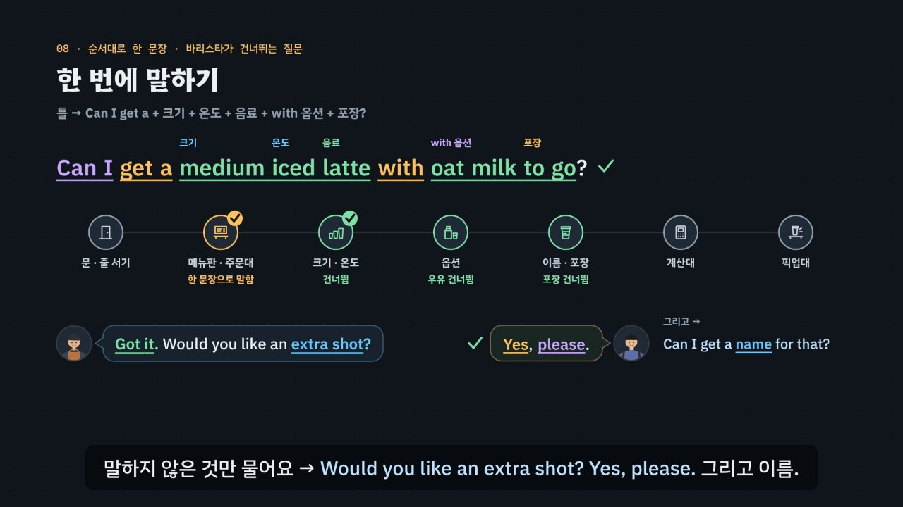

# 카페, 주문에는 순서가 있다

> [영어 튜토리얼](../README.md) 모음의 **상황별 영어 회화** 두 번째 꼭지입니다(영역: `talk`). 형식은 첫 꼭지 [공항](../airport/)을 따르고, 형식의 결정은 [CLAUDE.md](../CLAUDE.md)의 ‘회화 튜토리얼이 갖출 것’에 적었어요.

카페 주문대에서는 영어가 빠르게 쏟아지지만, 바리스타가 묻는 말은 거의 같고 **순서**도 거의 정해져 있어요. 음료 → 크기 → 온도 → 옵션 → 이름 → 포장 → 더 살 것 → 계산 → 받기. 순서를 알면 다음 질문을 미리 짐작할 수 있어서 빨리 말해도 들리고, 여러 조각을 순서대로 한 문장에 넣으면(*Can I get a medium iced latte with oat milk to go?*) 바리스타가 그 질문들을 건너뛰어요. 한국 학생이 자주 막히는 곳은 한국어를 낱말 그대로 옮긴 주문(*Give me one americano.* · *I want latte.*), 콩글리시(*ice americano* · 사이즈업 · 샷 추가 · 포장 · 서비스), 그리고 하루에도 수백 번 해서 아주 빠른 질문(*For here or to go?*)이에요. 이 튜토리얼은 약 6분 36초짜리 인터랙티브 모션그래픽으로 **3단계 말하기 법**을 가르쳐요.

- ① **열쇠 낱말 잡기** — 무엇을 묻나? *What can I get* → 음료, *size* → 크기, *Hot or iced* → 온도(고르기), *extra shot · Room for milk · receipt* → 권하기, *name* → 이름, *For here or to go* → 포장, *Card or cash* → 계산
- ② **틀에 내 정보 넣기** — 짧은 대답 틀 + 주문 카드와 맞는 정보. *Can I get* + 음료?, 고른 것 + *please*, *It's* + 이름, *Can I get it with* + 옵션?, *No* + 옵션, *please*. 한 잔 앞에는 *a(an)*, 차가운 음료는 *iced*.
- ③ **공손하게 끝내기** — *Can I get …? · I'd like …, please. · please · thanks.* 거절은 *No, thanks.* 못 알아들었으면 *Sorry? Could you say that again, please?* 일부만 들렸으면 주문 순서로 짐작해 되물어요 → *Sorry, for here or to go?*



## 바로 보기

`index.html`을 더블클릭하면 끝이에요. 설치도, 서버도 필요 없어요.

## 소리와 마이크에 대해 (꼭 읽어 주세요)

- 녹음 파일이 없어요. 영어는 모두 **합성 음성**이에요. 글이 정해진 말(영상의 말풍선 · 영어 칩, 직접 해 보기의 듣기, 듣고 대답 고르기, 따라 말하기)은 **VoiceStudio로 미리 만든 목소리**(`audio/dialogue/`)로, 카페 주문 시뮬레이터처럼 카드마다 바뀌는 말과 내가 칩으로 만든 문장은 **브라우저에 들어 있는 음성(speechSynthesis)** 으로 읽어요. 브라우저 음성은 기기마다 목소리가 다르고, 둘 다 실제 카페의 소리와는 달라요.
- 튜토리얼 전용 목소리 부품 `assets/js/voices.js`(`CFV`)가 말하는 사람마다 목소리를 정해요. 미리 만든 목소리는 주문대 바리스타 = 미국 남성 · 픽업대 바리스타 = 호주 남성 · 영국 카페의 바리스타 = 영국 여성 · 손님(나) = 미국 여성, 화면의 영어 칩(발음 듣기)과 음성 해설의 영어는 미국 여성 선생님 목소리예요(길 묻기와 같은 목소리들). 한 번에 읽는 줄 안에서 한 사람의 말 중 하나라도 파일이 없으면 그 사람의 말은 모두 브라우저 음성으로 읽고(한 사람의 목소리가 중간에 바뀌지 않게), 시뮬레이터는 처음부터 끝까지 브라우저 음성이에요. 브라우저 음성은 주문대 바리스타(en-US) · 픽업대 바리스타(en-AU) · 영국 카페의 바리스타(en-GB, *Eat in or take away?*) · 손님(나, 바리스타와 다른 목소리)을 골라요. 없으면 다른 영어 목소리의 높낮이 · 빠르기를 바꿔 구별해요. ‘아주 빠르게’ 문제는 일부러 빠르게(1.35배) 읽고, 값은 카페식으로 읽어요(*$6.50* → six fifty). 공통 부품(`shared/`)은 바꾸지 않았어요.
- 소리가 겹치지 않게: 대화를 읽기 전에 발음 듣기 · 음성 해설 · 녹음 재생을 멈추고 영상을 일시정지해요. 음성 인식을 시작할 때도 다른 소리를 모두 멈춰요.
- **따라 말하기 · 말로 주문하기**: 브라우저에 음성 인식(`SpeechRecognition` · `webkitSpeechRecognition`)이 있으면 말을 글로 바꿔 **낱말만** 맞춰 봐요(발음의 질은 판정하지 않아요). 크롬(Chrome) 같은 브라우저는 소리를 브라우저 회사의 서버로 보내 글로 바꿔요. 음성 인식이 없으면 녹음(`MediaRecorder`)으로 ‘내 목소리’와 ‘원래 문장’을 이어서 들어요. 둘 다 없으면 마이크 단추를 숨기고 ‘세 번 소리 내어 따라 해 보세요’라고 안내해요. 이 사이트는 소리도 글도 저장하지 않아요(녹음은 화면에만 잠깐 있다가 페이지를 닫으면 사라져요). 한국어 이름(Minji 같은)은 인식이 다르게 적기 쉬워서, 이름 질문에는 들린 말이 있으면 받아들이고 철자를 불러 보라고 알려 줘요. 다만 카드와 다른 이름(시뮬레이터의 다른 이름)이 또렷이 들리면 ②에서 걸려요.
- 가게 이름(*Pebble Café*) · 메뉴 · 값은 모두 지어낸 것이에요(실제 가게 · 체인과 상관없어요). 크기 이름, 옵션, 묻는 차례, 팁을 고르는 화면과 팁 문화는 나라와 가게마다 달라요. 여기서는 어디서나 자주 듣는 흐름을 골라 미국식 말(*to go*)을 중심으로 영국식 말(*takeaway*)도 보여 줘요.

## 무엇을 배우나요

| 장 | 시각 | 내용 | 직접 해 보기 |
| --- | --- | --- | --- |
| 00 들어가며 | 0:00 | 주문대 한 장면: *Hi! What can I get you?* → 한국어 그대로 *Give me one ice americano.* → *Can I get an iced americano?*, 3단계, 순서를 알면 다음 질문이 들림 | 먼저 주문해 보기 (듣고 대답 고르기) |
| 01 주문 길 지도 | 0:26 | 가게 평면도 위의 일곱 단계(문 · 메뉴판 · 크기와 온도 · 옵션 · 이름과 포장 · 계산대 · 픽업대)와 단계마다 질문 한두 개, 순서는 가게 · 나라마다 조금씩 다름 | 단계를 골라 질문 듣기 (지도의 단계를 눌러도 됨) |
| 02 인사와 주문 | 0:56 | 메뉴판, *Are you ready to order?* → *Not yet. Just a minute, please.*, *Can I get …?* · *I'd like …, please.*, *a · an*, *ice → iced*, *Give me · I want*의 말투 | 주문하는 말 만들기 (마시고 싶은 것 · 틀 · 음료 · a(an) 넣기) |
| 03 크기와 온도 | 1:30 | *What size?* · *Hot or iced?* → 고른 것 + *please*, *or* = 고르기 질문(*Yes, please.*는 엉뚱함), 크기 이름은 가게마다 다름(*This one, please.*), 사이즈업 → *Can I make it a large?* | 고르기 질문에 대답하기 (컵 · 질문 · 보기 넷) |
| 04 옵션 | 2:02 | *What kind of milk?*, *Would you like an extra shot?* → *Yes, please.* / *No, thanks.*, 샷 추가 → *an extra shot*, *Can I get it with ___?* · *No ___, please.*, *Room for milk?*(room = 빈자리) | 옵션 부탁 만들기 (바꾸고 싶은 것 · 틀 · 칸) |
| 05 이름과 포장 | 2:38 | *Can I get a name for that?*(허락이 아니라 부탁 → *It's Minji.*), *For here or to go?*, *Take out*도 통함 · *Packing*은 안 통함, 빠르게 이어지는 말(*fer-HEE-rer-tuh-GO*), 들린 만큼 되묻기 | 빠른 말 듣고 되묻기 + 이어서 들리는 말 (빠르게 · 보통 · 천천히) |
| 06 계산 | 3:14 | *Anything else?*, *That'll be $6.50.* → six fifty, 값 읽기(점 앞 + 점 뒤), *Card or cash?*(*Card calculate.* ×), 카드 단말기(tap)와 팁 화면(나라마다 다름), *Would you like a receipt?* | 주문하고 값 듣기 (메뉴 · 영수증 · 값 읽기 문제) |
| 07 받기와 문제가 생겼을 때 | 3:48 | *Medium iced latte for Minji!* → *That's me. Thanks!*, 잘못 나왔을 때(*This is wrong.* × → *Excuse me, I ordered it iced, but this one is hot.*), *Could I get a lid, please?* | 픽업대에서 부탁하기 (필요한 것 · 틀 · 칸) |
| 08 한 번에 말하기 | 4:20 | 질문 여섯 → 한 문장(크기 → 온도 → 음료 → with 옵션 → 포장), 바리스타가 건너뛰는 단계, 말하지 않은 것만 물음, 순서가 뒤섞이면, 주고받는 횟수 6 → 2 | 한 문장으로 주문하기 (누르는 차례대로, 순서 판정과 건너뛸 질문) |
| 09 3단계 말하기 법 | 4:56 | 상자 셋, 일곱 단계에 한 줄씩 단계별로 채워짐 | 단계를 골라 3단계 보기 |
| 10 실전 주문 | 5:24 | 주문 카드 하나로 넷(음료 · 온도 · 포장 · 더 살 것), 보기마다 엔진이 ①②③ 몇 단계에서 지우는지, 합계 | 대화 골라 보기 |
| 11 정리 | 6:14 | 단계 · 열쇠 낱말 · 대답 틀 표 + 한 번에 주문 + 못 알아들었을 때 | 아래 칸으로 가는 길 |

영상 아래에는 다섯 가지가 더 있어요.

- **놀이터 — 카페 주문 시뮬레이터**: 누를 때마다 새 주문 카드(음료 · 크기 · 온도 · 우유(아메리카노는 우유 자리) · 샷 · 포장 · 더 살 것 · 계산 · 영수증)가 만들어져요. 바리스타는 늘 쓰는 차례로 물어요(음료를 묻는 말, 크기 · 온도의 차례, 이름 · 포장의 차례가 조금씩 바뀌어요). 대답은 ① 대답 틀 칩(맞는 틀 하나 · 한국어 그대로나 콩글리시 · 무례한 틀 하나 · 다른 질문의 틀 하나, 권하는 말은 사실이 반대인 틀까지)과 ② 칸 칩(카드의 값 + 다른 값 둘)으로 만들어요. 첫 질문에서는 **한 번에 주문**(L)으로 크기 · 온도 · 음료 · with 옵션 · 포장 낱말 칩을 눌러 한 문장을 만들 수 있고, 엔진(`CF.covered`)이 이미 답한 질문을 알려 주면 바리스타가 *Got it.* 하고 건너뛰어요. 엔진이 ①에서 걸리면 바리스타가 질문을 다시 하고(*Sorry — …*), ②에서 걸리면 *Oh, are you sure?*(카드와 다름) · *Sorry?*(어색한 틀) · *Sorry, one more time?*(순서가 뒤섞임), ③이면 *… Okay.*(말투). 매번 단계와 까닭, 모범 대답(듣기)을 보여 줘요. 음성 인식이 있으면 마이크로 말해서 주문할 수 있어요(한 문장으로 말하면 들린 조각까지 건너뛰고, 다시 묻는 말을 하면 바리스타가 천천히 다시 물어요). 끝나면 이름이 적힌 컵, 계산한 영수증, 한 번에 통과한 수, 한 문장 주문으로 건너뛴 질문 수(없으면 그 카드의 한 문장 모범 주문), 대화 전체와 듣기. 키보드: R 듣기 · S 천천히 · T 대본 · 1~4 대답 틀 · A~C 내 정보 · Enter 대답하기 · Backspace 지우기 · L 한 번에 주문 · M 말로 대답하기 · N 새 카드.
- **카페 표현 따라 말하기**: 단계마다 바리스타의 말과 내 말 28문장. 듣기 · 천천히 · 따라 말하기(음성 인식 → 녹음 → 소리 내어 따라 하기). 인식 결과는 원래 문장의 낱말마다 초록(들림) · 주황(빠짐)으로 보여 줘요.
- **듣고 대답 고르기**(튜토리얼 전용 `CDrill`, `EN.drill`과 같은 모양 · 키보드): 16문제, 일곱 단계 + 빠른 말 둘, 정답 위치 A · B · C · D 넷씩. 문제마다 단계 아이콘과 한 줄 상황, 바리스타의 말은 소리 먼저(글은 답한 뒤 또는 대본 보기), 대답 넷은 글. 힌트 = 3단계 — ① 열쇠 낱말(가려진 말에서 드러남) ② 틀 · 칸(함정은 주황) ③ 공손한 말(보라)과 정답. 답하면 보기마다 엔진의 까닭, 해석, 줄마다 듣기, 대화 듣기(바리스타 → 나). 키보드: A~D(1~4) 고르기 · H 힌트 · R 다시 듣기 · S 천천히 · T 대본 · Enter/→ 다음.
- **퀴즈**: 10문제(그림 문제 3개: 가게 평면도에서 음료를 기다리는 곳, 메뉴판에서 라지 아메리카노의 값 누르기, 부른 음료와 이름에 맞는 컵 고르기).
- **핵심 정리**: 단계 × 열쇠 낱말 × 대답 틀 표, 용어(① 열쇠 낱말 · ② 대답 틀과 한 문장 주문 · 값 읽기 · ③ 공손한 말 · ④ 한국어와 다른 점 · 콩글리시).

### 플레이어 조작

다른 튜토리얼과 같아요. 스페이스(재생/일시정지), ← →(5초), Shift + ← →(장), C(자막), V(음성 해설), F(전체 화면). 화면 속 말풍선을 누르면 그 사람의 목소리로, 영어 칩을 누르면 발음을 들려줘요. 01장 지도의 단계를 누르면 직접 해 보기와 함께 바뀌어요. 주소 끝에 `#c-장면이름`(예: `index.html#c-oneline`)을 붙이면 그 장면에서 시작해요.

음성 해설은 자막의 `(A)`~`(D)`를 ‘에이 · 비 · 씨 · 디’, 값(`$6.50` · `4.25`)을 ‘6달러 50센트’처럼 한국어로 읽고, 영어 부분(*six fifty*)은 영어 음성으로 읽어요.

**미리 만든 목소리**: VoiceStudio(OmniVoice 엔진, 비상업용 라이선스)로 만든 합성 음성 파일이에요. 파일이 없거나 못 읽으면 그 줄 · 조각만 브라우저 음성으로 읽어요.
- 음성 해설(`audio/narration/`): 한국어 조각은 「튜토리얼 내레이터 (젊은 여성)」, 영어 조각(본보기 영어 문장)은 「영어 선생님 (미국 여성)」.
- 대화(`audio/dialogue/`): 말하는 사람 → 프로필은 `voices.json`(길 묻기와 같은 프로필 — 이름의 ‘길 묻기’는 처음 만든 곳일 뿐이에요). 프로필은 VoiceStudio 목소리 보관함(archetype)에서 고른 목소리를 한 번 만든 소리로 복제(clone)한 것이라, 줄마다 같은 사람 목소리가 나요. 파일 이름은 말하는 사람과 읽을 글로 정해져요(`CFV.lineId`). 값은 읽을 글(`CF.spoken`)로 만들어요(*$6.50* → *six fifty*).
- 합성 엔진은 가끔 무음 · 잡음을 내거나, 세 낱말 이하의 짧은 말을 0.3초 안에 뭉개 읽어요. 도구가 말소리 1초에 읽은 글자 수로 이런 소리를 걸러 seed를 바꿔 다시 만들고(짧은 말은 다섯 번까지), 그래도 이상하면 ‘확인 필요’로 알려 줘요. 지금 파일은 받아쓰기(Whisper)와 높낮이로 모두 다시 확인했고, 목소리가 갈라지거나 높낮이가 튄 짧은 말 15개는 `--seed 11`(*16 oz · What size?*는 `--seed 23`)로 다시 만들었어요. 컵 크기 칩(*12 oz · 16 oz · 20 oz*)은 *ounces*로 읽어요(도구가 숫자 뒤의 *oz*를 바꿔 읽어요). *Card or cash?*는 이어 말하면 *carder cash*처럼 들려요 — 실제 카페에서도 그래요. 한 파일만 다시 만들려면 그 파일을 지우고 `--seed`를 바꿔 다시 실행하세요.

만드는 법(VoiceStudio가 있는 맥에서, 이미 만든 파일은 건너뛰어요):

```bash
node tools/narration-pieces.cjs cafe     # 해설의 읽기 조각 목록 (자막을 고쳤을 때만, 클라우드에서도 됨)
node tools/dialogue-lines.cjs cafe       # 대화 줄 목록 (대화 · 문제 · 따라 말하기를 고쳤을 때만, 클라우드에서도 됨)
python3 tools/voicestudio-narration.py cafe --en-profile "영어 선생님 (미국 여성)"   # 해설 (한국어 + 영어 조각)
python3 tools/voicestudio-dialogue.py cafe             # 대화
```

## 무엇이 규칙 계산인가요

- **규칙 엔진** `assets/js/grammar.js`가 맞고 틀림과 까닭, 3단계 가운데 몇 단계에서 걸리는지를 정해요. 영상 속 ✓·×와 실전 주문에서 지워지는 순서, 한 문장 주문의 순서 판정과 건너뛰는 질문, 직접 해 보기 채점, 시뮬레이터의 판정과 바리스타의 반응, 듣고 대답 고르기의 힌트와 보기별 해설, 퀴즈 대부분의 정답, 그리고 모든 값이 여기서 나와요.
  - 질문(`CF.Q`)마다 단계 · 뜻(`intent`: 음료 · 크기 · 온도 · 우유 · 샷 · 이름 · 포장 · 더 살 것 · 계산 …) · 열쇠 낱말(`key`, 질문 안에 꼭 있음) · 빠른 말(`fast`)을 적었어요.
  - 대답은 틀(`CF.FRAME`) + 칸 값(`CF.SLOT`)이에요. 틀 글의 `___`은 내 정보 칸, `{…}`는 공손한 말이고, 틀마다 표시가 있어요: ok · literal(한국어를 그대로 옮김 · 콩글리시) · wrong(틀린 문장) · blunt(명령 · 조르기 · 따지기) · plain(그냥 *No.*로 끊김). 칸 값도 콩글리시일 수 있어요(*ice americano* → `bad`). 권하는 말의 *Yes, please.* · *No, thanks.*는 그 질문의 사실(샷 · 우유 자리 · 영수증)에 붙어요. *Take out, please.*는 통과하지만 ‘카페에서는 보통 *to go*’라는 알림(`note`)이 붙어요.
  - `CF.judge(질문, 대답, 카드)` — ① 틀의 뜻이 질문의 뜻과 같나(빠른 말이면 다시 묻는 말만 통과, 들린 만큼 되묻는 말은 실제 질문과 같을 때만) ② 틀이 literal · wrong이거나 칸 값이 콩글리시면 탈락, 한 문장 주문은 `CF.orderLine`으로 순서 확인, 칸의 정보가 카드(또는 상황)의 사실과 다르면 탈락 ③ blunt · plain이면(한 문장 주문을 *Give me*로 열어도) 탈락. `CF.model`은 카드에 맞는 모범 대답, `CF.modelLine`은 한 문장 모범 주문, `CF.steps`는 힌트 세 단계와 색칠할 낱말을 만들어요.
  - `CF.orderLine(낱말)` — 크기 → 온도 → 음료 → with 옵션 → 포장의 차례를 확인하고 자연스러운 차례를 돌려줘요. `CF.covered(대답, 질문)` — 대답이 말한 사실로 이미 답한 질문의 뜻들(크기 · 온도 · 우유 · 샷 · 포장 …)을 돌려줘요.
  - `CF.price(주문)` · `CF.money` · `CF.priceWords` — 지어낸 메뉴판(`CF.MENU` · `CF.EXTRA` · `CF.FOOD`)으로 합계를 계산하고 읽어요(4.25 → four twenty-five, 5.00 → five dollars). 영상의 영수증 · *That'll be …* · 시뮬레이터의 값 · 끝 영수증이 모두 같은 계산이에요.
  - `CF.matchSpoken(들린 글, 질문, 카드)` — 음성 인식이 글로 바꾼 말에 그 질문의 표시 낱말과 카드의 사실이 들어 있으면 받아들여요(숫자는 낱말로, 줄임말은 풀어서 비교). 음료 주문은 들린 크기 · 온도 · 우유 · 샷 · 포장까지 찾아 `covered`로 돌려줘요. *ice* · *give me* · *packing* · *service* 같은 꼴이 들리면 알림만 붙여요. 권하는 말(샷 · 우유 자리 · 영수증)에는 *Please.* 하나도 ‘네’로 받지만, *yes · no* 없이 다른 질문의 대답(*Large, please.* · *To go, please.*)만 들리면 ①에서 걸러요.
  - `CF.compareWords(원래 문장, 들린 글)` — 낱말마다 맞춤(가장 긴 공통 부분열).
- **어긋남 경고** `CF.check()`: 열쇠 낱말이 질문에 없거나, 사전에 없는 뜻 · 칸을 쓰거나, 함정 틀에 까닭이 없거나, 맞는 보기가 하나가 아니거나 정답과 다르거나, 정답 위치가 몰리거나, 단계 · 빠른 말 문제가 빠지면 콘솔에 경고가 떠요. 영상 · 직접 해 보기의 대화, 한 문장 주문과 건너뛰는 질문, 데모 주문의 합계($6.50)와 값 읽기, 실전 주문에서 단계마다 지워지는 보기와 화면 글, 시뮬레이터 카드 40장(모범 대답은 통과하는지, 틀 칩 가운데 맞는 것이 하나뿐인지, 모범 대답과 한 문장 모범 주문을 말로 해도 통과하는지), 따라 말하기 문장도 점검하고, 퀴즈 정답은 `app.js`에서 따로 점검해요.
- **단순하게 줄인 부분**
  - 엔진은 소리를 듣지 않아요. 질문의 뜻과 열쇠 낱말, 대답의 틀과 칸은 사람이 적어 두었고, 엔진은 그것을 카드의 사실과 맞춰요.
  - 대답 틀은 카페에서 자주 쓰는 것만 골랐어요. 같은 뜻의 다른 자연스러운 대답도 많아요(예: *Minji.*만 말해도 돼요).
  - 한 문장 주문의 순서(크기 → 온도 → 음료 → with 옵션 → 포장)는 자주 쓰는 순서를 단순하게 줄인 규칙이에요.
  - 그냥 *No.*, *Give me · I want*로 하는 주문은 ③단계에서 ‘더 공손하게’로 봤어요. 실제로는 말투와 표정으로도 공손함이 전해져요. *ice americano · Ice, please.*는 알아듣긴 하지만 바른 말(*iced*)을 익히도록 ②단계에서 걸러요.
  - 시뮬레이터의 바리스타는 늘 같은 차례로 묻게 만들었어요. 실제 가게에서는 차례가 바뀌거나 묻지 않고 넘어가기도 해요.
  - 말로 대답하기와 따라 말하기는 낱말만 맞춰요. 발음과 공손함은 판정하지 않고, 음성 인식이 *a · the* 같은 짧은 낱말이나 *iced*의 d를 빼고 적을 수도 있어요.
  - 사람 · 컵 · 가게는 도형으로 그린 그림이에요. 빠른 말의 소리 상자(*fer · HEE · rer · tuh · GO*)는 대략의 모양이에요.
- **예문과 대화**: 모두 직접 만든 것이에요.

이웃 튜토리얼: 같은 형식의 [공항](../airport/), 듣기 요령은 토익 듣기 [T15](../listening-part1-2/) · [T16](../listening-part3-4/)에서도 다뤄요(*Hot or iced?* 같은 선택 의문문, 들린 말을 바꿔 말하기).

## 폴더 구조

```
index.html              페이지 (영상 · 직접 해 보기 · 카페 주문 시뮬레이터 · 따라 말하기 · 듣고 대답 고르기 · 퀴즈 · 핵심 정리)
assets/js/grammar.js    규칙 엔진(CF.judge · CF.model · CF.orderLine · CF.covered · CF.price · CF.priceWords · CF.matchSpoken · CF.compareWords),
                        단계(CF.PLACES) · 질문(CF.Q) · 틀(CF.FRAME) · 칸(CF.SLOT) · 메뉴판(CF.MENU), 연습 문제(CF.DRILL), 영상 대화(CF.INTRO · CF.SCENE · CF.LINE · CF.METHOD · CF.PRACTICE),
                        빠른 말(CF.LINKED), 주문 카드(CF.newCard · CF.simQs · CF.simQ), 따라 말하기(CF.SHADOW), 힌트(CF.steps), 점검(CF.check)
assets/js/voices.js     대화 목소리(CFV): 바리스타마다 · 손님(나) 다른 영어 목소리(미리 만든 파일 → 없으면 브라우저 음성), 빠른 말, 값 읽기, 다른 소리와 겹치지 않게
assets/js/scenes.js     영상 장면 12개, 장 목록과 자막, 단계 아이콘(CFS.ICON · CFS.iconSVG), 얼굴(avatar), 말풍선(talk · answer), 낱말 조각(lay · morph),
                        주문 길 띠(strip) · 큰 띠(bigStrip), 메뉴판(menuBoard), 컵(cupDraw), 영수증(receiptDraw), 카드 단말기(reader), 주문 카드(orderCard), 이어서 들리는 말(linked)
assets/js/app.js        플레이어, 직접 해 보기, 듣고 대답 고르기(CDrill), 카페 주문 시뮬레이터, 따라 말하기(음성 인식 · 녹음), 퀴즈, 영상 추출(EN_EXPORT)
video/                  자막 원고(SRT)
audio/narration/        음성 해설의 읽기 조각 목록(pieces.json) · 미리 만든 음성 파일 목록(clips.js) · 음성 파일(조각 id.m4a)
audio/dialogue/         대화 줄 목록(lines.json) · 말하는 사람 → 프로필(voices.json) · 파일 목록(clips.js) · 음성 파일(말하는사람-id.m4a)
docs/poster.jpg         사이트 카드 그림
```

## 영상 다시 만들기

```bash
node tools/render-video.cjs cafe                      # → cafe/video/cafe.mp4 + .srt
node tools/render-video.cjs cafe --frames 282.5,186.5 # 몇 장면만 그림으로
node tools/render-video.cjs cafe --poster 282.5       # 카드 그림
node tools/render-video.cjs cafe --srt                # 자막 원고만
```

MP4에는 소리가 없어요(자막이 그림에 들어가요). 말은 말풍선 속 낱말이 하나씩 나타나는 모습으로 보여 줘요.
