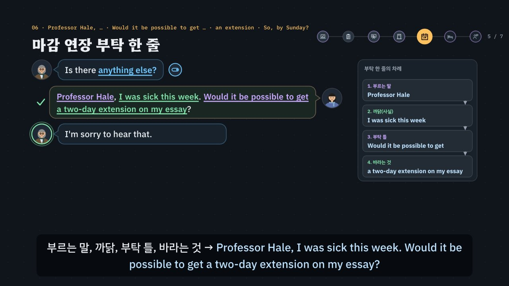

# 교환학생 생활, 부탁은 질문으로 · 문제는 사실부터

> [영어 튜토리얼](../README.md) 모음의 **상황별 영어 회화** 열 번째 꼭지입니다(영역: `talk`). 형식은 [공항](../airport/) · [카페](../cafe/) · [호텔](../hotel/) · [식당](../restaurant/) · [길 묻기](../directions/) · [쇼핑](../shopping/) · [대중교통](../transit/) · [약국 · 병원](../pharmacy/) · [은행 · 환전 · 휴대폰](../bank/)을 따르고(은행 · 환전 · 휴대폰을 복사해 시작, 호텔의 ‘부탁은 질문으로 · 문제는 사실 + 부탁’에 식당의 질문의 모양과 대중교통의 되짚기를 섞음), 형식의 결정은 [CLAUDE.md](../CLAUDE.md)의 ‘회화 튜토리얼이 갖출 것’에 적었어요.

> **지어낸 예시예요.** 대학(*Kellport University*) · 교수(*Professor Hale*) · 기숙사(*Maple Hall · Cedar Hall · Birch Hall*) 이름, 과목 번호(*English 210 · 245 · 260*) · 대기 번호, 면담 시간 · 연구실 번호, 에세이 마감, 방 번호와 수리 시간은 모두 말하기 연습을 위해 지어낸 것이에요. 실제 수강 신청 · 대기 명단 · 마감 연장 · 기숙사 수리 · RA 상담의 절차와 규칙은 학교마다 달라요(수강 신청은 대개 온라인으로 하고, 마감을 미뤄 주는지도 교수 · 학교마다 달라요). 실제로는 다니는 학교의 학생처 · 국제처 안내를 따르세요. 페이지 · 영상(01장) · 직접 해 보기 · 시뮬레이터의 정리표에도 같은 알림이 있어요.

교환학생의 첫 주에는 **내가 먼저** 말을 꺼내야 하는 곳이 많아요 — 학생처 수업 등록 창구, 수업이 끝난 교실, 교수 연구실, 기숙사 사무실, RA(기숙사 층마다 있는 선배 학생 도우미)의 방. 영영문과 학생에게 특히 쓸모가 큰 상황이라, 호텔처럼 **부탁은 질문으로**(*Could you put me on the waitlist, please?*), **문제는 사실부터** 짧게 말하고 바라는 것을 질문으로 붙이는 연습을 해요(*The heater in my room isn't working. Could you send someone to look at it?*). 교수님은 *Teacher*가 아니라 이름으로 불러요(*Professor Hale*). 마감 연장처럼 큰 부탁은 **한 줄**로 → 부르는 말 → 까닭(사실) → 부탁 틀 → 바라는 것(*Professor Hale, I was sick this week. Would it be possible to get a two-day extension on my essay?*). 상대가 알려 주는 대기 번호 · 면담 시간 · 새 마감 · 수리 시간은 *Okay. Thanks.*로 넘기지 말고 **되짚어요**(*So, I'm number 13? · So, Tuesdays and Thursdays, in Room 318? · So, by Sunday at midnight?*). 여기에 한국어를 그대로 옮긴 말(수강 신청 → *apply* · 선생님 → *Teacher* · 면담 시간 → *office time* · 대기 예약 → *reservation* · 리포트 → *report* · 이틀 동안 → *During two days.* · 보일러 → *boiler* · 여기가 시끄러워요 → *Here is too noisy.*)과 헷갈리는 숫자(*thirteen* · *thirty*, 과목 번호 *two-ten* · *two-oh-one*, 방 번호 *two-fourteen* · *two-forty*), 질문의 모양과 짧은 대답의 짝(*Have you taken …? → Yes, I have.* · *Is it alright if …? → Yes, that's fine.*)을 더했어요. 약 6분 56초짜리 인터랙티브 모션그래픽으로 **3단계 말하기 법**을 가르쳐요.

- ① **열쇠 낱말 + 질문의 모양 잡기** — 무엇을 묻나, 그리고 어떤 모양인가? *or*가 들리면 고르는 질문(*the morning section or the afternoon section? · the vocabulary or the main ideas?*), *what · how many*로 시작하면 정보 질문, *Have you · Is it · Did you*면 Yes/No 질문(첫 낱말이 짧은 대답의 짝 → *Have you …? → Yes, I have.* · *Is it …? → Yes, it is.*). 물음표가 없는 안내(*the morning section is full. · You're number 13 on the waitlist. · My office hours are …*)는 들은 번호 · 요일을 되짚거나 방법을 물을 차례예요. 등록 창구 · 교수 연구실 · 기숙사 사무실 · RA에게는 **내가 먼저** 용건을 말해요. 모양마다 그림 표시가 있어요: 스위치(Yes/No) · 갈림길(고르기) · 빈 상자(정보) · 말풍선(안내).
- ② **틀에 내 정보 넣기 · 문제는 사실로 · 들은 번호 되짚기** — 짧은 대답 틀 + 내 카드와 맞는 정보. *I'd like to register for English 210, please. · The afternoon section, please. · Mostly the main ideas. · It's Room 214, in Maple Hall.* 문제는 사실 + 부탁(*I'm having trouble with the readings. Could you give me some advice?*). 마감 연장은 **조각으로 한 줄**을 만들어요: 부르는 말 → 까닭 → 부탁 틀 → 바라는 것. 엔진이 조각마다 맞춰 보고, 틀린 조각에는 교수가 그 조각만 다시 말해요(*Oh, you can call me Professor Hale.* · *Hmm, can I ask why?*).
- ③ **공손하게 끝내기** — 부탁은 질문 · 부탁 틀로(*Could you …? · Could I …? · Would it be possible to …?*), *please · thank you.* 명령(*Register me … · Fix my heater. · Change my room.*)이나 조르는 말(*Just put me in the class. · I want …*)은 ③에서 걸러요. 못 알아들었으면 *Sorry? Could you say that again, please?* 일부만 들렸으면 *Sorry, what number am I on the waitlist?* 모르는 낱말이면 *Sorry, what does maintenance mean?*



## 바로 보기

`index.html`을 더블클릭하면 끝이에요. 설치도, 서버도 필요 없어요.

## 소리와 마이크에 대해 (꼭 읽어 주세요)

- 녹음 파일이 없어요. 영어는 모두 **합성 음성**이에요. 글이 정해진 말(영상의 말풍선 · 영어 칩, 직접 해 보기의 듣기, 듣고 대답 고르기, 따라 말하기)은 **VoiceStudio로 미리 만든 목소리**(`audio/dialogue/`)로, 교환학생 시뮬레이터처럼 카드마다 바뀌는 말과 내가 칩으로 만든 문장은 **브라우저에 들어 있는 음성(speechSynthesis)** 으로 읽어요. 브라우저 음성은 기기마다 목소리가 다르고, 둘 다 실제 학교 사람들의 소리와는 달라요.
- 튜토리얼 전용 목소리 부품 `assets/js/voices.js`(`CMV`)가 말하는 사람마다 목소리를 정해요. 미리 만든 목소리는 등록 창구 직원 = 미국 남성 · 헤일 교수 = 캐나다 여성 · 기숙사 사무실 직원 = 영국 여성 · RA = 호주 남성 · 학생(나) = 미국 여성, 화면의 영어 칩(발음 듣기)과 음성 해설의 영어는 밝은 미국 여성 선생님 목소리예요(다른 회화 튜토리얼과 같은 목소리들). 한 번에 읽는 줄 안에서 한 사람의 말 중 하나라도 파일이 없으면 그 사람의 말은 모두 브라우저 음성으로 읽고(한 사람의 목소리가 중간에 바뀌지 않게), 시뮬레이터는 처음부터 끝까지 브라우저 음성이에요. 브라우저 음성은 등록 창구 직원(en-US) · 헤일 교수(en-CA) · 기숙사 사무실 직원(en-GB) · RA(en-AU) · 학생(나, 상대와 다른 목소리)을 골라요. 없으면 다른 영어 목소리의 높낮이 · 빠르기를 바꿔 구별해요. ‘아주 빠르게’ 문제는 일부러 빠르게 읽어요. 숫자는 학교에서 말하는 꼴로 읽어요(`CM.spoken`): *English 210* → English two-ten, *Room 318* → Room three-eighteen, *number 13* → number thirteen, *from 2 to 4* → from two to four, *between 9 and 11* → between nine and eleven. 공통 부품(`shared/`)은 바꾸지 않았어요.
- 소리가 겹치지 않게: 대화를 읽기 전에 발음 듣기 · 음성 해설 · 녹음 재생을 멈추고 영상을 일시정지해요. 음성 인식을 시작할 때도 다른 소리를 모두 멈춰요.
- **따라 말하기 · 말로 대답하기**: 브라우저에 음성 인식(`SpeechRecognition` · `webkitSpeechRecognition`)이 있으면 말을 글로 바꿔 **낱말만** 맞춰 봐요(발음의 질은 판정하지 않아요). 번호는 *13*이든 *thirteen*이든, *210*이든 *two ten*이든 같은 것으로 맞춰요(`CM.canon`). 크롬(Chrome) 같은 브라우저는 소리를 브라우저 회사의 서버로 보내 글로 바꿔요. 음성 인식이 없으면 녹음(`MediaRecorder`)으로 ‘내 목소리’와 ‘원래 문장’을 이어서 들어요. 둘 다 없으면 마이크 단추를 숨기고 ‘세 번 소리 내어 따라 해 보세요’라고 안내해요. 이 사이트는 소리도 글도 저장하지 않아요(녹음은 화면에만 잠깐 있다가 페이지를 닫으면 사라져요). 이름(*Professor Hale* · *Maple Hall* · *Cedar Hall*)과 숫자는 인식이 다르게 적기 쉬워서 따라 말하기에서 알림을 붙여요.
- 수강 신청 · 대기 명단 · 마감 연장 · 기숙사 수리 · RA 상담의 실제 절차는 학교마다 달라요. 영어권 대학에서도 수강 신청은 대개 온라인으로 하고, 창구에서는 등록이 막혔을 때 도움을 받아요. 마감을 미뤄 주는지, 며칠까지인지, 증빙(진단서 등)이 필요한지도 교수 · 학교마다 달라요. 기숙사 담당 부서의 이름(*Housing Office · Residence Life*)과 RA의 역할도 학교마다 조금씩 달라요.

## 무엇을 배우나요

| 장 | 시각 | 내용 | 직접 해 보기 |
| --- | --- | --- | --- |
| 00 들어가며 | 0:00 | 수강 신청을 그대로 *I want to apply English 210.* → *I'd like to register for English 210, please.*, *Teacher, when is your office time?* → *Professor Hale* · *Could you tell me when your office hours are?*, 대기 번호를 *Okay. Thanks.*로 넘기지 말고 되짚기, 3단계 | 먼저 골라서 대답해 보기 (듣고 대답 고르기) |
| 01 캠퍼스 지도 | 0:26 | 학생처(수업 등록 · 대기 명단) · 인문관(수업 뒤 · 교수 면담 · 마감 연장) · 기숙사(고장 · RA 상담)의 일곱 곳, 곳마다 한두 마디, 내가 먼저 말을 꺼내는 곳(보라 테두리), **대학 · 교수 · 기숙사 이름 · 과목 번호 · 면담 시간 · 방 번호는 지어낸 예시** | 곳을 골라 한두 마디 듣기 (지도의 곳을 눌러도 됨) |
| 02 수업 등록 · register for | 0:56 | *What can I help you with?* → *apply* ×(입학 · 일자리에 지원할 때) · *I'm an exchange student.*(사실만) · *Register me …*(명령) → *I'd like to register for English 210, please.*, 과목 번호 *210 = two-ten*(*201 = two-oh-one*은 다른 과목), *the morning section or the afternoon section?*(이어져 들리는 *mor-nin-gor*) → *Yes, please.* × → *The morning section, please.*, *Have you taken a college English class before?* → *Yes, I did.* × → *Yes, I have. I took a similar class in Korea.*, 빠른 말 *Hey, whatcha need?* → *Sorry, did you ask what I need?* | 과목 · 반 · 말하는 방법 (과목 셋 × 반 × 방법 넷 → 엔진의 판정, 과목 번호 읽기, 수업을 들어 봤나) |
| 03 정원 · 대기 명단 | 1:36 | *the morning section is full.* → *Yes.* · *Oh, okay.*(방법이 없음) · *Can I make a reservation for the class?*(*reservation*은 식당 · 호텔) · *Just put me in the class.*(조르는 말) → *Could you put me on the waitlist, please?* · *Could I join the afternoon section instead?*, *You're number 13 on the waitlist.* → *Okay. Thanks.* ×(되짚지 않음) · *So, I'm number 30?* × → *So, I'm number 13?*(*thirTEEN* · *THIRty*), 빠른 말 *Kay, you're thirteen on the list.* → *Sorry, what number am I on the waitlist?* | 다 찬 반에서 · 대기 번호 되짚기 (바라는 것 × 말하는 방법 → 엔진의 판정, 대기 번호 넷 가운데 하나 · 되짚기 셋 → 직원의 반응) |
| 04 수업 뒤 교수에게 | 2:12 | *Did you have a question?* → *Yes.*만 × · *Teacher, when is your office time?* ×(한국어 그대로) · *Tell me your office hours.*(명령) → *Yes. Could you tell me when your office hours are?*, *My office hours are Tuesdays and Thursdays from 2 to 4, in Room 318.* → *Okay. Thanks.* × → *So, Tuesdays and Thursdays, in Room 318?*(월 · 수, 380호로 잘못 들으면), 빠른 말 *Office hours, Tuesdays, Thursdays, two to four, three-eighteen.* → *Sorry, when are your office hours?* | 물어볼 것 · 면담 시간 되짚기 (말하는 방법 넷 → 엔진의 판정, 면담 시간 셋 × 되짚기(요일을 바꿈 · 방을 바꿈 · 넘김) → 교수의 반응) |
| 05 교수 면담 · 사실 + 부탁 | 2:46 | *What can I do for you?* → *Teacher, I don't understand the class.*(무엇이 어려운지 없음) · *Help me with the readings.*(명령) · *I'm having trouble with the readings.*(사실만) → *I'm having trouble with the readings. Could you give me some advice?*, *the vocabulary or the main ideas?* → *Mostly the main ideas.*, 에세이면 *the topic or the structure?*(*to-pi-kor*), *Have you tried the study guide on the course website?* → *Yes, I do.* × → *Yes, I have, but it didn't help much.* | 질문의 모양 맞히기 · 사실 + 부탁 (상대의 말을 골라 모양 맞히기, 어려운 것 × 말하는 방법 넷 → 엔진의 판정) |
| 06 마감 연장 부탁 한 줄 | 3:22 | *Is there anything else?* → *Yes.*만 ×, 부탁 한 줄(부르는 말 → 까닭 → 부탁 틀 → 바라는 것) *Professor Hale, I was sick this week. Would it be possible to get a two-day extension on my essay?*, *Teacher*로 부르면 *Oh, you can call me Professor Hale.*, 까닭이 빠지면 *Hmm, can I ask why?*, *I want …*(조르는 말), *more time for my report*(→ *essay* · *extension*), 날수가 빠지면 *How many more days do you need?* → *During two days.* × → *Just two more days, if possible.*, *by Sunday at midnight*(금요일 마감 + 이틀) → *So, by Sunday at midnight?*, 빠른 말 *Kay, just get it to me by Sunday, midnight.* → *Sorry, when is the new deadline?* | 부탁 한 줄 — 까닭 · 날수 (까닭 셋 × 날수 → 조각을 누르는 차례대로 `CM.checkLine`의 판정과 교수가 다시 묻는 말, 새 마감 계산) |
| 07 기숙사 고장 알리기 | 4:04 | *Hello, Housing Office. How can I help?* → *The boiler in my room isn't working.*(*boiler*는 건물 전체의 물을 데우는 기계) · *Fix my heater.*(명령) → *The heater in my room isn't working. Could you send someone to look at it?*, *What's your room number?* → *I live in a dormitory.*(번호가 없음) · 240호 · Cedar Hall × → *It's Room 214, in Maple Hall.*, 빠른 말 *What's yer room number, love?* → *Sorry, did you ask for my room number?*, *Is it alright if maintenance goes in while you're out?* → *Yes, I do.* × · *Sorry, what does maintenance mean?* → *Yes, that's fine.* · *Actually, I'd rather be there, if that's okay.*, *between 9 and 11* → *So, tomorrow between 9 and 11?* | 고장 · 사실 + 부탁 (고장 난 것 넷 + 보일러 × 말하는 방법 → 엔진의 판정, Yes/No 질문 셋의 짝 · 모르는 낱말 묻기) |
| 08 룸메이트 · RA 상담 | 4:42 | *Hey! What's up?* → *Here is too noisy.* ×(*here*는 주어 자리에 오지 않음) · *Change my room.*(명령) → *My roommate plays loud music late at night, so I can't sleep. Could I get some advice?*, *Have you talked to your roommate about it?* → *No, I don't.* × → *No, I haven't. I'm not sure what to say.*, 빠른 말 *Ya talked to 'em about it yet?* → *Sorry, did you ask if I talked to my roommate?*, *Would you like me to be there when you talk to them?* → *Yes. You come with me.*(명령처럼) → *Yes, please. That would really help.* | 룸메이트 문제 · 도움 받기 (문제 셋 × 말하는 방법 · 얘기해 봤나 · RA가 함께 있기를 바라나 → 엔진의 판정과 RA의 반응) |
| 09 3단계 말하기 법 | 5:16 | 상자 셋, 일곱 곳에 한 줄씩 모양 표시와 함께 단계별로 채워짐 | 곳을 골라 3단계 보기 |
| 10 실전 교환학생 생활 | 5:44 | 내 카드 하나(English 245 오후 반 · 오전 반도 괜찮음 · 시험이 세 개 → 사흘 연장 · Cedar Hall 316호)로 넷(반 고르기 · 다 찬 반에서 · 부탁 한 줄 · 방 번호), 보기마다 엔진이 ①②③ 몇 단계에서 지우는지 | 대화 골라 보기 |
| 11 정리 | 6:34 | 곳 · 열쇠 낱말과 모양 · 대답 틀 표 + 숫자 읽기 + 못 알아들었을 때 | 아래 칸으로 가는 길 |

영상 아래에는 다섯 가지가 더 있어요.

- **놀이터 — 교환학생 시뮬레이터**: 누를 때마다 새 카드(듣고 싶은 과목과 반 · 대학 영어 수업을 들어 봤나 · 반이 다 찼을 때 바라는 것(대기 명단이나 다른 반), 어려운 것과 그 가운데 특히 어려운 것 · 학습 안내서를 써 봤나, 연장을 부탁하는 까닭과 날수, 기숙사와 방 번호 · 고장 난 것 · 없을 때 들어와도 되나, 룸메이트 문제 · 얘기해 봤나 · RA가 함께 있기를 바라나)가 만들어져요. 차례(20번 안팎): 등록 창구(**내가 먼저** 용건 → 반 → 수업을 들어 봤나) → 정원(다 찬 반 → **대기 번호 되짚기**) → 수업 뒤(물어볼 것 → **면담 시간 되짚기**) → 교수 면담(**내가 먼저** 사실 + 부탁 → 무엇이 어렵나 → 학습 안내서) → 마감 연장(**부탁 한 줄** → 며칠 더 → **새 마감 되짚기**) → 기숙사 사무실(**내가 먼저** 고장 → 방 번호 → 들어가도 되나 → **수리 시간 되짚기**) → RA(**내가 먼저** 룸메이트 문제 → 얘기해 봤나 → 함께 있을까). 대기 번호 · 면담 시간 · 새 마감 · 수리 시간은 카드에 없어요 — 상대가 말한 것을 듣고 되짚어야 해요. 대답은 ① 대답 틀 칩(맞는 틀 하나 · 함정 하나(Yes만 · 사실만 · 한국어 그대로 · 짝이 다른 짧은 대답 · 명령) · 다른 질문의 틀 하나)과 ② 칸 칩(카드의 값 + 헷갈리기 쉬운 이웃 값: *13* · *30*, *Room 214* · *Room 240*, 다른 요일 · 다른 기숙사)으로 만들어요. 마감 연장에서는 조각 칩(부르는 말 · 까닭 · 부탁 틀 · 바라는 것, 함정 *Teacher* · *I want* · *more time for my report*)을 말하는 차례대로 누르고(Backspace 하나 지우기), 틀린 조각이 있으면 교수가 그 조각만 다시 말해요. 날수까지 말하면 ‘며칠 더’ 질문을 건너뛰어요. 엔진이 ①에서 걸리면 상대가 질문을 다시 말하고, ②에서 걸리면 *Oh, you can call me Professor Hale.* · *Hmm, can I ask why?* 같은 반응, ③이면 말투를 알려요. 매번 단계와 까닭, 모범 대답(듣기)을 보여 줘요. 다시 묻기(*Sorry, what number am I on the waitlist?* · *Sorry, what does maintenance mean?* · *Could you say that again?*)에는 상대가 확인해 주거나 쉬운 말로 풀어 주거나 천천히 한 번 더 말해요. 음성 인식이 있으면 마이크로 말해서 대답할 수 있어요. 끝나면 학기 첫 주 정리표(과목 · 반과 대기 번호 · 면담 시간 · 새 마감 · 수리 · 방문 시간 · RA, 지어낸 예시라는 알림)와 새 마감, 한 번에 통과한 수, 대화 전체와 듣기. 키보드: R 듣기 · S 천천히 · T 대본 · 1~4 대답 틀 · A~C 내 정보 · Enter 대답하기(부탁 한 줄에서는 한 줄 말하기) · Backspace 지우기(부탁 한 줄에서는 조각 하나) · M 말로 대답하기 · N 새 카드.
- **교환학생 표현 따라 말하기**: 곳마다 넷씩, 직원 · 교수 · RA의 말과 내 말 28문장. 듣기 · 천천히 · 따라 말하기(음성 인식 → 녹음 → 소리 내어 따라 하기). 인식 결과는 원래 문장의 낱말마다 초록(들림) · 주황(빠짐)으로 보여 줘요.
- **듣고 대답 고르기**(튜토리얼 전용 `CDrill`, `EN.drill`과 같은 모양 · 키보드): 16문제, 일곱 곳 + 빠른 말, 정답 위치 A · B · C · D 넷씩. 문제마다 곳 아이콘과 한 줄 상황, 상대의 말은 소리 먼저(글은 답한 뒤 또는 대본 보기), 대답 넷은 글. 되짚기 · 부탁 한 줄 문제는 보기마다 한 조각만 달라요. 힌트 = 3단계 — ① 열쇠 낱말과 질문의 모양(상대의 말 옆에 모양 표시) ② 틀 · 칸 · 되짚는 번호(함정은 주황) ③ 공손한 말(보라)과 정답. 답하면 보기마다 엔진의 까닭, 해석, 줄마다 듣기, 대화 듣기(상대 → 나). 키보드: A~D(1~4) 고르기 · H 힌트 · R 다시 듣기 · S 천천히 · T 대본 · Enter/→ 다음.
- **퀴즈**: 10문제(그림 문제 4개: *morning section or afternoon section* 질문의 모양 표시 고르기, 대기 번호 넷 가운데 들은 번호 누르기, 부탁 한 줄 넷 가운데 차례 · 조각이 맞는 것 누르기, 금요일 마감에서 새 마감 요일 누르기).
- **핵심 정리**: 곳 × 열쇠 낱말 · 모양 × 대답 틀 표 + 부탁 한 줄, 용어(① 내가 먼저 · 고르는 질문 · 정보 질문 · Yes/No 질문의 짝 · ② 문제는 사실부터 · 과목 · 방 번호 · 헷갈리는 숫자 · 되짚기 · ③ 부탁은 질문으로 · 부탁 한 줄 · 다시 묻기 · 도움을 받을 때 · ④ 한국어와 다른 점 · 콩글리시).

### 플레이어 조작

다른 튜토리얼과 같아요. 스페이스(재생/일시정지), ← →(5초), Shift + ← →(장), C(자막), V(음성 해설), F(전체 화면). 화면 속 말풍선을 누르면 그 사람의 목소리로, 영어 칩을 누르면 발음을 들려줘요. 01장 지도의 곳을 누르면 직접 해 보기와 함께 바뀌어요. 주소 끝에 `#c-장면이름`(예: `index.html#c-ext`)을 붙이면 그 장면에서 시작해요.

음성 해설은 자막의 `(A)`~`(D)`를 ‘에이 · 비 · 씨 · 디’로 읽고, 영어 문장 속 과목 · 방 번호(*English 210* · *Room 318*) · 대기 번호(*number 13*) · 시간(*from 2 to 4* · *between 9 and 11*)은 영어 낱말로 읽어요. `Yes/No`는 *Yes or No*로 읽어요. 한국어 속 숫자(316호 · 210)는 한국어로 읽어요.

**미리 만든 목소리**: VoiceStudio(OmniVoice 엔진, 비상업용 라이선스)로 만든 합성 음성 파일이에요. 파일이 없거나 못 읽으면 그 줄 · 조각만 브라우저 음성으로 읽어요.
- 음성 해설(`audio/narration/`): 한국어 조각은 「튜토리얼 내레이터 (젊은 여성)」, 영어 조각(본보기 영어 문장)은 「영어 선생님 (밝은 미국 여성)」. 화면의 영어 칩(발음 듣기, 말하는 사람 `tc`)도 같은 목소리예요(다른 회화 · 토익 튜토리얼과 같음).
- 대화(`audio/dialogue/`): 말하는 사람 → 프로필은 `voices.json`(길 묻기와 같은 프로필 — 이름의 ‘길 묻기’는 처음 만든 곳일 뿐이에요). 프로필은 VoiceStudio 목소리 보관함(archetype)에서 고른 목소리를 한 번 만든 소리로 복제(clone)한 것이라, 줄마다 같은 사람 목소리가 나요. 파일 이름은 말하는 사람과 읽을 글로 정해져요(`CMV.lineId`). 숫자는 읽을 글(`CM.spoken`)로 만들어요(*English 210* → *English two-ten*, *Room 214* → *Room two-fourteen*, *number 13* → *number thirteen*).
- 합성 엔진은 가끔 무음 · 잡음을 내거나, 세 낱말 이하의 짧은 말을 0.3초 안에 뭉개 읽어요. 도구가 말소리 1초에 읽은 글자 수로 이런 소리를 걸러 seed를 바꿔 다시 만들고(짧은 말은 다섯 번까지), 그래도 이상하면 ‘확인 필요’로 알려 줘요. 지금 파일은 받아쓰기(Whisper)와 높낮이로 모두 다시 확인했어요(영어 501개 · 한국어 128개). 이번에는 받아쓰기는 맞지만 속삭이듯 읽은 소리까지 찾으려고 말하는 사람마다 목소리가 울린(성대가 떨린) 비율도 함께 쟀어요. 그래서 속삭이듯 읽은 *Yes, I did.* · *Yes, I have.* · *Yes.* · *shower* · *office hours* · *Oh, I see.* · *I'm an exchange student.* · *essay* · *topic* 같은 선생님 조각과, 다른 목소리의 *Sure.* · *Hi there. What can I help you with?*(미국) · *Oh no, that sounds tough.* · *Hey! What's up?*(호주) · *Of course.*(캐나다) · *Okay. Thanks.* · *Yes.*(나)는 seed를 바꿔 다시 만들었어요. 아주 높게 끽 소리를 낸 *oh* · *Professor* · *Hey, whatcha need?* · *What's up?* · *or* · *Is* · *here* · *three-sixty* · *No, I haven't. Could I still sign up?*도 다시 만들었어요. seed를 바꿔도 낫지 않던 *Yes, I do.* · *Yes, I have.* · *Yes, I did.* · *Of course.* · *shower* · *Is* · *here*는 읽을 글 끝에 쉼표를 붙여(*Yes, I do,*), *Sure.*(미국)는 느낌표로(*Sure!*), *RA, Hey!*는 *R.A., Hey!*로 바꿔 읽혀 다시 만들었어요. 화면의 글은 그대로예요. 밝은 목소리라 짧은 말(*thirty* · *forty* · *eighty* · *Yes?*)은 원래 높게 읽어요. 받아쓰기가 번호를 *1 3* · *2 1 0* · *360*으로 적는 것은 적는 방식만 다를 뿐이고, 빠르게 이어지는 소리를 적은 *mor-nin-gor* · *to-pi-kor* · *Ya talked to 'em*과 글자 이름 *RA*는 원래 낱말이 아니라 받아쓰기가 다른 말로 적어요. 한국어 조각 *로 읽어요, 201*은 받아쓰기가 숫자를 ‘이길’로 들어 *이백일*로 바꿔 읽혀 다시 만들었고, *와 의논해요.*는 seed 세 개가 모두 똑같이 ‘은호네요’로 적혀 받아쓰기 쪽이 못 알아듣는 말로 보고 그대로 두었어요. 한 파일만 다시 만들려면 그 파일을 지우고 `--seed`를 바꿔 다시 실행하세요.

만드는 법(VoiceStudio가 있는 맥에서, 이미 만든 파일은 건너뛰어요):

```bash
node tools/narration-pieces.cjs campus     # 해설의 읽기 조각 목록 (자막을 고쳤을 때만, 클라우드에서도 됨)
node tools/dialogue-lines.cjs campus       # 대화 줄 목록 (대화 · 문제 · 따라 말하기를 고쳤을 때만, 클라우드에서도 됨)
python3 tools/voicestudio-narration.py campus --en-profile "영어 선생님 (밝은 미국 여성)"   # 해설 (한국어 + 영어 조각)
python3 tools/voicestudio-dialogue.py campus             # 대화
```

## 무엇이 규칙 계산인가요

- **규칙 엔진** `assets/js/grammar.js`가 맞고 틀림과 까닭, 3단계 가운데 몇 단계에서 걸리는지를 정해요. 영상 속 ✓·×와 실전에서 지워지는 순서, 질문의 모양과 짧은 대답의 짝, 과목 · 방 번호 · 대기 번호 읽기와 헷갈리는 값, 면담 시간 되짚기, 새 마감 계산, 부탁 한 줄의 판정과 교수가 다시 묻는 말, 직접 해 보기 채점, 시뮬레이터의 판정과 상대의 반응, 듣고 대답 고르기의 힌트와 보기별 해설, 퀴즈 대부분의 정답이 여기서 나와요.
  - 상대의 말(`CM.Q`)마다 곳 · 뜻(`intent`) · **모양**(`shape`: `yn` · `or` · `wh` · `note`, 고르는 질문은 고를 것 `choices`) · Yes/No 질문의 **짧은 대답 짝**(`aux`) · 열쇠 낱말(`key`, 말 안에 꼭 있음) · 빠른 말(`fast`) · 알려 준 사실(`fact`: 대기 번호 · 면담 시간 · 새 마감 · 수리 시간)을 적었어요. `CM.shapeGuess`(마지막 물음 문장 → *or*가 있으면 고르기, 의문사로 시작하면 정보, 나머지는 Yes/No, 물음표가 없으면 안내)가 글과 맞는지, 적어 둔 짝이 첫 낱말과 맞는지 점검해요.
  - 대답은 틀(`CM.FRAME`) + 칸 값(`CM.SLOT`)이에요. 틀 글의 `___`은 내 정보 칸, `{…}`는 공손한 말이고, 틀마다 표시가 있어요: ok · literal(한국어를 그대로 옮김 · 콩글리시) · wrong(틀린 문장) · blunt(명령 · 조르는 말) · plain(그냥 *Yes.*로 끊김). **Yes · No만 하는 대답**은 `bare` 틀, 사실만 말하고 부탁이 빠진 말은 `half` 틀(*I'm having trouble with the readings.* · *The heater in my room isn't working.*), 짧은 대답의 짝은 `aux`(*Yes, I have.* · *Yes, it is.* · *No, I haven't.*)예요.
  - **숫자와 요일** — 숫자 낱말 `CM.numWord`, 과목 · 방 번호 `CM.roomWords`(210 → *two-ten*, 214 → *two-fourteen*, 201 → *two-oh-one*), 헷갈리는 값 `CM.teenSwap`(13 ↔ 30) · `CM.tailSwap`(끝 두 자리를 바꿈: 214 → 241) · `CM.digitSwap`, 면담 시간(`CM.OHS`: 요일 묶음 · 시간 · 연구실, 요일을 바꾼 함정 `CM.ohDaysTrap`, 되짚은 말 읽기 `CM.ohParse`), 새 마감 `CM.dueOf`(금요일 자정 + 날수, `CM.DUES`), 방 번호 읽기 `CM.roomParse`, 읽을 글 `CM.spoken`, 숫자 낱말을 숫자로 모으기 `CM.canon`. 영상의 과목 판 · 번호 읽기 · 대기표 · 연구실 문패 · 요일 달력 · 수리 신청서 · 퀴즈 그림이 모두 이 계산을 그려요.
  - **부탁 한 줄** `CM.checkLine(줄, 카드)` — 조각(`CM.OW`: 부르는 말 *Professor Hale,* / 까닭 *I was sick this week.* · *I had three exams this week.* · *I had a family emergency.* / 부탁 틀 *Would it be possible to get* · *Could I get* / 바라는 것 *a two-day extension on my essay?* · *a three-day extension …* · *an extension on my essay?*)을 누르는 차례대로 이은 줄을 판정해요. 갈래(`CM.OCAT`)마다 한 번, 부르는 말은 맨 앞(빼도 통과), 부탁 틀 바로 뒤에 바라는 것. 까닭을 부탁 뒤에 말해도 통과하고, 먼저 말하면 더 부드럽다고 알려 줘요. 함정 조각(*Teacher,* · *I want* · *more time for my report?*)이나 카드와 다른 까닭 · 날수가 있으면 첫 번째 틀린 조각과 교수가 다시 묻는 말(`CM.fixLine` → *Oh, you can call me Professor Hale.* · *Hmm, can I ask why?*)을 돌려주고, 차례가 뒤섞이면 차례를, 빠진 조각이 있으면 그 갈래를 알려 줘요. 날수를 빼고 *an extension*만 말하면 통과하고 교수가 *How many more days do you need?*를 물어요(`CM.covered`가 날수까지 말한 줄이면 이 질문을 건너뛰게 해요).
  - `CM.judge(말, 대답, 카드)` — ① 빠른 말이면 다시 묻는 말만 통과, **Yes · No만 하는 대답은 고르는 질문 · 정보 질문 · 안내에서 탈락**, 고르는 질문에서 상대가 말하지 않은 것을 고르면 탈락, 다른 질문의 대답이면 탈락 ② 틀이 literal · wrong이거나 Yes/No 질문의 짝이 다르면(*Have you …? → Yes, I did.*) 탈락, 칸의 정보가 카드(또는 상대가 말한 대기 번호 · 면담 시간 · 새 마감 · 수리 시간)와 다르면 탈락, 사실만 말하고 부탁이 빠지면 탈락, 들은 번호 · 요일을 되짚지 않으면(*Okay. Thanks.*) 탈락 ③ blunt · plain이면 탈락. 들은 것을 되짚는 말(*So, I'm number 13? · So, Tuesdays and Thursdays, in Room 318? · So, by Sunday at midnight?*)은 상대가 말한 것과 같으면 통과해요. `CM.model`은 카드에 맞는 모범 대답(마감 연장은 한 줄 `CM.modelLine`), `CM.steps`는 힌트 세 단계와 색칠할 낱말을 만들어요. `CM.REACT` · `CM.reply`가 단계마다 상대의 반응을 만들어요.
  - `CM.matchSpoken(들린 글, 말, 카드)` — 음성 인식이 글로 바꾼 말에 그 말의 표시 낱말과 카드의 사실이 들어 있으면 받아들여요. **모양 규칙도 같아요**: 고르는 질문 · 정보 질문에 *yes* · *no*만 들리면 ①. 숫자 낱말은 숫자로 모아(`CM.canon`) 번호를 맞추고, 부탁 한 줄은 들린 글에서 조각을 찾아(`CM.parseLine`) `CM.checkLine`으로 판정해요. 다른 값(*thirty* · 다른 방 번호) · *Teacher* · *apply* · *reservation*은 ②, 다른 질문의 대답만 들리면 ①. 말투는 판정하지 않아요.
  - `CM.compareWords(원래 문장, 들린 글)` — 낱말마다 맞춤(가장 긴 공통 부분열, 숫자는 같은 숫자로).
- **어긋남 경고** `CM.check()`: 열쇠 낱말이 말에 없거나, 적어 둔 모양 · 짝이 글과 다르거나, 고르는 질문에 고를 것이 없거나, 사전에 없는 뜻 · 칸 · 조각을 쓰거나, 함정 틀 · 조각에 까닭이 없거나, 맞는 보기가 하나가 아니거나 정답과 다르거나, 정답 위치가 4/4/4/4가 아니면 콘솔에 경고가 떠요. 숫자 읽기와 맞추기(과목 · 방 · 대기 번호 · 시간), 면담 시간 되짚기(요일 묶음 · 연구실), 새 마감(까닭 · 날수마다), 부탁 한 줄(맞는 줄 · 함정 조각 · 빠진 까닭 · 빠진 날수 · 뒤섞인 차례), 영상 · 직접 해 보기의 대화(02~08장), 실전에서 단계마다 지워지는 보기와 화면 글, 시뮬레이터 카드 여러 장(모범 대답이 통과하는지, 말로 해도 통과하는지, 틀 칩 가운데 맞는 것이 하나뿐인지, 조각 칩으로 모범 줄을 만들 수 있는지), 말로 한 대답 여러 가지, 따라 말하기 문장(곳마다 넷)도 점검하고, 퀴즈 정답은 `app.js`에서 따로 점검해요.
- **단순하게 줄인 부분과 엄격함의 기준** (상대가 틀리다 · 헷갈린다 · 무례하다고 느낄 말만 거르고, 알아듣지만 더 흔한 말이 있으면 통과 + 알림)
  - 엔진은 소리를 듣지 않아요. 말의 뜻 · 모양 · 열쇠 낱말, 대답의 틀과 칸은 사람이 적어 두었고, 엔진은 그것을 카드의 사실과 맞춰요. 대답 틀은 학교에서 자주 쓰는 것만 골랐어요. 같은 뜻의 다른 자연스러운 대답도 많아요(*I'd like to register for English 210.* 말고도 *I'm trying to sign up for English 210.* · *Could you help me register for English 210?*).
  - **대학 · 과목 · 시간은 지어낸 예시예요.** 과목 셋 · 반 둘 · 대기 번호 넷 · 면담 시간 셋 · 까닭 셋 · 날수 둘(이틀 · 사흘) · 기숙사 셋 · 방 넷 · 고장 넷 · 룸메이트 문제 셋만 두었어요. 마감은 늘 금요일 자정에서 시작해요.
  - **부탁 한 줄의 차례**(부르는 말 → 까닭 → 부탁 틀 → 바라는 것)는 자주 쓰는 꼴을 단순하게 줄인 규칙이에요. 까닭을 부탁 뒤에 말한 줄(*Professor Hale, would it be possible to get a two-day extension on my essay? I was sick this week.*)도 통과시키고 알림만 붙여요. 실제로는 이메일로 부탁하는 일도 많아요.
  - **질문의 모양 (①)**: 고르는 질문(*the morning section or the afternoon section? · the vocabulary or the main ideas? · the topic or the structure?*)과 정보 질문(*What's your room number? · How many more days do you need?*)에 *Yes.*만 하면 ①. *Did you have a question?* · *Is there anything else?*는 Yes/No 모양이지만, 물을 것 · 부탁할 것이 있으면 *Yes.*만 하고 끝내면 ②예요(→ *Yes. Could you tell me when your office hours are?*).
  - **짝 · 콩글리시 · 한국어 그대로 (②)**: *I want to apply English 210.* · *Can I make a reservation for the class?* · *Teacher, when is your office time?* · *Teacher, I don't understand the class.* · *more time for my report* · *During two days.* · *The boiler in my room isn't working.* · *I live in a dormitory.*(번호가 없음) · *Here is too noisy.* · 사실만 말하고 부탁이 빠진 말 · 짝이 다른 짧은 대답(*Have you …? → Yes, I did.* · *Is it …? → Yes, I do.*).
  - **공손함 (③)**: *Register me for English 210.* · *Just put me in the class.* · *Tell me your office hours.* · *Help me with the readings.* · *I want an extension.* · *Fix my heater.* · *Change my room.* · *You come with me.* · *What?*은 ③. 실제로는 말투 · 표정으로도 공손함이 전해져요. 말로 한 대답은 말투를 판정하지 않아요.
  - **되짚지 않기**: 대기 번호 · 면담 시간 · 새 마감 · 수리 시간에 *Okay. Thanks.*만 하면 ②로 걸러요 — 잘못 들은 번호 · 요일 · 시간으로 엉뚱한 날 엉뚱한 방에 가게 돼요.
  - 시뮬레이터의 상대는 늘 같은 차례에 작은 변화만 주게 만들었어요(다 찬 반에서 대기 명단이나 다른 반, 어려운 것에 따라 고르는 질문이 바뀜, 날수까지 말하면 ‘며칠 더’를 건너뜀). 실제 학교에서는 차례가 바뀌거나 묻지 않고 넘어가기도 해요.
  - 말로 대답하기와 따라 말하기는 낱말만 맞춰요. 발음과 공손함은 판정하지 않고, 음성 인식이 숫자 · 이름을 다르게 적을 수도 있어요.
  - 사람 · 창구 · 연구실 · 방 · 신청서는 도형으로 그린 그림이에요. 이어서 들리는 소리 상자(*mor-nin-gor* · *to-pi-kor*)는 대략의 모양이에요.
- **예문과 대화**: 모두 직접 만든 것이에요.

이웃 튜토리얼: 같은 형식의 [공항](../airport/) · [카페](../cafe/) · [호텔](../hotel/) · [식당](../restaurant/) · [길 묻기](../directions/) · [쇼핑](../shopping/) · [대중교통](../transit/) · [약국 · 병원](../pharmacy/) · [은행 · 환전 · 휴대폰](../bank/). 부탁은 질문으로 · 문제는 사실 + 부탁은 호텔에서, 질문의 모양(Yes/No · 고르기 · 정보)은 식당에서, 들은 숫자 되짚기는 대중교통 · 약국 · 은행에서, *thirteen*과 *thirty*는 토익 듣기 [T15](../listening-part1-2/)에서도 다뤄요.

## 폴더 구조

```
index.html              페이지 (영상 · 직접 해 보기 · 교환학생 시뮬레이터 · 따라 말하기 · 듣고 대답 고르기 · 퀴즈 · 핵심 정리)
assets/js/grammar.js    규칙 엔진(CM.judge · CM.model · CM.modelLine · CM.shapeGuess · CM.checkLine · CM.fixLine · CM.covered · CM.matchSpoken · CM.parseLine · CM.compareWords · CM.canon),
                        숫자 · 요일(CM.numWord · CM.roomWords · CM.spoken · CM.teenSwap · CM.tailSwap · CM.digitSwap · CM.ohParse · CM.ohDaysTrap · CM.dueOf · CM.roomParse),
                        학교 · 과목 · 기숙사(CM.UNI · CM.PROF · CM.COURSES · CM.SECTIONS · CM.WLS · CM.OHS · CM.TROUBLE · CM.WHYS · CM.DUES · CM.DAYS · CM.HALLS · CM.ROOMS · CM.THINGS · CM.VISITS · CM.ISSUES),
                        곳(CM.PLACES · CM.ME_FIRST) · 모양(CM.SHAPE · CM.AUX) · 말(CM.Q) · 틀(CM.FRAME) · 칸(CM.SLOT) · 부탁 한 줄 조각(CM.OW · CM.OCAT · CM.lineWords),
                        연습 문제(CM.DRILL · CM.MINI), 영상 대화(CM.INTRO · CM.SCENE · CM.METHOD · CM.PRACTICE · CM.DEMO · CM.PCARD), 내 카드(CM.newCard · CM.simQs · CM.simQ · CM.simFrames · CM.lineChips),
                        따라 말하기(CM.SHADOW), 힌트(CM.steps), 반응(CM.REACT · CM.reply), 점검(CM.check)
assets/js/voices.js     대화 목소리(CMV): 등록 창구 직원 · 헤일 교수 · 기숙사 사무실 직원 · RA · 학생(나) 다른 영어 목소리(미리 만든 파일 → 없으면 브라우저 음성), 빠른 말, 숫자 읽기, 다른 소리와 겹치지 않게
assets/js/scenes.js     영상 장면 12개, 장 목록과 자막, 곳 아이콘과 모양 표시(CMS.ICON · CMS.iconSVG · shapeMark), 얼굴(avatar), 말풍선(talk · answer), 낱말 조각,
                        학생처 · 인문관 · 기숙사 지도, 과목 판(courseBoard) · 번호 읽기(numRead) · 대기표(waitSlip) · 연구실 문패(doorSign) · 요일 달력(weekCal),
                        부탁 한 줄의 차례(lineOrder) · 고장 카드(thingCards) · 수리 신청서(repairForm) · 짧은 대답 짝 표(auxTable) · 이어서 들리는 말(linked) · 내 카드(myCard)
assets/js/app.js        플레이어, 직접 해 보기, 듣고 대답 고르기(CDrill), 교환학생 시뮬레이터(부탁 한 줄 조각 칩 · 요일 달력 · 정리표), 따라 말하기(음성 인식 · 녹음), 퀴즈, 영상 추출(EN_EXPORT)
video/                  자막 원고(SRT)
audio/narration/        음성 해설의 읽기 조각 목록(pieces.json) · 미리 만든 음성 파일 목록(clips.js) · 음성 파일(조각 id.m4a)
audio/dialogue/         대화 줄 목록(lines.json) · 말하는 사람 → 프로필(voices.json) · 파일 목록(clips.js) · 음성 파일(말하는사람-id.m4a)
docs/poster.jpg         사이트 카드 그림
```

## 영상 다시 만들기

```bash
node tools/render-video.cjs campus                       # → campus/video/campus.mp4 + .srt
node tools/render-video.cjs campus --frames 80,250       # 몇 장면만 그림으로
node tools/render-video.cjs campus --poster 211.6        # 카드 그림
node tools/render-video.cjs campus --srt                 # 자막 원고만
```

MP4에는 소리가 없어요(자막이 그림에 들어가요). 말은 말풍선 속 낱말이 하나씩 나타나는 모습으로 보여 줘요.
