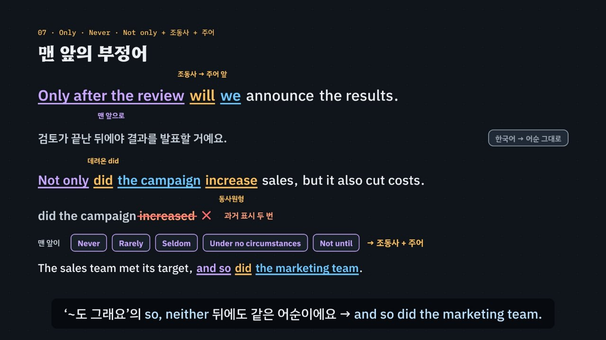

# 신호어가 짝을 부른다

> [영어 튜토리얼](../README.md) 모음의 열두 번째 꼭지(T12)입니다. 영역: 토익 문법 · 다루는 유형: [100개 유형](../docs/toeic-100-types.md)의 52번(원급·비교급, 비교급 강조), 53번(최상급, one of the + 최상급 + 복수 명사, the 비교급 ~ the 비교급), 54번(가정법과 if를 생략한 도치), 55번(부정어·only로 시작하는 도치).

토익 Part 5의 **비교 · 가정법 · 도치** 문제를 약 6분 20초짜리 인터랙티브 모션그래픽으로 설명합니다. 세 주제를 묶는 생각은 하나예요. **문장 속 신호어 하나가 정해진 짝을 부른다.** as는 원급을, than은 비교급을, the와 범위(of · in · ever)는 최상급을, superior는 to를, If + had p.p.는 would have p.p.를, 맨 앞의 Should · Had · Were는 숨은 if를, 맨 앞의 Only after · Never · Not only는 ‘조동사 + 주어’ 어순을 불러요. 이것을 **3단계 풀이법(신호어 → 짝 → 함정)** 으로 묶습니다.

한국어와 다른 점을 함께 보여 줘요. 한국어는 ‘저것**보다** 가볍다 · **가장** 가볍다’처럼 조사·부사를 붙일 뿐 ‘가볍다’의 모양이 그대로지만, 영어는 *light → lighter → lightest*로 낱말 모양이 바뀌고 짝(*than* · *the … of*)이 따라와요. ‘직원을 더 뽑는다면 끝낼 텐데’는 현재 모양이지만 영어 가정법은 동사를 한 칸 과거로 보내요. 한국어는 강조해도 어순이 그대로인데, 영어 도치는 문장 조각이 실제로 자리를 바꿔요. 영상과 놀이터에서 그 조각들이 미끄러지며 움직여요(*If we had known → Had we known*, *… only after the review → Only after the review will we …*).



## 바로 보기

`index.html`을 더블클릭하면 끝이에요. 설치도, 서버도 필요 없어요.

## 3단계 풀이법

1. **신호어**를 찾아요. *as … as · than · less … than*, *the* + 범위(*of · in · among · ever*), *one of the*, *The* 비교급 …, *superior · inferior · prior · senior*, if절의 동사, 맨 앞의 *Should · Had · Were*, 맨 앞의 *Only · Not until · Not only · Never · Rarely · Under no circumstances*, *so · neither*. 신호어가 만드는 자리에 맞지 않는 보기(품사가 다른 말, 강조어가 아닌 말, 비교의 짝이 아닌 낱말, 동사가 없는 덩어리, 직설법 모양)는 지워요.
2. **짝**을 맞춰요. as → 원급, than → 비교급, 범위 → 최상급, 비교급 앞 강조 → *much · even · far · still · a lot*, *one of the* + 최상급 → 복수 명사, *superior* → *to*, If + 과거 → would + 원형, If + had p.p. → would have p.p., *Should* + 주어 + 원형 · *Had* + 주어 + p.p. · *Were* + 주어 + 보어, 맨 앞 부정어 → 조동사 + 주어 + 동사.
3. **함정**을 확인해요. 비교 표시 두 번(*more lighter · less more expensive*), *very* + 비교급, *superior than*, 주절의 *had p.p.* · if절의 *would*, 뜻만 보고 고른 *If*(*If we known*), 조동사 뒤 과거형(*did … increased*), 수·시제가 다른 조동사(*does* + 복수 주어).

## 무엇을 배우나요

| 장 | 시각 | 내용 | 직접 해 보기 |
| --- | --- | --- | --- |
| 00 들어가며 | 0:00 | 비교급 앞 강조어 문제(many · very · much · most), 신호어와 짝 | 먼저 풀어 보기 |
| 01 세 모양, 비교 표시는 한 번 | 0:25 | 한국어 ‘보다 · 가장’과 그대로인 낱말 ↔ 영어 원급 · 비교급 · 최상급, more · most, good · better · best, more lighter × | 낱말 바꿔 보기, 비교 표시를 한 번만 했을까 |
| 02 as … as와 than | 0:57 | as … as → 원급, than → 비교급(문장 조각이 바뀌는 모습), as more efficient as ×, less + 원급 + than | 신호어 바꿔 보기(as · than · less), 빈칸 문제 둘 |
| 03 훨씬은 much, than 대신 to | 1:31 | much · even · far · still · a lot, very는 원급만, superior · inferior · prior · senior + to | 비교급 larger 앞에 올 수 있을까, 빈칸 문제 |
| 04 최상급과 the 비교급 | 2:05 | the + 최상급 + of · in · ever, one of the + 최상급 + 복수 명사, The sooner …, the more … | 빈칸 문제 둘 |
| 05 가정법은 한 칸 뒤로 | 2:39 | 한국어 ‘뽑는다면’(현재 모양) ↔ If we hired …, we would …, If we had hired …, we would have …, 가정법의 will × · if절의 would × | if절 바꿔 보기(현재 · 과거 · had p.p.), 빈칸 문제 |
| 06 if가 사라지면 | 3:15 | If we had known → Had we known, If you should have → Should you have, If I were → Were I (조각이 움직이는 모습) | if 되살리기, 빈칸 문제 |
| 07 맨 앞의 부정어 | 3:49 | … only after the review → Only after the review will we …, Not only did … + 원형, Never · Rarely · Under no circumstances, so · neither + 조동사 + 주어 | 맨 앞 바꿔 보기(다섯 가지), 빈칸 문제 둘 |
| 08 3단계 풀이법 | 4:29 | 신호어 → 짝 → 함정 흐름도 | 신호어를 고르면 흐름도에 길이 켜지고 짝과 함정이 나옴 |
| 09 실전 문제 풀이 | 4:59 | 토익 형식 세 문제 (much · Had · did the campaign increase) | 문제 고르기 |
| 10 정리 | 5:55 | 한눈에 보는 표 | 아래 칸으로 가는 길 |

영상 아래에는 네 가지가 더 있어요.

- **놀이터 — 신호어 스위치**: 비교 · 가정법 · 도치 세 갈래에서 같은 문장의 **신호어만** 바꿔 봐요. 비교는 as … as · than · much … than · less … than · the … of · the … ever · The …, the 일곱 틀과 낱말 넷(light · reliable · good · expensive), 가정법은 If + 현재 · If + 과거 · If + had p.p. · Had + 주어(if 생략) 네 틀, 도치는 보통 어순 · Only after · Not until · Never · Under no circumstances 다섯 틀이에요. 신호어를 바꾸면 무대의 문장 조각이 미끄러지며 다시 짜이고(앞으로 가는 조각은 위로 뛰어넘어요), 빈칸에 와야 할 짝이 바뀌어요. 후보를 고르면 규칙 엔진이 후보마다 맞고 틀린 까닭과 몇 단계에서 지워지는지, 3단계 풀이, 완성 문장의 해석과 발음을 보여 줘요. ‘먼저 맞혀 보기’를 끄면 늘 정답이 채워진 채로 신호어를 바꿔 볼 수 있어요. 키보드: ← → 신호어, ↑ ↓ 갈래, N 낱말, 1~5 고르기.
- **연습 문제**: 토익 Part 5 형식 16문제(52번 4 · 53번 4 · 54번 4 · 55번 4, 정답 위치 4·4·4·4). 힌트 = 3단계 풀이(신호어 → 짝 → 함정)와 단계마다 지워지는 보기, 보기마다 모양과 까닭, 해석, 발음.
- **퀴즈**: 개념 확인 10문제(그림 문제 2개: one of the largest supplier, Only after the review we will에서 틀린 조각 고르기).
- **핵심 정리**: 비교 표와 가정법·도치 표(신호어 · 짝 · 예 · 함정), 용어(비교 · 가정법 · 도치 · 한국어와 다른 점).

### 플레이어 조작

다른 튜토리얼과 같아요. 스페이스(재생/일시정지), ← →(5초), Shift + ← →(장), C(자막), V(음성 해설), F(전체 화면). 화면 속 영어 문장을 누르면 발음을 들려줘요. 주소 끝에 `#c-장면이름`(예: `index.html#c-neg`)을 붙이면 그 장면에서 시작해요.

음성 해설은 자막의 `(A)`~`(D)`를 ‘에이 · 비 · 씨 · 디’, `p.p.`를 ‘과거분사’, `-er` · `-or` · `-est`를 글자 이름(이알 · 오알 · 이에스티)으로 읽고, `=` · `+`는 쉬어 읽어요.

## 무엇이 규칙 계산인가요

- **규칙 엔진** `assets/js/grammar.js`의 `CI.judge(보기, 문장의 틀)`이 맞고 틀림과 까닭, 그리고 3단계 가운데 몇 단계에서 지워지는지를 정해요. 틀은 아홉 가지예요.
  - `deg` 형용사·부사의 모양(원급 · 비교급 · 최상급 · 비교 표시 두 번, 형용사 · 부사 · 명사) — 신호어 종류(as · than · much · less · the … of · the … ever · The …, the)가 필요한 모양을 정해요.
  - `int` 비교급 앞 강조어(much · even · far · still · a lot ✓, very · so · too는 원급 전용, more · most는 비교 표시, many는 명사 앞 수량).
  - `part` 비교의 짝 낱말(than · to · as). `noun` one of the + 최상급 뒤 명사의 수.
  - `cond` 가정법 동사: 보기 모양을 [법·때, 절]로 바꿔 신호어가 정한 [법·때, 절]과 차례로 견줘요. 직설법 ↔ 가정법이 다르면 ①, 지금의 반대 ↔ 지난 일의 반대가 다르면 ②, if절 모양 ↔ 주절 모양이 바뀌었으면 ③.
  - `front` if 자리의 맨 앞 낱말(Should + 원형 · Had + p.p. · Were + 보어, If는 ③ 함정).
  - `neg` 맨 앞 부정어 뒤 덩어리(조동사 + 주어 + 동사 ✓, 보통 어순 ②, 조동사 뒤 과거형 ③, 동사 없음 ①). `aux` 맨 앞 부정어 뒤 조동사 하나(뒤 동사와의 짝 ②, 주어의 수·시제 ③). `so` so · neither 뒤 조동사(앞 절 동사의 갈래 ②, 시제 ③).
  영상 속 ✓·×와 실전 문제에서 지워지는 순서, 직접 해 보기 채점, 신호어 스위치의 후보 판정과 풀이, 연습 문제의 힌트와 보기별 해설, 퀴즈 대부분의 정답이 모두 이 함수에서 나와요.
- **신호어 틀** `CI.SW`: 갈래(비교 · 가정법 · 도치)마다 틀을 토큰 `[글자, 역할, id]`으로 적어 두었어요. `CI.build`가 빈칸을 후보(또는 정답)로 채운 토큰을 만들고, 같은 id의 토큰은 틀을 바꿀 때 미끄러져 움직여요. 영상 02 · 05 · 07장과 놀이터가 같은 틀을 써요.
- **어긋남 경고** `CI.check()`: 연습 문제 정답이 규칙 엔진과 다르거나, 정답이 둘 이상이거나, 힌트의 표시 글자가 문장에 없거나, 보기 글자가 형용사 사전의 모양과 다르거나, 빈칸 뒤 ‘주어 + 말’이 데이터와 다르거나, 정답 위치가 몰리면 콘솔에 경고가 떠요. 신호어 스위치의 모든 틀 × 낱말에서 맞는 후보가 꼭 하나인지, 08장 신호어 표의 예와 함정, 01 · 03 · 06장 데이터도 점검하고, 실전 문제의 ‘탈락’ 표시(①·②·③ 모두)와 퀴즈 정답도 따로 점검해요.
- **단순하게 줄인 부분**
  - 문장의 틀(어떤 신호어인지, 빈칸의 품사, 가정법인지 직설법인지, 맨 앞에 부정어가 있는지)은 문제마다 데이터에 적어 두었어요. 규칙 엔진은 문장을 스스로 읽어 틀을 알아내지 않아요.
  - *one of the larger cities*처럼 비교급을 쓰는 말도 실제 영어에 있어서, one of the + 최상급 문제에는 원급 · 비교급 보기를 넣지 않았어요(명사의 수를 묻는 문제만). 둘 가운데 하나를 고르는 *the lighter of the two*는 다루지 않았어요.
  - 가정법은 시험 기준으로 판정해요. *if* + 현재 뒤의 *would*, if절 과거형이 실제 과거 일을 말하는 경우(*If he left at five, he will …*), 혼합 가정법(*If I had studied, I would be …*), 가정법의 *was*, *Were* + 주어 + to부정사는 다루지 않았어요. 신호어 스위치의 가정법 틀도 ‘사실과 반대’라는 뜻을 데이터로 정해 두었어요.
  - *Should* 도치의 주절에는 명령문 · *will* · *would*가 다 올 수 있어서 그 자리는 문제로 내지 않았어요. *If* + 주어 + 현재형은 보통의 조건문이라 규칙 엔진이 맞다고 봐요. 그래서 동사원형이 뒤따르는 문제(*___ you have any questions*)에는 *If*를 보기로 넣지 않았어요.
  - 부정어 도치는 *only · not until · not only · never · rarely · seldom · under no circumstances*만 다뤄요. *no sooner … than · hardly … when · so + 형용사 + that* 도치는 넣지 않았어요. *Only after the review do we announce*처럼 현재 시제로도 말이 되는 보기는 넣지 않았어요.
  - 형용사·부사의 모양은 사전에 적어 둔 낱말만 판정해요. 신호어 스위치에서 어색한 짝(*less light* 같은)은 고를 수 없게 빼 두었어요.
- **예문과 문제**: 모두 토익 형식을 본떠 직접 만든 것이에요.

## 폴더 구조

```
index.html              페이지 (영상 · 직접 해 보기 · 놀이터 · 연습 문제 · 퀴즈 · 핵심 정리)
assets/js/grammar.js    규칙 엔진(CI.judge), 형용사 사전, 신호어 틀(CI.SW · CI.build), 08장 신호어 표(CI.SIGNALS), 연습 문제(CI.DRILL)
assets/js/scenes.js     영상 장면 11개, 장 목록과 자막, 토큰 배치·미끄러짐(lay · morph), 놀이터의 작은 무대(CIS.stage)
assets/js/app.js        플레이어, 직접 해 보기, 놀이터(신호어 스위치), 퀴즈, 영상 추출(EN_EXPORT)
video/                  자막 원고(SRT)
docs/poster.jpg         사이트 카드 그림
```

## 영상 다시 만들기

```bash
node tools/render-video.cjs comparison-inversion                       # → comparison-inversion/video/comparison-inversion.mp4 + .srt
node tools/render-video.cjs comparison-inversion --frames 63.8,236.3   # 몇 장면만 그림으로
node tools/render-video.cjs comparison-inversion --poster 267.5        # 카드 그림
node tools/render-video.cjs comparison-inversion --srt                 # 자막 원고만
```
