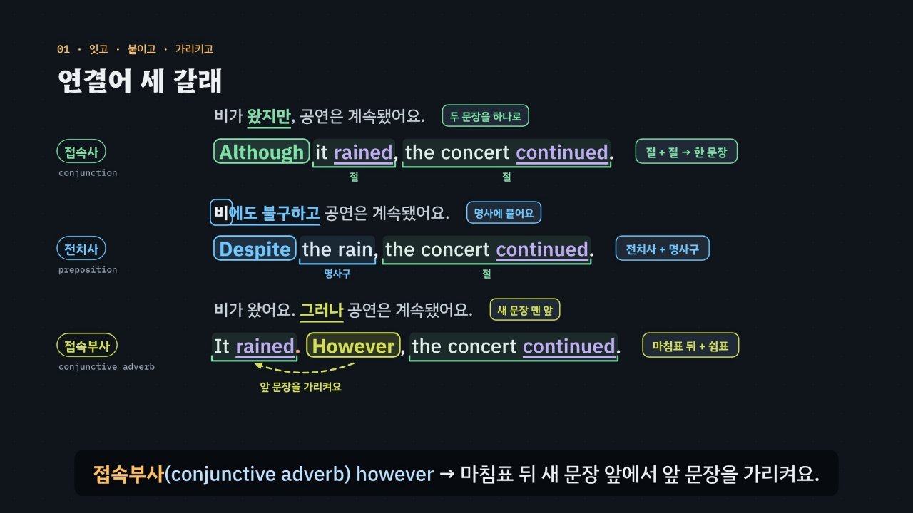

# 접속사냐 전치사냐, 빈칸 뒤가 답한다

> [영어 튜토리얼](../README.md) 모음의 다섯 번째 꼭지(T05)입니다. 영역: 토익 문법 · 다루는 유형: [100개 유형](../docs/toeic-100-types.md)의 31–35번

토익 Part 5·6의 **연결어 문제**(접속사·전치사·접속부사)를 약 5분 50초짜리 인터랙티브 모션그래픽으로 설명합니다. 핵심은 하나예요. **뜻이 같은 although와 despite 가운데 무엇이 답인지는 빈칸 뒤의 모양이 정한다.** 명사구가 오면 전치사, 주어 + 동사(절)가 오면 접속사, 마침표 뒤에 쉼표와 함께 오면 접속부사. 이것을 **3단계 풀이법(뒤 → 갈래 → 뜻)** 으로 묶습니다.



## 바로 보기

`index.html`을 더블클릭하면 끝이에요. 설치도, 서버도 필요 없어요.

## 무엇을 배우나요

| 장 | 시각 | 내용 | 직접 해 보기 |
| --- | --- | --- | --- |
| 00 들어가며 | 0:00 | 뜻이 같은 Although · Despite, 그런데 정답은 하나 | 먼저 풀어 보기 |
| 01 연결어 세 갈래 | 0:24 | 한국어 ‘왔지만 · 비에도 불구하고 · 그러나’ ↔ 영어 although · despite · however. 절을 잇고, 명사에 붙고, 앞 문장을 가리킴 | 갈래 하나씩 보기, 발음 듣기 |
| 02 명사구냐 절이냐 | 0:58 | 열쇠는 동사. the heavy rain → Despite, it rained heavily → Although. -ing 꼴(동명사) 함정, 같은 뜻 짝 | 조각이 명사구인지 절인지 고르기 |
| 03 같은 뜻, 세 갈래 | 1:30 | 뜻(대조·이유/결과·시간·부정 조건·추가) × 갈래(접속사·전치사·접속부사) 표 | 뜻을 고르면 같은 내용을 세 갈래로 쓴 문장 |
| 04 뜻으로 고르기 | 1:58 | unless = if … not, once, as long as · provided that, so that, whereas, even though | 빈칸 문제 둘 |
| 05 짝을 이루는 접속사 | 2:32 | either … or · neither … nor · both … and · not only … but also, 동사의 수(가볍게) | 앞쪽을 고르면 짝과 예문, 빈칸 문제 |
| 06 접속부사는 혼자 못 잇는다 | 3:02 | Sales rose, however profits fell. × → 마침표 · 세미콜론 · 접속사로 고치기, 접속부사 자리 | 앞 부호와 연결어를 바꿔 보며 판정 |
| 07 덩어리 전치사 | 3:36 | prior to · due to · on behalf of …, -ing 꼴 전치사(following · including · regarding), in addition to ↔ in addition | 빈칸 문제 둘 |
| 08 3단계 풀이법 | 4:06 | 뒤 → 갈래 → 뜻 흐름도 | 연결어 판정기: 빈칸 앞뒤와 뜻을 고르면 흐름도에 길이 켜지고 들어갈 말이 나옴 |
| 09 실전 문제 풀이 | 4:34 | 토익 형식 세 문제 (Despite · Unless · However) | 문제 고르기 |
| 10 정리 | 5:30 | 신호 → 갈래 표 | 아래 칸으로 가는 길 |

영상 아래에는 다섯 가지가 더 있어요.

- **놀이터 — 연결어 조립대**: 두 생각(비와 공연 · 기차와 연설 · 출입증과 실험실)을 세 가지 틀(연결어 + 절 / 연결어 + 명사구 / 문장. 연결어,)로 이어 봐요. 연결어 조각 18개 가운데 하나를 끼우면 문장이 조립되고, 규칙 엔진이 ① 뒤 → ② 갈래 → ③ 뜻 순서로 검사해 칸마다 ✓·×와 까닭을 보여 줘요. 틀리면 이 자리에 필요한 갈래와 뜻을 힌트로 알려 줘요. 틀마다 맞는 연결어를 모두 찾아 아래 표(9칸)를 채우는 것이 목표예요. 같은 생각이라도 접속부사 틀에서는 이유(because) 대신 결과(therefore)를 이끄는 것도 여기서 보여요. 키보드 1~3(틀), ← →(연결어), ↑ ↓(두 생각).
- **놀이터 — 연결어 사전**: 접속사 · 전치사 · 접속부사 · 짝 접속사를 뜻과 함께 모았어요. 전치사로도 쓰는 접속사(before · after · until · since)에는 표시가 있어요.
- **연습 문제**: 토익 Part 5 형식 16문제(정답 위치 A·B·C·D 4개씩). 힌트 = 3단계 풀이(뒤 → 갈래 → 뜻), 빈칸 뒤 명사구·절의 동사·마침표·짝 낱말에 색. 보기마다 갈래와 까닭, 해석, 발음.
- **퀴즈**: 개념 확인 10문제(그림 문제 2개: 접속사 뒤에 올 수 있는 조각, 짝 맞추기).
- **핵심 정리**: 신호 → 갈래 표, 같은 뜻 세 갈래 표, 용어 · 세 갈래 + 짝 · 뜻으로 고르는 접속사 · 함정.

### 플레이어 조작

T01·T02와 같아요. 스페이스(재생/일시정지), ← →(5초), Shift + ← →(장), C(자막), V(음성 해설), F(전체 화면). 화면 속 영어 문장을 누르면 발음을 들려줘요. 주소 끝에 `#c-장면이름`(예: `index.html#c-adv`)을 붙이면 그 장면에서 시작해요.

음성 해설은 `-ing(잉)`처럼 화면에 적고 괄호 속 한국어로 읽어요. `↔`는 쉼으로 읽어요.

## 무엇이 규칙 계산인가요

- **규칙 엔진** `assets/js/grammar.js`의 `LK.judge(연결어, 자리)`가 맞고 틀림과 까닭을 정해요. 사전(`LK.LEX`)에 연결어마다 [갈래, 뜻] 쌍을 적어 두고(예: since = 접속사·이유 / 접속사·시간 / 전치사·시간), 자리는 틀(명사구 `np` · 절 `cl` · 마침표 뒤 `adv` · 짝 `pair`)과 필요한 뜻으로 나타내요. 틀이 요구하는 갈래가 없으면 ② 갈래에서, 갈래는 맞는데 뜻이 다르면 ③ 뜻에서 틀렸다고 알려 줘요. 영상 속 ✓·×, 직접 해 보기 채점, 연결어 조립대의 세 단계 검사, 연습 문제의 힌트와 보기별 해설, 퀴즈 일부의 정답이 모두 이 함수에서 나와요.
- **판정기** `LK.frameFromCues(앞, 뒤)`는 빈칸 앞(문장 맨 앞 · 절 뒤 · 마침표 뒤 · 짝 낱말)과 뒤(명사구 · 절 · 쉼표 + 문장)로 틀을 정해요. 절 뒤에 쉼표만 찍고 새 문장을 붙이는 조합은 ‘이어지지 않는다’고 알려 줘요.
- **어긋남 경고** `LK.check()`: 연습 문제 정답이 규칙 엔진과 다르거나, 정답이 둘 이상이거나, 단서 글자(빈칸 뒤 명사구, 절의 주어·동사, 짝 낱말, 마침표)가 문장에 없거나, 보기가 사전에 없거나, 정답 위치가 몰리거나, 같은 뜻 표·조립대 데이터가 사전과 다르면 콘솔에 경고가 떠요. 실전 문제와 퀴즈도 규칙 엔진과 맞춰 봐요.
- **단순하게 줄인 부분**
  - 빈칸 앞뒤의 관계(대조·이유·조건…)는 엔진이 문장을 읽고 알아내는 것이 아니라, 문제와 조립대의 두 생각마다 정해 둔 것이에요.
  - 같은 뜻 안의 작은 차이(although와 whereas, while의 두 뜻, once의 시간·조건)는 가르지 않아요. 그래서 한 문제의 보기에는 같은 뜻의 같은 갈래가 둘 들어가지 않게 만들었어요.
  - 접속부사는 문장 가운데(…, however, …)에도 오지만, 토익 빈칸에 자주 나오는 자리(마침표·세미콜론 뒤 + 쉼표)만 다뤄요.
  - 접속사 뒤의 주어와 be동사를 줄인 꼴(Although tired, …)은 실제 영어에 있지만, ‘접속사 뒤에는 주어 + 동사’로 단순하게 정했어요. 퀴즈와 문제에는 이런 꼴이 정답·오답 판단에 걸리지 않게 했어요.
  - and · but · so 같은 등위접속사로 두 절을 잇는 경우는 다루지 않고, 짝 접속사 문제에서만 써요. 짝 접속사 뒤 동사의 수는 영상에서 가볍게만 짚었어요(수 일치는 T03).
  - 접속부사를 고르는 글 단위 문제(Part 6)는 T14에서 다뤄요.
- **예문과 문제**: 모두 토익 형식을 본떠 직접 만든 것이에요.

## 폴더 구조

```
index.html              페이지 (영상 · 직접 해 보기 · 놀이터 · 연습 문제 · 퀴즈 · 핵심 정리)
assets/js/grammar.js    규칙 엔진(LK.judge), 연결어 사전(LK.LEX), 판정기, 같은 뜻 표, 연습 문제(LK.DRILL), 조립대 데이터(LK.SCN · LK.PALETTE)
assets/js/scenes.js     영상 장면 11개, 장 목록과 자막
assets/js/app.js        플레이어, 직접 해 보기, 놀이터, 퀴즈, 영상 추출(EN_EXPORT)
video/                  자막 원고(SRT)
audio/narration/        미리 만든 음성 해설 · 발음 듣기: pieces.json(조각 목록) · clips.js(window.EN_CLIPS) · 조각 id.m4a
docs/poster.jpg         사이트 카드 그림
```

## 미리 만든 목소리

음성 해설과 발음 듣기는 VoiceStudio(OmniVoice 엔진, 비상업용 라이선스)로 미리 만든 합성 음성 파일(`audio/narration/`)로 읽어요. 파일이 없거나 못 읽는 글만 브라우저 음성으로 읽어요.
- 음성 해설: 한국어 조각은 「튜토리얼 내레이터 (젊은 여성)」, 영어 조각(본보기 영어 문장)은 「영어 선생님 (밝은 미국 여성)」.
- 발음 듣기(`EN.say`): 영상 속 영어나 스피커 단추를 누르면 같은 「영어 선생님 (밝은 미국 여성)」 파일로 읽어요(천천히는 같은 파일을 0.75배로). 글은 `tools/say-sweep.js`가 영상 · 처음부터 있는 스피커 단추 · 직접 해 보기의 예문(예문 단추를 하나씩 눌러 가며)에서 모아요. 놀이터에서 조각을 골라 만든 문장, 문제를 푼 뒤에 나오는 문장처럼 조합이 많은 글은 브라우저 음성으로 읽어요.
- 합성 엔진은 가끔 무음 · 잡음을 내거나 짧은 말을 뭉개 읽어요. 도구가 이런 소리를 걸러 seed를 바꿔 다시 만들어요. 지금 파일은 받아쓰기(Whisper)와 높낮이로 모두 다시 확인했고, 다시 만들어야 할 파일은 없었어요. 모든 튜토리얼을 다시 살펴볼 때(2026년 11월) 받아쓰기는 맞지만 속삭이듯 · 숨소리 섞이게 읽은 소리까지 찾으려고 영어 파일마다 목소리가 울린(성대가 떨린) 비율과 숨소리가 섞인 정도(소리가 얼마나 고르게 되풀이되는지 보는 자기상관 · 켑스트럼 피크, s 소리가 긴 짧은 말은 모음 부분만)를 쟀어요. 울린 비율 하나만으로는 숨소리 섞인 소리를 실제보다 훨씬 나쁘게 재기도 해서 세 가지를 함께 보고, 속삭이듯 · 숨소리 섞이게 읽거나 아주 높게 읽은 파일 17개(*if* · *therefore.* · *instead* · *in spite of* · *if, not.* · *otherwise* · *it* · *either … or* · *once* · *despite* · *both … and* · *since* · *clause* · *because, since* 등)를 seed를 바꾸거나 읽을 글 끝에 쉼표 · 느낌표를 붙여 다시 만든 뒤 받아쓰기로 낱말을 확인했어요. 화면의 글은 그대로예요. 한 파일만 다시 만들려면 그 파일을 지우고 `--seed`를 바꿔 다시 실행하세요.

만드는 법(VoiceStudio가 있는 맥에서, 이미 만든 파일은 건너뛰어요):

```bash
node tools/narration-pieces.cjs connectors     # 해설의 읽기 조각 + 발음 듣기 글 목록 (자막 · 예문을 고쳤을 때만, 클라우드에서도 됨)
python3 tools/voicestudio-narration.py connectors --en-profile "영어 선생님 (밝은 미국 여성)"
```

## 영상 다시 만들기

```bash
node tools/render-video.cjs connectors                    # → connectors/video/connectors.mp4 + .srt
node tools/render-video.cjs connectors --frames 57,192    # 몇 장면만 그림으로
node tools/render-video.cjs connectors --poster 57        # 카드 그림
node tools/render-video.cjs connectors --srt              # 자막 원고만
```
