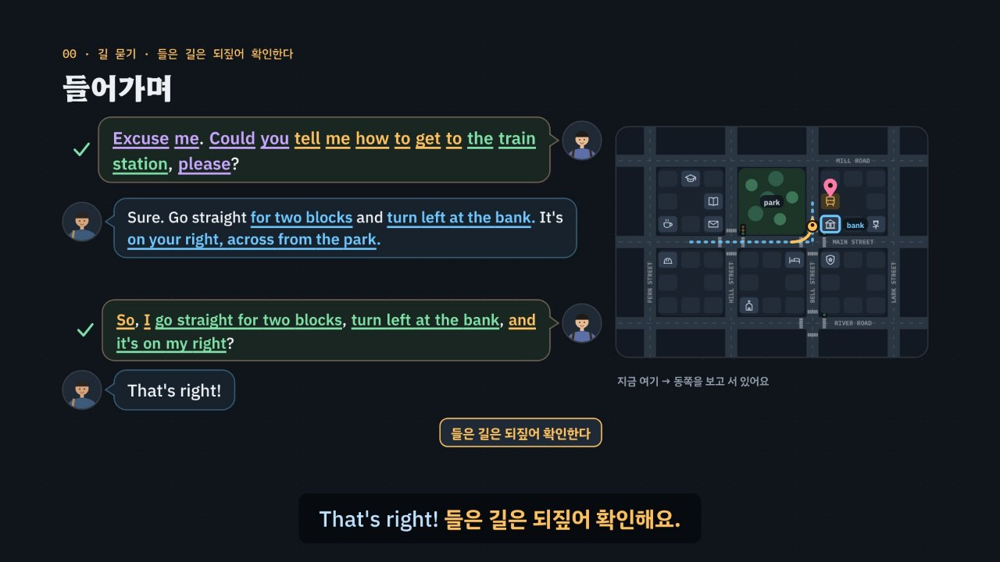

# 길 묻기, 들은 길은 되짚어 확인한다

> [영어 튜토리얼](../README.md) 모음의 **상황별 영어 회화** 다섯 번째 꼭지입니다(영역: `talk`). 형식은 [공항](../airport/) · [카페](../cafe/) · [호텔](../hotel/) · [식당](../restaurant/)을 따르고(식당을 복사해 시작), 형식의 결정은 [CLAUDE.md](../CLAUDE.md)의 ‘회화 튜토리얼이 갖출 것’에 적었어요.

길을 물을 때 **묻는 말은 쉬워요**(*Excuse me. Could you tell me how to get to the train station?*). 어려운 것은 **빠르고 긴 대답**이에요 — *Sure. Go straight for two blocks and turn left at the bank. It's on your right, across from the park.* 그래서 이 튜토리얼은 대답을 **조각**으로 들어요: **동작**(*go straight · turn left · take the second left · cross · go past · until you get to*) + **기준점**(*at the bank · at the lights · onto Bell Street*) + **도착 위치**(*on your right · across from · next to · between · on the corner of*). 그리고 들은 조각을 한 줄로 **되짚어** 확인해요 — *So, I go straight for two blocks, turn left at the bank, and it's on my right?* 맞으면 *That's right!*, 틀린 조각이 있으면 상대가 **그 조각만** 고쳐 줘요(*Not quite — turn left at the bank.*). 여기에 한국어를 그대로 옮긴 말(길 좀 가르쳐 주세요 → *teach me the way* · 마트 → *mart* · 편의점 → *a convenience*), 헷갈리기 쉬운 짝(*turn left*(도는 동작) · *on your left*(있는 위치), *take the second left*(한 번) · *turn left twice*(두 번), *across from*(맞은편) · *next to*(바로 옆)), 빠르게 지나가는 숫자(*fifteen* · *fifty* · *the third stop*)를 더했어요. 약 6분 33초짜리 인터랙티브 모션그래픽으로 **3단계 말하기 법**을 가르쳐요.

- ① **열쇠 낱말 잡기** — 물을 때는 **곳 이름**, 들을 때는 **동작 · 기준점 · 위치** 낱말. 질문의 모양(Yes/No · 고르기 · 정보)도 식당과 같이 봐요(*The train station or the subway station?* → 고르는 질문).
- ② **틀에 내 정보 넣기** — 묻는 틀(*Could you tell me how to get to ___? · Is there ___ near here? · Where's the nearest ___?*)에 곳 이름을, 되짚는 틀(*So, ___, ___, and it's on my ___?*)에 들은 조각을 들은 차례대로, *your* → *my*로 바꿔 넣어요. 한 조각만 확인해도 돼요(*So, I take the second left?*).
- ③ **공손하게 끝내기** — *Excuse me · Sorry to bother you · please · Great, thank you so much!* 모른다고 한 사람에게도 *That's okay. Thanks anyway.* 못 알아들었으면 짐작하지 말고 *Sorry, could you say that again more slowly, please?* 일부만 들렸으면 *Sorry, left or right?* · *Sorry, which bus?* 지도를 보여 주며 *Could you show me on the map?*



## 바로 보기

`index.html`을 더블클릭하면 끝이에요. 설치도, 서버도 필요 없어요.

## 소리와 마이크에 대해 (꼭 읽어 주세요)

- 녹음 파일이 없어요. 영어는 모두 **합성 음성**이에요. 글이 정해진 말(영상의 말풍선 · 영어 칩, 직접 해 보기의 대표 말과 상대의 대답, 듣고 대답 고르기, 따라 말하기)은 **VoiceStudio로 미리 만든 목소리**(`audio/dialogue/`)로, 길 찾기 시뮬레이터처럼 카드마다 바뀌는 말과 내가 칩으로 만든 문장은 **브라우저에 들어 있는 음성(speechSynthesis)** 으로 읽어요. 브라우저 음성은 기기마다 목소리가 다르고, 둘 다 실제 거리의 소리와는 달라요.
- 튜토리얼 전용 목소리 부품 `assets/js/voices.js`(`DRV`)가 말하는 사람마다 목소리를 정해요. 미리 만든 목소리는 길에서 만난 사람 = 미국 남성 · 모자 쓴 사람 = 캐나다 여성 · 관광객(이 동네를 몰라요) = 호주 남성 · 영국에서 만난 사람 = 영국 여성 · 나 = 미국 여성, 화면의 영어 칩(발음 듣기)과 음성 해설의 영어는 밝은 미국 여성 선생님 목소리예요. 한 번에 읽는 줄 안에서 한 사람의 말 중 하나라도 파일이 없으면 그 사람의 말은 모두 브라우저 음성으로 읽고(한 사람의 목소리가 중간에 바뀌지 않게), 시뮬레이터는 처음부터 끝까지 브라우저 음성이에요. 브라우저 음성은 en-US · en-CA · en-AU · en-GB 목소리를 먼저 찾고, 없으면 다른 영어 목소리의 높낮이 · 빠르기를 바꿔 구별해요. ‘아주 빠르게’ 문제는 일부러 빠르게(1.35배) 읽어요. 화면 글과 읽을 글이 다르면 엔진의 `DR.spoken`이 바꿔요(*the number 15 bus* → *the number fifteen bus*, *Exit 3* → *Exit three*). 공통 부품(`shared/`)은 바꾸지 않았어요.
- 소리가 겹치지 않게: 대화를 읽기 전에 발음 듣기 · 음성 해설 · 녹음 재생을 멈추고 영상을 일시정지해요. 시뮬레이터를 시작할 때도(첫 차례가 말이 없는 ‘지나가는 사람’이어도) 영상과 음성 해설을 멈춰요. 음성 인식을 시작할 때도 다른 소리를 모두 멈춰요.
- **따라 말하기 · 말로 대답하기 · 말로 되짚기**: 브라우저에 음성 인식(`SpeechRecognition` · `webkitSpeechRecognition`)이 있으면 말을 글로 바꿔 **낱말만** 맞춰 봐요(발음의 질은 판정하지 않아요). 숫자는 *15*든 *fifteen*이든 *one-five*든, 서수는 *third*든 *3rd*든 같은 숫자로 맞춰요(`DR.canon`). 크롬(Chrome) 같은 브라우저는 소리를 브라우저 회사의 서버로 보내 글로 바꿔요. 음성 인식이 없으면 녹음(`MediaRecorder`)으로 ‘내 목소리’와 ‘원래 문장’을 이어서 들어요. 둘 다 없으면 마이크 단추를 숨기고 ‘세 번 소리 내어 따라 해 보세요’라고 안내해요. 이 사이트는 소리도 글도 저장하지 않아요(녹음은 화면에만 잠깐 있다가 페이지를 닫으면 사라져요). 길 이름(*Bell Street*)은 인식이 다르게 적기도 해요.
- 동네(*Fernwood*) · 길 이름(*Fern · Hill · Bell · Lark Street*, *Mill Road · Main Street · River Road*) · 가게 · 버스 노선(15번 · 50번) · 버스 정류장 이름은 모두 지어낸 것이에요. 길을 알려 주는 방식은 나라와 사람마다 달라요 — 미국 · 캐나다는 블록(*two blocks*)으로 세는 일이 많고, 영국은 길 이름이나 *the second turning on the left*처럼 말하기도 하고, 거리는 미터 · 마일 · 걸어서 몇 분으로 말해요. 휴대폰 지도가 있어도 길은 자주 묻게 돼요.

## 무엇을 배우나요

| 장 | 시각 | 내용 | 직접 해 보기 |
| --- | --- | --- | --- |
| 00 들어가며 | 0:00 | *Where is train station?* → 퉁명스러움, *Excuse me.* + 묻는 틀 + 곳 이름, 길고 빠른 대답을 동작 · 기준점 · 도착 위치 조각으로, 한 줄 되짚기 → *That's right!*, 지도 위에서 걷는 사람이 계산된 길을 따라감 | 먼저 골라서 대답해 보기 (영국에서, 듣고 대답 고르기) |
| 01 길 묻기 지도 | 0:29 | 대화의 일곱 단계(말 걸기 → 묻기 → 동작 듣기 → 기준점 · 위치 듣기 → 거리 · 교통 → 되짚기 → 고맙다고 끝내기), 단계마다 한 줄, 내가 먼저 말하는 단계(보라 테두리: 말 걸기 · 묻기 · 되짚기), 나라 · 사람마다 다른 안내 | 단계를 골라 대표 말 듣기 |
| 02 말 걸기와 묻기 | 0:59 | *Excuse me · Sorry to bother you* vs *Hey!*, 묻는 틀 셋, *teach me the way*(알아듣지만 어색), 곳 이름 표(마트 → *supermarket · grocery store*, 편의점 → *convenience store*, 지하철역 · 화장실 · 횡단보도 · 사거리 · 신호등 · 주유소 + 영국 영어) | 말 걸고 곳 이름 묻기 (가려는 곳 · 말 거는 말 · 묻는 틀 · 곳 이름 → 3단계 판정) |
| 03 동작 낱말 | 1:35 | *go straight · turn left/right*, **left · right는 걷는 사람이 바라보는 쪽 기준**(북쪽을 볼 때와 남쪽을 볼 때의 *turn left*), *take the second left* vs *turn left twice*, *go past · cross the street*, *keep going until you get to the bank*, *turn left* vs *on your left* | 바라보는 쪽에 따라 움직여 보기 (출발 넷 × 들은 말 다섯) |
| 04 기준점과 위치 | 2:11 | *at the bank · at the lights · at the corner*, *It's on your right.*, *across from · next to · between · on the corner of · in front of · behind*, 지도의 관계는 엔진이 계산 | 건물을 골라 위치 관계 보기 (`DR.relationsOf`) |
| 05 거리 · 시간 · 교통 | 2:47 | *a five-minute walk · two blocks*, *too far to walk → Which bus should I take?* (*Bus number?* ×), *fifteen* · *fifty* 센 곳, *get off at the third stop*, *Take Exit 3.*, 미터 · 마일 · *the second turning on the left* | 버스 안내 되짚기 (번호 · 정류장 · 내리는 곳 → 판정과 고쳐 주는 말) |
| 06 되짚기 | 3:19 | 틀 *So, ___, ___, and it's on my ___?*, *your* → *my*, 맞으면 *That's right!*, 틀리면 그 조각만(*Not quite — turn left at the bank.*), 한 조각만 확인해도 됨, 엔진이 찾는 실수(빠진 조각 · 다른 방향 · 다른 기준점 · 두 번 돌기 · *turn* ↔ *on* · 순서) | 조각을 골라 되짚기 (누르는 차례대로 한 줄) |
| 07 다시 묻기 | 3:55 | 아주 빠른 말(*hang a left*) → *Sorry, could you say that again more slowly, please?*, 들린 만큼 되묻기(*Sorry, left or right? · Sorry, which bus?*), *Could you show me on the map?*, *Sorry, I'm not from around here.* → *That's okay. Thanks anyway.* (*Okay. Bye.* ×) | 빠른 버스 안내에 다시 묻기 (듣고 대답 고르기) |
| 08 한 줄로 되짚기 | 4:25 | 조각마다 따로 확인하면 세 번 주고받기, 한 줄이면 한 번, 틀린 조각이 하나면 그 조각만 고쳐 줌, 조각의 순서 = 들은 차례 | 주고받는 수 세어 보기 |
| 09 3단계 말하기 법 | 4:55 | 상자 셋, 일곱 단계에 한 줄씩 단계별로 채워짐 | 단계를 골라 3단계 보기 |
| 10 실전 길 묻기 | 5:21 | 길 카드 하나로 넷(말 걸기 · 모르는 사람 · 길 안내와 되짚기 · 고맙다고 끝내기), 보기마다 엔진이 ①②③ 몇 단계에서 지우는지, 작은 지도에서 걷는 사람이 길을 따라감 | 대화 골라 보기 |
| 11 정리 | 6:11 | 단계 · 열쇠 낱말 · 틀 표 + 못 알아들었을 때 | 아래 칸으로 가는 길 |

영상 아래에는 다섯 가지가 더 있어요.

- **놀이터 — 길 찾기 시뮬레이터**: 누를 때마다 새 **길 카드**(지금 있는 곳 · 바라보는 쪽 · 가려는 곳 · 걸어서인지 버스인지)가 만들어지고, 옆에 동네 지도가 나와요. 노란 화살표가 나예요. **가려는 곳은 지도에 표시되지 않아요** — 듣고 찾아가야 해요. 차례: (모르는 사람을 먼저 만나는 날도 있어요 → *That's okay. Thanks anyway.*) → 말 걸기(① 말 거는 말 칩 + ② 묻는 틀 칩 + ③ 곳 이름 칩 — 곳 이름 칩에는 콩글리시 · 다른 곳이 섞여 있어요. *Excuse me.*만 하면 상대가 *Yes? How can I help?* 하고 돌아봐요) → (버스면 *too far to walk* → 어떤 버스인지 묻기) → 길 안내 듣기(R 듣기 · S 천천히, 말투는 블록 · 몇 번째 길 · 기준점이 나올 때까지 · 버스 가운데 무작위) → **되짚기**: 들은 조각 칩을 차례로 눌러 한 줄로(조각 칩에는 하나씩 틀린 조각 — 다른 방향 · 다른 기준점 · 두 번 돌기 · 다른 쪽 · 15/50 — 이 섞여 있고, 같은 조각을 두 번 넣어도 돼요), 한 조각씩 확인해도 돼요. 틀린 조각이 있으면 상대가 그 조각만 고쳐 주고(고쳐 준 조각을 다시 되짚어요), 들은 길에 없는 조각이면 길을 처음부터 다시 말해 줘요. 못 알아들었으면 Q · W · E로 다시 묻기(주고받기에 세지 않아요) → **지도에서 가려는 곳(버스면 탈 정류장)을 눌러요** — 틀리면 들은 조각을 차례로 따라가 보라는 안내, 맞으면 걷는 사람이 계산된 길을 따라 걸어가요 → 고맙다고 끝내기. 엔진이 ①에서 걸리면 상대가 다시 묻거나 그냥 지나가고(*The person keeps walking.*), ②에서 걸리면 *Hmm, are you sure?*(카드와 다름) · 고쳐 주는 말, ③이면 놀란 상대. 매번 단계와 까닭, 모범 대답(듣기)을 보여 줘요. 음성 인식이 있으면 마이크로 말해서 대답하거나 되짚을 수 있어요. 끝나면 한 번에 통과한 수, 되짚기 주고받기 수(한 줄에 모두 맞게 했는지), 지도에서 몇 번 만에 찾았는지, 대화 전체와 듣기. 키보드: R 듣기 · S 천천히 · T 대본 · 5~8 말 거는 말 · 1~3 묻는 틀(대답 틀) · A~C 곳 이름 · 되짚기에서 1~9 조각 · Q · W · E 다시 묻기 · Enter 말하기 · Backspace 지우기(되짚기에서는 마지막 조각 하나) · M 말로 대답하기 · 지도에서 화살표 + Enter · N 새 카드.
- **길 묻기 표현 따라 말하기**: 일곱 단계마다 상대의 말과 내 말 28문장. 듣기 · 천천히 · 따라 말하기(음성 인식 → 녹음 → 소리 내어 따라 하기). 인식 결과는 원래 문장의 낱말마다 초록(들림) · 주황(빠짐)으로 보여 줘요.
- **듣고 대답 고르기**(튜토리얼 전용 `DDrill`, `EN.drill`과 같은 모양 · 키보드): 16문제, 일곱 단계 + 고쳐 준 말 + 아주 빠른 말, 정답 위치 A · B · C · D 넷씩. 되짚기 문제(다섯)는 보기마다 한 조각만 달라요(방향 · 기준점 · 블록 수 · 도착 쪽 · 버스 번호 · 정류장 · 내리는 곳). 지나가는 사람에게 내가 먼저 말을 거는 문제는 들을 말이 없어요. 문제마다 단계 아이콘과 한 줄 상황, 상대의 말은 소리 먼저(글은 답한 뒤 또는 대본 보기), 대답 넷은 글. 힌트 = 3단계 — ① 열쇠 낱말 ② 틀 · 내 정보(함정은 주황) ③ 공손한 말(보라)과 정답. 답하면 보기마다 엔진의 까닭, 해석, 줄마다 듣기, 대화 듣기(상대 → 나). 키보드: A~D(1~4) 고르기 · H 힌트 · R 다시 듣기 · S 천천히 · T 대본 · Enter/→ 다음.
- **퀴즈**: 10문제(그림 문제 4개: 남쪽을 보고 선 사람의 *turn left* 화살표, *take the second left* 화살표, *across from the park, next to the bank* 건물, 들은 길로 도착하는 건물).
- **핵심 정리**: 단계 × 열쇠 낱말 × 틀 · 조각 표, 용어(① 곳 이름 · 동작 · 기준점 · 도착 위치 ② 묻는 틀 · 되짚는 틀 · 고쳐 주는 말 · 숫자 ③ 말 걸기 · 고맙다는 말 · 다시 묻기 ④ 한국어와 다른 점 · 콩글리시 · 영국 영어).

### 플레이어 조작

다른 튜토리얼과 같아요. 스페이스(재생/일시정지), ← →(5초), Shift + ← →(장), C(자막), V(음성 해설), F(전체 화면). 화면 속 말풍선을 누르면 그 사람의 목소리로, 영어 칩을 누르면 발음을 들려줘요. 주소 끝에 `#c-장면이름`(예: `index.html#c-check`)을 붙이면 그 장면에서 시작해요.

음성 해설은 자막의 `(A)`~`(D)`를 ‘에이 · 비 · 씨 · 디’로, `Yes/No`는 *Yes or No*로 읽어요. 자막 속 영어(*Take Exit 3.* · *fifteen*)는 영어 음성으로, 한국어 속 숫자(*15와 50*)는 한국어로 읽어요.

**미리 만든 목소리**: VoiceStudio(OmniVoice 엔진, 비상업용 라이선스)로 만든 합성 음성 파일이에요. 파일이 없거나 못 읽으면 그 줄 · 조각만 브라우저 음성으로 읽어요.
- 음성 해설(`audio/narration/`): 한국어 조각은 「튜토리얼 내레이터 (젊은 여성)」, 영어 조각(본보기 영어 문장)은 「영어 선생님 (밝은 미국 여성)」. 화면의 영어 칩(발음 듣기, 말하는 사람 `tc`)도 같은 목소리예요(토익 튜토리얼과 같음). 처음에는 차분한 「영어 선생님 (미국 여성)」이었는데, 너무 가라앉게 들려 더 밝은 목소리로 바꿔 다시 만들었어요.
- 대화(`audio/dialogue/`): 말하는 사람 → 프로필은 `voices.json`. 프로필은 VoiceStudio 목소리 보관함(archetype)에서 고른 목소리를 한 번 만든 소리로 복제(clone)한 것이라, 줄마다 같은 사람 목소리가 나요. 파일 이름은 말하는 사람과 읽을 글로 정해져요(`DRV.lineId`).
- 합성 엔진은 가끔 무음 · 잡음을 내거나, 세 낱말 이하의 짧은 말을 0.3초 안에 뭉개 읽어요. 도구가 말소리 1초에 읽은 글자 수로 이런 소리를 걸러 seed를 바꿔 다시 만들고(짧은 말은 다섯 번까지), 그래도 이상하면 ‘확인 필요’로 알려 줘요. 지금 파일은 받아쓰기(Whisper)와 높낮이로 모두 다시 확인했고, 이상한 몇 개는 `--seed 11`로 다시 만들었어요. 길에서 만난 사람(미국 남성)은 짧은 대답(*That's right! · Sorry?*)을 원래 빠르게 말해요. 밝은 선생님 목소리로 바꾼 파일(해설의 영어 조각 85개 · 선생님 줄 70개)도 받아쓰기와 높낮이로 다시 확인했고, 높게 읽은 두 낱말(*So* · *fifty*)은 seed를 바꿔 다시 만들었어요. 밝은 목소리라 부르는 말 · 물음 · 감탄(*Hey!* · *near here?* · *Great, thank you so much!*)은 원래 높게 읽어요. 모든 튜토리얼을 다시 살펴볼 때(2026년 11월) 받아쓰기는 맞지만 속삭이듯 · 숨소리 섞이게 읽은 소리까지 찾으려고 영어 파일마다 목소리가 울린(성대가 떨린) 비율과 숨소리가 섞인 정도(소리가 얼마나 고르게 되풀이되는지 보는 자기상관 · 켑스트럼 피크, s 소리가 긴 짧은 말은 모음 부분만)를 쟀어요. 울린 비율 하나만으로는 숨소리 섞인 소리를 실제보다 훨씬 나쁘게 재기도 해서 세 가지를 함께 보고, 속삭이듯 · 숨소리 섞이게 읽거나 아주 높게 읽은 파일 22개(*Yes? How can I help?* · *Yes.* · *Get off at the third stop.* · *Okay. Bye.* · *Sorry to bother you.* · *traffic lights* · *That's right. You can't miss it.* · *That's right.* · *Take the second left.* · *Yes, left at the bank.* · *Yes, that's right.* · *Not quite — the stop across the street.* · *It's next to the bank.* · *Sorry, left or right?* 등)를 seed를 바꾸거나 읽을 글 끝에 쉼표 · 느낌표를 붙여 다시 만든 뒤 받아쓰기로 낱말을 확인했어요. 화면의 글은 그대로예요. 한 파일만 다시 만들려면 그 파일을 지우고 `--seed`를 바꿔 다시 실행하세요.

만드는 법(VoiceStudio가 있는 맥에서, 이미 만든 파일은 건너뛰어요):

```bash
node tools/narration-pieces.cjs directions     # 해설의 읽기 조각 목록 (자막을 고쳤을 때만, 클라우드에서도 됨)
node tools/dialogue-lines.cjs directions       # 대화 줄 목록 (대화 · 문제 · 따라 말하기를 고쳤을 때만, 클라우드에서도 됨)
python3 tools/voicestudio-narration.py directions --en-profile "영어 선생님 (밝은 미국 여성)"   # 해설 (한국어 + 영어 조각)
python3 tools/voicestudio-dialogue.py directions --limit 5   # 대화: 앞의 5개만 만들어 먼저 들어 보기
python3 tools/voicestudio-dialogue.py directions             # 대화: 나머지
```

## 무엇이 규칙 계산인가요

- **규칙 엔진** `assets/js/grammar.js`가 맞고 틀림과 까닭, 3단계 가운데 몇 단계에서 걸리는지를 정해요. 영상 속 지도 위의 모든 길 · 화살표 · 걷는 사람, 길 안내 영어와 그 한국어, 되짚는 조각과 판정, 상대가 고쳐 주는 말, ✓·×와 실전에서 지워지는 순서, 직접 해 보기 채점, 시뮬레이터의 판정 · 반응 · 걷는 길, 듣고 대답 고르기의 힌트와 보기별 해설, 퀴즈 정답이 여기서 나와요.
  - **동네**(`DR.TOWN`): 남북 길 넷(*Fern · Hill · Bell · Lark Street*) × 동서 길 셋(*Mill Road · Main Street · River Road*)의 바둑판, 블록마다 자리 아홉(`nw · n · ne · w · e · sw · s · se`, 공원은 한 블록 전체), 신호등이 있는 교차점 셋, 이름이 보이는 기준점(`DR.MARKS`: 학교 · 도서관 · 카페 · 우체국 · 공원 · 은행 · 꽃집 · 빵집 · 호텔 · 교회 · 경찰서)과 가려는 곳(`DR.DESTS`: 약국 · 기차역 · 병원 · 편의점 · 주유소 · 마트 · 지하철역 · 박물관), 버스 정류장 둘(공원 앞 50번 · 마트 앞 15번)과 지도 밖의 먼 곳(시장 · 동물원 · 경기장 · 바닷가).
  - `DR.route(출발, 가려는 곳)` — 출발은 ‘길의 어느 구간 · 바라보는 쪽’이에요. 두 번까지 도는 길을 모두 찾아 가장 짧고 안내하기 쉬운 길을 골라요. 구간(`legs`)마다 도는 교차점 · 바라보는 쪽 · **상대적인 방향**(`DR.LEFT` · `DR.RIGHT`: 북쪽을 보고 왼쪽 = 서쪽, 남쪽을 보고 왼쪽 = 동쪽) · 블록 수 · 몇 번째 길(`nth`) · 신호등 수 · 들어서는 길 이름 · 길 끝인지 · 기준점(그 교차점의 이름 있는 건물), 마지막에 길을 건너는지, **도착 쪽**(`arrive.side`: 걷는 쪽에서 본 왼쪽 · 오른쪽)을 계산해요. `DR.verifyRoute`가 같은 길을 벡터의 외적으로 따로 다시 계산해 맞춰 봐요(바라보는 쪽 · 돌기 · 도착 쪽).
  - `DR.where(곳, 기준점)` · `DR.relationsOf` — 지도에서 *across from*(길 건너 맞은편) · *next to*(같은 블록 바로 옆 자리) · *between A and B* · *on the corner of A and B* · *behind*(같은 블록 반대쪽)를 계산해요. 영상 · 직접 해 보기 · 퀴즈 그림 · 길 안내의 관계가 모두 같은 계산이에요.
  - `DR.say(길, 말투)` — 같은 길을 여러 말투로 말해요: 블록(*Go straight for two blocks and turn left at the bank.*) · 몇 번째 길(*Go down this street and take the second left. That's Bell Street.*) · 기준점이 나올 때까지(*Keep going until you get to the bank, then turn left.*) · 버스(*Take the number 15 bus from the stop across the street, and get off at the third stop.*). `DR.sayKo`는 같은 차례의 한국어, `DR.sayKeys`는 말 안에 꼭 있는 열쇠 낱말(말에 나온 차례대로)이에요.
  - `DR.chunks` · `DR.modelLine` · `DR.coreOf` — 길 안내를 조각(동작 · 돌기 · 건너기 · 도착 쪽 · 관계 · 버스 번호 · 정류장 · 내리는 곳)으로 나누고, 판정에 쓰는 **뼈대**를 만들어요. 돌기 · 건너기 · 도착 쪽(버스는 번호 · 정류장 · 내리는 곳)은 꼭 필요한 조각, 블록 수 · 관계는 덧붙이는 조각이에요.
  - `DR.checkBack(길, 되짚은 조각)` — 되짚은 조각을 뼈대에 차례로 맞춰요. 같은 교차점을 가리키는 다른 이름표(은행 · 신호등 · 길 이름 · 몇 번째 길)는 모두 맞게 받아들여요. 결과는 모두 맞음(`full`) · 들은 곳까지 맞음(`partial`) · 실수의 종류(빠진 조각 `missing` · 다른 방향 `dir` · 다른 기준점 `lm` · 몇 번째 `nth` · 블록 수 `go` · 다른 쪽 `side` · *turn* ↔ *on* `turnVsOn` · 두 번 돌기 `twice` · 두 번 돌지만 방향이 다름 `twice2` · 건너는 길 `cross` · 관계 `rel` · 버스 번호 `num` · 정류장 `where` · 순서 `order` · 들은 길에 없는 조각 `extra`)와 **상대가 고쳐 주는 말**(*Not quite — turn left at the bank, not the post office.* · *Almost — it's on your right, not your left.* · *Not quite — the number 15 bus. One-five.*)이에요. 이미 확인된 조각(`covered`)은 다시 말하지 않아도 돼요. 앞에서 맞게 되짚은 조각의 이름표를 뒤에서 다시 쓰면 순서 탓이 아니라 그 자리의 기준점 · 방향을 고쳐 줘요.
  - 상대의 말(`DR.Q`, 길 안내는 `DR.dirQ` · 고쳐 준 말은 `DR.fixQ`)마다 단계 · 뜻(`intent`) · 모양(`shape`) · 열쇠 낱말(`key`) · 빠른 말(`fast`) · 들린 만큼 되물어도 되는 것(`echo`)을 적었어요. 대답은 틀(`DR.FRAME`: `___` 곳 이름 칸 · `{…}` 공손한 말 · tag ok · literal · wrong · blunt · plain, 말을 거는 대답은 말 거는 말 + 묻는 틀 두 조각 `req`) + 칸 값(`DR.SLOT.place`: the · a · 이름만 꼴, 콩글리시 `bad` · 영국 영어 `note`)이에요. 되짚는 대답은 조각 줄(`line`)이에요.
  - `DR.judge(말, 대답, 카드)` — ① 뜻(지나가는 사람에게는 내가 먼저, 고르는 · 정보 질문에 Yes만 ×, 빠른 말이면 다시 묻는 말만 통과, 다 알아들었는데 다시 묻기 ×, 고맙다는 말에 *You're welcome* ×) → ② 틀 · 곳 이름(콩글리시 · 카드와 다른 곳) · 되짚기(`DR.checkBack`) → ③ 공손함(*Hey! · ___ where? · Tell me the way … · Bus number? · Okay. Bye. · Why not? · What?*, 말 거는 말 없이 *Where is …?*로 바로 시작). `DR.model`은 카드에 맞는 모범 대답, `DR.steps`는 힌트 세 단계와 색칠할 낱말을 만들어요.
  - `DR.parseCheck(들린 글)` · `DR.matchSpoken(들린 글, 말, 카드)` — 음성 인식이 글로 바꾼 되짚기를 조각으로 나누고(*so I go straight for 2 blocks turn left at the bank and it's on my right*), 숫자 낱말은 숫자로 모아(`DR.canon`: *fifteen* · *15* · *one five* → 15, *third* · *3rd* → 3) 뼈대와 맞춰요. 묻는 말은 곳 이름과 카드를 맞춰요(*station*만 말하면 통과 + ‘기차역인지 지하철역인지’ 알림).
  - `DR.compareWords(원래 문장, 들린 글)` — 따라 말하기의 낱말 맞춤(가장 긴 공통 부분열, 숫자는 같은 숫자로).
- **어긋남 경고** `DR.check()`: 출발 34곳 × 가려는 곳 8곳 × 말투 셋의 모든 길에 대해 독립 계산(`DR.verifyRoute`)과 다르면, 모범 되짚기가 `full`이 아니면, 길 안내 글을 다시 조각으로 읽었을 때(`DR.parseCheck`) 다르면, 말로 되짚어도 통과하지 않으면, 열쇠 낱말이 말에 없으면 콘솔에 경고가 떠요. 위치 관계의 대칭(맞은편 ↔ 맞은편, 바로 옆 ↔ 바로 옆), 연습 문제(맞는 보기가 하나뿐인지 · 정답 위치 4/4/4/4 · 단계마다 고루 · 되짚기 보기가 한 조각만 다른지), 영상의 데모 길(두 블록 → 은행에서 왼쪽 → 오른쪽, 공원 맞은편)과 영상 대화, 실전 길 묻기에서 단계마다 지워지는 보기, 시뮬레이터 카드 60장(모범 대답과 말로 한 대답이 통과하는지, 틀 칩 가운데 맞는 것이 하나뿐인지, 조각 칩의 함정이 정말 틀리는지), 말로 한 대답 수십 가지(다른 방향 · 다른 기준점 · 빠진 조각 · 순서 바꿈 · *on your left* ↔ *turn left* · *fifteen* ↔ *fifty* · *yes*만 · 다른 곳의 길 · 숫자/낱말/하이픈), 따라 말하기 문장(숫자를 낱말로 말해도 맞는지)도 점검하고, 퀴즈 정답은 `app.js`에서 따로 점검해요.
- **엄격함의 기준** — 듣는 사람이 **틀리다 · 헷갈린다 · 무례하다**고 느낄 말만 거르고, 알아듣지만 더 흔한 말이 있으면 **통과 + 알림**이에요. 결정 하나하나:
  - **말 걸기**: *Excuse me. · Sorry to bother you.* 통과. 말 거는 말 없이 공손한 질문(*Could you tell me how to get to …, please? · Is there … near here?*)은 통과 + ‘Excuse me부터 하면 더 자연스러워요’. 말 거는 말 없이 *Where is …? · Where's the nearest …?*로 바로 시작하면 ③(퉁명스러움). *Hey!*는 뒤에 공손한 질문이 와도 ③(모르는 사람을 친구처럼 부름). *Excuse me.*만 하면 통과하고, 상대가 *Yes? How can I help?* 하고 돌아봐요.
  - **묻는 틀**: *Could you teach me the way to …?*는 통과 + 알림(teach는 수업에서 가르치는 말이라 어색하지만 알아들어요). *Tell me the way to ….*(명령) · *___ where?*(역 어디? 그대로) · *Bus number?*는 ③. *Excuse me. Where is train station?*(the 빠짐)은 통과 + ‘the를 붙여요’. *I'm looking for ….*는 통과.
  - **곳 이름**: *mart*(가게 이름에 붙는 말이라 혼자 쓰면 어떤 가게인지 헷갈림) · *a convenience*(‘편리함’)는 ②. 영국 영어(*underground · the tube · toilets · petrol station · pedestrian crossing*)는 통과 + 알림(미국과 다른 말이지 틀린 말이 아니에요). *toilet*은 통과 + ‘미국에서는 restroom · bathroom이 더 부드러워요’. *station*만 말하면 상대가 고르는 질문(*The train station or the subway station?*)으로 되물어요(말로 했으면 통과 + 알림).
  - **되짚기 (②)**: 한 조각만 확인해도 맞아요(`partial`). 처음 조각과 마지막 조각 **사이**의 꼭 필요한 조각이 빠지면 ②, 앞뒤 조각을 말하지 않은 것은 괜찮아요(아직 확인하지 않은 것). 블록 수 · 위치 관계는 말하지 않아도 되지만, 말했는데 틀리면 ②. 같은 교차점을 가리키는 다른 이름표는 모두 통과(*at the bank* = *at the lights* = *onto Bell Street* = *the second left*, 지도에서 그 교차점일 때만). 이름표 없이 *turn left*만 해도 방향이 맞으면 통과. 공원은 한 블록 전체라서, *at the park*는 그 구간에서 처음 만나는 공원 모퉁이이고 공원을 따라 걷는 구간이 아닐 때만 기준점으로 써요. *turn left*(동작)를 마지막 도착 조각 자리에 쓰면 ②(*you don't turn there*), *turn left twice*는 ②(*take the second left*와 다름). 다만 남은 두 번의 돌기가 모두 왼쪽인 길이면 맞는 말이라 통과하고, 두 번 돌지만 방향이 다르면 ②에서 두 돌기를 차례로 고쳐 줘요(*Not quite — turn right at the post office first. Then turn left at the bank.*). 되짚을 때 *on your right*라고 해도 통과 + ‘your → my’ 알림(뜻은 같아요).
  - **되짚기 대신 다른 말**: 길 안내를 듣고 *Thank you!*만 하면 ②(영어로 틀린 말은 아니지만 이 튜토리얼은 되짚기 연습이에요 — 화면에 그렇게 밝혔어요). 다 알아들었는데 *Sorry, could you say that again?* · *Could you show me on the map?*은 ①(듣고 대답 고르기에서). 시뮬레이터의 다시 묻기 칩(Q · W · E)은 언제든 쓸 수 있고 주고받기에 세지 않아요. *What?*은 ③.
  - **아주 빠른 말**: 다시 묻는 말만 통과(①). 들린 만큼 되묻는 말은 실제로 들린 것과 같을 때만(*hang a left at the bank*에 *Sorry, left or right?* ○, *Sorry, which bus?* ×). 짐작해서 되짚으면 ①.
  - **끝내기**: *Great, thank you so much!* 통과. 모른다고 한 사람에게 *That's okay. Thanks anyway.* 통과, *Great, thank you so much!*는 ①(길을 알려 주지 않은 사람에게는 비꼬는 말처럼 들릴 수 있어요), *Okay. Bye.*는 ③(무뚝뚝함), *Why not?*은 ③(따지는 말), *You're welcome.*은 ①(고맙다는 말을 들었을 때 하는 대답).
  - **도와줄까요?**(*Can I help you?*): *Yes. · Yes, please.*는 통과 + ‘어디에 가는지까지 말하면 바로 알려 줘요’, *No, thanks.* · *I'm fine, thank you.*는 ②(길을 찾는 중이라 도움을 거절하면 상황의 사실과 달라요).
  - **말로 한 대답**은 낱말과 카드의 사실, 되짚은 조각만 봐요. 공손함과 발음은 판정하지 않고, *Hey! · Tell me the way · Bus number? · Okay. Bye.*가 들리면 알림만 붙여요.
- **단순하게 줄인 부분**
  - 동네는 작은 바둑판이고 길은 두 번까지만 돌아요. 블록 수는 ‘몇 번째 교차점에서 도는지’로 세었어요(지금 서 있는 블록의 끝 = 첫 교차점, *go to the end of this block*). 실제 길은 휘어지고, 비스듬하고, 블록 크기도 달라요.
  - 되짚기 판정은 조각(동작 · 기준점 · 위치 · 교통)을 들은 길과 맞춰 보는 것이지 문장 전체를 이해하는 것은 아니에요. 말로 한 되짚기는 자주 쓰는 표현만 조각으로 읽어요(`DR.parseCheck`).
  - 버스는 정류장 둘, 노선 둘(15번 · 50번)이고, 갈아타기는 없어요. 지하철 출구(*Exit 3*)는 영상에서만 다뤄요.
  - 시뮬레이터의 상대는 늘 같은 차례에 작은 변화만 주게 만들었어요(모르는 사람 · 말투 · 버스). 실제로는 상대가 되묻거나 함께 걸어가 주기도 해요.
  - 사람 · 지도 · 건물 아이콘은 도형으로 그린 그림이에요.
- **예문과 대화**: 모두 직접 만든 것이에요.

이웃 튜토리얼: 같은 형식의 [공항](../airport/) · [카페](../cafe/) · [호텔](../hotel/) · [식당](../restaurant/). 장소 전치사 그림(*across from · next to · between*)은 토익 문법 [T11](../prepositions/)에서도 다뤄요.

## 폴더 구조

```
index.html              페이지 (영상 · 직접 해 보기 · 길 찾기 시뮬레이터 · 따라 말하기 · 듣고 대답 고르기 · 퀴즈 · 핵심 정리)
assets/js/grammar.js    규칙 엔진: 동네(DR.TOWN · DR.SPOT · DR.STOPS · DR.FAR), 길 계산(DR.route · DR.busRoute · DR.applyMoves · DR.verifyRoute),
                        위치 관계(DR.where · DR.relationsOf · DR.REL), 길 안내(DR.say · DR.sayKo · DR.sayKeys), 조각과 판정(DR.chunks · DR.modelLine · DR.coreOf · DR.checkBack),
                        말 · 틀 · 칸(DR.Q · DR.dirQ · DR.fixQ · DR.FRAME · DR.SLOT), DR.judge · DR.model · DR.steps, 말로 한 대답(DR.parseCheck · DR.matchSpoken · DR.canon · DR.spoken · DR.compareWords),
                        길 카드(DR.newCard · DR.simQ · DR.SIM_FRAMES · DR.chunkChips · DR.REACT), 연습 문제(DR.DRILL · DR.MINI), 영상 대화(DR.INTRO · DR.SCENE · DR.METHOD · DR.buildPractice),
                        따라 말하기(DR.SHADOW), 점검(DR.check)
assets/js/voices.js     대화 목소리(DRV): 길에서 만난 사람 · 모자 쓴 사람 · 관광객 · 영국에서 만난 사람 · 나 다른 영어 목소리, 빠른 말, 숫자 읽기, 다른 소리와 겹치지 않게
assets/js/scenes.js     영상 장면 12개, 장 목록과 자막, 단계 · 건물 아이콘(DRS.ICON · DRS.iconSVG), 얼굴(avatar), 말풍선(talk · answer), 낱말 조각(lay · morph),
                        단계 띠(strip), 동네 지도(town: 이름표 · 걷는 사람 · 계산된 길 · 돌기 화살표 · 정류장 · 핀), 버스 노선 띠, 길 카드
assets/js/app.js        플레이어, 직접 해 보기, 듣고 대답 고르기(DDrill), 길 찾기 시뮬레이터(지도 누르기 · 걷기), 따라 말하기(음성 인식 · 녹음), 퀴즈(지도 그림 문제), 영상 추출(EN_EXPORT)
video/                  자막 원고(SRT)
audio/narration/        음성 해설의 읽기 조각 목록(pieces.json) · 미리 만든 음성 파일 목록(clips.js) · 음성 파일(조각 id.mp3|m4a, 선택)
audio/dialogue/         대화 줄 목록(lines.json) · 말하는 사람 → 프로필(voices.json) · 파일 목록(clips.js) · 음성 파일(말하는사람-id.m4a)
docs/poster.jpg         사이트 카드 그림
```

## 영상 다시 만들기

```bash
node tools/render-video.cjs directions                      # → directions/video/directions.mp4 + .srt
node tools/render-video.cjs directions --frames 26.6,212    # 몇 장면만 그림으로
node tools/render-video.cjs directions --poster 26.6        # 카드 그림
node tools/render-video.cjs directions --srt                # 자막 원고만
```

MP4에는 소리가 없어요(자막이 그림에 들어가요). 말은 말풍선 속 낱말이 하나씩 나타나는 모습으로 보여 줘요.
