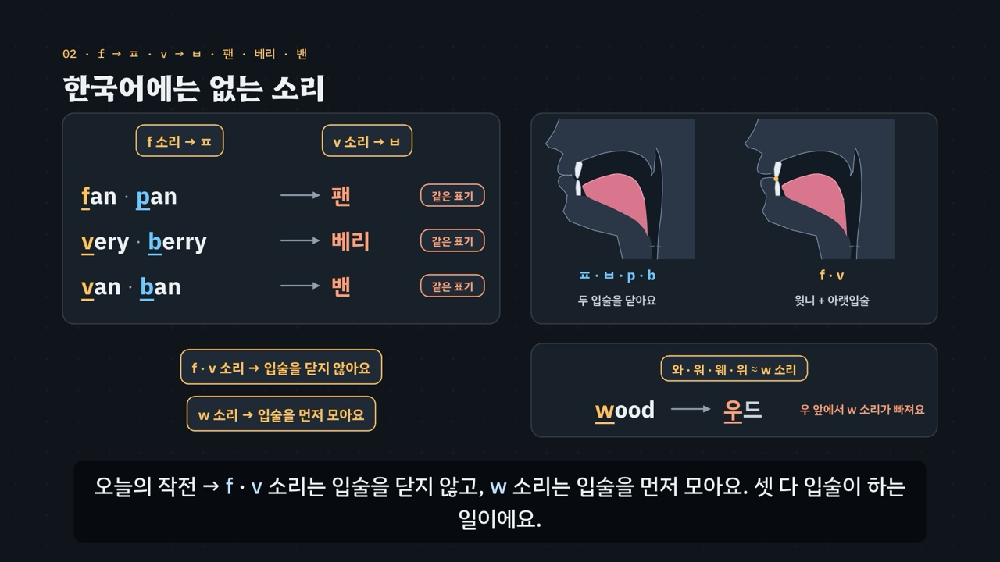

# 입술이 하는 일 — f · v · w

> [영어 튜토리얼](../README.md) 모음의 **영어 발음 (미국식)** 여섯 번째 꼭지입니다(영역: `pron`, 계획표의 P02 · 유형 5 · 6 · 11의 w). 발음 영역의 설계도는 [docs/pron-types.md](../docs/pron-types.md)이고, 형식은 [r · l, 혀끝이 닿느냐 마느냐](../r-and-l/README.md)를 복사해 시작했어요(목소리 부품은 [끝소리와 자음 묶음](../final-consonants/README.md)과 같아요). 이 꼭지가 입 옆 단면도에 **입술 자세**(윗니 끝을 아랫입술에 · 입술을 둥글게 모아 내밀기)와 **윗니 – 아랫입술 닿음 계산**을 더했어요.

선풍기 · 냄비 → 영어로 *fan · pan*. 한국어로 적으면 둘 다 **팬**이에요. 정말 · 산딸기 → *very · berry*, 둘 다 **베리**예요. 한국어에는 윗니와 아랫입술로 내는 소리가 없어서, 외래어 표기는 f를 ㅍ, v를 ㅂ으로 적어요. ㅍ · ㅂ은 두 입술을 닫았다 터뜨리는 소리라, 한국어식으로 말하면 듣는 사람에게는 *pan · berry*로 들리기 쉬워요.

- **f 소리** — 윗니 끝을 아랫입술 안쪽에 가볍게 얹고(깨물지 않음) 그 틈으로 바람을 길게. 목은 울리지 않아요. *p* 소리는 두 입술을 닫았다가 톡 터뜨려요.
- **v 소리** — f 소리와 같은 입 + 목 울림. 요령: f 소리를 길게 내다가 목소리를 켜기. *b* 소리는 두 입술을 닫았다가 목을 울리며 열어요.
- **w 소리** — 입술이 이에 닿지 않아요. 우 하듯 둥글게 모아 내밀었다가 곧바로 다음 모음으로 풀어요(와인 · 워터 · 웨스트 · 윈과 비슷). 함정은 **우 앞** — *wood · woman · would*를 한국어식으로 읽으면 우드 · 우먼 · 우드, w 소리가 사라져요.
- **끝의 f · v**(*leaf · five · love · golf*)는 윗니를 입술에 댄 채 끝내요. 한국어식(리프 · 파이브 · 러브 · 골프)처럼 ‘으’를 붙이지 않아요 — 끝 자음은 [끝소리 튜토리얼](../final-consonants/index.html)에서 더 다뤄요.

3단계 발음법: ① **듣고 가르기**(짝 낱말 · 여러 목소리) → ② **입 모양 만들기**(윗니 + 아랫입술 · 입술 모으기 · 목 울림) → ③ **낱말 · 문장 속에서**(자리 · 외래어 · 문장).



## 바로 보기

`index.html`을 더블클릭하면 끝이에요. 설치도, 서버도 필요 없어요.

## 소리와 마이크에 대해 (꼭 읽어 주세요)

- 녹음 파일이 없어요. 영어는 모두 **합성 음성**이에요. 글이 정해진 말(짝 낱말 · 문장 · 연습 문제 · 따라 말하기)은 **VoiceStudio로 미리 만든 미국식 목소리 넷**(`audio/dialogue/`)으로, 나머지는 브라우저에 들어 있는 영어 음성(speechSynthesis)으로 읽어요. 합성 음성은 실제 사람의 말소리와 조금 다르게 들릴 수 있고, 특히 **브라우저 음성은 f · v를 p · b처럼 약하게 내기도 해요**(머리말 각주에도 적음).
- **목소리 넷**: 밝은 선생님(미국 여성) · 차분한 선생님(미국 여성) · 미국 여성 · 미국 남성. 같은 짝을 여러 목소리로 들으며 가르는 것이 듣기 훈련의 핵심이라(목소리가 바뀌어도 f · p, v · b, w · v를 가르는 귀), 훈련 · 연습 문제는 문제마다 목소리를 바꿔요. 비교용 **한국어식 소리**(*팬 · 베리 · 우드 · 커피 · 러브* …)는 한국어 내레이터 목소리로 만들었어요(`voices.json`의 `"lang": "ko"`).
- 튜토리얼 전용 목소리 부품 `assets/js/voices.js`(`FVV`)는 끝소리의 `FCV`와 같아요(말하는 사람마다 파일을 찾고, 없으면 브라우저 음성 en-US · 한국어식은 ko-KR, 잰 값 `FVV.meas`). 읽기 전에 음성 해설 · 발음 듣기 · 녹음 재생을 멈추고 영상을 일시정지해요.
- **내 발음 확인 · 따라 말하기**: 브라우저에 음성 인식(`SpeechRecognition` · `webkitSpeechRecognition`, en-US)이 있으면 말을 글로 바꿔 **후보 글 여러 개**를 짝 낱말과 맞춰 봐요(*fan*을 말했는데 *pan*으로 적히면 ‘짝 낱말로 들렸어요’). 발음의 질은 판정하지 않아요 — 인식기는 흔한 낱말 쪽으로 기울어요(*vile*보다 *while*, *fleas*보다 *please*). 크롬(Chrome) 같은 브라우저는 소리를 브라우저 회사의 서버로 보내 글로 바꿔요. 음성 인식이 없으면 녹음(`MediaRecorder`)으로 ‘내 목소리’와 ‘본보기’를 이어서 들어요. 녹음은 메모리에만 두고, 이 사이트는 아무것도 저장하지 않아요(듣고 가르기 훈련의 기록만 이 브라우저의 `localStorage`에).

## 무엇을 배우나요

| 장 | 시각 | 내용 | 직접 해 보기 |
| --- | --- | --- | --- |
| 00 들어가며 | 0:00 | *fan · pan* = 둘 다 팬, *very · berry* = 둘 다 베리 · f · v는 윗니 + 아랫입술, p · b는 두 입술 | 먼저 들어 보기(한국어식 팬 · 베리와 함께) |
| 01 들어 보기 · 구별되나요? | 0:30 | ① 짝 낱말(*fan · pan, very · berry, wine · vine, leaf · leap*) · 한국 대학생의 듣기 연구에서도 p · f, b · v가 가장 헷갈림 | 짝 듣고 고르기(맛보기 — 네 짝 × 목소리 넷) |
| 02 한국어에는 없는 소리 | 1:08 | f → ㅍ · v → ㅂ(팬 · 베리 · 밴 — 짝이 같은 표기) · 두 입술(ㅍ · ㅂ · p · b)과 윗니 + 아랫입술(f · v) 입 그림 · 와 · 워 · 웨 · 위 ≈ w 소리, 우 앞에서는 빠짐(*wood* → 우드) | 짝의 한국어식 표기(22쌍, 같은 표기인지 엔진이 계산) |
| 03 f 소리 — 윗니를 아랫입술에 | 1:48 | ② 입 옆 단면도 · 입술 앞모습 · 바람이 이어지는 f ↔ 막혔다 터지는 p(소리 띠) · 끝의 f(*leaf · laugh*) | 입 모양 바꿔 보기(f 소리 · p 소리) |
| 04 v 소리 — 같은 자리 + 목 울림 | 2:34 | ② f와 같은 입 + 목 울림(목 물결) · v ↔ b · *vote · boat, vest · best, van · ban* | 목 울림 켜고 끄기(v 소리 ↔ f 소리) |
| 05 w 소리 — 입술을 먼저 모으고 | 3:16 | ② 입술을 둥글게 모아 내밀었다가 풀기 · 와인 · 워터 · 웨스트 · 윈 · 우 앞 함정(*wood · woman · would*) · *wine ↔ vine* 입 그림 둘 | 입 모양 바꿔 보기(w 소리 · v 소리) |
| 06 낱말 속 자리 | 4:06 | ③ 처음(*fan · very · wine*) · 묶음(*fly · free · swim · twelve · quick*) · 가운데(*coffee · seven · away*) · 끝(*leaf · five · love · golf*, 끝에 ‘으’ 없이) | 낱말 속 자리(낱말을 고르면 자리 · 입 모양 · 한국어식) |
| 07 외래어 함정 | 4:50 | 외래어 카드 열여섯 장(f → ㅍ · v → ㅂ · 우 앞 w 빠짐 · 섞어서) · *cup* 컵 ≠ *cuff* 커프(모든 짝이 같은 표기는 아님) | 외래어 하나씩(한국어식과 함께) |
| 08 문장 속에서 | 5:34 | *A cup of coffee, please.*(*of* = v 소리) · *My wife will wipe the table.* · *Wear a vest when it's cold.* · *Would you like some water?* | 문장 고르기(따라 말하기의 28문장) |
| 09 정리 | 6:18 | 3단계 발음법 · 목표는 듣는 사람이 헷갈리지 않는 소리 | 이제 직접(아래 칸으로) |

전체 6분 52초.

- **듣고 가르기 훈련**(놀이터 왼쪽): 목소리 넷 × 짝 낱말 22쌍(f ↔ p 12 · v ↔ b 6 · w ↔ v 4)에서 하나를 무작위로 들려주고 둘 중 하나를 고르게 해요(짝의 두 낱말이 모두 확인을 통과한 목소리로만 — 아래 ‘낱말 파일 점검’). 짝 종류 · 목소리를 고를 수 있고, 답하면 두 낱말을 같은 목소리로 이어서 들어 보고 엔진의 듣기 힌트를 보여 줘요. 기록은 **자리(처음 · 묶음 · 가운데 · 끝)마다 · 짝마다 · 목소리마다** 맞힌 비율로, `localStorage` `en-fv-hvpt-v1`(지우기 단추). 키보드 R 듣기 · 1 · 2 고르기 · Space/Enter 다음. 여러 목소리로 듣는 훈련의 근거는 [r · l 튜토리얼](../r-and-l/index.html)의 각주를 이어서 가리켜요.
- **내 발음 확인**(놀이터 오른쪽): 짝 22쌍 가운데 하나와 말할 낱말을 고르면 입 그림(윗니 – 아랫입술 닿음 표시) · 말하는 요령이 나오고, 말하면 음성 인식의 후보 글을 짝과 맞춰 ‘그 낱말로 들렸어요 · 짝 낱말로 들렸어요 · 다른 말로 들렸어요’를 알려 줘요. 소리가 같은 철자(*wine · whine*, *wood · would*, *past · passed* …, `FV.SAME`)는 같은 낱말로 봐요.
- **따라 말하기 28문장**: f 소리 · v 소리 · w 소리 · 섞어서, 묶음마다 일곱 문장. f · v · w 소리 글자는 노랑, p · b 소리 글자는 하늘(글자 색 + 밑줄). 철자와 소리가 다른 곳(*ph* = f, *of* = v)도 엔진이 소리에서 칠해요. 들린 낱말을 원래 문장과 맞춰 맞은 낱말 초록 · 빠진 낱말 주황(`FV.compareWords`).
- **듣고 고르기 16문제**(`PDrill`, `.edr` 모양): 어느 낱말? 7 · 문장 속 어느 낱말? 4 · 같은 낱말? 다른 낱말? 3(*wood · would*는 소리가 같아 ‘같아요’) · 한국어식은 어느 쪽? 2. 정답 위치 8/8, 목소리마다 4문제. 소리 먼저, 힌트 세 단계(① 들을 곳 → ② 입 모양 → ③ 낱말 속 자리)는 엔진이 짝의 종류 · 자리에서 만들어요. 키보드 A · B(1 · 2) · H 힌트 · R 다시 듣기 · S 천천히 · Enter.
- **퀴즈 10문제**: 영상 순서대로. 그림 문제 둘(f 소리의 입 · w 소리의 입 — 입 옆 단면도 넷 중 고르기). 그림 문제의 정답은 `check()`가 입 그림에서 다시 계산해요(윗니가 아랫입술에 닿은 그림 · 닿지 않고 입술도 닫히지 않고 둥글게 모은 그림).
- **핵심 정리**: f · v · w · p · b, 낱말 처음 · 자음 묶음 · 끝 · 우 앞의 w 표 + 용어(① 듣고 가르기 · ② 입 모양 만들기 · ③ 낱말 · 문장 속에서).

### 플레이어 조작

다른 튜토리얼과 같아요. 스페이스(재생/일시정지), ← →(5초), Shift + ← →(장), C(자막), V(음성 해설), F(전체 화면). 화면 속 낱말을 누르면 발음을 들려줘요(같은 단추를 곧바로 다시 누르면 천천히). 03 · 04 · 05장의 직접 해 보기에서 자세를 고르면 영상이 멈추고 그 장의 장면이 고른 자세로 바뀌어요(영상 추출은 늘 기본 자세).

**미리 만든 목소리**: VoiceStudio(OmniVoice 엔진, 비상업용 라이선스)로 만든 합성 음성 파일이에요. 파일이 없거나 못 읽으면 그 줄 · 조각만 브라우저 음성으로 읽어요.
- **영어는 0.9배로 재생해요**(`voices.js`의 `EN_RATE`). 한국어 해설과 한국어식 읽기는 1배.
- **늘어놓은 낱말은 쉬어 가며 읽어요.** 자막에 · 로 늘어놓은 영어 낱말(*fan · pan*, *vote · boat*)은 낱말마다 따로 만들고 사이에 쉼표만큼 쉬어 한 파일로 이었어요(`--word-lists`). 해설의 영어 조각 48개는 받아쓰기(Whisper)로 모두 맞게 적히는 것을 확인했어요(*wood · would*처럼 소리가 같은 낱말은 맞게 들은 것으로 봤어요). 그 가운데 낱말만 읽는 조각 42개는 확인(받아쓰기 · 끝 올림 · 센 음절)을 통과한 밝은 선생님(`tc`) 낱말 파일을 쉼표만큼 쉬어 이어 다시 만들었어요(`tools/measure-syllables.py f-v-w --narration`). *of*와 *five, Wi-Fi, wave, favorite.*, 문장 4개(*A cup of coffee, please.* · *My wife will wipe the table.* · *Wear a vest when it's cold.* · *Would you like some water?*)는 처음 만든 소리 그대로예요. 한국어 조각 110개도 받아쓰기로 확인했어요. 받아쓰기가 ‘에프 · 브이 · 더블유’를 *F · V · W*로, ‘스물여덟’을 ‘28’로 적은 조각은 그대로 썼어요. ‘베리 → 페리’, ‘파일 → 타일’, ‘컵 → 컴’, ‘목을 울려요 → 올려요’, ‘가운데 → 다음’, ‘끝 · 울’(한 낱말 조각을 엉뚱한 문장으로)처럼 다르게 적힌 조각은 seed를 바꿔 다시 만들었어요. ‘밴’은 다섯 번 만들어도 받아쓰기가 ‘펜 · 팬’으로 적어서 첫 모음의 높이를 쟀어요. ㅂ로 시작하는 ‘베리 · 비디오’(약 235Hz)처럼 214~235Hz였고, ㅍ · ㅋ로 시작하는 ‘팬 · 파일 · 포크 · 커피’(360~406Hz)보다 훨씬 낮았어요(한국어의 예사소리는 뒤 모음을 낮게 시작해요). 그래서 처음 소리를 그대로 썼어요. ‘아내’는 홀로 받아쓰면 ‘아메’로 적혔지만, 앞뒤 해설 조각에 이어 받아쓰면 ‘아내’로 적혀서 그렇게 적힌 소리를 골랐어요.
- 음성 해설(`audio/narration/`): 한국어 조각은 「튜토리얼 내레이터 (젊은 여성)」, 영어 조각은 「영어 선생님 (밝은 미국 여성)」. 해설은 한국어 속 홀로 쓴 소리 글자를 글자 이름으로 읽어요(f · v · w · p · b → 에프 · 브이 · 더블유 · 피 · 비, 함께 나오는 r · l → 알 · 엘), ㅍ · ㅂ은 ‘피읖 · 비읍’, 자막의 `+` · ` = `는 쉼표로.
- 낱말 · 문장(`audio/dialogue/`): 말하는 사람 → 프로필은 `voices.json` — `tc` 「영어 선생님 (밝은 미국 여성)」 · `tf` 「영어 선생님 (미국 여성)」 · `uf` 「길 묻기 · 나 (미국 여성)」 · `um` 「길 묻기 · 길에서 만난 사람 (미국 남성)」 · `ko` 「튜토리얼 내레이터 (젊은 여성)」(한국어).

만드는 법(VoiceStudio가 있는 맥에서, 이미 만든 파일은 건너뛰어요):

```bash
node tools/narration-pieces.cjs f-v-w     # 해설의 읽기 조각 목록 (자막을 고쳤을 때만)
node tools/dialogue-lines.cjs f-v-w       # 낱말 · 문장 줄 목록 + 잴 줄의 정보 (낱말 · 문제 · 따라 말하기를 고쳤을 때만)
python3 tools/voicestudio-narration.py f-v-w --en-profile "영어 선생님 (밝은 미국 여성)" --word-lists
python3 tools/voicestudio-dialogue.py f-v-w
```

### 낱말 파일 점검

이 꼭지는 잰 값으로 그리는 그림이 없어요(박자 공 · 높낮이 선 · 모음 지도 없음). 측정 도구는 짝 낱말 파일이 정말 그 낱말로 들리는지 확인하는 데 써요. `audio/dialogue/measure.js`에는 확인을 통과한 줄의 값(음절 · 높이)이 적히지만 화면에 그리지는 않고, 듣고 가르기 훈련과 직접 해 보기의 듣기 문제가 짝의 두 낱말이 모두 통과한 목소리를 고를 때만 써요(`FVV.meas`). 줄 정보(`window.__measureMeta`)는 낱말 하나 `word`(음절 수 `n` · 센 음절 `at`) · 한국어식 `ko`(글자 수 `n`) · 그 밖(문장 · 짝 이어 듣기) `other`이고, 모음 · 높이를 재는 칸은 없어요.

- 처음 쟀을 때 277줄 가운데 31줄이 통과하지 못했어요(이유가 겹치는 줄이 있어요).
  - 끝이 묻는 말처럼 올라감 16줄
  - 받아쓰기가 다름 10줄: *ban · van* → Fan, *boats* → Votes, *vet* → That, *bet* → but처럼 이 꼭지가 다루는 바로 그 혼동도 있었어요. 그 밖에 *berry* → Barry 2줄, *would* → wood 2줄, 한국어식 *베스트*를 엉뚱한 문장으로 적은 1줄
  - 음절을 나누지 못함 6줄, 센 음절 3줄(*Wi-Fi · supper · suffer*)
- seed를 여섯 번 바꿔 25줄을 바꿨어요.
- 측정 도구의 소리가 같은 낱말에 *wood · would*와 *Barry · berry*(많은 미국 사람이 같게 말해요)를 더했어요. 남은 6줄을 다시 재고 seed를 여섯 번 더 바꿔 4줄이 통과했어요.
- **끝내 통과하지 못한 2줄**: 미국 남성의 *berry*(음절을 나누지 못함)와 *while*(끝이 묻는 말처럼 올라감)이에요. 엔진이 이 목소리의 짧은 낱말을 자주 너무 빨리 읽어서 쓸 만한 소리가 잘 나오지 않았어요. 소리 파일은 그대로 두고 잰 값만 뺐어요.
  - 듣고 가르기 훈련과 직접 해 보기의 듣기 문제는 짝의 두 낱말이 모두 통과한 목소리로만 들려줘요. 그래서 *very · berry*와 *while · vile* 짝은 미국 남성 목소리로 나오지 않아요.
  - 연습 문제 16개의 소리와 견줘 듣기 낱말 · 한국어식 표기는 모두 그 목소리로 확인을 통과한 파일이에요.

## 무엇이 규칙 계산인가요

- **규칙 엔진** `assets/js/grammar.js`(`FV`)가 낱말마다 적은 발음 기호에서 계산해요. 영상 · 직접 해 보기 · 놀이터 · 연습 문제 · 퀴즈가 모두 같은 결과를 써요.
  - 낱말 사전 `FV.DICT`(103낱말: 철자 조각(f · v · w · p · b 소리를 적은 글자 `[ ]`) · 음절로 나눈 넓은 IPA · 한국어식 표기 · 뜻 · 묶음). 소리 목록 `FV.phones`, 음절 `FV.syl` · `FV.nSyl` · `FV.stressAt`.
  - **소리의 자리** `FV.labials` · `FV.targets` · `FV.posOf`: f · v · w(이 편의 소리)와 p · b(짝 소리)가 음절의 어디에 있나 — 처음 · 묶음 · 가운데 · 끝(`FV.POS`).
  - **짝 낱말** `FV.pairDiff`: 소리 수가 같고 한 소리만 다르며 그 차이가 f ↔ p · v ↔ b · w ↔ v인지, 그 자리. `FV.PAIRS` 22쌍(f ↔ p 처음 6 · 묶음 1 · 가운데 1 · 끝 4, v ↔ b 처음 5 · 끝 1, w ↔ v 처음 4).
  - **외래어 표기** `FV.koUnits` · `FV.koExpect` · `FV.koMarks`: 한국어식 표기의 한글(첫소리 ㅍ · ㅂ, 받침 ㅂ, 와 · 워 · 웨 · 위 · 왜, w가 빠진 우)이 영어의 소리와 차례대로 맞는지, 넣은 ‘으’ `FV.koInserted`, 두 낱말이 **같은 표기**가 되는지 `FV.koSame`(22쌍 중 16쌍이 같은 표기 — *cuff · cup*, *laugh · lap*과 w ↔ v 넷은 다른 표기). 영상 · 페이지가 ‘같은 표기 · 다른 표기’라고 말하는 짝(`FV.CLAIMS`)은 `check()`가 엔진으로 확인해요.
  - 외래어 줄 `FV.LOAN`(f → ㅍ: *coffee · file · fork · golf*, v → ㅂ: *video · service · van · love*, 우 앞 w 빠짐: *wood · woman · wool · wolf*, 섞어서: *five · Wi-Fi · wave · favorite*), 문장 속 칠하기 `FV.spans` · `FV.segs`(철자가 아니라 소리로 — *of*의 f = v 소리, *ph* = f 소리), 들린 말 맞추기 `FV.heard`(소리가 같은 철자 `FV.SAME`), `FV.compareWords`, 연습 문제의 힌트 `FV.hints`.
- **어긋남 경고** `FV.check()`: 철자 조각의 `[ ]`와 엔진의 소리 자리, 한국어식 표기의 ㅍ · ㅂ · 와 · 우가 소리와 맞는지, 짝이 한 소리만 다른지와 자리 · 종류, 같은 표기 주장, 외래어 줄, 문장 묶음마다 일곱 문장, 엔진과 어긋나는 연습 문제의 정답 · 한쪽에 몰린 정답 위치(퀴즈의 정답은 `app.js`가 엔진 · 입 그림으로 따로 확인), 입 그림(f · v는 윗니가 아랫입술에 닿음 · p · b는 입술이 닫힘 · w는 둘 다 아니고 둥글게 모음)이 어긋나면 콘솔에 경고가 떠요. 지금 경고 0개.
- **입 옆 단면도**: 공통 부품 `../shared/mouth.js`에 이 꼭지가 더한 것 — 자세 `f`(윗니 끝을 아랫입술에, `bite: 1`) · `w`(입술을 둥글게 모아 내밂, `round: 0.95`, 혀 뒤를 조금 올림), 자세의 `bite` 값(아랫입술을 윗니 쪽으로 · 앞모습에서 윗니가 보이고 아랫입술 안쪽이 보임, `mix`도 `bite`를 섞음), 닿음 계산 `EN.mouth.lipTeeth(자세)` → `{ touch, gap, at, from }`(아랫입술 앞쪽 점과 윗니 끝 사이 거리, 3 이하면 닿음), 그림 옵션 `lipMark`(닿으면 점 · 아니면 점선), 이름표 `teeth`(윗니) · `llip`(아랫입술). p · b는 원래 있던 `p` 자세와 `lipsClosed`를 써요. 원래 자세 스무 개는 그림이 한 화소도 바뀌지 않았고, 다른 발음 튜토리얼 다섯(r · l · 낱말 강세 · 끝소리 · 긴장한 모음 · 벌리는 모음)의 `check()`도 그대로 0이에요. ‘닿아요 · 닫혀요 · 모아요’는 그림에서 계산해 영상 · 퀴즈가 같은 값을 써요.
- **발음 사전 대조**(커밋 전에 따로): 103낱말의 음절 수 · 센 음절 · 자음 차례를 misaki 미국 발음 사전(VoiceStudio에 들어 있는 `us_gold.json` · `us_silver.json`)과 맞췄어요. 사전에 있는 낱말은 거의 같았고, 다른 곳 11개는 모두 표기 방식 차이예요.
  - r 모음을 한 기호로 적음(*suffer · supper · curve · curb · service · water · never · sweater · were*의 ɚ · ɝ = 사전의 əɹ · ɜɹ — 사전 쪽 자음 차례에 ɹ이 하나 더 보임).
  - *video*: 사전은 두 음절(vˈɪdiO)로 줄여 적고, 여기서는 세 음절(ˈvɪ.di.oʊ)로 적었어요.
  - *with*: 사전은 wɪð, 여기서는 wɪθ(미국 영어에서 둘 다 쓰임, 이 편의 w · v와 상관없음).
  - 사전에 없는 *what's*는 *what* + s로 적었어요. 센 모음이 다른 곳은 *golf*(여기 ɑ · 사전 ɔ, 미국 안에서도 갈림)뿐이에요. 사전 대조 스크립트는 저장소에 넣지 않았어요.
- **단순하게 줄인 부분**
  - 입 그림은 쉽게 줄여 그린 것이에요(윗니 · 아랫입술 · 입술 모으기만 강조). 실제 입 모양은 사람마다 조금씩 달라요.
  - f · v의 ‘윗니 끝을 아랫입술 안쪽에’는 가르치기 쉬운 설명이에요. 실제로는 윗니가 아랫입술의 어느 곳에 닿는지, 얼마나 세게 닿는지 사람마다 달라요.
  - 들을 때 ‘f는 바람이 이어지고 p는 막혔다 터진다’는 소리 띠는 그림으로 줄인 것이고, 잰 값이 아니에요.
  - 자리는 음절로 나눠 정해요(첫 음절의 홀로 선 첫소리 = 처음 · 다른 자음과 붙은 첫소리 = 묶음 · 둘째 음절부터의 첫소리 = 가운데 · 음절 끝 = 끝).
  - 외래어 표기는 국립국어원 외래어 표기법을 따르되 굳어진 표기(커피)는 그대로 써요. 엔진은 f · v · w · p · b 자리의 한글만 맞춰 봐요(모음은 보지 않음).
  - 엔진은 소리를 듣지 않아요. 내 발음 확인은 음성 인식이 적은 후보 글을 짝 낱말과 맞춰 볼 뿐이에요.
- **근거로 삼은 연구**(초록으로 확인한 범위, 자세한 목록은 [docs/pron-types.md](../docs/pron-types.md)):
  - f · v — [초미희 2009](https://koreascience.or.kr/article/JAKO200906942463679.page)(한국콘텐츠학회논문지 9(1)). 한국 대학생이 무의미 낱말 속 p · b · f · v를 고르는 듣기 시험에서, 막는 소리와 바람 소리(p ↔ f, b ↔ v)를 양쪽 방향으로 가장 많이 헷갈렸고, 강한 자리가 약한 자리보다 쉬웠어요. **듣기 혼동으로만** 인용하고, ‘f를 p로 말한다’는 말하기 주장의 근거로 쓰지 않았어요.
  - w — [Praisley 2016](https://hdl.handle.net/20.500.14783/12787)(Memorial University of Newfoundland 석사 논문). 일본인 · 한국인 학습자가 뒤 모음 앞의 w를 빼거나 바꾸고, 그 주된 원인이 듣기(지각)에 있다고 봤어요. 초록이 말한 ‘뒤 모음 앞’ 그대로 옮겼어요(‘우 앞’은 이 튜토리얼의 설명).
  - 두 연구 모두 대상 · 방법이 이 튜토리얼과 달라 보여 준 방향만 말하고 숫자는 옮기지 않았어요.
- **예문과 문제**: 모두 직접 만든 것이에요.

## 폴더 구조

```
index.html              페이지 (영상 · 직접 해 보기 · 듣고 가르기 훈련 · 내 발음 확인 · 따라 말하기 · 듣고 고르기 · 퀴즈 · 핵심 정리)
assets/js/grammar.js    규칙 엔진(FV.phones · FV.syl · FV.labials · FV.targets · FV.posOf · FV.pairDiff · FV.koUnits · FV.koExpect · FV.koMarks · FV.koSame · FV.koInserted · FV.spans · FV.segs · FV.heard · FV.compareWords · FV.hints),
                        낱말 사전(FV.DICT) · 짝(FV.PAIRS) · 외래어(FV.LOAN) · 문장(FV.SENT) · 목소리(FV.VOICES) · 입 그림(FV.MOUTH) · 연습 문제(FV.DRILL) · 점검(FV.check)
assets/js/voices.js     낱말 · 문장 목소리(FVV): 목소리 넷 + 한국어식(미리 만든 파일 → 없으면 브라우저 음성), EN_RATE 0.9, 잰 값(FVV.meas)
assets/js/scenes.js     영상 장면 10개, 장 목록과 자막, 입 옆 단면도(f · v · w · p · b와 윗니 – 아랫입술 닿음) · 입술 앞모습 · 소리 띠 · 짝 표 · 외래어 카드 · 문장 칠하기
assets/js/app.js        플레이어, 직접 해 보기, 듣고 가르기 훈련(기록 표), 내 발음 확인, 따라 말하기(음성 인식 · 녹음), 듣고 고르기(PDrill), 퀴즈, 영상 추출(EN_EXPORT)
../shared/mouth.js      입 옆 단면도 부품(EN.mouth) — 이 꼭지가 f · w 자세, bite, lipTeeth, lipMark를 더함
video/                  자막 원고(SRT)
audio/narration/        음성 해설의 읽기 조각 목록(pieces.json) · 파일 목록(clips.js) · 음성 파일
audio/dialogue/         낱말 · 문장 줄 목록(lines.json) · 잴 줄의 정보(measure-meta.json) · 말하는 사람 → 프로필(voices.json) · 파일 목록(clips.js) · 잰 값(measure.js) · 음성 파일
docs/poster.jpg         사이트 카드 그림
```

## 영상 다시 만들기

```bash
node tools/render-video.cjs f-v-w                       # → f-v-w/video/f-v-w.mp4 + .srt
node tools/render-video.cjs f-v-w --frames 106.5,130    # 몇 장면만 그림으로
node tools/render-video.cjs f-v-w --poster 106.5        # 카드 그림
node tools/render-video.cjs f-v-w --srt                 # 자막 원고만
```

MP4에는 소리가 없어요(자막이 그림에 들어가요).
