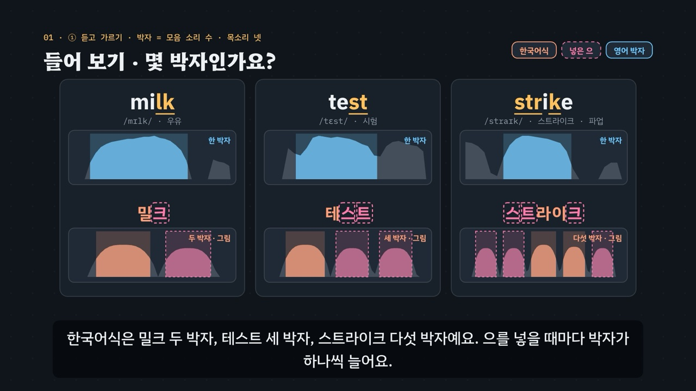

# 없는 ‘으’를 넣지 마세요 — 끝소리와 자음 묶음

> [영어 튜토리얼](../README.md) 모음의 **영어 발음 (미국식)** 세 번째 꼭지입니다(영역: `pron`, 계획표의 P01 · 유형 1–4). 발음 영역의 설계도는 [docs/pron-types.md](../docs/pron-types.md)이고, 형식은 [낱말 강세와 슈와](../word-stress/README.md)를 복사해 시작했어요. 이 꼭지가 **소리 덩어리**(20밀리초마다 잰 크기)와 **끝 유성 · 무성 짝의 모음 길이**를 처음 그렸어요.

책상을 영어로 말할 때 *데스크*라고 하면 세 박자예요. 영어 *desk* → 모음은 에 하나뿐이라 **한 박자**예요. 한국어 음절은 받침이 하나뿐이고 닫은 채 끝나서, 한국어식으로 읽으면 모음 없이 이어지는 자음마다 **없는 ‘으’**를 넣게 돼요. 그러면 박자가 늘고, 다른 낱말로 들리기도 해요(*sport* → *support*).

- **박자는 모음 소리만큼** — 손뼉 한 번 = 모음 소리 하나. 자음은 아무리 많아도 박자를 만들지 않아요(*desk · milk · strike* → 한 박자, *Christmas* → 두 박자).
- **끝 자음은 닫고 멈추기** — 입술을 닫거나 혀를 댄 채 멈춰요. 떼면서 목소리를 실으면 ‘으’가 돼요. 터뜨린다면 숨만 살짝.
- **자음 묶음은 바로 이어** — *strike* = s → t → r + 아이 + k. 혀끝이 윗잇몸 근처에서 그대로 옮겨 가요.
- **끝 유성 · 무성은 모음 길이로** — 목이 울리는 끝(b · d · g · v · z) 앞에서는 모음이 길고, 울리지 않는 끝(p · t · k · f · s) 앞에서는 짧아요(*bag · back*, *prize · price*). ‘으’를 붙여 가르지 않아요.
- **-ed · -s** — 한 박자가 느는 곳은 t · d 뒤 [ɪd](*wanted*), s · z · sh · ch · j 뒤 [ɪz](*buses*)뿐이에요. *worked* [t] · *played* [d] · *cats* [s] · *dogs* [z] → 한 박자 그대로.

3단계 발음법: ① **듣고 가르기**(박자 세기 · 여러 목소리 · 끝 유성 · 무성) → ② **입 모양 만들기**(끝 자음에서 멈추기 · 자음 묶음 잇기) → ③ **낱말 · 문장 속에서**(-ed · -s · 외래어 · 이어 말하기).



## 바로 보기

`index.html`을 더블클릭하면 끝이에요. 설치도, 서버도 필요 없어요.

## 소리와 마이크에 대해 (꼭 읽어 주세요)

- 녹음 파일이 없어요. 영어는 모두 **합성 음성**이에요. 글이 정해진 말(낱말 · 문장 · 연습 문제 · 따라 말하기)은 **VoiceStudio로 미리 만든 미국식 목소리 넷**(`audio/dialogue/`)으로, 나머지는 브라우저에 들어 있는 영어 음성(speechSynthesis)으로 읽어요. 합성 음성은 실제 사람의 말소리와 조금 다르게 들릴 수 있어요.
- **목소리 넷**: 밝은 선생님(미국 여성) · 차분한 선생님(미국 여성) · 미국 여성 · 미국 남성. 박자 세기 · 연습 문제는 문제마다 목소리를 바꿔요. 비교용 **한국어식 소리**(*데스크 · 스트라이크 · 크리스마스 · 애스크드* …)는 한국어 내레이터 목소리로 만들었어요(`voices.json`의 `"lang": "ko"`).
- 튜토리얼 전용 목소리 부품 `assets/js/voices.js`(`FCV`)는 낱말 강세의 `WSV`와 같아요(말하는 사람마다 파일을 찾고, 없으면 브라우저 음성 en-US · 한국어식은 ko-KR, 잰 값 `FCV.meas`). 읽기 전에 음성 해설 · 발음 듣기 · 녹음 재생을 멈추고 영상을 일시정지해요.
- **내 발음 확인 · 따라 말하기**: 브라우저에 음성 인식(`SpeechRecognition` · `webkitSpeechRecognition`, en-US)이 있으면 말을 글로 바꿔 **후보 글 여러 개**를 짝 낱말과 맞춰 봐요(*sport*를 말했는데 *support*로 적히면 ‘짝 낱말로 들렸어요’). ‘으’를 넣었는지, 모음 길이를 살렸는지는 판정하지 않아요(인식기는 흔한 낱말 쪽으로 기울고, *eyes · ice*처럼 끝만 다른 짧은 낱말은 특히 헷갈려요). 크롬(Chrome) 같은 브라우저는 소리를 브라우저 회사의 서버로 보내 글로 바꿔요. 음성 인식이 없으면 녹음(`MediaRecorder`)으로 ‘내 목소리’와 ‘본보기’를 이어서 들어요. 녹음은 메모리에만 두고, 이 사이트는 아무것도 저장하지 않아요(박자 세기의 기록만 이 브라우저의 `localStorage`에).

## 무엇을 배우나요

| 장 | 시각 | 내용 | 직접 해 보기 |
| --- | --- | --- | --- |
| 00 들어가며 | 0:00 | 데스크 = 세 박자, *desk* = 한 박자 · *sport · support* | 먼저 들어 보기(한국어식과 함께) |
| 01 들어 보기 · 몇 박자인가요? | 0:36 | ① 박자 = 모음 소리 수 · 박자 공 · 소리 덩어리 · 목소리 넷 | 몇 박자인가요?(맛보기) |
| 02 한국어 음절의 모양 | 1:16 | 받침 하나 · 닫은 끝 → 자음마다 ‘으’ · *strike* → 스 · 트 · 라 · 이 · 크 | 한국어식으로 적으면(넣은 으 · 박자) |
| 03 끝 자음에서 멈추기 | 1:56 | ② 입 옆 단면도: k · p · t에서 닫고 멈춤 · 한국어식 크(떼며 목을 울림) | 끝 자음의 입 모양(k · p · t · s 고르기) |
| 04 자음 묶음 — 자음에서 자음으로 | 2:38 | ② *strike*의 입 · 묶음 낱말 · *sport · support*, *blow · below* | 자음 묶음 낱말 |
| 05 끝 유성 · 무성 — 모음 길이 | 3:20 | ① *bag · back · prize · price · eyes · ice · leave · leaf* — 모음 길이 막대 | 짝 고르기(같은 목소리로 견줘 듣기) |
| 06 과거형 · 복수형의 끝소리 | 4:04 | ③ -ed [t] · [d] · [ɪd], -s [s] · [z] · [ɪz] | 끝소리 계산기(바탕 낱말 → 끝소리 · 박자) |
| 07 외래어 함정 | 4:48 | 외래어 카드 열여섯 장(끝 자음 하나 · 끝 묶음 · 앞 묶음 · 앞뒤 · 가운데에도) | 외래어 하나씩(한국어식 공과 함께) |
| 08 문장 속에서 · 이어 말하기 | 5:32 | *Let me check it again. · I left my bag on the bus.* — 끝 자음 + 모음 → 이어 붙이기 | 문장 고르기(따라 말하기의 28문장) |
| 09 정리 | 6:16 | 3단계 발음법 | 이제 직접(아래 칸으로) |

- **박자 세기**(놀이터 왼쪽): 목소리 넷 × 낱말 여든 개 남짓에서 하나를 무작위로 들려주고, 박자 수(한~네 박자)를 고르면 **그 목소리를 실제로 잰 박자 공과 소리 덩어리**, 한국어식 표기의 박자가 나란히 나타나요(잰 값이 없으면 엔진의 기본 모양). 낱말 묶음(끝 자음 하나 · 끝 묶음 · 앞 묶음 · 앞뒤로 묶음 · -ed · -s) · 목소리를 고를 수 있고, 묶음 · 목소리마다 맞힌 비율을 표(막대)로 보여 줘요. 기록은 `localStorage` `en-fc-beats-v1`(지우기 단추). 키보드 R 듣기 · 1~4 고르기 · Space/Enter 다음.
- **내 발음 확인**(놀이터 오른쪽): ‘으’를 넣으면 다른 낱말이 되는 짝 다섯(*sport · support, blow · below, prayed · parade, plight · polite, claps · collapse*)과 끝 유성 · 무성 짝 여덟(*bag · back, cab · cap, bed · bet, seed · seat, pig · pick, prize · price, eyes · ice, leave · leaf*) 중 하나를 말하면, 음성 인식의 후보 글을 짝과 맞춰 ‘그 낱말로 들렸어요 · 짝 낱말로 들렸어요 · 다른 말로 들렸어요’를 알려 줘요. 끝 유성 · 무성 짝은 모음 길이 막대(밝은 선생님을 잰 값)를 함께 보여 줘요.
- **따라 말하기 28문장**: 끝 자음 · 자음 묶음 · -ed와 -s · 끝 유성과 무성, 묶음마다 일곱 문장. 모음 없이 이어지는 자음 글자를 노랑으로, 이어 말하는 곳에 ‿를 달았어요. 들린 낱말을 원래 문장과 맞춰 맞은 낱말 초록 · 빠진 낱말 주황(`FC.compareWords`).
- **듣고 박자 · 끝소리 찾기 16문제**(`PDrill`, `.edr` 모양): 몇 박자인지 6 · -ed의 끝소리 4 · 끝 유성과 무성 짝 4 · 자음 묶음 짝 2. 소리 먼저, 힌트 세 단계는 엔진이 낱말에서 만들어요. 답하면 그 목소리를 잰 박자 공 · 모음 길이와 같은 목소리로 견줘 듣기. 키보드 A~C(1~3) · H 힌트 · R 다시 듣기 · S 천천히 · Enter.
- **퀴즈 10문제**: 영상 순서대로. 그림 문제 둘(끝 k에서 멈춘 입 — 입 옆 단면도, *strike*의 박자 공).
- **핵심 정리**: 박자 · 끝 자음 · 자음 묶음 · 끝 유성과 무성 · -ed와 -s · 외래어와 문장 표 + 용어(① 듣고 가르기 · ② 입 모양 만들기 · ③ 낱말 · 문장 속에서).

### 플레이어 조작

다른 튜토리얼과 같아요. 스페이스(재생/일시정지), ← →(5초), Shift + ← →(장), C(자막), V(음성 해설), F(전체 화면). 화면 속 낱말을 누르면 발음을 들려줘요(같은 단추를 곧바로 다시 누르면 천천히). 03 · 04장의 입 그림은 영상을 멈춰도 계속 움직여요(플레이어만, 영상 추출은 시각 t만으로 그려요).

**미리 만든 목소리**: VoiceStudio(OmniVoice 엔진, 비상업용 라이선스)로 만든 합성 음성 파일이에요. 파일이 없거나 못 읽으면 그 줄 · 조각만 브라우저 음성으로 읽어요.
- **영어는 0.9배로 재생해요**(`voices.js`의 `EN_RATE`). 한국어 해설과 한국어식 읽기는 1배.
- **늘어놓은 낱말은 쉬어 가며 읽어요.** 자막에 · 로 늘어놓은 영어 낱말(*milk · test · strike*)은 낱말마다 따로 만들고 사이에 쉼표만큼 쉬어 한 파일로 이었어요(`--word-lists`). 해설의 영어 조각 30개는 받아쓰기(Whisper)로 모두 맞게 적히는 것을 확인했어요. 그 가운데 낱말만 읽는 조각 22개는 확인(받아쓰기 · 울림 조각 수 · 끝 올림)을 통과한 밝은 선생님(`tc`) 낱말 파일을 쉼표만큼 쉬어 이어 다시 만들었어요(`tools/measure-syllables.py final-consonants --narration`). 이어 말하기를 보여 주는 조각 3개(*check · it*, *bag · on*, *test · in*)는 처음 만든 소리 그대로예요(*it · on · in*은 잰 낱말이 아니에요). 한국어 조각도 받아쓰기로 확인했어요. 홀로 쓴 ‘으’는 받아쓰기가 ‘음 · 을’로 적는 일이 잦아서(같은 자리를 세 번 만들어도 같았어요), 그 글자만 다르게 적힌 조각은 받아쓰기의 한계로 보고 그대로 썼어요.
- 음성 해설(`audio/narration/`): 한국어 조각은 「튜토리얼 내레이터 (젊은 여성)」, 영어 조각은 「영어 선생님 (밝은 미국 여성)」. 해설은 -ed를 ‘이디’, -s를 ‘에스’로, 한국어 속 홀로 쓴 자음 글자(k · t · r …)를 글자 이름으로 읽어요.
- 낱말 · 문장(`audio/dialogue/`): 말하는 사람 → 프로필은 `voices.json` — `tc` 「영어 선생님 (밝은 미국 여성)」 · `tf` 「영어 선생님 (미국 여성)」 · `uf` 「길 묻기 · 나 (미국 여성)」 · `um` 「길 묻기 · 길에서 만난 사람 (미국 남성)」 · `ko` 「튜토리얼 내레이터 (젊은 여성)」(한국어).

만드는 법(VoiceStudio가 있는 맥에서, 이미 만든 파일은 건너뛰어요):

```bash
node tools/narration-pieces.cjs final-consonants     # 해설의 읽기 조각 목록 (자막을 고쳤을 때만)
node tools/dialogue-lines.cjs final-consonants       # 낱말 · 문장 줄 목록 + 잴 줄의 정보 (낱말 · 문제 · 따라 말하기를 고쳤을 때만)
python3 tools/voicestudio-narration.py final-consonants --en-profile "영어 선생님 (밝은 미국 여성)" --word-lists
python3 tools/voicestudio-dialogue.py final-consonants
```

### 잰 값 — 박자 공 · 소리 덩어리 · 모음 길이

박자 공(박자마다 공 하나, 넓이 = 음절의 길이와 크기), **소리 덩어리**(20밀리초마다 잰 크기, 모음 자리를 칠함), **모음 길이 막대**(끝 유성 · 무성 짝)는 미리 만든 음성 파일을 `tools/measure-syllables.py`로 따로 재서 그려요(`audio/dialogue/measure.js`의 `window.PRON_MEASURE`). 잰 값이 없는 낱말은 엔진의 기본 모양으로 그리고, 화면에 ‘잰 값’이라고 적지 않아요. 이 꼭지에서 측정 도구에 더한 확인은 셋이에요(줄 정보 `measure-meta.json`의 `env` · `count` · `pair`).

- **받아쓰기**(Whisper large-v3): 다른 낱말로 들리지 않는지(*sport*가 *support*로 적히면 탈락).
- **울림 조각 수**(`count`): 영어 낱말 파일의 울림 조각(모음 자리)이 박자 수보다 많으면 탈락 — 합성 음성이 끝 자음 뒤에 모음을 붙였는지.
- **짝의 모음 길이**(`pair`): 같은 목소리의 끝 유성 · 무성 짝에서 목이 울리는 쪽의 마지막 음절이 짝보다 1.15배 이상 길어야 해요. 어긋나면 둘 다 잰 값을 빼요.
- 두 박자 이상인 낱말(*Christmas · wanted*)은 낱말 강세와 같은 센 음절 확인도 거쳐요. 통과하지 못한 파일은 seed를 바꿔 다시 만들어 통과하는 첫 소리를 써요(`--regen`).

**잰 결과**(2026-11-13): 잴 줄 393개(영어 낱말 328 · 한국어식 36 · 문장 29)를 받아쓰고 쟀어요. 낱말 · 한국어식 364줄 가운데 350줄의 잰 값을 써요.

- 처음 쟀을 때 82줄이 통과하지 못했어요 — 끝이 묻는 말처럼 올라감 37줄(밝은 선생님 13 · 미국 남성 12), 울림 조각이 박자보다 많음(끝 자음 뒤에 모음을 붙임) 32줄(차분한 선생님 19 · 미국 여성 10, *mask · milk · cake · work · break · book* …), 받아쓰기가 다름 6줄(*seed* → *See*, *plight* → *Plate* …), 센 음절 6줄(*decided · parade · polite · below*), 짝의 모음 길이 비 3줄(미국 남성 *bag · back* 1.07배). 한 줄에 둘 이상 걸린 것도 있어요.
- seed를 바꿔 다시 만들어(`--regen`, seed 여섯 개 · 남은 일곱 줄은 여덟 개 더) 77줄이 통과했어요. 끝내 통과하지 못한 3줄(*book* 차분한 선생님 — 끝에 모음이 붙음, *collapse* 미국 남성 — 음절을 나누지 못함, 한국어식 *디사이디드* — 받아쓰기가 매번 영어 *DECIDED*로 적음)은 소리 파일은 그대로 두고 잰 값만 뺐어요.
- **박자 세기 · 연습 문제는 확인한 소리로**: 박자 세기는 그 낱말의 확인을 통과한 목소리 가운데서 골라 들려줘요(목소리를 하나로 고르면 그 목소리가 통과한 낱말만). 연습 문제 16개의 소리(견줘 듣는 짝 · 바탕 낱말 포함)는 모두 통과했어요. 영상 · 직접 해 보기에서 목소리를 골라 들을 때는 그대로 들려주고, 그 목소리의 잰 값이 없으면 띠에 ‘그림’이라고 적어요.
- **모음 길이**: 끝 유성 · 무성 짝 8쌍 × 목소리 넷 = 32쌍 모두, 같은 목소리에서 목이 울리는 쪽 모음이 길었어요(가장 작은 차이 1.22배 *prize · price* 미국 여성, 가장 큰 차이 2.94배 *cab · cap* 차분한 선생님). 밝은 선생님은 *bag* 350 · *back* 245ms예요.
- **소리 덩어리는 모음 자리만 색칠해요.** 띠는 20밀리초마다 잰 크기 전체를 그리는데, s · k 같은 자음 소리도 크기가 커서(*test*의 st) 띠만 보면 덩어리가 둘로 보이기도 해요. 그래서 잰 음절(모음 자리) 안만 색칠하고 밖은 회색으로 그려요. 울림 조각 확인을 통과한 파일은 목이 울리는 덩어리가 박자 수보다 많지 않아요.
- **한국어식 박자 공 · 띠는 그림이에요.** 한국어식 36줄 가운데 11줄(*테스트 · 스트라이크 · 브랜드* …)은 음절을 나누지 못했고, 나눈 줄도 넣은 ‘으’가 아주 짧거나 약하게 재어졌어요(*글라스*의 그 20ms · −17dB). 잰 값으로 그리면 ‘으를 넣을 때마다 박자가 하나’와 어긋나 보여서, 한국어식은 표기의 박자 수대로 고르게 그린 그림(`FC.koSchematic`)으로 보여 주고 ‘그림’이라고 적어요. 01장 자막도 ‘넣은 으마다 덩어리가 하나씩’에서 ‘으를 넣을 때마다 박자가 하나씩’으로 고쳤어요. 한국어식 파일도 받아쓰기로 한국어 표기와 같은지는 확인해요.

## 무엇이 규칙 계산인가요

- **규칙 엔진** `assets/js/grammar.js`(`FC`)가 낱말마다 적은 발음 기호에서 계산해요. 영상 · 직접 해 보기 · 놀이터 · 연습 문제 · 퀴즈가 모두 같은 결과를 써요.
  - 낱말 사전 `FC.DICT`(82낱말: 철자 조각(모음 없이 이어지는 자음 글자 `[ ]`) · 음절로 나눈 넓은 IPA · 한국어식 표기 · 뜻 · 묶음). 외래어가 아닌 낱말의 한국어식 표기는 한국어식으로 읽은 소리(*asked* → 애스크드)예요.
  - 박자 수 `FC.nSyl` · `FC.beats`, 끝 자음 `FC.coda` · `FC.final`, 앞 자음 묶음 `FC.onset`, 가운데 묶음 `FC.medial`, 소리의 모양 `FC.shape`(CCVC …), 낱말의 묶음 `FC.kindOf`(끝 자음 하나 · 끝 묶음 · 앞 묶음 · 앞뒤로 묶음 · -ed 꼴 · -s 꼴).
  - 한국어식 표기의 음절 `FC.koSyl` · `FC.koParts`와 **넣은 ‘으’** `FC.koInserted`(이중모음이 나뉜 음절 — *strike*의 라 · 이 — 은 넣은 으와 따로 셈), 한국어식 박자 공의 기본 모양 `FC.koSchematic`.
  - **-ed · -s의 끝소리** `FC.ending`: 바탕 낱말의 마지막 소리에서 [t] · [d] · [ɪd], [s] · [z] · [ɪz]와 늘어난 박자를 계산하고, 까닭 `FC.END_WHY`를 붙여요(`FC.INFL` 20개).
  - **짝 낱말** `FC.VPAIRS`(끝 유성 · 무성 8쌍 — 끝 자음 하나만 다르고 유성 · 무성인지 `FC.voiceDiff`) · `FC.EPAIRS`(‘으’를 넣으면 다른 낱말 5쌍 — 첫 자음 뒤에 모음 하나를 넣은 것인지 `FC.insDiff`), `FC.pairOf` · `FC.partner`.
  - 문장 속 칠하기 `FC.wordsIn` · `FC.segs`와 **이어 말하기** `FC.links`(자음으로 끝나는 낱말 + 모음 글자로 시작하는 낱말), 들린 말 맞추기 `FC.heard`, `FC.compareWords`, 연습 문제의 힌트 `FC.hints`.
- **어긋남 경고** `FC.check()`: 철자 조각의 `[ ]`와 엔진의 끝 자음 · 앞 묶음, 음절 수, 한국어식 표기, 짝이 소리 하나만 다른지, 끝소리 계산과 적어 둔 끝소리, 외래어 줄, 문장 묶음마다 일곱 문장, 엔진과 어긋나는 연습 문제 · 퀴즈의 정답, 한쪽에 몰린 정답 위치, 입 그림(끝 자음 k · t · p에서 닿음 · s는 틈 · 으는 떨어짐)이 어긋나면 콘솔에 경고가 떠요.
- **입 옆 단면도**: 공통 부품 `../shared/mouth.js`에 이 꼭지가 자세 다섯(k · t · p · s · 으)과 입술 닫힘(`close` · `lipsClosed`)을 더했어요. ‘닿아요 · 닫혀요’는 그림에서 계산해 영상 · 퀴즈가 같은 값을 써요.
- **발음 사전 대조**(커밋 전에 따로): 82낱말의 음절 수 · 센 음절 · 자음 차례를 misaki 미국 발음 사전(VoiceStudio에 들어 있는 `us_gold.json` · `us_silver.json`)과 맞췄어요. 사전에 있는 79낱말은 모두 같았고(*work · worked*의 ɝ = 사전의 ɜɹ, 표기만 다름), 사전에 없는 셋(*McDonald's · wanted · dogs*)은 바탕 낱말(*McDonald · want · dog*)에 끝소리를 붙인 것과 같아요.
- **단순하게 줄인 부분**
  - 박자는 사전의 음절 수예요. 빨리 말할 때 줄어드는 음절은 다루지 않아요.
  - 한국어 받침이 닫은 채 끝난다는 설명과 미국 영어의 닫은 끝 자음(터뜨리지 않는 끝 p · t · k)은 쉽게 줄인 설명이에요. 실제로는 사람 · 자리마다 터뜨리기도 해요.
  - 끝 유성 · 무성은 앞 모음의 길이를 중심으로 가르쳐요. 끝 자음 자체의 울림 · 막는 시간 같은 다른 신호도 있어요.
  - 이어 말하기는 ‘자음으로 끝나는 낱말 + 모음 글자로 시작하는 낱말’로 단순하게 찾아요(*hour · honest*처럼 h가 소리 나지 않는 낱말은 따로 적음).
  - 엔진은 소리를 듣지 않아요. 박자 공 · 소리 덩어리 · 모음 길이는 미리 만든 파일을 따로 잰 값이고, 내 발음 확인은 음성 인식이 적은 후보 글을 짝 낱말과 맞춰 볼 뿐이에요.
- **근거로 삼은 연구**(초록 · 요약으로 확인한 범위, 자세한 목록은 [docs/pron-types.md](../docs/pron-types.md)): 모음 넣기 — [신동진 · Iverson 2014](https://koreascience.kr/article/JAKO201420947476109.page?lang=ko)(한국인 영어 학습자가 이어지는 자음 사이 — 자음 묶음 안 · 음절과 낱말 사이 · 끝 자음 뒤 — 에 모음을 넣는 경향, 말하기와 듣기 모두에서 어려움). 끝 유성 · 무성 — [Baker 2010](https://www.cambridge.org/core/journals/bilingualism-language-and-cognition/article/abs/effects-of-age-and-experience-on-the-production-of-english-wordfinal-stops-by-korean-speakers/85ADB4C5B14B33C690ED0408722FBED8)(영어를 오래 쓴 학습자도 늘 정확하지는 않았고, 앞 모음의 길이가 막는 시간보다 익히기 쉬웠으며, 영어 청자는 두 신호를 모두 씀). 연구마다 대상 · 방법이 달라 두 연구가 보여 준 방향만 말하고 숫자는 옮기지 않았어요.
- **예문과 문제**: 모두 직접 만든 것이에요.

## 폴더 구조

```
index.html              페이지 (영상 · 직접 해 보기 · 박자 세기 · 내 발음 확인 · 따라 말하기 · 듣고 고르기 · 퀴즈 · 핵심 정리)
assets/js/grammar.js    규칙 엔진(FC.phones · FC.nSyl · FC.coda · FC.onset · FC.kindOf · FC.koParts · FC.koInserted · FC.ending · FC.voiceDiff · FC.insDiff · FC.links · FC.segs · FC.heard · FC.compareWords · FC.hints · FC.schematic),
                        낱말 사전(FC.DICT) · 끝이 붙은 꼴(FC.INFL) · 짝(FC.VPAIRS · FC.EPAIRS) · 외래어(FC.LOAN) · 문장(FC.SENT) · 목소리(FC.VOICES) · 연습 문제(FC.DRILL) · 점검(FC.check)
assets/js/voices.js     낱말 · 문장 목소리(FCV): 목소리 넷 + 한국어식(미리 만든 파일 → 없으면 브라우저 음성), 잰 값(FCV.meas)
assets/js/scenes.js     영상 장면 10개, 장 목록과 자막, 박자 공 · 소리 덩어리(잰 값 → 없으면 기본 모양) · 모음 길이 막대, 입 옆 단면도(끝 자음에서 멈추기 · strike의 묶음), 외래어 카드, 문장 칠하기
assets/js/app.js        플레이어, 직접 해 보기, 박자 세기(기록 표), 내 발음 확인, 따라 말하기(음성 인식 · 녹음), 듣고 고르기(PDrill), 퀴즈, 영상 추출(EN_EXPORT)
../shared/mouth.js      입 옆 단면도 부품(EN.mouth) — 끝 자음 k · t · p · s와 으
video/                  자막 원고(SRT)
audio/narration/        음성 해설의 읽기 조각 목록(pieces.json) · 파일 목록(clips.js) · 음성 파일
audio/dialogue/         낱말 · 문장 줄 목록(lines.json) · 잴 줄의 정보(measure-meta.json) · 말하는 사람 → 프로필(voices.json) · 파일 목록(clips.js) · 잰 값(measure.js) · 음성 파일
docs/poster.jpg         사이트 카드 그림
```

## 영상 다시 만들기

```bash
node tools/render-video.cjs final-consonants                       # → final-consonants/video/final-consonants.mp4 + .srt
node tools/render-video.cjs final-consonants --frames 57,170       # 몇 장면만 그림으로
node tools/render-video.cjs final-consonants --poster 57           # 카드 그림
node tools/render-video.cjs final-consonants --srt                 # 자막 원고만
```

MP4에는 소리가 없어요(자막이 그림에 들어가요).
