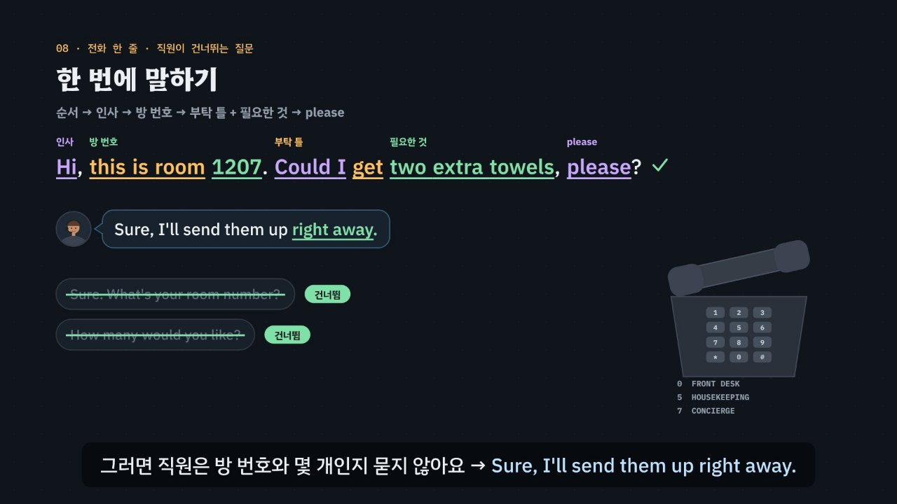

# 호텔, 부탁은 질문으로 한다

> [영어 튜토리얼](../README.md) 모음의 **상황별 영어 회화** 세 번째 꼭지입니다(영역: `talk`). 형식은 [공항](../airport/) · [카페](../cafe/)를 따르고, 형식의 결정은 [CLAUDE.md](../CLAUDE.md)의 ‘회화 튜토리얼이 갖출 것’에 적었어요.

공항과 카페에서는 주로 직원의 질문에 **대답**했어요. 호텔에서는 **내가 먼저** 말을 꺼낼 때가 많아요. 수건이 더 필요하고, 에어컨이 고장 나고, 짐을 맡기고 싶어요. 그래서 호텔 영어의 핵심은 두 가지예요. **부탁은 질문으로**(*Could I get …? · Could you …? · Is late check-out possible?*), **문제는 사실 + 부탁**(*The air conditioner isn't working. Could you send someone to look at it?*). 체크인 · 체크아웃의 질문은 공항처럼 거의 정해져 있어요. 한국 학생이 자주 막히는 곳은 낱말 그대로 옮긴 부탁과 문제 알리기(*Give me towel.* · *Fix it.* · *Change my room.* · *This bill is wrong.*), 2박 3일을 날로 세는 것(*Three days.* → *two nights*), 빠르게 지나가는 숫자(*twelve-oh-seven* · *from seven to ten* · *fifteen*과 *fifty*), 그리고 콩글리시(콘센트 · 리모컨 · 서비스 · 모닝콜 · 드라이기)예요. 이 튜토리얼은 약 6분 32초짜리 인터랙티브 모션그래픽으로 **3단계 말하기 법**을 가르쳐요.

- ① **열쇠 낱말 잡기** — 무엇을 묻나? *reservation* → 예약, *spell* → 철자, *how many nights* → 밤의 수, *passport* → 여권, *incidentals* → 카드를 잠깐 잡아 둠, *room number* → 방 번호, *minibar* → 미니바. 직원이 *How can I help you?* · *What can I do for you?* 하고 물으면 이제 **내가 부탁할 차례** — 무엇을 부탁하나(수건 · 콘센트 · 늦은 체크아웃)가 열쇠 낱말이 돼요.
- ② **틀에 내 정보 넣기** — 짧은 대답 틀 · 부탁 틀 + 숙박 카드와 맞는 정보. *I have a reservation under* + 성, *Two nights.*, *This is room* + 번호, *Could I get* + 필요한 것?, *The ___ isn't working.* + *Could you send someone to look at it?* 방 번호와 시각은 카드 키 봉투의 숫자를 써요.
- ③ **공손하게 끝내기** — *Could I …? · Could you …, please? · Thank you. · I think …* 못 알아들었으면 *Sorry? Could you say that again, please?* 일부만 들렸으면 들린 만큼 되물어요 → *Sorry, what time is breakfast?* 받아 적을 말이면 → *Could you spell that, please?*



## 바로 보기

`index.html`을 더블클릭하면 끝이에요. 설치도, 서버도 필요 없어요.

## 소리와 마이크에 대해 (꼭 읽어 주세요)

- 녹음 파일이 없어요. 영어는 모두 **합성 음성**이에요. 글이 정해진 말(영상의 말풍선 · 영어 칩, 직접 해 보기의 듣기, 듣고 대답 고르기, 따라 말하기)은 **VoiceStudio로 미리 만든 목소리**(`audio/dialogue/`)로, 호텔 숙박 시뮬레이터처럼 카드마다 바뀌는 말과 내가 칩으로 만든 문장은 **브라우저에 들어 있는 음성(speechSynthesis)** 으로 읽어요. 브라우저 음성은 기기마다 목소리가 다르고, 둘 다 실제 호텔의 소리와는 달라요.
- 튜토리얼 전용 목소리 부품 `assets/js/voices.js`(`HTV`)가 말하는 사람마다 목소리를 정해요. 미리 만든 목소리는 프런트 = 미국 남성 · 전화로 받는 프런트와 객실 관리팀 = 캐나다 여성 · 조식 식당 = 호주 남성 · 컨시어지 = 영국 여성 · 손님(나) = 미국 여성, 화면의 영어 칩(발음 듣기)과 음성 해설의 영어는 밝은 미국 여성 선생님 목소리예요(길 묻기와 같은 목소리들). 한 번에 읽는 줄 안에서 한 사람의 말 중 하나라도 파일이 없으면 그 사람의 말은 모두 브라우저 음성으로 읽고(한 사람의 목소리가 중간에 바뀌지 않게), 시뮬레이터는 처음부터 끝까지 브라우저 음성이에요. 브라우저 음성은 프런트(en-US) · 전화로 받는 프런트와 객실 관리팀(en-CA) · 조식 식당(en-AU) · 컨시어지(en-GB) · 손님(나, 프런트와 다른 목소리)을 골라요. 없으면 다른 영어 목소리의 높낮이 · 빠르기를 바꿔 구별해요. ‘아주 빠르게’ 문제는 일부러 빠르게(1.35배) 읽어요. 숫자는 호텔식으로 읽어요(`HT.spoken`): 방 번호 *1207* → twelve-oh-seven, 시각 *6:30* → six-thirty, 합계 *$334.40* → three hundred thirty-four dollars and forty cents, 철자 *K-I-M* → K, I, M. 공통 부품(`shared/`)은 바꾸지 않았어요.
- 소리가 겹치지 않게: 대화를 읽기 전에 발음 듣기 · 음성 해설 · 녹음 재생을 멈추고 영상을 일시정지해요. 음성 인식을 시작할 때도 다른 소리를 모두 멈춰요.
- **따라 말하기 · 말로 대답하기**: 브라우저에 음성 인식(`SpeechRecognition` · `webkitSpeechRecognition`)이 있으면 말을 글로 바꿔 **낱말만** 맞춰 봐요(발음의 질은 판정하지 않아요). 숫자는 *1207*이든 *twelve oh seven*이든 같은 숫자로 맞춰요(`HT.canon`). 크롬(Chrome) 같은 브라우저는 소리를 브라우저 회사의 서버로 보내 글로 바꿔요. 음성 인식이 없으면 녹음(`MediaRecorder`)으로 ‘내 목소리’와 ‘원래 문장’을 이어서 들어요. 둘 다 없으면 마이크 단추를 숨기고 ‘세 번 소리 내어 따라 해 보세요’라고 안내해요. 이 사이트는 소리도 글도 저장하지 않아요(녹음은 화면에만 잠깐 있다가 페이지를 닫으면 사라져요). 성(*Kim*)과 한 글자씩 부른 철자(*K-I-M*)는 인식이 다르게 적기 쉬워서, 성이 들리면 받아들이고 철자를 또박또박 불러 보라고 알려 줘요. 다만 카드와 다른 성(시뮬레이터의 다른 성)이나 다른 방 번호가 또렷이 들리면 ②에서 걸려요.
- 호텔 이름(*Willowmere Hotel*) · 방 번호 · 방값($150.00) · 조식값 · 미니바 · 세금(10%) · 와이파이 비밀번호는 모두 지어낸 것이에요(실제 호텔 · 체인과 상관없어요). 체크인 절차, 카드에 잠깐 잡아 두는 금액(*incidentals*), 조식, 객실 청소 팁, 층 이름(영국 *ground floor*), 쓰는 말은 나라와 호텔마다 달라요. 여기서는 어디서나 자주 듣는 흐름을 골랐어요.

## 무엇을 배우나요

| 장 | 시각 | 내용 | 직접 해 보기 |
| --- | --- | --- | --- |
| 00 들어가며 | 0:00 | 객실 전화 한 장면: *Front desk. How can I help you?* → 한국어 그대로 *Give me towel.* → *Hi, this is room 1207. Could I get some extra towels, please?*, 호텔에서는 내가 먼저 말을 꺼냄 · 부탁은 질문으로 · 문제는 사실 + 부탁, 3단계 | 먼저 전화로 부탁해 보기 (듣고 대답 고르기) |
| 01 호텔 길 지도 | 0:26 | 호텔 단면도(12층 객실 · 2층 조식 식당 · 1층 로비)의 일곱 곳을 머무는 차례대로, 곳마다 한두 마디, 직원이 묻는 곳과 내가 먼저 말하는 곳 | 곳을 골라 한두 마디 듣기 (지도의 곳을 눌러도 됨) |
| 02 체크인 | 0:56 | *Do you have a reservation?* → *I have a reservation under Kim.*, *Could you spell that?* → *K-I-M.*, 2박 3일 = *two nights*(해와 달로 세기, *Three days* · *During two nights* ×), *Can I see your passport?* → *Sure, here you go.*, 카드를 잠깐 잡아 두는 *incidentals*(모르면 *Sorry, what are incidentals?*) | 며칠 밤인지 말하기 (숙박 · 틀 · 칸) |
| 03 방 열쇠와 안내 | 1:30 | 카드 키 봉투(방 번호 · 층 · 조식 · 체크아웃 · 와이파이), 방 번호 두 자리씩(*twelve-oh-seven* · *twelve-seventy*), 시각(*from seven to ten*), *fifteen* · *fifty* 센 곳, 되묻기(*Sorry, was that room 1207?* · *Sorry, what time is breakfast?*), *Is breakfast included?*(*service* ×), 영국의 *ground floor* | 방 번호 듣고 읽기 + 빠른 말 듣고 되묻기 |
| 04 전화로 부탁하기 | 2:02 | 객실 전화, *Could I get ___?*(내가 받을 때) · *Could you bring up ___?*(직원이 해 줄 때), 칸 바꾸기(수건 · 베개 · 칫솔 · 어댑터 · 헤어드라이어), *a dryer*는 통하지만 건조기로 들릴 수도, 콩글리시 표(콘센트 · 리모컨 · 드라이기 · 모닝콜 · 프런트), *Give me towel.* × | 전화로 부탁하는 말 만들기 (필요한 것 · 틀 · 칸) |
| 05 문제가 생겼을 때 | 2:36 | 사실 + 부탁(*The air conditioner isn't working. Could you send someone to look at it?*), 사실 틀 셋(*isn't working* · *There's no* · *too*), 방 바꾸기 · 잠김 · 문제와 어울리는 부탁, *Fix it.* · *Change my room.* · *TV doesn't come out.* ×, *Hot water doesn't come out.*은 통함, *consent* × → *outlet* | 사실 + 부탁 만들기 (문제 · 사실 틀 · 칸 · 부탁) |
| 06 조식과 컨시어지 | 3:10 | *What's your room number?* → *It's 1207.*(*Room is 1207.* · *twelve-seventy* ×), *Coffee or tea?*, *Could you hold my luggage until three?*(시각까지 말하면 *Until what time?*을 건너뜀, *Keep my bag.* ×), 택시, *a wake-up call at 6:30*, *Is late check-out possible?*, 모닝콜은 통하지만 보통 *wake-up call* | 컨시어지에 부탁하기 (하고 싶은 것 · 틀 · 시각) |
| 07 체크아웃 | 3:44 | *Checking out?* → *Yes, room 1207.*, *Did you have anything from the minibar?* → *No, nothing.*(*No, I don't.* ×), *How was your stay?*(*Yes, it was.* ×), 청구서와 합계 읽기, *This bill is wrong.* × → *I think there's a mistake on my bill. I didn't use the minibar.* | 청구서 확인하기 (숙박 · 미니바 · 청구서의 실수 → 합계 · 맞는 대답) |
| 08 한 번에 말하기 | 4:18 | 짧게 *Towels, please.* → 세 번 주고받기, 전화 한 줄(인사 → 방 번호 → 부탁 틀 + 필요한 것 → please), 직원이 건너뛰는 질문, 끝인사가 맨 앞이면 어색함 · 방 번호는 끝이어도 통함, 3 → 1 | 전화 한 줄 만들기 (누르는 차례대로, 순서 판정과 건너뛸 질문) |
| 09 3단계 말하기 법 | 4:52 | 상자 셋, 일곱 곳에 한 줄씩 단계별로 채워짐 | 곳을 골라 3단계 보기 |
| 10 실전 숙박 | 5:20 | 숙박 카드 하나로 넷(묵는 밤 · 조식 방 번호 · 뜨거운 물 · 청구서), 보기마다 엔진이 ①②③ 몇 단계에서 지우는지 | 대화 골라 보기 |
| 11 정리 | 6:10 | 곳 · 열쇠 낱말 · 대답 틀과 부탁 틀 표 + 전화 한 줄 + 못 알아들었을 때 | 아래 칸으로 가는 길 |

영상 아래에는 다섯 가지가 더 있어요.

- **놀이터 — 호텔 숙박 시뮬레이터**: 누를 때마다 새 숙박 카드(성과 이름 · 1~3박과 조식 포함 여부 · 더 물어볼 것 · 전화로 부탁할 것 · 생긴 문제 · 모닝콜과 짐 맡길 시각 · 미니바)가 만들어져요. **방 번호는 카드에 없어요.** 체크인이 끝나면 직원이 말하고, 왼쪽에 카드 키 봉투가 나와요 — 그 번호를 전화 · 조식 식당 · 체크아웃에서 써야 해요(방 번호 칩은 *1207* · *1270* · *1027*처럼 헷갈리기 쉬운 이웃 번호와 함께 나와요). 차례: 체크인(예약 · 이름 · 철자 · 묵는 밤 · 여권 · 카드) → 방 열쇠(더 물어볼 것: 와이파이 비밀번호 · 조식 포함) → 객실 관리팀에 전화 부탁(**전화 한 줄**(L)로 방 번호 · 필요한 것 · 몇 개를 한 번에 말하면 직원이 *What's your room number?* · *How many would you like?*를 건너뜀, `HT.covered`) → 프런트에 문제 알리기(**사실 칩 + 부탁 칩**, 문제와 맞지 않는 부탁은 ②) → 조식 식당(방 번호, 조식이 포함되지 않았으면 방으로 달기) → 컨시어지(모닝콜 · 짐 맡기기 — 카드의 두 부탁 중 어느 쪽을 먼저 말해도 되고, 직원은 남은 쪽을 *Anything else?*로 물어요. 시각까지 말하면 건너뜀. 틀 칩의 함정은 카드에 없는 부탁인 택시) → 체크아웃(방 번호 · 미니바 · 청구서 — 숙박 카드와 다른 요금이 있으면 따지지 않고 알리기). 대답은 ① 대답 틀 칩(맞는 틀 하나 · 한국어 그대로나 콩글리시 · 무례하거나 틀린 틀 하나 · 다른 질문의 틀 하나)과 ② 칸 칩으로 만들어요. 엔진이 ①에서 걸리면 직원이 다시 말하고(*Sorry — …*), ②에서 걸리면 *Hmm, are you sure?*(카드와 다름) · *Sorry — how many nights?*(날로 셈) · *Sorry, what would you like us to do?*(문제와 안 맞는 부탁) · *Sorry?*(어색한 말), ③이면 *… Okay.*(말투). 매번 단계와 까닭, 모범 대답(듣기)을 보여 줘요. 음성 인식이 있으면 마이크로 말해서 대답할 수 있어요. 끝나면 카드 키 봉투, 계산한 청구서(실수가 있었으면 그 줄에 줄을 긋고 고친 합계), 한 번에 통과한 수, 한 번에 말해서 건너뛴 질문 수, 머문 동안의 대화 전체와 듣기. 키보드: R 듣기 · S 천천히 · T 대본 · 1~4 대답 틀 · A~C 내 정보 · 5~8 부탁(문제 알리기) · Enter 대답하기 · Backspace 지우기 · L 전화 한 줄 · M 말로 대답하기 · N 새 카드.
- **호텔 표현 따라 말하기**: 곳마다 직원의 말과 내 말 28문장. 듣기 · 천천히 · 따라 말하기(음성 인식 → 녹음 → 소리 내어 따라 하기). 인식 결과는 원래 문장의 낱말마다 초록(들림) · 주황(빠짐)으로 보여 줘요.
- **듣고 대답 고르기**(튜토리얼 전용 `HDrill`, `EN.drill`과 같은 모양 · 키보드): 16문제, 일곱 곳 + 빠른 말 둘, 정답 위치 A · B · C · D 넷씩. 문제마다 곳 아이콘과 한 줄 상황, 직원의 말은 소리 먼저(글은 답한 뒤 또는 대본 보기), 대답 넷은 글. 힌트 = 3단계 — ① 열쇠 낱말(가려진 말에서 드러남) ② 틀 · 칸(함정은 주황) ③ 공손한 말(보라)과 정답. 답하면 보기마다 엔진의 까닭, 해석, 줄마다 듣기, 대화 듣기(직원 → 나). 키보드: A~D(1~4) 고르기 · H 힌트 · R 다시 듣기 · S 천천히 · T 대본 · Enter/→ 다음.
- **퀴즈**: 10문제(그림 문제 3개: 호텔의 네 곳에서 짐 맡기는 곳, 카드 키 봉투에서 조식 칸 누르기, 청구서에서 잘못 들어간 요금 누르기).
- **핵심 정리**: 곳 × 열쇠 낱말 × 대답 틀 · 부탁 틀 표, 용어(① 열쇠 낱말 · ② 대답 틀 · 사실 + 부탁 · 전화 한 줄 · 숫자 읽기 · 박과 일 · ③ 공손한 말 · ④ 한국어와 다른 점 · 콩글리시).

### 플레이어 조작

다른 튜토리얼과 같아요. 스페이스(재생/일시정지), ← →(5초), Shift + ← →(장), C(자막), V(음성 해설), F(전체 화면). 화면 속 말풍선을 누르면 그 사람의 목소리로, 영어 칩을 누르면 발음을 들려줘요. 01장 지도의 곳을 누르면 직접 해 보기와 함께 바뀌어요. 주소 끝에 `#c-장면이름`(예: `index.html#c-oneline`)을 붙이면 그 장면에서 시작해요.

음성 해설은 자막의 `(A)`~`(D)`를 ‘에이 · 비 · 씨 · 디’, 값(`$334.40`)을 ‘334달러 40센트’처럼 한국어로 읽고(앞의 영어와 붙어 읽히지 않게 끊어서), 영어 속 방 번호(`room 1207`)와 시각(`6:30`)은 영어 음성이 *twelve-oh-seven* · *six-thirty*로, 철자(`K-I-M`)는 한 글자씩 읽어요. ‘1270호’처럼 한국어 속 번호는 한국어로 읽어요.

**미리 만든 목소리**: VoiceStudio(OmniVoice 엔진, 비상업용 라이선스)로 만든 합성 음성 파일이에요. 파일이 없거나 못 읽으면 그 줄 · 조각만 브라우저 음성으로 읽어요.
- 음성 해설(`audio/narration/`): 한국어 조각은 「튜토리얼 내레이터 (젊은 여성)」, 영어 조각(본보기 영어 문장)은 「영어 선생님 (밝은 미국 여성)」. 화면의 영어 칩(발음 듣기, 말하는 사람 `tc`)도 같은 목소리예요(토익 튜토리얼과 같음). 처음에는 차분한 「영어 선생님 (미국 여성)」이었는데, 너무 가라앉게 들려 더 밝은 목소리로 바꿔 다시 만들었어요.
- 대화(`audio/dialogue/`): 말하는 사람 → 프로필은 `voices.json`(길 묻기와 같은 프로필 — 이름의 ‘길 묻기’는 처음 만든 곳일 뿐이에요). 프로필은 VoiceStudio 목소리 보관함(archetype)에서 고른 목소리를 한 번 만든 소리로 복제(clone)한 것이라, 줄마다 같은 사람 목소리가 나요. 파일 이름은 말하는 사람과 읽을 글로 정해져요(`HTV.lineId`). 방 번호 · 시각 · 값은 읽을 글(`HT.spoken`)로 만들어요(*room 1207* → *twelve-oh-seven*).
- 합성 엔진은 가끔 무음 · 잡음을 내거나, 세 낱말 이하의 짧은 말을 0.3초 안에 뭉개 읽어요. 도구가 말소리 1초에 읽은 글자 수로 이런 소리를 걸러 seed를 바꿔 다시 만들고(짧은 말은 다섯 번까지), 그래도 이상하면 ‘확인 필요’로 알려 줘요. 지금 파일은 받아쓰기(Whisper)와 높낮이로 모두 다시 확인했고, 목소리가 갈라지거나 잘못 읽힌 한 낱말 3개(*dryer · The · please.*)는 `--seed 11`(*The*은 `--seed 51`)로 다시 만들었어요. 방 번호(*twelve-oh-seven*)와 값은 받아쓰기가 숫자(1207 · $334.40)로 적을 뿐 바르게 읽혀요. 밝은 선생님 목소리로 바꾼 파일(해설의 영어 조각 96개 · 선생님 줄 72개)도 받아쓰기와 높낮이로 다시 확인했어요. 숫자는 받아쓰기가 숫자로 적어(*1207* · *$334.40*) 하나씩 들어 확인했고 모두 맞게 읽었어요. 높게 읽은 *Could you ___, please?* 한 조각만 seed를 바꿔 다시 만들었어요. 따지는 말 *Fix it.*은 다른 seed가 모두 더 높게 읽어서 그대로 두었어요. 한 파일만 다시 만들려면 그 파일을 지우고 `--seed`를 바꿔 다시 실행하세요.

만드는 법(VoiceStudio가 있는 맥에서, 이미 만든 파일은 건너뛰어요):

```bash
node tools/narration-pieces.cjs hotel     # 해설의 읽기 조각 목록 (자막을 고쳤을 때만, 클라우드에서도 됨)
node tools/dialogue-lines.cjs hotel       # 대화 줄 목록 (대화 · 문제 · 따라 말하기를 고쳤을 때만, 클라우드에서도 됨)
python3 tools/voicestudio-narration.py hotel --en-profile "영어 선생님 (밝은 미국 여성)"   # 해설 (한국어 + 영어 조각)
python3 tools/voicestudio-dialogue.py hotel             # 대화
```

## 무엇이 규칙 계산인가요

- **규칙 엔진** `assets/js/grammar.js`가 맞고 틀림과 까닭, 3단계 가운데 몇 단계에서 걸리는지를 정해요. 영상 속 ✓·×와 실전 숙박에서 지워지는 순서, 전화 한 줄의 순서 판정과 건너뛰는 질문, 문제와 부탁이 맞는지, 직접 해 보기 채점, 시뮬레이터의 판정과 직원의 반응, 듣고 대답 고르기의 힌트와 보기별 해설, 퀴즈 대부분의 정답, 그리고 모든 숫자(방 번호 · 층 · 시각 읽기, 청구서와 합계)가 여기서 나와요.
  - 직원의 말(`HT.Q`)마다 곳 · 뜻(`intent`: 예약 · 철자 · 묵는 밤 · 방 번호 안내 · 부탁 듣기 · 문제 · 짐 맡길 시각 · 미니바 · 청구서 …) · 열쇠 낱말(`key`, 말 안에 꼭 있음) · 빠른 말(`fast`) · 알려 준 사실(`fact`, 방 번호 등) · 대답 대신 해도 되는 다시 묻기(`allow`: *Could you spell that?* · *what are incidentals?*)를 적었어요.
  - 대답은 틀(`HT.FRAME`) + 칸 값(`HT.SLOT`)이에요. 틀 글의 `___`은 내 정보 칸, `{…}`는 공손한 말이고, 틀마다 표시가 있어요: ok · literal(한국어를 그대로 옮김 · 콩글리시) · wrong(틀린 문장) · blunt(명령 · 조르기 · 따지기) · plain(그냥 *No.*로 끊김). 칸 값도 콩글리시일 수 있어요(*consent* · *remocon* → `bad`). 박을 날로 센 값(*Three days*)은 `days`로 표시해 카드의 박 수와 함께 까닭을 만들어요. 방 번호 · 시각은 값이 정해져 있지 않은 칸(`dyn`)이에요. 문제를 알리는 대답은 사실 틀 + 부탁(`req`) 두 조각이에요.
  - `HT.judge(말, 대답, 카드)` — ① 틀의 뜻이 말의 뜻과 같나(빠른 말이면 다시 묻는 말만 통과, 들린 만큼 되묻는 말은 실제로 들은 말과 같을 때만, 부탁만 있고 사실이 없으면 탈락) ② 틀이 literal · wrong이거나 칸 값이 콩글리시 · 날로 센 값이면 탈락, 전화 한 줄은 `HT.callLine`으로 순서 확인, 칸의 정보가 카드(또는 상황)의 사실과 다르면 탈락(되묻는 *was that room ___?*은 직원이 말한 번호와), 문제와 부탁이 맞지 않으면(`HT.fix`) 탈락 ③ blunt · plain이면(붙인 부탁이 *Fix it.* 이어도, 전화 한 줄을 *Give me*로 해도) 탈락. `HT.model`은 카드에 맞는 모범 대답(전화 부탁은 한 줄, 문제는 사실 + 어울리는 부탁), `HT.steps`는 힌트 세 단계와 색칠할 낱말을 만들어요.
  - `HT.callLine(줄)` — 인사(맨 앞) · 방 번호 · 부탁 틀 + 필요한 것(붙어 있어야) · please(필요한 것 바로 뒤 또는 부탁 틀 바로 앞) · 끝인사(맨 끝)의 순서를 확인해요. 방 번호를 끝에 말해도 통과시키고 ‘먼저 말하면 더 좋아요’라는 알림을 붙여요. `HT.covered(대답, 말)` — 대답이 말한 사실로 이미 답한 질문(방 번호 · 몇 개 · 이름 · 모닝콜 시각 · 맡길 시각)을 돌려줘요. 시뮬레이터는 같은 곳 안에서만 건너뛰어요.
  - `HT.fix(문제, 부탁)` — 문제마다 어울리는 부탁(`HT.PROB`): 고장(에어컨 · TV · 와이파이 · 콘센트 · 리모컨 · 뜨거운 물) → 사람 보내기, 에어컨 · 뜨거운 물 · 시끄러움 · 추위 → 방 바꾸기, 카드 키 · 잠김 → 새 카드 키, 수건 · 화장지 · 추위 · 리모컨 → 가져다주기.
  - `HT.roomWords` · `HT.floorOf` · `HT.floorWords` · `HT.timeWords` · `HT.bill` · `HT.priceWords` — 방 번호 두 자리씩(0은 *oh*), 서수 층, 시각, 지어낸 청구서(방값 × 밤 + 조식 + 미니바 + 세금, 실수가 있으면 그 줄 표시)와 읽기. 영상의 카드 키 봉투 · 청구서 · *Your total is …* · 시뮬레이터의 청구서가 모두 같은 계산이에요.
  - `HT.matchSpoken(들린 글, 말, 카드)` — 음성 인식이 글로 바꾼 말에 그 말의 표시 낱말과 카드의 사실이 들어 있으면 받아들여요. 숫자 낱말은 숫자 줄로 모아(`HT.canon`: *twelve oh seven* → 1207, *six thirty* → 630) 방 번호 · 시각 · 개수를 맞춰요. 다른 방 번호 · 다른 성 · 다른 시각 · 날로 센 밤 · 다른 문제 · 문제와 안 맞는 부탁은 ②, 다른 질문의 대답만 들리면(몇 개냐는 물음에 *two nights*) ①에서 걸러요. *give me* · *fix it* · *morning call* · *dryer* 같은 꼴이 들리면 알림만 붙여요.
  - `HT.compareWords(원래 문장, 들린 글)` — 낱말마다 맞춤(가장 긴 공통 부분열, 숫자는 같은 숫자로).
- **어긋남 경고** `HT.check()`: 열쇠 낱말이 말에 없거나, 사전에 없는 뜻 · 칸을 쓰거나, 함정 틀에 까닭이 없거나, 문제의 사실 틀 · 부탁이 맞지 않거나, 맞는 보기가 하나가 아니거나 정답과 다르거나, 정답 위치가 4/4/4/4가 아니거나, 곳 · 빠른 말 문제가 빠지면 콘솔에 경고가 떠요. 숫자 읽기(1207 · 1270 · 815 · 850 · 6:30 · 5:45 …)와 숫자 맞추기, 영상 · 직접 해 보기의 대화, 전화 한 줄과 건너뛰는 질문, 데모 청구서의 합계($334.40)와 읽기, 실전 숙박에서 단계마다 지워지는 보기와 화면 글, 시뮬레이터 카드 40장(모범 대답이 통과하는지, 틀 칩 가운데 맞는 것이 하나뿐인지, 문제 알리기의 사실 칩 · 부탁 칩, 모범 대답과 전화 한 줄을 말로 해도 통과하는지), 말로 한 엉뚱한 대답 열네 가지(다른 방 번호 · 다른 성 · 날로 셈 · 다른 질문의 대답 · 다른 문제 · 안 맞는 부탁 · 다른 시각 · 서비스 …)가 통과하지 않는지, 따라 말하기 문장(숫자를 낱말로 말해도 맞는지)도 점검하고, 퀴즈 정답은 `app.js`에서 따로 점검해요.
- **단순하게 줄인 부분** (판단의 기준)
  - 엔진은 소리를 듣지 않아요. 직원의 말의 뜻과 열쇠 낱말, 대답의 틀과 칸은 사람이 적어 두었고, 엔진은 그것을 카드의 사실과 맞춰요.
  - 대답 틀은 호텔에서 자주 쓰는 것만 골랐어요. 같은 뜻의 다른 자연스러운 대답도 많아요(*Yes, I do.* · *Room 1207.* · *For two nights.* 도 통과).
  - **콩글리시의 엄격함**: 뜻이 통하지 않거나 다른 뜻이 되는 말은 ②에서 걸러요 — *consent*(동의), *remocon*, *Is breakfast service?*, *TV doesn't come out.*, *My room is very noise.* 통하지만 더 흔한 말이 있는 것은 통과시키고 알림을 붙여요 — *morning call*(→ *wake-up call*), *a dryer*(→ *a hair dryer*, 건조기로 들릴 수도), *Hot water doesn't come out.*(→ *There's no hot water.*). *front*(→ *front desk*)는 엔진 판정 없이 영상의 콩글리시 표에만 ‘줄여도 알아듣는 곳이 많아요’로 적었어요.
  - **박과 일**: 날로 센 대답(*Three days.*)은 카드의 박 수와 상관없이 ②에서 걸러요(호텔은 밤으로 세니까요). *During two nights.*도 ②(‘동안’ 그대로).
  - **공손함**: *Give me · I want · Fix it. · Change my room. · Keep my bag. · Wake me up … · This bill is wrong. · Why? I already paid. · Speak slowly!* 와 그냥 *No.*는 ③단계에서 ‘더 공손하게’로 봤어요. 실제로는 말투와 표정으로도 공손함이 전해져요. *Towels, please.*처럼 짧은 부탁은 통과하지만, 방 번호 · 몇 개를 직원이 다시 물어요.
  - 전화 한 줄의 순서와 문제마다 어울리는 부탁은 자주 쓰는 경우를 단순하게 줄인 규칙이에요. 문제를 알릴 때 부탁 없이 사실만 말해도 통과시키고(직원이 먼저 제안해요), 모범 대답은 사실 + 부탁으로 보여 줘요.
  - 시뮬레이터의 직원은 늘 같은 차례로 묻게 만들었고, 문제를 알린 뒤 방을 바꿔 주지는 않아요(방 번호가 바뀌지 않게). 실제 호텔에서는 차례가 바뀌거나 묻지 않고 넘어가기도 해요.
  - 말로 대답하기와 따라 말하기는 낱말만 맞춰요. 발음과 공손함은 판정하지 않고, 음성 인식이 숫자 · 철자를 다르게 적을 수도 있어요.
  - 사람 · 전화 · 에어컨 · 호텔 단면도는 도형으로 그린 그림이에요. 빠른 말의 소리 상자(*TWEL · vo · SEV*)는 대략의 모양이에요.
- **예문과 대화**: 모두 직접 만든 것이에요.

이웃 튜토리얼: 같은 형식의 [공항](../airport/) · [카페](../cafe/). 숫자 듣기(*fifteen* · *fifty*)와 바꿔 말하기는 토익 듣기 [T15](../listening-part1-2/) · [T16](../listening-part3-4/)에서도 다뤄요.

## 폴더 구조

```
index.html              페이지 (영상 · 직접 해 보기 · 호텔 숙박 시뮬레이터 · 따라 말하기 · 듣고 대답 고르기 · 퀴즈 · 핵심 정리)
assets/js/grammar.js    규칙 엔진(HT.judge · HT.model · HT.callLine · HT.covered · HT.fix · HT.bill · HT.matchSpoken · HT.compareWords · HT.canon),
                        숫자 읽기(HT.roomWords · HT.floorOf · HT.timeWords · HT.priceWords · HT.spoken), 곳(HT.PLACES) · 말(HT.Q) · 틀(HT.FRAME) · 칸(HT.SLOT) · 문제(HT.PROB),
                        연습 문제(HT.DRILL), 영상 대화(HT.INTRO · HT.SCENE · HT.LINE · HT.METHOD · HT.PRACTICE), 숙박 카드(HT.newCard · HT.simQs · HT.simQ · HT.issueChips),
                        카드 키 봉투(HT.sleeve), 따라 말하기(HT.SHADOW), 힌트(HT.steps), 점검(HT.check)
assets/js/voices.js     대화 목소리(HTV): 곳마다 · 손님(나) 다른 영어 목소리(미리 만든 파일 → 없으면 브라우저 음성), 빠른 말, 숫자 읽기, 다른 소리와 겹치지 않게
assets/js/scenes.js     영상 장면 12개, 장 목록과 자막, 곳 아이콘(HTS.ICON · HTS.iconSVG), 얼굴(avatar), 말풍선(talk · answer), 낱말 조각(lay · morph),
                        호텔 길 띠(strip), 호텔 단면도, 카드 키 봉투(keySleeve), 청구서(billDraw), 숙박 카드(stayCard), 객실 전화(phoneDraw), 에어컨 · 짐 · 시계 · 밤 세기, 이어서 들리는 말(linked)
assets/js/app.js        플레이어, 직접 해 보기, 듣고 대답 고르기(HDrill), 호텔 숙박 시뮬레이터, 따라 말하기(음성 인식 · 녹음), 퀴즈, 영상 추출(EN_EXPORT)
video/                  자막 원고(SRT)
audio/narration/        음성 해설의 읽기 조각 목록(pieces.json) · 미리 만든 음성 파일 목록(clips.js) · 음성 파일(조각 id.m4a)
audio/dialogue/         대화 줄 목록(lines.json) · 말하는 사람 → 프로필(voices.json) · 파일 목록(clips.js) · 음성 파일(말하는사람-id.m4a)
docs/poster.jpg         사이트 카드 그림
```

## 영상 다시 만들기

```bash
node tools/render-video.cjs hotel                      # → hotel/video/hotel.mp4 + .srt
node tools/render-video.cjs hotel --frames 279.5,62    # 몇 장면만 그림으로
node tools/render-video.cjs hotel --poster 279.5       # 카드 그림
node tools/render-video.cjs hotel --srt                # 자막 원고만
```

MP4에는 소리가 없어요(자막이 그림에 들어가요). 말은 말풍선 속 낱말이 하나씩 나타나는 모습으로 보여 줘요.
