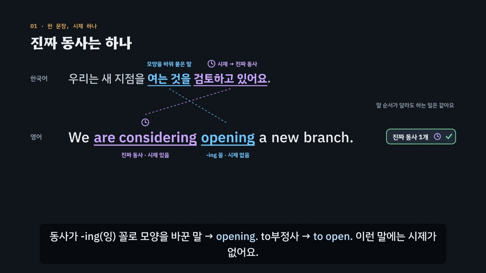

# 진짜 동사는 하나, 나머지는 to와 -ing

> [영어 튜토리얼](../README.md) 모음의 일곱 번째 꼭지(T07)입니다. 영역: 토익 문법 · 다루는 유형: [100개 유형](../docs/toeic-100-types.md)의 21–27번

토익 Part 5·6의 **동사 모양 문제**(동사 자리 · 문장 구조 · 타동사와 자동사 · to부정사 · 동명사)를 약 6분 24초짜리 인터랙티브 모션그래픽으로 설명합니다. 핵심은 둘이에요. **한 문장(절)에 시제를 가진 진짜 동사는 하나**이고, 나머지 동사는 to부정사 · -ing 꼴 · 동사원형으로 옷을 갈아입는데 **그 모양은 빈칸 앞 낱말이 고른다.** 이것을 **3단계 풀이법(진짜 동사 → 앞 → 뒤)** 으로 묶습니다.



## 바로 보기

`index.html`을 더블클릭하면 끝이에요. 설치도, 서버도 필요 없어요.

## 무엇을 배우나요

| 장 | 시각 | 내용 | 직접 해 보기 |
| --- | --- | --- | --- |
| 00 들어가며 | 0:00 | 같은 동사 open의 네 모양 가운데 하나만 답 | 먼저 풀어 보기 |
| 01 진짜 동사는 하나 | 0:24 | 한국어 ‘여는 것을 검토하고 있어요’ ↔ We are considering opening. 시제를 가진 진짜 동사(시계 표시)는 하나, 모양을 그대로 두면 진짜 동사가 둘 | open의 네 모양을 바꿔 보며 진짜 동사 세기 |
| 02 동사 자리가 비었다면 | 0:58 | 진짜 동사가 없으면 빈칸이 진짜 동사 자리. -ing 꼴 · to부정사는 진짜 동사가 못 됨. 조동사 · Please 뒤 동사원형 | 빈칸 문제 둘 |
| 03 진짜 동사가 둘이면 | 1:28 | Staff attend the seminar will receive … × → 연결어(who)로 잇기 / -ing 꼴로 바꾸기(한국어 ‘-는’), 목적의 to부정사 | 고치는 방법 고르기, 빈칸 문제 |
| 04 바로 잡나, 전치사와 잡나 | 2:00 | 한국어 ‘~에 대해 논의하다 · ~에 참석하다’ → discuss · attend는 목적어를 바로. respond to · comply with · participate in. 타동사 · 자동사 | 동사와 전치사를 골라 판정, 빈칸 문제 |
| 05 앞 동사가 고른다 | 2:34 | to부정사를 고르는 동사 · -ing 꼴을 고르는 동사 카드. ‘앞으로 할 일 / 이미 떠올린 일’은 경향일 뿐(suggest · postpone · recommend) | 동사 카드 눌러 보기, 빈칸 문제 |
| 06 이 to는 전치사 | 3:08 | look forward to meeting. to 뒤에 명사를 넣어 보면 전치사인지 가려짐(hope to the meeting ×) | 표현마다 명사 넣어 보기, 빈칸 문제 |
| 07 형용사 · 명사 뒤의 to | 3:38 | be eligible · able · likely to, the ability · effort · opportunity to. eligible for + 명사 함정 | 빈칸 문제 둘 |
| 08 목적어 다음의 동사 | 4:06 | encourage · ask · allow · require + 목적어 + to부정사, make · have · let + 목적어 + 원형, 수동태(are encouraged to) | 동사와 모양을 골라 판정, 빈칸 문제 |
| 09 3단계 풀이법 | 4:36 | 진짜 동사 → 앞 → 뒤 흐름도 | 동사 모양 판정기: 진짜 동사 · 빈칸 앞 · 빈칸 뒤를 고르면 흐름도에 길이 켜지고 들어갈 모양이 나옴 |
| 10 실전 문제 풀이 | 5:06 | 토익 형식 세 문제 (considering opening · respond to · look forward to working) | 문제 고르기 |
| 11 정리 | 6:02 | 빈칸 앞 신호 → 모양 표 | 아래 칸으로 가는 길 |

영상 아래에는 다섯 가지가 더 있어요.

- **놀이터 — 동사 옷 입히기**: 문장 열 개의 동사가 모두 사전에 실린 원형 그대로 들어 있어요(The company *decide* *open* a new branch …). 동사마다 네 가지 옷(진짜 동사 · 동사원형 · to부정사 · -ing 꼴) 가운데 하나를 입히고, 전치사 조각은 눌러서 넣거나 빼요. 규칙 엔진이 ① 진짜 동사가 하나인지(시계 개수) → ② 앞 낱말이 고른 모양인지 → ③ 뒤의 목적어 · 전치사가 맞는지 바로 검사해요. 한 문장에 동사가 둘 셋 이어진 사슬(asked us to consider moving)과 전치사 넣기 · 빼기(discuss about ×, respond to)가 섞여 있어요. 막히면 ‘정답 보기’(엔진이 모든 조합을 따져 찾은 하나뿐인 답). 키보드: ← → 동사 고르기, 1~4 옷 입히기, Enter 다음 문장.
- **놀이터 — 동사 짝 사전**: 뒤에 to부정사 · -ing 꼴 · 목적어 + to부정사 · 목적어 + 원형 · 전치사 to + -ing · 형용사 · 명사 + to부정사 · 타동사 · 자동사 + 전치사로 묶은 사전. 예문을 들을 수 있어요.
- **연습 문제**: 토익 Part 5 형식 16문제(정답 위치 A·B·C·D 4개씩, 유형 21–27을 모두 다룸). 힌트 = 3단계 풀이(진짜 동사 → 앞 → 뒤), 진짜 동사 · 빈칸 앞 단서 · 빈칸 뒤 목적어나 전치사에 색. 보기마다 모양과 까닭, 해석, 발음.
- **퀴즈**: 개념 확인 10문제(그림 문제 2개: 진짜 동사 찾기, -ing 꼴을 고르는 동사 카드).
- **핵심 정리**: 빈칸 앞 신호 → 모양 표, 목적어 잡는 법 표, 용어 · 목적어 잡는 법 · 함정 · to냐 -ing냐(경향).

### 플레이어 조작

다른 튜토리얼과 같아요. 스페이스(재생/일시정지), ← →(5초), Shift + ← →(장), C(자막), V(음성 해설), F(전체 화면). 화면 속 영어 문장을 누르면 발음을 들려줘요. 주소 끝에 `#c-장면이름`(예: `index.html#c-toprep`)을 붙이면 그 장면에서 시작해요.

음성 해설은 `-ing(잉)`처럼 화면에 적고 괄호 속 한국어로 읽어요. `to부정사`는 한국어 음성으로 읽어요.

## 무엇이 규칙 계산인가요

- **규칙 엔진** `assets/js/grammar.js`의 `IG.judge(보기, 자리)`가 맞고 틀림과 까닭, 틀린 단계(① 진짜 동사 · ② 앞 · ③ 뒤)를 정해요. 보기는 모양(진짜 동사 · 동사원형 · to부정사 · -ing 꼴 · 과거분사 · 명사)과 동사로, 자리는 진짜 동사가 이미 있는지(`eng`), 빈칸 앞 낱말의 종류(`gov`: 주어 · 조동사 · Please · 동사 · 전치사 · 형용사 · 명사 · 동사 + 목적어 · 명사 꾸밈 · 목적), 빈칸 뒤(`obj`: 목적어 · 전치사)로 나타내요. 동사 사전(`IG.VERB`)에 동사마다 뒤에 고르는 모양(`take`), 목적어 뒤에 고르는 모양(`vo`), 목적어를 잡는 법(`obj`: 바로 · 짝 전치사)을 적어 두었어요. 영상 속 ✓·×, 직접 해 보기 채점, 동사 옷 입히기의 세 단계 검사와 ‘정답 보기’, 연습 문제의 힌트와 보기별 해설, 퀴즈 일부의 정답이 모두 이 함수에서 나와요.
- **진짜 동사 세기** `IG.chain(퍼즐, 상태)`: 진짜 동사 꼴과, 모양을 바꾸지 않은 원형(조동사 · 사역동사 · 전치사 to 뒤는 빼고)을 세요. `IG.clauseOk(진짜 동사 수, 연결어 수)` = 진짜 동사 수 ≤ 연결어 수 + 1.
- **판정기** `IG.formFromCues(진짜 동사, 빈칸 앞)`: 진짜 동사가 없는데 빈칸 앞이 동사 · 형용사이거나, 진짜 동사가 있는데 빈칸 앞이 주어 · 조동사이면 ‘맞지 않는 조합’이라고 알려 줘요.
- **어긋남 경고** `IG.check()`: 연습 문제 정답이 규칙 엔진과 다르거나, 정답이 둘 이상이거나, 단서 글자(진짜 동사 · 빈칸 앞 · 빈칸 뒤)가 문장에 없거나, 동사가 사전에 없거나, 정답 위치가 몰리거나, 퍼즐의 답이 하나가 아니면(엔진이 모든 조합을 따져 봄) 콘솔에 경고가 떠요. 영상 속 판정 · 카드 · 실전 문제 · 퀴즈도 규칙 엔진과 맞춰 봐요.
- **단순하게 줄인 부분**
  - 엔진이 문장을 직접 읽는 것은 아니에요. 문제마다 진짜 동사가 이미 있는지, 빈칸 앞 낱말이 무엇인지, 빈칸 뒤에 목적어나 전치사가 오는지를 적어 두었어요.
  - 동사 하나에 모양 하나만 적었어요. to부정사와 -ing 꼴을 둘 다 쓰는 동사(begin · start · continue · like), 모양에 따라 뜻이 바뀌는 동사(remember · forget · stop · try), 원형과 to부정사를 둘 다 쓰는 help는 문제에 넣지 않았어요.
  - ‘to부정사 = 앞으로 할 일, -ing = 이미 떠올린 일’은 경향으로만 소개하고, 맞지 않는 동사(suggest · recommend · postpone)를 영상에서 짚었어요.
  - 타동사 · 자동사는 토익에서 자주 쓰는 한 가지 쓰임만 적었어요. speak English처럼 목적어를 잡는 쓰임, ‘처리하다’라는 뜻의 attend to 같은 다른 뜻은 다루지 않아요.
  - 명사 뒤를 꾸미는 말은 목적어가 따라오는 -ing 꼴(Staff attending the seminar)만 다뤄요. -ing와 -ed를 고르는 분사 문제는 T08에서 다뤄요. 보기의 attended · opened 같은 꼴은 과거 시제(진짜 동사)로 판정해요.
  - 주어 바로 뒤 진짜 동사 자리에서는 원형을 받지 않아요. 그래서 문제와 퍼즐의 주어는 3인칭 단수이거나 과거의 일이에요(수 일치는 T03).
  - 목적의 to부정사는 문장 맨 앞(To meet the deadline, …)과 문장 끝(… to reduce costs)만 다뤄요.
- **예문과 문제**: 모두 토익 형식을 본떠 직접 만든 것이에요.

## 폴더 구조

```
index.html              페이지 (영상 · 직접 해 보기 · 놀이터 · 연습 문제 · 퀴즈 · 핵심 정리)
assets/js/grammar.js    규칙 엔진(IG.judge), 동사 사전(IG.VERB), 판정기, 연습 문제(IG.DRILL), 동사 옷 입히기 퍼즐(IG.PUZ · IG.chain · IG.solve)
assets/js/scenes.js     영상 장면 12개, 장 목록과 자막
assets/js/app.js        플레이어, 직접 해 보기, 놀이터, 퀴즈, 영상 추출(EN_EXPORT)
video/                  자막 원고(SRT)
docs/poster.jpg         사이트 카드 그림
```

## 영상 다시 만들기

```bash
node tools/render-video.cjs infinitives-gerunds                     # → infinitives-gerunds/video/infinitives-gerunds.mp4 + .srt
node tools/render-video.cjs infinitives-gerunds --frames 46,330     # 몇 장면만 그림으로
node tools/render-video.cjs infinitives-gerunds --poster 46         # 카드 그림
node tools/render-video.cjs infinitives-gerunds --srt               # 자막 원고만
```
