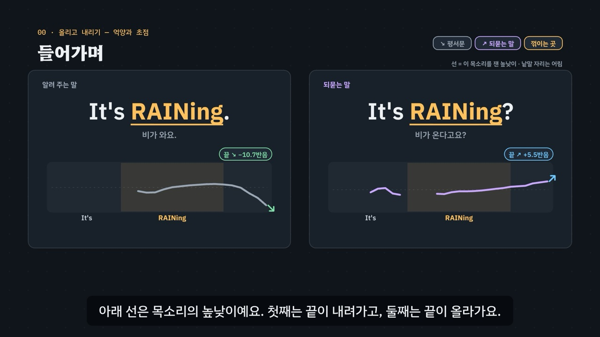

# 올리고 내리기 — 억양과 초점

> [영어 튜토리얼](../README.md) 모음의 **영어 발음 (미국식)** 아홉 번째 꼭지입니다(영역: `pron`, 계획표의 P12 · 유형 22). 발음 영역의 설계도는 [docs/pron-types.md](../docs/pron-types.md)이고, 형식과 잰 값 읽기는 [미국식 t와 이어 말하기](../t-and-linking/README.md)를 따랐어요. 이 꼭지는 목 울림 띠 대신 **높낮이 선**을 그려, 문장 끝에서 소리가 올라가는지 내려가는지를 보여 줘요.

영어는 같은 낱말이라도 끝의 높낮이로 뜻이 바뀌어요. *It's raining.* → 끝을 내려 말하는 문장, *It's raining?* → 끝만 올려 되묻는 말이에요. 문장의 모양이 끝의 움직임을 정해요.

- **Yes/No 질문 ↗** — 예 · 아니오로 답하는 질문. 꺾이는 곳에서부터 끝까지 올려요(*Are you ready? · Do you like coffee?*).
- **정보 질문 ↘** — 의문사로 묻는 질문. 꺾이는 곳에서 한 번 높였다가 내려요(*Where are you going? · What time is it?*). 묻는 말이라고 끝을 올리면 되묻는 말처럼 들릴 수 있어요.
- **고르는 질문 ↗↘** — 둘 가운데 하나를 고르게 하는 질문. 앞 선택지는 올리고 마지막은 내려요(*Coffee or tea?*). 끝까지 올리면 ‘마실 것을 원하나요?’라는 Yes/No 질문이 돼요.
- **평서문 ↘ · 되묻는 말 ↗** — 말하는 문장은 내리고, 평서문 꼴 그대로 끝만 올리면 놀람 · 확인의 되묻는 말이 돼요(*You're leaving. · You're leaving?*).
- **꺾이는 곳** — 높낮이가 가장 크게 움직이는 음절. 보통 마지막 내용어의 센 음절이에요(*Is it FAR from here? — 뒤에 기능어가 붙어도 그대로 · How was your WEEKend?*).
- **초점** — 고쳐 말하거나 새로 알리는 낱말로 꺾이는 곳이 옮겨 가 그 낱말이 가장 높아요(*I said TUESday, not Monday.*).

3단계 발음법: ① **듣고 가르기**(끝이 올라가나 내려가나, 문장 모양 다섯, 목소리 넷) → ② **높낮이 만들기**(꺾이는 곳 · 거기서부터 올리기 · 거기서 내리기) → ③ **문장 속에서**(고르는 질문 · 되묻는 말 · 초점).



## 바로 보기

`index.html`을 더블클릭하면 끝이에요. 설치도, 서버도 필요 없어요.

## 소리와 마이크에 대해 (꼭 읽어 주세요)

- 녹음 파일이 없어요. 영어는 모두 **합성 음성**이에요. 글이 정해진 말(문장 · 연습 문제 · 따라 말하기)은 **VoiceStudio로 미리 만든 미국식 목소리 넷**(`audio/dialogue/`)으로, 나머지는 브라우저에 들어 있는 영어 음성(speechSynthesis)으로 읽어요. 합성 음성의 억양은 글 끝의 물음표 · 마침표가 정해요.
- **목소리 넷**: 밝은 선생님(미국 여성) · 차분한 선생님(미국 여성) · 미국 여성 · 미국 남성. 끝 올림 · 내림 듣기 훈련 · 연습 문제는 문제마다 목소리를 바꿔요.
- **한국어식 억양은 소리로 만들지 않아요.** 앞의 꼭지들은 한국어식으로 읽은 소리를 한국어 목소리로 만들었지만, 억양은 한국어 목소리로 영어 문장을 읽혀도 ‘한국인 학습자의 억양’이 되지 않아서, 주황 점선 그림(‘그림으로 줄인 모양 · 잰 값 아님’)으로만 보여 줘요 — 정보 질문의 끝을 올린 모양(05장), 연구에서 본 ‘초점 낱말에 높은 소리를 얹는’ 모양(08장). 고르는 질문을 끝까지 올린 모양(06장)도 소리 없이 그림으로만 보여 줘요.
- 튜토리얼 전용 목소리 부품 `assets/js/voices.js`(`INV`)는 미국식 t의 `ATV`를 바탕으로 했어요(잰 값 `INV.meas` 포함). 말하는 사람마다 파일을 찾고, 없으면 브라우저 음성(en-US)으로 읽어요. 읽기 전에 음성 해설 · 발음 듣기 · 녹음 재생을 멈추고 영상을 일시정지해요.
- **내 높낮이 선 · 따라 말하기**: 내 높낮이 선(시험 기능)은 녹음한 문장을 **브라우저 안에서** 재서(YIN이라는 방법: 16kHz, 40ms 창 · 10ms마다, 70~500Hz) 높낮이 선을 그리고, 측정 도구와 같은 자리(마지막 0.15초 ↔ 그 앞 0.6~0.25초)에서 끝 움직임을 반음으로 보여 줘요(2반음보다 크면 올림 · 내림). 본보기는 다른 방법(배음 더하기, SHS)으로 잰 값이라 모양을 그대로 견주지 말고 끝의 방향만 보게 했어요. 녹음은 메모리에만 두고 아무 데도 보내지 않아요. 발음의 질은 판정하지 않아요. 따라 말하기는 음성 인식(`SpeechRecognition` · `webkitSpeechRecognition`, en-US)이 있으면 들린 낱말을 원래 문장과 맞춰요 — 높낮이는 맞춰 보지 않아요. 크롬(Chrome) 같은 브라우저는 소리를 브라우저 회사의 서버로 보내 글로 바꿔요. 음성 인식이 없으면 녹음(`MediaRecorder`)으로 ‘내 목소리’와 ‘본보기’를 이어서 들어요. 이 사이트는 아무것도 저장하지 않아요(훈련 기록만 이 브라우저의 `localStorage`에).

## 무엇을 배우나요

| 장 | 시각 | 내용 | 직접 해 보기 |
| --- | --- | --- | --- |
| 00 들어가며 | 0:00 | *It's raining. · It's raining?* — 같은 낱말, 다른 끝 | 먼저 들어 보기(두 선 나란히) |
| 01 들어 보기 · 구별되나요? | 0:36 | ① 평서문 · 되묻는 말 짝, 목소리 넷 | 목소리 바꿔 듣기 · 짝 여섯 |
| 02 억양의 지도 | 1:16 | ① 문장 모양 다섯(Yes/No 질문 · 정보 질문 · 고르는 질문 · 평서문 · 되묻는 말) | 모양마다 예문 셋 |
| 03 꺾이는 곳 | 1:58 | ② 마지막 내용어의 센 음절, 뒤에 기능어가 붙어도 그대로 | 문장 고르기(4) |
| 04 Yes/No 질문 ↗ | 2:40 | ② 꺾이는 곳에서부터 끝까지 올리기 | 문장 고르기(6) |
| 05 정보 질문 ↘ | 3:20 | ② 꺾이는 곳에서 내리기, 올리면 되묻는 말처럼(그림) | 문장 고르기(6) |
| 06 고르는 질문 ↗↘ | 4:00 | ③ 앞은 올리고 마지막은 내리기, 끝까지 올리면 Yes/No 질문(그림) | 문장 고르기(6) |
| 07 되묻는 말 ↗ | 4:42 | ③ 평서문 꼴로 끝만 올리기, 두 선 겹쳐 보기 | 짝 고르기(6) |
| 08 초점 | 5:22 | ③ 고쳐 말하는 낱말이 가장 높게, 연구 두 편(그림) | 문장 고르기(5) |
| 09 정리 | 6:06 | 3단계 발음법 | 이제 직접(아래 칸으로) |

- **끝 올림 · 내림 듣기 훈련**(놀이터 왼쪽): 문장 스무 개(평서문 · 되묻는 말 짝 여섯 + Yes/No 질문 넷 + 정보 질문 넷) × 목소리 넷에서 하나를 무작위로 들려주고(그 문장이 확인을 통과한 목소리만), **끝을 올렸나 내렸나** 고르면 그 목소리를 잰 높낮이 선이 나타나요(짝이 있으면 짝의 선도 같은 기준으로). 목소리를 고를 수 있고, 올림 · 내림마다 · 목소리마다 맞힌 비율을 보여 줘요. 기록은 `localStorage` `en-in-tune-v1`(지우기 단추). 키보드 R 듣기 · 1 올림 · 2 내림 · Space/Enter 다음.
- **억양 바꾸기 실험실**(놀이터 오른쪽): 하나만 바꾼 짝을 A ↔ B로 견줘요 — 끝만 바꾸기(마침표 ↔ 물음표, 짝 여섯) · 의문사 붙이기(*Are you going? → Where are you going?* 등 넷) · 하나 → 둘 중 하나(*Would you like coffee? → Would you like coffee or tea?* 등 넷). 두 쪽의 모양 · 꺾이는 곳 · 높낮이 선을 엔진과 잰 값이 보여 줘요. 짝 둘이 모두 확인을 통과한 목소리만 써요.
- **내 높낮이 선**(시험 기능, 놀이터 아래): *It's raining? · It's raining. · Are you ready? · Where are you going? · You're leaving? · Coffee or tea?* 가운데 하나를 3초 녹음하면 내 소리의 높낮이 선과 끝 움직임(반음)을 본보기와 나란히 보여 줘요.
- **따라 말하기 28문장**: Yes/No 질문 · 정보 질문 · 고르는 질문 · 되묻기와 초점, 묶음마다 일곱 문장. 문장마다 듣기 · 천천히 · 따라 말하기와 작은 높낮이 선.
- **듣고 억양 가르기 16문제**(`PDrill`, `.edr` 모양): 끝을 올렸나 내렸나 6 · 같은 낱말 둘 가운데 되묻는 쪽 5 · 어떤 질문인가(Yes/No · 정보 · 고르는 질문) 5. 소리 먼저, 힌트 세 단계(① 듣고 가르기 · ② 높낮이 만들기 · ③ 문장 속에서)는 엔진이 만들어요. 보기 둘 문제 11개의 정답 위치 5 / 6, 보기 셋 문제 5개 1 / 2 / 2. 키보드 A~C(1~3) · H 힌트 · R 다시 듣기 · S 천천히 · Enter.
- **퀴즈 10문제**: 영상 순서대로. 그림 문제 하나(*Do you like coffee?*의 높낮이 선 고르기). 정답 위치 3 / 3 / 2 / 2.
- **핵심 정리**: 문장 모양 다섯 + 꺾이는 곳 + 초점 표, 용어(① 듣고 가르기 · ② 높낮이 만들기 · ③ 문장 속에서).

### 플레이어 조작

다른 튜토리얼과 같아요. 스페이스(재생/일시정지), ← →(5초), Shift + ← →(장), C(자막), V(음성 해설), F(전체 화면). 화면 속 문장 · 높낮이 선을 누르면 그 소리를 들려줘요(같은 곳을 곧바로 다시 누르면 천천히).

**미리 만든 목소리**: VoiceStudio(OmniVoice 엔진, 비상업용 라이선스)로 만든 합성 음성 파일이에요. 파일이 없거나 못 읽으면 그 줄 · 조각만 브라우저 음성으로 읽어요.
- **영어는 0.9배로 재생해요**(`voices.js`의 `EN_RATE`). 한국어 해설은 1배.
- **늘어놓은 낱말은 쉬어 가며 읽어요.** 자막에 · 로 늘어놓은 영어 낱말(*what · where · when · why · who · how*)은 낱말마다 따로 만들고 사이에 쉼표만큼 쉬어 한 파일로 이어요(`--word-lists`). 해설 읽기 규칙: 꺾이는 곳을 대문자로 적은 낱말(*TUESday*)은 소문자로 읽고, *Yes/No*는 Yes No로, ↗ · ↘ 화살표는 읽지 않고, ` = ` · ` + `는 쉼으로 읽어요.
- **해설 소리 확인**: 영어 조각 38개는 받아쓰기(Whisper)로 모두 맞게 적히는 것을 확인했어요(*ten dollars · twenty*는 $10 · $20, *seven · eight*는 7 · 8처럼 숫자로 적혔어요). 영어 문장 하나뿐인 조각 26개는 확인(아래 ‘잰 값’)을 통과한 밝은 선생님의 문장 파일로 바꿨어요(`tools/measure-syllables.py intonation --narration`) — 해설에서 들리는 문장도 끝 올림 · 내림과 초점을 잰 소리예요. 낱말만 읽는 조각 12개(*ready · coffee · far · weekend · going · tea · leaving · tuesday · Yes No · not Monday*, 의문사 여섯을 늘어놓은 조각)는 이 꼭지가 낱말만 읽은 줄을 따로 만들지 않아서 처음 만든 소리 그대로예요. 조각마다 높이 가운데값이 3반음 넘게 다른 조각이 20개였는데, 확인을 통과한 문장 파일로 바꾼 조각에서도 13개가 그랬어요 — 묻는 말은 끝이 올라가 높게, 초점 뒤를 낮게 누른 말은 낮게 재져서 다른 목소리가 아니라 억양 차이로 봤어요.
- 한국어 조각 80개도 받아쓰기로 확인했어요. ‘아래 따라 말하기의 → 아랫따라 말하기에’, ‘뒤의 → 뒤에’처럼 소리가 같은 다른 글자로 적힌 2조각은 그대로 썼어요. 잰 선에 맞춰 자막을 고친 곳(아래 ‘잰 값’)은 그 조각만 다시 만들어 다시 받아쓰기했어요. 사람이 귀로 다시 듣지는 않았어요.
- 음성 해설(`audio/narration/`): 한국어 조각은 「튜토리얼 내레이터 (젊은 여성)」, 영어 조각은 「영어 선생님 (밝은 미국 여성)」.
- 문장(`audio/dialogue/`): 말하는 사람 → 프로필은 `voices.json` — `tc` 「영어 선생님 (밝은 미국 여성)」 · `tf` 「영어 선생님 (미국 여성)」 · `uf` 「길 묻기 · 나 (미국 여성)」 · `um` 「길 묻기 · 길에서 만난 사람 (미국 남성)」.

만드는 법(VoiceStudio가 있는 맥에서, 이미 만든 파일은 건너뛰어요):

```bash
node tools/narration-pieces.cjs intonation     # 해설의 읽기 조각 목록 (자막을 고쳤을 때만)
node tools/dialogue-lines.cjs intonation       # 문장 줄 목록 · 잴 줄 정보(measure-meta.json)
python3 tools/voicestudio-narration.py intonation --en-profile "영어 선생님 (밝은 미국 여성)" --word-lists
python3 tools/voicestudio-dialogue.py intonation
"$HOME/Library/Application Support/VoiceStudio/runtime/project/.venv/bin/python" tools/measure-syllables.py intonation
```

### 잰 값 — 높낮이 선

높낮이 선은 **미리 만든 음성 파일을 프로그램으로 따로 재서** 그려요(`audio/dialogue/measure.js`의 `window.PRON_MEASURE`). 소리의 높이를 배음 더하기 방법(`tools/shs_pitch.py`)으로 5ms마다 재고, 한 옥타브 잘못 고른 프레임을 지운 뒤(같은 소리를 pYIN(librosa)으로도 재서 5반음 넘게 다른 프레임 · 0.1초보다 짧게 4반음 넘게 튄 조각 — 소리 끝이 갈라지는 곳에서 잦았어요) 20ms마다 하나씩 적고(`f`, Hz), 그 문장의 가운데 높이(가운데값)에서 몇 반음 위아래인지로 그려요. 짝을 함께 그릴 때(평서문 · 되묻는 말)는 두 문장의 가운데 높이를 하나로 맞춰 같은 기준으로 그려요. 낱말의 자리는 받아쓰기(Whisper)의 낱말 시각으로 잡아요(`w`, 어림). 잰 값이 없는 문장은 엔진의 그림 모양(`IN.schematic`)으로 점선을 그리고 ‘그림으로 줄인 모양 · 잰 값 아님’이라고 적어요.

- **잴 줄**(`window.__measureMeta`): 모든 줄이 `kind: 'tune'` — 모양 `shape`(yn · wh · alt · stmt · decl), 낱말 `toks` · 내용어의 자리 `cw`, 초점 낱말의 자리 `focus`, 고르는 질문이면 앞 선택지의 마지막 낱말 `alt`.
- **확인**: 받아쓰기(Whisper)가 원래 문장과 같은지, **끝 움직임**(마지막 0.15초의 높이 가운데값 ↔ 그 앞 0.6~0.25초의 가운데값, 반음 `end`) — Yes/No 질문 · 되묻는 말은 **+3반음 이상**, 정보 질문 · 평서문 · 고르는 질문은 **−2반음 이하**. 고르는 질문은 앞 선택지 낱말의 꼭대기가 문장 가운데 높이보다 **2반음 이상** 높아야 해요. 초점 문장은 초점 낱말의 꼭대기가 **모든 낱말 가운데 가장 높고**(다른 내용어보다 1반음 이상), **초점 뒤의 낱말은 모두 2반음 이상 낮아야**(낮게 눌러 말함) 하고, 끝은 −2반음 이하 대신 **+1반음 넘게 올라가지 않으면** 돼요 — 초점 뒤가 이미 낮게 눌려 있어 끝에서 더 내려가지 않기도 해서요(`pk`, 낱말마다 꼭대기).
- **돌린 과정**: 처음 만든 소리 192줄 가운데 114줄이 확인을 통과했어요. 통과하지 못한 줄을 seed를 바꿔 다시 만들어 155 → 162줄이 됐고, 끝내 한 목소리도 통과하지 못한 두 문장(*Do you want to walk or take a bus? · It's my bag, not yours.*)은 더 짧은 문장(*Do you want to walk or drive? · It's black, not brown.*)으로 바꿔 167줄이 됐어요.
- 그 뒤 선을 살펴보다가, 배음 더하기가 한 옥타브 위를 고른 프레임 때문에 꼭대기가 부풀려진 줄(미국 남성의 *Tuesday*처럼)을 찾았어요. 높이 재는 법에 pYIN 견주기와 짧게 튄 조각 지우기를 더해 모두 다시 재니 141줄로 줄었어요. *not*이 초점 낱말보다 높게 재진 줄도 통과하고 있어서, 초점 낱말이 모든 낱말 가운데 가장 높고 초점 뒤는 2반음 이상 낮아야 한다는 조건을 더했어요.
- 화면 · 해설 · 연습에 쓰는 줄을 seed를 바꿔 다시 만들어 **151 / 192줄**이 통과했어요. 통과하지 못한 41줄은 잰 값을 빼고, 그 목소리는 그 문장에 쓰지 않아요(문장마다 통과한 목소리가 하나 이상 있어요. 연습 문제 16개와 실험실 짝은 모두 통과한 목소리로 들려줘요).
- 밝은 선생님(해설의 영어 목소리)은 *Coffee or tea?*를 seed 서른 번 바꿔 다시 만들어도 앞 선택지의 꼭대기가 +2반음에 닿지 않아서, 영상의 고르는 질문 예문을 *Would you like coffee or tea?*로, 억양의 지도 · 정리의 예문을 *Is it red or blue?*로 바꿨어요. *Coffee or tea?*는 놀이터 · 연습에서 통과한 다른 목소리로 들려줘요.
- **자막과 잰 선 맞추기**: 잰 선과 다르게 말하던 자막을 고쳤어요(‘꺾이는 곳에서 높았다가 뚝 내려가요’ · ‘거기서 낮게 시작해 끝까지 쭉 올려요’ · ‘하나는 크게 올라가요’ · ‘앞 선택지 → 올리고’ 등). 합성 음성은 정보 질문을 의문사에서 높게 시작하고, 고르는 질문의 앞 선택지를 올리기보다 높은 채로 두는 경우가 있었어요. 선 맨 끝에 아주 짧게(0.05초 안팎) 튀어 오르는 곳이 보이기도 하는데(*Where are you going?*), 끝 움직임은 가운데값으로 재서 이런 곳은 셈에 거의 들지 않아요.

## 무엇이 규칙 계산인가요

- **규칙 엔진** `assets/js/grammar.js`(`IN`)가 낱말마다 적은 사전에서 계산해요. 영상 · 직접 해 보기 · 놀이터 · 연습 문제 · 퀴즈가 모두 같은 결과를 써요.
  - 낱말 사전 `IN.DICT`(**80낱말**: 음절 · 센 음절 · 내용어인지 기능어인지 · 뜻).
  - **문장의 모양** `IN.shapeOf`(여러 문장이면 마지막 문장): 끝이 물음표가 아니면 평서문, 물음표면 — *or*가 있으면 고르는 질문, 의문사로 시작하면 정보 질문, 조동사(be · do · have · can · would …)로 시작하면 Yes/No 질문, 그 밖(평서문 꼴)은 되묻는 말. 끝의 방향 `IN.endOf` · 화살표 `IN.arrowOf`.
  - **꺾이는 곳** `IN.phrases` · `IN.nuclei`: 마지막 내용어의 센 음절(고르는 질문은 선택지마다 하나), 문장 데이터에 적어 둔 초점 낱말(`IN.focusOf` — *I said Tuesday, not Monday.*의 *Tuesday*)이 있으면 그 낱말로 옮겨요. 대문자 표기 `IN.caps` · `IN.capsW`.
  - **그림 모양** `IN.schematic`: 꺾이는 곳까지는 평평하게, 거기서 올리거나(↗) 솟았다 내리고(↘), 고르는 질문은 앞 선택지에서 오르고 마지막에서 내리는 점을 계산해요. 한국어식 그림(`tune: 'ko'`)과 끝까지 올린 고르는 질문은 모양을 바꿔(`shape` · `tune`) 같은 계산으로 그려요.
  - 따라 말하기 맞추기 `IN.compareWords`, 연습 문제의 정답 `IN.drillAnswer`과 힌트 `IN.hints`.
  - 데이터: 들어가며 `IN.INTRO` · 평서문 · 되묻는 말 짝 `IN.DECL`(6) · 억양의 지도 `IN.MAP`(5 × 3) · 꺾이는 곳 `IN.NUC`(4) · Yes/No 질문 `IN.YN`(6) · 정보 질문 `IN.WH`(6) · 고르는 질문 `IN.ALT`(6) · 초점 `IN.FOCUS`(5) · 실험실 `IN.SWITCH`(3묶음, 짝 6 · 4 · 4) · 훈련 문장 `IN.HV`(20) · 따라 말하기 `IN.SENT`(28 = 7 × 4) · 연습 문제 `IN.DRILL`(16).
- **어긋남 경고** `IN.check()`(0이어야 해요): 사전의 철자 · 센 음절 · 갈래(내용어 · 기능어 · 의문사), 모든 문장(48)의 낱말이 사전에 있는지와 적어 둔 모양 = 엔진의 모양, 초점 낱말이 문장에 있고 첫 토막의 꺾이는 곳이 되는지, 화면 · 놀이터 · 연습 문제의 문장이 모두 문장 표에 있는지, 짝(낱말이 같고 평서문 → 되묻는 말) · 지도 · Yes/No · 정보 질문 · 고르는 질문(토막 둘)의 모양, 실험실 짝이 그 묶음의 바뀜(평서문 → 되묻는 말 · Yes/No → 정보 질문 · Yes/No → 고르는 질문)을 보이는지, 훈련 문장에 올림 · 내림이 모두 있고 고르는 질문 · 초점 문장은 없는지, 따라 말하기 묶음(7 × 4)과 묶음의 모양 · 맞추기, 연습 문제의 정답 · 목소리 · 정답 위치, 엔진 규칙 몇 가지(*Is it FAR from here? · Would you like COFfee or TEA? · It's BLACK, not BROWN.* 같은 대문자 표기와 토막의 높낮이). 퀴즈의 정답도 엔진으로 다시 계산해 어긋나면 콘솔에 경고가 떠요.
- **단순하게 줄인 부분**
  - 억양은 **경향**이에요. 기분 · 상황 · 사람에 따라 Yes/No 질문을 내려 말하기도 하고(다그치듯 묻거나 이미 답을 짐작할 때), 정보 질문을 부드럽게 올려 말하기도 해요. 이 꼭지는 가장 흔한 기본 모양을 다뤄요.
  - 꺾이는 곳은 ‘마지막 내용어의 센 음절’로 줄였어요. 실제로는 이미 나온 낱말은 낮추고(옛 정보), 문장 끝의 부사 · 시간 표현이 꺾이는 곳이 되지 않는 등 더 복잡해요.
  - 고르는 질문의 선택지가 셋 이상이거나 *or* 없이 이어진 목록은 다루지 않아요.
  - 엔진은 소리를 듣지 않아요. 높낮이 선은 미리 만든 파일을 따로 잰 값이고(자동으로 잰 값이라 낱말의 자리는 어림), 내 높낮이 선은 녹음을 다른 방법으로 대략 재 볼 뿐이에요.
- **근거로 삼은 연구**(초록으로 확인한 범위, 자세한 목록은 [docs/pron-types.md](../docs/pron-types.md)):
  - Yes/No 질문의 초점 — [전윤실 · 오세풍 · 김기호 2004, 음성과학 11(3)](https://koreascience.or.kr/article/JAKO200415637245667.page?lang=ko): 원어민은 Yes/No 질문의 초점 낱말을 낮게 시작해 끝을 올렸고, 한국인 화자는 초점 낱말에 높은 소리를 얹는 경향을 보였어요(08장 자막 · 그림).
  - 초점 알아듣기 — [Kim · Jeon 2009, 영어어문교육 15(4)](https://koreascience.or.kr/article/JAKO200917357306511.page): 한국인 청자는 낮게 시작하는 초점을 알아듣기 어려워했고, 억양 곡선으로 설명하자 알아듣기가 나아졌어요(08장 자막).
  - 정보 질문 · 고르는 질문 · 되묻는 말의 모양은 연구를 인용하지 않고 교재의 표준 설명으로만 다뤄요. 숫자는 옮기지 않고 보여 준 방향만 적었어요.
- **예문과 문제**: 모두 직접 만든 것이에요.

## 폴더 구조

```
index.html              페이지 (영상 · 직접 해 보기 · 끝 올림 · 내림 듣기 훈련 · 억양 바꾸기 실험실 · 내 높낮이 선 · 따라 말하기 · 듣고 가르기 · 퀴즈 · 핵심 정리)
assets/js/grammar.js    규칙 엔진(IN.shapeOf · IN.endOf · IN.phrases · IN.nuclei · IN.focusOf · IN.caps · IN.schematic ·
                        IN.switchSet · IN.compareWords · IN.drillAnswer · IN.hints), 사전(IN.DICT) · 데이터 · 점검(IN.check)
assets/js/voices.js     문장 목소리(INV): 목소리 넷(미리 만든 파일 → 없으면 브라우저 음성), 잰 값(INV.meas)
assets/js/scenes.js     영상 장면 10개(INS), 장 목록과 자막, 높낮이 선(잰 값 → 없으면 그림 모양, INS.pitchSVG는 페이지의 SVG)
assets/js/app.js        플레이어, 직접 해 보기, 끝 올림 · 내림 듣기 훈련(기록 표), 억양 바꾸기 실험실, 내 높낮이 선(YIN), 따라 말하기(음성 인식 · 녹음), 듣고 가르기(PDrill), 퀴즈, 영상 추출(EN_EXPORT)
video/                  자막 원고(SRT)
audio/narration/        음성 해설의 읽기 조각 목록(pieces.json) · 파일 목록(clips.js) · 음성 파일
audio/dialogue/         문장 줄 목록(lines.json) · 잴 줄 정보(measure-meta.json) · 말하는 사람 → 프로필(voices.json) · 파일 목록(clips.js) · 잰 값(measure.js) · 음성 파일
docs/poster.jpg         사이트 카드 그림
```

## 영상 다시 만들기

```bash
node tools/render-video.cjs intonation                       # → intonation/video/intonation.mp4 + .srt
node tools/render-video.cjs intonation --frames 20,280       # 몇 장면만 그림으로
node tools/render-video.cjs intonation --poster 14.5         # 카드 그림
node tools/render-video.cjs intonation --srt                 # 자막 원고만
```

MP4에는 소리가 없어요(자막이 그림에 들어가요).
