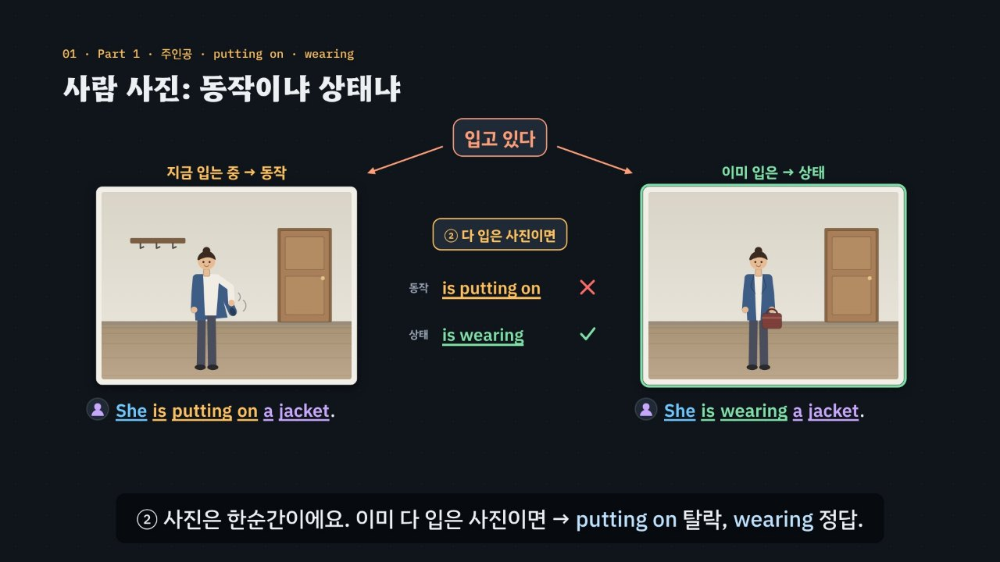

# 첫 단어를 잡고, 들린 단어를 의심하라

> [영어 튜토리얼](../README.md) 모음의 첫 듣기 꼭지(T15)입니다. 영역: 토익 · 다루는 유형: [100개 유형](../docs/toeic-100-types.md)의 67–69번(Part 1 사진 묘사: 입는 동작 · 입은 상태, being p.p. · has been p.p., 사진에 없는 말 · 비슷한 소리)과 70–77번(Part 2 질의응답: 첫 단어, 같은 단어 · 비슷한 소리 함정, 간접 응답, 모른다 · 되묻기 · 넘기기, 평서문, 제안 · 요청, 선택 의문문, 부정 · 부가 의문문의 Yes · No).

토익 듣기 Part 1과 Part 2는 문제지에 문장이 없어요. Part 1은 사진 한 장을 보며 문장 넷을, Part 2는 질문 하나에 이어지는 대답 셋을 한 번만 들어요. 귀에 걸린 낱말을 따라 고르면 함정에 빠지기 쉬워요. 이 튜토리얼은 약 6분 30초짜리 인터랙티브 모션그래픽으로 **3단계 풀이법**을 가르쳐요.

- **Part 1**: ① 사진의 **주인공**(사람? 사물?) → ② **동작**(is putting on · is being stacked)인가 **상태**(is wearing · have been stacked)인가 → ③ 사진에 **없는 말** 지우기(비슷한 소리 copies · coffee 조심)
- **Part 2**: ① **첫 단어**로 답의 종류 정하기(Where → 장소, Why don't we → 제안, A or B → 선택) → ② **함정** 지우기(엉뚱한 종류 · 같은 단어 · 비슷한 소리) → ③ 남은 답이 **말이 되나**(Yes · No와 뒷말, 돌려 말한 답도 정답)

한국어와 다른 점 둘을 특히 짚어요. 한국어 ‘입고 있다’는 입는 중과 입은 상태를 함께 뜻하지만 영어는 *is putting on* · *is wearing*으로 나눠요. ‘안 보냈어요?’에 보냈으면 한국어는 ‘아니요, 보냈어요’지만 영어는 *Yes, I did* — 영어 Yes · No는 질문의 꼴이 아니라 사실을 따라요.



## 바로 보기

`index.html`을 더블클릭하면 끝이에요. 설치도, 서버도 필요 없어요.

## 소리에 대해 (꼭 읽어 주세요)

- 녹음 파일이 없어요. 영어는 모두 **합성 음성**이에요. 듣기 문제의 문장과 대답(영상 · 직접 해 보기 · 놀이터 · 듣기 연습 문제)은 글이 정해져 있어 **VoiceStudio로 미리 만든 목소리**(`audio/dialogue/`)로 읽어요. 말하는 사람은 억양마다 한 사람이에요: 미국(남성) · 영국(여성) · 호주(남성) · 캐나다(여성). 합성 음성이라 실제 시험의 억양과 녹음 품질을 그대로 흉내 내지 못해요. 이 튜토리얼은 억양에 익숙해지는 연습이 아니라, 들으면서 함정을 가려내는 **생각의 순서**를 익히는 곳이에요. 페이지 위쪽과 연습 문제 머리말에도 같은 안내를 적었어요.
- 튜토리얼 전용 목소리 부품 `assets/js/voices.js`(`LPV`)가 줄마다 미리 만든 파일을 찾아 읽어요. 파일이 없거나 못 읽는 줄만 브라우저 음성(speechSynthesis)으로 읽는데, 그때는 말하는 사람마다 en-US · en-GB · en-AU · en-CA 목소리를 찾아 쓰고, 그 억양 목소리가 없으면 다른 영어 목소리의 높낮이 · 빠르기를 바꿔 사람을 구별해요. 한 번에 읽는 줄 안에서 한 사람의 말은 한 가지 소리로만 읽어요(파일과 브라우저 음성을 섞지 않음). 어떤 목소리를 쓰는지는 페이지에 한 줄로 보여 줘요. 공통 부품(`shared/`)은 바꾸지 않았어요.
- 소리가 겹치지 않게: 듣기 문제를 읽기 전에 발음 듣기(`EN.say.stop()`)와 음성 해설을 멈추고 영상을 일시정지해요. 반대로 발음 듣기 단추나 음성 해설 단추를 누르면 듣기 문제 소리를 먼저 멈춰요. 다른 쪽이 말을 끊으면(취소) 듣기 문제는 이어 읽지 않아요.
- 듣기 항목마다 **듣기**와 **천천히** 단추(읽는 동안 ‘멈추기’로 바뀜), 줄마다 다시 듣기가 있고 키보드로도 돼요(R · S · T). 단추 모양과 키는 [T16 듣기 ②](../listening-part3-4/)와 같아요. 파일도 브라우저 음성도 쓸 수 없으면 글을 처음부터 보여 줘요.
- MP4 영상에는 소리를 넣을 수 없어서, 들리는 영어는 ‘말하는 사람 · 소리 물결 · 낱말이 하나씩 나타나는 받아쓰기’로 그려요. 페이지에서는 그 줄을 누르면 그 사람의 목소리로 들려주고, 음성 해설을 켜면 자막의 영어를 영어 음성으로 읽어요.

## 무엇을 배우나요

| 장 | 시각 | 내용 | 직접 해 보기 |
| --- | --- | --- | --- |
| 00 들어가며 | 0:00 | 문제지에는 사진 · Mark your answer뿐, Part 2 한 문제(When … 질문에 시간으로 답한 보기가 없음) | 먼저 풀어 보기 (듣기 문제) |
| 01 사람 사진: 동작이냐 상태냐 | 0:24 | 주인공(사람 · 몇 명), 한국어 ‘입고 있다’의 두 뜻, *is putting on* · *is wearing*, 동작 · 상태 짝 | 사진 바꿔 보기(입는 중 · 다 입은 뒤), O/X |
| 02 사람 없는 사진: being이냐 been이냐 | 1:00 | 주인공 = 사물, *have been stacked*(상태) · *are being stacked*(누가 하는 중), 사람이 들어오면 판정이 바뀜, 놓인 모양 | 사람을 넣었다 빼 보기, O/X |
| 03 사진에 없는 말 | 1:34 | 문장 속 물건 ↔ 사진, *copies · coffee*, 없는 물건은 분홍 점선, 소리 짝 | 복사기 사진 O/X(문장 다섯), 소리 짝 듣기 |
| 04 첫 단어가 답을 정한다 | 2:04 | 의문사 → 답의 종류, 엉뚱한 종류 · 의문사 의문문에 Yes | 첫 단어 바꿔 보기(대답 여섯을 엔진이 판정), 듣기 문제 |
| 05 들린 단어를 의심하라 | 2:36 | 같은 단어(*sales*), 비슷한 소리(*contract · contact*, *lunch · launch*) | 듣기 문제(힌트로 함정 찾기) |
| 06 돌려 말하는 정답 | 3:08 | 간접 응답: 모른다 · 넘기기 · 되묻기 · 확인하기 · 상황 알리기 | 대답이 되나요? O/X(대답 열) |
| 07 질문이 아닌 말 | 3:40 | 평서문 → 해결책, *Why don’t we* → 제안, *A or B* → 선택(둘 다 · 다른 것) | 듣기 문제(평서문) |
| 08 사실이 정하는 Yes · No | 4:16 | 한국어 ‘네 · 아니요’ ↔ 영어 Yes · No 표, *No, I called her* 함정, 꼬리 질문 | 사실 바꿔 보기, O/X |
| 09 3단계 풀이법 | 4:50 | Part 1 · Part 2 흐름도 | 첫 단어를 고르면 기대하는 답의 종류가 켜짐 |
| 10 실전 문제 풀이 | 5:18 | 연습 문제 셋(Part 2 *When* · Part 1 의자 · Part 2 *Didn’t you*)을 3단계로 | 문제 고르기 |
| 11 정리 | 6:14 | 한눈에 보는 표 | 아래 칸으로 가는 길 |

영상 아래에는 다섯 가지가 더 있어요.

- **놀이터 ① — 함정 감별사**: Part 2 열 세트. 질문 하나 · 대답 셋을 듣고 대답마다 이름표(바로 답 · 간접 응답 · 엉뚱한 종류 · 같은 단어 · 비슷한 소리 · 앞뒤 안 맞음)를 붙여요. ‘엔진과 맞춰 보기’를 누르면 글이 열리고, 규칙 엔진의 이름표와 까닭, 해석이 나와요. 함정 하나에 이름표가 둘 붙는 경우(같은 단어 + 엉뚱한 종류)는 하나만 맞혀도 맞힌 걸로 세요. 키보드: R 듣기 · S 천천히 · T 대본 · A B C 대답 고르기 · 1~6 이름표 · Enter 맞춰 보기 · ← → 세트.
- **놀이터 ② — 동작 · 상태 고르기**: 장면 넷(재킷 · 의자 · 상자 · 화분)을 두 순간(사람이 하는 중 · 끝나고 사람이 없을 때)으로 그렸어요. 문장 넷을 듣고 지금 사진과 맞는지 고르면 엔진이 몇 단계에서 탈락하는지 알려 줘요. 순간을 바꾸면 *being p.p.* 문장의 판정이 뒤집혀요. 키보드: R 듣기 · S 천천히 · T 대본 · 1~4 문장 듣기 · O 맞아요 · X 아니에요 · M 순간 바꾸기 · ← → 장면.
- **듣기 연습 문제**(튜토리얼 전용, `EN.drill`과 같은 모양 · 키보드): Part 1 여섯(정답 위치 1·2·1·2) + Part 2 열(정답 위치 3·4·3). 소리 먼저 듣고 글은 답한 뒤에 보여요(꼭 필요하면 대본 보기). 줄마다 다시 듣기. 힌트 = 3단계 — 가려진 글 가운데 단서 낱말(주인공 · 동사 꼴 · 물건 / 첫 단어 · 함정 낱말 · 정답)만 색과 함께 드러나고, Part 1 사진에는 주인공 고리와 사진에 없는 물건의 점선이 그려져요. 답하면 보기마다 까닭, 줄마다 해석과 다시 듣기. 키보드: A~D(1~4) 고르기 · H 힌트 · R 다시 듣기 · S 천천히 · T 대본 · Enter/→ 다음(다음 문제는 저절로 들려줘요). T16과 같은 키예요.
- **퀴즈**: 개념 확인 10문제(그림 문제 3개: 문장에 맞는 사진 고르기 두 개, 사진 속에 있는 물건 카드 고르기).
- **핵심 정리**: 한눈에 보는 표, 용어(Part 1 · Part 2 · 함정과 간접 응답 · 한국어와 다른 점).

### 플레이어 조작

다른 튜토리얼과 같아요. 스페이스(재생/일시정지), ← →(5초), Shift + ← →(장), C(자막), V(음성 해설), F(전체 화면). 화면 속 들리는 말 줄을 누르면 그 사람의 목소리로, 영어 칩을 누르면 발음을 들려줘요. 주소 끝에 `#c-장면이름`(예: `index.html#c-yesno`)을 붙이면 그 장면에서 시작해요.

음성 해설은 자막의 `(A)`~`(D)`를 ‘에이 · 비 · 씨 · 디’, `Part 1` · `Part 2`를 ‘파트 1 · 2’, `A or B`를 ‘에이 오어 비’, `p.p.`를 ‘피피’로 읽어요.

## 무엇이 규칙 계산인가요

- **규칙 엔진** `assets/js/grammar.js`가 맞고 틀림과 까닭, 3단계 가운데 몇 단계에서 지워지는지를 정해요. 영상 속 ✓·×와 실전 문제에서 지워지는 순서, 직접 해 보기 채점, 함정 감별사의 이름표, 동작 · 상태 고르기의 판정, 연습 문제의 힌트와 보기별 해설, 퀴즈 대부분의 정답이 모두 여기서 나와요.
  - `LP.judge1(문장, 사진)` — 사진마다 사실을 적어 두었어요: 사람(`people`), 물건(`things`), 지금 하는 동작(`acts`: [누가, 동작]), 이미 된 상태(`states`). 문장은 주어(`who`) · 꼴(`form`: 동작 is ~ing · 사람의 상태 · is being p.p. · has been p.p. · is p.p.) · 동사(`v`) · 물건(`obj`)으로 적어요. ① 주어가 사진에 없으면 1단계, ② 꼴과 동사가 사진의 동작 · 상태와 맞지 않으면 2단계(being p.p.는 그 일을 하는 사람이 있어야 함, 입는 동작 ↔ 입은 상태는 짝으로 설명), ③ 물건이 사진에 없으면 3단계(비슷한 소리면 까닭에 덧붙임)에서 지워져요.
  - `LP.judge2(문제, 보기)` — 질문의 종류(`pt`: 의문사 · Yes/No · 부정 · 꼬리 · 제안 · 요청 · 선택 · 평서문)가 기대하는 답의 종류를 정해요. 대답마다 종류(`kind`)와 함정 표시(`same` 같은 단어 · `sound` 비슷한 소리), Yes/No 대답이면 사실(`yn` · `fact`)을 적어요. ① 첫 단어는 기대를 정하고, ② 종류가 다르거나(간접 응답 다섯 갈래는 언제나 됨) 함정 표시가 있으면 탈락, ③ Yes/No와 뒷말이 어긋나거나(`No, I sent it`) 앞뒤가 안 맞으면(`off`) 탈락이에요. 남은 것이 바로 답 또는 간접 응답이에요.
  - `LP.steps(문제)` — 판정 결과로 힌트 세 단계와 가려진 글에서 드러낼 낱말(marks)을 만들어요.
- **어긋남 경고** `LP.check()`: 정답이 엔진과 다르거나 맞는 보기가 하나가 아니거나, 표시한 글(주어 · 동사 · 물건 · 첫 단어 · 단서 · 같은 단어 · 비슷한 소리)이 문장에 없거나, 사전에 없는 이름을 쓰거나, Yes/No 대답에 사실이 빠졌거나, 간접 응답에 설명이 없거나, 정답 위치가 몰리면 콘솔에 경고가 떠요. 영상 · 직접 해 보기의 예와 함정 감별사 열 세트(이름표 여섯이 모두 나오는지), 동작 · 상태 고르기의 장면(두 순간에서 판정이 달라지는 문장이 있는지)도 점검하고, 실전 문제의 ‘탈락’ 표시와 퀴즈 정답, 사진 그림과 사실의 짝(`LPS.checkPhotos`)도 따로 점검해요.
- **단순하게 줄인 부분**
  - 엔진은 소리를 듣거나 그림을 보지 않아요. 사진의 사실, 문장의 짜임, 대답의 종류와 함정 표시는 문제마다 사람이 적어 두었고, 엔진은 그것을 맞춰 판정해요.
  - 반쯤 입은 재킷 사진에서 *She is wearing a jacket*은 오답으로 봤어요(시험의 관례: 지금 하는 동작이 답). 실제로는 애매할 수 있어 연습 문제에는 이 짝을 넣지 않고, 놀이터와 직접 해 보기에서만 썼어요.
  - 선택 의문문(A or B)에 Yes · No로 시작하는 대답은 모두 엉뚱한 종류로 봤어요.
  - 같은 단어가 들리는 대답도 대답이 되면 정답일 수 있어요. 이 튜토리얼의 함정 표시는 ‘낱말만 겹치고 대답이 아닌’ 보기에만 붙였어요.
  - Part 1 문장은 *She is …*처럼 줄이지 않은 꼴로 썼어요(시험에서는 *She’s …*로도 들려요). 보기 앞의 A · B · C · D는 음성이 ‘A. …’처럼 읽어요.
  - 사진은 실제 사진이 아니라 도형으로 그린 그림이에요. 사람 · 가구 · 물건을 단순하게 그렸어요.
- **예문과 문제**: 모두 토익 형식을 본떠 직접 만든 것이에요.

이웃 튜토리얼: 수동태와 동작 · 상태는 [T03](../verb-agreement-voice/), -ing · -ed 분사는 [T08](../participles/)에서도 다뤄요. 다음 듣기 튜토리얼은 Part 3 · 4 대화와 담화의 [T16 먼저 읽고, 바꿔 말한 답을 잡아라](../listening-part3-4/)예요.

## 폴더 구조

```
index.html              페이지 (영상 · 직접 해 보기 · 함정 감별사 · 동작 · 상태 고르기 · 듣기 연습 문제 · 퀴즈 · 핵심 정리)
assets/js/grammar.js    규칙 엔진(LP.judge1 · LP.judge2), 사진의 사실(LP.PHOTO), 연습 문제(LP.P1 · LP.P2), 영상 예(LP.EX), 놀이터(LP.GAME · LP.SCENES), 힌트(LP.steps), 점검(LP.check)
assets/js/voices.js     듣기 목소리(LPV): 미리 만든 파일 → 없으면 말하는 사람마다 브라우저 영어 목소리 고르기, 다시 듣기 · 천천히, 다른 소리와 겹치지 않게
assets/js/scenes.js     영상 장면 12개, 장 목록과 자막, 사진 그림(LPS.photo: 사람 · 가구 · 사진에 없는 물건 점선), 들리는 말 한 줄(voiceLine: 말하는 사람 · 소리 물결 · 받아쓰기)
assets/js/app.js        플레이어, 직접 해 보기, 듣기 연습 문제(LDrill), 놀이터 ①②, 퀴즈, 영상 추출(EN_EXPORT)
audio/narration/        미리 만든 음성 해설 · 발음 듣기: pieces.json(조각 목록) · clips.js(window.EN_CLIPS) · 조각 id.m4a
audio/dialogue/         듣기 문제의 목소리: 줄 목록(lines.json) · 말하는 사람 → 프로필(voices.json) · 파일 목록(clips.js) · 음성 파일(말하는사람-id.m4a)
video/                  자막 원고(SRT)
docs/poster.jpg         사이트 카드 그림
```

## 미리 만든 목소리

VoiceStudio(OmniVoice 엔진, 비상업용 라이선스)로 미리 만든 합성 음성 파일이에요. 파일이 없거나 못 읽으면 그 줄 · 조각만 브라우저 음성으로 읽어요.
- 듣기 문제(`audio/dialogue/`): 말하는 사람(억양) → 프로필은 `voices.json`. [길 묻기 튜토리얼](../directions/)의 네 목소리(미국 남성 · 영국 여성 · 호주 남성 · 캐나다 여성)를 함께 써요. 줄 목록은 페이지의 `window.__dialogueLines()`가 모아요: 영상을 처음부터 끝까지 훑으며 들리는 말 줄(직접 해 보기에서 바꾸는 사진 · 첫 단어 · 사실마다 그 장을 한 번 더), 직접 해 보기의 듣기 단추, 듣기 연습 문제와 짧은 문제의 보기(*A. …*) · 질문 · 줄마다 다시 듣기, 놀이터 두 곳의 문장. 파일 이름은 말하는 사람과 읽을 글로 정해져요(`LPV.lineId`). 천천히 듣기는 같은 파일을 0.75배로 읽어요.
- 음성 해설과 발음 듣기(`audio/narration/`): 한국어 조각은 「튜토리얼 내레이터 (젊은 여성)」, 영어 조각과 발음 듣기(`EN.say`)는 「영어 선생님 (밝은 미국 여성)」.
- 합성 엔진은 가끔 무음 · 잡음을 내거나 짧은 말을 뭉개 읽어요. 도구가 이런 소리를 걸러 seed를 바꿔 다시 만들어요. 지금 파일은 받아쓰기(Whisper) · 높낮이 · 소리 크기로 모두 다시 확인했어요. 음성 해설에서 너무 높게 읽은 한 낱말(*Who*)과 받아쓰기에서 다른 말로 들린 짧은 한국어 조각(*첫 단어*)은 seed를 바꿔 다시 만들었고, 듣기 문제 275줄은 모두 제대로 읽혀 다시 만든 줄이 없어요. 미국 남성 · 호주 남성은 짧은 말을 낮고 거칠게(목을 긁듯) 읽기도 해요 — 높낮이 측정이 이런 줄을 아주 높은 소리로 잘못 재지만, 다른 방법으로 다시 재면 다른 줄과 같은 높이(100–130 Hz)예요. 한 파일만 다시 만들려면 그 파일을 지우고 `--seed`를 바꿔 다시 실행하세요.

만드는 법(VoiceStudio가 있는 맥에서, 이미 만든 파일은 건너뛰어요):

```bash
node tools/narration-pieces.cjs listening-part1-2     # 해설의 읽기 조각 + 발음 듣기 글 목록 (자막 · 예문을 고쳤을 때만, 클라우드에서도 됨)
node tools/dialogue-lines.cjs listening-part1-2       # 듣기 문제의 줄 목록 (문장 · 대답을 고쳤을 때만, 클라우드에서도 됨)
python3 tools/voicestudio-narration.py listening-part1-2 --en-profile "영어 선생님 (밝은 미국 여성)"
python3 tools/voicestudio-dialogue.py listening-part1-2
```

## 영상 다시 만들기

```bash
node tools/render-video.cjs listening-part1-2                      # → listening-part1-2/video/listening-part1-2.mp4 + .srt
node tools/render-video.cjs listening-part1-2 --frames 51.5,342    # 몇 장면만 그림으로
node tools/render-video.cjs listening-part1-2 --poster 51.5        # 카드 그림
node tools/render-video.cjs listening-part1-2 --srt                # 자막 원고만
```

MP4에는 소리가 없어요(자막이 그림에 들어가요). 들리는 영어는 화면의 받아쓰기로 보여 줘요.
