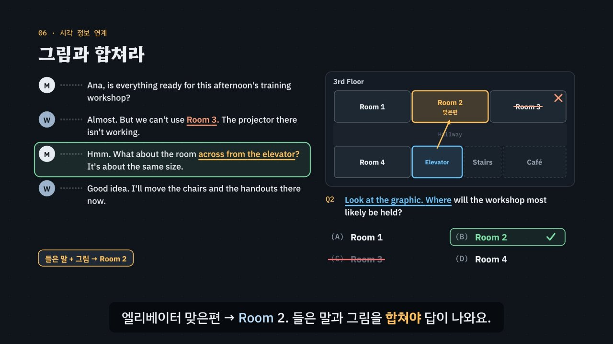

# 먼저 읽고, 바꿔 말한 답을 잡아라

> [영어 튜토리얼](../README.md) 모음의 열여섯 번째 꼭지(T16)입니다. 영역: 토익 · 다루는 유형: [100개 유형](../docs/toeic-100-types.md)의 78번(패러프레이즈), 79번(문제 미리 읽기와 순서), 80번(주제·목적), 81번(화자의 직업·장소 추론), 82번(문제점·걱정), 83번(요청·제안), 84번(다음에 할 일), 85번(화자 의도 파악), 86번(시각 정보 연계), 87번(세 사람 대화의 화자 구분), 88번(Part 4 담화 유형별 흐름).

토익 듣기 **Part 3(대화)·Part 4(담화)** 를 약 6분 30초짜리 인터랙티브 모션그래픽으로 설명합니다. 묶는 생각은 하나예요. **정답은 들은 말을 바꿔 말한다(paraphrase).** 대화에서 *fully booked*가 들렸다면 정답 보기는 *No rooms are available*이고, 오히려 *booked*가 그대로 들어간 보기가 함정이에요. 그리고 세 문제의 답은 대부분 대화 순서대로 나오니, 문제를 먼저 읽으면 어디를 들어야 할지 알 수 있어요. 이것을 **3단계 풀이법(미리 읽기 → 신호 듣기 → 바꿔 말하기)** 으로 묶습니다.

한국어와 견주어 보여 줘요. 한국어도 ‘방이 다 찼어요’를 ‘빈방이 없어요’로 바꿔 말하죠. 낱말이 달라도 뜻이 같으면 정답 쪽, 낱말이 같아도 뜻이 다르면 함정 쪽이에요.



## 바로 보기

`index.html`을 더블클릭하면 끝이에요. 설치도, 서버도 필요 없어요.

## 음성에 대해 (먼저 읽어 주세요)

녹음 파일이 아니라 **VoiceStudio로 미리 만든 합성 음성**(`audio/dialogue/`)으로 대화와 담화를 읽어요. 목소리는 화자의 성별과 억양으로 정해요: 미국 여성 · 미국 남성 · 영국 여성 · 영국 남성 · 호주 여성 · 호주 남성, 여섯 사람이 모든 세트를 나눠 읽어요(같은 세트 안에서는 화자마다 다른 사람). 합성 음성이라 **실제 시험 녹음의 억양 · 속도 · 음질을 그대로 들려주지 못해요.** 이 튜토리얼은 억양에 익숙해지는 연습이 아니라 문제를 먼저 읽고, 신호어를 잡고, 바꿔 말한 보기를 고르는 **전략**을 익히는 곳이에요. 억양 연습은 실제 기출 음원으로 따로 해 주세요. 지금 쓰는 목소리는 듣기 단추 아래에 ‘목소리: …’로 보여 줘요.

- 파일이 없거나 못 읽는 줄만 브라우저 음성(speechSynthesis)으로 읽어요. 이때 폴더 안의 `assets/js/voices.js`가 화자마다 다른 목소리를 골라요(미국 · 영국 · 호주 영어를 먼저 찾고, 성별이 맞는 목소리를 고름). 목소리가 모자라면 같은 목소리의 높낮이(pitch)를 바꿔 구별해요. 한 번에 읽는 줄 안에서 한 화자의 말은 한 가지 소리로만 읽어요(파일과 브라우저 음성을 섞지 않음).
- 대화를 읽기 전에 늘 영상 일시정지, 음성 해설 멈추기, 발음 듣기 멈추기(`EN.say.stop()`)를 먼저 해서 소리가 겹치지 않아요. 영상 재생 · 음성 해설 켜기 · 발음 듣기를 누르면 대화 듣기가 멈춰요.
- 공통 부품(`shared/`)은 고치지 않았어요. 대화 듣기는 모두 이 폴더 안에서 처리해요.
- 파일도 브라우저 음성도 쓸 수 없으면 듣기 단추를 숨기고, 연습 문제의 대본을 처음부터 보여 줘요.
- 영상(MP4)은 음성을 넣을 수 없어서, 무대에 대본을 말풍선 줄(화자 표시 + 소리 물결)로 보여 주고 설명에 맞춰 한 줄씩 ‘말하게’ 그려요. 페이지에서는 무대 속 대본 줄을 누르면 그 화자의 목소리로 들려줘요.

## 3단계 풀이법

1. **미리 읽기** — 대화가 나오기 전에 세 문제를 읽고 키워드(누구: *the man · the woman · Kenji*, 무엇: *problem · suggest · do next*)에 표시해요. 묻는 것에 따라 답의 자리를 짐작해요(주제 → 첫 부분, 다음 할 일 → 끝부분, 세 문제는 대화 순서). 그림 문제는 그림과 보기를 먼저 봐요. 문제의 키워드와 어긋나는 보기(**다른 사람의 말 · 때가 다른 일**)는 이 단계에서 지워요.
2. **신호 듣기** — 신호어 뒤의 근거 줄을 잡아요. 문제점 → *but · unfortunately · I'm afraid*, 요청 · 제안 → *Could you · Why don't you*, 다음 할 일 → *I'll · Let me*, 장소 · 직업 → 단서 낱말 여럿, 의도 → 따옴표 문장의 앞 줄과 뒤 줄, 세 사람 → 이름을 부르는 말. 근거 줄과 맞지 않는 보기(**나오지 않은 내용 · 대화와 반대**)를 지워요.
3. **바꿔 말하기** — 근거 줄을 같은 뜻 다른 말로 한 보기를 골라요(*reserve twenty rooms → book accommodations for a group*). **그대로 들린 낱말**이 들어간 보기와 **그림과 안 맞는 칸**(들린 *Room 3*, 바로 옆의 *Room 4*)은 마지막에 지워요.

## 무엇을 배우나요

| 장 | 시각 | 내용 | 직접 해 보기 |
| --- | --- | --- | --- |
| 00 들어가며 | 0:00 | Part 3 · 4 생김새, *fully booked → No rooms are available*, *booked* 함정, 3단계 | 먼저 풀어 보기(대화 두 줄 듣기) |
| 01 문제를 먼저 읽어라 | 0:24 | 문제지(문제 + 보기 인쇄, 대화는 한 번), 키워드 표시, 세 문제 = 대화 순서(시간선 위 Q1 · Q2 · Q3), 13세트 39문제 · 10세트 30문제 | 이 문제의 답은 대화의 어디쯤? |
| 02 정답은 바꿔 말한다 | 0:56 | 한국어 ‘방이 다 찼어요 = 빈방이 없어요’, 들은 말 → 바꿔 말한 보기 넷(데이터에서), 구체적인 말 → 넓은 말, 같은 말 다른 뜻 함정 | 같은 뜻일까, 같은 낱말일까? |
| 03 첫 부분과 단서 낱말 | 1:30 | 주제 · 목적은 첫 부분(*I need …*), *most likely* = 추론, 단서 낱말 모으기(*posters · printed · glossy paper · sample copy*), *gallery* 함정 | 단서를 모아 장소 맞히기 |
| 04 신호어가 답을 부른다 | 2:02 | *Unfortunately* → 문제점, *Why don't you* → 제안, *Could you* → 요청(누가 누구에게), *I'll* → 다음 할 일, 이미 한 일(*Let me check*) | 신호어 뒤에는 무슨 답이 올까?, 대화 다시 듣기 |
| 05 같은 말, 다른 뜻 | 2:46 | *That's the third time this week.* — 복사기 대화(불만) · 계약 대화(감탄), 앞 줄 + 뒤 줄, 낱말 뜻 그대로 함정 | 대화 바꿔 보기(세 대화) |
| 06 그림과 합쳐라 | 3:18 | 층 지도, 보기 = 방 이름 → 대화에는 다른 말, 그대로 들린 *Room 3* ×, *across from the elevator* → *Room 2*, *next to* ≠ *across from* | 들은 말을 그림에서 찾기(맞은편 · 바로 옆) |
| 07 세 사람, 누가 말했나 | 3:50 | 이름을 부르는 말(*Raj, could you …?*) 다음 화자 = Raj, 남은 남자 = Kenji, Kenji의 제안 | 누가 누구일까? |
| 08 담화에는 순서가 있다 | 4:14 | 음성 메시지(줄마다 흐름 칩), 안내 방송 · 광고 · 회의 발췌 · 관광 안내의 흐름, 세 문제의 자리 | 담화 종류를 골라 흐름 보기 |
| 09 3단계 풀이법 | 4:46 | 미리 읽기 → 신호 듣기 → 바꿔 말하기 흐름도와 단계마다 지우는 보기 | 함정 갈래를 고르면 지워지는 단계에 불이 켜짐 |
| 10 실전 문제 풀이 | 5:13 | IT 지원팀 대화 한 세트(세 문제), 단계마다 보기를 하나씩 지움 | 대화 듣기, 문제 고르기 |
| 11 정리 | 6:07 | 한눈에 보는 표 | 아래 칸으로 가는 길 |

영상 아래에는 네 가지가 더 있어요.

- **놀이터 ① 근거 줄 찾기**: 대화 넷(호텔 단체 예약 · 워크숍 회의실 지도 · 세 사람 대화 · 치과 음성 메시지) 가운데 하나를 골라 듣고, 문제마다 답을 증명하는 줄을 대본에서 눌러요. 규칙 엔진(`LT.lineRole`)이 근거 줄이면 정답이 그 줄을 어떻게 바꿔 말했는지 보여 주고, 아니면 왜 아닌지 알려 줘요(함정 보기의 출처가 된 줄인지, 다른 문제의 근거 줄인지 → ‘세 문제는 대화 순서대로’, 답이 없는 줄인지). 보기를 눌러 답부터 골라도 돼요. 키보드: ↑ ↓ 줄 옮기기, Enter 이 줄이 근거, 1~3 문제, A~D 보기, R 다시 듣기, S 천천히.
- **놀이터 ② 의도 파악 실험**: 세 대화(복사기 · 계약 · 고객 일정)에 똑같은 문장 *That's the third time this week.*와 똑같은 보기 넷이 나오는데, 앞뒤 줄에 따라 정답이 바뀌어요(불만 → *A machine keeps breaking down* · 감탄 → *A team has been very successful* · 짜증 → *A client keeps changing a schedule*). 셋을 다 풀면 비교 표가 나와요. 키보드: ← → 대화, A~D, R, S.
- **연습 문제**: 실제 시험처럼 세트로 풀어요. 대화 다섯 개(Part 3 렌터카 · 세 사람 사무실 이사 · 그림이 있는 워크숍 신청, Part 4 회의 발췌 · 관광 안내) × 세 문제 = 15문제(정답 위치 4 · 4 · 4 · 3). 세 문제가 먼저 보이고 대본은 가려져 있어요(누가 말하는지와 소리 물결만 보임). 힌트 = 3단계 풀이(① 키워드와 답의 자리 → ② 신호어와 근거 줄: 이때 근거 줄이 드러나고 색이 칠해짐 → ③ 바꿔 말하기). 답하면 보기마다 대본과의 관계 · 탈락 단계 · 까닭 · 해석, 세 문제를 다 풀면 대본 전체와 해석이 보여요. 폴더 안의 `listeningDrill`이 공통 `EN.drill`과 같은 모양(`.edr`)과 키보드를 써요: A~D 고르기, H 힌트, R 다시 듣기, S 천천히, T 대본 보기, Enter · → 다음(‘다음’ 뒤에도 초점이 상자 안에 남음).
- **퀴즈**: 10문제(그림 문제 2개: 층 지도에서 *across from the café*인 방 누르기, 세 사람 대화에서 Kenji가 한 줄 누르기 — 맞은편 방과 이름은 규칙 엔진이 계산).
- **핵심 정리**: 묻는 것 · 답의 자리 · 신호 · 바꿔 말하기 예와 함정 표, 용어(미리 읽기 · 신호 듣기 · 바꿔 말하기 · Part 4 담화의 흐름).

### 플레이어 조작

다른 튜토리얼과 같아요. 스페이스(재생/일시정지), ← →(5초), Shift + ← →(장), C(자막), V(음성 해설), F(전체 화면). 화면 속 대본 줄을 누르면 그 화자의 목소리로, 문제와 보기를 누르면 영어 발음으로 들려줘요. 주소 끝에 `#c-장면이름`(예: `index.html#c-graphic`)을 붙이면 그 장면에서 시작해요.

음성 해설은 자막의 `(A)`~`(D)`를 ‘에이 · 비 · 씨 · 디’, `Part 3`을 ‘파트 3’, `TOEIC`을 ‘토익’으로 읽고, `=` · `+`는 쉬어 읽어요.

## 무엇이 규칙 계산인가요

- **규칙 엔진** `assets/js/grammar.js`의 `LT.judge(세트, 문제, 보기)`가 맞고 틀림, 까닭(근거 줄을 함께), 3단계 가운데 몇 단계에서 지워지는지를 정해요. 보기마다 대본과의 관계를 적어 두고, 엔진이 관계를 단계로 바꿔요.
  - ① 미리 읽기에서 탈락: `speaker` 다른 사람의 말 · 일, `time` 때가 다른 일(이미 한 일 · 나중 일)
  - ② 신호 듣기에서 탈락: `none` 나오지 않은 내용, `contra` 대화와 반대
  - ③ 바꿔 말하기에서 탈락: `repeat` 그대로 들린 낱말, `graphic` 그림과 안 맞는 칸
  - 정답 `para`: 바꿔 말하기 짝(들은 말 = 보기의 말)과 근거 줄. 장소 · 직업 문제는 단서 낱말 여럿, 의도 문제는 앞뒤 줄, 그림 문제는 그림에서 다시 계산한 답.
- **그림 계산**: 층 지도는 방마다 위치(위 · 아래 줄, 칸)를 적어 두고 `LT.where`가 ‘맞은편(across from)’ · ‘바로 옆(next to)’을 계산해요(답이 둘이면 정하지 않음). 표는 `LT.lookup`이 ‘점심 바로 다음 줄’ 같은 말을 칸으로 바꿔요. 그림 문제의 정답이 이 계산과 다르면 경고해요.
- **세 사람 대화의 이름**: `LT.names`가 ① 한 사람만 부른 말(*Raj, could you …?*) 바로 다음에 다른 사람이 말하면 그 사람, ② 남은 이름은 성별로 하나씩 정해요. 대본만으로 이름을 알 수 없으면 경고해요.
- **신호어**: `LT.signalType`이 *Could you · Why don't you* → 요청 · 제안, *I'll · Let me* → 다음 할 일, *but · unfortunately · I'm afraid* → 문제점, *I'm calling about · I need* → 주제로 나눠요. 문제점 · 요청 · 다음 할 일 문제의 신호어가 다른 갈래면 경고해요.
- **어긋남 경고** `LT.check()`: 맞는 보기가 꼭 하나인지, 근거 줄 · 신호어 · 단서 · 바꿔 말하기의 들은 말이 대본에 정말 있는지, 바꾼 말이 보기에 있는지, 그대로 들린 낱말이 대본과 보기 양쪽에 있는지, 세 문제의 근거 줄이 대화 순서인지, 주제 문제의 근거가 첫 부분 · 다음 할 일 문제의 근거가 끝부분인지, 따옴표 문장이 대본과 같은지, 연습 문제 정답 위치가 고른지, 의도 파악 실험의 세 대화가 보기는 같고 정답은 다른지 점검해요. 실전 문제의 ‘탈락’ 표시(①·②·③ 모두)와 자막, 퀴즈 정답도 따로 점검해요.
- **단순하게 줄인 부분**
  - 보기와 대본의 관계(바꿔 말한 정답인지, 그대로 들린 낱말 함정인지 등)는 엔진이 영어를 이해해 정하는 것이 아니라 보기마다 데이터에 적어 둔 것이에요. 엔진은 그 관계가 대본과 맞는지만 확인해요.
  - ‘세 문제는 대화 순서’, ‘주제는 첫 부분 · 다음 할 일은 끝부분’은 시험의 일반적인 경향이에요. 실제 시험에는 예외도 있어요.
  - 화자 의도 문제의 뜻(불만 · 감탄 · 짜증)은 사람이 정해 둔 것이에요.
  - ‘때가 다른 일’에는 이미 한 일, 나중 일, 문제가 묻는 때와 다른 일(오전을 묻는데 오후 이야기)을 함께 넣었어요.
  - Part 3 · 4 문제 수(39 · 30)와 세트 수는 시험 형식 자료에서 가져왔어요. 시험의 지시문과 문제 사이 쉬는 시간은 다루지 않았어요.
- **대화와 문제**: 모두 토익 형식을 본떠 직접 만든 것이에요. 사람 이름과 회사 이름도 지어낸 것이에요.

## 폴더 구조

```
index.html              페이지 (영상 · 직접 해 보기 · 놀이터 · 연습 문제 · 퀴즈 · 핵심 정리)
assets/js/grammar.js    규칙 엔진(LT.judge · LT.steps · LT.lineRole), 대화 · 담화 세트(LT.SETS), 그림(LT.G · LT.where · LT.lookup), 이름 알아내기(LT.names), 데이터 점검(LT.check)
assets/js/voices.js     대화 듣기: 미리 만든 파일 → 없으면 화자마다 브라우저 목소리 고르기(LTV.play · LTV.stop · LTV.voices · LTV.lineId)
assets/js/scenes.js     영상 장면 12개, 장 목록과 자막, 대본 말풍선(화자 표시 + 소리 물결) · 문제 칸 · 지도와 표 그리기(LTS.graphic)
assets/js/app.js        플레이어, 직접 해 보기, 놀이터(근거 줄 찾기 · 의도 파악 실험), 세트형 연습 문제(listeningDrill), 퀴즈, 영상 추출(EN_EXPORT)
audio/narration/        미리 만든 음성 해설 · 발음 듣기: pieces.json(조각 목록) · clips.js(window.EN_CLIPS) · 조각 id.m4a
audio/dialogue/         대화 · 담화의 목소리: 줄 목록(lines.json) · 목소리 열쇠 → 프로필(voices.json) · 파일 목록(clips.js) · 음성 파일(열쇠-id.m4a)
video/                  자막 원고(SRT)
docs/poster.jpg         사이트 카드 그림
```

## 미리 만든 목소리

VoiceStudio(OmniVoice 엔진, 비상업용 라이선스)로 미리 만든 합성 음성 파일이에요. 파일이 없거나 못 읽으면 그 줄 · 조각만 브라우저 음성으로 읽어요.
- 대화 · 담화(`audio/dialogue/`): 세트의 화자 표시(`spk: { W: ['여자', 'f', 'us'] }`)에서 성별-억양 열쇠(`f-us`)를 만들고, 열쇠 → 프로필은 `voices.json`. 미국 여성 · 미국 남성 · 영국 여성 · 호주 남성은 [길 묻기 튜토리얼](../directions/)의 목소리를 함께 쓰고, 영국 남성 「듣기 · 영국 남성」과 호주 여성 「듣기 · 호주 여성」은 이 튜토리얼을 위해 새로 만들었어요(VoiceStudio에 목소리 설명 *male, young adult, moderate pitch, british accent* 등으로 본보기 문장을 여러 seed로 읽힌 뒤, 받아쓰기 · 높낮이를 확인해 하나를 골라 복제(clone) 프로필로 저장 — 줄마다 같은 사람 목소리가 나요). 줄 목록은 페이지의 `window.__dialogueLines()`가 모든 세트(`LT.SETS`)의 줄에서 모아요. 파일 이름은 열쇠와 읽을 글로 정해져요(`LTV.lineId`). 천천히 듣기는 같은 파일을 0.75배로 읽어요.
- 음성 해설과 발음 듣기(`audio/narration/`): 한국어 조각은 「튜토리얼 내레이터 (젊은 여성)」, 영어 조각과 발음 듣기(`EN.say`)는 「영어 선생님 (밝은 미국 여성)」.
- 합성 엔진은 가끔 무음 · 잡음을 내거나 짧은 말을 뭉개 읽어요. 도구가 이런 소리를 걸러 seed를 바꿔 다시 만들어요. 지금 파일은 받아쓰기(Whisper) · 높낮이 · 소리 크기로 모두 다시 확인했어요. 대화 · 담화 75줄은 모두 제대로 읽혔고 여섯 목소리의 높이도 고르게 나와(남성 118–121 Hz · 여성 178–205 Hz) 다시 만든 줄이 없어요. 음성 해설에서는 목소리가 갈라져 아주 높게 들린 짧은 영어 3개(*next to* · *Raj* 두 조각)를 seed를 바꿔 다시 만들었고, 괄호 안의 영어에서 자막이 나뉘어 앞에 ‘)’가 남은 한국어 조각(*), 무엇을 묻는지.*)은 엔진이 ‘)’를 ‘픽’처럼 읽어서, 도구가 조각 앞뒤의 짝 없는 괄호를 떼고 읽게 고친 뒤 다시 만들었어요. 모든 튜토리얼을 다시 살펴볼 때(2026년 11월) 받아쓰기는 맞지만 속삭이듯 · 숨소리 섞이게 읽은 소리까지 찾으려고 영어 파일마다 목소리가 울린(성대가 떨린) 비율과 숨소리가 섞인 정도(소리가 얼마나 고르게 되풀이되는지 보는 자기상관 · 켑스트럼 피크, s 소리가 긴 짧은 말은 모음 부분만)를 쟀어요. 울린 비율 하나만으로는 숨소리 섞인 소리를 실제보다 훨씬 나쁘게 재기도 해서 세 가지를 함께 보고, 속삭이듯 · 숨소리 섞이게 읽거나 아주 높게 읽은 파일 5개(*slides* · *across from* · *client* · *Raj.*)를 seed를 바꾸거나 읽을 글 끝에 쉼표 · 느낌표를 붙여 다시 만든 뒤 받아쓰기로 낱말을 확인했어요. 화면의 글은 그대로예요. 한 파일만 다시 만들려면 그 파일을 지우고 `--seed`를 바꿔 다시 실행하세요.

만드는 법(VoiceStudio가 있는 맥에서, 이미 만든 파일은 건너뛰어요):

```bash
node tools/narration-pieces.cjs listening-part3-4     # 해설의 읽기 조각 + 발음 듣기 글 목록 (자막 · 예문을 고쳤을 때만, 클라우드에서도 됨)
node tools/dialogue-lines.cjs listening-part3-4       # 대화 · 담화의 줄 목록 (대본을 고쳤을 때만, 클라우드에서도 됨)
python3 tools/voicestudio-narration.py listening-part3-4 --en-profile "영어 선생님 (밝은 미국 여성)"
python3 tools/voicestudio-dialogue.py listening-part3-4
```

## 영상 다시 만들기

```bash
node tools/render-video.cjs listening-part3-4                        # → listening-part3-4/video/listening-part3-4.mp4 + .srt
node tools/render-video.cjs listening-part3-4 --frames 14,224,330    # 몇 장면만 그림으로
node tools/render-video.cjs listening-part3-4 --poster 224           # 카드 그림
node tools/render-video.cjs listening-part3-4 --srt                  # 자막 원고만
```
