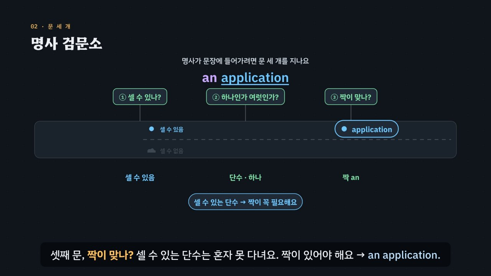

# 명사 검문소를 통과하라

> [영어 튜토리얼](../README.md) 모음의 여섯 번째 꼭지(T06)입니다. 영역: 토익 문법 · 다루는 유형: [100개 유형](../docs/toeic-100-types.md)의 47–51번

토익 Part 5의 **명사·관사·수량 표현 문제**를 약 6분짜리 인터랙티브 모션그래픽으로 설명합니다. 한국어는 ‘어제 책 샀어’로 충분하지만, 영어는 a book · the book · books 가운데 하나를 꼭 골라야 해요. 한국어에는 관사도, 반드시 붙이는 복수 표시도 없어서 한국인 학습자가 특히 자주 빠뜨리는 부분이에요. 이 튜토리얼은 영어 명사가 문장에 들어갈 때마다 지나는 **명사 검문소**의 세 문으로 설명하고, 그것을 그대로 **3단계 풀이법(셀 수 있나? → 하나인가 여럿인가? → 짝이 맞나?)** 으로 씁니다.



## 바로 보기

`index.html`을 더블클릭하면 끝이에요. 설치도, 서버도 필요 없어요.

## 무엇을 배우나요

| 장 | 시각 | 내용 | 직접 해 보기 |
| --- | --- | --- | --- |
| 00 들어가며 | 0:00 | 뜻이 모두 ‘많은’인 보기 넷(many · several · a great deal of · a number of), 답을 정하는 뒤의 명사 information | 먼저 풀어 보기 |
| 01 ‘책 샀어’를 영어로 | 0:24 | 한국어 한 문장이 영어 넷(a book · the book · books · book ×)으로, ‘학생 세 명’과 three students | 뜻을 골라 그 영어 문장을 화면에서 보기 |
| 02 명사 검문소 | 0:56 | 세 문: 셀 수 있나 · 하나인가 여럿인가 · 짝이 맞나. application은 셋째 문에서 짝 an이 붙어야 통과, information은 첫째 문에서 다른 길 | 명사구 여덟 가지를 골라 검문소에 보내기 |
| 03 혼자 못 다니는 명사 | 1:30 | 셀 수 있는 단수 + 한정사(an · the · your · this), 짝 없이 다닐 수 있는 복수·셀 수 없는 명사, a/an은 뒤 낱말의 첫 소리로 | 빈칸 문제 둘 |
| 04 셀 수 없는 명사 | 2:00 | information · advice · equipment · feedback · luggage · furniture, 묶음의 이름(furniture = 의자 · 책상 · 탁자), -s ×, a/an ×, a piece of로 세기 | 셀 수 있나 없나 고르기(suggestion/advice, chair/furniture 등 다섯 쌍) |
| 05 수량 표현의 짝 | 2:34 | each · every · another + 단수, several · a few · many · a number of + 복수, much · a little · a great deal of + 셀 수 없는 명사, 둘 다(all · most · some …), each of the + 복수 | 빈칸 문제 둘 |
| 06 almost · most · most of | 3:10 | most + 명사, most of + the · our + 명사, almost(부사) → almost all | 빈칸 문제 둘 |
| 07 숫자-하이픈과 another | 3:42 | three days → a three-day workshop(-s가 떨어짐), a 10-page report, another = an + other → 단수, other → 복수 | 빈칸 문제 둘 |
| 08 3단계 풀이법 | 4:14 | 셀 수 있나 → 하나인가 여럿인가 → 짝이 맞나 흐름도 | 검문소 판정기: 짝 · 명사 · 모양을 고르면 흐름도에 길이 켜짐 |
| 09 실전 문제 풀이 | 4:44 | 토익 형식 세 문제 (a great deal of · Each of the · a two-week) | 문제 고르기 |
| 10 정리 | 5:40 | 명사 갈래와 짝 표 | 아래 칸으로 가는 길 |

영상 아래에는 네 가지가 더 있어요.

- **놀이터 — 명사 검문소**: 짝(한정사·수량 표현) 26가지, 명사 13개(셀 수 있는 것 7 · 셀 수 없는 것 6), 모양(단수 · 복수)을 골라 명사구를 만들면, 명사가 그림 속 검문소의 세 문을 차례로 지나가요. 멈추면 어느 문에서 왜 멈췄는지(세 문의 판정과 까닭)와 고친 말을 보여 주고, 지금 명사와 짝이 되는 말을 모두 모아 보여 줘요. 함정 줄에는 almost · almost all · most of · most of the · each of the · a three-___ workshop(숫자-하이픈)이 있어요. ‘먼저 맞히기’를 켜면 통과하는 것과 멈추는 것이 반쯤씩 섞인 무작위 명사구가 나오고, 통과할지 먼저 고른 뒤 확인해요. 키보드 ← → 짝, ↑ ↓ 명사, S 단수/복수, 1 통과 · 2 멈춤, Enter 다음 문제.
- **연습 문제**: 토익 Part 5 형식 16문제(유형 47 · 48 · 49 · 50 · 51을 고루, 정답 위치 4/4/4/4). 힌트 = 3단계 풀이(셀 수 있나 → 하나인가 여럿인가 → 짝이 맞나), 명사와 단서에 색, 보기마다 어느 문에서 멈췄는지와 까닭, 해석, 발음.
- **퀴즈**: 개념 확인 10문제(그림 문제 3개: many informations가 멈추는 문 고르기, Several 뒤에 올 낱말 카드 고르기, 문장 속 틀린 곳 고르기).
- **핵심 정리**: 명사 갈래와 짝 표, 세 문별 용어(셀 수 있는·없는 명사, 뜻은 비슷한데 셈이 다른 짝, 세는 말, 숫자-하이픈 꾸밈말, 한정사 · 관사 · 수량 표현, another · other, almost · most · most of).

### 플레이어 조작

다른 튜토리얼과 같아요. 스페이스(재생/일시정지), ← →(5초), Shift + ← →(장), C(자막), V(음성 해설), F(전체 화면). 화면 속 영어 문장을 누르면 발음을 들려줘요. 주소 끝에 `#c-장면이름`(예: `index.html#c-most`)을 붙이면 그 장면에서 시작해요.

음성 해설은 복수 꼬리 `-s`를 ‘에스’라고 한국어 음성으로 읽어요.

## 무엇이 규칙 계산인가요

- **규칙 엔진** `assets/js/grammar.js`의 `NA.judgePhrase({ det, of, hyw, hy, noun, num }, ctx)`가 명사구 하나를 세 문으로 판정해요. ① 셀 수 있나는 명사 사전(`NA.NOUNS`), ② 하나인가 여럿인가는 명사의 모양(셀 수 없는 명사의 -s, 숫자-하이픈 꾸밈말의 -s, 문장의 다른 단서가 정한 수), ③ 짝이 맞나는 짝 사전(`NA.DETS`: 짝마다 바로 뒤에 올 수 있는 갈래와 of the 뒤에 올 수 있는 갈래)으로 정해요. 멈추면 처음 멈춘 문과 까닭, 그리고 가장 가까운 고친 말(`NA.fix`)을 돌려줘요. 영상 속 ✓·×와 검문소의 판정, 직접 해 보기 채점, 놀이터, 연습 문제의 힌트와 보기별 해설, 퀴즈의 정답이 모두 이 함수에서 나와요.
- **a냐 an이냐** `NA.aan(낱말)`은 뒤 낱말의 첫 소리로 정해요(hour · honest는 an, university · uniform · useful은 a를 따로 적어 둠).
- **어긋남 경고** `NA.check()`: 연습 문제 정답이 규칙 엔진과 다르거나, 정답이 둘 이상이거나, 보기 글과 엔진의 명사구가 완성 문장 속에서 다르거나(a/an 철자 포함), 표시할 단서가 문장에 없거나, 정답 위치가 몰리면 콘솔에 경고가 떠요. 영상 속 예문(✓·× 표시)과 실전 문제, 퀴즈도 페이지를 열 때 규칙 엔진과 대조해요.
- **단순하게 줄인 부분**
  - 실제 영어에서는 같은 명사가 뜻에 따라 셀 수 있기도, 없기도 해요(a paper 신문 / paper 종이, experience, time, room). 엔진은 명사마다 토익에서 주로 쓰는 한 가지로 정해 두었어요.
  - some + 단수(some person = 어떤 사람), most of the report(보고서의 대부분)처럼 한 덩어리를 나누는 말, another three days처럼 숫자가 낀 말은 엔진이 다루지 않아요(엔진은 ×로 판정해요). any · no · enough 같은 짝은 사전에 넣지 않았어요. 연습 문제와 퀴즈에는 이런 짝을 보기로 넣지 않았어요.
  - a와 the 가운데 무엇을 쓸지(처음 말하는 것인지, 서로 아는 것인지)는 문맥의 일이라, 엔진은 셀 수 있는 단수에 짝이 있는지만 봐요. 01장의 a book · the book 구별은 뜻 설명이에요.
  - few · little(거의 없는)과 a few · a little(조금 있는)의 뜻 차이는 엔진이 가리지 않아요. 짝(복수 · 셀 수 없음)만 봐요.
  - other + 셀 수 없는 명사(other equipment)는 엔진이 맞다고 해요. 영상과 문제에서는 other + 복수만 썼어요.
  - 숫자-하이픈 꾸밈말은 기간 · 분량을 뜻하는 단위 명사(day · week · hour · page · year · minute)만 다뤄요.
  - 주어와 동사의 수 일치(each + 단수 동사 등)는 T03에서 다뤄요. 이 튜토리얼은 명사구 안의 짝만 봐요.
- **예문과 문제**: 모두 토익 형식을 본떠 직접 만든 것이에요.

## 폴더 구조

```
index.html              페이지 (영상 · 직접 해 보기 · 놀이터 · 연습 문제 · 퀴즈 · 핵심 정리)
assets/js/grammar.js    규칙 엔진(NA.judgePhrase · NA.fix · NA.aan), 명사 사전 · 짝 사전, 연습 문제(NA.DRILL), 놀이터의 짝 · 명사 목록(NA.PG)
assets/js/scenes.js     영상 장면 11개, 검문소 그리기(NS.gates · NS.pgDraw), 장 목록과 자막
assets/js/app.js        플레이어, 직접 해 보기, 놀이터(명사 검문소), 퀴즈, 영상 추출(EN_EXPORT)
video/                  자막 원고(SRT)
audio/narration/        미리 만든 음성 해설 · 발음 듣기: pieces.json(조각 목록) · clips.js(window.EN_CLIPS) · 조각 id.m4a
docs/poster.jpg         사이트 카드 그림
```

## 미리 만든 목소리

음성 해설과 발음 듣기는 VoiceStudio(OmniVoice 엔진, 비상업용 라이선스)로 미리 만든 합성 음성 파일(`audio/narration/`)로 읽어요. 파일이 없거나 못 읽는 글만 브라우저 음성으로 읽어요.
- 음성 해설: 한국어 조각은 「튜토리얼 내레이터 (젊은 여성)」, 영어 조각(본보기 영어 문장)은 「영어 선생님 (밝은 미국 여성)」.
- 발음 듣기(`EN.say`): 영상 속 영어나 스피커 단추를 누르면 같은 「영어 선생님 (밝은 미국 여성)」 파일로 읽어요(천천히는 같은 파일을 0.75배로). 글은 `tools/say-sweep.js`가 영상 · 처음부터 있는 스피커 단추 · 직접 해 보기의 예문(예문 단추를 하나씩 눌러 가며)에서 모아요. 놀이터에서 조각을 골라 만든 문장, 문제를 푼 뒤에 나오는 문장처럼 조합이 많은 글은 브라우저 음성으로 읽어요.
- 합성 엔진은 가끔 무음 · 잡음을 내거나 짧은 말을 뭉개 읽어요. 도구가 이런 소리를 걸러 seed를 바꿔 다시 만들어요. 지금 파일은 받아쓰기(Whisper)와 높낮이로 모두 다시 확인했고, 너무 높게 읽거나 *an*이 *and*처럼 들린 4개(*furniture* 두 조각 · *furnitures* · *an information, informations*)는 seed를 바꿔 다시 만들었어요. 한 파일만 다시 만들려면 그 파일을 지우고 `--seed`를 바꿔 다시 실행하세요.

만드는 법(VoiceStudio가 있는 맥에서, 이미 만든 파일은 건너뛰어요):

```bash
node tools/narration-pieces.cjs nouns-articles     # 해설의 읽기 조각 + 발음 듣기 글 목록 (자막 · 예문을 고쳤을 때만, 클라우드에서도 됨)
python3 tools/voicestudio-narration.py nouns-articles --en-profile "영어 선생님 (밝은 미국 여성)"
```

## 영상 다시 만들기

```bash
node tools/render-video.cjs nouns-articles                    # → nouns-articles/video/nouns-articles.mp4 + .srt
node tools/render-video.cjs nouns-articles --frames 77.6,300  # 몇 장면만 그림으로
node tools/render-video.cjs nouns-articles --poster 77.6      # 카드 그림
node tools/render-video.cjs nouns-articles --srt              # 자막 원고만
```
