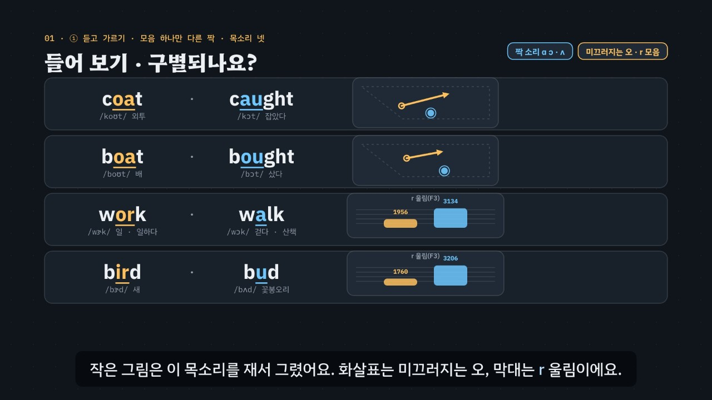

# 미끄러지는 오, r을 품은 어 — oʊ · ɝ · ɚ

> [영어 튜토리얼](../README.md)의 **영어 발음 (미국식)** 꼭지 가운데 열한 번째예요(영역: `pron`, 계획표의 P08 · 유형 16 · 17). 발음 영역의 설계도는 [docs/pron-types.md](../docs/pron-types.md)예요. 형식은 [입을 얼마나 벌리나](../open-vowels/README.md)를 복사해 시작했어요(모음 지도 · 내 모음 찍기 · 목소리 넷).

외투 · 잡았다 → 영어로 *coat · caught*. 한국어로 적으면 둘 다 코트예요. 영어에서는 **끝에서 우 쪽으로 미끄러지느냐**가 두 낱말을 갈라요. 일 · 걷다 → *work · walk*도 한국어로는 둘 다 워크지만, 영어에서는 **혀를 r 모양으로 하느냐**가 갈라요.

- **미끄러지는 오 oʊ** — 오로 시작해 한 박자 안에서 입술을 더 모으고 혀 뒤를 조금 올려 우 쪽으로(*coat · boat · home · phone · go*). 한국어 오는 처음부터 끝까지 한 모양이에요.
- **크게 벌린 아 ɑ · ɔ** — 짝 소리. 턱을 크게 내리고 끝까지 미끄러지지 않아요(*caught · bought · law · saw · not*). 사전에는 다른 기호(ɔ · ɑ)로 적지만 많은 미국 사람이 같게 말해서, 이 꼭지는 둘을 함께 짝 소리로 다뤄요.
- **r을 품은 어 ɝ** — 어를 내는 동안 처음부터 끝까지 혀를 r 모양으로(혀 몸통을 뭉쳐 올리거나 혀끝을 살짝 젖힘, 혀끝은 입천장에 닿지 않음), 입술은 조금 모아요(*work · bird · hurt · girl*). 어 + ㄹ이 아니라 모음 전체가 r 소리예요.
- **r 없는 어 ʌ · 아 + r ɑr** — 짝 소리와 셋이 갈리는 줄(*hut · hurt · heart*). 아 + r은 아로 시작해 끝에서 r로 옮겨 가요.
- **약한 r 모음 ɚ** — 약한 끝 음절에서도 짧게, 그래도 혀는 r 모양(*water · doctor · center · computer*). 한국어 표기는 끝을 어로 적어(워터 · 닥터) r이 보이지 않아요.

3단계 발음법: ① **듣고 가르기**(짝 낱말 · 목소리 넷 · 셋이 갈리는 줄) → ② **입 모양 만들기**(오에서 우로 · 턱을 크게 · 혀를 r 모양으로) → ③ **낱말 · 문장 속에서**(약한 r 모음 · 외래어 · 짧은 낱말 · 내 모음 찍기).



## 바로 보기

`index.html`을 더블클릭하면 끝이에요. 설치도, 서버도 필요 없어요.

## 소리와 마이크에 대해 (꼭 읽어 주세요)

- 녹음 파일이 없어요. 영어는 모두 **합성 음성**이에요. 글이 정해진 말(낱말 · 문장 · 연습 문제 · 따라 말하기)은 **VoiceStudio로 미리 만든 미국식 목소리 넷**(`audio/dialogue/`)으로, 나머지는 브라우저에 들어 있는 영어 음성(speechSynthesis)으로 읽어요. 합성 음성은 실제 사람의 말소리와 조금 다르게 들릴 수 있어요.
- **목소리 넷**: 밝은 선생님(미국 여성) · 차분한 선생님(미국 여성) · 미국 여성 · 미국 남성. 듣고 가르기 훈련 · 연습 문제는 문제마다 목소리를 바꿔요. 비교용 **한국어식 소리**(*코트 · 워크 · 워터* …)는 한국어 내레이터 목소리로 만들었어요(`voices.json`의 `"lang": "ko"`).
- 튜토리얼 전용 목소리 부품 `assets/js/voices.js`(`RVV`)는 입을 얼마나 벌리나의 `OVV`와 같아요(말하는 사람마다 파일을 찾고, 없으면 브라우저 음성 en-US · 한국어식은 ko-KR, 잰 값 `RVV.meas` — F1 · F2 · 미끄러짐 G · 세 번째 공명 F3 · 모음 길이). 읽기 전에 음성 해설 · 발음 듣기 · 녹음 재생을 멈추고 영상을 일시정지해요.
- **내 발음 확인 · 따라 말하기**: 브라우저에 음성 인식(`SpeechRecognition` · `webkitSpeechRecognition`, en-US)이 있으면 말을 글로 바꿔 **후보 글 여러 개**를 짝 낱말과 맞춰 봐요. 모음을 맞게 냈는지는 판정하지 않아요(인식기는 흔한 낱말 쪽으로 기울어요). 크롬(Chrome) 같은 브라우저는 소리를 브라우저 회사의 서버로 보내 글로 바꿔요. 음성 인식이 없으면 녹음(`MediaRecorder`)으로 ‘내 목소리’와 ‘본보기’를 이어서 들어요.
- **내 모음 찍기(시험 기능)**: 짝 낱말 둘을 2초씩 녹음하면 **브라우저 안에서** 재서, 오 짝은 모음의 처음 → 끝(F1 · F2)을 지도에 화살표로, r 짝은 모음 앞쪽의 세 번째 공명(F3)을 막대로 그려요. 소리는 어디로도 보내지 않고, 녹음은 메모리에만 둬요. 이 사이트는 아무것도 저장하지 않아요(듣고 가르기 훈련의 기록만 이 브라우저의 `localStorage`에).

## 무엇을 배우나요

| 장 | 시각 | 내용 | 직접 해 보기 |
| --- | --- | --- | --- |
| 00 들어가며 | 0:00 | *coat · caught* = 코트 · 코트, *work · walk* = 워크 · 워크 · 3단계 | 먼저 들어 보기(한국어식 · 목소리 넷) |
| 01 들어 보기 · 구별되나요? | 0:36 | ① 짝 넷(*coat · caught, boat · bought, work · walk, bird · bud*) · 목소리마다 잰 작은 그림(화살표 · r 울림 막대) · 한국어식은 짝마다 같은 표기 | 짝 고르기(스무 쌍) · 목소리 고르기 |
| 02 미끄러지는 오 | 1:16 | ② 입 옆 단면도가 오 → 우로 움직임, 한국어 오는 한 모양 · 잰 지도(*coat · caught · cut · curt*)의 화살표 · *boat · home · phone · go* | 낱말 고르기 · 목소리 고르기 |
| 03 크게 벌린 아 · 미끄러지지 않아요 | 2:00 | ② 턱을 크게 · 끝까지 미끄러지지 않음 · 오 짝 열 쌍 가운데 여섯 쌍이 같은 표기 | 오 짝 고르기 |
| 04 r을 품은 어 | 2:40 | ② r 모양 둘(뭉친 혀 · 젖힌 혀) + 입술 · *work · bird · hurt · girl*의 한국어식 표기 · 잰 r 울림 막대(*work · walk · bird · bud*) | 낱말 고르기 · 목소리 고르기 |
| 05 셋이 갈리는 줄 | 3:24 | ① *hut · hurt · heart* 등 네 줄 — r 없는 어 · r을 품은 어 · 아 + r, 한국어식 헛 · 허트 · 하트 · r 울림이 있는 곳(그림) | 줄 고르기 · 목소리 고르기 |
| 06 약한 r 모음 | 4:08 | ③ *water · doctor · center · computer* — 끝 음절의 r 울림 막대(목소리 넷 + 한국어식 워터) · *teacher · sister · paper* | 낱말 고르기 |
| 07 외래어 함정 | 4:48 | 외래어 카드 열여섯 장(홈 · 폰 · 쇼 · 토스트 / 볼 · 토크 · 소스 · 쇼핑 / 너스 · 퍼스트 · 월드 · 버거 / 워터 · 닥터 · 센터 · 컴퓨터) — 같은 오라도 *home* → 미끄러지고 *ball* → 미끄러지지 않아요 | 외래어 하나씩 |
| 08 문장 속에서 | 5:32 | *I bought a boat.* · *The nurse called the doctor.* — 짧은 낱말(*so · go · don't · her · first*) | 문장 고르기(따라 말하기의 28문장) |
| 09 정리 | 6:16 | 3단계 발음법 · 입 그림은 쉽게 줄인 그림 · 목표는 알아듣는 소리 | 이제 직접(아래 칸으로) |

- **듣고 가르기 훈련**(놀이터 왼쪽): 목소리 넷 × 짝 낱말 스무 쌍(오 짝 열 · r 짝 열)에서 하나를 무작위로 들려주고, 짝 가운데 고르면 **그 목소리를 실제로 잰 그림**(오 짝은 모음 지도의 화살표, r 짝은 r 울림 막대)과 한국어식 표기가 나타나요(잰 값이 없으면 그림 자리). 짝 묶음(모두 · 오 짝 · r 짝) · 목소리를 고를 수 있고, 짝 묶음 · 들은 쪽 · 목소리마다 맞힌 비율을 표(막대)로 보여 줘요. 기록은 `localStorage` `en-rv-hvpt-v1`(지우기 단추).
- **내 발음 확인**(놀이터 오른쪽): 흔히 쓰는 짝 열둘(*coat · caught, boat · bought, low · law, so · saw, cope · cop, note · not, hope · hop, work · walk, bird · bud, hurt · hut, shirt · shut, burn · bun*) 중 하나를 말하면, 음성 인식의 후보 글을 짝과 맞춰 알려 줘요.
- **내 모음 찍기**(놀이터 아래, 시험 기능): 짝 여덟(*coat · caught, boat · bought, note · not, hope · hop, work · walk, bird · bud, hurt · hut, burn · bun*)과 목소리 높낮이(높은 편 = 재는 범위 5500Hz · 낮은 편 = 5000Hz)를 고르고 두 낱말을 2초씩 녹음하면, 오 짝은 두 화살표를 그리고 ‘미끄러짐이 들어 있어요 · 미끄러짐의 차이가 작아요 · 둘 다 거의 미끄러지지 않아요’를, r 짝은 두 막대를 그리고 ‘r 울림이 또렷해요(F3 차 400Hz 이상) · 조금 있어요(150Hz 이상) · 거의 없어요’를 알려 줘요(미끄러짐과 400Hz는 측정 도구의 짝 확인과 같은 기준이에요 — 아래).
- **따라 말하기 28문장**: 오 짝 · r 짝 · 외래어 · 섞어서, 묶음마다 일곱 문장. 목표 모음 글자를 노랑(미끄러지는 오 · r 모음) · 하늘(짝 소리)로 칠했어요.
- **듣고 고르기 16문제**(`PDrill`, `.edr` 모양): 어느 낱말 8 · 문장 속 어느 낱말 4 · 같았나 2 · 외래어의 모음 2(정답 위치 A 8 · B 8, 목소리마다 넷). 소리 먼저, 힌트 세 단계는 엔진이 낱말에서 만들어요. 답하면 그 목소리를 잰 짝의 그림과 같은 목소리로 견줘 듣기.
- **퀴즈 10문제**: 영상 순서대로. 그림 문제 하나(입 옆 단면도 넷에서 r을 품은 어의 입 고르기).
- **핵심 정리**: 미끄러지는 오 · r을 품은 어를 3단계로 견준 표 + 용어.

### 플레이어 조작

다른 튜토리얼과 같아요. 스페이스(재생/일시정지), ← →(5초), Shift + ← →(장), C(자막), V(음성 해설), F(전체 화면). 화면 속 낱말 · 지도의 화살표 · 막대 · 한국어식 표기를 누르면 그 목소리로 들려줘요(같은 단추를 곧바로 다시 누르면 천천히). 02 · 04장의 입 그림은 영상을 멈춰도 계속 움직여요(플레이어만, 영상 추출은 시각 t만으로 그려요).

**미리 만든 목소리**: VoiceStudio(OmniVoice 엔진, 비상업용 라이선스)로 만든 합성 음성 파일이에요. 파일이 없거나 못 읽으면 그 줄 · 조각만 브라우저 음성으로 읽어요.
- **영어는 0.9배로 재생해요**(`voices.js`의 `EN_RATE`). 한국어 해설과 한국어식 읽기는 1배.
- **늘어놓은 낱말은 쉬어 가며 읽어요.** 자막에 · 로 늘어놓은 영어 낱말(*coat · caught*, *boat · home · phone · go*)은 낱말마다 따로 만들고 사이에 쉼표만큼 쉬어 한 파일로 이었어요(`--word-lists`). 해설의 영어 조각 40개는 받아쓰기(Whisper)로 모두 맞게 적히는 것을 확인했어요. 그 가운데 낱말만 읽는 조각 35개는 확인(받아쓰기 · 끝 올림 · 센 음절 · 짝)을 통과한 밝은 선생님(`tc`) 낱말 파일을 쉼표만큼 쉬어 이어 다시 만들었어요(`tools/measure-syllables.py o-and-r-vowels --narration`). *bird · word*(*word*는 낱말 파일을 따로 두지 않아요)와 문장 4개(*I bought a boat.* · *Don't walk on the road.* · *I work on Sunday.* · *The nurse called the doctor.*)는 처음 만든 소리 그대로예요.
- 한국어 조각 86개도 받아쓰기로 확인했어요. 받아쓰기가 소리가 같은 다른 글자로(‘미끄러지는 오’ → 미끄러지는 5, ‘크게 벌린 아’ → 크게 벌리나), 수를 숫자로(‘스물여덟’ → 28) 적은 조각은 그대로 썼어요. 다르게 적힌 조각 2개(‘노트 · 낫’ → 노트 나, ‘오에서 우로’ → 오세서우로)는 seed를 바꿔 다시 만들어 맞게 적힌 소리로 바꿨어요. 07장의 ‘끝의 어도 혀는 …’은 다섯 번 만들어도 ‘끝에 얻어 …’로 적혀서, 자막을 ‘끝 음절에서도 혀는 r 모양이에요’로 바꿨어요.
- 음성 해설(`audio/narration/`): 한국어 조각은 「튜토리얼 내레이터 (젊은 여성)」, 영어 조각은 「영어 선생님 (밝은 미국 여성)」. 자막에는 발음 기호 대신 ‘미끄러지는 오 · 크게 벌린 아 · r을 품은 어 · r 없는 어 · 약한 r 모음’을 써요(음성 해설이 기호를 읽지 못해서). 한국어 속 홀로 쓴 r은 ‘알’, ㄹ은 ‘리을’로 읽어요(`read`).
- 낱말 · 문장(`audio/dialogue/`): 말하는 사람 → 프로필은 `voices.json` — `tc` 「영어 선생님 (밝은 미국 여성)」 · `tf` 「영어 선생님 (미국 여성)」 · `uf` 「길 묻기 · 나 (미국 여성)」 · `um` 「길 묻기 · 길에서 만난 사람 (미국 남성)」 · `ko` 「튜토리얼 내레이터 (젊은 여성)」(한국어).

만드는 법(VoiceStudio가 있는 맥에서, 이미 만든 파일은 건너뛰어요):

```bash
node tools/narration-pieces.cjs o-and-r-vowels     # 해설의 읽기 조각 목록 (자막을 고쳤을 때만)
node tools/dialogue-lines.cjs o-and-r-vowels       # 낱말 · 문장 줄 목록 + 잴 줄의 정보 (낱말 · 문제 · 따라 말하기를 고쳤을 때만)
python3 tools/voicestudio-narration.py o-and-r-vowels --en-profile "영어 선생님 (밝은 미국 여성)" --word-lists
python3 tools/voicestudio-dialogue.py o-and-r-vowels
```

### 잰 값 — 미끄러짐 화살표 · r 울림 막대

지도의 화살표 · 점과 r 울림 막대는 미리 만든 음성 파일을 `tools/measure-syllables.py`로 따로 재서 그려요(`audio/dialogue/measure.js`의 `window.PRON_MEASURE`). 잰 값이 없는 낱말은 그림 자리(‘그림 자리(어림)’ · 점선 빈 막대 ‘잰 값 없음’)로 그리고, 화면에 ‘잰 값’이라고 적지 않아요. 지도의 범위는 목소리마다 그 장면의 낱말로 잡아서(`RVS.mapRange`), 목소리끼리 Hz를 바로 견주지 않아요. 이 꼭지에서 측정 도구에 더한 것은 줄 정보 `measure-meta.json`의 `track` · `tat` · `gpair` · `rpair` · `f3`예요.

- **미끄러짐**(`track` → `G`): 목표 모음의 핵(크기가 가장 큰 곳에서 10dB 안쪽)의 처음(15–35%)과 끝(65–85%)에서 F1 · F2를 재요(구간마다 3프레임 이상의 가운데 값). 화살표는 처음 → 끝이에요. 크게 벌린 뒤 모음에서는 F1 · F2가 한 봉우리로 붙어 F3를 F2로 잡는 프레임이 섞이기도 해서, 핵 안의 F2 값이 900Hz 넘게 떨어진 두 무리로 갈리면 낮은 무리만 써요(낮은 무리가 프레임의 30% 이상일 때).
- **r 울림**(`track` → `F3`): 핵의 앞쪽(15–45%)에서 세 번째 공명을 LPC 12차로 재요(F2보다 150Hz 넘게 높은 첫 공명). 혀를 r 모양으로 하면 이 값이 내려가요. 약한 r 모음 낱말은 끝 음절(`tat`)을, 한국어식 워터 · 닥터 · 센터 · 컴퓨터도 끝 음절(`f3`)을 재요.
- **미끄러짐 짝**(`gpair`): 같은 목소리에서 미끄러지는 오의 F2 내려감(처음 − 끝)이 80Hz 이상이고, 짝(크게 벌린 아)의 내려감은 그보다 100Hz 이상 작아야 해요.
- **r 짝**(`rpair`): 같은 목소리에서 r을 품은 어의 F3가 짝(r 없는 어 · 크게 벌린 아)보다 400Hz 이상 낮아야 해요.
- 어긋나면 그 짝의 파일을 seed를 바꿔 다시 만들고, 끝내 어긋나면 둘 다 잰 값을 빼요. 받아쓰기(Whisper large-v3)로 다른 낱말로 들리지 않는지도 함께 확인해요(`--regen`).
- **내 모음 찍기**는 같은 구간 · 같은 기준을 브라우저에서 줄여 계산해요.

### 낱말 파일 점검

측정 도구는 낱말 파일이 정말 그 낱말로 들리는지(받아쓰기), 센 음절이 사전과 맞는지, 끝이 묻는 말처럼 올라가지 않는지, 짝의 미끄러짐 · r 울림이 기준만큼 갈리는지도 확인해요. **확인을 통과하지 못한 낱말 파일은 어디에서도 들려주지 않아요.** 듣고 가르기 훈련은 짝의 두 낱말이 모두 통과한 목소리만 쓰고, 직접 해 보기에서는 그 낱말이 화면에 나오는 동안 그 목소리 단추가 흐려져 누를 수 없고(고른 뒤에 낱말을 바꾸면 밝은 선생님으로 돌아가요), ‘목소리 넷’ 단추는 통과한 목소리만 보여 줘요. 소리를 내는 길목(`app.js`의 `speak`)에서도 한 번 더 걸러요.

- 밝은 선생님의 낱말만 먼저 쟀을 때 *pose · pause*, *won't · want*의 짝 소리에서 F2가 1400~2000Hz씩 내려간 것으로 나왔어요. 크게 벌린 뒤 모음에서 F1 · F2가 한 봉우리로 붙어 F3를 F2로 잡은 프레임이 섞인 탓이라, 위의 ‘두 무리’ 규칙을 넣었어요(내 모음 찍기에도 같은 규칙).
- 그 뒤 319줄을 받아썼고, 낱말 · 한국어식 287줄 가운데 52줄이 통과하지 못했어요.
  - 끝이 묻는 말처럼 올라감 20줄(미국 남성 12 · 밝은 선생님 6 · 미국 여성 1 · 차분한 선생님 1)
  - 받아쓰기가 다름 7줄: *curt* → Kurt 3줄, *bun* → Fun 3줄, *gull* → Goal 1줄
  - 센 음절 5줄(*computer* 3 · *teacher* · *center*)
  - 미끄러짐 짝 12줄(*won't · want* 세 목소리 6줄과 재지 못한 1줄, *low · law* 3줄, *pose · pause* 2줄) · r 짝 8줄(*fern · fun*, *shirt · shut*, *lurk · luck*, *turn · ton*)
- 고친 것
  - *curt*와 이름 Kurt는 소리가 같은 말로 보게 했어요(3줄 통과).
  - *won't · want*는 세 목소리에서 *won't*의 F2 내려감이 −84~+21Hz로 기준(80Hz)에 못 미쳤어요. 후보 짝을 만들어 재 보고, 네 목소리 모두 통과한 *cope · cop*으로 짝을 바꿨어요.
  - 나머지는 seed를 바꿔 다시 만들었어요 — 여섯 번씩 세 차례. 첫 차례 뒤 11줄, 둘째 차례 뒤 9줄이 남았고, 셋째 차례에서는 더 통과하지 못했어요.
- **영어 낱말 238줄 가운데 229줄이 통과했어요.** 남은 9줄은 미국 남성의 *bought · walk · law · not · got · cart*(끝 올림 3.6~6.8반음), 미국 남성의 *low*(F2 내려감 5Hz — 미끄러짐이 재어지지 않음), 미국 여성의 *gull*(받아쓰기 Goal), 차분한 선생님의 *computer*(센 음절)예요. 그래서 짝 스무 쌍 가운데 열네 쌍은 네 목소리로, *boat · bought*, *low · law*, *note · not*, *goat · got*, *work · walk*는 미국 남성을 뺀 세 목소리로, *girl · gull*은 미국 여성을 뺀 세 목소리로 나와요. 연습 문제의 낱말 소리는 모두 확인을 통과한 파일이에요. 문장 32줄은 받아쓰기만 확인했어요(모두 맞음).
- 통과한 짝에서 잰 값: 미끄러지는 오의 F2 내려감 83~743Hz(36짝 · 목소리), r을 품은 어의 F3 1436~2673Hz · 짝의 F3 2247~3438Hz · 차이 504~1756Hz(38짝 · 목소리).
- **한국어식 낱말은 하나씩 따로 다시 받아썼어요.** 도구는 한국어 글자 하나까지 다른 것을 봐줘서, ‘로 · 소 · 합’ 같은 한 글자 낱말은 무엇으로 들려도 통과하기 때문이에요.
  - 처음에 10줄이 다르게 적혔어요(‘코트’ → 호트, ‘낫’ → 답, ‘고트’ → 코트, ‘갓’ → 갑, ‘너스’ → 노스, ‘커브’ → 커버스, ‘카트’ → 하트, ‘셧’ → 샷, 엉뚱한 문장으로 적힌 ‘헛 · 럭’). 새 짝의 ‘캅’도 캣으로 적혔어요. seed를 바꿔 다시 만들어 8줄(코트 · 낫 · 고트 · 갓 · 헛 · 너스 · 커브 · 카트)은 글자 그대로 적힌 소리로 바꿨어요.
  - **‘셧 · 럭 · 캅’은 미리 만든 파일을 두지 않아요.** seed 다섯 개로, 또 읽을 글에 마침표 · 느낌표 · 쉼표 · 물음표를 붙여 seed 둘씩 만들어도 다른 말로 적혔어요(셧 → 샷 · 쇼, 럭 → 6 · 록, 캅 → 캣 · 퀵). 모음을 재 봐도 ‘셧’은 여덟 번 가운데 일곱 번 F1이 891~1072Hz(어보다 아에 가까움), ‘캅’은 F2가 2186~2734Hz(아보다 애에 가까움)였어요. 이 셋은 브라우저의 한국어 음성으로 읽어요(`app.js`의 `KO_NO_CLIP`).
  - 지금 있는 47줄은 모두 글자 그대로 적혀요(‘보트.’ · ‘쇼!’ · ‘너스?’처럼 문장 부호만 붙은 것 포함).
  - 한국어식 2줄(토스트 · 퍼스트)은 받아쓰기는 맞지만 음절을 나누지 못해 `measure.js`에 값이 없어요. 한국어식 줄의 잰 값은 06장의 막대(끝 음절의 F3)에만 써요.
- **06장의 한국어식 막대**(끝 음절의 세 번째 공명): 닥터 3276Hz · 센터 3547Hz · 워터 3569Hz, 컴퓨터는 재지 못해 빈 막대예요. 영어 쪽은 목소리 넷 모두 1776~2177Hz예요.
  - 한국어식 ‘워터’는 처음 만든 소리에서 1634Hz로 재어져 영어 *water*보다 낮았어요. 여덟 번 만들어 보니 다섯 번은 3239~4531Hz, 세 번은 1523~1634Hz였어요. 처음 소리에는 거센소리 ㅌ 바로 뒤에 넓게 퍼진 봉우리(1500~1700Hz, 대역폭 430~584Hz)가 있어 그것을 세 번째 공명으로 잡은 것으로 보이지만, 정말 그런지는 가려내지 못했어요. 그래서 모음의 앞쪽(15–45%)과 뒤쪽(55–85%)에서 잰 값이 가장 고른 소리(3569 · 3500Hz)로 바꿨어요. 받아쓰기는 여덟 번 모두 ‘워터’였어요.
  - 영어 쪽은 앞쪽 · 뒤쪽 값이 고르게 낮았어요(네 낱말 · 확인을 통과한 15줄에서 앞쪽 1776~2177Hz, 뒤쪽 1645~2034Hz). 한국어식 소리는 만들 때마다 값이 크게 달라져서(한국어 어는 F1 · F2가 가깝고 그 위가 비어 있어 자동으로 잡기 어려워요), **한국어식 막대는 그 소리 하나를 잰 값**으로만 봐 주세요.
- 점검에 쓴 따로 받아쓰기 · 여러 번 만들어 재 보기 스크립트는 저장소에 넣지 않았어요.


## 무엇이 규칙 계산인가요

- **규칙 엔진** `assets/js/grammar.js`(`RV`)가 낱말마다 적은 발음 기호에서 계산해요. 영상 · 직접 해 보기 · 놀이터 · 연습 문제 · 퀴즈가 모두 같은 결과를 써요.
  - 낱말 사전 `RV.DICT`(87낱말: 철자 조각(목표 모음 글자 `[ ]`) · 음절로 나눈 넓은 IPA · 한국어식 표기(목표 음절의 한글 `[ ]`) · 뜻 · 묶음). 모음 일곱 `RV.V`(oʊ · ɑ · ɔ · ɝ · ʌ · ɚ · ɑr — 이름 · 짝 · 요령).
  - 센 음절 `RV.stressAt` · 목표 모음의 음절 `RV.targetAt`(약한 r 모음 낱말은 끝 음절) · 목표 모음 `RV.vowel`, 칠할 글자 `RV.segs`.
  - **짝 낱말** `RV.PAIRS`(스무 쌍 — 오 짝 열 · r 짝 열, 목표 모음 하나만 다른지 `RV.pairDiff`), `RV.pairOf` · `RV.partner`, 한국어식 표기가 같은지 `RV.koSame`, 셋이 갈리는 줄 `RV.TRI`(네 줄).
  - **외래어 함정**: 한글 표기가 미끄러짐이나 r을 감추는지(`RV.koHides`: 오 하나로 적은 oʊ · 어로 적은 ɝ · ɚ), 한글 오로 적은 크게 벌린 아(`RV.koTrap`). 외래어 줄 `RV.LROWS`(네 줄 × 넷), 문장 속 칠하기, 들린 말 맞추기, 연습 문제의 힌트.
- **어긋남 경고** `RV.check()`: 철자 조각과 목표 모음, 음절 수, 한국어식 표기, 짝이 모음 하나만 다른지, 셋이 갈리는 줄, 외래어 줄, 문장 묶음마다 일곱 문장과 묶음의 조건, 연습 문제의 보기 · 정답 · 목소리, 한쪽에 몰린 정답 위치, 입 그림(혀가 입천장에 닿지 않음 · o의 입술이 둥글고 턱이 a보다 덜 · 미끄러짐의 끝(u)이 o보다 혀 뒤가 높고 입술을 더 모음)이 어긋나면 콘솔에 경고가 떠요. 퀴즈의 문제도 엔진 · 입 그림으로 정답을 다시 계산해요. 자막이 말하는 것(같은 표기 여섯 쌍, 한국어식 표기, r 울림 막대의 차이 400Hz 이상)도 `app.js`가 잰 값 · 엔진과 맞춰 봐요.
- **입 옆 단면도**: 공통 부품 `../shared/mouth.js`에 이 꼭지가 오 자세(`o`)를 더했어요. 미끄러짐은 `o` → `u`를 섞어(`mix`) 그리고, r 모양은 r · l의 두 자세(`rb` 뭉친 혀 · `r` 젖힌 혀)를 써요.
- **발음 사전 대조**(커밋 전에 따로): 사전의 87낱말마다 음절 수 · 센 음절 · 모음의 차례를 misaki 미국 발음 사전(VoiceStudio에 들어 있는 `us_gold.json` · `us_silver.json`)과 맞췄어요. 다른 곳이 없었어요(r 모음은 사전의 /ɜɹ/ · /əɹ/ · /ɑɹ/를 ɝ · ɚ · ɑr로 맞춰 봄).
- **단순하게 줄인 부분**
  - ‘미끄러지는 오 · 크게 벌린 아 · r을 품은 어’는 쉽게 붙인 이름이고, 오 · 아 · 어는 가까운 한국어 모음일 뿐 같은 소리가 아니에요.
  - *caught · cot*처럼 사전의 ɔ와 ɑ를 같게 말하는 미국 사람이 많아서, 이 꼭지는 둘을 함께 짝 소리(크게 벌린 아)로 다뤄요.
  - r 모양은 사람마다 달라요(뭉친 혀 · 젖힌 혀). 둘 다 괜찮다고 말해요.
  - 셋이 갈리는 줄의 r 울림 띠는 잰 값이 아닌 그림이에요.
  - 엔진은 소리를 듣지 않아요. 그림은 미리 만든 파일을 따로 잰 값이고, 내 발음 확인은 음성 인식이 적은 후보 글을 짝 낱말과 맞춰 볼 뿐이며, 내 모음 찍기는 두 낱말 사이의 차이만 봐요.
- **근거로 삼은 연구와 규정**(초록이나 본문 일부로 확인한 범위, 자세한 목록은 [docs/pron-types.md](../docs/pron-types.md)):
  - 미끄러지는 오 — [초미희 · 김명순 · 이신숙 2009, 외국어교육 16(1)](https://scholar.korea.ac.kr/handle/2021.sw.korea/121560?mode=full): 한국 대학생의 영어 이중모음 듣기 · 말하기를 훈련 전후로 본 연구로, 뒤쪽 요소(우)를 빼는 실수가 많았고 듣기도 어려웠어요.
  - 오 짝 — [이신숙 · 초미희 2020, 한국콘텐츠학회논문지 20(7)](https://doi.org/10.5392/JKCA.2020.20.07.203): 미국 영어의 *boat*를 *bought*로 헷갈리는 등 둥근 모음 사이의 혼동이 있었어요.
  - r 모음 — [Cho 2022, 말소리와 음성과학 14(1)](https://www.eksss.org/archive/view_article?pid=pss-14-1-29): 중상급 한국인 학습자도 *bird · word* 같은 낱말에서 원어민처럼 세 번째 공명을 낮췄어요(참여자 수가 적은 연구).
  - 외래어의 끝 r — [Rhee 2001, 말소리 42](https://koreascience.kr/article/JAKO200113842068708.page): 영어 외래어가 끝의 r을 적지 않는 까닭을 한국어의 소리 체계로 설명한 이론 연구예요.
  - 한국어식 표기 — [외래어 표기법 제3장 제1절](https://korean.go.kr/kornorms/m/m_regltn.do?regltn_code=0003) 제8항 · 제9항.
  - 연구마다 대상 · 방법이 달라 연구가 보여 준 방향만 말하고 숫자는 옮기지 않았어요. 한국인이 r 모음을 다른 모음으로 바꿔 말한다는 연구는 찾지 못해서, 그런 말은 하지 않았어요.
- **예문과 문제**: 모두 직접 만든 것이에요.

## 폴더 구조

```
index.html              페이지 (영상 · 직접 해 보기 · 듣고 가르기 훈련 · 내 발음 확인 · 내 모음 찍기 · 따라 말하기 · 듣고 고르기 · 퀴즈 · 핵심 정리)
assets/js/grammar.js    규칙 엔진(RV.vowel · RV.targetAt · RV.segs · RV.pairDiff · RV.koSame · RV.koHides · RV.koTrap · RV.heard · RV.hints),
                        모음 일곱(RV.V) · 낱말 사전(RV.DICT) · 짝(RV.PAIRS · RV.MP_PAIRS) · 셋이 갈리는 줄(RV.TRI) · 외래어(RV.LROWS · RV.LOAN) · 문장(RV.SENT) · 목소리(RV.VOICES) · 연습 문제(RV.DRILL) · 점검(RV.check)
assets/js/voices.js     낱말 · 문장 목소리(RVV): 목소리 넷 + 한국어식(미리 만든 파일 → 없으면 브라우저 음성), 잰 값(RVV.meas — F · G · F3 · 모음 길이)
assets/js/scenes.js     영상 장면 10개, 장 목록과 자막, 모음 지도(화살표 — 잰 값 → 없으면 그림 자리), r 울림 막대, 입 옆 단면도와 입술 앞모습, 셋이 갈리는 줄, 외래어 카드, 문장 칠하기
assets/js/app.js        플레이어, 직접 해 보기, 듣고 가르기 훈련(기록 표), 내 발음 확인, 내 모음 찍기(브라우저 안의 LPC), 따라 말하기(음성 인식 · 녹음), 듣고 고르기(PDrill), 퀴즈, 영상 추출(EN_EXPORT)
../shared/mouth.js      입 옆 단면도 부품(EN.mouth) — 오 자세 o
video/                  자막 원고(SRT)
audio/narration/        음성 해설의 읽기 조각 목록(pieces.json) · 파일 목록(clips.js) · 음성 파일
audio/dialogue/         낱말 · 문장 줄 목록(lines.json) · 잴 줄의 정보(measure-meta.json) · 말하는 사람 → 프로필(voices.json) · 파일 목록(clips.js) · 잰 값(measure.js) · 음성 파일
docs/poster.jpg         사이트 카드 그림
```

## 영상 다시 만들기

```bash
node tools/render-video.cjs o-and-r-vowels                       # → o-and-r-vowels/video/o-and-r-vowels.mp4 + .srt
node tools/render-video.cjs o-and-r-vowels --frames 57,234       # 몇 장면만 그림으로
node tools/render-video.cjs o-and-r-vowels --poster 57           # 카드 그림
node tools/render-video.cjs o-and-r-vowels --srt                 # 자막 원고만
```

MP4에는 소리가 없어요(자막이 그림에 들어가요).
