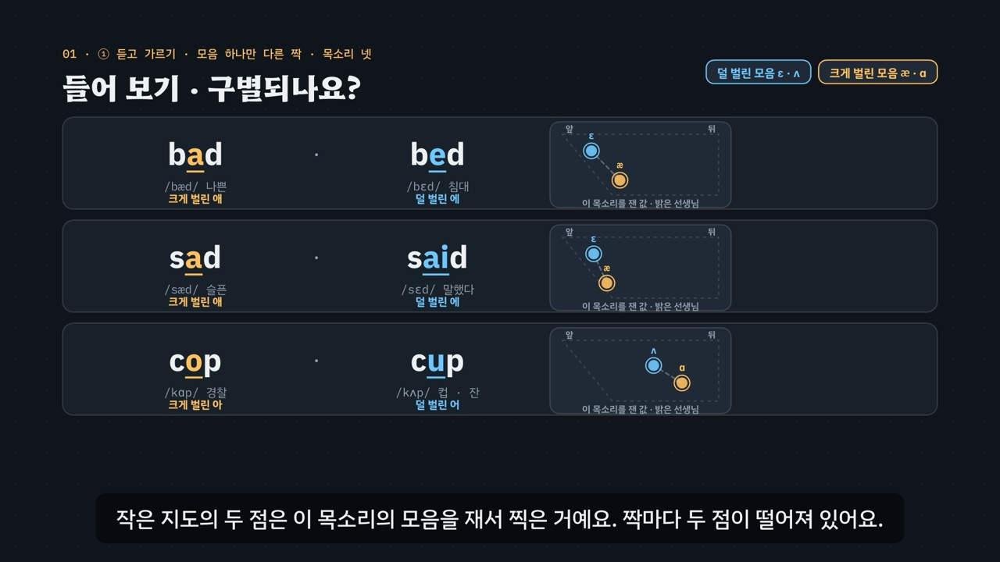

# 입을 얼마나 벌리나 — æ · ɛ · ʌ · ɑ

> [영어 튜토리얼](../README.md) 모음의 **영어 발음 (미국식)** 다섯 번째 꼭지입니다(영역: `pron`, 계획표의 P07 · 유형 14 · 15). 발음 영역의 설계도는 [docs/pron-types.md](../docs/pron-types.md)이고, 형식은 [긴장한 모음, 느슨한 모음](../tense-lax-vowels/README.md)을 복사해 시작했어요(모음 지도 · 내 모음 찍기 · 목소리 넷).

나쁜 · 침대 → 영어로 *bad · bed*. 요즘 한국어에서는 애 · 에를 한 소리로 말하는 사람이 많아서 한국어식으로 읽으면 둘이 같아지기 쉬워요(배드 · 베드). 영어에서는 **턱을 얼마나 내리나**가 두 낱말을 갈라요. 뒤쪽도 마찬가지예요 — 경찰 · 컵 → *cop · cup*.

- **크게 벌린 애 æ** — 턱을 크게 내리고 입꼬리를 옆으로 당겨요. 한국어 애보다 훨씬 크게(*bad · sad · cat · apple · taxi*).
- **덜 벌린 에 ɛ** — 턱을 조금만 내려요. 한국어 에와 비슷해요(*bed · said · pet · menu · lemon*).
- **크게 벌린 아 ɑ** — 턱을 크게 내리고 혀를 낮게 뒤로, 목 안을 보여 주듯(*cop · hot · lock · doctor · shopping*).
- **덜 벌린 어 ʌ** — 턱을 조금만 내리고 힘을 빼 짧게, 입술은 둥글리지 않아요(*cup · luck · but · money · mother*).
- **외래어 표기를 믿지 마세요** — 카메라 · 바나나는 영어로 크게 벌린 애, 쇼핑 · 초콜릿은 크게 벌린 아, 마더 · 오븐은 덜 벌린 어예요.

3단계 발음법: ① **듣고 가르기**(짝 낱말 · 목소리 넷 · 셋이 갈리는 줄) → ② **입 모양 만들기**(턱을 크게 · 조금, 혀 앞 · 뒤) → ③ **낱말 · 문장 속에서**(외래어 · 짧은 낱말 · 내 모음 찍기).



## 바로 보기

`index.html`을 더블클릭하면 끝이에요. 설치도, 서버도 필요 없어요.

## 소리와 마이크에 대해 (꼭 읽어 주세요)

- 녹음 파일이 없어요. 영어는 모두 **합성 음성**이에요. 글이 정해진 말(낱말 · 문장 · 연습 문제 · 따라 말하기)은 **VoiceStudio로 미리 만든 미국식 목소리 넷**(`audio/dialogue/`)으로, 나머지는 브라우저에 들어 있는 영어 음성(speechSynthesis)으로 읽어요. 합성 음성은 실제 사람의 말소리와 조금 다르게 들릴 수 있어요.
- **목소리 넷**: 밝은 선생님(미국 여성) · 차분한 선생님(미국 여성) · 미국 여성 · 미국 남성. 듣고 가르기 훈련 · 연습 문제는 문제마다 목소리를 바꿔요. 비교용 **한국어식 소리**(*배드 · 베드 · 캅 · 컵* …)는 한국어 내레이터 목소리로 만들었어요(`voices.json`의 `"lang": "ko"`).
- 튜토리얼 전용 목소리 부품 `assets/js/voices.js`(`OVV`)는 긴장한 모음의 `TLV`와 같아요(말하는 사람마다 파일을 찾고, 없으면 브라우저 음성 en-US · 한국어식은 ko-KR, 잰 값 `OVV.meas` — F1 · F2와 모음 길이). 읽기 전에 음성 해설 · 발음 듣기 · 녹음 재생을 멈추고 영상을 일시정지해요.
- **내 발음 확인 · 따라 말하기**: 브라우저에 음성 인식(`SpeechRecognition` · `webkitSpeechRecognition`, en-US)이 있으면 말을 글로 바꿔 **후보 글 여러 개**를 짝 낱말과 맞춰 봐요(*bad*를 말하려다 *bed*로 적히면 ‘짝 낱말로 들었어요’). 모음을 맞게 냈는지는 판정하지 않아요(인식기는 흔한 낱말 쪽으로 기울어요). 크롬(Chrome) 같은 브라우저는 소리를 브라우저 회사의 서버로 보내 글로 바꿔요. 음성 인식이 없으면 녹음(`MediaRecorder`)으로 ‘내 목소리’와 ‘본보기’를 이어서 들어요.
- **내 모음 찍기(시험 기능)**: 짝 낱말 둘을 2초씩 녹음하면 **브라우저 안에서** 두 모음의 F1 · F2를 재서 지도에 찍어요. 소리는 어디로도 보내지 않고, 녹음은 메모리에만 둬요. 이 사이트는 아무것도 저장하지 않아요(듣고 가르기 훈련의 기록만 이 브라우저의 `localStorage`에).

## 무엇을 배우나요

| 장 | 시각 | 내용 | 직접 해 보기 |
| --- | --- | --- | --- |
| 00 들어가며 | 0:00 | *bad · bed* = 한국어식 배드 · 베드 · 턱이 얼마나 내려갔나 | 먼저 들어 보기(한국어식 · 목소리 넷 · 뒤쪽 짝 *cop · cup*) |
| 01 들어 보기 · 구별되나요? | 0:36 | ① 모음 하나만 다른 짝 셋(*bad · bed, sad · said, cop · cup*) · 목소리마다 잰 작은 지도 | 짝 고르기(열아홉 쌍) · 목소리 고르기 |
| 02 모음 지도 · 한국어 에는 하나 | 1:16 | ① 혀의 높이(턱)와 앞뒤 · 그림 지도(한국어 에 · 아 · 어와 영어 넷) · 잰 지도(*bat · bet · but · bot*) | 잰 지도 · 목소리 고르기 |
| 03 크게 벌린 애 · 덜 벌린 에 | 1:56 | ② 입 옆 단면도 둘 + 입술 앞모습: 애는 턱을 크게 내리고 입꼬리를 당겨요 | 앞 모음 낱말 고르기 |
| 04 크게 벌린 아 · 덜 벌린 어 | 2:40 | ② 아는 턱을 크게 · 혀를 낮게 뒤로, 어는 조금만 · 힘을 빼 짧게 | 뒤 모음 낱말 고르기 |
| 05 셋이 갈리는 줄 | 3:24 | ① *cat · cut · cot* — 자음은 같고 모음만 셋 · 입으로 기억하기 | 줄 고르기(다섯 줄) · 목소리 고르기 |
| 06 목소리마다 지도는 달라요 | 4:08 | ③ 목소리 넷의 잰 지도 — 자리는 달라도 차례(크게 벌린 모음이 아래나 뒤)는 같아요 | 한 목소리 크게 |
| 07 외래어 함정 | 4:48 | 외래어 카드 열여섯 장(애플 · 택시 · 카메라 · 바나나 / 메뉴 · 드레스 · 레몬 · 케첩 / 닥터 · 박스 · 쇼핑 · 초콜릿 / 버스 · 머니 · 마더 · 오븐) | 외래어 하나씩 |
| 08 문장 속에서 | 5:32 | *I had a bad headache.* — 짧은 낱말(*has · that* = 크게 벌린 애, *but · what · come* = 덜 벌린 어) | 문장 고르기(따라 말하기의 28문장) |
| 09 정리 | 6:16 | 3단계 발음법 · 콧소리 앞의 애(*man · can*)는 이 꼭지의 짝에서 뺀 까닭 | 이제 직접(아래 칸으로) |

- **듣고 가르기 훈련**(놀이터 왼쪽): 목소리 넷 × 짝 낱말 열아홉 쌍(애 짝 아홉 · 아 짝 열)에서 하나를 무작위로 들려주고, 짝 가운데 고르면 **그 목소리를 실제로 잰 모음 지도**와 한국어식 표기가 나타나요(잰 값이 없으면 그림 자리). 짝 묶음(모두 · 애 짝 · 아 짝) · 목소리를 고를 수 있고, 짝 묶음 · 들은 쪽(크게 · 덜) · 목소리마다 맞힌 비율을 표(막대)로 보여 줘요. 기록은 `localStorage` `en-ov-hvpt-v1`(지우기 단추). 키보드 R 듣기 · A · B(1 · 2) 고르기 · Space/Enter 다음.
- **내 발음 확인**(놀이터 오른쪽): 흔히 쓰는 짝 열하나(*bad · bed, sad · said, had · head, pat · pet, sat · set, cop · cup, hot · hut, lock · luck, not · nut, shot · shut, collar · color*) 중 하나를 말하면, 음성 인식의 후보 글을 짝과 맞춰 알려 주고, 짝이 엇갈리면 고칠 점(크게 벌린 쪽 → 턱을 더 내려, 덜 벌린 쪽 → 조금만 벌리고 힘을 빼)을 보여 줘요. *cot · caught*, *bot · bought*, *collar · caller*처럼 많은 미국 사람이 같게 말하는 낱말은 같은 낱말로 받아들여요.
- **내 모음 찍기**(놀이터 아래, 시험 기능): 짝 일곱(*bad · bed, sad · said, pat · pet, had · head, cop · cup, hot · hut, lock · luck*)과 목소리 높낮이(높은 편 = 재는 범위 5500Hz · 낮은 편 = 5000Hz)를 고르고 두 낱말을 2초씩 녹음하면, 두 점과 덜 벌린 → 크게 벌린 화살표를 지도에 찍고 ‘두 점이 떨어져 있어요 · 거의 겹쳐요 · 방향이 달라요’를 알려 줘요(판정 기준은 측정 도구의 짝 확인과 같아요 — 아래).
- **따라 말하기 28문장**: 애 짝 · 아 짝 · 외래어 · 섞어서, 묶음마다 일곱 문장. 센 음절의 목표 모음 글자를 노랑(크게) · 하늘(덜)로 칠했어요. 들린 낱말을 원래 문장과 맞춰 맞은 낱말 초록 · 빠진 낱말 주황(`OV.compareWords`).
- **듣고 크게 · 덜 가르기 16문제**(`PDrill`, `.edr` 모양): 어느 낱말 8 · 문장 속 어느 낱말 4 · 같았나 2 · 외래어 센 음절의 모음 2(정답 위치 A 8 · B 8). 소리 먼저, 힌트 세 단계는 엔진이 낱말에서 만들어요. 답하면 그 목소리를 잰 짝의 모음 지도와 같은 목소리로 견줘 듣기. 키보드 A · B(1 · 2) · H 힌트 · R 다시 듣기 · S 천천히 · Enter.
- **퀴즈 10문제**: 영상 순서대로. 그림 문제 둘(모음 지도의 점 넷에서 크게 벌린 애 고르기 · 입 옆 단면도 넷에서 크게 벌린 애의 입 고르기).
- **핵심 정리**: 크게 벌린 모음 · 덜 벌린 모음을 3단계로 견준 표 + 용어(① 듣고 가르기 · ② 입 모양 만들기 · ③ 낱말 · 문장 속에서).

### 플레이어 조작

다른 튜토리얼과 같아요. 스페이스(재생/일시정지), ← →(5초), Shift + ← →(장), C(자막), V(음성 해설), F(전체 화면). 화면 속 낱말 · 지도의 점 · 한국어식 표기를 누르면 그 목소리로 들려줘요(같은 단추를 곧바로 다시 누르면 천천히). 03 · 04장의 입 그림은 영상을 멈춰도 계속 움직여요(플레이어만, 영상 추출은 시각 t만으로 그려요).

**미리 만든 목소리**: VoiceStudio(OmniVoice 엔진, 비상업용 라이선스)로 만든 합성 음성 파일이에요. 파일이 없거나 못 읽으면 그 줄 · 조각만 브라우저 음성으로 읽어요.
- **영어는 0.9배로 재생해요**(`voices.js`의 `EN_RATE`). 한국어 해설과 한국어식 읽기는 1배.
- **늘어놓은 낱말은 쉬어 가며 읽어요.** 자막에 · 로 늘어놓은 영어 낱말(*bat · bet · but · bot*)은 낱말마다 따로 만들고 사이에 쉼표만큼 쉬어 한 파일로 이었어요(`--word-lists`). 해설의 영어 조각 29개는 받아쓰기(Whisper)로 확인했어요(*but*을 *butt*로, *cot*을 *caught*로 적은 두 조각은 소리가 같은 낱말이라 맞게 들은 것으로 봤어요). 그 가운데 낱말만 읽는 조각 23개는 확인(받아쓰기 · 끝 올림 · 센 음절 · 짝의 방향 · 모음 자리)을 통과한 밝은 선생님(`tc`) 낱말 파일을 쉼표만큼 쉬어 이어 다시 만들었어요(`tools/measure-syllables.py open-vowels --narration`). 밝은 선생님 낱말 파일이 없는 *man · can*과 *m · n*, 문장 4개(*I had a bad headache.* · *The cup is hot.* · *Set the bag on the bed.* · *Dad cut the hot bread.*)는 처음 만든 소리 그대로예요. 한국어 조각 76개도 받아쓰기로 확인했어요. ‘크게 벌린 아예요’는 ‘아이에요’로 적혀 seed를 바꿔 다시 만들었어요. ‘애는 앞쪽, 아는 뒤쪽, 어는 그 사이예요’도 다시 만들었지만, 홀로 쓴 모음 이름을 받아쓰기가 로마자(*n · a · o*)로 적는 일은 같아서 받아쓰기의 한계로 봤어요. ‘크게 벌린 애’를 ‘크게 벌리네’처럼 소리를 이어 적거나, ‘스물여덟’을 ‘28’처럼 숫자로 적은 조각도 그대로 썼어요.
- 음성 해설(`audio/narration/`): 한국어 조각은 「튜토리얼 내레이터 (젊은 여성)」, 영어 조각은 「영어 선생님 (밝은 미국 여성)」. 자막에는 발음 기호 대신 ‘크게 벌린 애 · 덜 벌린 에 · 크게 벌린 아 · 덜 벌린 어’를 써요(음성 해설이 기호를 읽지 못해서).
- 낱말 · 문장(`audio/dialogue/`): 말하는 사람 → 프로필은 `voices.json` — `tc` 「영어 선생님 (밝은 미국 여성)」 · `tf` 「영어 선생님 (미국 여성)」 · `uf` 「길 묻기 · 나 (미국 여성)」 · `um` 「길 묻기 · 길에서 만난 사람 (미국 남성)」 · `ko` 「튜토리얼 내레이터 (젊은 여성)」(한국어).

만드는 법(VoiceStudio가 있는 맥에서, 이미 만든 파일은 건너뛰어요):

```bash
node tools/narration-pieces.cjs open-vowels     # 해설의 읽기 조각 목록 (자막을 고쳤을 때만)
node tools/dialogue-lines.cjs open-vowels       # 낱말 · 문장 줄 목록 + 잴 줄의 정보 (낱말 · 문제 · 따라 말하기를 고쳤을 때만)
python3 tools/voicestudio-narration.py open-vowels --en-profile "영어 선생님 (밝은 미국 여성)" --word-lists
python3 tools/voicestudio-dialogue.py open-vowels
```

### 잰 값 — 모음 지도 · 모음 길이

모음 지도의 점(F1 · F2)과 모음 길이는 미리 만든 음성 파일을 `tools/measure-syllables.py`로 따로 재서 그려요(`audio/dialogue/measure.js`의 `window.PRON_MEASURE`). 잰 값이 없는 낱말은 엔진의 그림 자리(`OV.SCHEM`)로 그리고, 화면에 ‘잰 값’이라고 적지 않아요. 지도의 범위는 목소리마다 그 목소리의 *bat · bet · but · bot*(+ 그 장면의 낱말)로 잡아서(`OVS.mapRange`), 목소리끼리 Hz를 바로 견주지 않아요. 모음의 공명을 재는 방법(`formant`)은 [긴장한 모음](../tense-lax-vowels/README.md)과 같고, 이 꼭지에서 측정 도구에 더한 것은 **입 벌림 짝의 방향**이에요(줄 정보 `measure-meta.json`의 `fpair` + `open`).

- **입 벌림 짝**(`fpair` + `open`): 같은 목소리의 짝에서 크게 벌린 모음(æ · ɑ)의 F1이 덜 벌린 모음(ɛ · ʌ)보다 50Hz 이상 높아야 해요(턱을 더 내림). 아 짝은 F1 차가 모자라도 덜 벌린 어의 F2가 크게 벌린 아보다 100Hz 이상 높으면(아가 더 뒤) 통과예요. 어긋나면 그 짝의 두 파일을 seed를 바꿔 다시 만들고, 끝내 어긋나면 둘 다 잰 값을 빼요.
- 받아쓰기(Whisper large-v3)로 다른 낱말로 들리지 않는지(*bad*가 *bed*로 적히면 탈락)도 함께 확인해요. 통과하지 못한 파일은 seed를 바꿔 다시 만들어 통과하는 첫 소리를 써요(`--regen`).
- **내 모음 찍기**는 같은 방법 · 같은 기준을 브라우저에서 줄여 계산해요(긴장한 모음과 같은 LPC).

- **모음 자리 · 소리가 같은 낱말**: [긴장한 모음](../tense-lax-vowels/README.md)에서 더한 두 확인을 그대로 써요. 이 꼭지에서 소리가 같은 낱말에 *cot · caught*, *bot · bought*, *collar · caller*(많은 미국 사람이 아 · 오를 같게 말해요), *dock · doc*, *son · sun*, *sent · scent*, *but · butt*를 더했어요.
- **F1을 찾는 범위를 1300Hz까지 넓혔어요**(이 꼭지에서 고침). 밝은 선생님의 크게 벌린 애(*pat · hat · pack*)는 F1이 1150~1200Hz라서, 전에 쓰던 1100Hz 상한으로는 seed를 여섯 번 바꿔도 재지 못했어요. 범위를 넓힌 뒤 긴장한 모음을 다시 재 보니 잰 값은 하나도 바뀌지 않았어요.
- 처음 쟀을 때 301줄 가운데 72줄이 통과하지 못했어요(이유가 겹치는 줄이 있어요). 가장 많은 이유는 끝이 묻는 말처럼 올라감이었어요(52줄, 낱말 하나만 읽을 때).
  - 받아쓰기가 다름 12줄: *cot* → Caught(네 목소리), *dock* → Doc, *sent* → Scent, *bet* → but, 문장 하나, 한국어식 *칼라 · 밧 · 벗*
  - 모음을 재지 못함 4줄, 센 음절 3줄(*ketchup · collar · color*), 음절을 나누지 못함 3줄, 짝의 방향 2줄(밝은 선생님 *peck · dock*)
- seed를 여섯 번 바꿔 50줄을 바꿨어요. 위의 두 고침을 더해 다시 재니 7줄이 그대로 통과했고, 남은 15줄은 seed를 여섯 번 더 바꿔 10줄을 바꿨어요.
- **연습 문제 하나의 목소리를 바꿨어요.** 미국 남성의 *camera*는 엔진이 매번 너무 빨리 뭉개 읽어서, 열두 번을 다시 만들어도 쓸 만한 소리가 나오지 않았어요. 그래서 ‘외래어 센 음절의 모음’ 문제의 *camera*는 확인을 통과한 밝은 선생님 목소리로 들려주고, 그 대신 *sad · said* 문제를 미국 남성 목소리로 바꿨어요(목소리마다 네 문제씩은 그대로예요). 쓰지 않게 된 줄은 목록에서 뺐어요.
- **끝내 통과하지 못한 4줄**: 미국 남성의 *lock · not · dock · rob* — seed를 열두 번 바꿔도 끝이 묻는 말처럼 올라갔어요(+4~9 반음). 소리 파일은 그대로 두고 잰 값만 뺐어요.
  - 그 목소리의 *lack · luck · lock* 지도에는 잰 점 둘만 찍고 ‘lock 없음’이라고 적어요.
  - 그 네 짝(*lock · luck, not · nut, dock · duck, rob · rub*)의 미국 남성 지도는 그림 자리로 그려요.
  - 듣고 가르기 훈련은 짝의 두 낱말이 모두 통과한 목소리로만 들려줘요.
- **잰 값으로 확인한 것**: 화면의 설명이 잰 값과 맞는지 따로 봤어요.
  - 잰 짝 72쌍(네 목소리 × 열아홉 쌍에서 미국 남성 네 쌍을 뺌) 모두 크게 벌린 쪽의 F1이 더 높았어요.
  - *bat · bet · but · bot*은 네 목소리 모두 크게 벌린 애가 덜 벌린 에보다 아래, 크게 벌린 아가 덜 벌린 어보다 아래 · 뒤에 찍혔어요(06장).
  - 셋이 갈리는 줄 다섯 개는 잰 19줄 모두 F2가 애 > 어 > 아 차례였어요(05장 ‘애는 앞쪽, 아는 뒤쪽, 어는 그 사이’).
  - 연습 문제 16개의 소리와 보기 낱말은 모두 그 목소리로 확인을 통과한 파일이에요.

## 무엇이 규칙 계산인가요

- **규칙 엔진** `assets/js/grammar.js`(`OV`)가 낱말마다 적은 발음 기호에서 계산해요. 영상 · 직접 해 보기 · 놀이터 · 연습 문제 · 퀴즈가 모두 같은 결과를 써요.
  - 낱말 사전 `OV.DICT`(철자 조각(목표 모음 글자 `[ ]`) · 음절로 나눈 넓은 IPA · 한국어식 표기(센 음절의 한글 `[ ]`) · 뜻 · 묶음). 모음 넷 `OV.V`(이름 · 크게 벌린 쪽인지 · 앞인지 · 짝 · 요령).
  - 센 음절 `OV.stressAt` · 목표 모음 `OV.vowel` · 크게 · 덜 `OV.isOpen` · 앞 · 뒤 `OV.side`, 칠할 글자 `OV.spellSegs`, 콧소리 앞인지 `OV.beforeNasal`.
  - **짝 낱말** `OV.PAIRS`(열아홉 쌍 — 목표 모음 하나만 다르고 그 둘이 짝 모음인지 `OV.pairDiff`), `OV.pairOf` · `OV.partner`, 한국어식으로 읽으면 같은 소리인지 `OV.koSameSound`(애 · 에를 한 소리로 봄), 셋이 갈리는 줄 `OV.TRI`.
  - **외래어 함정**: 한국어식 표기의 센 음절 한글에서 모음(`OV.koJamo` → 애 · 에 · 아 · 어 · 오 갈래 `OV.koFam`)을 뽑아 영어의 목표 모음과 어긋나면 함정(`OV.koTrap` — 카메라의 아, 쇼핑의 오, 마더의 아 …). 외래어 줄 `OV.LROWS`(네 줄 × 넷), 문장 속 칠하기 `OV.wordsIn` · `OV.segs` · `OV.countIn`, 들린 말 맞추기 `OV.heard`, `OV.compareWords`, 연습 문제의 힌트 `OV.hints`.
- **어긋남 경고** `OV.check()`: 철자 조각의 `[ ]`와 센 음절의 목표 모음, 음절 수, 한국어식 표기의 `[ ]`, 짝이 모음 하나만 다르고 한국어식으로 같은 소리가 되는지, b_t 낱말, 셋이 갈리는 줄, 외래어 줄의 모음과 함정, 문장 묶음마다 일곱 문장과 묶음의 조건, 연습 문제의 보기 · 정답 · 목소리, 한쪽에 몰린 정답 위치, 입 그림(네 모음 모두 혀가 입천장에 닿지 않음 · 크게 벌린 쪽의 턱이 더 크고 혀가 더 낮음 · 입술을 둥글리지 않음)이 어긋나면 콘솔에 경고가 떠요. 퀴즈의 문제도 엔진 · 입 그림으로 정답을 다시 계산해 어긋나면 경고해요.
- **입 옆 단면도**: 공통 부품 `../shared/mouth.js`에 이 꼭지가 덜 벌린 모음의 자세 둘(`eh` · `wedge`)을 더했어요. 크게 벌린 쪽(`ae` · `a`)보다 턱이 덜 내려가고 혀가 높아요.
- **발음 사전 대조**(커밋 전에 따로): 사전의 낱말마다 음절 수 · 센 음절 · 자음 차례 · **센 음절의 모음**을 misaki 미국 발음 사전(VoiceStudio에 들어 있는 `us_gold.json` · `us_silver.json`)과 맞췄어요. 센 음절의 모음은 *on* 하나만 달랐어요 — 사전은 /ɔn/, 이 꼭지는 /ɑn/(많은 미국 사람이 이 둘을 같게 말해서, 문장 속 *on*은 크게 벌린 아로 칠했어요). 그 밖에는 사전이 r 빛깔 모음을 /əɹ/로 적는 방식(*doctor · mother · collar · color*)과 *chocolate*의 음절을 셋으로 나누는 방식(가운데 약한 모음을 빼고 두 음절로 말하는 일이 흔해 둘로 적음)만 달랐어요.
- **단순하게 줄인 부분**
  - ‘크게 벌린 · 덜 벌린’은 턱의 높이(혀의 높이)를 쉽게 붙인 이름이고, 칠하는 것은 센 음절의 목표 모음 넷뿐이에요(약한 음절의 슈와는 다루지 않음).
  - *man · can · hand*처럼 콧소리(m · n) 앞의 애는 많은 미국 사람이 조금 높여(에 쪽으로) 말해서, 짝 낱말 · 연습 문제에서 뺐어요.
  - *cot · caught*처럼 아와 오(ɔ)를 같게 말하는 미국 사람이 많아서, 이 꼭지는 크게 벌린 아 하나로 다뤄요.
  - 모음 지도는 F1 · F2 두 값만 써요. 그림 지도의 한국어 에 · 아 · 어 자리는 쉬운 어림이에요.
  - 엔진은 소리를 듣지 않아요. 모음 지도 · 모음 길이는 미리 만든 파일을 따로 잰 값이고, 내 발음 확인은 음성 인식이 적은 후보 글을 짝 낱말과 맞춰 볼 뿐이며, 내 모음 찍기는 두 점의 거리와 방향만 봐요.
- **근거로 삼은 연구**(초록으로 확인한 범위, 자세한 목록은 [docs/pron-types.md](../docs/pron-types.md)): 한국어의 애 · 에 — [Ingram & Park 1996, ICSLP](https://www.isca-archive.org/icslp_1996/ingram96_icslp.html)(한국어 서울말에서 두 앞 모음이 합쳐지고 있고 세대에 따라 다르다는 점을 짚은 뒤, 한국인 · 일본인 청자가 영어의 앞 모음을 어떻게 듣는지 본 연구). 배우는 흐름 — [Kim, Clayards & Goad 2018, *Journal of Phonetics*](https://dkim.rbind.io/pdf/Kim-Clayards-Goad_2018_JPhon.pdf)(캐나다에 온 한국인 학습자를 첫해 동안 따라간 연구로, 영어의 에 · 애 짝이 긴장한 이 · 느슨한 이 짝보다 더 어려웠어요). 연구마다 대상 · 방법이 달라 두 연구가 보여 준 방향만 말하고 숫자는 옮기지 않았어요. 아 · 어 짝의 입 모양은 흔히 쓰는 발음 설명을 따랐어요.
- **예문과 문제**: 모두 직접 만든 것이에요.

## 폴더 구조

```
index.html              페이지 (영상 · 직접 해 보기 · 듣고 가르기 훈련 · 내 발음 확인 · 내 모음 찍기 · 따라 말하기 · 듣고 고르기 · 퀴즈 · 핵심 정리)
assets/js/grammar.js    규칙 엔진(OV.phones · OV.stressAt · OV.vowel · OV.isOpen · OV.side · OV.spellSegs · OV.pairDiff · OV.koSameSound · OV.koTrap · OV.segs · OV.heard · OV.compareWords · OV.hints),
                        모음 넷(OV.V) · 낱말 사전(OV.DICT) · 짝(OV.PAIRS · OV.MP_PAIRS) · 셋이 갈리는 줄(OV.TRI) · 외래어(OV.LROWS · OV.LOAN) · 문장(OV.SENT) · 목소리(OV.VOICES) · 연습 문제(OV.DRILL) · 점검(OV.check)
assets/js/voices.js     낱말 · 문장 목소리(OVV): 목소리 넷 + 한국어식(미리 만든 파일 → 없으면 브라우저 음성), 잰 값(OVV.meas — F1 · F2 · 모음 길이)
assets/js/scenes.js     영상 장면 10개, 장 목록과 자막, 모음 지도(잰 값 → 없으면 그림 자리), 입 옆 단면도 둘 + 입술 앞모습, 셋이 갈리는 줄, 외래어 카드, 문장 칠하기
assets/js/app.js        플레이어, 직접 해 보기, 듣고 가르기 훈련(기록 표), 내 발음 확인, 내 모음 찍기(브라우저 안의 LPC), 따라 말하기(음성 인식 · 녹음), 듣고 고르기(PDrill), 퀴즈, 영상 추출(EN_EXPORT)
../shared/mouth.js      입 옆 단면도 부품(EN.mouth) — 덜 벌린 모음 eh · wedge
video/                  자막 원고(SRT)
audio/narration/        음성 해설의 읽기 조각 목록(pieces.json) · 파일 목록(clips.js) · 음성 파일
audio/dialogue/         낱말 · 문장 줄 목록(lines.json) · 잴 줄의 정보(measure-meta.json) · 말하는 사람 → 프로필(voices.json) · 파일 목록(clips.js) · 잰 값(measure.js) · 음성 파일
docs/poster.jpg         사이트 카드 그림
```

## 영상 다시 만들기

```bash
node tools/render-video.cjs open-vowels                       # → open-vowels/video/open-vowels.mp4 + .srt
node tools/render-video.cjs open-vowels --frames 57,234       # 몇 장면만 그림으로
node tools/render-video.cjs open-vowels --poster 57           # 카드 그림
node tools/render-video.cjs open-vowels --srt                 # 자막 원고만
```

MP4에는 소리가 없어요(자막이 그림에 들어가요).
