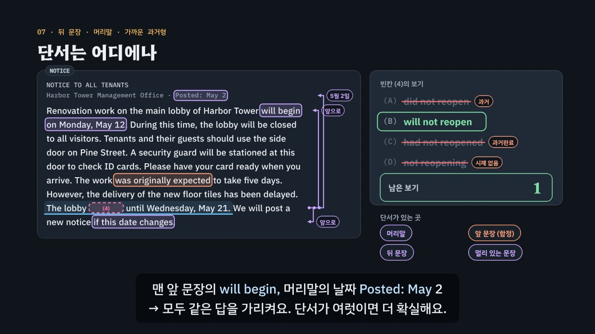

# 한 문장으론 모른다, 앞뒤 문장이 답한다

> [영어 튜토리얼](../README.md) 모음의 열네 번째 꼭지(T14)입니다. 영역: 토익 문법 · 다루는 유형: [100개 유형](../docs/toeic-100-types.md)의 64번(글 전체로 정하는 시제), 65번(접속부사 고르기), 66번(문장 삽입과 지시어).

토익 Part 6(글 빈칸 채우기)을 약 6분 16초짜리 인터랙티브 모션그래픽으로 설명합니다. Part 6은 짧은 글 하나에 빈칸이 넷이에요. 그런데 빈칸이 있는 문장만 읽으면 보기 두세 개가 문법으로 다 맞아 보여요. *During this time, the lobby ___ to all visitors.* — *was closed · will be closed · has been closed* 모두 문장으로는 문제가 없어요. 답을 하나로 줄이는 단서는 빈칸 **밖**에 있어요. 앞 문장의 *will begin on Monday, May 12*, 공지 머리말의 *Posted: May 2*, 앞 문장과 빈칸 문장의 관계(반대 · 더하기 · 결과 …), 뒤 문장의 *this delay · These labels* 같은 가리키는 말이에요. 이 튜토리얼은 **“문장 하나로는 여러 개, 앞뒤 문장이 하나로 줄인다”** 를 한 가지 원리로 삼고, **3단계 풀이법(빈칸 문장 → 앞뒤 문장 → 글 전체)** 으로 묶습니다.

한국어와 다른 점도 짚어요. 한국어 공지는 ‘5월 12일부터 로비를 닫습니다’처럼 현재형으로 앞일을 말하지만 영어 공지는 앞일에 보통 *will*을 써요. 한국어는 ‘옆문을 이용해 주세요. (그 문에서) 경비원이 신분증을 확인합니다’처럼 가리키는 말을 자주 빼지만, 영어는 *this door · it · they*로 꼭 다시 가리켜요. 그래서 이 가리키는 말이 문장 넣기의 열쇠가 돼요. 연결어는 한국어 연결어(그러나 · 게다가 · 그래서 · 예를 들어 · 그 대신 · 그렇지 않으면)를 두 문장 사이에 넣어 읽어 보는 방법으로 이어 줘요.



## 바로 보기

`index.html`을 더블클릭하면 끝이에요. 설치도, 서버도 필요 없어요.

## 3단계 풀이법

1. **빈칸 문장**만 봐요. Part 5 규칙으로 지울 수 있는 보기만 지워요. 시제 빈칸이면 동사 자리 · 주어의 수 · 능동/수동(시제가 없는 *being · to · -ing* 꼴, 수가 안 맞는 *have*, 목적어가 있는데 수동), 연결어 빈칸이면 마침표 뒤 · 쉼표 앞 자리라서 접속부사만(*Although* 같은 접속사, *Despite* 같은 전치사는 지움). 문장 넣기는 보기 넷이 모두 문법에 맞으니 가리키는 말(*this · these · it · they · also*)만 표시해 둬요. 이 단계가 끝나도 보기가 둘 이상 남는 것이 Part 6 문제예요.
2. **앞뒤 문장**에서 단서를 찾아요. 시제는 날짜 · 시간 표현 · 다른 동사의 시제, 연결어는 두 문장의 관계(반대 · 더하기 · 결과 · 예 · 대신 · 조건), 문장 넣기는 가리키는 말의 짝(앞 문장에 있나?)과 뒤 문장의 가리키는 말(넣은 문장에서 짝을 찾나?), 주제, 앞 내용과 어긋나지 않는지. 여기서 보기가 하나로 줄어요.
3. **글 전체**로 확인해요. 글을 쓴 날(머리말), 글의 목적(앞일을 알리는 공지인가, 끝난 일에 고마워하는 이메일인가), 흐름에 남은 답이 맞는지 봐요.

## 무엇을 배우나요

| 장 | 시각 | 내용 | 직접 해 보기 |
| --- | --- | --- | --- |
| 00 들어가며 | 0:00 | 로비 공지의 빈칸 문장만 보면 보기 셋이 맞음 → 앞 문장을 켜면 하나 | 먼저 풀어 보기 (앞 문장 켜기 단추가 있는 작은 손전등) |
| 01 Part 6은 이런 문제 | 0:24 | Part 5(문장 하나) ↔ Part 6(글 하나 · 빈칸 넷 · 16문제), 글 종류, 빈칸 세 가지 | 빈칸 종류 고르기, 글 종류 발음 |
| 02 문장 하나로는 여러 개 | 0:54 | 같은 빈칸 문장, 앞 문장만 바꾸면 답이 *will be closed* ↔ *was closed*, 문맥 손전등 | 앞 문장 바꿔 보기 |
| 03 시제는 글이 정한다 | 1:26 | 한국어 현재형 ↔ 영어 *will*, 시간선 가운데의 ‘글을 쓴 날’, 날짜를 바꾸면 시제도, 시간 단서 네 가지 | 글을 쓴 날 바꾸기, 작은 손전등 |
| 04 연결어는 두 문장의 관계 | 2:06 | 접속부사 자리(T05), 관계 여섯(반대 · 더하기 · 결과 · 예 · 대신 · 조건), 같은 앞 문장 + 다른 뒤 문장, 한국어로 이어 읽기 | 프린터 두 문장 네 쌍, 관계 카드 |
| 05 문장 넣기 ① 가리키는 말 | 2:46 | 한국어는 빼고 영어는 가리킨다, 가리키는 말 목록, *this door ← the side door* · *your card ← ID cards* | 가리키는 말 고르기, 작은 손전등 |
| 06 문장 넣기 ② 함정 피하기 | 3:22 | 순서 함정 · 같은 낱말 함정 · also 함정 · 어긋남 함정 | 보기별 함정 보기, 함정 이름 붙이기 |
| 07 단서는 어디에나 | 3:56 | 공지 전체, 가까운 과거형 함정(*was originally expected*), 뒤 문장 · 머리말 · 멀리 있는 문장의 단서 | 어느 문장을 켜야 할까 |
| 08 3단계 풀이법 | 4:26 | 빈칸 문장 → 앞뒤 문장 → 글 전체 × 시제 · 연결어 · 문장 넣기 | 빈칸 종류별 3단계 (엔진이 연습 문제 하나를 풂) |
| 09 실전 문제 풀이 | 4:54 | 회의실 예약 이메일 하나, 빈칸 셋(시제 · 문장 넣기 · 연결어) | 문제 고르기 |
| 10 정리 | 5:54 | 한눈에 보는 표 | 아래 칸으로 가는 길 |

영상 아래에는 네 가지가 더 있어요.

- **놀이터 — 문맥 손전등**: 지문 셋(공지 · 이메일 · 광고), 빈칸 열. 처음에는 빈칸 문장만 보이고 나머지 문장은 회색 막대로 가려져 있어요. ‘앞 문장 켜기’ · ‘뒤 문장 켜기’ · ‘머리말 켜기’로 문장을 하나씩 켜면, 규칙 엔진이 켜진 문장 속 단서만으로 보기를 다시 판정해 ‘남은 보기’ 수가 줄고, 지워진 보기에는 몇 단계에서 왜 지워졌는지가 붙어요. 단서 낱말에는 보라색, 함정(가까운 과거형)에는 주황색이 칠해져요. 보기가 하나 남았을 때 고르면 ‘단서로 풀었어요’, 그 전에 고르면 ‘운이 좋았어요’예요. 엔진이 계산한 ‘가장 적게 켜는 수’와 견줘 빈칸마다 기록(단서로 · 가장 적게 / 단서로 / 운 / 틀림)이 남아요. 키보드: ↑ 앞 문장 · ↓ 뒤 문장 · H 머리말 · A~D 고르기 · ← → 빈칸 · 0 다시 가리기.
- **연습 문제**: 토익 Part 6 형식 지문 넷(공지 · 이메일 · 회람 · 이메일) × 빈칸 넷 = 16문제(시제 6 · 연결어 6 · 문장 넣기 4, 정답 위치 4·4·4·4). 한 지문씩 빈칸을 차례로 풀어요. 힌트 = 3단계 풀이로, 단계마다 지문 속 빈칸 문장(하늘), 단서 문장(보라 바탕), 단서 낱말(보라 밑줄), 주어 · 목적어, 함정, 머리말 날짜에 색이 칠해지고 문장 넣기 보기의 가리키는 말에도 표시가 생겨요. 답하면 보기마다 몇 단계에서 왜 지워지는지, 해석, 완성 문장 발음이 나오고, 지문의 빈칸 넷을 다 풀면 ‘지문 전체 해석 · 듣기’가 열려요. 키보드는 공통 연습 문제와 같아요(A~D · 1~4 고르기, H 힌트, Enter · → 다음 문제, ‘다음’ 뒤에도 초점이 상자 안에 남음).
- **퀴즈**: 개념 확인 10문제(그림 문제 2개: 시제를 정하는 문장 누르기, 문장이 들어갈 자리 [1]~[4] 누르기).
- **핵심 정리**: 빈칸 종류 × 3단계 표, 두 문장의 관계와 접속부사 표, 용어(Part 6 · 시제 단서 · 문장 넣기 단서 · 함정).

### 플레이어 조작

다른 튜토리얼과 같아요. 스페이스(재생/일시정지), ← →(5초), Shift + ← →(장), C(자막), V(음성 해설), F(전체 화면). 화면 속 영어 문장(켜진 문장)을 누르면 발음을 들려줘요. 주소 끝에 `#c-장면이름`(예: `index.html#c-far`)을 붙이면 그 장면에서 시작해요.

음성 해설은 자막의 `Part 6`을 ‘파트 6’, `TOEIC`을 ‘토익’, `(A)`~`(D)`를 ‘에이 · 비 · 씨 · 디’로 읽어요.

## 무엇이 규칙 계산인가요

- **규칙 엔진** `assets/js/grammar.js`의 `PT.judge(빈칸, 보기, 보이는 문장)`이 3단계 풀이법을 그대로 따라 맞고 틀림, 지워지는 단계, 까닭, 함정 이름을 정해요. ① 빈칸 문장: 시제 보기는 `PT.verbForm`이 글자를 읽어 시제(과거 · 현재완료 · 과거완료 · 현재진행 · 미래) · 진짜 동사인지 · 태 · 주어의 수를 가르고, 빈칸 자리의 수와 태에 맞춰 봐요. 연결어 보기는 연결어 사전 `PT.LINK`에서 갈래(접속부사 · 접속사 · 전치사)를 찾아요. ② 앞뒤 문장: **보이는 문장의 단서만** 써요. 시간 단서는 ‘앞으로 · 끝난 일’을 적어 두거나, 머리말 날짜와 일의 날짜를 견줘 계산해요(`PT.whenByDate`). 연결어는 두 문장의 관계와 접속부사의 관계를 맞춰 보고, 문장 넣기는 어긋남 → 가리키는 말의 짝(앞 문장이 내놓는 것) → 주제 → 뒤 문장의 가리키는 말 순서로 봐요. ③ 남은 하나를 글의 흐름 문장으로 확인해요.
- **보이는 문장**을 넘기면 가려진 문장의 단서는 쓰지 않아요. 놀이터 ‘문맥 손전등’, 영상 07장 직접 해 보기, 영상 속 ‘남은 보기’ 수가 모두 이 계산이고, `PT.minReveal`이 답을 하나로 줄이는 가장 적은 공개(앞 · 뒤 · 머리말)를 찾아요.
- 영상 속 ✓·×와 남은 보기 수, 직접 해 보기 채점, 놀이터 판정과 기록, 연습 문제의 힌트(`PT.steps`)와 보기별 해설(`PT.notes`), 퀴즈 대부분의 정답이 모두 이 엔진에서 나와요.
- **어긋남 경고** `PT.check()`: 빈칸마다 ①단계 뒤 남는 보기가 데이터와 엔진이 같은지, **빈칸 문장만으로 답이 하나로 정해지면(= Part 5 문제) 경고**, 글 전체를 보면 정확히 하나만 남고 그것이 정답인지, 단서 · 주어 · 목적어 · 가리키는 말 · 어긋나는 말 · 같은 낱말이 지문에 실제로 있는지, 빈칸 문장 안에 *next · last · since* 같은 시간 단서가 없는지, 단서끼리 시간이 엇갈리지 않는지, 한 문제에 같은 관계의 접속부사가 둘 있지 않은지, 연습 문제가 지문 넷 × 빈칸 넷(문장 넣기 하나씩)인지, 정답 위치가 고른지 확인해요. 실전 문제의 정답 표시와 자막, 퀴즈 정답도 따로 점검해요.
- **단순하게 줄인 부분**
  - 엔진은 영어 문장을 스스로 읽고 뜻을 알아내지 않아요. 어느 문장의 어느 말이 단서인지, 그 말이 앞으로의 일인지 끝난 일인지, 두 문장의 관계가 반대인지 결과인지, 가리키는 말이 무엇을 찾는지, 문장의 주제가 무엇인지는 문제마다 데이터에 적어 두었고, 엔진은 그것을 맞춰 봐요.
  - 시제는 시간선의 자리(과거 · 현재완료 · 과거완료 · 지금 · 미래)만 가려요. 일정표처럼 현재형으로 미래를 말하는 쓰임(*The lobby closes on May 12*)과 앞으로의 약속을 말하는 현재진행은 보기에 넣지 않았어요. 실제 영어에서는 과거와 현재완료가 둘 다 자연스러운 경우가 있어서, 한 문제 안에 둘이 함께 정답처럼 보이지 않게 보기를 골랐어요.
  - 접속부사는 관계 여섯 가지만 다루고, 한 문제에 같은 관계의 말(*However · Nevertheless*)을 함께 넣지 않았어요. *However*처럼 문장 가운데에 오는 쓰임은 다루지 않았어요(갈래는 [T05](../connectors/)).
  - 문장 넣기의 ‘앞 문장’은 빈칸 바로 앞 문장만 봐요. 실제 글에서는 두세 문장 앞을 가리키기도 해요.
- **예문과 지문**: 모두 토익 형식을 본떠 직접 만든 것이고, 회사 · 사람 이름은 지어낸 것이에요.

이웃 튜토리얼: 접속사 · 전치사 · 접속부사의 갈래는 [T05 연결어](../connectors/), 시간 단서와 시제는 [T04 시제](../verb-tense/), 가리키는 말(대명사)은 [T10 대명사](../pronouns/)에서 문장 단위로 배워요. 이 튜토리얼은 그것을 글 단위로 넓혀요.

## 폴더 구조

```
index.html              페이지 (영상 · 직접 해 보기 · 문맥 손전등 · 지문 연습 문제 · 퀴즈 · 핵심 정리)
assets/js/grammar.js    규칙 엔진(PT.judge · PT.cands · PT.minReveal), 동사 꼴 읽기(PT.verbForm), 연결어 사전(PT.LINK), 지문 일곱 + 작은 지문(PT.P), 3단계 풀이(PT.steps), 데이터 점검(PT.check)
assets/js/scenes.js     영상 장면 11개, 장 목록과 자막, 글 배치(layP) · 그리기(drawP · 가려진 문장은 회색 막대), 오른쪽 여백 꺾쇠 화살표(bracket), 보기 목록(optRows)
assets/js/app.js        플레이어, 직접 해 보기, 문맥 손전등, 지문 연습 문제(공통 EN.drill과 같은 모양 · 키보드), 퀴즈, 영상 추출(EN_EXPORT)
video/                  자막 원고(SRT)
audio/narration/        미리 만든 음성 해설 · 발음 듣기: pieces.json(조각 목록) · clips.js(window.EN_CLIPS) · 조각 id.m4a
docs/poster.jpg         사이트 카드 그림
```

연습 문제는 지문이 화면에 있어야 해서 공통 부품 `shared/drill.js`를 고치지 않고 이 폴더 안에 지문용 연습 문제를 따로 만들었어요(`app.js`의 `passageDrill`). 모양은 공통 부품의 CSS(`.edr-*`)를 그대로 써요.

## 미리 만든 목소리

음성 해설과 발음 듣기는 VoiceStudio(OmniVoice 엔진, 비상업용 라이선스)로 미리 만든 합성 음성 파일(`audio/narration/`)로 읽어요. 파일이 없거나 못 읽는 글만 브라우저 음성으로 읽어요.
- 음성 해설: 한국어 조각은 「튜토리얼 내레이터 (젊은 여성)」, 영어 조각(본보기 영어 문장)은 「영어 선생님 (밝은 미국 여성)」.
- 발음 듣기(`EN.say`): 영상 속 영어나 스피커 단추를 누르면 같은 「영어 선생님 (밝은 미국 여성)」 파일로 읽어요(천천히는 같은 파일을 0.75배로). 글은 `tools/say-sweep.js`가 영상 · 처음부터 있는 스피커 단추 · 직접 해 보기의 예문(예문 단추를 하나씩 눌러 가며)에서 모아요. 놀이터에서 조각을 골라 만든 문장, 문제를 푼 뒤에 나오는 문장처럼 조합이 많은 글은 브라우저 음성으로 읽어요.
- 합성 엔진은 가끔 무음 · 잡음을 내거나 짧은 말을 뭉개 읽어요. 도구가 이런 소리를 걸러 seed를 바꿔 다시 만들어요. 지금 파일은 받아쓰기(Whisper) · 높낮이 · 소리 크기로 모두 다시 확인했고, 무음 · 너무 높게 읽은 소리 · 다른 말로 들린 소리가 없어서 다시 만든 파일은 없어요. 모든 튜토리얼을 다시 살펴볼 때(2026년 11월) 받아쓰기는 맞지만 속삭이듯 · 숨소리 섞이게 읽은 소리까지 찾으려고 영어 파일마다 목소리가 울린(성대가 떨린) 비율과 숨소리가 섞인 정도(소리가 얼마나 고르게 되풀이되는지 보는 자기상관 · 켑스트럼 피크, s 소리가 긴 짧은 말은 모음 부분만)를 쟀어요. 울린 비율 하나만으로는 숨소리 섞인 소리를 실제보다 훨씬 나쁘게 재기도 해서 세 가지를 함께 보고, 속삭이듯 · 숨소리 섞이게 읽거나 아주 높게 읽은 파일 5개(*A* · *C* · *article* · *Otherwise*)를 seed를 바꾸거나 읽을 글 끝에 쉼표 · 느낌표를 붙여 다시 만든 뒤 받아쓰기로 낱말을 확인했어요. 화면의 글은 그대로예요. 한 파일만 다시 만들려면 그 파일을 지우고 `--seed`를 바꿔 다시 실행하세요.

만드는 법(VoiceStudio가 있는 맥에서, 이미 만든 파일은 건너뛰어요):

```bash
node tools/narration-pieces.cjs part6-text     # 해설의 읽기 조각 + 발음 듣기 글 목록 (자막 · 예문을 고쳤을 때만, 클라우드에서도 됨)
python3 tools/voicestudio-narration.py part6-text --en-profile "영어 선생님 (밝은 미국 여성)"
```

## 영상 다시 만들기

```bash
node tools/render-video.cjs part6-text                       # → part6-text/video/part6-text.mp4 + .srt
node tools/render-video.cjs part6-text --frames 263.8,333    # 몇 장면만 그림으로
node tools/render-video.cjs part6-text --poster 263.8        # 카드 그림
node tools/render-video.cjs part6-text --srt                 # 자막 원고만
```
