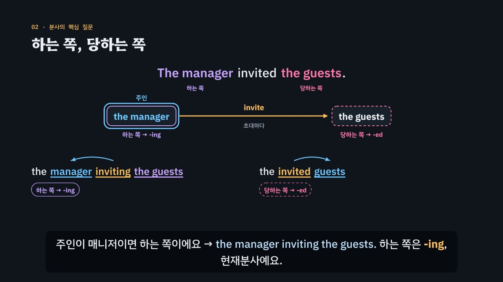

# -ing냐 -ed냐, 주인에게 물어라

> [영어 튜토리얼](../README.md) 모음의 여덟 번째 꼭지(T08)입니다. 영역: 토익 문법 · 다루는 유형: [100개 유형](../docs/toeic-100-types.md)의 28번(명사를 꾸미는 -ing · -ed, 명사 뒤 분사구), 29번(감정 분사), 30번(분사구문).

토익 Part 5에서 같은 동사의 -ing 모양과 -ed 모양 가운데 하나를 고르는 **분사 문제**를 약 6분 30초짜리 인터랙티브 모션그래픽으로 설명합니다. 핵심은 질문 하나예요. **분사가 꾸미는 말(이 튜토리얼에서는 ‘주인’이라고 불러요)이 그 일을 하는가, 당하는가?** 하는 쪽이면 -ing, 당하는 쪽이면 -ed. 감정이라면 일으키는 쪽이 -ing, 느끼는 쪽이 -ed예요. [T03](../verb-agreement-voice/)의 능동·수동과 같은 질문이라는 점을 영상에서 이어 보여 줘요. 이것을 **3단계 풀이법(주인 → 질문 → 확인)** 으로 묶습니다.

한국어와 다른 점을 함께 보여 줘요. ‘남은 좌석’의 ‘-은’은 과거처럼 들리지만 영어 -ing · -ed는 때가 아니라 관계를 말해서 *the remaining seats*(*remained* ×)이고, 한국어는 ‘지루하다’ 한 낱말로 ‘영화가 지루하다(*boring*)’와 ‘나는 지루하다(*bored*)’를 다 말해요.



## 바로 보기

`index.html`을 더블클릭하면 끝이에요. 설치도, 서버도 필요 없어요.

## 3단계 풀이법

1. **주인**을 찾아요. 명사 앞뒤의 분사는 그 명사, be · find 뒤의 보어는 설명받는 주어 · 목적어, 분사구문은 콤마 뒤 주절의 주어(명령문이면 숨은 주어 *you*). 분사가 아닌 보기(동사 · 명사 · 부사)는 지워요.
2. 주인에게 **물어요**. 하나요, 당하나요? 감정이면 일으키나요, 느끼나요? 하면 -ing, 당하면 -ed. 자동사(*remain · rise · exist*)는 당할 수 없어서 늘 -ing.
3. 뒤를 보고 **확인**해요. 분사 뒤에 목적어가 있으면 -ing. by + 하는 쪽이나 전치사구 · 시간 표현뿐이면 대개 -ed. *before · after* 뒤에는 -ing.

## 무엇을 배우나요

| 장 | 시각 | 내용 | 직접 해 보기 |
| --- | --- | --- | --- |
| 00 들어가며 | 0:00 | 같은 동사 submit의 네 모양, 물어볼 것 하나(하는 쪽인가, 당하는 쪽인가) | 먼저 풀어 보기 |
| 01 명사를 꾸미는 동사 | 0:24 | attach → attaching · attached(첨부하는 · 첨부된), 주인이라는 말, 짧으면 명사 앞 · 길면 명사 뒤 | 동사 바꿔 보기 (attach · repair · write · break) |
| 02 하는 쪽, 당하는 쪽 | 0:54 | 관계 그림(하는 쪽 → 동사 → 당하는 쪽), 주인이 도착점이면 -ed · 출발점이면 -ing, T03의 능동·수동, 수동태에서 be를 떼면 | 문장 · 주인 바꾸기 |
| 03 이름에 속지 마세요 | 1:28 | 현재분사 ≠ 지금, 과거분사 ≠ 과거, 언제든 *Orders placed*, ‘남은 좌석’의 함정, 자동사는 늘 -ing | 때 바꿔 보기, 늘 -ing인 자동사일까 |
| 04 명사 뒤의 분사구 | 2:02 | -ing + 목적어, -ed + by, 줄어든 관계사절(who are · that was) | 빠진 말 넣어 보기, 빈칸 문제 둘 |
| 05 감정 분사 | 2:36 | 감정을 일으키는 쪽 -ing · 느끼는 쪽 -ed (*an exciting offer · excited customers*) | 감정 동사 바꿔 보기 |
| 06 지루한 영화, 지루한 나 | 3:08 | 한국어 ‘지루하다’ 하나 ↔ *boring · bored*, *I was boring*의 함정, ‘사람이면 -ed’ 지름길과 한계, -ed + in · with · about | -ing일까 -ed일까 (문장 여섯) |
| 07 분사구문 | 3:44 | 주인 = 콤마 뒤 주절의 주어 (*Built in 1920 · Facing a deadline · Impressed by*) | 빈칸 문제 둘 |
| 08 접속사가 남은 분사구문 | 4:16 | 명령문의 숨은 주어 you, *once approved · if needed · until signed*, *before leaving · after reviewing* | -ing일까 -ed일까 (문장 여섯), 빈칸 문제 |
| 09 3단계 풀이법 | 4:48 | 주인 → 질문 → 확인 흐름도 | 3단계 판정기: 자리 · 관계 · 뒤를 고르면 흐름도에 길이 켜짐 |
| 10 실전 문제 풀이 | 5:18 | 토익 형식 세 문제 (submitted · confusing · approved) | 문제 고르기 |
| 11 정리 | 6:14 | 한눈에 보는 표 | 아래 칸으로 가는 길 |

영상 아래에는 네 가지가 더 있어요.

- **놀이터 — 주인 바꾸기 실험실**: 동사 열한 개(타동사 넷, 자동사 셋, 감정 동사 넷)와 그 동사의 주인(하는 쪽 · 당하는 쪽, 일으키는 쪽 · 느끼는 쪽)을 골라요. 하는 쪽에서 당하는 쪽으로 가는 화살표 그림에 주인이 하늘색 고리로 표시되고, -ing로 채운 문장과 -ed로 채운 문장 가운데 맞는 쪽을 먼저 맞혀 볼 수 있어요. 고르면 규칙 엔진이 두 문장 각각의 까닭과 3단계 풀이, 해석, 발음을 보여 줘요. 주인을 바꾸면 고리가 반대편 상자로 옮겨 가고 꼬리가 바뀌어요. 자동사는 받는 쪽이 없다는 것도 그림으로 보여요. 키보드: 1 · 2 고르기, O 주인 바꾸기, ← → 동사.
- **연습 문제**: 토익 Part 5 형식 16문제(28번 6 · 29번 5 · 30번 5, 정답 위치 4·4·4·4). 힌트 = 3단계 풀이(주인 → 질문 → 확인)와 단계마다 지워지는 보기, 보기마다 모양(현재분사 · 과거분사 · 동사 · 명사 · 부사)과 까닭, 해석, 발음.
- **퀴즈**: 개념 확인 10문제(그림 문제 2개: 관계 그림에서 주인 고르기, 분사구문의 주인 고르기).
- **핵심 정리**: 한눈에 보는 표, 용어(분사와 주인 · 분사의 자리 · 감정 분사 · 한국어와 다른 점).

### 플레이어 조작

다른 튜토리얼과 같아요. 스페이스(재생/일시정지), ← →(5초), Shift + ← →(장), C(자막), V(음성 해설), F(전체 화면). 화면 속 영어 문장을 누르면 발음을 들려줘요. 주소 끝에 `#c-장면이름`(예: `index.html#c-core`)을 붙이면 그 장면에서 시작해요.

음성 해설은 자막의 `-ing` · `-ed`를 한국어로 ‘잉’ · ‘이디’, `(A)`~`(D)`를 ‘에이 · 비 · 씨 · 디’, `p.p.`를 ‘과거분사’, `T03`을 ‘세 번째 튜토리얼’로 읽어요.

## 무엇이 규칙 계산인가요

- **규칙 엔진** `assets/js/grammar.js`의 `PT.judge(보기 모양, 문장)`이 맞고 틀림과 까닭, 그리고 3단계 가운데 몇 단계에서 지워지는지를 정해요. 보기 모양은 현재분사 · 과거분사 · 동사 모양 · 명사 · 부사로, 문장은 자리(명사 앞 · 명사 뒤 · 보어 · 분사구문), 주인과 동사의 관계(하는 쪽 · 당하는 쪽 · 자동사 · 감정을 일으키는 쪽 · 느끼는 쪽), 분사 뒤의 목적어, 분사구문 앞의 접속사로 적어요. 영상 속 ✓·×와 실전 문제에서 지워지는 순서, 직접 해 보기 채점, 놀이터의 판정과 풀이, 연습 문제의 힌트와 보기별 해설, 퀴즈 대부분의 정답이 모두 이 함수에서 나와요.
- **동사 사전** `PT.VERBS`: 동사마다 다섯 모양(원형 · -s · 과거 · 과거분사 · -ing), 종류(타동사 · 자동사 · 감정 동사), 뜻, ‘하는 쪽 · 당하는 쪽’의 한국어를 적어 두었어요. 불규칙 과거분사(made · written · broken · left · led)도 여기서 나와요.
- **3단계 판정기** `PT.decide`: 자리 · 관계 · 뒤를 고르면 알맞은 분사와 까닭을 내요. ‘당하는 쪽인데 뒤에 목적어가 있음’처럼 함께 쓸 수 없는 짝은 왜 안 되는지 알려 줘요.
- **어긋남 경고** `PT.check()`: 연습 문제 정답이 규칙 엔진과 다르거나, 정답이 둘 이상이거나, 단서 글자(주인 · 문장의 동사 · 빈칸 뒤 단서)가 문장에 없거나, 관계가 동사 종류와 맞지 않거나(자동사인데 당하는 쪽 등), 당하는 쪽인데 뒤에 목적어가 있다고 적었거나, 보기 글자가 사전의 -ing · 과거분사와 다르거나, 분사구문의 주인이 콤마 뒤에 없거나, 정답 위치가 몰리면 콘솔에 경고가 떠요. 놀이터의 문장 열아홉 개와 직접 해 보기 문장도 두 모양 가운데 꼭 하나만 맞는지 점검하고, 실전 문제의 ‘탈락’ 표시와 퀴즈 정답도 따로 점검해요.
- **단순하게 줄인 부분**
  - 주인과 동사의 관계는 문제마다 데이터에 정해 두었어요. 규칙 엔진은 문장의 뜻을 스스로 알아내지 않아요.
  - 자동사의 과거분사가 ‘다 끝난 상태’를 뜻하는 말(*fallen leaves · retired staff · a departed guest*)은 다루지 않았고, 규칙 엔진은 자동사의 -ed를 모두 틀린 것으로 봐요.
  - *experienced · qualified · interesting*처럼 사전에 형용사로 따로 실린 낱말도 분사와 같은 규칙으로 설명했어요.
  - *before · after* + -ing는 전치사 + 동명사로 보는 문법책도 있어요. 시험 풀이에서는 분사구문과 같은 방법으로 풀어요. *while* + p.p.(*while employed*)처럼 접속사 뒤에서 두 모양이 다 쓰이는 경우는 문장마다 관계로 정했어요.
  - 주인이 주절의 주어와 다른 분사구문(*Weather permitting, …*), *having + p.p. · being + p.p.*, 주는 동사의 과거분사 뒤에 목적어가 남는 경우(*employees given a bonus*)는 넣지 않았어요.
  - 명사 + 명사(복합명사)가 될 수 있는 명사 보기는 넣지 않았어요(복합명사는 [T02](../parts-of-speech/)).
  - ‘사람이면 대개 -ed, 물건이면 대개 -ing’는 지름길로만 소개하고, 판정에는 쓰지 않아요.
- **예문과 문제**: 모두 토익 형식을 본떠 직접 만든 것이에요.

## 폴더 구조

```
index.html              페이지 (영상 · 직접 해 보기 · 놀이터 · 연습 문제 · 퀴즈 · 핵심 정리)
assets/js/grammar.js    규칙 엔진(PT.judge), 동사 사전, 3단계 판정기(PT.decide), 놀이터 데이터(PT.LAB), 연습 문제(PT.DRILL)
assets/js/scenes.js     영상 장면 12개, 장 목록과 자막, 관계 그림(relDiagram), 놀이터의 작은 무대(PTS.stage)
assets/js/app.js        플레이어, 직접 해 보기, 놀이터, 퀴즈, 영상 추출(EN_EXPORT)
video/                  자막 원고(SRT)
audio/narration/        미리 만든 음성 해설 · 발음 듣기: pieces.json(조각 목록) · clips.js(window.EN_CLIPS) · 조각 id.m4a
docs/poster.jpg         사이트 카드 그림
```

## 미리 만든 목소리

음성 해설과 발음 듣기는 VoiceStudio(OmniVoice 엔진, 비상업용 라이선스)로 미리 만든 합성 음성 파일(`audio/narration/`)로 읽어요. 파일이 없거나 못 읽는 글만 브라우저 음성으로 읽어요.
- 음성 해설: 한국어 조각은 「튜토리얼 내레이터 (젊은 여성)」, 영어 조각(본보기 영어 문장)은 「영어 선생님 (밝은 미국 여성)」.
- 발음 듣기(`EN.say`): 영상 속 영어나 스피커 단추를 누르면 같은 「영어 선생님 (밝은 미국 여성)」 파일로 읽어요(천천히는 같은 파일을 0.75배로). 글은 `tools/say-sweep.js`가 영상 · 처음부터 있는 스피커 단추 · 직접 해 보기의 예문(예문 단추를 하나씩 눌러 가며)에서 모아요. 놀이터에서 조각을 골라 만든 문장, 문제를 푼 뒤에 나오는 문장처럼 조합이 많은 글은 브라우저 음성으로 읽어요.
- 합성 엔진은 가끔 무음 · 잡음을 내거나 짧은 말을 뭉개 읽어요. 도구가 이런 소리를 걸러 seed를 바꿔 다시 만들어요. 지금 파일은 받아쓰기(Whisper)와 높낮이로 모두 다시 확인했고, 다시 만들어야 할 파일은 없었어요. 모든 튜토리얼을 다시 살펴볼 때(2026년 11월) 받아쓰기는 맞지만 속삭이듯 · 숨소리 섞이게 읽은 소리까지 찾으려고 영어 파일마다 목소리가 울린(성대가 떨린) 비율과 숨소리가 섞인 정도(소리가 얼마나 고르게 되풀이되는지 보는 자기상관 · 켑스트럼 피크, s 소리가 긴 짧은 말은 모음 부분만)를 쟀어요. 울린 비율 하나만으로는 숨소리 섞인 소리를 실제보다 훨씬 나쁘게 재기도 해서 세 가지를 함께 보고, 속삭이듯 · 숨소리 섞이게 읽거나 아주 높게 읽은 파일 8개(*you.* · *attach* · *excite* · *be* · *attached* · *placed.* · *write* · *file.*)를 seed를 바꾸거나 읽을 글 끝에 쉼표 · 느낌표를 붙여 다시 만든 뒤 받아쓰기로 낱말을 확인했어요. 화면의 글은 그대로예요. 한 파일만 다시 만들려면 그 파일을 지우고 `--seed`를 바꿔 다시 실행하세요.

만드는 법(VoiceStudio가 있는 맥에서, 이미 만든 파일은 건너뛰어요):

```bash
node tools/narration-pieces.cjs participles     # 해설의 읽기 조각 + 발음 듣기 글 목록 (자막 · 예문을 고쳤을 때만, 클라우드에서도 됨)
python3 tools/voicestudio-narration.py participles --en-profile "영어 선생님 (밝은 미국 여성)"
```

## 영상 다시 만들기

```bash
node tools/render-video.cjs participles                    # → participles/video/participles.mp4 + .srt
node tools/render-video.cjs participles --frames 77,346    # 몇 장면만 그림으로
node tools/render-video.cjs participles --poster 77        # 카드 그림
node tools/render-video.cjs participles --srt              # 자막 원고만
```
