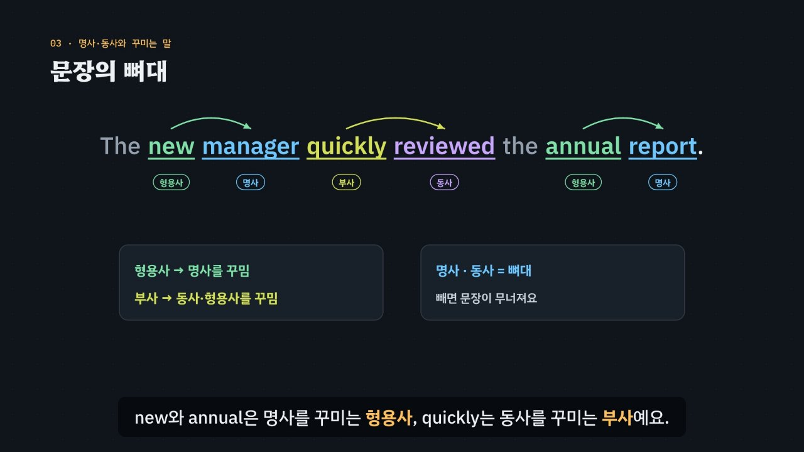

# 빈칸의 자리가 품사를 정한다

> [영어 튜토리얼](../README.md) 모음의 두 번째 꼭지(T02)입니다. 영역: 토익 문법 · 다루는 유형: [100개 유형](../docs/toeic-100-types.md)의 1–8번

토익 Part 5에 가장 자주 나온다고 꼽히는 **품사 문제**를 약 6분 20초짜리 인터랙티브 모션그래픽으로 설명합니다. 핵심은 두 가지예요. **빈칸 앞뒤의 낱말이 자리를 정하고, 낱말의 꼬리(접미사)가 품사를 알려 준다.** 이것을 **3단계 풀이법(보기 → 자리 → 꼬리)** 으로 묶습니다.



## 바로 보기

`index.html`을 더블클릭하면 끝이에요. 설치도, 서버도 필요 없어요.

## 무엇을 배우나요

| 장 | 시각 | 내용 | 직접 해 보기 |
| --- | --- | --- | --- |
| 00 들어가며 | 0:00 | 같은 뿌리의 보기 네 개, 빈칸 앞뒤 단서 | 먼저 풀어 보기 |
| 01 같은 뿌리, 다른 옷 | 0:24 | 한국어 어미(하다·적인·적으로)와 영어 꼬리의 비교, 낱말 가족 | 다른 낱말 가족(succeed · compete · rely · apply), 발음 듣기 |
| 02 꼬리표 읽기 | 0:54 | 명사·사람 명사·형용사·부사·동사의 꼬리, 꼬리가 속이는 말(timely, approval, representative) | 꼬리를 보고 품사 맞히기 |
| 03 문장의 뼈대 | 1:28 | 명사·동사 = 뼈대, 형용사·부사 = 꾸미는 말, 빼도 문장이 됨, 빈칸은 빠진 조각 | 형용사·부사 빼기 |
| 04 명사 자리 | 2:02 | 관사·형용사 뒤, 전치사 앞 / 목적어가 있으면 동명사 | 빈칸 문제 둘 |
| 05 형용사 자리 ① | 2:34 | 관사 + 빈칸 + 명사, 부사 significantly 함정 | 빈칸 문제 둘 |
| 06 형용사 자리 ② | 2:58 | be·remain 뒤 보어, keep + 목적어 뒤 목적격 보어 (목적어 = 보어) | 빈칸 문제 둘 |
| 07 부사 자리 | 3:30 | 동사 덩어리 가운데 · 완전한 문장 뒤 · 형용사 앞, ‘빼 보기’ 검사 | 빈칸 문제 둘 |
| 08 명사 + 명사, 사람과 일 | 4:02 | customer satisfaction survey, 사람 명사(consultant) vs 일 명사(consultation) | 빈칸 문제 둘 |
| 09 3단계 풀이법 | 4:34 | 보기 → 자리 → 꼬리 흐름도 | 자리 판정기: 빈칸 앞뒤 낱말을 고르면 흐름도에 길이 켜짐 |
| 10 실전 문제 풀이 | 5:04 | 토익 형식 세 문제 (renewal · steadily · secure) | 문제 고르기 |
| 11 정리 | 6:00 | 자리 표 | 아래 칸으로 가는 길 |

영상 아래에는 다섯 가지가 더 있어요.

- **놀이터 — 3초 품사 감각 훈련**: 문장을 해석하지 않고 빈칸에 들어갈 품사만 고르는 훈련이에요. 24문장 가운데 열 개를 섞어서 내고, 제한 시간(3초 · 6초 · 없음)을 고를 수 있어요. 답하면 자리를 정한 단서에 테두리가 그려지고, 채운 문장을 들을 수 있어요. 끝나면 많이 틀린 자리를 알려 줘요. 키보드 1~4, Enter.
- **놀이터 — 낱말 가족 사전**: 영상과 연습 문제에 나온 낱말 가족을 꼬리에 품사 색을 칠해 모았어요. 꼬리가 속이는 말에는 ‘함정’ 표시가 있어요.
- **연습 문제**: 토익 Part 5 형식 16문제. 힌트 = 3단계 풀이(보기 → 자리 → 꼬리), 보기마다 품사와 까닭, 해석, 발음.
- **퀴즈**: 개념 확인 10문제(그림 문제 2개: 형용사가 꾸미는 낱말, 빼도 되는 낱말).
- **핵심 정리**: 자리 표, 꼬리표, 꼬리가 속이는 말, 용어.

### 플레이어 조작

T01과 같아요. 스페이스(재생/일시정지), ← →(5초), Shift + ← →(장), C(자막), V(음성 해설), F(전체 화면). 화면 속 영어 문장을 누르면 발음을 들려줘요. 주소 끝에 `#c-장면이름`(예: `index.html#c-adv`)을 붙이면 그 장면에서 시작해요.

음성 해설은 꼬리표를 `-tion(션)`처럼 화면에 적고 괄호 속 한국어로 읽어요.

## 무엇이 규칙 계산인가요

- **규칙 엔진** `assets/js/grammar.js`의 `PS.judge(품사, 자리)`가 맞고 틀림과 까닭을 정해요. 자리는 명사 · 사람 명사 · 일·개념 명사 · 명사 + 명사 · 동명사 · 명사 앞 형용사 · 보어 · 목적격 보어 · 부사 아홉 가지예요. 영상 속 ✓·×, 직접 해 보기 채점, 3초 감각 훈련의 정답, 연습 문제의 힌트와 보기별 해설, 퀴즈 일부의 정답이 모두 이 함수에서 나와요.
- **자리 판정기** `PS.slotFromCues(앞, 뒤)`는 빈칸 바로 앞뒤 낱말의 종류로 자리를 정해요. 판단할 수 없는 조합은 ‘문장 전체를 보라’고 알려 줘요.
- **어긋남 경고** `PS.check()`: 연습 문제 정답이 규칙 엔진과 다르거나, 정답이 둘 이상이거나, 단서 글자가 문장에 없거나, 낱말 사전의 품사가 보기와 다르거나, 정답 위치가 몰리면 콘솔에 경고가 떠요.
- **단순하게 줄인 부분**: 실제 영어에서는 명사가 명사를 꾸미고(복합명사), -ing·-ed 형태가 형용사로 쓰이고, 같은 낱말이 여러 품사로 쓰여요. 이 튜토리얼은 토익 Part 5에서 자주 나오는 자리만 규칙으로 정리했어요. 사람 명사와 일 명사를 가르는 단서(hire, experienced처럼 뜻에 기댄 것)는 문제마다 자리로 정해 두었어요. 분사형 형용사(-ing/-ed)는 T08 ‘분사’에서 다뤄요.
- **예문과 문제**: 모두 토익 형식을 본떠 직접 만든 것이에요.

## 폴더 구조

```
index.html              페이지 (영상 · 직접 해 보기 · 놀이터 · 연습 문제 · 퀴즈 · 핵심 정리)
assets/js/grammar.js    규칙 엔진(PS.judge), 자리 판정기, 낱말 가족·낱말 사전, 연습 문제(PS.DRILL), 감각 훈련 문장(PS.GAME)
assets/js/scenes.js     영상 장면 12개, 장 목록과 자막
assets/js/app.js        플레이어, 직접 해 보기, 놀이터, 퀴즈, 영상 추출(EN_EXPORT)
video/                  자막 원고(SRT)
docs/poster.jpg         사이트 카드 그림
```

## 영상 다시 만들기

```bash
node tools/render-video.cjs parts-of-speech                    # → parts-of-speech/video/parts-of-speech.mp4 + .srt
node tools/render-video.cjs parts-of-speech --frames 104,232   # 몇 장면만 그림으로
node tools/render-video.cjs parts-of-speech --poster 104       # 카드 그림
node tools/render-video.cjs parts-of-speech --srt              # 자막 원고만
```
