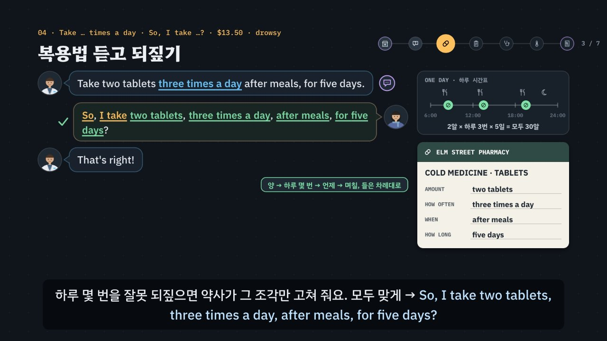

# 약국 · 병원, 증상은 사실 + 부탁, 복용법은 되짚는다

> [영어 튜토리얼](../README.md) 모음의 **상황별 영어 회화** 여덟 번째 꼭지입니다(영역: `talk`). 형식은 [공항](../airport/) · [카페](../cafe/) · [호텔](../hotel/) · [식당](../restaurant/) · [길 묻기](../directions/) · [쇼핑](../shopping/) · [대중교통](../transit/)을 따르고(대중교통을 복사해 시작, 호텔의 ‘사실 + 부탁’과 길 묻기의 되짚기를 섞음), 형식의 결정은 [CLAUDE.md](../CLAUDE.md)의 ‘회화 튜토리얼이 갖출 것’에 적었어요.

> **의학 조언이 아니에요.** 약 이름 · 한 번에 먹는 양 · 하루 횟수 · 먹는 때 · 기간 · 값 · 졸음 주의 · 알레르기에 따라 바꾸는 처방은 모두 말하기 연습을 위해 지어낸 예시예요. 실제로 아프면 약사 · 의사의 설명과 약 봉투 · 설명서를 따르세요. 페이지 · 영상(01장) · 직접 해 보기 · 시뮬레이터의 약 봉투에도 같은 알림이 있어요.

약국에서는 보통 **내가 먼저** 말을 꺼내요(*What can I get for you today?*). 증상은 **사실**로 말하고, 바라는 것은 **질문으로 부탁**해요 → *I have a sore throat. Could you recommend something for it?* 호텔에서 문제를 알리던 ‘사실 + 부탁’과 같은 모양이에요. 사실만 말하고 끝내면(*I have a sore throat.*) 약사가 무엇을 바라는지 다시 물어요. 약사가 묻는 짧은 질문(얼마나 됐나 *How long have you had it?* · 열 *Do you have a fever?* · 알레르기 *Are you allergic to any medicine?* · 다른 약 *Are you taking any other medication?* · 알약이냐 물약이냐 *Would you prefer tablets or liquid?*)과 병원 접수 · 진찰의 질문은 **질문의 모양**이 대답을 정해요. Yes/No 질문은 **첫 낱말이 짧은 대답의 짝**을 정하고요 → *Do you …? → No, I don't.* · *Are you …? → No, I'm not.* · *Is this …? → Yes, it is.* · *Does it …? → Yes, it does.* · *Have you taken …? → No, I haven't.* 약사 · 의사의 **복용법 설명은 길고 숫자가 많아서** 한 번 듣고 지나가기 쉬워요(*Take two tablets three times a day after meals, for five days.*). 그래서 길 묻기에서 길을 되짚었듯 **들은 조각을 차례대로 되짚어요** → *So, I take two tablets, three times a day, after meals, for five days?* 병원 접수에서는 이름 철자(*Kim, K-I-M*)를 한 글자씩, 생년월일은 달 이름으로(*It's March 4th, 2005.*) 말해요. 여기에 한국어를 그대로 옮긴 말(목이 아파요 → *My throat is sick.* · 약을 먹다 → *eat* · 이틀 동안 → *during two days* · 어제부터 → *from yesterday* · 알레르기 → *I'm allergy to …* · 여기가 아파요 → *Here is pain.* · 많이 아파요 → *Very pain.* · 진단서 → *a diagnosis*)과 헷갈리는 숫자(*thirteen fifty* · *thirty fifty*, 3월 4일과 4월 3일)를 더했어요. 약 6분 36초짜리 인터랙티브 모션그래픽으로 **3단계 말하기 법**을 가르쳐요.

- ① **열쇠 낱말 + 질문의 모양 잡기** — 무엇을 묻나, 그리고 어떤 모양인가? *or*가 들리면 고르는 질문(*Tablets or liquid?*), *how long · what's · where · how bad*로 시작하면 정보 질문, *Do you · Are you · Is this · Does it · Have you*면 Yes/No 질문(첫 낱말이 짧은 대답의 짝). 물음표가 없는 안내(*Take two tablets … · That's $13.50. · Come back in three days if …*)는 들은 것을 되짚을 차례예요. 약국 카운터에서는 **내가 먼저** 증상을 알려요. 모양마다 그림 표시가 있어요: 스위치(Yes/No) · 갈림길(고르기) · 빈 상자(정보) · 말풍선(안내).
- ② **틀에 내 정보 넣기 · 들은 것 되짚기** — 짧은 대답 틀 + 환자 카드와 맞는 정보. *I have a cough. Do you have anything for it? · For two days. · Since yesterday. · No, I'm not. · Tablets, please. · It's March 4th, 2005.* 들은 복용법은 **조각으로 되짚어요**: 한 번에 먹는 양 → 하루 몇 번 → 언제 → 며칠 동안. 엔진이 조각마다 맞춰 보고, 틀린 조각에는 그 조각만 고쳐 줘요(*Not quite — three times a day, not twice a day.*).
- ③ **공손하게 끝내기** — 부탁은 질문으로(*Could you …? · Do you have …? · Could I get …?*), *please · thanks.* 못 알아들었으면 *Sorry? Could you say that again, please?* 일부만 들렸으면 *Sorry, how many times a day?* 숫자가 많으면 *Could you write that down for me, please?* 모르는 낱말이면 *Sorry, what does drowsy mean?*



## 바로 보기

`index.html`을 더블클릭하면 끝이에요. 설치도, 서버도 필요 없어요.

## 소리와 마이크에 대해 (꼭 읽어 주세요)

- 녹음 파일이 없어요. 영어는 모두 **합성 음성**이에요. 글이 정해진 말(영상의 말풍선 · 영어 칩, 직접 해 보기의 듣기, 듣고 대답 고르기, 따라 말하기)은 **VoiceStudio로 미리 만든 목소리**(`audio/dialogue/`)로, 약국 · 병원 시뮬레이터처럼 카드마다 바뀌는 말과 내가 칩으로 만든 문장은 **브라우저에 들어 있는 음성(speechSynthesis)** 으로 읽어요. 브라우저 음성은 기기마다 목소리가 다르고, 둘 다 실제 약국 · 병원의 소리와는 달라요.
- 튜토리얼 전용 목소리 부품 `assets/js/voices.js`(`PHV`)가 말하는 사람마다 목소리를 정해요. 미리 만든 목소리는 약사 = 미국 남성 · 의사 = 캐나다 여성 · 호주 약국의 약사 = 호주 남성 · 병원 접수 직원 = 영국 여성 · 환자(나) = 미국 여성, 화면의 영어 칩(발음 듣기)과 음성 해설의 영어는 밝은 미국 여성 선생님 목소리예요(길 묻기 · 식당 · 쇼핑 · 대중교통과 같은 목소리들). 한 번에 읽는 줄 안에서 한 사람의 말 중 하나라도 파일이 없으면 그 사람의 말은 모두 브라우저 음성으로 읽고(한 사람의 목소리가 중간에 바뀌지 않게), 시뮬레이터는 처음부터 끝까지 브라우저 음성이에요. 브라우저 음성은 약사(en-US) · 호주 약국의 약사(en-AU) · 병원 접수 직원(en-GB) · 의사(en-CA) · 환자(나, 상대와 다른 목소리)를 골라요. 없으면 다른 영어 목소리의 높낮이 · 빠르기를 바꿔 구별해요. ‘아주 빠르게’ 문제는 일부러 빠르게 읽어요. 숫자는 약국 · 병원에서 말하는 꼴로 읽어요(`PH.spoken`): *$13.50* → thirteen fifty, *15 ml* → fifteen milliliters, *March 4th, 2005* → March fourth, two thousand five, *K-I-M* → K, I, M. 공통 부품(`shared/`)은 바꾸지 않았어요.
- 소리가 겹치지 않게: 대화를 읽기 전에 발음 듣기 · 음성 해설 · 녹음 재생을 멈추고 영상을 일시정지해요. 음성 인식을 시작할 때도 다른 소리를 모두 멈춰요.
- **따라 말하기 · 말로 대답하기**: 브라우저에 음성 인식(`SpeechRecognition` · `webkitSpeechRecognition`)이 있으면 말을 글로 바꿔 **낱말만** 맞춰 봐요(발음의 질은 판정하지 않아요). 숫자는 *2*든 *two*든, 값은 *13.50*이든 *thirteen fifty*든, 날짜는 *March 4th*든 *March fourth*든 같은 것으로 맞추고(`PH.canon` · `PH.heardDob`), 철자는 *K I M*처럼 한 글자씩 들려도 맞춰요(`PH.heardLetters`). 크롬(Chrome) 같은 브라우저는 소리를 브라우저 회사의 서버로 보내 글로 바꿔요. 음성 인식이 없으면 녹음(`MediaRecorder`)으로 ‘내 목소리’와 ‘원래 문장’을 이어서 들어요. 둘 다 없으면 마이크 단추를 숨기고 ‘세 번 소리 내어 따라 해 보세요’라고 안내해요. 이 사이트는 소리도 글도 저장하지 않아요(녹음은 화면에만 잠깐 있다가 페이지를 닫으면 사라져요). 이름 철자(*K-I-M*) · 약 이름(*penicillin*) · 낯선 낱말(*drowsy*)은 인식이 다르게 적기 쉬워서 따라 말하기에서 알림을 붙여요.
- 도시(*Kellport*) · 약국(*Elm Street Pharmacy*) · 병원(*Kellport Walk-in Clinic*) · 의사(*Dr. Hall*) · 환자의 생년월일 · 약 이름과 복용법 · 값은 모두 지어낸 것이에요(실제 약 · 병원과 상관없어요). 약국에서 살 수 있는 약과 처방이 필요한 약, 병원 접수 · 보험 · 진단서는 나라마다 달라요 — 영국은 약국을 *chemist*, 동네 병원을 *GP · surgery*라고도 하고, 미국은 *drugstore · doctor's office*라고도 해요. 날짜는 미국 서류에 달/날/해(*03/04/2005*), 영국 서류에 날/달/해로 적어요.

## 무엇을 배우나요

| 장 | 시각 | 내용 | 직접 해 보기 |
| --- | --- | --- | --- |
| 00 들어가며 | 0:00 | 약사의 *What can I get for you today?*에 *I have a sore throat.*만 하면 무엇을 바라는지 다시 물음 → 사실에 부탁을 붙임(*Could you recommend something for it?*), 복용법을 듣고 *Okay. Thanks.*로 끝내지 말고 되짚기, 3단계 | 먼저 골라서 대답해 보기 (약국 카운터, 듣고 대답 고르기) |
| 01 약국에서 병원까지 | 0:26 | 약국 셋(카운터 · 약사의 질문 · 복용법과 값)과 사흘 뒤 병원 넷(접수 · 진료실 · 진찰 · 처방)의 일곱 곳, 곳마다 한두 마디, 내가 먼저 말을 꺼내는 곳(보라 테두리), **약 이름 · 먹는 양 · 값은 지어낸 예시이고 의학 조언이 아님** | 곳을 골라 한두 마디 듣기 (지도의 곳을 눌러도 됨) |
| 02 약국 카운터 · 사실 + 부탁 | 0:56 | *My throat is sick.* × · *Give me medicine for a sore throat.* × → *I have a sore throat. Could you recommend something for it?* · *Do you have anything for it?*, 증상 넷(*a sore throat · a cough · a stomachache · an earache*), *How long have you had it?* → *During two days* × → *For two days.* · *From yesterday* × → *Since yesterday.* | 증상 알리기 — 사실 + 부탁 (증상 · 말하는 방법 다섯 · 얼마나 됐나 → 엔진의 판정과 약사의 반응) |
| 03 약사의 질문 · 짝 맞는 대답 | 1:30 | *Do you have a fever? · Are you allergic to any medicine?*(Yes/No) · *Tablets or liquid?*(고르기) · *How long …?*(정보), 첫 낱말로 짧은 대답(*Do you → No, I don't. · Are you → No, I'm not.*), *Are you taking any other medication?* → *I'm eating vitamins* × → *I'm taking vitamins.*, 빠른 말 *You allergic to anything?* → *Sorry, did you ask about allergies?*, *tablets or*가 이어져 들리는 소리 | 질문의 모양 맞히기 + 짝 맞는 짧은 대답 (질문 다섯 · 대답 고르기) |
| 04 복용법 듣고 되짚기 | 2:04 | *Take two tablets three times a day after meals, for five days.* → 조각 넷(양 · 하루 몇 번 · 언제 · 며칠), *Okay. Thanks.* ×(되짚지 않음), *So, I eat …* × · *three times one day* ×, 하루 몇 번을 잘못 되짚으면 *Not quite — three times a day, not twice a day.*, 빠른 말에 *Sorry, how many times a day?*, *That's $13.50.* → thirteen fifty(*thirteen* 뒤를 세게 · *thirty* 앞을 세게), *Can I pay by card?*(*Card is okay?* ×), *may make you drowsy* → *Sorry, what does drowsy mean?* → *Okay, I won't drive.* | 먹는 법 듣고 되짚기 (증상 · 알약이나 물약 → `PH.otc`가 계산한 약사의 말과 하루 시간표, 조각 칩을 누르는 차례대로 `PH.checkLine`의 판정과 고쳐 주는 말, 값 듣기 · 되묻기) |
| 05 병원 접수 · 이름과 생년월일 | 2:40 | *Do you have an appointment?* → *No, I don't. I'd like to see a doctor, please.*(*No. I want doctor.* ×), *Is this your first visit here?* → *Yes, it is.*(*Yes, I am first.* ×), *What's your last name?* → *It's Kim, K-I-M.*, *Could you spell that?* → *Sure. K-I-M.*, *date of birth* → *2005, 3, 4.* × → *It's March 4th, 2005.*(읽기와 미국 서류의 *03/04/2005*), *Do you have any health insurance?* → *Yes, I have.* × → *Yes, I do. I have travel insurance.* | 접수 — 이름 · 철자 · 생년월일 · 보험 (이름 · 생년월일 · 보험을 골라 접수 서류가 채워짐, 숫자만 말하면 몇 월인지 헷갈리는 예) |
| 06 진료실 · 증상 설명 | 3:16 | *So, what seems to be the problem?* → *I have a sore throat.* · *My throat hurts.*(*My throat is sick.* ×), *Have you taken anything for it?*(Yes/No · have) → *Yes, I took some cold medicine.*(*I ate some …* ×) · *No, I haven't.*, 빠른 말 *So what brings you in today?* → *Sorry, did you ask what's wrong?* | 증상 설명 · 먹은 약 (증상 · 말하는 방법 · 먹은 약 → 엔진의 판정과 의사의 반응) |
| 07 진찰 · 아픈 곳과 정도 | 3:46 | *Where does it hurt?* → *Here is pain.* × → *It hurts in my throat.*, *Does it hurt when I press here?* → *Yes, it does.*(*Yes, it is.* ×), *How bad is the pain, on a scale of one to ten?* → *Very pain.* × → *About a six.*, *Do you have any allergies to medication?*(Do you → *No, I don't.*), *Yes, I'm allergic to penicillin.* → 의사가 다른 약으로 바꿈 | 아픈 곳 · 누르면 · 몇 점 (몸 그림의 아픈 곳 · 통증 점수 · 알레르기 질문 둘(*Are you* · *Do you*)과 짝 맞는 대답) |
| 08 처방 · 다음 진료 · 진단서 | 4:20 | *Take one capsule twice a day with food, for seven days.* → 잘못 되짚으면 *Not quite — twice a day, not three times a day.* → 바르게 되짚기, *If you're not feeling better in three days, please come back.* → *So, I should come back in three days if I'm not better?*, *Do you have any other questions?* → *Yes. Could I get a doctor's note for my class?*(*a diagnosis* ×, *Give me a doctor's note.* ×) · *No, that's all. Thank you so much!*(그냥 *No.* ×) | 처방 되짚기 · 다시 올 날 · 진단서 (증상 · 알레르기 → `PH.rx`가 계산한 처방과 시간표, 조각 칩으로 되짚기, 다시 올 날 되짚기, 진단서 부탁) |
| 09 3단계 말하기 법 | 4:56 | 상자 셋, 일곱 곳에 한 줄씩 모양 표시와 함께 단계별로 채워짐 | 곳을 골라 3단계 보기 |
| 10 실전 약국 · 병원 | 5:24 | 환자 카드 하나(기침 · 물약 · 2004년 11월 12일생 · 진단서 필요 없음)로 넷(알약이냐 물약이냐 · 복용법 되짚기 · 생년월일 · 끝인사), 보기마다 엔진이 ①②③ 몇 단계에서 지우는지 | 대화 골라 보기 |
| 11 정리 | 6:14 | 곳 · 열쇠 낱말과 모양 · 대답 틀 표 + 되짚기 한 줄 + 못 알아들었을 때 | 아래 칸으로 가는 길 |

영상 아래에는 다섯 가지가 더 있어요.

- **놀이터 — 약국 · 병원 시뮬레이터**: 누를 때마다 새 환자 카드(증상과 언제부터 · 열 · 먹고 있는 다른 약 · 알약이냐 물약이냐 · 내는 방법, 이름과 철자 · 생년월일 · 보험, 먹어 본 약 · 아픈 곳 · 누르면 아픈지 · 통증 점수 · 알레르기 · 진단서가 필요한지)가 만들어져요. 차례(17번): 약국 카운터(**내가 먼저** 증상 알리기, 호주 약국이면 *Morning! What can I do for you?*) → 얼마나 됐나 → 열 또는 다른 약 → 알약이냐 물약이냐 → 복용법(**조각 칩으로 들은 차례대로 되짚기**) → 값(**약사가 말한 값을 듣고** 내기 · 되묻기) → 사흘 뒤 병원 접수(예약 · 이름 철자 · 생년월일 · 보험) → 진료실(증상 · 먹어 본 약) → 진찰(아픈 곳 · 누르면 · 통증 점수 가운데 하나, 알레르기) → 처방(**조각 칩으로 되짚기**) → 다시 올 날(되짚기) → 더 물어볼 것(진단서). 복용법 · 값 · 처방 · 다시 올 날은 카드에 없어요 — 상대가 말한 것을 듣고 써야 해요. 대답은 ① 대답 틀 칩(맞는 틀 하나 · 함정 하나(Yes만 · 한국어 그대로 · 짝이 다른 짧은 대답 · 무례한 말) · 다른 질문의 틀 하나)과 ② 칸 칩(카드의 값 + 헷갈리기 쉬운 이웃 값: *thirteen fifty* · *thirty fifty*, 달과 날을 바꾼 생년월일, 비슷한 철자 *K-I-N · G-I-M*)으로 만들어요. 복용법에서는 조각 칩(되짚는 틀 *So, I take* · 함정 *So, I eat* · 양 · 하루 몇 번 · 언제 · 며칠)을 들은 차례대로 누르고(같은 갈래의 조각은 바꿔 끼워져요, Backspace 하나 지우기), 틀린 조각이 있으면 상대가 그 조각만 고쳐 줘요. ‘되짚지 않고 → Okay. Thanks.’ 단추를 누르면 ②로 걸려 왜 되짚어야 하는지 보여 줘요. 엔진이 ①에서 걸리면 상대가 질문만 다시 말하고, ②에서 걸리면 *Sick…? Oh — does it hurt?* · *No — I said $13.50.* · *Sorry — which is the month?* 같은 반응, ③이면 *… Okay.* 매번 단계와 까닭, 모범 대답(듣기)을 보여 줘요. 다시 묻기(*Sorry, did you say $13.50?* · *Sorry, what does drowsy mean?* · *Could you say that again?*)에는 상대가 확인해 주거나 쉬운 말로 풀어 주거나 천천히 한 번 더 말해요. 음성 인식이 있으면 마이크로 말해서 대답할 수 있어요. 끝나면 약 봉투의 라벨 둘(약국에서 산 약 · 병원 처방, 값 · 다시 올 날 · 진단서), 하루 복용 시간표 둘, 한 번에 통과한 수, 대화 전체와 듣기. 키보드: R 듣기 · S 천천히 · T 대본 · 1~4 대답 틀 · A~C 내 정보 · Enter 대답하기(되짚기에서는 되짚기) · Backspace 지우기(되짚기에서는 조각 하나) · M 말로 대답하기 · N 새 카드.
- **약국 · 병원 표현 따라 말하기**: 곳마다 넷씩, 약사 · 접수 직원 · 의사의 말과 내 말 28문장. 듣기 · 천천히 · 따라 말하기(음성 인식 → 녹음 → 소리 내어 따라 하기). 인식 결과는 원래 문장의 낱말마다 초록(들림) · 주황(빠짐)으로 보여 줘요.
- **듣고 대답 고르기**(튜토리얼 전용 `PDrill`, `EN.drill`과 같은 모양 · 키보드): 16문제, 일곱 곳 + 빠른 말 셋, 정답 위치 A · B · C · D 넷씩. 문제마다 곳 아이콘과 한 줄 상황, 상대의 말은 소리 먼저(글은 답한 뒤 또는 대본 보기), 대답 넷은 글. 되짚기 문제는 보기마다 한 조각만 달라요. 힌트 = 3단계 — ① 열쇠 낱말과 질문의 모양(상대의 말 옆에 모양 표시) ② 틀 · 칸 · 되짚는 조각(함정은 주황) ③ 공손한 말(보라)과 정답. 답하면 보기마다 엔진의 까닭, 해석, 줄마다 듣기, 대화 듣기(상대 → 나). 키보드: A~D(1~4) 고르기 · H 힌트 · R 다시 듣기 · S 천천히 · T 대본 · Enter/→ 다음.
- **퀴즈**: 10문제(그림 문제 4개: 질문의 모양 표시 고르기, *every six hours*의 하루 시간표 줄 고르기, 몸 그림에서 의사가 살펴볼 곳 누르기, 약 봉투 라벨에서 하루 몇 번이 적힌 줄 누르기).
- **핵심 정리**: 곳 × 열쇠 낱말 · 모양 × 대답 틀 표, 용어(① 사실 + 부탁 · 질문의 모양 · Yes/No 질문의 짝 · ② 증상 · for와 since · 복용법 되짚기 · 숫자 · 철자 · 날짜 · 다시 올 날 · ③ 부탁은 질문으로 · 다시 묻기 · 무례하게 들리는 말 · 주의를 들었을 때 · ④ 한국어와 다른 점 · 콩글리시).

### 플레이어 조작

다른 튜토리얼과 같아요. 스페이스(재생/일시정지), ← →(5초), Shift + ← →(장), C(자막), V(음성 해설), F(전체 화면). 화면 속 말풍선을 누르면 그 사람의 목소리로, 영어 칩을 누르면 발음을 들려줘요. 01장 지도의 곳을 누르면 직접 해 보기와 함께 바뀌어요. 주소 끝에 `#c-장면이름`(예: `index.html#c-dose`)을 붙이면 그 장면에서 시작해요.

음성 해설은 자막의 `(A)`~`(D)`를 ‘에이 · 비 · 씨 · 디’로 읽고, 영어 문장 속 값(*That's $13.50.*)은 *thirteen fifty*, 물약의 양(*10 ml*)은 *ten milliliters*처럼 영어 낱말로 읽어요. 미국 서류의 날짜(`03/04/2005`)는 ‘공삼, 공사, 2005’, 이어져 들리는 소리 상자(*TAB-let-ser*)는 *tab let ser*로 읽어요. `Yes/No`는 *Yes or No*로 읽어요.

**미리 만든 목소리**: VoiceStudio(OmniVoice 엔진, 비상업용 라이선스)로 만든 합성 음성 파일이에요. 파일이 없거나 못 읽으면 그 줄 · 조각만 브라우저 음성으로 읽어요.
- 음성 해설(`audio/narration/`): 한국어 조각은 「튜토리얼 내레이터 (젊은 여성)」, 영어 조각(본보기 영어 문장)은 「영어 선생님 (밝은 미국 여성)」. 화면의 영어 칩(발음 듣기, 말하는 사람 `tc`)도 같은 목소리예요(다른 회화 · 토익 튜토리얼과 같음).
- 대화(`audio/dialogue/`): 말하는 사람 → 프로필은 `voices.json`(길 묻기와 같은 프로필 — 이름의 ‘길 묻기’는 처음 만든 곳일 뿐이에요). 프로필은 VoiceStudio 목소리 보관함(archetype)에서 고른 목소리를 한 번 만든 소리로 복제(clone)한 것이라, 줄마다 같은 사람 목소리가 나요. 파일 이름은 말하는 사람과 읽을 글로 정해져요(`PHV.lineId`). 숫자는 읽을 글(`PH.spoken`)로 만들어요(*$13.50* → *thirteen fifty*, *10 ml* → *ten milliliters*, *K-I-M* → *K, I, M*).
- 합성 엔진은 가끔 무음 · 잡음을 내거나, 세 낱말 이하의 짧은 말을 0.3초 안에 뭉개 읽어요. 도구가 말소리 1초에 읽은 글자 수로 이런 소리를 걸러 seed를 바꿔 다시 만들고(짧은 말은 다섯 번까지), 그래도 이상하면 ‘확인 필요’로 알려 줘요. 지금 파일은 받아쓰기(Whisper)와 높낮이로 모두 다시 확인했어요(영어 283개 · 한국어 118개). 한국어 조각 ‘뒤를.’ · ‘증상 넷.’은 짧게 뭉개져 seed를 바꿔 다시 만들었어요. 밝은 선생님 목소리로 아주 높게 끽 소리를 낸 *Tablets, please.*와, 선생님 목소리답지 않게 낮게 가라앉은 *So, I take ten milliliters, every six hours, after meals, for five days?*도 seed를 바꿔 다시 만들었어요. 밝은 목소리라 감탄하는 말 · 짧은 말(*What's wrong?* · *Morning! What can I do for you?* · *thirty*)은 원래 높게 읽고, 캐나다 의사의 *Have you taken anything for it?* · *That's right!*는 묻는 말 · 감탄하는 말이라 끝이 올라가요. 받아쓰기가 생년월일을 *March 4th, 2005*로, 철자를 *K-I-M*으로 적는 것은 적는 방식만 다를 뿐이에요. 교환학생 생활 튜토리얼부터는 받아쓰기는 맞지만 속삭이듯 읽은 소리까지 찾으려고 말하는 사람마다 목소리가 울린(성대가 떨린) 비율도 함께 재요. 이 튜토리얼도 그렇게 다시 확인해서 속삭이듯 읽거나 아주 높게 끽 소리를 낸 선생님 조각(*I have a stomachache.* · *My stomach hurts.* · *I have a cough.* · *What's wrong?* · *No, I'm not.* · *Yes, it does.* · *Yes, I do.* · *Yes, I have.* · *Yes.* · *Okay, thanks.* · *Okay, I won't drive.* · *So, I take* · *Is this* · *Does* · *take* · *have* · *or* · *About a six.* · *Tablets, please.* · *Sure.*)과 미국 남성 목소리의 *That's right!*, 나의 *Tablets, please.* · *Okay. Thanks.* · *Yes.*를 다시 만들었어요. seed를 바꿔도 낫지 않던 짧은 말은 읽을 글 끝에 쉼표를 붙여(*I have a cough,* · *Yes, it does,* · *take,* · *Sure,*) 다시 만들었어요. 화면의 글은 그대로예요. 한 파일만 다시 만들려면 그 파일을 지우고 `--seed`를 바꿔 다시 실행하세요.

만드는 법(VoiceStudio가 있는 맥에서, 이미 만든 파일은 건너뛰어요):

```bash
node tools/narration-pieces.cjs pharmacy     # 해설의 읽기 조각 목록 (자막을 고쳤을 때만, 클라우드에서도 됨)
node tools/dialogue-lines.cjs pharmacy       # 대화 줄 목록 (대화 · 문제 · 따라 말하기를 고쳤을 때만, 클라우드에서도 됨)
python3 tools/voicestudio-narration.py pharmacy --en-profile "영어 선생님 (밝은 미국 여성)"   # 해설 (한국어 + 영어 조각)
python3 tools/voicestudio-dialogue.py pharmacy             # 대화
```

## 무엇이 규칙 계산인가요

- **규칙 엔진** `assets/js/grammar.js`가 맞고 틀림과 까닭, 3단계 가운데 몇 단계에서 걸리는지를 정해요. 영상 속 ✓·×와 실전에서 지워지는 순서, 질문의 모양과 짧은 대답의 짝, 복용법과 하루 시간표, 알레르기에 따라 바꾸는 처방, 값과 다시 올 날, 되짚는 한 줄의 판정과 고쳐 주는 말, 직접 해 보기 채점, 시뮬레이터의 판정과 상대의 반응, 듣고 대답 고르기의 힌트와 보기별 해설, 퀴즈 대부분의 정답이 여기서 나와요.
  - 상대의 말(`PH.Q`)마다 곳 · 뜻(`intent`) · **모양**(`shape`: `yn` · `or` · `wh` · `note`, 고르는 질문은 고를 것 `choices`) · Yes/No 질문의 **짧은 대답 짝**(`aux`: `do` · `be` · `is` · `does` · `have`) · 열쇠 낱말(`key`, 말 안에 꼭 있음) · 빠른 말(`fast`) · 알려 준 사실(`fact`: 복용법 · 값 · 다시 올 날)을 적었어요. `PH.shapeGuess`(마지막 물음 문장 → *or*가 있으면 고르기, 의문사로 시작하면 정보, 나머지는 Yes/No, 물음표가 없으면 안내)가 글과 맞는지, 적어 둔 짝이 첫 낱말과 맞는지 점검해요.
  - 대답은 틀(`PH.FRAME`) + 칸 값(`PH.SLOT`)이에요. 틀 글의 `___`은 내 정보 칸, `{…}`는 공손한 말이고, 틀마다 표시가 있어요: ok · literal(한국어를 그대로 옮김 · 콩글리시) · wrong(틀린 문장) · blunt(명령 · 조르기) · plain(그냥 *No.*로 끊김). **Yes · No만 하는 대답**은 `bare` 틀(*Yes. · Yes, please. · No, thanks.*), 사실만 말하고 부탁이 빠진 말은 `half` 틀(*I have a sore throat.*), 짧은 대답의 짝은 `aux`(*Yes, I do.* · *No, I'm not.* · *Yes, it does.*)예요.
  - **복용법** `PH.MEDS`(약국 약 넷: 감기약 · 기침약 · 위장약 · 진통제, 알약 · 물약마다 양 · 하루 몇 번 · 언제 · 며칠 · 값 · 졸음 주의 · 하루 최대) · `PH.RX`(병원 처방 넷, 들어 있는 성분과 다시 올 날) · `PH.safeRx`(알레르기가 있는 성분이면 다른 약으로 바꿈) · `PH.otc` · `PH.rx` · `PH.doseOf` — 복용법은 조각 넷(`PH.AMT` · `PH.FREQ` · `PH.WHEN` · `PH.LEN`)으로 적고, 상대의 말 `PH.say` · `PH.sayKo` · 빠른 말 `PH.sayFast` · 처방 `PH.rxSay`, 하루 시간표 `PH.schedule`(식사 8시 · 13시 · 19시, 잠 22시, *every six hours*는 깨어 있는 8시~20시), 모두 몇 알 `PH.total`이 모두 같은 계산이에요. 영상의 약 상자와 라벨 · 하루 시간표 · 시뮬레이터의 약 봉투 · 퀴즈 그림이 이 계산을 그려요.
  - **되짚는 한 줄** `PH.checkLine(줄, 카드)` — 조각(`PH.OW`: 되짚는 틀 *So, I take* / 한 번에 먹는 양 *two tablets · one capsule · 10 ml* / 하루 몇 번 *three times a day · every six hours* / 언제 *after meals · before meals · with food · at bedtime* / 며칠 *for five days*)을 누르는 차례대로 이은 줄을 판정해요. 같은 갈래는 한 번만, 차례는 들은 차례대로, 되짚는 틀이 꼭 있어야 하고, *So, I eat*과 *three times one day*는 ②(한국어를 옮긴 말). 들은 복용법과 다른 조각이 있으면 첫 번째 틀린 조각과 바른 조각(`PH.fixLine` → *Not quite — three times a day, not twice a day.*)을 돌려주고, 식사와 상관없는 약(*every six hours*)에 *after meals*를 넣으면 *No — just every six hours. It doesn't matter when you eat.* 빠진 조각이 있으면 그 갈래를 알려 줘요.
  - `PH.judge(말, 대답, 카드)` — ① 빠른 말이면 다시 묻는 말만 통과, **Yes · No만 하는 대답은 고르는 질문 · 정보 질문 · 안내에서 탈락**, 고르는 질문에서 상대가 말하지 않은 것을 고르면 탈락, 다른 질문의 대답이면 탈락 ② 틀이 literal · wrong이거나 Yes/No 질문의 짝이 다르면(*Does it …? → Yes, it is.*) 탈락, 칸의 정보가 카드(또는 상대가 말한 복용법 · 값 · 다시 올 날)와 다르면 탈락, 사실만 말하고 부탁이 빠지면 탈락 ③ blunt · plain이면 탈락. 들은 숫자를 되짚는 말(*Sorry, did you say $13.50? · So, I should come back in three days if I'm not better?*)은 상대가 말한 숫자와 같으면 통과해요. `PH.model`은 카드에 맞는 모범 대답(복용법은 되짚는 한 줄), `PH.steps`는 힌트 세 단계와 색칠할 낱말을 만들어요. `PH.REACT` · `PH.reply`가 단계마다 상대의 반응을 만들어요.
  - `PH.matchSpoken(들린 글, 말, 카드)` — 음성 인식이 글로 바꾼 말에 그 말의 표시 낱말과 카드의 사실이 들어 있으면 받아들여요. **모양 규칙도 같아요**: 고르는 질문 · 정보 질문에 *yes* · *no*만 들리면 ①. 숫자 낱말은 숫자로 모아(`PH.canon`: *thirteen fifty* → 1350) 값을 맞추고, 생년월일은 달 이름 · 서수(`PH.heardDob`), 철자는 한 글자씩(`PH.heardLetters`), 되짚는 한 줄은 들린 글에서 조각을 찾아(`PH.parseLine`) `PH.checkLine`으로 판정해요. 다른 값(*thirty fifty*) · 숫자만 말한 날짜 · *eat* · *my throat is sick*은 ②, 다른 질문의 대답만 들리면 ①. 말투는 판정하지 않아요.
  - `PH.compareWords(원래 문장, 들린 글)` — 낱말마다 맞춤(가장 긴 공통 부분열, 숫자는 같은 숫자로).
- **어긋남 경고** `PH.check()`: 열쇠 낱말이 말에 없거나, 적어 둔 모양 · 짝이 글과 다르거나, 고르는 질문에 고를 것이 없거나, 사전에 없는 뜻 · 칸 · 조각을 쓰거나, 함정 틀 · 조각에 까닭이 없거나, 맞는 보기가 하나가 아니거나 정답과 다르거나, 정답 위치가 4/4/4/4가 아니면 콘솔에 경고가 떠요. 숫자 읽기와 맞추기(값 · 날짜 · 철자), 복용법(약과 처방마다 시간표 · 모두 몇 알 · 하루 최대를 넘지 않는지), **처방 안전**(알레르기가 있는 성분을 주지 않는지, 바꾼 까닭을 말하는지), 되짚는 한 줄(맞는 줄 · 횟수 · 식전 · *eat* · *three times one day* · 빠진 조각 · 순서 · 식사와 상관없는 약), 영상 · 직접 해 보기의 대화(02~08장), 실전에서 단계마다 지워지는 보기와 화면 글, 시뮬레이터 카드 여러 장(모범 대답이 통과하는지, 말로 해도 통과하는지, 틀 칩 가운데 맞는 것이 하나뿐인지, 조각 칩으로 모범 줄을 만들 수 있는지), 말로 한 대답 여러 가지, 따라 말하기 문장(곳마다 넷)도 점검하고, 퀴즈 정답은 `app.js`에서 따로 점검해요.
- **단순하게 줄인 부분과 엄격함의 기준** (상대가 틀리다 · 헷갈린다 · 무례하다고 느낄 말만 거르고, 알아듣지만 더 흔한 말이 있으면 통과 + 알림)
  - 엔진은 소리를 듣지 않아요. 말의 뜻 · 모양 · 열쇠 낱말, 대답의 틀과 칸은 사람이 적어 두었고, 엔진은 그것을 카드의 사실과 맞춰요. 대답 틀은 약국 · 병원에서 자주 쓰는 것만 골랐어요. 같은 뜻의 다른 자연스러운 대답도 많아요(*Could you recommend something for it?* 말고도 *What would you recommend?* · *Is there anything I can take for it?*).
  - **약과 복용법은 지어낸 예시예요.** 증상 넷에 약국 약 하나씩, 처방 하나씩만 두었고, 실제 약의 이름 · 양 · 횟수와 상관없어요. 하루 시간표는 식사와 잠의 시각을 정해 두고 단순하게 계산해요.
  - **되짚는 한 줄의 차례**(양 → 하루 몇 번 → 언제 → 며칠)는 약 봉투에 적히는 차례를 단순하게 줄인 규칙이에요. 실제로는 *So, two tablets three times a day?*처럼 짧게 되짚어도 알아들어요.
  - **질문의 모양 (①)**: 고르는 질문(*Would you prefer tablets or liquid?*)과 정보 질문(*How long have you had it? · What's your last name? · Where does it hurt? · How bad is the pain …?*)에 *Yes.*만 하면 ①. *Could you spell that for me?*는 Yes/No 모양이지만 부탁이라 *Yes.*만 하면 철자가 없어 ②예요(→ *Sure. K-I-M.*).
  - **짝 · 콩글리시 · 한국어 그대로 (②)**: *My throat is sick.* · *During two days.* · *From yesterday.* · *No, I don't have.* · *Yes, I'm allergy to …*(틀린 문장) · *I'm eating vitamins.* · *Card is okay?* · *No. I want doctor.* · *Yes, I am first.* · 숫자만 말한 생년월일(*2005, 3, 4.*) · *Yes, I have.* · *Yes, I ate some …* · *Here is pain.* · *Very pain.* · *Please write me a diagnosis.* · 짝이 다른 짧은 대답(*Does it …? → Yes, it is.* · *Do you …? → Yes, I am.*).
  - **공손함 (③)**: *Give me medicine for a sore throat.* · *So expensive. Cheaper, please.* · *Give me a doctor's note.* · *What?* · 그냥 *No.*(더 물어볼 것이 있느냐는 말에)는 ③. 실제로는 말투 · 표정으로도 공손함이 전해져요. 말로 한 대답은 말투를 판정하지 않아요.
  - **되짚지 않기**: 복용법에 *Okay. Thanks.*만 하면 ②로 걸러요 — 숫자가 많은 설명은 되짚지 않으면 틀린 곳을 몰라요. 길 묻기 · 대중교통보다 엄격하게 둔 까닭은 약을 잘못 먹으면 탈이 나서예요. 시뮬레이터의 ‘되짚지 않고 → Okay. Thanks.’ 단추도 같은 판정이에요.
  - 값은 세금 없이, 보험은 여행자 보험 · 학생 보험 둘만 다뤄요. 진단서(*a doctor's note*)는 수업에 내는 확인서로만 다뤄요.
  - 시뮬레이터의 상대는 늘 같은 차례에 작은 변화만 주게 만들었어요(호주 약국, 열 또는 다른 약, 진찰 질문 셋 가운데 하나). 실제 약국 · 병원에서는 차례가 바뀌거나 묻지 않고 넘어가기도 해요.
  - 말로 대답하기와 따라 말하기는 낱말만 맞춰요. 발음과 공손함은 판정하지 않고, 음성 인식이 숫자 · 이름 철자 · 약 이름을 다르게 적을 수도 있어요.
  - 사람 · 약국 · 진료실 · 약 상자 · 몸 그림은 도형으로 그린 그림이에요. 이어서 들리는 소리 상자(*TAB-let-ser*)는 대략의 모양이에요.
- **예문과 대화**: 모두 직접 만든 것이에요.

이웃 튜토리얼: 같은 형식의 [공항](../airport/) · [카페](../cafe/) · [호텔](../hotel/) · [식당](../restaurant/) · [길 묻기](../directions/) · [쇼핑](../shopping/) · [대중교통](../transit/). 사실 + 부탁은 호텔에서, 들은 것 되짚기는 길 묻기 · 대중교통에서, 질문의 모양(Yes/No · 고르기 · 정보)은 식당에서, thirteen과 thirty는 토익 듣기 [T15](../listening-part1-2/)에서도 다뤄요.

## 폴더 구조

```
index.html              페이지 (영상 · 직접 해 보기 · 약국 · 병원 시뮬레이터 · 따라 말하기 · 듣고 대답 고르기 · 퀴즈 · 핵심 정리)
assets/js/grammar.js    규칙 엔진(PH.judge · PH.model · PH.shapeGuess · PH.checkLine · PH.fixLine · PH.matchSpoken · PH.parseLine · PH.compareWords · PH.canon · PH.heardDob · PH.heardLetters),
                        약과 복용법(PH.SYM · PH.PART · PH.MEDS · PH.RX · PH.ALT · PH.safeRx · PH.otc · PH.rx · PH.doseOf · PH.AMT · PH.FREQ · PH.WHEN · PH.LEN · PH.schedule · PH.total · PH.say · PH.rxSay · PH.BACK),
                        숫자(PH.money · PH.priceWords · PH.dateWords · PH.letters · PH.spoken · PH.teenSwap), 곳(PH.PLACES) · 모양(PH.SHAPE · PH.AUX) · 말(PH.Q) · 틀(PH.FRAME) · 칸(PH.SLOT) · 되짚기 조각(PH.OW · PH.OCAT),
                        연습 문제(PH.DRILL), 영상 대화(PH.INTRO · PH.SCENE · PH.METHOD · PH.PRACTICE · PH.DEMO · PH.PCARD), 환자 카드(PH.newCard · PH.simQs · PH.simQ · PH.simFrames · PH.lineChips),
                        따라 말하기(PH.SHADOW), 힌트(PH.steps), 반응(PH.REACT · PH.reply), 점검(PH.check)
assets/js/voices.js     대화 목소리(PHV): 약사 · 호주 약국의 약사 · 병원 접수 직원 · 의사 · 환자(나) 다른 영어 목소리(미리 만든 파일 → 없으면 브라우저 음성), 빠른 말, 숫자 읽기, 다른 소리와 겹치지 않게
assets/js/scenes.js     영상 장면 12개, 장 목록과 자막, 곳 아이콘과 모양 표시(PHS.ICON · PHS.iconSVG · shapeMark), 얼굴(avatar), 말풍선(talk · answer), 낱말 조각,
                        약국과 병원 지도, 약 상자와 라벨(medPack · medLabel), 하루 복용 시간표(doseDay), 접수 서류(patientForm), 몸 그림(bodyFig) · 통증 점수(painScale), 다시 올 날의 달력(calFig), 환자 카드(patientCard)
assets/js/app.js        플레이어, 직접 해 보기, 듣고 대답 고르기(PDrill), 약국 · 병원 시뮬레이터(되짚기 조각 칩 · 약 봉투 · 하루 시간표), 따라 말하기(음성 인식 · 녹음), 퀴즈, 영상 추출(EN_EXPORT)
video/                  자막 원고(SRT)
audio/narration/        음성 해설의 읽기 조각 목록(pieces.json) · 미리 만든 음성 파일 목록(clips.js) · 음성 파일(조각 id.m4a)
audio/dialogue/         대화 줄 목록(lines.json) · 말하는 사람 → 프로필(voices.json) · 파일 목록(clips.js) · 음성 파일(말하는사람-id.m4a)
docs/poster.jpg         사이트 카드 그림
```

## 영상 다시 만들기

```bash
node tools/render-video.cjs pharmacy                       # → pharmacy/video/pharmacy.mp4 + .srt
node tools/render-video.cjs pharmacy --frames 80,250       # 몇 장면만 그림으로
node tools/render-video.cjs pharmacy --poster 142.3        # 카드 그림
node tools/render-video.cjs pharmacy --srt                 # 자막 원고만
```

MP4에는 소리가 없어요(자막이 그림에 들어가요). 말은 말풍선 속 낱말이 하나씩 나타나는 모습으로 보여 줘요.
