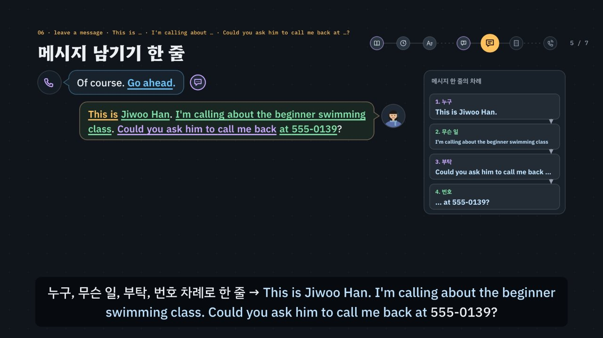

# 전화 영어, 철자는 as in · 숫자는 되짚기

> [영어 튜토리얼](../README.md) 모음의 **상황별 영어 회화** 열한 번째 꼭지입니다(영역: `talk`). 형식은 [공항](../airport/) · [카페](../cafe/) · [호텔](../hotel/) · [식당](../restaurant/) · [길 묻기](../directions/) · [쇼핑](../shopping/) · [대중교통](../transit/) · [약국 · 병원](../pharmacy/) · [은행 · 환전 · 휴대폰](../bank/) · [교환학생 생활](../campus/)을 따르고(교환학생 생활을 복사해 시작, 호텔의 ‘전화 부탁’을 넓혀 식당의 질문의 모양과 대중교통 · 은행의 되짚기를 섞음), 형식의 결정은 [CLAUDE.md](../CLAUDE.md)의 ‘회화 튜토리얼이 갖출 것’에 적었어요.

> **지어낸 예시예요.** 식당(*Lantern Bistro*) · 스포츠 센터(*Kellport Sports Center*) 이름, 사람 이름(*Ben · Grace · Olivia · Matt Diaz*, 내 이름 *Jiwoo Han* 등), 전화번호(*555-0139* 같은 **555-01XX** — 미국 영화 · 드라마에서 쓰려고 비워 둔 지어낸 번호대예요), 빈 시각 · 수업 요일과 값 · 준비물은 모두 말하기 연습을 위해 지어낸 것이에요. 실제 예약 · 문의 절차는 가게 · 센터마다 달라요(요즘은 온라인 예약도 많고, 자동 응답(*Press 1 for …*)으로 먼저 연결되기도 해요). 페이지 · 영상(01장) · 직접 해 보기 · 시뮬레이터의 통화 메모에도 같은 알림이 있어요.

전화에서는 **얼굴도 몸짓도 보이지 않아요.** 메뉴판을 가리키거나 표정으로 되묻을 수 없고, 듣기만으로 주고받아요. 그래서 이 튜토리얼의 핵심은 둘이에요 — 이름 철자는 **as in**으로(*H-A-N, N as in Nancy*), 들은 숫자 · 시각 · 요일은 **되짚기**로(*So, 8:15? · So, Tuesdays and Thursdays from 6 to 7, $40 a month?*). 전화를 건 사람은 **첫마디에 용건**을 말하고(*Hi, I'd like to make a reservation for Friday, please. · Hi, I'm calling to ask about your swimming lessons.*), 전화에서 나를 밝힐 때는 *This is …*예요. 찾는 사람이 없으면 **메시지 한 줄**로 → 누구 → 무슨 일 → 부탁 → 번호(*This is Jiwoo Han. I'm calling about the beginner swimming class. Could you ask him to call me back at 555-0139?*). 전화번호는 숫자를 하나씩, 0은 *oh*로 읽어요(*five-five-five, oh-one-three-nine*). 상대가 철자 · 번호를 **잘못 되짚으면** *Yes, that's right.*로 넘기지 말고 바로잡아요(*No, N as in Nancy. · No, it isn't. It's 555-0139.*). 여기에 한국어를 그대로 옮긴 말(예약하다 → *I want to reserve Friday.* · 우리는 네 명이에요 → *We are four.* · 가능한 시간 → *What time is possible?* · 이름은 한이에요 → *Name is Han.* · 문의하다 → *inquiry* · 여기는 지우예요 → *Here is Jiwoo Han.* · 남길게요 → *Please leave a message.* · 핸드폰 → *handphone*)과 헷갈리는 숫자(*fifteen* · *fifty*, *thirteen* · *thirty*, 끝 두 자리를 바꾼 번호 *0139* · *0193*), 헷갈리는 글자(*M · N*, *B · P*, *F · S*), Yes/No 질문의 짧은 대답 짝(*Is this …? → Yes, it is.* · *Was that …? → No, it wasn't.*)을 더했어요. 약 7분짜리 인터랙티브 모션그래픽으로 **3단계 말하기 법**을 가르쳐요.

- ① **열쇠 낱말 + 질문의 모양 잡기** — 무엇을 묻나, 그리고 어떤 모양인가? *or*가 들리면 고르는 질문(*Is that for lunch or dinner? · the beginner class or the intermediate class?*), *What · How*로 시작하면 정보 질문(*What time would you like? · What name is the reservation under?*), *Is this · Was that · Do you*면 Yes/No 질문(첫 낱말이 짧은 대답의 짝 → *Is this …? → Yes, it is.* · *Was that …? → No, it wasn't.*). 물음표가 없는 안내(*We have a table at 8:15. · The beginner class is on …*)는 들은 시각 · 요일 · 값을 되짚을 차례예요. 식당 · 스포츠 센터에 걸 때는 **내가 먼저** 용건을 말해요. 모양마다 그림 표시가 있어요: 스위치(Yes/No) · 갈림길(고르기) · 빈 상자(정보) · 말풍선(안내).
- ② **틀에 내 정보 넣기 · 철자는 as in · 들은 숫자 되짚기** — 짧은 대답 틀 + 내 카드와 맞는 정보. *Dinner, please. · For four, please. · At 7, please. · It's Han. · Sure. It's H-A-N, N as in Nancy. · It's 555-0139.* 메시지는 **조각으로 한 줄**을 만들어요: 누구 → 무슨 일 → 부탁 → 번호. 엔진이 조각마다 맞춰 보고, 빠진 조각이 있으면 받아 적는 사람이 그 조각만 다시 물어요(*And may I ask who's calling? · And what is it regarding? · What's the best number to reach you?*).
- ③ **공손하게 끝내기** — 부탁은 질문 · 부탁 틀로(*I'd like to … · Could you …? · Do you have anything later?*), *please · thanks.* 명령(*Give me a table … · Tell me about … · Tell him to call me back.*)이나 퉁명스러운 말(*Who are you? · Okay. Bye.*)은 ③에서 걸러요. 못 알아들었으면 *Sorry? Could you say that again, please?* 소리가 끊기면 *Sorry, you're breaking up. Could you say that again?* 일부만 들렸으면 *Sorry, what time was that?* 모르는 낱말이면 *Sorry, what does intermediate mean?*



## 바로 보기

`index.html`을 더블클릭하면 끝이에요. 설치도, 서버도 필요 없어요.

## 소리와 마이크에 대해 (꼭 읽어 주세요)

- 녹음 파일이 없어요. 영어는 모두 **합성 음성**이에요. 글이 정해진 말(영상의 말풍선 · 영어 칩, 직접 해 보기의 듣기, 듣고 대답 고르기, 따라 말하기)은 **VoiceStudio로 미리 만든 목소리**(`audio/dialogue/`)로, 전화 시뮬레이터처럼 카드마다 바뀌는 말과 내가 칩으로 만든 문장은 **브라우저에 들어 있는 음성(speechSynthesis)** 으로 읽어요. 브라우저 음성은 기기마다 목소리가 다르고, 둘 다 실제 전화 속 사람들의 소리와는 달라요(실제 전화는 소리가 더 작고 뭉개져요).
- 튜토리얼 전용 목소리 부품 `assets/js/voices.js`(`PNV`)가 말하는 사람마다 목소리를 정해요. 미리 만든 목소리는 식당 직원 벤 = 미국 남성 · 안내 데스크 그레이스 = 캐나다 여성 · 수영 사무실 올리비아 = 영국 여성 · 디아스 코치 = 호주 남성 · 나 = 미국 여성, 화면의 영어 칩(발음 듣기)과 음성 해설의 영어는 밝은 미국 여성 선생님 목소리예요(다른 회화 튜토리얼과 같은 목소리들). 한 번에 읽는 줄 안에서 한 사람의 말 중 하나라도 파일이 없으면 그 사람의 말은 모두 브라우저 음성으로 읽고(한 사람의 목소리가 중간에 바뀌지 않게), 시뮬레이터는 처음부터 끝까지 브라우저 음성이에요. 브라우저 음성은 식당 직원(en-US) · 안내 데스크(en-CA) · 수영 사무실(en-GB) · 코치(en-AU) · 나(상대와 다른 목소리)를 골라요. 없으면 다른 영어 목소리의 높낮이 · 빠르기를 바꿔 구별해요. ‘아주 빠르게’ 문제는 일부러 빠르게 읽어요. 숫자와 철자는 전화에서 말하는 꼴로 읽어요(`PN.spoken`): *555-0139* → five-five-five, oh-one-three-nine, *8:15* → eight-fifteen, *$40* → forty dollars, *H-A-N* → H, A, N, *from 6 to 7* → from six to seven. 공통 부품(`shared/`)은 바꾸지 않았어요.
- 소리가 겹치지 않게: 대화를 읽기 전에 발음 듣기 · 음성 해설 · 녹음 재생을 멈추고 영상을 일시정지해요. 음성 인식을 시작할 때도 다른 소리를 모두 멈춰요.
- **따라 말하기 · 말로 대답하기**: 브라우저에 음성 인식(`SpeechRecognition` · `webkitSpeechRecognition`)이 있으면 말을 글로 바꿔 **낱말만** 맞춰 봐요(발음의 질은 판정하지 않아요). 숫자는 *8:15*든 *eight fifteen*이든, *555-0139*든 *five five five oh one three nine*이든 같은 것으로 맞춰요(`PN.canon`). 크롬(Chrome) 같은 브라우저는 소리를 브라우저 회사의 서버로 보내 글로 바꿔요. 음성 인식이 없으면 녹음(`MediaRecorder`)으로 ‘내 목소리’와 ‘원래 문장’을 이어서 들어요. 둘 다 없으면 마이크 단추를 숨기고 ‘세 번 소리 내어 따라 해 보세요’라고 안내해요. 이 사이트는 소리도 글도 저장하지 않아요(녹음은 화면에만 잠깐 있다가 페이지를 닫으면 사라져요). 이름(*Lantern Bistro* · *Kellport* · *Diaz* · *Jiwoo*) · 철자(*H-A-N*) · 숫자는 인식이 다르게 적기 쉬워서 따라 말하기에서 알림을 붙여요.
- 실제 전화 예약 · 문의는 가게 · 센터마다 달라요. 요즘은 온라인 예약 · 문자 확인이 많고, 자동 응답(*Press 1 for reservations*)이나 음성 사서함(*Please leave a message after the tone.*)으로 먼저 연결되기도 해요. 철자를 부를 때 쓰는 이름(*N as in Nancy*)은 정해진 것이 아니라 흔한 이름이면 돼요(항공 · 군대에서는 *November* 같은 정해진 낱말을 써요).

## 무엇을 배우나요

| 장 | 시각 | 내용 | 직접 해 보기 |
| --- | --- | --- | --- |
| 00 들어가며 | 0:00 | 예약하다를 그대로 *Hi, I want to reserve Friday.* → *Hi, I'd like to make a reservation for Friday, please.*, 잘못 되짚은 철자 *Was that M as in Mary?*에 *Yes, that's right.* × → *No, N as in Nancy.*, 빈 시각을 *Okay. Thanks.*로 넘기지 말고 되짚기 *So, 8:15?*, 3단계 | 먼저 골라서 대답해 보기 (듣고 대답 고르기) |
| 01 전화 세 통 | 0:26 | 식당 예약(예약 · 시간 맞추기 · 이름 철자) → 스포츠 센터(문의 · 메시지 · 전화번호) → 코치의 전화(받기 · 준비물 되짚기 · 끝인사)의 일곱 곳, 곳마다 한두 마디, 내가 먼저 말을 꺼내는 곳(보라 테두리), **식당 · 센터 · 사람 이름 · 시간과 값 · 전화번호(555-01XX)는 지어낸 예시** | 곳을 골라 한두 마디 듣기 (지도의 곳을 눌러도 됨) |
| 02 예약 전화 · make a reservation | 0:56 | *Lantern Bistro, this is Ben. How can I help you?* → *I want to reserve Friday.* ×(*reserve* 뒤에는 잡을 것) · *I'm calling about Friday.*(무엇을 하고 싶은지 없음) · *Give me a table …*(명령) → *Hi, I'd like to make a reservation for Friday, please.*, *Is that for lunch or dinner?*(이어져 들리는 *lun-chor*) → *Yes, please.* × → *Dinner, please.*, *How many people?* → *We are four.* × → *For four, please.*, 빠른 첫마디 *Lantern Bistro, Ben speakin'.* → *Sorry, is this Lantern Bistro?* | 요일 · 말하는 방법 · 식사 · 사람 수 (요일 둘 × 방법 넷 × 점심 · 저녁 × 사람 수 → 엔진의 판정과 직원의 반응) |
| 03 시간 맞추기 · 되짚기 | 1:34 | *What time would you like?* → *Yes.* × → *At 7, please.*, *I'm sorry, we're fully booked at 7.* → *Yes.* · *Oh, okay.*(예약을 못 함) · *Then what time is possible?*(한국어 그대로) → *Oh, I see. Do you have anything later?*, *We have a table at 8:15.* → *Okay. Thanks.* × · *So, 8:50?* × → *So, 8:15?*(*fifTEEN* · *FIFty*), 빠른 말 *'Kay, got a table at eight-fifteen.* → *Sorry, what time was that?* | 다 찬 시각에서 · 빈 시각 되짚기 (점심 · 저녁 × 이른 · 늦은 시간 × 빈 시각 둘 × 되짚기(맞게 · 잘못 · 넘김) → 직원의 반응) |
| 04 이름 철자 부르기 | 2:10 | *What name is the reservation under?* → *Name is Han.* × → *It's Han.*, *Could you spell that for me?* → *Yes, please.* · *It's Han.* × → *Sure. It's H-A-N, N as in Nancy.*, 전화에서 헷갈리는 글자(*M · N*, *B · P*, *F · S*)에는 as in + 흔한 이름, *Was that M as in Mary?* → *Yes, that's right.* ×(H-A-M으로 적힘) · *No, it isn't.*(*Was*로 물었으니 짝이 어긋남) · *No.*만 × → *No, N as in Nancy.* | 성 넷 × 철자 부르는 방법(글자 + as in · 헷갈리는 글자로 · 이름만 다시 · *Yes, please.*만) × 직원이 맞게 · 잘못 되짚음 × 내 대답 → 엔진의 판정과 직원의 반응 |
| 05 문의 전화 · 수업 안내 되짚기 | 2:44 | *Kellport Sports Center, Grace speaking.* → *I want to inquiry swimming lessons.* ×(*inquiry*는 이름씨) · *Hi, I have a question.*(무엇을 묻는지 없음) · *Tell me about …*(명령) → *Hi, I'm calling to ask about your swimming lessons.*, *the beginner class or the intermediate class?* → *Sorry, what does intermediate mean?* → *The beginner class, please.*, *The beginner class is on Tuesdays and Thursdays from 6 to 7, and it's $40 a month.* → *Okay. Thanks.* × · $14 · 월 · 수로 잘못 들으면 × → *So, Tuesdays and Thursdays from 6 to 7, $40 a month?*, 빠른 말 → *Sorry, when is the class, and how much is it?* | 묻는 용건 · 수업 안내 되짚기 (수영 · 요가 × 말하는 방법 넷 → 엔진의 판정, 초급 · 중급 × 되짚기(맞게 · 값을 바꿈 · 요일을 바꿈 · 넘김), 질문의 모양 맞히기) |
| 06 메시지 남기기 한 줄 | 3:22 | *Would you like to leave a message?* → *Yes. Please leave a message.* ×(상대에게 남기라는 말) → *Yes, please.* → *Of course. Go ahead.*, 메시지 한 줄(누구 → 무슨 일 → 부탁 → 번호) *This is Jiwoo Han. I'm calling about the beginner swimming class. Could you ask him to call me back at 555-0139?*, *Here is Jiwoo Han.* ×(*Here is*는 물건을 건넬 때), *Tell him to call me back …*(명령처럼), 누구인지 빠지면 *And may I ask who's calling?*, 무슨 일인지 빠지면 *And what is it regarding?*, 번호를 부탁보다 먼저 툭 말하면 차례가 뒤섞임, 빠른 말 *He's out, I'm 'fraid. D'you wanna leave a message?* → *Sorry, did you ask if I'd like to leave a message?* | 메시지 한 줄 — 누구 · 무슨 일 · 부탁 · 번호 (반 둘 × 번호 → 조각을 누르는 차례대로 `PN.checkLine`의 판정과 받아 적는 사람이 다시 묻는 말) |
| 07 전화번호 불러 주기 | 4:06 | 번호를 빼고 남기면 *What's the best number to reach you?* → *My handphone number is …* ×(*handphone*은 한국에서 만든 말 → *cell phone* · 영국 *mobile*) · *Yes.* × → *It's 555-0139.*, 번호는 하나씩 · 0은 *oh* · 세 자리와 네 자리 사이에서 쉼, *Let me read that back. 555-0193. Is that right?* → *Yes, that's right.* ×(다른 번호로 전화가 옴) · *No, it wasn't.*(*Is*로 물었으니 짝이 어긋남) · *No.*만 × → *No, it isn't. It's 555-0139.*, 빠른 말 → *Sorry, did you ask for my phone number?* | 번호 넷 × 사무실이 맞게 · 잘못 되짚음 × 내 대답 → 엔진의 판정, Yes/No 질문의 짝 셋(이름 되짚기 · 번호 되짚기 · 나를 찾는 전화) |
| 08 걸려 온 전화 받기 | 4:42 | *Hi, this is Matt Diaz from Kellport Sports Center. Is this Jiwoo?* → *Who are you?*(퉁명스러움) · *No.*(찾는 사람이 아니라는 뜻) → *Yes, speaking.* · *Yes, it is.*, 소리가 끊기면 짐작해서 되짚지 말고 → *Sorry, you're breaking up. Could you say that again?*, *You'll need to bring a swimsuit and goggles on Tuesday.* → *Okay. Thanks.* × · 목요일로 잘못 들으면 × → *So, a swimsuit and goggles on Tuesday?*, *Is there anything else I can help you with?* → *Yes.*만 · *Okay. Bye.* × → *No, that's all. Thanks for calling back. Bye!* | 걸려 온 전화 — 받기 · 준비물 되짚기 · 끝인사 (이름 넷 × 반 둘 × 준비물 둘 × 되짚기(맞게 · 요일을 바꿈 · 넘김) → 코치의 반응) |
| 09 3단계 말하기 법 | 5:20 | 상자 셋, 일곱 곳에 한 줄씩 모양 표시와 함께 단계별로 채워짐 | 곳을 골라 3단계 보기 |
| 10 실전 전화 | 5:48 | 내 카드 하나(토요일 점심 두 명 · 12시가 다 차서 더 이른 시간 · 중급 반 · 555-0147 · *Minji Park*)로 넷(점심이냐 저녁이냐 · 빈 시각 *11:30* 되짚기 · 메시지 한 줄 · 맞게 되짚은 번호), 보기마다 엔진이 ①②③ 몇 단계에서 지우는지 | 대화 골라 보기 |
| 11 정리 | 6:38 | 곳 · 열쇠 낱말과 모양 · 대답 틀 표 + 메시지 한 줄 + 숫자 · 철자 읽기 + 못 알아들었을 때 | 아래 칸으로 가는 길 |

영상 아래에는 다섯 가지가 더 있어요.

- **놀이터 — 전화 시뮬레이터**: 누를 때마다 새 카드(예약할 요일 · 점심이나 저녁 · 사람 수 · 다 찼을 때 더 이른 · 늦은 시간, 내 이름과 성(*Han* · *Park* · *Kim* · *Seo*), 듣고 싶은 반(초급 · 중급), 내 번호(555-01XX), 직원 · 사무실이 철자 · 번호를 맞게 되짚을지)가 만들어져요. 차례(19번 안팎): 식당(**내가 먼저** 용건 → 점심이냐 저녁이냐 → 몇 명 → 몇 시 → 다 찼을 때 → **빈 시각 되짚기** → 이름 → **철자 부르기** → **되짚은 철자 확인**) → 스포츠 센터(**내가 먼저** 묻는 용건 → 어느 반 → **수업 안내 되짚기** → 메시지를 남길까 → **메시지 한 줄** → 가장 좋은 번호 → **되짚은 번호 확인**) → 코치의 전화(나를 찾는 전화 받기 → **준비물 · 요일 되짚기** → 끝인사). 빈 시각 · 수업 요일과 값 · 준비물과 첫 수업 요일은 카드에 없어요 — 상대가 말한 것을 듣고 되짚어야 해요. 대답은 ① 대답 틀 칩(맞는 틀 하나 · 함정 하나(Yes만 · 한국어 그대로 · 짝이 다른 짧은 대답 · 되짚지 않는 말 · 명령) · 다른 질문의 틀 하나)과 ② 칸 칩(카드의 값 + 헷갈리기 쉬운 이웃 값: *8:15* · *8:50*, *N as in Nancy* · *M as in Mary*, *0139* · *0193*, 같은 반의 다른 요일)으로 만들어요. 메시지에서는 조각 칩(누구 · 무슨 일 · 부탁 · 번호, 함정 *Here is* · *Tell him to call me back* · 끝 두 자리를 바꾼 번호)을 말하는 차례대로 누르고(Backspace 하나 지우기), 빠진 조각이 있으면 받아 적는 사람이 그 조각만 다시 물어요. 번호까지 말하면 ‘가장 좋은 번호’ 질문을 건너뛰어요. 엔진이 ①에서 걸리면 상대가 질문을 다시 말하고, ②에서 걸리면 *Right… and how do you spell that?* · *And may I ask who's calling?* 같은 반응, ③이면 말투를 알려요. 매번 단계와 까닭, 모범 대답(듣기)을 보여 줘요. 다시 묻기(*Sorry, what time was that?* · *Sorry, what does intermediate mean?* · *Sorry, you're breaking up.* · *Could you say that again?*)에는 상대가 확인해 주거나 쉬운 말로 풀어 주거나 천천히 한 번 더 말해요. 음성 인식이 있으면 마이크로 말해서 대답할 수 있어요. 상대는 얼굴 대신 전화기 그림과 소리 물결로 보여요. 끝나면 통화 메모(예약 · 이름 · 수업 · 메시지 · 다시 온 전화 · 준비물, 지어낸 예시라는 알림)와 준비물 카드, 한 번에 통과한 수, 대화 전체와 듣기. 키보드: R 듣기 · S 천천히 · T 대본 · 1~4 대답 틀 · A~C 내 정보 · Enter 대답하기(메시지 한 줄에서는 한 줄 말하기) · Backspace 지우기(메시지 한 줄에서는 조각 하나) · M 말로 대답하기 · N 새 카드.
- **전화 표현 따라 말하기**: 곳마다 넷씩, 식당 직원 · 안내 데스크 · 수영 사무실 · 코치의 말과 내 말 28문장. 듣기 · 천천히 · 따라 말하기(음성 인식 → 녹음 → 소리 내어 따라 하기). 인식 결과는 원래 문장의 낱말마다 초록(들림) · 주황(빠짐)으로 보여 줘요.
- **듣고 대답 고르기**(튜토리얼 전용 `TDrill`, `EN.drill`과 같은 모양 · 키보드): 16문제, 일곱 곳 + 빠른 말, 정답 위치 A · B · C · D 넷씩. 문제마다 곳 아이콘과 한 줄 상황, 상대의 말은 소리 먼저(글은 답한 뒤 또는 대본 보기), 대답 넷은 글. 되짚기 · 메시지 한 줄 문제는 보기마다 한 조각만 달라요. 힌트 = 3단계 — ① 열쇠 낱말과 질문의 모양(상대의 말 옆에 모양 표시) ② 틀 · 칸 · 되짚는 숫자 · 철자(함정은 주황) ③ 공손한 말(보라)과 정답. 답하면 보기마다 엔진의 까닭, 해석, 줄마다 듣기, 대화 듣기(상대 → 나). 키보드: A~D(1~4) 고르기 · H 힌트 · R 다시 듣기 · S 천천히 · T 대본 · Enter/→ 다음.
- **퀴즈**: 10문제(그림 문제 4개: *Would you like to leave a message?* 질문의 모양 표시 고르기, 빈 시각 넷 가운데 들은 시각(*eleven-THIRty*) 누르기, 메시지 한 줄 넷 가운데 차례 · 조각이 맞는 것 누르기, 준비물 · 요일 카드 넷 가운데 코치가 말한 것 누르기).
- **핵심 정리**: 곳 × 열쇠 낱말 · 모양 × 대답 틀 표 + 메시지 한 줄 + 못 알아들었을 때, 용어(① 첫마디에 용건 · 고르는 질문 · 정보 질문 · Yes/No 질문의 짝 · ② 철자는 as in · 헷갈리는 글자 · 전화번호 읽기 · 헷갈리는 숫자 · 되짚기 · ③ 부탁은 질문으로 · 메시지 한 줄 · 다시 묻기 · 끝인사 · ④ 한국어와 다른 점 · 콩글리시).

### 플레이어 조작

다른 튜토리얼과 같아요. 스페이스(재생/일시정지), ← →(5초), Shift + ← →(장), C(자막), V(음성 해설), F(전체 화면). 화면 속 말풍선을 누르면 그 사람의 목소리로, 영어 칩을 누르면 발음을 들려줘요. 01장 지도의 곳을 누르면 직접 해 보기와 함께 바뀌어요. 주소 끝에 `#c-장면이름`(예: `index.html#c-msg`)을 붙이면 그 장면에서 시작해요.

음성 해설은 자막의 `(A)`~`(D)`를 ‘에이 · 비 · 씨 · 디’로 읽고, 영어 문장 속 전화번호(*555-0139*) · 시각(*8:15* · *at 7* · *from 6 to 7*) · 값(*$40*) · 철자(*H-A-N*)는 영어 낱말로 읽어요. 세게 말하는 곳을 대문자로 적은 낱말(*fifTEEN* · *FIFty* · *DINner* · *LUNCH*)은 소문자로 읽어요. `Yes/No`는 *Yes or No*로 읽어요. 한국어 속 숫자(8시 15분 · 40달러)는 한국어로 읽어요.

**미리 만든 목소리**: VoiceStudio(OmniVoice 엔진, 비상업용 라이선스)로 만든 합성 음성 파일이에요. 파일이 없거나 못 읽으면 그 줄 · 조각만 브라우저 음성으로 읽어요.
- 음성 해설(`audio/narration/`): 한국어 조각은 「튜토리얼 내레이터 (젊은 여성)」, 영어 조각(본보기 영어 문장)은 「영어 선생님 (밝은 미국 여성)」. 화면의 영어 칩(발음 듣기, 말하는 사람 `tc`)도 같은 목소리예요(다른 회화 · 토익 튜토리얼과 같음).
- 대화(`audio/dialogue/`): 말하는 사람 → 프로필은 `voices.json`(길 묻기와 같은 프로필 — 이름의 ‘길 묻기’는 처음 만든 곳일 뿐이에요). 프로필은 VoiceStudio 목소리 보관함(archetype)에서 고른 목소리를 한 번 만든 소리로 복제(clone)한 것이라, 줄마다 같은 사람 목소리가 나요. 파일 이름은 말하는 사람과 읽을 글로 정해져요(`PNV.lineId`). 숫자 · 철자는 읽을 글(`PN.spoken`)로 만들어요(*555-0139* → *five-five-five, oh-one-three-nine*, *8:15* → *eight-fifteen*, *H-A-N* → *H, A, N*).
- 합성 엔진은 가끔 무음 · 잡음을 내거나, 세 낱말 이하의 짧은 말을 0.3초 안에 뭉개 읽어요. 도구가 말소리 1초에 읽은 글자 수로 이런 소리를 걸러 seed를 바꿔 다시 만들고(짧은 말은 다섯 번까지), 그래도 이상하면 ‘확인 필요’로 알려 줘요. 지금 파일은 받아쓰기(Whisper)와 높낮이, 말하는 사람마다 목소리가 울린(성대가 떨린) 비율로 모두 다시 확인했어요(영어 569개 · 한국어 138개). 속삭이듯 읽거나 아주 높게 끽 소리를 낸 선생님 조각 *P, F* · *Who are you?* · *What? How?* · *Yes, that's right.* · *This is* · *Yes, speaking.* · *Here is* · *Sure.* · *S*와, 다른 목소리의 *Sure!*(캐나다) · *Sure. And may I ask who's calling?*(영국) · *That's right. See you on Tuesday!*(호주) · *That's right.* · *Great — go ahead.* · *Oh — so what's the right letter?* · *Oh — so how do you spell it?* · *No — five-fifteen.* · *Right… and how do you spell that?*(미국), 선생님의 *Lunch or dinner?* · *Sure. Is that for lunch or dinner?* · *fifty dollars* · *Beginners're …*는 seed를 바꿔 다시 만들었어요. seed를 바꿔도 낫지 않던 말은 읽을 글 끝에 쉼표를 붙이거나(*Yes, that's right,* · *This is,* · *Yes, speaking,* · *Here is,* · *Sure,*) *S*를 *Ess,*로, *That's right.*를 *That's right!*로, *Great, go ahead.*를 *Great, go ahead!*로, 캐나다 목소리의 *Sure!*를 *Sure...*로 바꿔 읽혀 다시 만들었어요. 선생님이 읽는 *It's H, A, N, N as in Nancy. No, N as in Nancy.*는 글자가 짧아 엔진이 뒷문장을 빼먹어서, 글자 이름을 *aitch, ay, en*으로 풀어 써서 읽혔어요. 화면의 글은 그대로예요. 밝은 목소리라 짧은 말 · 묻는 말 · 끝인사(*fifty* · *forty dollars* · *Great!* · *Bye!* · *Could you say that again?*)는 원래 높게 읽어요. 받아쓰기가 값 · 시각 · 번호를 *$40* · *1 4* · *815*로 적는 것은 적는 방식만 다를 뿐이고, 빠르게 이어지는 소리를 적은 *lun-chor* · *fraid.* · *How c'n I help?* · *Ben speakin'* · *D'you wanna leave a message?* · *What's th' best number t' reach ya?*와 글자 이름 *H, A, N, N* · *F, E, O, F* · *M*, 이름 *Seo*는 원래 낱말이 아니라 받아쓰기가 다른 말로 적어요. 한국어 조각 *나를 밝힐 때는*과 *은 뒤를*은 받아쓰기가 ‘말을 밝힐 때는’ · ‘은지를’로 들어 seed를 바꿔 다시 만들었고, *세게* → ‘3개’, *정답 씨* → ‘정답 C’, *첫째, 에이* → ‘첫째, A’, *되짚어* → ‘돼지퍼’는 소리가 같은 말로 적었을 뿐이라 그대로 두었어요. 그 뒤 모든 튜토리얼을 다시 살펴보면서 숨소리가 섞인 정도(소리가 얼마나 고르게 되풀이되는지 보는 자기상관 · 켑스트럼 피크, s 소리가 긴 짧은 말은 모음 부분만)까지 재서 파일 9개(*Yes.* · *Thanks.* · *Of course.* · *Great!* · *M* · *... Okay.* · *fifty* · *P, F*)를 더 다시 만들고 받아쓰기로 낱말을 확인했어요. 한 파일만 다시 만들려면 그 파일을 지우고 `--seed`를 바꿔 다시 실행하세요.

만드는 법(VoiceStudio가 있는 맥에서, 이미 만든 파일은 건너뛰어요):

```bash
node tools/narration-pieces.cjs phone     # 해설의 읽기 조각 목록 (자막을 고쳤을 때만, 클라우드에서도 됨)
node tools/dialogue-lines.cjs phone       # 대화 줄 목록 (대화 · 문제 · 따라 말하기를 고쳤을 때만, 클라우드에서도 됨)
python3 tools/voicestudio-narration.py phone --en-profile "영어 선생님 (밝은 미국 여성)"   # 해설 (한국어 + 영어 조각)
python3 tools/voicestudio-dialogue.py phone             # 대화
```

## 무엇이 규칙 계산인가요

- **규칙 엔진** `assets/js/grammar.js`가 맞고 틀림과 까닭, 3단계 가운데 몇 단계에서 걸리는지를 정해요. 영상 속 ✓·×와 실전에서 지워지는 순서, 질문의 모양과 짧은 대답의 짝, 시각 · 전화번호 · 값 · 철자 읽기와 헷갈리는 값, 빈 시각 · 수업 안내 · 준비물 되짚기, 되짚은 철자 · 번호 확인, 메시지 한 줄의 판정과 받아 적는 사람이 다시 묻는 말, 직접 해 보기 채점, 시뮬레이터의 판정과 상대의 반응, 듣고 대답 고르기의 힌트와 보기별 해설, 퀴즈 대부분의 정답이 여기서 나와요.
  - 상대의 말(`PN.Q`)마다 곳 · 뜻(`intent`) · **모양**(`shape`: `yn` · `or` · `wh` · `note`, 고르는 질문은 고를 것 `choices`) · Yes/No 질문의 **짧은 대답 짝**(`aux`: *Is this · Is that → it is* · *Was that → it was* · *Do you → I do*) · 열쇠 낱말(`key`, 말 안에 꼭 있음) · 빠른 말(`fast`) · 알려 준 사실(`fact`: 다 찬 시각 · 빈 시각 · 되짚은 철자 · 수업 안내 · 되짚은 번호 · 준비물)을 적었어요. `PN.shapeGuess`(마지막 물음 문장 → *or*가 있으면 고르기, 의문사로 시작하면 정보, 나머지는 Yes/No, 물음표가 없으면 안내)가 글과 맞는지, 적어 둔 짝이 첫 낱말과 맞는지 점검해요.
  - 대답은 틀(`PN.FRAME`) + 칸 값(`PN.SLOT`)이에요. 틀 글의 `___`은 내 정보 칸, `{…}`는 공손한 말이고, 틀마다 표시가 있어요: ok · literal(한국어를 그대로 옮김 · 콩글리시) · wrong(틀린 문장) · blunt(명령 · 퉁명스러운 말) · plain(그냥 *Yes.*로 끊김). **Yes · No만 하는 대답**은 `bare` 틀, 용건 없이 말을 꺼내기만 한 말은 `half` 틀(*I'm calling about Friday.* · *Hi, I have a question.*), 짧은 대답의 짝은 `aux`(*Yes, it is.* · *No, it wasn't.*)예요.
  - **숫자와 철자** — 숫자 낱말 `PN.numWord`, 시각 `PN.timeWords`(8:15 → *eight-fifteen*, 11:30 → *eleven-thirty*), 전화번호 `PN.phoneWords`(숫자를 하나씩, 0은 *oh*, 묶음 사이에 쉼), 값 `PN.priceWords`, 철자 `PN.letterWords`, 헷갈리는 값 `PN.teenSwap`(15 ↔ 50, 13 ↔ 30) · `PN.timeTrap`(8:15 → 8:50) · `PN.phoneSwap`(끝 두 자리를 바꿈: 0139 → 0193) · `PN.dayTrap`(같은 반의 다른 요일), 헷갈리는 글자와 as in(`PN.AS` · `PN.NAMES`: 성마다 전화에서 헷갈리기 쉬운 글자 하나 · 그 글자와 헷갈리는 글자 → `PN.asIn` · `PN.wrongSpell`), 빈 시각(`PN.OFFERS` · `PN.offerOf`), 수업 안내(`PN.LEVELS` · `PN.infoLine` · `PN.infoParse`), 준비물(`PN.BRINGS` · `PN.bringLine` · `PN.bringParse`), 철자 읽기 `PN.spellParse`, 읽을 글 `PN.spoken`, 숫자 낱말을 숫자로 모으기 `PN.canon`. 영상의 예약 메모 · 시각 읽기 · 철자 카드 · 수업 안내 카드 · 메시지 메모 · 번호 읽기 · 준비물 카드 · 퀴즈 그림이 모두 이 계산을 그려요.
  - **메시지 한 줄** `PN.checkLine(줄, 카드)` — 조각(`PN.OW`: 누구 *This is* + 내 이름 / 무슨 일 *I'm calling about the beginner swimming class* · *… the intermediate swimming class* / 부탁 *Could you ask him to call me back* / 번호 *at 555-0139* 등)을 누르는 차례대로 이은 줄을 판정해요. 갈래(`PN.OCAT`)마다 한 번, 번호는 부탁 바로 뒤. 함정 조각(*Here is* · *Tell him to call me back*)이나 카드와 다른 반 · 번호(끝 두 자리를 바꾼 번호)가 있으면 첫 번째 틀린 조각과 받아 적는 사람이 다시 묻는 말(`PN.fixLine` → *And may I ask who's calling?* · *And what is it regarding?*)을 돌려주고, 번호를 부탁보다 먼저 툭 말하면 차례를, 빠진 조각이 있으면 그 갈래를 알려 줘요. 번호를 빼고 말하면 통과하고 사무실이 *What's the best number to reach you?*를 물어요(`PN.covered`가 번호까지 말한 줄이면 이 질문을 건너뛰게 해요).
  - `PN.judge(말, 대답, 카드)` — ① 빠른 말이면 다시 묻는 말만 통과, **Yes · No만 하는 대답은 고르는 질문 · 정보 질문 · 안내에서 탈락**, 고르는 질문에서 상대가 말하지 않은 것을 고르면 탈락, 다른 질문의 대답이면 탈락 ② 틀이 literal · wrong이거나 Yes/No 질문의 짝이 다르면(*Was that …? → No, it isn't.* · *Is that right? → No, it wasn't.*) 탈락, 칸의 정보가 카드(또는 상대가 말한 빈 시각 · 수업 안내 · 준비물)와 다르면 탈락, 용건 없이 말을 꺼내기만 하면 탈락, 들은 시각 · 요일 · 값을 되짚지 않으면(*Okay. Thanks.*) 탈락, 잘못 되짚은 철자 · 번호에 *Yes, that's right.*이면 탈락, *No.*만 하고 맞는 것을 말하지 않으면 탈락 ③ blunt · plain이면 탈락. 들은 것을 되짚는 말(*So, 8:15? · So, Tuesdays and Thursdays from 6 to 7, $40 a month? · So, a swimsuit and goggles on Tuesday?*)은 상대가 말한 것과 같으면 통과해요. `PN.model`은 카드에 맞는 모범 대답(메시지는 한 줄 `PN.modelLine`), `PN.steps`는 힌트 세 단계와 색칠할 낱말을 만들어요. `PN.REACT` · `PN.reply`가 단계마다 상대의 반응을 만들어요.
  - `PN.matchSpoken(들린 글, 말, 카드)` — 음성 인식이 글로 바꾼 말에 그 말의 표시 낱말과 카드의 사실이 들어 있으면 받아들여요. **모양 규칙도 같아요**: 고르는 질문 · 정보 질문에 *yes* · *no*만 들리면 ①. 숫자 낱말은 숫자로 모아(`PN.canon`) 시각 · 번호를 맞추고, 철자는 들린 글자와 as in 이름에서 찾고(`PN.spellParse`), 메시지 한 줄은 들린 글에서 조각을 찾아(`PN.parseLine`) `PN.checkLine`으로 판정해요. 다른 값(*eight fifty* · 끝 두 자리를 바꾼 번호) · *reserve Friday* · *inquiry* · *handphone* · *here is*는 ②, 다른 질문의 대답만 들리면 ①. 말투는 판정하지 않아요.
  - `PN.compareWords(원래 문장, 들린 글)` — 낱말마다 맞춤(가장 긴 공통 부분열, 숫자는 같은 숫자로).
- **어긋남 경고** `PN.check()`: 열쇠 낱말이 말에 없거나, 적어 둔 모양 · 짝이 글과 다르거나, 고르는 질문에 고를 것이 없거나, 사전에 없는 뜻 · 칸 · 조각을 쓰거나, 함정 틀 · 조각에 까닭이 없거나, 맞는 보기가 하나가 아니거나 정답과 다르거나, 정답 위치가 4/4/4/4가 아니면 콘솔에 경고가 떠요. 숫자 읽기와 맞추기(시각 · 전화번호 · 값 · 철자), 빈 시각(식사 · 이른 · 늦은 시간마다), 수업 안내 · 준비물 되짚기, 메시지 한 줄(맞는 줄 · 함정 조각 · 빠진 조각 · 뒤섞인 차례 · 다른 번호), 영상 · 직접 해 보기의 대화(02~08장), 실전에서 단계마다 지워지는 보기와 화면 글, 시뮬레이터 카드 여러 장(모범 대답이 통과하는지, 말로 해도 통과하는지, 틀 칩 가운데 맞는 것이 하나뿐인지, 조각 칩으로 모범 줄을 만들 수 있는지), 말로 한 대답 여러 가지, 따라 말하기 문장(곳마다 넷)도 점검하고, 퀴즈 정답은 `app.js`에서 따로 점검해요.
- **단순하게 줄인 부분과 엄격함의 기준** (상대가 틀리다 · 헷갈린다 · 무례하다고 느낄 말만 거르고, 알아듣지만 더 흔한 말이 있으면 통과 + 알림)
  - 엔진은 소리를 듣지 않아요. 말의 뜻 · 모양 · 열쇠 낱말, 대답의 틀과 칸은 사람이 적어 두었고, 엔진은 그것을 카드의 사실과 맞춰요. 대답 틀은 전화에서 자주 쓰는 것만 골랐어요. 같은 뜻의 다른 자연스러운 대답도 많아요(*I'd like to make a reservation for Friday.* 말고도 *I'd like to book a table for Friday.* · *Could I reserve a table for Friday?*).
  - **곳 · 사람 · 숫자는 지어낸 예시예요.** 식당 하나 · 센터 하나 · 요일 둘 · 사람 수 넷 · 빈 시각 여덟 · 성 넷 · 이름 넷 · 반 둘 · 번호 넷(555-01XX) · 준비물 둘만 두었어요. 다 찬 시각은 점심 12시 · 저녁 7시로 정해 두었어요.
  - **철자의 as in**: 성마다 전화에서 헷갈리기 쉬운 글자 하나(*Han → N* · *Park → P* · *Kim → M* · *Seo → S*)에만 as in을 붙이는 꼴을 모범으로 했어요. 글자만 불러도(*H-A-N*) 통과하고 알림만 붙여요. as in 뒤의 이름은 흔한 이름이면 무엇이든 돼요.
  - **메시지 한 줄의 차례**(누구 → 무슨 일 → 부탁 → 번호)는 자주 쓰는 꼴을 단순하게 줄인 규칙이에요. 실제로는 번호를 따로 한 문장으로 말하기도 해요(*My number is 555-0139.*). 받아 적는 사람은 *him*(코치)으로 정해 두었어요.
  - **질문의 모양 (①)**: 고르는 질문(*Is that for lunch or dinner? · the beginner class or the intermediate class?*)과 정보 질문(*What time would you like? · What name is the reservation under? · What's the best number to reach you?*)에 *Yes.*만 하면 ①. *Would you like to leave a message?* · *Is there anything else I can help you with?*는 Yes/No 모양이지만, 남길 것 · 물을 것이 있는데 *Yes.*만 하고 끝내면 ②예요.
  - **짝 · 콩글리시 · 한국어 그대로 (②)**: *I want to reserve Friday.* · *We are four.* · *Then what time is possible?* · *Name is Han.* · *I want to inquiry swimming lessons.* · *Yes. Please leave a message.* · *Here is Jiwoo Han.* · *My handphone number is …* · 짝이 다른 짧은 대답(*Was that …? → No, it isn't.* · *Is that right? → No, it wasn't.*) · 잘못 되짚은 철자 · 번호에 *Yes, that's right.* · *No.*만.
  - **공손함 (③)**: *Give me a table for Friday.* · *Tell me about your swimming lessons.* · *Tell him to call me back.* · *Who are you?* · *Okay. Bye.* · *What?*은 ③. 실제로는 말투로도 공손함이 전해져요. 말로 한 대답은 말투를 판정하지 않아요.
  - **되짚지 않기**: 빈 시각 · 수업 안내 · 준비물에 *Okay. Thanks.*만 하면 ②로 걸러요 — 얼굴이 보이지 않는 전화에서 잘못 들은 시각 · 요일 · 값은 확인할 길이 없어요.
  - 시뮬레이터의 상대는 늘 같은 차례에 작은 변화만 주게 만들었어요(다 찬 시각과 빈 시각, 철자 · 번호를 맞게 되짚을지, 번호까지 말하면 ‘가장 좋은 번호’를 건너뜀). 실제 전화에서는 차례가 바뀌거나 묻지 않고 넘어가기도 해요.
  - 말로 대답하기와 따라 말하기는 낱말만 맞춰요. 발음과 공손함은 판정하지 않고, 음성 인식이 숫자 · 이름 · 철자를 다르게 적을 수도 있어요.
  - 사람 · 전화기 · 메모 · 카드는 도형으로 그린 그림이에요. 이어서 들리는 소리 상자(*lun-chor*)는 대략의 모양이에요.
- **예문과 대화**: 모두 직접 만든 것이에요.

이웃 튜토리얼: 같은 형식의 [공항](../airport/) · [카페](../cafe/) · [호텔](../hotel/) · [식당](../restaurant/) · [길 묻기](../directions/) · [쇼핑](../shopping/) · [대중교통](../transit/) · [약국 · 병원](../pharmacy/) · [은행 · 환전 · 휴대폰](../bank/) · [교환학생 생활](../campus/). 객실 전화의 부탁은 호텔에서, 질문의 모양(Yes/No · 고르기 · 정보)은 식당에서, 들은 숫자 되짚기는 대중교통 · 약국 · 은행 · 교환학생에서, 이름 철자 부르기는 약국 · 병원의 접수에서, *fifteen*과 *fifty*는 토익 듣기 [T15](../listening-part1-2/)에서도 다뤄요.

## 폴더 구조

```
index.html              페이지 (영상 · 직접 해 보기 · 전화 시뮬레이터 · 따라 말하기 · 듣고 대답 고르기 · 퀴즈 · 핵심 정리)
assets/js/grammar.js    규칙 엔진(PN.judge · PN.model · PN.modelLine · PN.shapeGuess · PN.checkLine · PN.fixLine · PN.covered · PN.matchSpoken · PN.parseLine · PN.compareWords · PN.canon),
                        숫자 · 철자(PN.numWord · PN.timeWords · PN.phoneWords · PN.priceWords · PN.letterWords · PN.spoken · PN.teenSwap · PN.timeTrap · PN.phoneSwap · PN.dayTrap · PN.asIn · PN.wrongSpell · PN.spellParse · PN.infoParse · PN.bringParse),
                        전화 · 사람 · 수업(PN.CALLS · PN.BISTRO · PN.CENTER · PN.COACH · PN.DAYS · PN.MEALS · PN.WANT · PN.PPL · PN.ALTS · PN.OFFERS · PN.AS · PN.NAMES · PN.GIVEN · PN.TOPICS · PN.LEVELS · PN.PHONES · PN.WDAYS · PN.BRINGS),
                        곳(PN.PLACES · PN.ME_FIRST) · 모양(PN.SHAPE · PN.AUX) · 말(PN.Q) · 틀(PN.FRAME) · 칸(PN.SLOT) · 메시지 한 줄 조각(PN.OW · PN.OCAT · PN.lineWords),
                        연습 문제(PN.DRILL · PN.MINI), 영상 대화(PN.INTRO · PN.SCENE · PN.METHOD · PN.PRACTICE · PN.DEMO · PN.PCARD), 내 카드(PN.newCard · PN.simQs · PN.simQ · PN.simFrames · PN.lineChips),
                        따라 말하기(PN.SHADOW), 힌트(PN.steps), 반응(PN.REACT · PN.reply), 점검(PN.check)
assets/js/voices.js     대화 목소리(PNV): 식당 직원 · 안내 데스크 · 수영 사무실 · 코치 · 나 다른 영어 목소리(미리 만든 파일 → 없으면 브라우저 음성), 빠른 말, 숫자 · 철자 읽기, 다른 소리와 겹치지 않게
assets/js/scenes.js     영상 장면 12개, 장 목록과 자막, 곳 아이콘과 모양 표시(PNS.ICON · PNS.iconSVG · shapeMark), 얼굴(avatar), 말풍선(talk · answer), 낱말 조각,
                        전화 세 통 지도, 전화기 화면(phoneScreen) · 예약 메모(resvPad) · 시각 읽기(timeRead) · 철자 카드(spellCard) · 수업 안내 카드(classCard),
                        메시지 메모(msgPad) · 메시지 한 줄의 차례(lineOrder) · 번호 읽기(phoneRead) · 준비물 카드(bringCard) · 짧은 대답 짝 표(auxTable) · 이어서 들리는 말(linked) · 내 카드(myCard)
assets/js/app.js        플레이어, 직접 해 보기, 듣고 대답 고르기(TDrill), 전화 시뮬레이터(메시지 한 줄 조각 칩 · 통화 메모 · 준비물 카드), 따라 말하기(음성 인식 · 녹음), 퀴즈, 영상 추출(EN_EXPORT)
video/                  자막 원고(SRT)
audio/narration/        음성 해설의 읽기 조각 목록(pieces.json) · 미리 만든 음성 파일 목록(clips.js) · 음성 파일(조각 id.m4a)
audio/dialogue/         대화 줄 목록(lines.json) · 말하는 사람 → 프로필(voices.json) · 파일 목록(clips.js) · 음성 파일(말하는사람-id.m4a)
docs/poster.jpg         사이트 카드 그림
```

## 영상 다시 만들기

```bash
node tools/render-video.cjs phone                       # → phone/video/phone.mp4 + .srt
node tools/render-video.cjs phone --frames 80,250       # 몇 장면만 그림으로
node tools/render-video.cjs phone --poster 217.2        # 카드 그림
node tools/render-video.cjs phone --srt                 # 자막 원고만
```

MP4에는 소리가 없어요(자막이 그림에 들어가요). 말은 말풍선 속 낱말이 하나씩 나타나는 모습으로 보여 줘요.
