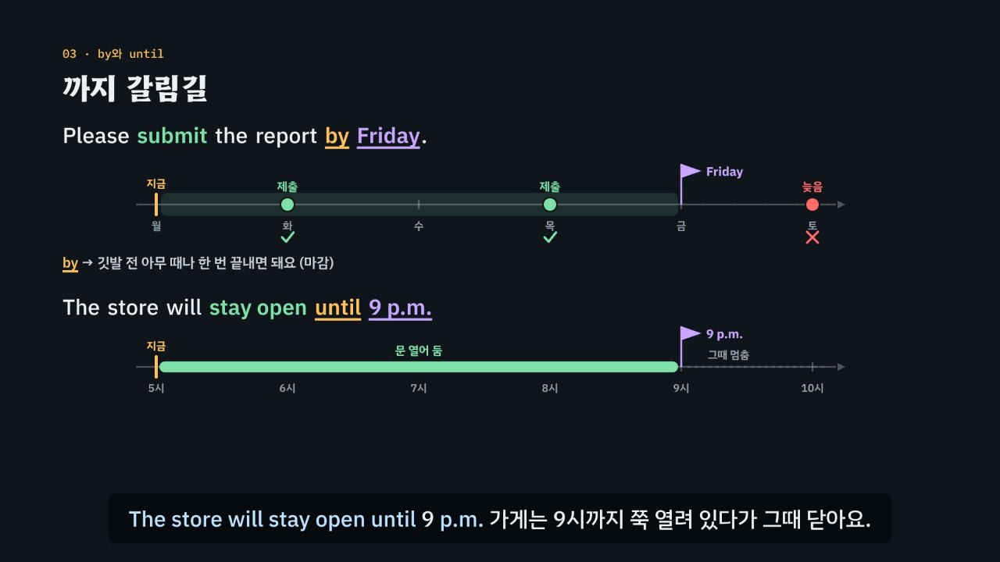

# 전치사, 그림으로 보고 짝으로 외워라

> [영어 튜토리얼](../README.md) 모음의 열한 번째 꼭지(T11)입니다. 영역: 토익 문법 · 다루는 유형: [100개 유형](../docs/toeic-100-types.md)의 56번(시간 전치사: by · until, for · during, within, since), 57번(장소와 뜻을 더하는 전치사: between · among, throughout, as, 숫자 앞 by · to), 58번(동사 · 형용사 · 명사와 짝인 전치사).

토익 Part 5에서 보기 네 개가 모두 전치사인 문제를 약 6분 30초짜리 인터랙티브 모션그래픽으로 설명합니다. 한국어는 명사 **뒤**에 조사를 붙이고 영어는 명사 **앞**에 전치사를 놓는데, 조사 하나가 전치사 하나와 짝이 맞지 않아요. ‘까지’는 *by* · *until*, ‘동안’은 *for* · *during*, ‘에’는 *at* · *on* · *in*으로 나뉘고, ‘안에’의 *in two weeks*는 ‘2주 뒤’예요. 그래서 한국어 뜻으로 옮겨 고르면 자주 틀려요. 이 튜토리얼은 시간과 장소를 **그림**(시간선 위의 깃발 · 점 · 막대, 공간 그림)으로 보고, 앞 낱말이 고르는 전치사(**짝 표현**)는 **짝 카드**로 외우게 해요. 이것을 **3단계 풀이법(무엇 → 뒤의 명사 → 그림 · 짝)** 으로 묶습니다.



## 바로 보기

`index.html`을 더블클릭하면 끝이에요. 설치도, 서버도 필요 없어요.

## 3단계 풀이법

1. **무엇**을 나타내나요? 빈칸 앞뒤를 보고 시간인지, 장소인지, 뜻을 더하는 말(자격 · 숫자 · 경로 · 단위)인지, 앞 낱말과 늘 같이 다니는 짝 표현인지 정해요. 종류가 다른 보기(시간 자리의 *among*, 뒤가 명사인데 접속사 *while*)는 지워요.
2. **뒤의 명사**를 봐요. 시각 · 날 · 큰 칸(*at · on · in*), 한 시점(*by · until · since*), 숫자로 잰 길이(*for · within · in*), 사건(*during*), 둘 · 셋 이상(*between · among*), 숫자 · 자격(*by · to · as*). 짝 표현에서는 뒤의 명사가 답을 정하지 않아요(숫자 앞에서 바뀌는 *increase in · of*만 예외).
3. **그림**으로 확인해요. 그때까지 끝나나(*by*) 이어지나(*until*), 과거부터 지금까지(*since*), 길이 내내(*for*) · 그 안의 한때(*within*) · 그만큼 뒤(*in*), 차이(*by*) · 도착점(*to*). 짝 표현은 **짝 카드**로 확인해요.

## 무엇을 배우나요

| 장 | 시각 | 내용 | 직접 해 보기 |
| --- | --- | --- | --- |
| 00 들어가며 | 0:00 | 토익 문제 하나, ‘금요일까지’에 맞는 보기가 둘(*by · until*) | 먼저 풀어 보기 |
| 01 조사 하나, 전치사 여럿 | 0:24 | 금요일**까지** ↔ ***by** Friday*, ‘에’ · ‘까지’ · ‘동안’ · ‘안에’가 전치사 여럿으로 나뉨, 그림과 짝 | 조사 하나를 골라 보기 |
| 02 시간의 at · on · in | 0:58 | 시계(점) ⊂ 하루(날) ⊂ 달력(큰 칸), *on Monday morning* | 크기 골라 보기, at · on · in 맞히기 |
| 03 까지 갈림길 | 1:28 | 시간선의 깃발, *by* = 깃발 전에 한 번(점), *until* = 깃발까지 쭉(막대), 어울리는 동사 | 예문 바꿔 보기, 끝나나 이어지나 (문장 여섯) |
| 04 동안과 안에 | 2:04 | *for* + 숫자 길이(자), *during* + 사건(칸), *during three hours*의 함정, *within* + 길이(상자 안의 점) | 길이일까 사건일까 (문장 여섯), 빈칸 문제 |
| 05 지금을 기준으로 | 2:38 | *since* + 과거 시점 + 현재완료(T04), *in two weeks* = 2주 뒤 한 점, *within two weeks* = 2주 안 아무 때나 | 빈칸 문제, 그만큼 뒤? 그 안에? (문장 넷) |
| 06 장소의 그림 | 3:06 | *at* 지점 · *on* 면 · *in* 공간, ‘에서’, *between · among · along · across · throughout · beyond*, *throughout the year* | 장소 그림 고르기 (문장 일곱), 빈칸 문제 |
| 07 뜻을 더하는 전치사 | 3:42 | *as* 자격, 막대그래프로 보는 *by*(차이) · *to*(도착점), *via · per · upon* | 뜻을 더하는 전치사 (문장 여섯), 빈칸 문제 |
| 08 짝 카드 | 4:16 | *responsible for* 같은 짝 카드, 한국어 조사의 함정(*access to · depend on · comply with · respond to · consist of*), 명사의 짝 | 짝 고르기 (문장 다섯) |
| 09 3단계 풀이법 | 4:50 | 무엇 → 뒤의 명사 → 그림 · 짝 흐름도 | 3단계 판정기: 무엇 · 뒤의 명사 · 그림을 고르면 흐름도에 길이 켜짐 |
| 10 실전 문제 풀이 | 5:18 | 토익 형식 세 문제 (*by* · *by 18 percent* · *increase in*) | 문제 고르기 |
| 11 정리 | 6:14 | 한눈에 보는 표 | 아래 칸으로 가는 길 |

영상 아래에는 다섯 가지가 더 있어요.

- **놀이터 ① — 까지 갈림길 (시간선 실험실)**: 문장 여덟 개(*return the keys ___ Friday*, *stay open ___ 9 p.m.*, *waited ___ two hours*, *served ___ the flight*, *requested ___ 30 days of purchase*, *has lived ___ 2019*, *open ___ two weeks*, *remain closed ___ Monday*) 가운데 하나를 고르고 전치사 일곱 개(*by · until · for · during · within · since · in*) 가운데 하나를 넣어요. 시간선에 그 전치사의 그림이 그려져요 — 깃발은 그때(시점), 자는 숫자로 잰 길이, 보라 칸은 사건, 한 번에 끝나는 일은 점, 쭉 이어지는 일은 막대. 그림이 문장의 뜻과 어긋나면 주황색으로 바뀌고 어디가 어긋났는지(‘한 번에 끝나는 일을 깃발까지 계속?’, ‘for 뒤에는 숫자로 잰 길이가 와야 해요’) 보여 줘요. *by · within · during*의 점은 끌어서 옮길 수 있어요(깃발 뒤로 끌면 ‘늦었어요’). 아래에 규칙 엔진의 판정과 3단계 풀이(일곱 전치사가 몇 단계에서 지워지는지)가 나와요. 키보드: 1~7 전치사, ← → 문장, , . 점 옮기기.
- **놀이터 ② — 짝 카드**: 짝 표현 열다섯 개(형용사 다섯 · 동사 다섯 · 명사 다섯)를 카드로 섞어 내요. 문장 속 빈칸에 들어갈 전치사를 넷 가운데 고르면 카드가 뒤집혀 짝, 해석, 발음, 한국어에 끌려 틀리기 쉬운 점이 나와요. 틀린 카드는 세 장 뒤에 다시 나오고, 한 번에 맞힌 카드만 셉니다. ‘카드 모아 보기’로 열다섯 개를 한눈에 볼 수 있어요. 키보드: 1~4 고르기, Enter 다음 카드.
- **연습 문제**: 토익 Part 5 형식 16문제(56번 6 · 57번 5 · 58번 5, 정답 위치 4·4·4·4). 힌트 = 3단계 풀이(무엇 → 뒤의 명사 → 그림 · 짝)와 단계마다 지워지는 보기, 보기마다 뜻과 까닭, 해석, 발음.
- **퀴즈**: 개념 확인 10문제(그림 문제 2개: 시간선 그림 고르기, 장소 그림 고르기).
- **핵심 정리**: 한눈에 보는 표, 용어(전치사와 조사 · 시간의 그림 · 장소와 뜻을 더하는 말 · 짝 표현과 한국어와 다른 점).

### 플레이어 조작

다른 튜토리얼과 같아요. 스페이스(재생/일시정지), ← →(5초), Shift + ← →(장), C(자막), V(음성 해설), F(전체 화면). 화면 속 영어 문장을 누르면 발음을 들려줘요. 주소 끝에 `#c-장면이름`(예: `index.html#c-byuntil`)을 붙이면 그 장면에서 시작해요.

음성 해설은 자막의 `(A)`~`(D)`를 ‘에이 · 비 · 씨 · 디’, `a.m.` · `p.m.`을 AM · PM, `T04`를 ‘네 번째 튜토리얼’로 읽어요.

## 무엇이 규칙 계산인가요

- **규칙 엔진** `assets/js/grammar.js`의 `PR.judge(보기, 빈칸 자리)`가 맞고 틀림과 까닭, 그리고 3단계 가운데 몇 단계에서 지워지는지를 정해요. 빈칸 자리는 세 가지로 적어요 — 무엇(시간 · 장소 · 뜻을 더하는 말 · 짝 표현), 뒤의 명사 종류(시각 · 날 · 큰 칸 · 때를 가리키는 말 · 숫자 길이 · 사건 · 지점 · 면 · 공간 · 둘 · 무리 · 길 · 경계 · 범위 · 자격 · 숫자 · 경로 · 단위 · 동작 명사), 그림(그때에 · 마감 · 쭉 이어짐 · 그때부터 지금까지 · 그 기간 동안 · 그 안에 · 그만큼 뒤 · 사이 · 따라 · 건너 · 곳곳에 · 넘어 · 자격 · 차이 · 도착점 · 거쳐 · 마다 · 하자마자). 영상 속 ✓·×와 실전 문제에서 지워지는 순서, 직접 해 보기 채점, 까지 갈림길의 판정과 풀이, 짝 카드 채점, 연습 문제의 힌트와 보기별 해설, 퀴즈 대부분의 정답이 모두 이 함수에서 나와요.
- **전치사 사전** `PR.P`: 전치사마다 뜻을 [무엇, 받는 명사 종류, 그림]으로 적어 두었어요. 예: *by* = [시간, 한 시점, 마감] · [뜻, 숫자, 차이]. 보기의 뜻이 빈칸 자리의 ①무엇과 맞지 않으면 1단계, ②명사 종류가 맞지 않으면 2단계, ③그림이 맞지 않으면 3단계에서 지워져요. 보기에 섞여 나오는 접속사(*while* 등)는 1단계에서 지워요.
- **짝 카드 사전** `PR.PAIRS`: 앞 낱말 열다섯 개와 짝 전치사, 뜻, 카드 문장, 틀린 보기 셋, 한국어에 끌려 틀리기 쉬운 점. *increase · decrease*는 뒤에 숫자가 오면 *of*로 바뀌어요.
- **3단계 판정기** `PR.decide`: 무엇 · 뒤의 명사 · 그림을 고르면 그 그림을 그리는 전치사를 사전에서 찾아요. 하나가 아니면(예: 공간 + 곳곳에 → *throughout · across*) 모두 보여 줘요.
- **어긋남 경고** `PR.check()`: 연습 문제 정답이 규칙 엔진과 다르거나, 맞는 보기가 둘 이상이거나, 단서 글자(뒤의 명사 · 동작 · 앞 낱말)가 문장에 없거나 자리가 틀렸거나, 사전에 없는 이름을 썼거나, 정답 위치가 몰리면 콘솔에 경고가 떠요. 직접 해 보기 문장, 까지 갈림길 문장(일곱 전치사 가운데 꼭 하나만 맞는지, 시간선에 깃발 · 자 · 칸이 있는지, 동작 모양과 그림이 맞는지), 짝 카드의 정답과 틀린 보기도 점검하고, 실전 문제의 ‘탈락’ 표시와 퀴즈 정답도 따로 점검해요.
- **단순하게 줄인 부분**
  - 빈칸 자리의 뜻(무엇 · 뒤의 명사 · 그림)은 문제마다 데이터에 정해 두었어요. 규칙 엔진은 문장의 뜻을 스스로 알아내지 않아요. 까지 갈림길은 문장마다 한국어 뜻을 함께 보여 주고, 그 뜻을 기준으로 판정해요(*will open within two weeks*도 문법은 맞지만 ‘2주 뒤’라는 뜻과는 달라요).
  - 전치사 사전에는 이 튜토리얼에서 가르치는 뜻만 넣었어요. *by the window*(옆), *by e-mail*(수단), *closed for the holidays*처럼 for 뒤에 사건이 오는 쓰임, *in the meeting*처럼 in 뒤에 사건이 오는 쓰임, *during May*처럼 during 뒤에 달이 오는 쓰임은 없어요. 그래서 문제와 보기는 이런 쓰임이 답처럼 보이지 않게 만들었어요.
  - *in* + 길이는 ‘지금부터 그만큼 뒤’로만 봤어요. 일상 영어에서는 *in 24 hours*를 ‘24시간 안에’라는 뜻으로도 써요. 토익 풀이의 기준(in = 그만큼 뒤, within = 그 안에)을 따랐어요.
  - 굳은 표현(*at night · on time · in time*)과 *between*을 셋 이상에 쓰는 경우, *familiar to*(물건이 주어)처럼 주어에 따라 짝이 바뀌는 경우는 판정에 넣지 않았어요(짝 카드의 도움말로만 소개).
  - 짝 표현은 규칙이 아니라 짝 카드 사전으로 채점해요. 사전 밖의 짝은 판정하지 않아요.
- **예문과 문제**: 모두 토익 형식을 본떠 직접 만든 것이에요.

이웃 튜토리얼: since + 현재완료는 [T04 시제](../verb-tense/), 전치사와 접속사의 구별(*during · while*)은 [T05](../connectors/), 동사 + 전치사(*respond to · comply with*)와 *eligible to* + 동사원형은 [T07](../infinitives-gerunds/)에서도 다뤄요.

## 폴더 구조

```
index.html              페이지 (영상 · 직접 해 보기 · 놀이터 · 짝 카드 · 연습 문제 · 퀴즈 · 핵심 정리)
assets/js/grammar.js    규칙 엔진(PR.judge), 전치사 사전(PR.P), 짝 카드 사전(PR.PAIRS), 3단계 판정기(PR.decide), 놀이터 문장(PR.ROAD), 연습 문제(PR.DRILL)
assets/js/scenes.js     영상 장면 12개, 장 목록과 자막, 시간선 그림(axis · flag · dot · bar · ruler · eventBlock · boxSpan), 장소 그림(placeIcon), 놀이터 시간선(PRS.road)
assets/js/app.js        플레이어, 직접 해 보기, 놀이터 ①②, 퀴즈, 영상 추출(EN_EXPORT)
video/                  자막 원고(SRT)
audio/narration/        미리 만든 음성 해설 · 발음 듣기: pieces.json(조각 목록) · clips.js(window.EN_CLIPS) · 조각 id.m4a
docs/poster.jpg         사이트 카드 그림
```

## 미리 만든 목소리

음성 해설과 발음 듣기는 VoiceStudio(OmniVoice 엔진, 비상업용 라이선스)로 미리 만든 합성 음성 파일(`audio/narration/`)로 읽어요. 파일이 없거나 못 읽는 글만 브라우저 음성으로 읽어요.
- 음성 해설: 한국어 조각은 「튜토리얼 내레이터 (젊은 여성)」, 영어 조각(본보기 영어 문장)은 「영어 선생님 (밝은 미국 여성)」.
- 발음 듣기(`EN.say`): 영상 속 영어나 스피커 단추를 누르면 같은 「영어 선생님 (밝은 미국 여성)」 파일로 읽어요(천천히는 같은 파일을 0.75배로). 글은 `tools/say-sweep.js`가 영상 · 처음부터 있는 스피커 단추 · 직접 해 보기의 예문(예문 단추를 하나씩 눌러 가며)에서 모아요. 놀이터에서 조각을 골라 만든 문장, 문제를 푼 뒤에 나오는 문장처럼 조합이 많은 글은 브라우저 음성으로 읽어요.
- 합성 엔진은 가끔 무음 · 잡음을 내거나 짧은 말을 뭉개 읽어요. 도구가 이런 소리를 걸러 seed를 바꿔 다시 만들어요. 지금 파일은 받아쓰기(Whisper) · 높낮이 · 소리 크기로 모두 다시 확인했고, 너무 높게 읽은 6개(*to* 두 조각 · *for* · *per* · *by, to* · *three hours*)와 소리 없이 만들어진 한 글자 한국어 조각 1개(글자 이름 *디*), 받아쓰기에서 다른 말로 들린 두 글자 조각 2개(*안에* · *마다*)는 seed를 바꿔 다시 만들었어요. 모든 튜토리얼을 다시 살펴볼 때(2026년 11월) 받아쓰기는 맞지만 속삭이듯 · 숨소리 섞이게 읽은 소리까지 찾으려고 영어 파일마다 목소리가 울린(성대가 떨린) 비율과 숨소리가 섞인 정도(소리가 얼마나 고르게 되풀이되는지 보는 자기상관 · 켑스트럼 피크, s 소리가 긴 짧은 말은 모음 부분만)를 쟀어요. 울린 비율 하나만으로는 숨소리 섞인 소리를 실제보다 훨씬 나쁘게 재기도 해서 세 가지를 함께 보고, 속삭이듯 · 숨소리 섞이게 읽거나 아주 높게 읽은 파일 12개(*to.* · *as* · *since* · *at.* · *across* · *via* · *three hours* · *for.* · *by, to.* · *per*)를 seed를 바꾸거나 읽을 글 끝에 쉼표 · 느낌표를 붙여 다시 만든 뒤 받아쓰기로 낱말을 확인했어요. 화면의 글은 그대로예요. 한 파일만 다시 만들려면 그 파일을 지우고 `--seed`를 바꿔 다시 실행하세요.

만드는 법(VoiceStudio가 있는 맥에서, 이미 만든 파일은 건너뛰어요):

```bash
node tools/narration-pieces.cjs prepositions     # 해설의 읽기 조각 + 발음 듣기 글 목록 (자막 · 예문을 고쳤을 때만, 클라우드에서도 됨)
python3 tools/voicestudio-narration.py prepositions --en-profile "영어 선생님 (밝은 미국 여성)"
```

## 영상 다시 만들기

```bash
node tools/render-video.cjs prepositions                       # → prepositions/video/prepositions.mp4 + .srt
node tools/render-video.cjs prepositions --frames 111.5,343    # 몇 장면만 그림으로
node tools/render-video.cjs prepositions --poster 111.5        # 카드 그림
node tools/render-video.cjs prepositions --srt                 # 자막 원고만
```
