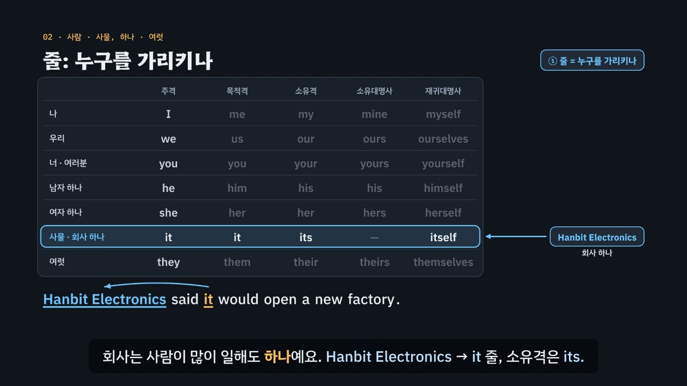

# 가리키는 말이 줄을, 자리가 칸을 정한다

> [영어 튜토리얼](../README.md) 모음의 열 번째 꼭지(T10)입니다. 영역: 토익 문법 · 다루는 유형: [100개 유형](../docs/toeic-100-types.md)의 43번(인칭대명사의 격), 44번(재귀대명사), 45번(부정대명사 one · another · the other · others), 46번(대명사의 수와 that · those).

토익 Part 5에서 *they · them · their · theirs · themselves*처럼 한 대명사의 여러 모양 가운데 하나를 고르는 **대명사 문제**를 약 6분 30초짜리 인터랙티브 모션그래픽으로 설명합니다. 핵심은 질문 두 개예요. **빈칸이 누구를 가리키나?**(대명사 표의 **줄**: 사람 · 사물, 하나 · 여럿) **빈칸이 어느 자리에 있나?**(표의 **칸**: 주격 · 목적격 · 소유격 · 소유대명사) 여기에 짝 표현(주어와 같은 사람 → *-self*, *one … the other*, *of* 앞 → *that · those*)을 더해 **3단계 풀이법(화살표 → 자리 → 짝)** 으로 묶습니다.

한국어와 다른 점을 함께 보여 줘요. 한국어는 ‘김 씨는 보고서를 끝내고 매니저에게 보냈어요’처럼 ‘그것을’ · ‘자기’를 자주 빼고, 조사(은 · 을 · 의)를 바꿔 자리를 나타내요. 영어는 대명사를 빼지 않고 낱말 모양 자체가 바뀌어요(*they · them · their · theirs*). 한국어 ‘자기’ 하나가 영어에서는 *herself*(자기를)와 *her*(자기 팀을) 둘로 갈리고, ‘직원’과 ‘직원들’을 꼭 나누지 않는 한국어와 달리 영어는 *it*과 *they*를 꼭 나눠요(회사 하나 → *its*).



## 바로 보기

`index.html`을 더블클릭하면 끝이에요. 설치도, 서버도 필요 없어요.

## 3단계 풀이법

1. **화살표**를 그려요. 빈칸에서 가리키는 말로 화살표를 그리고, 그 말이 사람인가 사물인가, 하나인가 여럿인가를 봐요(회사 · 기관은 하나 → *it*). 표의 줄이 다른 보기는 지워요. 부정대명사는 몇 개 가운데 몇 개가 남았는지, *that · those*는 앞의 명사가 하나인지 여럿인지를 봐요.
2. **자리**를 봐요. 동사 앞 주어 자리 → 주격, 동사 · 전치사 뒤 목적어 자리 → 목적격, 명사(또는 *own*) 앞 → 소유격, 뒤에 명사 없이 ‘누구의 것’ → 소유대명사. *other*는 뒤에 명사가 있어야 하고, *others · the others*는 홀로 써요.
3. **짝**을 확인해요. 목적어가 주어 자신이면 *-self*(*by himself* = 혼자서, 문장 끝 강조 = 직접). 둘 가운데 남은 하나 → *the other*, 정해진 나머지 전부 → *the others*, 정해지지 않은 다른 몇몇 → *others*. 뒤에 *of …*가 붙어 앞의 명사를 되풀이하면 → *that · those*, *who* 절이 꾸미면 → *those who*.

## 무엇을 배우나요

| 장 | 시각 | 내용 | 직접 해 보기 |
| --- | --- | --- | --- |
| 00 들어가며 | 0:00 | 토익 문제(*its · it · their · it’s*), 물어볼 것 두 가지(누구를 · 어느 자리) | 먼저 풀어 보기 |
| 01 대명사는 화살표 | 0:24 | 대명사 → 가리키는 말 화살표, 한국어는 ‘그것을’ · ‘자기’를 뺌 | 문장 바꾸기, 화살표 끝 찾기 |
| 02 줄: 누구를 가리키나 | 0:54 | 대명사 표의 일곱 줄, 회사 하나 → *it*, 직원들 → *they*, 한국어 ‘직원(들)’ | 가리키는 말 바꾸기 (그 줄의 다섯 모양) |
| 03 칸: 자리가 모양을 정한다 | 1:28 | 그들은 · 그들을 · 그들의 · 그들의 것 ↔ *they · them · their · theirs*, 자리마다 칸 | 줄 바꾸기, 빈칸 문제 둘 |
| 04 홀로 서는 theirs, 붙어 서는 its | 2:02 | 뒤에 명사가 있나, *theirs = their + 명사*, *it* 줄에는 소유대명사가 없음, *its*와 *it’s*, 소유격 + *own* | 둘 가운데 고르기 (문장 여섯), 빈칸 문제 |
| 05 거울 대명사 -self | 2:32 | 같은 사람 → *herself*, 다른 사람 → *her*, 한국어 ‘자기’, 강조(직접), *by himself* = 혼자서, 주어 자리에는 못 옴 | 같은 사람 · 다른 사람 바꾸기, 둘 가운데 고르기, 빈칸 문제 |
| 06 둘이면 the other | 3:06 | *one … the other*, *one … another … the other*, 규칙 엔진으로 둘뿐일 때 *another* × | 무리 바꾸기 (둘 · 셋), 빈칸 문제 |
| 07 others와 the others | 3:40 | 정해진 무리의 나머지 전부 *the others*, 다른 몇몇 *others*, *other + 복수 명사 · another + 단수 명사*, *each other* | 둘 가운데 고르기 (문장 여섯), 빈칸 문제 |
| 08 되풀이 대신 that · those | 4:10 | *the price → that of*, *the sales → those of*, *it · them*은 안 됨(규칙 엔진), *those who* | 비교 문장 바꾸기, 빈칸 문제 둘 |
| 09 3단계 풀이법 | 4:42 | 화살표 → 자리 → 짝 흐름도 | 대명사 표 판정기: 줄 · 자리 · 같은 사람을 고르면 흐름도에 길이 켜짐 |
| 10 실전 문제 풀이 | 5:12 | 토익 형식 세 문제 (*its · himself · the other*) | 문제 고르기 |
| 11 정리 | 6:08 | 한눈에 보는 표 | 아래 칸으로 가는 길 |

영상 아래에는 네 가지가 더 있어요.

- **놀이터 — 대명사 표 놀이터**: 가리키는 말 여섯(*Ms. Kim · Mr. Park · Hanbit Foods · Our partners · We · I*)과 문장 여섯(주어 · 목적어 · 명사 앞 · 홀로 · 같은 사람 · *by* + 혼자서)을 골라 빈칸 문장을 만들고, 7줄 × 5칸 대명사 표에서 칸을 눌러 답해요. 규칙 엔진이 줄(가리키는 대상)과 칸(자리)을 따로 채점해 표에 켜고, 무대 그림에 빈칸에서 가리키는 말로 화살표를 그려요. *her*처럼 두 칸의 모양이 같은 낱말은 ‘낱말은 맞지만 이 자리는 소유격 칸’이라고 알려 줘요. 같은 문장에서 가리키는 말만 바꾸면 줄이, 같은 가리키는 말로 문장만 바꾸면 칸이 바뀌는 모습을 볼 수 있어요. ‘먼저 맞혀 보기’를 끄면 답이 바로 보여요. 키보드: 방향키 칸 옮기기, Enter 고르기, N 다른 문제.
- **연습 문제**: 토익 Part 5 형식 16문제(43번 4 · 44번 4 · 45번 4 · 46번 4, 정답 위치 4·4·4·4). 힌트 = 3단계 풀이(화살표 → 자리 → 짝)와 단계마다 지워지는 보기, 보기마다 모양(주격 · 목적격 · 소유격 · 소유대명사 · 재귀대명사 · 부정대명사 · 지시대명사)과 까닭, 해석, 발음.
- **퀴즈**: 개념 확인 10문제(그림 문제 3개: 문장에서 it의 가리키는 말 고르기, they 줄에서 칸 고르기, 의자 그림에서 *the others* 고르기).
- **핵심 정리**: 한눈에 보는 표, 용어(가리키는 말과 줄 · 자리와 칸 · 짝 표현 · 한국어와 다른 점).

### 플레이어 조작

다른 튜토리얼과 같아요. 스페이스(재생/일시정지), ← →(5초), Shift + ← →(장), C(자막), V(음성 해설), F(전체 화면). 화면 속 영어 문장과 대명사 표의 낱말을 누르면 발음을 들려줘요. 주소 끝에 `#c-장면이름`(예: `index.html#c-rows`)을 붙이면 그 장면에서 시작해요.

음성 해설은 자막의 `it’s`를 *its*와 구별되게 ‘it is’로, `-self`를 ‘셀프’, `(A)`~`(D)`를 ‘에이 · 비 · 씨 · 디’, `+`를 ‘플러스’로 읽어요.

## 무엇이 규칙 계산인가요

- **규칙 엔진** `assets/js/grammar.js`의 `PN.judge(낱말, 문장)`이 맞고 틀림과 까닭, 그리고 3단계 가운데 몇 단계에서 지워지는지를 정해요. 문장은 종류마다 이렇게 적어요.
  - 인칭 · 재귀대명사: 가리키는 말의 줄(I · we · you · he · she · it · they), 빈칸의 자리(동사 앞 · 동사와 전치사 뒤 · 명사 앞 · 홀로 · 강조 · 주어 + 동사), 주어와 같은 사람인지.
  - 부정대명사: 가리키는 것이 하나인지 여럿인지, 빈칸 뒤에 명사가 있는지(단수 · 복수), 정해진 나머지인지, 무리의 수.
  - *that · those*: 앞의 명사가 하나인지 여럿인지, 뒤에 *of …* · *who …*가 붙는지.
  영상 속 ✓·×와 실전 문제에서 지워지는 순서, 직접 해 보기 채점, 놀이터의 줄 · 칸 판정과 풀이, 연습 문제의 힌트와 보기별 해설, 퀴즈의 정답이 모두 이 함수에서 나와요.
- **대명사 표** `PN.TABLE`: 7줄 × 5칸. 낱말마다 읽을 수 있는 칸을 모두 찾아서(*her* = 목적격 · 소유격, *his* = 소유격 · 소유대명사), 자리에 맞는 칸이 하나라도 있으면 통과시켜요. *it* 줄의 소유대명사 칸은 비어 있어요.
- **3단계 판정기** `PN.decide`: 줄 · 자리 · 같은 사람을 고르면 알맞은 칸과 대명사를 내요. ‘주어 자리인데 같은 사람(-self)’, ‘it 줄인데 홀로’처럼 쓸 수 없는 짝은 왜 안 되는지 알려 줘요.
- **어긋남 경고** `PN.check()`: 연습 문제 정답이 규칙 엔진과 다르거나, 정답이 둘 이상이거나, 단서 글자(가리키는 말 · 자리 단서 · 짝)가 문장에 없거나, 보기가 사전에 없거나, 정답 위치가 몰리면 콘솔에 경고가 떠요. 놀이터의 문장 서른다섯 개는 표 전체 35칸 가운데 맞는 낱말이 꼭 하나인지 점검하고, 직접 해 보기 문장 열여덟 개, 01 · 02 · 03 · 08장 예문, 실전 문제의 ‘탈락’ 표시와 퀴즈 정답도 따로 점검해요.
- **단순하게 줄인 부분**
  - 빈칸이 가리키는 말, 빈칸의 자리, 주어와 같은 사람인지, 무리가 정해져 있는지는 문제마다 데이터에 정해 두었어요. 규칙 엔진은 문장의 뜻을 스스로 알아내지 않아요.
  - 회사 · 기관은 토익(미국식 영어) 기준으로 *it · its*로만 받아요. 영국식 영어에서는 *they*로 받기도 해요.
  - 성별을 모르는 한 사람을 가리키는 *they*(singular *they*), *each other*와 *one another*의 차이, *other* + 셀 수 없는 명사(*other information*), *a third · the second* 같은 순서 표현은 다루지 않았어요.
  - 주어 자리의 *myself*(*Mr. Okafor and myself will …*)는 실제 말에서 쓰는 사람도 있지만, 시험 기준으로 틀린 것으로 봐요.
  - *that · those*는 비교 문장에서 앞의 명사를 되풀이하지 않는 쓰임과 *those who*만 다뤘어요(지시형용사 *this · these*는 넣지 않음).
  - 놀이터의 표에서는 *you*의 재귀대명사를 *yourself* 하나로 보여 줘요(여럿이면 *yourselves*).
  - 명사 쪽의 *another · other*(+ 명사)는 [T06 명사 · 관사](../nouns-articles/)에서, 관계대명사 *who · which*는 [T01](../relative-pronouns/)에서 다뤄요.
- **예문과 문제**: 모두 토익 형식을 본떠 직접 만든 것이에요.

## 폴더 구조

```
index.html              페이지 (영상 · 직접 해 보기 · 놀이터 · 연습 문제 · 퀴즈 · 핵심 정리)
assets/js/grammar.js    규칙 엔진(PN.judge), 대명사 표(PN.TABLE), 3단계 판정기(PN.decide), 놀이터 데이터(PN.PG_ANTE · PN.PG_FRAMES), 연습 문제(PN.DRILL)
assets/js/scenes.js     영상 장면 12개, 장 목록과 자막, 대명사 표 그리기(grid), 가리키는 화살표(point), 놀이터의 작은 무대(PNS.stage)
assets/js/app.js        플레이어, 직접 해 보기, 놀이터, 퀴즈, 영상 추출(EN_EXPORT)
video/                  자막 원고(SRT)
docs/poster.jpg         사이트 카드 그림
```

## 영상 다시 만들기

```bash
node tools/render-video.cjs pronouns                       # → pronouns/video/pronouns.mp4 + .srt
node tools/render-video.cjs pronouns --frames 75.5,346     # 몇 장면만 그림으로
node tools/render-video.cjs pronouns --poster 75.5         # 카드 그림
node tools/render-video.cjs pronouns --srt                 # 자막 원고만
```
