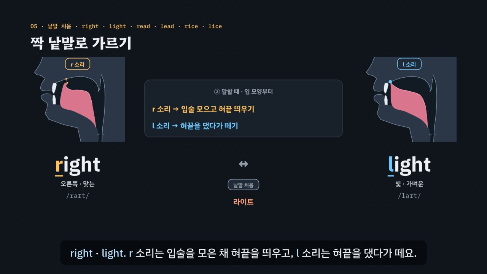

# r · l, 혀끝이 닿느냐 마느냐

> [영어 튜토리얼](../README.md) 모음의 **영어 발음 (미국식)** 첫 꼭지입니다(영역: `pron`, 계획표의 P04 · 유형 9). 발음 영역의 설계도는 [docs/pron-types.md](../docs/pron-types.md)이고, 이 꼭지가 발음 영역의 공통 부품(입 옆 단면도 `shared/mouth.js`, 듣고 가르기 훈련, 내 발음 확인)을 처음 세웠어요.

오른쪽 *right*와 빛 *light*는 한국어로 적으면 둘 다 ‘라이트’예요. 한국어에는 ㄹ이 하나뿐이라, 영어에서 둘인 소리가 하나로 합쳐져요. 둘을 가르는 열쇠는 **혀끝**이에요.

- **l 소리** — 혀끝을 윗잇몸에 대고, 공기는 혀 양옆으로. 한국어 *달라*의 ㄹㄹ과 가까워요. 요령: ‘을’ 하고 댄 채 (을)*light*.
- **r 소리** — 혀끝은 어디에도 닿지 않게, 혀 양옆은 위 어금니 안쪽에, 입술은 조금 둥글게. 요령: ‘우’ 하고 입술을 모은 채 (우)*right*.
- **끝의 l**(*feel · milk · school · world*)은 혀 뒤를 올려 어둡게 — 받침 ㄹ처럼 밝게 끝내거나 ‘으’를 붙이지 않아요(*milk* ≠ 밀크).

3단계 발음법: ① **듣고 가르기**(짝 낱말 · 여러 목소리) → ② **입 모양 만들기**(혀끝을 대느냐 띄우느냐) → ③ **낱말 · 문장 속에서**(자리마다 조심할 점).



## 바로 보기

`index.html`을 더블클릭하면 끝이에요. 설치도, 서버도 필요 없어요.

## 소리와 마이크에 대해 (꼭 읽어 주세요)

- 녹음 파일이 없어요. 영어는 모두 **합성 음성**이에요. 글이 정해진 말(짝 낱말 · 문장 · 연습 문제 · 따라 말하기)은 **VoiceStudio로 미리 만든 미국식 목소리 넷**(`audio/dialogue/`)으로, 나머지는 브라우저에 들어 있는 영어 음성(speechSynthesis)으로 읽어요. 합성 음성은 실제 사람의 말소리와 조금 다르게 들릴 수 있어요.
- **목소리 넷**: 밝은 선생님(미국 여성) · 차분한 선생님(미국 여성) · 미국 여성 · 미국 남성. 같은 낱말을 여러 목소리로 들으며 가르는 것이 듣기 훈련의 핵심이라(목소리가 바뀌어도 r · l을 가르는 귀), 훈련 · 연습 문제는 문제마다 목소리를 바꿔요. 비교용 **한국어식 소리**(*라이트 · 달라 · 밀크 · 월드* …)는 한국어 내레이터 목소리로 만들었어요(`voices.json`의 `"lang": "ko"`).
- 튜토리얼 전용 목소리 부품 `assets/js/voices.js`(`RLV`)가 말하는 사람마다 파일을 찾고, 없으면 브라우저 음성(en-US, 없으면 높낮이로 구별 · 한국어식은 ko-KR)으로 읽어요. 읽기 전에 음성 해설 · 발음 듣기 · 녹음 재생을 멈추고 영상을 일시정지해요.
- **내 발음 확인 · 따라 말하기**: 브라우저에 음성 인식(`SpeechRecognition` · `webkitSpeechRecognition`, en-US)이 있으면 말을 글로 바꿔 **후보 글 여러 개**(alternatives)를 짝 낱말과 맞춰 봐요 — *light*를 말했는데 *right*로 적히면 ‘짝 낱말로 들렸어요’. 발음의 질은 판정하지 않아요(인식기는 문맥으로 고쳐 적기도 해요). 크롬(Chrome) 같은 브라우저는 소리를 브라우저 회사의 서버로 보내 글로 바꿔요. 음성 인식이 없으면 녹음(`MediaRecorder`)으로 ‘내 목소리’와 ‘본보기’를 이어서 들어요. 녹음은 메모리에만 두고, 이 사이트는 아무것도 저장하지 않아요(듣고 가르기 훈련의 기록만 이 브라우저의 `localStorage`에).

## 무엇을 배우나요

| 장 | 시각 | 내용 | 직접 해 보기 |
| --- | --- | --- | --- |
| 00 들어가며 | 0:00 | right · light = 둘 다 ‘라이트’, 열쇠는 혀끝 | 먼저 들어 보기(한국어식 *라이트*와 함께) |
| 01 들어 보기 · 구별되나요? | 0:26 | 짝 낱말 · 목소리 넷 · ① 듣고 가르기 | 짝 듣고 고르기(맛보기, 무작위 목소리) |
| 02 한국어 ㄹ의 두 얼굴 | 1:02 | *나라* = 톡 치는 ㄹ · *달라* = 대고 머무는 ㄹㄹ | 한국어 ㄹ 두 가지(입 옆 단면도 바꾸기) |
| 03 l 소리 만들기 | 1:42 | 혀끝 → 윗잇몸 · 공기는 양옆 · 목 울림 | 혀끝을 대고 있기(입 모양 단계) |
| 04 r 소리 만들기 | 2:26 | 혀끝은 어디에도 닿지 않게 · 입술은 조금 둥글게 | 혀끝을 띄우기(혀 모양 두 가지) |
| 05 짝 낱말로 가르기 | 3:12 | 낱말 처음: *right · light · read · lead · rice · lice* | 짝 고르기(짝 · 목소리) |
| 06 묶음 · 가운데 자리와 외래어 표기 | 3:54 | *grass* 그래스 · *glass* 글라스, 으 넣지 않기 | 외래어 표기로 r · l 가르기(자리 고르기) |
| 07 끝의 l 소리 · 어두운 l | 4:38 | *feel · milk · school · world · girl* | 끝의 l 소리(낱말 고르기) |
| 08 외래어 함정 | 5:24 | 라디오 · 레몬 · 호텔 · 컬러 · 클래스 … 카드 열여섯 장 | 외래어 하나씩(함정의 종류) |
| 09 문장 속에서 | 6:06 | *Turn right at the light. · It's a small world.* | 문장 고르기(r · l 소리 칠하기) |
| 10 정리 | 6:50 | 3단계 발음법 · r 소리와 l 소리 | 이제 직접(아래 칸으로) |

- **듣고 가르기 훈련**(놀이터 왼쪽): 짝 낱말 스물두 쌍(`RL.PAIRS`: 처음 8 · 묶음 8 · 가운데 4 · 끝 2) 중 하나를 무작위 목소리로 들려주고 고르게 해요. 자리 · 목소리를 고를 수 있고, 자리 × 목소리마다 맞힌 비율을 표(막대)로 보여 줘요. 연구에서 여러 목소리 · 여러 자리로 듣는 훈련(HVPT)이 쓰인 방식을 본떴어요. 기록은 `localStorage` `en-rl-hvpt-v1`(지우기 단추).
- **내 발음 확인**(놀이터 오른쪽): 짝 낱말 하나를 말하면 음성 인식의 후보 글을 짝과 맞춰 ‘그 낱말로 들렸어요 · 짝 낱말로 들렸어요 · 다른 말로 들렸어요’를 알려 줘요.
- **따라 말하기 28문장**: 자리(처음 · 묶음 · 가운데 · 끝)별로 묶은 문장, 문장마다 듣기 · 천천히 · 따라 말하기. 들린 낱말을 원래 문장과 맞춰 맞은 낱말 초록 · 빠진 낱말 주황(`RL.compareWords`).
- **듣고 고르기 16문제**(`PDrill`, `.edr` 모양): 낱말 하나 · 문장 속 낱말 · 두 낱말이 같았나 · *word*와 *world*. 소리 먼저, 힌트 세 단계는 엔진이 자리와 소리에서 만들어요. 키보드 A · B(1 · 2) · H 힌트 · R 다시 듣기 · S 천천히 · Enter.
- **퀴즈 10문제**: 영상 순서대로, 입 옆 단면도 그림 문제 둘(l 소리 · 어두운 l 고르기)을 함께.
- **핵심 정리**: 자리 × r 소리 · l 소리 표 + 용어(① 듣고 가르기 · ② 입 모양 만들기 · ③ 낱말 · 문장 속에서).

### 플레이어 조작

다른 튜토리얼과 같아요. 스페이스(재생/일시정지), ← →(5초), Shift + ← →(장), C(자막), V(음성 해설), F(전체 화면). 화면 속 낱말을 누르면 발음을 들려줘요(같은 단추를 곧바로 다시 누르면 천천히).

음성 해설은 자막의 ㄹ을 ‘리을’, ㄹㄹ을 ‘리을 두 개’(뒤의 조사도 맞춰 ‘리을 두 개는’)로, 한국어 문장 속 홀로 쓴 글자 r · l을 ‘알 · 엘’로 읽어요.

**미리 만든 목소리**: VoiceStudio(OmniVoice 엔진, 비상업용 라이선스)로 만든 합성 음성 파일이에요. 파일이 없거나 못 읽으면 그 줄 · 조각만 브라우저 음성으로 읽어요.
- 음성 해설(`audio/narration/`): 한국어 조각은 「튜토리얼 내레이터 (젊은 여성)」, 영어 조각은 「영어 선생님 (밝은 미국 여성)」.
- 낱말 · 문장(`audio/dialogue/`): 말하는 사람 → 프로필은 `voices.json` — `tc` 「영어 선생님 (밝은 미국 여성)」 · `tf` 「영어 선생님 (미국 여성)」 · `uf` 「길 묻기 · 나 (미국 여성)」 · `um` 「길 묻기 · 길에서 만난 사람 (미국 남성)」 · `ko` 「튜토리얼 내레이터 (젊은 여성)」(한국어). 프로필 이름의 ‘길 묻기’는 처음 만든 곳일 뿐이에요.
- 짝 낱말은 한 소리만 다르게 들려야 의미가 있어서, 영어 파일 237개(한국어식 읽기는 빼고)를 받아쓰기(Whisper large-v3)로 한 번 더 들었어요. 짝 낱말로 적힌 파일은 없었고, 다른 낱말로 적힌 2개(long → Lawn · rate → Right)는 seed를 바꿔 다시 만든 뒤 맞게 적히는 것을 확인했어요. berry 4개 → 받아쓰기 결과 = Barry(사람 이름)인데, 미국 영어에서는 두 낱말 소리가 같아서 그대로 뒀어요.

만드는 법(VoiceStudio가 있는 맥에서, 이미 만든 파일은 건너뛰어요):

```bash
node tools/narration-pieces.cjs r-and-l     # 해설의 읽기 조각 목록 (자막을 고쳤을 때만)
node tools/dialogue-lines.cjs r-and-l       # 낱말 · 문장 줄 목록 (낱말 · 문제 · 따라 말하기를 고쳤을 때만)
python3 tools/voicestudio-narration.py r-and-l --en-profile "영어 선생님 (밝은 미국 여성)"
python3 tools/voicestudio-dialogue.py r-and-l
```

## 무엇이 규칙 계산인가요

- **규칙 엔진** `assets/js/grammar.js`(`RL`)가 낱말마다 적은 발음 기호(소리 목록)에서 계산해요. 영상 · 직접 해 보기 · 훈련 · 연습 문제 · 퀴즈가 모두 같은 결과를 써요.
  - 낱말 사전 `RL.DICT`(낱말 · IPA · 한국어 표기 · 뜻)와 소리 나누기 `RL.phones`.
  - r · l 소리의 **자리** `RL.liquids` · `RL.posOf`: 처음 · 묶음(앞 자음과 붙음) · 가운데(모음 사이) · 끝 · r 다음 l(*world · girl*), 끝의 l은 어두운 l로 표시.
  - **짝 낱말** `RL.pairDiff`: 두 낱말이 r · l 소리 하나만 다른지, 어느 자리에서 다른지(`RL.PAIRS`의 자리는 손으로 적지 않고 여기서 계산).
  - **외래어 표기** `RL.koUnits` · `RL.koExpect` · `RL.koMarks`: 한국어 표기의 ㄹ이 ㄹㄹ(받침 ㄹ + 첫소리 ㄹ = l)인지 하나(= r)인지, 표준 표기에서 기대되는 ㄹ과 견줘요(*글라스 = glass · 그래스 = grass*). 한국어식으로 **넣은 으**와 음절 수 `RL.koInserted` · `RL.syl` · `RL.koSyl`, 외래어 함정의 종류 `RL.TRAP`(처음 ㄹ로 합쳐짐 · 으 넣기 · 밝은 끝 l · r이 사라짐 · ㄹㄹ = l).
  - 글자 속에서 소리를 적은 곳(칠하기) `RL.spans` · `RL.segs`, 문장 속 r · l 소리 수 `RL.countIn`.
  - 들린 말 맞추기 `RL.heard`(후보 글 → 그 낱말 · 짝 낱말 · 다른 말, 소리가 같은 낱말 `RL.SAME`: *right · write · rite*), `RL.compareWords`(낱말마다 맞춤).
  - 연습 문제의 힌트 `RL.hints`(① 어디를 들을지 → ② 입 모양 → ③ 낱말 속 자리).
- **입 그림 부품** `../shared/mouth.js`(`EN.mouth`): 자세(pose)마다 혀 · 입술 · 턱을 그리고, 혀가 입천장에 닿는지를 **그림의 혀와 입천장 사이 거리로 계산**해요(`contact`). 영상의 ‘닿아요 · 떨어져 있어요’ 표시와 퀴즈 그림 문제의 정답이 이 계산을 써요.
- **어긋남 경고** `RL.check()`: 사전에 없는 낱말, r · l 소리 하나만 다르지 않은 짝, 표준 표기에서 기대한 ㄹ과 다른 외래어 표기, 글자 칠하기 실패, 그 자리의 r · l 소리가 없는 문장, 엔진과 어긋나는 문제의 정답 · 보기, 한쪽에 몰린 정답 위치, 입 그림에서 l 소리의 혀끝이 닿지 않거나 r 소리의 혀가 입천장에 닿으면 콘솔에 경고가 떠요.
- **발음 사전 대조**(커밋 전에 따로): 손으로 적은 IPA 102낱말을 misaki 미국 발음 사전(VoiceStudio에 들어 있는 `us_gold.json`)과 맞춰 r · l 소리와 자음 뼈대를 견줬어요. 다른 곳은 셋이고 모두 일부러 고른 것이에요 — *fire · tire*(사전은 끝의 r을 r 모음으로 적음, 이 꼭지는 *file · tile*과의 짝으로만 쓰고 끝의 r은 P08에서), *every*(사전은 세 음절 *ev-er-y*, 이 꼭지는 흔한 두 음절 /ˈɛvri/라 r이 묶음 자리).
- **단순하게 줄인 부분**
  - 입 옆 단면도는 혀가 닿느냐 마느냐를 보여 주려고 그린 그림이고, 실제 혀의 모양을 잰 것이 아니에요. r 소리의 혀 모양은 두 가지(혀끝을 살짝 든 모양 · 혀 뭉치를 올린 모양)를 보여 주고, 사람마다 다르다고 적었어요.
  - 미국 영어의 l은 자리와 상관없이 조금 어둡지만, 여기서는 처음 · 묶음 · 가운데 = 밝은 l, 끝 = 어두운 l로 나눠요.
  - IPA는 넓게 적어요(r = ɹ를 r로, 모음 사이 t의 짧은 ㄹ 소리 등은 적지 않음).
  - 끝의 r(*car · work*)은 r 모음이라 이 꼭지에서는 처음 · 묶음 · 가운데의 r 소리만 다뤄요(*fire · file* 짝은 끝의 l을 듣는 데만).
  - 외래어 표기의 힌트는 표준 표기를 기준으로 했어요(실제로 쓰는 표기는 조금씩 달라요).
  - 엔진은 소리를 듣지 않아요. 내 발음 확인은 음성 인식이 적은 후보 글을 짝 낱말과 맞춰 볼 뿐이에요.
- **근거로 삼은 연구**(초록 · 요약으로 확인한 범위, 자세한 목록은 [docs/pron-types.md](../docs/pron-types.md)): 낱말 속 자리마다 결과가 달라요 — [Kang 1999](https://koreascience.kr/article/JAKO199915637237323.page)(l에서 더 많이 틀리고 모음 사이에서 가장 적게 틀림) · Ingram & Park 1998(*JASA* 103(2), 한국인 · 일본인 청자의 r · l 듣기). 끝의 어두운 l과 r 다음 l — [Cho 2022](https://koreascience.kr/article/JAKO202211039250772.page)(*pearl · world*). 여러 목소리로 듣는 훈련 — [Yu & Jamieson 1993](https://jcaa.caa-aca.ca/index.php/jcaa/article/view/797). 연구마다 대상 · 방법이 달라 결과가 엇갈리는 곳(특히 낱말 처음)은 강하게 말하지 않고, 공통으로 나온 것(끝의 l과 r 다음 l이 가장 어려움, 모음 사이는 상대적으로 쉬움)만 강조했어요.
- **예문과 문제**: 모두 직접 만든 것이에요.

## 폴더 구조

```
index.html              페이지 (영상 · 직접 해 보기 · 듣고 가르기 훈련 · 내 발음 확인 · 따라 말하기 · 듣고 고르기 · 퀴즈 · 핵심 정리)
assets/js/grammar.js    규칙 엔진(RL.phones · RL.liquids · RL.posOf · RL.pairDiff · RL.koUnits · RL.koExpect · RL.koMarks · RL.koInserted · RL.spans · RL.segs · RL.countIn · RL.heard · RL.compareWords · RL.hints),
                        낱말 사전(RL.DICT) · 짝(RL.PAIRS) · 목소리(RL.VOICES) · 낱말 묶음(RL.SETS) · 외래어(RL.LOAN · RL.TRAP) · 문장(RL.SENT) · 연습 문제(RL.DRILL) · 점검(RL.check)
assets/js/voices.js     낱말 · 문장 목소리(RLV): 목소리 넷 + 한국어식(미리 만든 파일 → 없으면 브라우저 음성), 다른 소리와 겹치지 않게
assets/js/scenes.js     영상 장면 11개, 장 목록과 자막, 입 옆 단면도 배치(옆모습 둘 · 혀끝 표시 · 닿음 표시), 짝 낱말 카드, 외래어 카드, 문장 칠하기
assets/js/app.js        플레이어, 직접 해 보기, 듣고 가르기 훈련(기록 표), 내 발음 확인, 따라 말하기(음성 인식 · 녹음), 듣고 고르기(PDrill), 퀴즈, 영상 추출(EN_EXPORT)
../shared/mouth.js      입 옆 단면도 부품(EN.mouth) — 발음 영역이 함께 씀
video/                  자막 원고(SRT)
audio/narration/        음성 해설의 읽기 조각 목록(pieces.json) · 파일 목록(clips.js) · 음성 파일
audio/dialogue/         낱말 · 문장 줄 목록(lines.json) · 말하는 사람 → 프로필(voices.json) · 파일 목록(clips.js) · 음성 파일
docs/poster.jpg         사이트 카드 그림
```

## 영상 다시 만들기

```bash
node tools/render-video.cjs r-and-l                       # → r-and-l/video/r-and-l.mp4 + .srt
node tools/render-video.cjs r-and-l --frames 30,201       # 몇 장면만 그림으로
node tools/render-video.cjs r-and-l --poster 201          # 카드 그림
node tools/render-video.cjs r-and-l --srt                 # 자막 원고만
```

MP4에는 소리가 없어요(자막이 그림에 들어가요).
