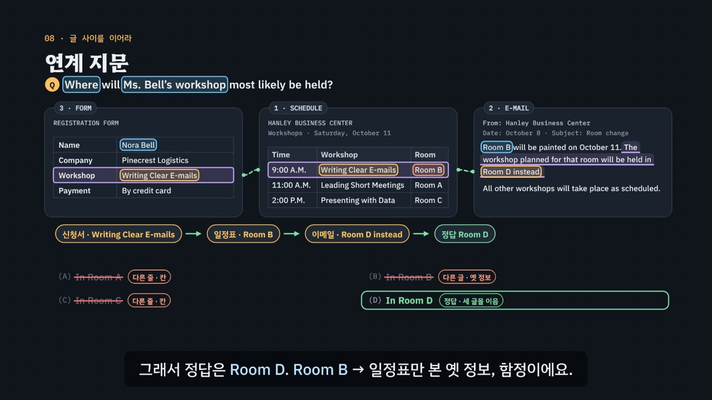

# 답은 지문에 있다, 다른 말로

> [영어 튜토리얼](../README.md) 모음의 열일곱 번째 꼭지(T17)입니다. 영역: 토익 · 다루는 유형: [100개 유형](../docs/toeic-100-types.md)의 89–100번(Part 7 독해 — 주제 · 목적, 세부 정보, NOT · True, 추론, 동의어, 패러프레이즈, 요청 · 지시, 문장 삽입, 채팅 · 문자의 의도 파악, 양식 · 표, 이중 지문, 삼중 지문).

토익 Part 7(독해)을 약 6분 29초짜리 인터랙티브 모션그래픽으로 설명합니다. Part 7은 읽기 100문제 가운데 54문제예요. 이메일, 공지, 광고, 문자, 표 같은 글을 읽고 질문에 답하는데, 글을 처음부터 다 해석할 필요는 없어요. 이 튜토리얼은 **“근거는 지문에, 답은 다른 말로”** 를 한 가지 원리로 삼아요. 정답에는 늘 지문 속 근거 문장이 있고, 정답 보기는 그 근거를 그대로 옮기지 않고 바꿔 말해요(*fully booked → no vacancies*). 거꾸로 지문 낱말을 그대로 쓴 보기(*It is hosting a city marathon.*)는 함정일 때가 많아요. 그래서 **3단계 풀이법(질문 먼저 → 근거 찾기 → 바꿔 말한 보기)** 으로 열두 가지 문제 유형을 풀어요.

한국어와 견주는 곳도 있어요. 한국어에서도 ‘방이 다 찼어요’와 ‘빈방이 없어요’는 낱말이 달라도 뜻이 같아요. 바꿔 말하기는 낯선 기술이 아니라는 뜻이에요. 동의어 문제에서는 단어장에서 *hold = 잡다*처럼 한국어 뜻 하나만 외운 습관이 함정이 돼요. *hold its annual book sale*의 hold는 ‘열다(host)’, *hold the room*의 hold는 ‘잡아 두다(keep)’예요.



## 바로 보기

`index.html`을 더블클릭하면 끝이에요. 설치도, 서버도 필요 없어요.

## 3단계 풀이법

1. **질문 먼저.** 지문보다 질문을 먼저 읽고, 문제 유형과 키워드를 표시해요. 유형이 근거가 있는 곳을 알려 줘요. 목적 → 첫 문단(*I am writing to …*), 요청 → *please · Could you* 뒤, 세부 → 키워드(날짜 · 숫자 · 이름), NOT → 보기마다, 동의어 → 그 낱말이 있는 문장, 의도 파악 → 바로 앞 메시지, 문장 삽입 → 넣을 문장의 가리키는 말, 양식 → 줄 × 칸, 연계 → 두 글 · 세 글.
2. **근거 찾기.** 키워드를 지문에서 찾아 근거 문장에 밑줄을 그어요. 질문의 키워드도 바뀌어 있을 수 있어요(*July 18 = on the first day*). 연계 문제는 글마다 근거를 하나씩 찾아 선으로 이어요. 근거를 찾으면 근거가 아닌 곳에서 온 보기(다른 사람 · 다른 때 · 다른 글 · 옆 줄 · 질문과 다른 내용)가 지워져요.
3. **바꿔 말한 보기 고르기.** 근거와 같은 뜻을 다른 말로 한 보기가 정답이에요. 지문 낱말을 그대로 반복한 보기, 지문에 없는 보기, 반대 보기, 말 그대로의 뜻 · 사전 첫 뜻을 지워요. 숫자 · 시각 · 이름은 그대로 나오기도 해요.

## 무엇을 배우나요

| 장 | 시각 | 내용 | 직접 해 보기 |
| --- | --- | --- | --- |
| 00 들어가며 | 0:00 | 호텔 이메일 한 통 + 질문, 키워드 → 근거 → 그대로 반복 함정(*city marathon*)과 바꿔 말한 정답(*no vacancies*) | 먼저 풀어 보기(근거 문장 보기 단추) |
| 01 Part 7은 이런 문제 | 0:24 | 읽기 75분 · 100문제 중 54문제, 지문 하나 · 둘 · 셋 세트, 글 종류, 해석부터 ↔ 질문 먼저 | 세트 고르기, 글 종류 발음 |
| 02 근거는 지문에, 답은 다른 말로 | 0:54 | 근거 문장, 같은 뜻 · 다른 말(정답) ↔ 같은 낱말 · 다른 뜻(함정), 한국어도 같아요, 자주 나오는 바꿔 말하기 | 같은 뜻 고르기 여섯 쌍 |
| 03 목적과 요청 | 1:26 | 엘리베이터 점검 이메일: 목적 → 첫 문단, 요청 → please 문장 | 목적 · 요청 문제 바꾸기 |
| 04 세부 정보와 표 | 1:56 | 도서관 공지(키워드도 바뀜, 10 A.M. = 다른 사람), 청구서의 줄 × 칸 | 청구서 칸 누르기, 작은 문제 |
| 05 NOT과 추론 | 2:28 | 보기마다 근거 찾기 → 못 찾은 하나, *annual* → 전에도 열었다 | NOT 보기마다 있음 · 없음, 추론 문제 |
| 06 문맥 속 뜻 | 3:02 | 단어장 *hold = 잡다* ↔ 두 문장의 hold(host · keep), 바꿔 넣어 읽기 | hold 대신 넣어 보기 |
| 07 채팅과 문장 삽입 | 3:30 | *That’s not it* → 바로 앞 메시지, 넣을 문장의 *This panel* → [1] 앞의 *its control panel* | [1]~[4]에 넣어 보기, 채팅 의도 하나 더 |
| 08 연계 지문 | 4:06 | 이중(광고 + 이메일: 25명 < 30명), 삼중(신청서 → 일정표 → 이메일: Room B → Room D), 카메라로 다가가 읽기와 글 사이 선 | 근거 두 개 찾기, 이중 · 삼중 화면 |
| 09 3단계 풀이법 | 4:46 | 질문 → 근거 → 바꿔 말하기 × 문제 유형 다섯 줄 | 유형별 3단계 (엔진이 연습 문제 하나를 풂) |
| 10 실전 문제 풀이 | 5:12 | 자전거 대여 광고 + 이메일, 문제 셋(목적 · 세부 정보 · 연계) | 문제 고르기 |
| 11 정리 | 6:09 | 문제 유형별 근거가 있는 곳 | 아래 칸으로 가는 길 |

영상 아래에는 네 가지가 더 있어요.

- **놀이터 — 근거 사냥**: 지문 세트 여덟(호텔 이메일 · 엘리베이터 이메일 · 도서관 공지 · 청구서 · 문자 · 광고 + 이메일 · 일정표 + 이메일 + 신청서 · 자전거 광고 + 이메일), 문제 스물하나. 보기를 고르기 전에 근거부터 찾아요. 문장(문자는 메시지, 표는 줄)을 누르면 규칙 엔진(`R7.tap`)이 근거인지, 아니면 어느 보기의 함정이 나온 곳인지 알려 줘요. 근거가 두 글에 나뉜 연계 문제는 두 글에서 모두 찾아야 하고, 다 찾으면 왼쪽 여백에 글 사이 선이 이어져요. 보기를 고르면 보기마다 근거와의 관계(바꿔 말함 · 그대로 반복 · 지문에 없음 · 반대 · 다른 사람 · 다른 때 · 다른 글 · 다른 칸 …)와 까닭이 나와요. 근거를 다 찾고 맞히면 ‘근거 먼저 · 정답’, 근거 없이 맞히면 ‘근거 없이 정답’으로 기록돼요. 키보드: Tab으로 문장에 가서 Enter · A~D 고르기 · H 힌트 · ← → 문제 · 0 다시.
- **연습 문제**: 토익 Part 7 형식 지문 세트 다섯(이메일 · 문자 메시지 · 강좌 안내표 · 웹 페이지 + 이메일 · 웹 페이지 + 이메일 + 배송 기록), 문제 열여섯(정답 위치 4 · 4 · 4 · 4, 유형 89–100 모두). 한 문제씩 지문과 함께 풀어요. 힌트 = 3단계 풀이로, 단계마다 질문의 키워드(하늘), 근거 문장(보라 바탕), 근거 낱말(보라), 바꿔 말한 말(노랑, 지문과 보기 양쪽), 그대로 반복한 낱말(주황)에 색이 칠해지고, 연계 문제는 왼쪽 여백에 글 사이 선이 그려지며, 문장 삽입은 셋째 힌트에서 문장이 제자리에 들어가요. 답하면 보기마다 몇 단계에서 왜 지워지는지와 해석, 질문 · 근거 문장의 해석과 발음이 나오고, 세트의 문제를 다 풀면 ‘지문 전체 해석 · 듣기’가 열려요. 키보드는 공통 연습 문제와 같아요(A~D · 1~4 고르기, H 힌트, Enter · → 다음 문제, ‘다음’ 뒤에도 초점이 상자 안에 남음).
- **퀴즈**: 개념 확인 10문제(그림 문제 3개: 목적이 드러난 문장 누르기, 표에서 필요한 칸 누르기, 문장이 들어갈 자리 [1]~[4] 누르기).
- **핵심 정리**: 문제 유형 × 3단계 표, 바꿔 말하기 짝 표, 용어(Part 7 · 3단계 · 함정 · 시간 쓰기 조언).

### 플레이어 조작

다른 튜토리얼과 같아요. 스페이스(재생/일시정지), ← →(5초), Shift + ← →(장), C(자막), V(음성 해설), F(전체 화면). 화면 속 영어 문장을 누르면 발음을 들려줘요. 주소 끝에 `#c-장면이름`(예: `index.html#c-linked`)을 붙이면 그 장면에서 시작해요.

음성 해설은 자막의 `Part 7`을 ‘파트 7’, `TOEIC`을 ‘토익’, `[1]`을 ‘1번 자리’, `(A)`~`(D)`를 ‘에이 · 비 · 씨 · 디’, `10:14 A.M.`을 ‘10 14 AM’으로 읽어요. `Ms. Song`은 `Ms Song`으로 바꿔 읽어요 — 마침표에서 영어 조각이 끊겨 질문을 ‘What does Ms.’ · ‘Song ask about?’ 두 번에 나눠 읽지 않게요.

## 무엇이 규칙 계산인가요

- **규칙 엔진** `assets/js/grammar.js`의 `R7.judge(문제, 보기)`가 3단계 풀이법을 그대로 따라 맞고 틀림, 지워지는 단계, 까닭, 관계 이름을 정해요. 보기마다 데이터에 적은 관계(`rel`)와 출처(`src`: 몇 번째 글의 몇 번째 단위)를 보고, 근거가 아닌 곳에서 온 보기(`off` 질문과 다른 내용 · `who` 다른 사람 · 대상 · `when` 다른 때 · `doc` 다른 글 · 옛 정보 · `cell` 다른 줄 · 칸)는 ②단계, 근거와 견줘 걸러지는 보기(`same` 그대로 반복 · `none` 지문에 없음 · `contra` 반대 · `literal` 말 그대로 · `dict` 사전 첫 뜻 · `sense` 다른 문맥의 뜻)는 ③단계에서 지워요. NOT 문제는 지문에 있는 보기 셋(`stated`)을 ②단계에서 지우고, 찾을 수 없는 하나가 답이에요.
- **엔진이 직접 계산하는 것**: 보기와 지문에 함께 나오는 낱말(`R7.echo`, 그대로 반복 함정의 근거), 문장 삽입의 보기 [1]~[4]와 자리마다 가리키는 말의 짝(`R7.NEED`), 근거가 몇 개의 글에 나뉘어 있는지(연계 문제), 위치 이름(첫 문장 · 둘째 문단 · 10:13 A.M. 메시지 · 표의 ○○ 줄 · 글 2(이메일)), 3단계 힌트(`R7.steps`: 키워드 · 근거 · 바꿔 말한 짝 · 함정 · 글 사이 연결)와 보기별 해설(`R7.notes`), 놀이터의 근거 판정(`R7.tap`).
- 영상 속 ✓·×와 보기의 이름표, 직접 해 보기 채점, 근거 사냥, 연습 문제의 힌트와 보기별 해설, 퀴즈 대부분의 정답이 모두 이 엔진에서 나와요. 영상 자막의 ‘정답은 (X)’도 엔진과 맞춰 봐요.
- **어긋남 경고** `R7.check()`: 문제마다 엔진이 고른 정답이 하나이고 데이터의 정답과 같은지, 키워드가 질문에 있는지, 근거 · 출처 · 바꿔 말한 짝의 글자가 지문(과 보기)에 실제로 있는지, 그대로 반복 함정에 지문과 같은 낱말이 있는지, 다른 사람 · 다른 때 · 다른 칸 보기의 출처가 근거 문장이 아닌지(그러면 ②단계에서 지울 수 없음), 바꿔 말하지 않고 지문을 그대로 옮긴 정답이 없는지, NOT 문제에 지문에 있는 보기가 셋인지, 이중 · 삼중 문제의 근거가 두 글 이상에 있는지, 동의어 낱말이 그 문단에 한 번만 나오는지, 의도 파악의 근거가 바로 앞 메시지인지, 삽입 자리가 하나뿐인지, 양식 문제의 근거 칸이 맞는지, 글마다 해석 수가 맞는지, 연습 문제가 16개 · 정답 위치 4 · 4 · 4 · 4 · 유형 89–100을 모두 담는지, 세트 종류(단일 · 채팅 · 양식 · 이중 · 삼중)가 다 있는지 확인해요.
- **단순하게 줄인 부분**
  - 엔진은 영어 문장을 스스로 읽고 뜻을 알아내지 않아요. 근거가 어느 글의 어느 문장인지, 보기의 말이 어디서 왔는지, 근거와 보기가 같은 뜻인지(바꿔 말한 짝)는 문제마다 데이터에 적어 두었고, 엔진은 그것을 맞춰 봐요. 그대로 반복 찾기는 낱말 모양(간단한 어간)만 견줘요.
  - 실제 시험은 글 하나짜리 세트에 두세 문제(가끔 넷), 글 둘 · 셋짜리 세트에 다섯 문제가 나오지만, 여기서는 세트마다 셋이나 넷으로 줄였어요.
  - 동의어 문제의 자리는 ‘몇째 문단’까지만 적었어요. 실제 시험은 ‘몇째 줄’까지 적지만 화면 너비에 따라 줄이 바뀌기 때문이에요.
  - 문장 삽입의 짝은 자리 바로 앞 문장만 봐요.
  - 영상 08장의 삼중 지문은 단서를 찾는 순서대로(신청서 → 일정표 → 이메일) 카드를 놓고, 글 번호(3 · 1 · 2)를 그대로 붙였어요.
  - 시간 쓰기(질문 먼저 읽기, 한 문제에 오래 머물지 않기)는 통계가 아니라 조언이에요. 문항 수(읽기 75분 · 100문제 · Part 7 54문제, 둘 · 셋짜리 세트 다섯 문제)는 시험 형식이에요.
- **예문과 지문**: 모두 토익 형식을 본떠 직접 만든 것이고, 회사 · 사람 이름은 지어낸 것이에요.

이웃 튜토리얼: 가리키는 말과 문장 넣기는 [T14 Part 6](../part6-text/index.html), 바꿔 말한 답은 듣기에서도 똑같이 쓰여요([T16 Part 3·4](../listening-part3-4/index.html)). 짝 표현과 어휘는 [T13](../vocabulary/index.html), 대명사가 가리키는 것은 [T10](../pronouns/index.html)에서 배워요.

## 폴더 구조

```
index.html              페이지 (영상 · 직접 해 보기 · 근거 사냥 · 지문 연습 문제 · 퀴즈 · 핵심 정리)
assets/js/grammar.js    규칙 엔진(R7.judge · R7.tap · R7.echo · R7.steps · R7.notes), 글(R7.DOCS)과 지문 세트(R7.SETS: 영상 · 놀이터 여덟, 연습 문제 다섯, 퀴즈용 작은 세트), 데이터 점검(R7.check)
assets/js/scenes.js     영상 장면 12개, 장 목록과 자막, 글 배치(layDoc: 문장 · 말풍선 · 표 · [1]~[4]) · 그리기(drawDoc), 질문 판(qPanel), 카메라(withCam · camAt · focus), 글 사이 연결(gapLink · pairLine · bracket)
assets/js/app.js        플레이어, 직접 해 보기, 근거 사냥, 지문 연습 문제(공통 EN.drill과 같은 모양 · 키보드), 퀴즈(그림 문제 셋), 영상 추출(EN_EXPORT)
video/                  자막 원고(SRT)
audio/narration/        미리 만든 음성 해설 · 발음 듣기: pieces.json(조각 목록) · clips.js(window.EN_CLIPS) · 조각 id.m4a
docs/poster.jpg         사이트 카드 그림
```

연습 문제는 지문이 화면에 있어야 해서 공통 부품 `shared/drill.js`를 고치지 않고 이 폴더 안에 지문 세트용 연습 문제를 따로 만들었어요(`app.js`의 `passageDrill`, T14와 같은 방식). 모양은 공통 부품의 CSS(`.edr-*`)를 그대로 써요.

## 미리 만든 목소리

음성 해설과 발음 듣기는 VoiceStudio(OmniVoice 엔진, 비상업용 라이선스)로 미리 만든 합성 음성 파일(`audio/narration/`)로 읽어요. 파일이 없거나 못 읽는 글만 브라우저 음성으로 읽어요.
- 음성 해설: 한국어 조각은 「튜토리얼 내레이터 (젊은 여성)」, 영어 조각(본보기 영어 문장)은 「영어 선생님 (밝은 미국 여성)」.
- 발음 듣기(`EN.say`): 영상 속 영어나 스피커 단추를 누르면 같은 「영어 선생님 (밝은 미국 여성)」 파일로 읽어요(천천히는 같은 파일을 0.75배로). 글은 `tools/say-sweep.js`가 영상 · 처음부터 있는 스피커 단추 · 직접 해 보기의 예문(예문 단추를 하나씩 눌러 가며)에서 모아요. 놀이터에서 조각을 골라 만든 문장, 문제를 푼 뒤에 나오는 문장처럼 조합이 많은 글은 브라우저 음성으로 읽어요.
- 합성 엔진은 가끔 무음 · 잡음을 내거나 짧은 말을 뭉개 읽어요. 도구가 이런 소리를 걸러 seed를 바꿔 다시 만들어요. 지금 파일은 받아쓰기(Whisper) · 높낮이 · 소리 크기로 모두 다시 확인했고, 자막 맨 앞의 숫자 *20*(*20 percent off*)은 한국어 조각으로 나뉘어 한국어 목소리로는 소리가 나지 않아서 영어 선생님 목소리로, 받아쓰기에서 다른 말로 들린 두 글자 조각 *줄과*는 seed를 바꿔 다시 만들었어요. 표의 줄 셋(*Business cards, 500, $40* 등)은 숫자 사이를 쉬지 않고 읽어 *$540*처럼 들려서, 도구가 숫자와 값 사이를 마침표로 끊게 하고(*500. $40*) 쉬는 자리가 있는 seed로 다시 만들었어요. 도구가 *1,000*을 *1, 000*으로 떼어 읽히던 것도 고쳐서, 한국어 해설의 *1,000* 조각을 다시 만들었어요. 한 파일만 다시 만들려면 그 파일을 지우고 `--seed`를 바꿔 다시 실행하세요.

만드는 법(VoiceStudio가 있는 맥에서, 이미 만든 파일은 건너뛰어요):

```bash
node tools/narration-pieces.cjs reading-part7     # 해설의 읽기 조각 + 발음 듣기 글 목록 (자막 · 예문을 고쳤을 때만, 클라우드에서도 됨)
python3 tools/voicestudio-narration.py reading-part7 --en-profile "영어 선생님 (밝은 미국 여성)"
```

## 영상 다시 만들기

```bash
node tools/render-video.cjs reading-part7                        # → reading-part7/video/reading-part7.mp4 + .srt
node tools/render-video.cjs reading-part7 --frames 8,283.6       # 몇 장면만 그림으로
node tools/render-video.cjs reading-part7 --poster 283.6         # 카드 그림
node tools/render-video.cjs reading-part7 --srt                  # 자막 원고만
```
