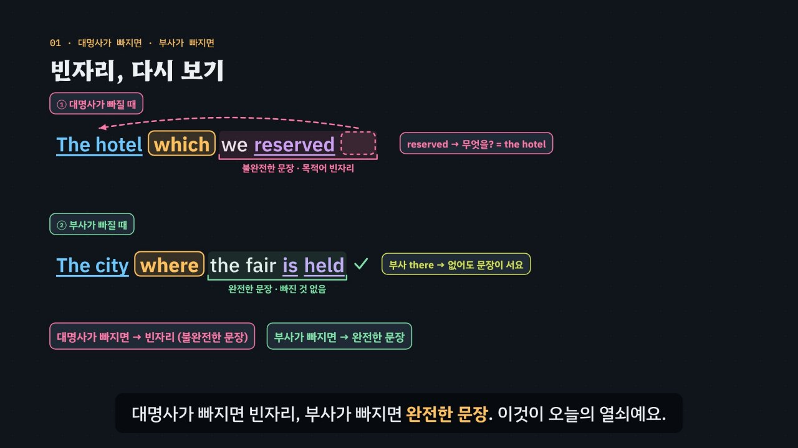

# 빈자리가 있느냐 없느냐, 그것이 문제로다

> [영어 튜토리얼](../README.md) 모음의 아홉 번째 꼭지(T09)입니다. 영역: 토익 문법 · 다루는 유형: [100개 유형](../docs/toeic-100-types.md)의 39(관계부사)·40·41·42번 · 앞 꼭지: [관계대명사, 빈자리를 찾아라](../relative-pronouns/) (T01)

토익 Part 5·6의 **관계부사**(where · when · why · how), **복합관계사**(whoever · whatever · however · wherever · whenever), **명사절**(that · what · whether · if, 의문사 명사절의 어순)을 약 6분 30초짜리 인터랙티브 모션그래픽으로 설명합니다. 관계대명사 튜토리얼(T01)의 핵심 ‘관계사절에는 빈자리가 있다’를 넓혀, 질문 하나로 모두 풉니다. **빈칸 뒤 문장에 빈자리가 있나, 없나?** 빈자리가 있으면 빠진 명사를 대신하는 말(which · who · what · whoever · whatever), 빠진 것이 없으면 부사·접속사(where · when · that · whether · however …). 이것을 **3단계 풀이법(뒤 → 앞 → 함정)** 으로 묶습니다. T01은 앞 → 뒤 → 함정이었지만, 보기에 관계대명사·관계부사·접속사가 섞이는 이번 문제들은 뒤부터 보면 보기가 반으로 줄어요.



## 바로 보기

`index.html`을 더블클릭하면 끝이에요. 설치도, 서버도 필요 없어요.

## 무엇을 배우나요

| 장 | 시각 | 내용 | 직접 해 보기 |
| --- | --- | --- | --- |
| 00 들어가며 | 0:00 | 장소 명사 + 빈칸 문제(where에 눈이 감), 오늘의 질문 하나 | 먼저 풀어 보기 (규칙 엔진이 채점) |
| 01 빈자리, 다시 보기 | 0:24 | We reserved it → which ▢(빈자리), The fair is held there → where(완전한 문장). 대명사가 빠지면 빈자리, 부사가 빠지면 완전 | 절 여섯 개: 빈자리가 있을까, 없을까 |
| 02 관계부사 where · when · why | 0:58 | 한국어 ‘예약한 호텔 · 열리는 도시’는 같은 모양, 영어는 which ↔ where로 갈림. 장소·시간·이유 카드, 장소 명사 함정(the museum which we visited) | 선행사의 뜻 고르기(화면 카드가 켜짐), 빈칸 문제 |
| 03 where = 전치사 + which | 1:28 | in which → where 움직임, 전치사 + which 표, 전치사 바로 뒤 관계부사 ×(in where), the way how × | 뜻을 고르면 화면 문장이 그 꼴로, 빈칸 문제 |
| 04 선행사를 품은 whoever | 2:02 | ___ arrives first → 주어 빈자리 + 선행사 없음 → whoever = anyone who, whatever = anything that | 빈칸 문제 둘 |
| 05 아무리 ~해도, however | 2:32 | We are busy → However busy we are(형용사가 따라 나옴), 빈칸 바로 뒤 형용사 → however, wherever · whenever + 완전한 문장, whatever + 빈자리 | 빈칸 문제 둘 |
| 06 명사절 that vs what | 3:02 | 명사절 = 주어·목적어 노릇을 하는 절. It is clear that + 완전 / What we need ▢ + 빈자리. what = the thing which(T01) | that일까 what일까 네 문장 |
| 07 whether와 if | 3:32 | 동사의 목적어 자리는 둘 다, whether만 되는 네 자리(주어 · 전치사 뒤 · or not 앞 · to부정사 앞) | if도 될까 다섯 문장, 화면의 네 자리에 if를 넣어 보기 |
| 08 의문사 명사절의 어순 | 4:06 | 한국어 ‘언제 떠나요? → 언제 떠나는지’(순서 그대로) ↔ 영어 When does the train leave? → when the train leaves. 의문사도 빈자리 규칙을 따름 | 질문을 문장 속에 넣어 보기 |
| 09 3단계 풀이법 | 4:42 | 뒤(빈자리?) → 앞(무슨 자리?) → 함정(뜻·전치사·if·어순) 흐름도 | 판별기: 뒤와 앞을 고르면 흐름도에 길이 켜지고 들어갈 말이 나옴 |
| 10 실전 문제 풀이 | 5:16 | 토익 형식 세 문제 (which · What · whether) | 문제 고르기 |
| 11 정리 | 6:12 | 빈칸의 자리 × 빈자리 있음/없음 표 | 아래 칸으로 가는 길 |

영상 아래에는 네 가지가 더 있어요.

- **놀이터 — 빈자리 탐지기**: 문장 열두 개(같은 선행사인데 빈칸 뒤만 다른 짝 포함: the restaurant which we booked ▢ / the restaurant where we had the team dinner). 빈칸 뒤 절의 낱말 사이에 세로 막대가 있어서, ① 빠진 말이 있다고 생각되는 자리를 누르거나 ‘빠진 것 없음’을 고르고, ② 빈칸 앞의 자리(명사 뒤 · 명사 자리 · 문장 밖)를 골라요. 둘 다 맞히면 ③ 후보 16개(which … if)를 규칙 엔진이 판정해 ✓ · △ · ×와 어느 단계에서 왜 탈락하는지 보여 주고, 빈자리를 선행사로 채워 본 문장(또는 부사를 붙여 본 문장)과 발음을 들려줘요. 끝낸 문장과 두 단계를 한 번에 맞힌 문장을 세요. 키보드: ← → 자리 옮기기, 0 빠진 것 없음, 1~3 빈칸 앞의 자리, ↑ ↓ 문장 바꾸기.
- **연습 문제**: 토익 Part 5 형식 16문제(정답 위치 A·B·C·D 4개씩). 힌트 = 3단계 풀이(뒤 → 앞 → 함정), 단계마다 지울 보기를 규칙 엔진이 정하고 빈칸 뒤 절 · 선행사 · 전치사에 색. 보기마다 갈래와 탈락 단계, 까닭, 해석, 발음.
- **퀴즈**: 개념 확인 10문제(그림 문제 2개: 관계사절 속 빈자리 위치 고르기, where 뒤에 올 수 있는 절 고르기).
- **핵심 정리**: 빈칸의 자리 × 빈자리 있음/없음 표, 바꿔 쓰기 표(where = in which, whoever = anyone who …), 용어 · 풀이 신호 · 함정.

### 플레이어 조작

T01·T02와 같아요. 스페이스(재생/일시정지), ← →(5초), Shift + ← →(장), C(자막), V(음성 해설), F(전체 화면). 화면 속 영어 문장을 누르면 발음을 들려줘요. 주소 끝에 `#c-장면이름`(예: `index.html#c-pw`)을 붙이면 그 장면에서 시작해요.

## 무엇이 규칙 계산인가요

- **규칙 엔진** `assets/js/grammar.js`의 `WH.judge(낱말, 상황)`이 맞고 틀림과 까닭, 탈락 단계를 정해요. 낱말 사전(`WH.LEX`)에는 낱말마다 갈래(빈자리 쪽 · 완전 쪽, that은 양쪽)와 뜻을 적어 두었고, 상황은 빈칸 뒤(`back`: 주어 빠짐 · 목적어 빠짐 · 완전, `next`: 바로 뒤 형용사 · or not · to부정사), 빈칸 앞(`front`: 명사 뒤 · 명사 자리 · 문장 밖, 선행사의 종류, 명사 자리의 역할, 전치사 · 콤마), 절의 뜻(`sense`: 사실 · 여부 · 물건 · 사람 · 장소 · 시간 · 이유 · 방법 · 누구든 · 무엇이든 …)으로 나타내요. 판정은 ① 뒤 → ② 앞 → ③ 함정 순서라서, 틀린 보기가 어느 단계에서 지워지는지도 알려 줘요. 영상 속 ✓·×, 실전 문제에서 보기가 지워지는 순서, 직접 해 보기 채점, 판별기, 빈자리 탐지기의 후보 판정, 연습 문제의 힌트와 보기별 해설, 퀴즈 대부분의 정답이 모두 이 함수에서 나와요.
- **어순** `WH.formOf(보기, 주어)`가 보기의 모양(평서문 어순 · 의문문 어순 · 동사 + 주어 · 동사 없음)을 가르고, 의문사 명사절에는 평서문 어순만 맞다고 판정해요.
- **어긋남 경고** `WH.check()`: 연습 문제 정답이 규칙 엔진과 다르거나, 정답이 둘 이상이거나, 보기에 △(시험 답이 아닌 말)가 있거나, 단서 글자(선행사 · 빈칸 뒤 절 · 전치사)가 문장에 없거나, 정답 위치가 몰리거나, 탐지기의 빈자리 표시(`gapAt`)와 `back`이 다르면 콘솔에 경고가 떠요. 실전 문제, 07장 표, 퀴즈도 규칙 엔진과 맞춰 봐요.
- **단순하게 줄인 부분**
  - 빈자리가 있는지, 빈칸이 어떤 자리인지, 절의 뜻은 엔진이 문장을 읽고 알아내는 것이 아니라 문제마다 데이터에 적어 둔 것이에요.
  - 실제 영어에서는 쓰지만 시험 답으로 고르지 않는 말은 △로 표시하고 보기에 넣지 않았어요: 관계부사 자리의 that(the day that we met), 형용사 없이 쓴 however(‘어떤 방법으로 ~하든’), ‘~하는 것’ 하나를 말하는 자리의 whatever, 목적어 자리의 who(T01과 같음).
  - however + 형용사는 형용사가 however와 함께 앞으로 나온 것으로 보고, 나머지를 완전한 문장으로 다뤄요.
  - ‘전치사 + which’는 문제마다 적어 둔 전치사와 같은지만 봐요(in · on · at · for가 명사와 어울리는지 엔진이 따지지 않아요).
  - 접속사 when · if가 이끄는 부사절(When you arrive, … / If you need help, …)은 엔진이 맞다고 판정하지만, 연결어 튜토리얼(T05)의 몫이라 whenever · whether 문제의 보기에 함께 넣지 않았어요.
  - 동격의 that(the fact that …)은 핵심 정리와 판별기에서만 짚었어요. whomever · whichever, 의문사 which(어느 것), 관계부사의 계속적 용법, 가주어 It 뒤의 whether · if는 다루지 않았어요.
- **예문과 문제**: 모두 토익 형식을 본떠 직접 만든 것이에요.

## 폴더 구조

```
index.html              페이지 (영상 · 직접 해 보기 · 놀이터 · 연습 문제 · 퀴즈 · 핵심 정리)
assets/js/grammar.js    규칙 엔진(WH.judge), 낱말 사전(WH.LEX), 판별기(WH.pathWords), 어순(WH.formOf), 연습 문제(WH.DRILL), 탐지기 문장(WH.DET)
assets/js/scenes.js     영상 장면 12개, 장 목록과 자막
assets/js/app.js        플레이어, 직접 해 보기, 놀이터(빈자리 탐지기), 퀴즈, 영상 추출(EN_EXPORT)
video/                  자막 원고(SRT)
audio/narration/        미리 만든 음성 해설 · 발음 듣기: pieces.json(조각 목록) · clips.js(window.EN_CLIPS) · 조각 id.m4a
docs/poster.jpg         사이트 카드 그림
```

## 미리 만든 목소리

음성 해설과 발음 듣기는 VoiceStudio(OmniVoice 엔진, 비상업용 라이선스)로 미리 만든 합성 음성 파일(`audio/narration/`)로 읽어요. 파일이 없거나 못 읽는 글만 브라우저 음성으로 읽어요.
- 음성 해설: 한국어 조각은 「튜토리얼 내레이터 (젊은 여성)」, 영어 조각(본보기 영어 문장)은 「영어 선생님 (밝은 미국 여성)」.
- 발음 듣기(`EN.say`): 영상 속 영어나 스피커 단추를 누르면 같은 「영어 선생님 (밝은 미국 여성)」 파일로 읽어요(천천히는 같은 파일을 0.75배로). 글은 `tools/say-sweep.js`가 영상 · 처음부터 있는 스피커 단추 · 직접 해 보기의 예문(예문 단추를 하나씩 눌러 가며)에서 모아요. 놀이터에서 조각을 골라 만든 문장, 문제를 푼 뒤에 나오는 문장처럼 조합이 많은 글은 브라우저 음성으로 읽어요.
- 합성 엔진은 가끔 무음 · 잡음을 내거나 짧은 말을 뭉개 읽어요. 도구가 이런 소리를 걸러 seed를 바꿔 다시 만들어요. 지금 파일은 받아쓰기(Whisper)와 높낮이로 모두 다시 확인했고, 너무 높게 읽은 1개(*to*)는 seed를 바꿔 다시 만들었어요. 모든 튜토리얼을 다시 살펴볼 때(2026년 11월) 받아쓰기는 맞지만 속삭이듯 · 숨소리 섞이게 읽은 소리까지 찾으려고 영어 파일마다 목소리가 울린(성대가 떨린) 비율과 숨소리가 섞인 정도(소리가 얼마나 고르게 되풀이되는지 보는 자기상관 · 켑스트럼 피크, s 소리가 긴 짧은 말은 모음 부분만)를 쟀어요. 울린 비율 하나만으로는 숨소리 섞인 소리를 실제보다 훨씬 나쁘게 재기도 해서 세 가지를 함께 보고, 속삭이듯 · 숨소리 섞이게 읽거나 아주 높게 읽은 파일 13개(*to* · *which.* · *arrives* · *does.* · *That, Whether* · *if, that* · *why.* · *What* · *where*)를 seed를 바꾸거나 읽을 글 끝에 쉼표 · 느낌표를 붙여 다시 만든 뒤 받아쓰기로 낱말을 확인했어요. 화면의 글은 그대로예요. *there, where*는 seed나 끝 문장부호를 바꿔 다시 만든 것이 더 낫지 않아 그대로 두었어요. 한 파일만 다시 만들려면 그 파일을 지우고 `--seed`를 바꿔 다시 실행하세요.

만드는 법(VoiceStudio가 있는 맥에서, 이미 만든 파일은 건너뛰어요):

```bash
node tools/narration-pieces.cjs relative-adverbs-noun-clauses     # 해설의 읽기 조각 + 발음 듣기 글 목록 (자막 · 예문을 고쳤을 때만, 클라우드에서도 됨)
python3 tools/voicestudio-narration.py relative-adverbs-noun-clauses --en-profile "영어 선생님 (밝은 미국 여성)"
```

## 영상 다시 만들기

```bash
node tools/render-video.cjs relative-adverbs-noun-clauses                    # → relative-adverbs-noun-clauses/video/relative-adverbs-noun-clauses.mp4 + .srt
node tools/render-video.cjs relative-adverbs-noun-clauses --frames 55,320    # 몇 장면만 그림으로
node tools/render-video.cjs relative-adverbs-noun-clauses --poster 55        # 카드 그림
node tools/render-video.cjs relative-adverbs-noun-clauses --srt              # 자막 원고만
```
