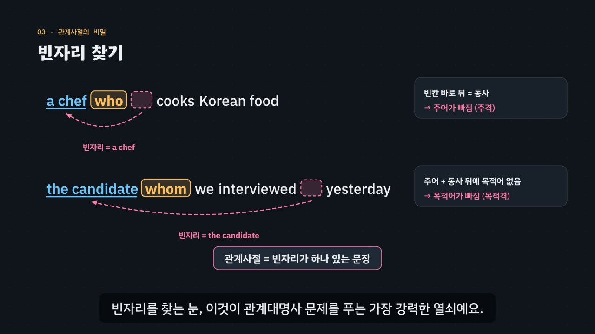

# 관계대명사, 빈자리를 찾아라

> [영어 튜토리얼](../README.md) 모음의 첫 꼭지(시범 튜토리얼)입니다. 영역: 토익 문법

토익 Part 5 단골 문법인 **관계대명사**(who, whom, which, that, whose, what)를 약 6분 30초짜리 인터랙티브 모션그래픽으로 설명합니다. 핵심 아이디어는 하나예요. **관계사절에는 빈자리가 꼭 하나 있고, 그 빈자리가 주어인지 목적어인지 소유격인지가 답을 정한다.** 이 아이디어를 토익 문제 풀이용 **3단계 풀이법(앞 → 뒤 → 함정)** 으로 묶습니다.



## 바로 보기

`index.html`을 더블클릭하면 끝이에요. 설치도, 서버도 필요 없어요. 인터넷이 없으면 글꼴만 기본 글꼴로 바뀌어요.

## 무엇을 배우나요

| 장 | 시각 | 내용 | 직접 해 보기 |
| --- | --- | --- | --- |
| 00 들어가며 | 0:00 | 토익 Part 5 문제 한 개, 오늘 배울 세 가지 | 먼저 풀어 보기 (규칙 엔진이 채점) |
| 01 꾸미는 말의 자리 | 0:24 | 한국어는 꾸밈 → 명사, 영어는 명사 ← 꾸밈. 선행사·관계사절·관계대명사 | 예문 세 개(요리사·프린터·회사), 발음 듣기 |
| 02 두 문장을 하나로 | 0:54 | She → who, 접속사 + 대명사, 절을 선행사 뒤에 붙이기, 사물은 which | 다른 두 문장 합치기 |
| 03 빈자리 찾기 | 1:30 | 대명사가 앞으로 가면 원래 자리가 빈다. 주어 빈자리 · 목적어 빈자리 | 네 구절에서 빠진 자리 고르기 |
| 04 주격 who · which | 2:06 | 빈칸 바로 뒤 동사, 동사의 수는 선행사에 맞춤 | 단수·복수 바꿔 보기 |
| 05 목적격 whom · which | 2:40 | 주어 + 동사 뒤 목적어 없음, 목적격 생략, 회화 who vs 시험 whom | 생략해 보기 |
| 06 소유격 whose | 3:14 | Its → whose, whose + 관사 없는 명사 | 사람(지원자)·사물(회사) |
| 07 선행사를 품은 what | 3:44 | what = the thing which, 앞에 명사가 있으면 what ✗ | what일까 which일까 세 문제 |
| 08 that을 못 쓰는 자리 | 4:14 | 콤마 뒤(계속적 용법), 전치사 바로 뒤 | 콤마·전치사 위치를 바꾸면 쓸 수 있는 말이 바뀜 |
| 09 3단계 풀이법 | 4:44 | 앞(선행사) → 뒤(빈자리) → 함정(콤마·전치사·수 일치) 흐름도 | 판별기: 조건을 고르면 흐름도에 길이 켜짐 |
| 10 실전 문제 풀이 | 5:18 | 토익 형식 세 문제를 3단계로 풀기 (who · which vs where · whose) | 문제 고르기 |
| 11 정리 | 6:14 | 사람/사물 × 격 표, 관계부사 예고 | 아래 칸으로 가는 길 |

영상 아래에는 네 가지가 더 있어요.

- **놀이터 — 문장 합치기 실험실**: 예문 아홉 쌍 중 하나를 고르고, who·whom·which·that·whose·what·생략을 바꿔 넣어 봐요. 콤마(계속적 용법)와 전치사 위치를 바꾸면 규칙 엔진이 맞고 틀림과 까닭, 3단계 풀이를 바로 다시 보여 줘요. 후보 일곱 개의 판정을 한 표로도 볼 수 있어요.
- **연습 문제**: 토익 Part 5 형식 16문제. 한 문제씩 풀고, 막히면 힌트(= 3단계 풀이)가 한 단계씩 열리며 문장 속 단서에 색이 칠해져요. 답하면 보기마다 맞고 틀린 까닭, 해석, 완성 문장 발음이 나와요. 틀린 문제만 다시 풀 수 있어요.
- **퀴즈**: 개념 확인 10문제(그림 문제 2개: 빈자리 위치 고르기, 선행사 고르기).
- **핵심 정리**: 한눈에 보는 표와 용어(기본 · 풀이 신호 · 함정).

### 영어 교육을 위해 더한 것 (DH 튜토리얼 형식에서 달라진 점)

- **한·영 나눠 읽는 음성 해설**: 자막 속 영어는 영어 음성으로, 한국어는 한국어 음성으로 읽어요. 한국어 음성이 영어 문장을 한국어 억양으로 읽지 않게 하려는 것이에요.
- **발음 듣기**: 화면 속 영어 문장을 누르거나, 직접 해 보기·놀이터·연습 문제의 스피커 단추를 누르면 영어 음성으로 읽어요. 같은 단추를 곧바로 한 번 더 누르면 천천히 읽어요.
- **문법 역할 색**: 선행사(하늘색 밑줄), 관계대명사(노란 상자), 빈자리(분홍 점선 상자), 관계사절(민트 밑줄), 동사·단서(보라), 함정(주황). 영상, 놀이터, 연습 문제가 같은 색을 써요.
- **움직이는 문장**: 낱말 하나하나가 id를 가진 조각이라서, She가 who로 바뀌어 앞으로 가고 그 자리에 빈자리가 남는 모습을 그대로 보여 줘요.
- **단계별 힌트 연습 문제**: 정답만 알려 주지 않고, 풀이 순서를 한 단계씩 열어 스스로 풀게 해요.

### 플레이어 조작

| 키 | 동작 |
| --- | --- |
| 스페이스 | 재생 / 일시정지 |
| ← → | 5초 뒤로 / 앞으로 |
| Shift + ← → | 이전 장 / 다음 장 |
| C | 자막 켜기 / 끄기 |
| V | 음성 해설 켜기 / 끄기 (자막을 다 읽을 때까지 영상이 기다려요) |
| F | 전체 화면 |

- 화면 속 영어 문장을 누르면 발음을 들려줘요. 빈 곳을 누르면 재생/일시정지.
- 주소 끝에 `#c-장면이름`을 붙이면 그 장면에서 시작해요. 예: `index.html#c-gap`, `index.html#c-method`
- 연습 문제 상자 안에서는 A~D(또는 1~4)로 고르고, H로 힌트, → 또는 Enter로 다음 문제.

## 무엇이 규칙 계산인가요

- **규칙 엔진** `assets/js/grammar.js`의 `RP.judge(관계사, 상황)`이 맞고 틀림과 까닭을 정해요. 상황은 선행사(사람/사물/없음), 빈자리(주어/목적어/소유격/없음), 콤마, 전치사, 장소 여부예요. 영상 속 ✓·×, 놀이터 판정, 연습 문제의 힌트와 보기별 해설, 퀴즈 일부의 정답이 모두 이 함수에서 나와요.
- **어긋남 경고**: 연습 문제에 적어 둔 정답이 규칙 엔진과 다르거나, 정답이 둘 이상이거나, 정답 위치가 한쪽에 몰리면 브라우저 콘솔에 경고가 떠요(`RP.check()`). 영상의 실전 문제 풀이와 퀴즈 정답도 같은 방식으로 확인해요.
- **단순하게 줄인 부분**: 토익처럼 격식 있는 문어체를 기준으로 판정해요. 실제 영어에서는 목적어 자리에 who를 흔히 쓰고(규칙 엔진은 ‘△ 회화에서만’으로 표시), 계속적 용법과 제한적 용법은 뜻이 달라지지만 놀이터는 문법 형태만 판정해요. 관계부사는 where만 구별하고, 자세한 내용은 다음 튜토리얼 몫으로 남겨 두었어요.
- **예문과 문제**: 모두 토익 형식을 본떠 직접 만든 것이에요. 실제 시험 문제가 아니에요.

## 폴더 구조

```
index.html              페이지 (영상 플레이어 · 직접 해 보기 · 놀이터 · 연습 문제 · 퀴즈 · 핵심 정리)
assets/js/grammar.js    규칙 엔진(RP.judge), 3단계 풀이 문장, 두 문장 합치기 예문(RP.PAIRS), 연습 문제(RP.DRILL)
assets/js/scenes.js     영상 장면 12개, 장 목록과 자막, 낱말 조각 배치·움직임
assets/js/app.js        플레이어, 직접 해 보기, 놀이터, 퀴즈, 영상 추출(EN_EXPORT)
video/                  자막 원고(SRT)
audio/narration/        미리 만든 음성 해설 · 발음 듣기: pieces.json(조각 목록) · clips.js(window.EN_CLIPS) · 조각 id.m4a
docs/poster.jpg         사이트 카드 그림
```

음성 해설·발음 듣기·연습 문제·퀴즈 화면은 사이트 공통 부품(`../shared/`)을 씁니다.

## 미리 만든 목소리

음성 해설과 발음 듣기는 VoiceStudio(OmniVoice 엔진, 비상업용 라이선스)로 미리 만든 합성 음성 파일(`audio/narration/`)로 읽어요. 파일이 없거나 못 읽는 글만 브라우저 음성으로 읽어요.
- 음성 해설: 한국어 조각은 「튜토리얼 내레이터 (젊은 여성)」, 영어 조각(본보기 영어 문장)은 「영어 선생님 (밝은 미국 여성)」.
- 발음 듣기(`EN.say`): 영상 속 영어나 스피커 단추를 누르면 같은 「영어 선생님 (밝은 미국 여성)」 파일로 읽어요(천천히는 같은 파일을 0.75배로). 글은 `tools/say-sweep.js`가 영상 · 처음부터 있는 스피커 단추 · 직접 해 보기의 예문(예문 단추를 하나씩 눌러 가며)에서 모아요. 놀이터에서 조각을 골라 만든 문장, 문제를 푼 뒤에 나오는 문장처럼 조합이 많은 글은 브라우저 음성으로 읽어요.
- 합성 엔진은 가끔 무음 · 잡음을 내거나 짧은 말을 뭉개 읽어요. 도구가 이런 소리를 걸러 seed를 바꿔 다시 만들어요. 지금 파일은 받아쓰기(Whisper)와 높낮이로 모두 다시 확인했고, 짧은 낱말을 너무 높게 읽거나 끝소리가 흐린 3개(*who · him · résumés*)는 seed를 바꿔 다시 만들었어요(*who*는 어느 seed나 조금 올려 읽어서 가장 낮은 것을 골랐어요). 한 파일만 다시 만들려면 그 파일을 지우고 `--seed`를 바꿔 다시 실행하세요.

만드는 법(VoiceStudio가 있는 맥에서, 이미 만든 파일은 건너뛰어요):

```bash
node tools/narration-pieces.cjs relative-pronouns     # 해설의 읽기 조각 + 발음 듣기 글 목록 (자막 · 예문을 고쳤을 때만, 클라우드에서도 됨)
python3 tools/voicestudio-narration.py relative-pronouns --en-profile "영어 선생님 (밝은 미국 여성)"
```

## 영상 다시 만들기

장면을 고쳤다면 저장소 루트에서 공통 렌더러로 다시 뽑아요(Node.js, ffmpeg, Playwright 필요).

```bash
node tools/render-video.cjs relative-pronouns                     # → relative-pronouns/video/relative-pronouns.mp4 + .srt
node tools/render-video.cjs relative-pronouns --frames 61,124     # 몇 장면만 그림으로 → frames/relative-pronouns/
node tools/render-video.cjs relative-pronouns --poster 123        # 카드 그림 → relative-pronouns/docs/poster.jpg
node tools/render-video.cjs relative-pronouns --srt               # 자막 원고만
```

MP4는 저장소에 넣지 않아요. 방문자는 인터랙티브 페이지로 보게 하려는 것이에요.
