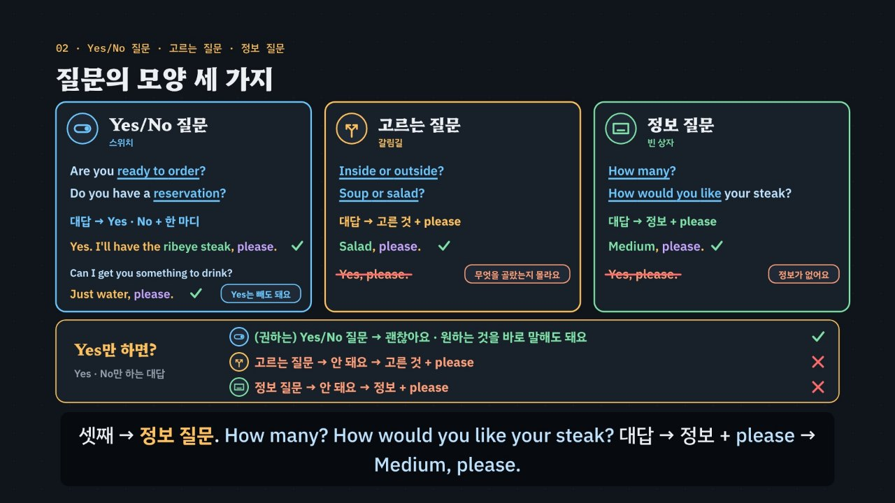

# 식당, 질문의 모양이 대답을 정한다

> [영어 튜토리얼](../README.md) 모음의 **상황별 영어 회화** 네 번째 꼭지입니다(영역: `talk`). 형식은 [공항](../airport/) · [카페](../cafe/) · [호텔](../hotel/)을 따르고, 형식의 결정은 [CLAUDE.md](../CLAUDE.md)의 ‘회화 튜토리얼이 갖출 것’에 적었어요.

식당에서는 서버가 짧은 질문을 아주 많이 해요. 물, 음료, 주문, 굽기, 곁들임, 알레르기, 디저트, 계산까지요. 그런데 질문에는 **모양**이 있어요. **Yes/No 질문**(*Are you ready to order? · Do you have a reservation?*)은 Yes · No에 한 마디를 더해요 — 권하는 말이면 원하는 것을 바로 말해도 돼요(*Can I get you something to drink? → Just water, please.*). **고르는 질문**(*Still or sparkling? · Soup or salad? · Together or separate?*)은 고른 것 + please, **정보 질문**(*How many? · How would you like your steak? · Which dressing?*)은 정보 + please예요. 한국 학생이 가장 자주 막히는 곳이 여기예요 — *Still or sparkling?*에 **Yes.** 라고 하면 무엇을 골랐는지 알 수 없어요. 이 비대칭이 이 튜토리얼의 중심이에요: 권하는 Yes/No 질문에는 그것을 바로 말해도 되지만, 고르는 질문 · 정보 질문에는 Yes로 답할 수 없어요. 여기에 한국어를 그대로 옮긴 말(사이다 → *cider* · 계산해 주세요 → *Calculate* · 더치페이 → *Dutch pay* · 땅콩 있어요 → *I have peanut.* · 여기요 → *Here!*)과 빠르게 지나가는 숫자(*fifteen* · *fifty* · *twenty-eight fifty each*)를 더했어요. 약 6분 34초짜리 인터랙티브 모션그래픽으로 **3단계 말하기 법**을 가르쳐요.

- ① **열쇠 낱말 + 질문의 모양 잡기** — 무엇을 묻나, 그리고 어떤 모양인가? *or*가 들리면 고르는 질문, *how · which · what*으로 시작하면 정보 질문, *Are you · Do you · Would you · Can I get you*면 Yes/No 질문. 질문이 아닌 안내(*Here's your grilled salmon. · Enjoy your meal!*)는 고맙다고 하거나 내가 먼저 말할 차례예요. 모양마다 그림 표시가 있어요: 스위치(Yes/No) · 갈림길(고르기) · 빈 상자(정보) · 말풍선(안내).
- ② **틀에 내 정보 넣기** — 짧은 대답 틀 + 식사 카드와 맞는 정보. *Two, please. · Sparkling, please. · Medium-rare, please. · I'll have the ___, please. · I'm allergic to ___.* 주문은 한 줄로(음식 → 굽기 → with 곁들임 → 드레싱 → please) 말하면 서버가 나머지 질문을 건너뛰어요.
- ③ **공손하게 끝내기** — *please · thank you · Could I …? · Could we …?*, 서버를 부를 때는 *Excuse me.* 못 알아들었으면 *Sorry? Could you say that again, please?* 일부만 들렸으면 *Sorry, still or sparkling?* 숫자가 헷갈리면 *Sorry, did you say fifteen minutes?*



## 바로 보기

`index.html`을 더블클릭하면 끝이에요. 설치도, 서버도 필요 없어요.

## 소리와 마이크에 대해 (꼭 읽어 주세요)

- 녹음 파일이 없어요. 영어는 모두 **브라우저에 들어 있는 음성(speechSynthesis)** 으로 읽어요. 기기마다 목소리가 다르고 실제 식당의 소리와도 달라요.
- 튜토리얼 전용 목소리 부품 `assets/js/voices.js`(`RSV`)가 입구 호스트(en-AU) · 서버(en-US) · 음식을 나르는 직원(en-CA) · 영국 식당의 서버(en-GB) · 손님(나, 서버와 다른 목소리)을 골라요. 없으면 다른 영어 목소리의 높낮이 · 빠르기를 바꿔 구별해요. ‘아주 빠르게’ 문제는 일부러 빠르게(1.35배) 읽어요. 값은 식당식으로 읽어요(`RS.spoken`): *$28.50* → twenty-eight fifty, *$26.00* → twenty-six dollars. 공통 부품(`shared/`)은 바꾸지 않았어요.
- 소리가 겹치지 않게: 대화를 읽기 전에 발음 듣기 · 음성 해설 · 녹음 재생을 멈추고 영상을 일시정지해요. 음성 인식을 시작할 때도 다른 소리를 모두 멈춰요.
- **따라 말하기 · 말로 대답하기**: 브라우저에 음성 인식(`SpeechRecognition` · `webkitSpeechRecognition`)이 있으면 말을 글로 바꿔 **낱말만** 맞춰 봐요(발음의 질은 판정하지 않아요). 숫자는 *15*든 *fifteen*이든, 값은 *23.40*이든 *twenty-three forty*든 같은 숫자로 맞춰요(`RS.canon`). 크롬(Chrome) 같은 브라우저는 소리를 브라우저 회사의 서버로 보내 글로 바꿔요. 음성 인식이 없으면 녹음(`MediaRecorder`)으로 ‘내 목소리’와 ‘원래 문장’을 이어서 들어요. 둘 다 없으면 마이크 단추를 숨기고 ‘세 번 소리 내어 따라 해 보세요’라고 안내해요. 이 사이트는 소리도 글도 저장하지 않아요(녹음은 화면에만 잠깐 있다가 페이지를 닫으면 사라져요). 이름(*Park* 같은)은 인식이 다르게 적기 쉬워서 들린 말이 있으면 받아들이고 알림만 붙여요. 다만 카드와 다른 이름이 또렷이 들리면 ②에서 걸려요.
- 식당 이름(*Juniper Table*) · 서버 이름(*Sam*) · 메뉴 · 재료 · 값 · 계산서는 모두 지어낸 것이에요(실제 식당 · 체인과 상관없어요). 계산서에는 세금 · 봉사료를 넣지 않았어요(나라마다 달라요). 자리 안내를 기다리는지, 물이 무료인지(*tap water*), 테이블에서 계산하는지, 나눠 내는 법(똑같이 나누기 · 각자 먹은 것), 팁(*tip*)은 나라와 식당마다 달라요. 팁은 ‘나라마다 달라요’만 보여 주고 몇 퍼센트를 내라는 규칙은 넣지 않았어요.
- **알레르기**: 알레르기가 있으면 메뉴 표시만 믿지 말고 직원에게 직접 말해요. 이 튜토리얼은 말하기 연습이고 의학적인 조언이 아니에요. 메뉴의 재료와 ‘뺄 수 있다 · 없다’는 말하기 연습을 위해 지어낸 것이에요.

## 무엇을 배우나요

| 장 | 시각 | 내용 | 직접 해 보기 |
| --- | --- | --- | --- |
| 00 들어가며 | 0:00 | *Still or sparkling?* → 그냥 *Yes.* → 서버가 다시 물음(…*Sorry — still or sparkling?*) → *Sparkling, please.*, 질문의 모양이 대답의 모양을 정한다, 모양 셋과 3단계 | 먼저 골라서 대답해 보기 (영국 식당, 듣고 대답 고르기) |
| 01 식당 길 지도 | 0:26 | 식당 평면도(입구 · 호스트 · 테이블 · 주방 · 바깥 자리 · 점선 계산대)의 일곱 곳을 식사하는 차례대로, 곳마다 한두 마디, 서버가 묻는 곳과 내가 먼저 말하기도 하는 곳, 자리 안내 · 테이블에서 계산은 식당 · 나라마다 달라요 | 곳을 골라 한두 마디 듣기 (평면도의 곳을 눌러도 됨) |
| 02 질문의 모양 세 가지 | 0:56 | Yes/No 질문(스위치) · 고르는 질문(갈림길) · 정보 질문(빈 상자), 대답의 모양, 권하는 말은 원하는 것을 바로(*Just water, please.*), 고르는 질문에 *Yes, please.* ×, 끝을 내리는 고르는 질문과 끝을 올리면 Yes/No 질문이 되기도 함, Yes만 하면? 표 | 질문의 모양 맞히기 + *Yes, please.*로 대답하면? |
| 03 입구와 자리 | 1:32 | *Do you have a reservation?* → *Yes, under Park.* · *No, we don't.*, *How many?* → *Two, please.*(*We are two.* · *two person*은 통하지만 알림), *fifteen-minute wait*과 fifteen · fifty 센 곳, *Sorry, did you say fifteen minutes?*, *Inside or outside?* → *Yes, please.* × → *Outside, please.* | 몇 명인지 말하기 (일행 · 틀 · 칸) + 기다리는 시간 되묻기 |
| 04 음료와 주문 | 2:04 | *Can I get you something to drink?* → *Just water, please.*, *Still or sparkling?*(still · sparkling · tap water), 사이다 → *cider* × → *a lemon-lime soda*, *Are you ready to order?* → *Yes. I'll have the ribeye steak, please.* · *Could we have a few more minutes?*, 굽기 띠(rare … well-done), *Give me the menu.* · *I want ribeye steak.* × | 스테이크 굽기 말하기 (굽기 · 틀 · 칸, *Middle* 함정) |
| 05 알레르기와 요청 | 2:40 | *I'm allergic to peanuts.* · *I have a peanut allergy.*, *I have peanut.* ×, *Does the house salad have nuts in it?* → 서버의 계산된 대답(뺄 수 있음 · 없음), *Yes, without the walnuts, please.*, *Not too spicy, please.* · *Italian on the side, please.*, 알레르기 안전 한 줄 | 알레르기 말하고 확인하기 (알레르기 · 음식 · 틀 → `RS.safe`의 대답) |
| 06 식사 중 | 3:14 | *Excuse me.*(눈 맞추기 · 손 살짝) vs *Hey! · Waiter! · Here!* ×, *How is everything?* → *Yes.* × → *Great, thank you.*, *Could I get some more water?* · *Could we get an extra plate?*, 다른 음식이 나옴 → *This is wrong!* × → *Excuse me, this isn't what I ordered. I ordered the ribeye steak.* | 서버 부르고 부탁하기 (필요한 것 · 부르는 말 · 부탁) |
| 07 디저트와 계산 | 3:48 | *Are you still working on that?* → *No, I'm done. Could I get a box for this?*(*take out*은 통함), *Can I interest you in some dessert?* → *No, thanks. Just the check, please.*(영국 *the bill*), *Calculate* ×, *Together or separate?* → *Dutch pay* × → *Separate, please.* · *Could you split it evenly?*, 나눈 값(*That's $28.50 each.*), *Card, please.*, 팁은 나라마다 달라요 | 계산서 나눠 보기 (일행 · 함께 · 나눠 · 디저트 → 계산서 · 서버의 말) |
| 08 한 번에 주문하기 | 4:22 | 짧게 주문 → 네 번 주고받기, 한 줄 주문(음식 → 굽기 → with 곁들임 → 드레싱 → please)과 서버가 건너뛰는 질문, 알레르기도 한 줄 끝에, 순서가 뒤섞이면, 4 → 1 | 한 줄 주문 만들기 (누르는 차례대로, 순서 판정과 건너뛸 질문) |
| 09 3단계 말하기 법 | 4:54 | 상자 셋, 일곱 곳에 한 줄씩 모양 표시와 함께 단계별로 채워짐 | 곳을 골라 3단계 보기 |
| 10 실전 식사 | 5:22 | 식사 카드 하나로 넷(자리 · 굽기 · 다른 음식 · 나눠 내기), 보기마다 엔진이 ①②③ 몇 단계에서 지우는지 | 대화 골라 보기 |
| 11 정리 | 6:12 | 곳 · 열쇠 낱말과 모양 · 대답 틀 표 + 한 줄 주문 + 못 알아들었을 때 | 아래 칸으로 가는 길 |

영상 아래에는 다섯 가지가 더 있어요.

- **놀이터 — 식당 시뮬레이터**: 누를 때마다 새 식사 카드(예약 · 이름 · 일행 · 안쪽이나 바깥 자리 · 물과 음료 · 주문(굽기 · 수프나 샐러드 · 드레싱 · 맵기) · 알레르기 · 식사 중 부탁 하나나 둘 · 남은 음식 · 디저트 · 함께 또는 나눠 내기 · 카드나 현금)와 함께 온 사람의 주문이 만들어지고, 옆에 **메뉴판**(값과 알레르기 표시)이 나와요. 카드의 음식은 알레르기 성분이 없거나 뺄 수 있는 것만 골라요. 차례: 입구(예약 → 이름, 또는 몇 명 → 기다리는 시간 → 안쪽 · 바깥) → 자리 · 음료(물 → 다른 음료) → 주문(오늘의 스페셜을 말하는 날도 있어요 → **한 줄 주문**(L)으로 굽기 · 곁들임 · 드레싱 · 알레르기까지 말하면 서버가 건너뜀) → 알레르기(성분이 들어 있으면 서버가 `RS.safe`로 계산한 대답 → 빼고 만들기) → 식사 중(나온 음식이 맞을 때도, 다를 때도 있어요 — **나온 음식을 듣고** 내가 시킨 것인지 판단 → 맛 묻기 → 서버 부르기: 부르는 말 칩 + 부탁 칩. 부탁이 둘이면 어느 쪽을 먼저 말해도 되고 서버가 남은 쪽을 *Anything else?*로 물어요) → 디저트 · 포장(다 먹었나 → 디저트, *Just the check*까지 말하면 계산 부탁을 건너뜀) → 계산(함께 · 나눠 → 계산서의 값 → 카드 · 현금). 대답은 ① 대답 틀 칩(맞는 틀 하나 · 함정 하나(Yes만 · 한국어 그대로 · 콩글리시 · 무례한 말) · 다른 질문의 틀 하나)과 ② 칸 칩(카드의 값 + 헷갈리기 쉬운 값, 예: *fifteen* · *fifty*)으로 만들어요. 엔진이 ①에서 걸리면 서버가 질문만 다시 말하고(*Sorry — inside or outside?*), ②에서 걸리면 *Hmm, are you sure?*(카드와 다름) · *Cider? Just so you know, our cider is an apple drink with alcohol in it.* · *Sorry, Dutch…?* 같은 반응, ③이면 *… Okay.*나 놀란 서버. 매번 단계와 까닭, 모범 대답(듣기)을 보여 줘요. 음성 인식이 있으면 마이크로 말해서 대답할 수 있어요. 끝나면 계산서(나눠 내면 한 사람 몫), 한 번에 통과한 수, 한 번에 말해서 건너뛴 질문 수, 저녁 식사의 대화 전체와 듣기. 키보드: R 듣기 · S 천천히 · T 대본 · 1~4 대답 틀 · A~C 내 정보 · 5~7 부탁(서버 부르기) · Enter 대답하기 · Backspace 지우기 · L 한 줄 주문 · M 말로 대답하기 · N 새 카드.
- **식당 표현 따라 말하기**: 곳마다 서버의 말과 내 말 28문장. 듣기 · 천천히 · 따라 말하기(음성 인식 → 녹음 → 소리 내어 따라 하기). 인식 결과는 원래 문장의 낱말마다 초록(들림) · 주황(빠짐)으로 보여 줘요.
- **듣고 대답 고르기**(튜토리얼 전용 `RDrill`, `EN.drill`과 같은 모양 · 키보드): 16문제, 일곱 곳 + 빠른 말 둘, 정답 위치 A · B · C · D 넷씩, 고르는 · 정보 질문에 Yes 함정이 있는 문제 여섯. 문제마다 곳 아이콘과 한 줄 상황, 서버의 말은 소리 먼저(글은 답한 뒤 또는 대본 보기), 대답 넷은 글. 힌트 = 3단계 — ① 열쇠 낱말과 질문의 모양(서버의 말 옆에 모양 표시) ② 틀 · 칸(함정은 주황) ③ 공손한 말(보라)과 정답. 답하면 보기마다 엔진의 까닭, 해석, 줄마다 듣기, 대화 듣기(서버 → 나). 키보드: A~D(1~4) 고르기 · H 힌트 · R 다시 듣기 · S 천천히 · T 대본 · Enter/→ 다음.
- **퀴즈**: 10문제(그림 문제 4개: 질문의 모양 표시 고르기, 굽기 띠에서 medium 누르기, 메뉴판에서 땅콩이 든 음식 누르기, 계산서에서 한 사람 몫 줄 누르기).
- **핵심 정리**: 곳 × 열쇠 낱말 · 모양 × 대답 틀 표, 용어(① 질문의 모양 셋과 안내 · ② 대답 틀 · 한 줄 주문 · 굽기 · 숫자와 값 · 사실 + 내가 시킨 것 · ③ 공손한 말 · 서버 부르기 · 다시 묻기 · ④ 한국어와 다른 점 · 콩글리시).

### 플레이어 조작

다른 튜토리얼과 같아요. 스페이스(재생/일시정지), ← →(5초), Shift + ← →(장), C(자막), V(음성 해설), F(전체 화면). 화면 속 말풍선을 누르면 그 사람의 목소리로, 영어 칩을 누르면 발음을 들려줘요. 01장 평면도의 곳을 누르면 직접 해 보기와 함께 바뀌어요. 주소 끝에 `#c-장면이름`(예: `index.html#c-shapes`)을 붙이면 그 장면에서 시작해요.

음성 해설은 자막의 `(A)`~`(D)`를 ‘에이 · 비 · 씨 · 디’, 값(`$28.50`)을 ‘28달러 50센트’처럼 한국어로 읽고(앞의 영어와 붙어 읽히지 않게 끊어서), `Yes/No`는 *Yes or No*로 읽어요.

## 무엇이 규칙 계산인가요

- **규칙 엔진** `assets/js/grammar.js`가 맞고 틀림과 까닭, 3단계 가운데 몇 단계에서 걸리는지를 정해요. 영상 속 ✓·×와 실전 식사에서 지워지는 순서, 질문의 모양, 한 줄 주문의 순서 판정과 건너뛰는 질문, 알레르기 확인과 서버의 대답, 직접 해 보기 채점, 시뮬레이터의 판정과 서버의 반응, 듣고 대답 고르기의 힌트와 보기별 해설, 퀴즈 대부분의 정답, 그리고 모든 값(메뉴판 · 계산서 · 한 사람 몫 · 서버가 말하는 값)이 여기서 나와요.
  - 서버의 말(`RS.Q`)마다 곳 · 뜻(`intent`) · **모양**(`shape`: `yn` · `or` · `wh` · `note`, 고르는 질문은 고를 것 `choices`) · 열쇠 낱말(`key`, 말 안에 꼭 있음) · 빠른 말(`fast`) · 알려 준 사실(`fact`: 기다리는 분 · 값 · 나온 음식) · 대답 대신 해도 되는 다시 묻기(`allow`: *what's sparkling water?*)를 적었어요. `RS.shapeOf`가 모양을 돌려주고, `RS.shapeGuess`(마지막 물음 문장 → *or*가 있으면 고르기, 의문사로 시작하면 정보, 나머지는 Yes/No, 물음표가 없으면 안내)가 글과 맞는지 점검해요.
  - 대답은 틀(`RS.FRAME`) + 칸 값(`RS.SLOT`)이에요. 틀 글의 `___`은 내 정보 칸, `{…}`는 공손한 말이고, 틀마다 표시가 있어요: ok · literal(한국어를 그대로 옮김 · 콩글리시) · wrong(틀린 문장) · blunt(명령 · 조르기 · 따지기 · 큰 소리로 부르기) · plain(그냥 *No.*로 끊김). **Yes · No만 하는 대답**은 `bare` 틀(*Yes. · Yes, please. · No, thanks.*)이에요. 칸 값도 콩글리시일 수 있어요(*cider* · *middle* → `bad`). 기다리는 분 · 값은 정해져 있지 않은 칸(`dyn`)이에요. 서버를 부르는 대답은 부르는 말 + 부탁(`req`) 두 조각이에요.
  - `RS.judge(말, 대답, 카드)` — ① 빠른 말이면 다시 묻는 말만 통과(들린 만큼 되묻는 말은 실제 질문과 같을 때만), **Yes · No만 하는 대답은 고르는 질문 · 정보 질문 · 안내에서 탈락**, 고르는 질문에서 서버가 말하지 않은 것을 고르면 탈락(*Soup or salad? → Fries*), 다른 질문의 대답이면 탈락 ② 틀이 literal · wrong이거나 칸 값이 콩글리시면 탈락, Yes/No 질문에 Yes · No만 했으면 카드가 바라는 쪽인지(`yn.yes`) 보고 알레르기에는 Yes.만으로 모자라 탈락(`strict`), 한 줄 주문은 `RS.orderLine`으로 순서와 메뉴(굽기는 스테이크 · 맵기는 국수 · 곁들임은 스테이크 · 연어 · 파스타), 칸의 정보가 카드(또는 상황)와 다르면 탈락(되묻는 말은 서버가 말한 숫자와, 다른 음식이 나왔을 때 나온 음식 이름을 말하면 탈락) ③ blunt · plain이면(붙인 부탁이 *Give me* 여도, 한 줄 주문을 *Give me · I want*로 해도) 탈락. `RS.model`은 카드에 맞는 모범 대답(주문은 한 줄, 서버 부르기는 *Excuse me.* + 부탁), `RS.steps`는 힌트 세 단계와 색칠할 낱말을 만들어요.
  - `RS.orderLine(줄)` · `RS.covered(대답, 말)` — 한 줄 주문의 순서(주문 틀 → 음식 → 굽기 · 맵기 → with 곁들임 → 드레싱 → without → please, 알레르기 문장은 맨 앞이나 맨 끝)를 확인하고, 그 대답이 이미 답한 질문(굽기 · 수프나 샐러드 · 드레싱 · 맵기 · 알레르기 · 빼고 만들기)을 돌려줘요. 시뮬레이터는 같은 곳 안에서만 건너뛰는데, 대화 전체에서 한 번만 나오는 질문(알레르기 · 빼고 만들기 · 계산 부탁, `RS.CROSS`)은 다른 곳에서 미리 답했어도 건너뛰어요(주문에서 알레르기를 말했거나, 디저트를 거절하며 *Just the check*까지 말했을 때).
  - `RS.MENU` · `RS.bill` · `RS.split` · `RS.safe` · `RS.safeReply` — 지어낸 메뉴(값 · 알레르기 성분과 뺄 수 있나), 계산서(세금 · 봉사료 없이), 똑같이 나눈 한 사람 몫, 알레르기 확인(들어 있나 · 뺄 수 있나)과 서버의 대답(*we can make it without them* · *can't be left out*). 영상의 메뉴판 · 계산서 · *That's $28.50 each.* · 시뮬레이터의 메뉴판과 계산서가 모두 같은 계산이에요.
  - `RS.matchSpoken(들린 글, 말, 카드)` — 음성 인식이 글로 바꾼 말에 그 말의 표시 낱말과 카드의 사실이 들어 있으면 받아들여요. **모양 규칙도 같아요**: 고르는 질문 · 정보 질문에 *yes* · *no*만 들리면 ①, *yes, sparkling*은 통과(‘Yes 없이 말해도 돼요’ 알림). 숫자 낱말은 숫자 줄로 모아(`RS.canon`: *fifteen* → 15, *twenty-three forty* → 2340) 기다리는 시간 · 값 · 사람 수를 맞춰요. 다른 이름 · 다른 숫자(*fifty*) · 다른 음식 · 카드에 없는 부탁 · *cider* · *Dutch pay* · *calculate* · *I have peanut* · *packing* · *middle*은 ②, 다른 질문의 대답만 들리면 ①. 브랜드 이름(*Sprite*)은 레몬 라임 탄산음료로 받아들이고 ‘일반 이름으로’ 알림을 붙여요. *Hey! · Give me* 같은 꼴은 알림만 붙여요(말투는 판정하지 않아요).
  - `RS.compareWords(원래 문장, 들린 글)` — 낱말마다 맞춤(가장 긴 공통 부분열, 숫자는 같은 숫자로).
- **어긋남 경고** `RS.check()`: 열쇠 낱말이 말에 없거나, 적어 둔 모양이 글의 모양과 다르거나, 고르는 질문에 고를 것이 없거나, 사전에 없는 뜻 · 칸을 쓰거나, 함정 틀에 까닭이 없거나, 맞는 보기가 하나가 아니거나 정답과 다르거나, 정답 위치가 4/4/4/4가 아니거나, 곳 · 빠른 말 · Yes 함정 문제가 모자라면 콘솔에 경고가 떠요. 값 · 시각 읽기와 숫자 맞추기(*twenty-three forty* · *$23.40* · *seven thirty*), 알레르기 확인, 영상 · 직접 해 보기의 대화, 한 줄 주문과 건너뛰는 질문, 데모 계산서($57.00 · 한 사람 $28.50), 실전 식사에서 단계마다 지워지는 보기와 화면 글, 시뮬레이터 카드 50장(모범 대답이 통과하는지, 말로 해도 통과하는지, 틀 칩 가운데 맞는 것이 하나뿐인지, 나눠 낸 값이 센트로 나뉘는지, 알레르기에 안전한 음식인지, 매번 바뀌는 서버의 말도 모양과 열쇠 낱말이 맞는지), 말로 한 대답 수십 가지(고르는 · 정보 질문마다 *yes* · *yes please* · *yeah sure*, 다른 이름 · *fifty* · *cider* · *Dutch pay* · *calculate* · *I have peanut* · *middle* · 다른 값 · 다른 음식 · 카드에 없는 부탁 …)와 브랜드 이름 · 두 부탁을 거꾸로 말한 경우, 따라 말하기 문장(숫자를 낱말로 말해도 맞는지)도 점검하고, 퀴즈 정답은 `app.js`에서 따로 점검해요.
- **단순하게 줄인 부분과 엄격함의 기준** (서버가 틀리다 · 헷갈린다 · 무례하다고 느낄 말만 거르고, 알아듣지만 더 흔한 말이 있으면 통과 + 알림)
  - 엔진은 소리를 듣지 않아요. 말의 뜻 · 모양 · 열쇠 낱말, 대답의 틀과 칸은 사람이 적어 두었고, 엔진은 그것을 카드의 사실과 맞춰요. 대답 틀은 식당에서 자주 쓰는 것만 골랐어요. 같은 뜻의 다른 자연스러운 대답도 많아요.
  - **질문의 모양 (①)**: 고르는 질문(*Still or sparkling? · Inside or outside? · Soup or salad? · Mild or spicy? · Together or separate? · Card or cash?*)과 정보 질문(*How many? · Under what name? · How would you like your steak cooked? · Which dressing? · How is everything? · How can I help?*)에 *Yes.* · *Yes, please.* · *Yes, it is.*만 하면 ①. 권하는 Yes/No 질문(*Can I get you something to drink? · Can I interest you in some dessert?*)에는 원하는 것만 말해도 통과하고 ‘Yes는 빼도 돼요’를 붙여요. 같은 낱말도 끝을 올리면 Yes/No 질문이 되기도 한다는 것은 영상(02장)과 용어에 한 줄로만 밝혔고, 엔진은 서버가 고르라고 묻는 경우(끝을 내림)만 다뤄요.
  - **Yes/No 질문에 Yes · No만 하기 (②)**: 카드가 바라는 쪽이면 통과(*Do you have a reservation? → Yes.* · *Is that okay? → Yes.*), 반대면 ②. 권하는 말에 *Yes, please.*만 하면 통과하지만 ‘무엇인지까지 말하면 다시 묻지 않아요’를 붙여요. **알레르기에 Yes.만 하면 ②**(안전과 관계있어 무엇에 알레르기가 있는지 꼭 말해야 해서), 남은 음식을 싸 갈 카드인데 *Are you still working on that?*에 그냥 *No.*면 ②(접시를 치울 수 있어서).
  - **콩글리시 · 한국어 그대로 (②)**: *cider*(사과 음료 · 영국은 술) · *Calculate, please.* · *Can I calculate?* · *Card calculate, please.* · *Dutch pay* · *I have peanut.*(= 땅콩을 갖고 있다) · *Packing* · *Middle*(굽기) · *Is the house salad have nuts?*(틀린 문장). **통과 + 알림**: *We are two.* · *Two person.* · *No. Take out, please.*(남은 음식) · *tap water* · *the bill*(영국) · *Not too spicy, please.* · *on the side* · 브랜드 이름(말로 했을 때).
  - **공손함 (③)**: *Hey! · Waiter! · Here!*(여기요 그대로) · *Give me … · I want … · Wait. · Too long. Hurry up. · This is wrong! · I didn't order this. Take it back. · What?* 과 그냥 *No.*(음료를 거절할 때)는 ③. 실제로는 말투 · 표정 · 몸짓으로도 공손함이 전해지고, 서버를 부르는 방식은 나라마다 달라요(박수 · 큰 소리는 많은 곳에서 무례해요). 말로 한 대답은 말투를 판정하지 않고 알림만 붙여요.
  - 한 줄 주문의 순서와 메뉴마다 붙는 것(굽기 · 맵기 · 곁들임)은 자주 쓰는 경우를 단순하게 줄인 규칙이에요. 나눠 내기는 이렇게 구별해요: *Separate, please.*(*Could we pay separately?*)는 ‘따로 계산’ — 보통 각자 먹은 것만 내요. 똑같이 나누려면 *Could you split it evenly, please?*라고 하거나, 서버가 *Would you like me to split it evenly?*로 물으면 *Yes, please.* 시뮬레이터 카드의 ‘나눠 내기’는 늘 ‘똑같이 나누기’라서, *Separate, please.* 다음에 서버가 똑같이 나눌지 묻고(*Could you split it evenly?*까지 말했으면 건너뜀) 한 사람 몫을 말해요. 각자 먹은 것만 따로 계산하는 경우는 다루지 않았어요.
  - 시뮬레이터의 서버는 늘 같은 차례에 작은 변화만 주게 만들었어요(기다리는 시간 · 스페셜 · 나온 음식). 실제 식당에서는 차례가 바뀌거나 묻지 않고 넘어가기도 해요. 서버가 다른 음식을 바로 바꿔 줘요.
  - 말로 대답하기와 따라 말하기는 낱말만 맞춰요. 발음과 공손함은 판정하지 않고, 음성 인식이 숫자 · 이름을 다르게 적을 수도 있어요.
  - 사람 · 평면도 · 접시 위 음식 · 물잔은 도형으로 그린 그림이에요. 이어서 들리는 소리 상자(*fif · TEEN · min · it · WAIT*)는 대략의 모양이에요.
- **예문과 대화**: 모두 직접 만든 것이에요.

이웃 튜토리얼: 같은 형식의 [공항](../airport/) · [카페](../cafe/) · [호텔](../hotel/). 선택 의문문과 Yes · No는 토익 듣기 [T15](../listening-part1-2/)에서도 다뤄요.

## 폴더 구조

```
index.html              페이지 (영상 · 직접 해 보기 · 식당 시뮬레이터 · 따라 말하기 · 듣고 대답 고르기 · 퀴즈 · 핵심 정리)
assets/js/grammar.js    규칙 엔진(RS.judge · RS.model · RS.shapeOf · RS.shapeGuess · RS.orderLine · RS.covered · RS.matchSpoken · RS.compareWords · RS.canon),
                        메뉴와 계산(RS.MENU · RS.bill · RS.split · RS.safe · RS.safeReply · RS.priceWords · RS.spoken), 곳(RS.PLACES) · 모양(RS.SHAPE) · 말(RS.Q) · 틀(RS.FRAME) · 칸(RS.SLOT),
                        연습 문제(RS.DRILL), 영상 대화(RS.INTRO · RS.SCENE · RS.LINE · RS.METHOD · RS.PRACTICE), 식사 카드(RS.newCard · RS.simQs · RS.simQ · RS.SIM_FRAMES),
                        따라 말하기(RS.SHADOW), 힌트(RS.steps), 점검(RS.check)
assets/js/voices.js     대화 목소리(RSV): 호스트 · 서버 · 음식 나르는 직원 · 영국 식당 · 손님(나) 다른 영어 목소리, 빠른 말, 값 읽기, 다른 소리와 겹치지 않게
assets/js/scenes.js     영상 장면 12개, 장 목록과 자막, 곳 아이콘과 모양 표시(RSS.ICON · RSS.iconSVG · shapeMark · shapeTag), 얼굴(avatar), 말풍선(talk · answer), 낱말 조각(lay · morph),
                        식당 길 띠(strip), 식당 평면도, 메뉴판(menuDraw), 계산서(checkDraw), 굽기 띠(doneStrip), 식사 카드(dineCard), 물잔 · 접시 · 포장 그릇 · 카드 단말기, 높낮이 화살표(pitch), 이어서 들리는 말(linked)
assets/js/app.js        플레이어, 직접 해 보기, 듣고 대답 고르기(RDrill), 식당 시뮬레이터, 따라 말하기(음성 인식 · 녹음), 퀴즈, 영상 추출(EN_EXPORT)
video/                  자막 원고(SRT)
docs/poster.jpg         사이트 카드 그림
```

## 영상 다시 만들기

```bash
node tools/render-video.cjs restaurant                      # → restaurant/video/restaurant.mp4 + .srt
node tools/render-video.cjs restaurant --frames 89.5,262    # 몇 장면만 그림으로
node tools/render-video.cjs restaurant --poster 89.5        # 카드 그림
node tools/render-video.cjs restaurant --srt                # 자막 원고만
```

MP4에는 소리가 없어요(자막이 그림에 들어가요). 말은 말풍선 속 낱말이 하나씩 나타나는 모습으로 보여 줘요.
