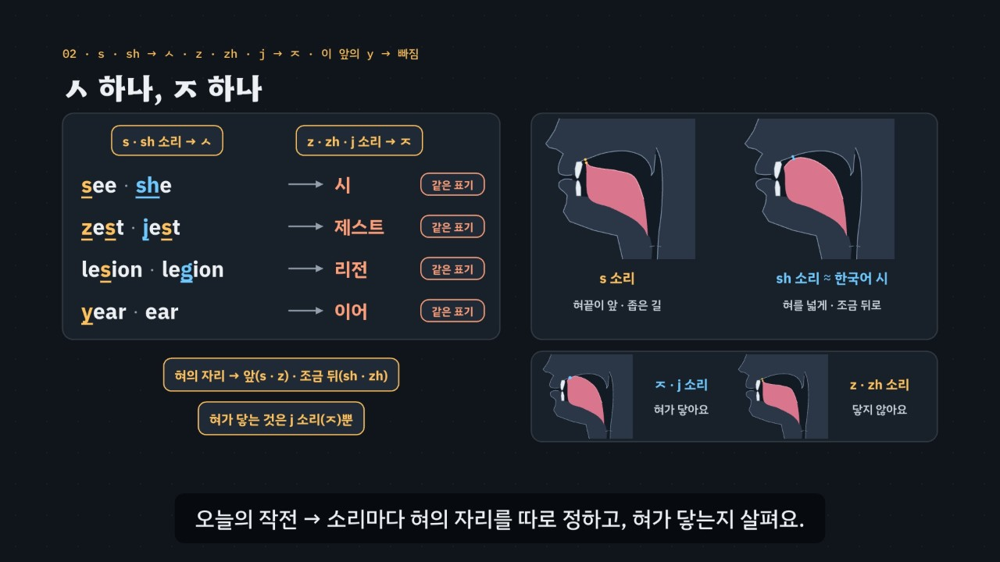

# ㅅ · ㅈ 너머 — s · sh · z · zh · y

> [영어 튜토리얼](../README.md) 모음의 **영어 발음 (미국식)** 열 번째 꼭지입니다(영역: `pron`, 계획표의 P05 · 유형 8 · 10 · 11의 y). 발음 영역의 설계도는 [docs/pron-types.md](../docs/pron-types.md)이고, 형식은 [입술이 하는 일 — f · v · w](../f-v-w/README.md)를 복사해 시작했어요(목소리 부품은 [끝소리와 자음 묶음](../final-consonants/README.md)과 같아요). 이 꼭지가 입 옆 단면도에 **혀 앞 자세 셋**(sh · j · y)을 더하고, 측정 도구에 **s · sh 바람 소리의 높이(무게중심)** 재기를 더했어요.

보다 · 그녀 → 영어로 *see · she*. 한국어로 적으면 둘 다 **시**예요. 해 · 귀 → *year · ear*, 둘 다 **이어**예요. 한국어는 ㅅ 하나로 s · sh 소리를, ㅈ 하나로 z · zh · j 소리를 적고, 외래어 표기는 이 앞의 y 소리를 빼고 적기 때문이에요. 둘을 가르는 열쇠는 **혀의 자리**예요.

- **s 소리** — 혀끝을 윗잇몸 가까이(닿지 않게) 두고 가운데 좁은 길로 센 바람. 입술은 옆으로. 높은 바람 소리. 함정은 **이 앞** — 한국어 시는 혀를 넓게 올려 sh 소리 쪽으로 가요(*see* → *she*, *seat* → *sheet*).
- **sh 소리** — 혀를 조금 뒤로, 혀 앞을 넓게 올리고, 입술을 동그랗게 조금 내밀어요. 낮고 두툼한 바람 소리.
- **z · zh 소리** — s · sh 소리와 같은 혀 + 목 울림. **혀가 입천장에 닿지 않아요.** 한국어식 ㅈ(제로 · 비전)은 혀를 붙였다 떼는 소리라 영어의 j 소리가 돼요(*zest* → *jest*, *lesion* → *legion*).
- **y 소리** — 혀 앞을 센입천장 가까이 올렸다가 다음 모음으로. 야 · 여 · 요 · 유와 비슷하지만, **이 앞**에서도 혀를 먼저 올려요(*year* ≠ *ear*).
- **끝의 s · z · sh · zh**(*bus · cheese · fish · beige*)는 바람이나 떨림으로 끝내요. 한국어식(버스 · 치즈 · 피시 · 베이지)처럼 으 · 이를 붙이지 않아요 — 끝 자음은 [끝소리 튜토리얼](../final-consonants/index.html)에서 더 다뤄요.

3단계 발음법: ① **듣고 가르기**(짝 낱말 · 여러 목소리) → ② **혀의 자리 만들기**(앞 · 조금 뒤 · 닿나 · 목 울림) → ③ **낱말 · 문장 속에서**(자리 · 외래어 · 문장).



## 바로 보기

`index.html`을 더블클릭하면 끝이에요. 설치도, 서버도 필요 없어요.

## 소리와 마이크에 대해 (꼭 읽어 주세요)

- 녹음 파일이 없어요. 영어는 모두 **합성 음성**이에요. 글이 정해진 말(짝 낱말 · 문장 · 연습 문제 · 따라 말하기)은 **VoiceStudio로 미리 만든 미국식 목소리 넷**(`audio/dialogue/`)으로, 나머지는 브라우저에 들어 있는 영어 음성(speechSynthesis)으로 읽어요. 합성 음성은 실제 사람의 말소리와 조금 다르게 들릴 수 있고, 특히 **브라우저 음성은 기기마다 s · sh 바람 소리의 세기가 달라** 짝이 잘 갈리지 않을 때도 있어요(머리말 각주에도 적음).
- **목소리 넷**: 밝은 선생님(미국 여성) · 차분한 선생님(미국 여성) · 미국 여성 · 미국 남성. 같은 짝을 여러 목소리로 들으며 가르는 것이 듣기 훈련의 핵심이라(목소리가 바뀌어도 s · sh, z · j, y 소리가 있고 없음을 가르는 귀), 훈련 · 연습 문제는 문제마다 목소리를 바꿔요. 비교용 **한국어식 소리**(*시 · 시트 · 제스트 · 리전 · 이어* …)는 한국어 내레이터 목소리로 만들었어요(`voices.json`의 `"lang": "ko"`).
- 튜토리얼 전용 목소리 부품 `assets/js/voices.js`(`SZV`)는 끝소리의 `FCV`와 같아요(말하는 사람마다 파일을 찾고, 없으면 브라우저 음성 en-US · 한국어식은 ko-KR, 잰 값 `SZV.meas`). 읽기 전에 음성 해설 · 발음 듣기 · 녹음 재생을 멈추고 영상을 일시정지해요.
- **내 발음 확인 · 따라 말하기**: 브라우저에 음성 인식(`SpeechRecognition` · `webkitSpeechRecognition`, en-US)이 있으면 말을 글로 바꿔 **후보 글 여러 개**를 짝 낱말과 맞춰 봐요(*see*를 말했는데 *she*로 적히면 ‘짝 낱말로 들렸어요’). 발음의 질은 판정하지 않아요 — 인식기는 흔한 낱말 쪽으로 기울어요(*lesion*보다 *legion*, *sift*보다 *shift*). 크롬(Chrome) 같은 브라우저는 소리를 브라우저 회사의 서버로 보내 글로 바꿔요. 음성 인식이 없으면 녹음(`MediaRecorder`)으로 ‘내 목소리’와 ‘본보기’를 이어서 들어요. 녹음은 메모리에만 두고, 이 사이트는 아무것도 저장하지 않아요(듣고 가르기 훈련의 기록만 이 브라우저의 `localStorage`에).

## 무엇을 배우나요

| 장 | 시각 | 내용 | 직접 해 보기 |
| --- | --- | --- | --- |
| 00 들어가며 | 0:00 | *see · she* = 둘 다 시, *year · ear* = 둘 다 이어 · ㅅ과 ㅈ 두 글자가 영어 소리 다섯을 맡음 | 먼저 들어 보기(한국어식 시 · 이어와 함께) |
| 01 들어 보기 · 구별되나요? | 0:30 | ① 짝 낱말(*see · she, sip · ship, zest · jest, year · ear*) · 이 앞의 s 소리를 sh 소리로 내는 경향(연구) | 짝 듣고 고르기(맛보기 — 네 짝 × 목소리 넷) |
| 02 ㅅ 하나, ㅈ 하나 | 1:08 | s · sh → ㅅ · z · zh · j → ㅈ · 이 앞의 y → 빠짐 · 한국어 시는 혀를 넓게 올림 · 시트 → *sheet*로 들리기 쉬움 | 짝의 한국어식 표기(20쌍, 같은 표기인지 엔진이 계산) |
| 03 s 소리 · sh 소리 — 혀끝은 앞에 | 1:50 | ② 입 옆 단면도 · 위에서 본 혀(가운데 바람길) · 입술 앞모습 · 네 목소리의 바람 소리 높이(잰 값) · 이 앞에서도 혀끝을 앞에 | 혀의 자리 바꿔 보기(s 소리 · sh 소리) |
| 04 z 소리 — 혀를 띄우고 목을 울려요 | 2:38 | ② s 소리와 같은 혀 + 목 울림 · j 소리(한국어 ㅈ)는 혀가 닿음 · *zest · jest, zig · jig, buzz · budge* | 혀 · 목 바꿔 보기(z · s · j 소리) |
| 05 zh 소리 — sh 소리 + 목 울림 | 3:22 | ② 조금 뒤 · 둥근 입술 · 목 울림 · 가운데(*vision · usually · measure · casual*) · *lesion · legion* · 끝(*beige · massage*) | 혀 · 목 바꿔 보기(zh · sh · j 소리) |
| 06 y 소리 — 이 앞에서도 혀를 먼저 | 4:02 | ② 혀 앞을 센입천장 가까이 → 다음 모음 · 야 · 여 · 요 · 유 · 이 앞에서 빠짐(*year · ear, yeast · east, yearn · earn*) | 혀를 먼저 올리기 ↔ y 소리 없이 |
| 07 낱말 속 자리 | 4:46 | ③ 처음(*see · zero · year*) · 묶음(*street · sleep · smile*, *music*의 my) · 가운데(*basic · busy · vision*) · 끝(*bus · fish · cheese · beige*, 끝에 으 · 이 없이) | 낱말 속 자리(낱말을 고르면 영어 음절 · 한국어식 음절) |
| 08 외래어 함정 | 5:30 | 외래어 카드 열여섯 장(이 앞의 s → 시 · z → ㅈ · zh → ㅈ · 섞어서) · *sell* 셀 ≠ *shell* 셸(모든 짝이 같은 표기는 아님) | 외래어 하나씩(소리마다 혀의 자리) |
| 09 문장 속에서 | 6:14 | *She sells sea shells.*(*sells*의 끝 = z 소리) · *The zoo is closed.* · *I usually walk to school.* · *See you next year.* | 문장 고르기(따라 말하기의 28문장) |
| 10 정리 | 6:58 | 3단계 발음법 · 목표는 듣는 사람이 헷갈리지 않는 소리 | 이제 직접(아래 칸으로) |

전체 7분 34초.

- **듣고 가르기 훈련**(놀이터 왼쪽): 목소리 넷 × 짝 낱말 20쌍(s ↔ sh 10 · z ↔ j 5 · zh ↔ j 1 · y ↔ 없음 4)에서 하나를 무작위로 들려주고 둘 중 하나를 고르게 해요(짝의 두 낱말이 모두 확인을 통과한 목소리로만 — 아래 ‘낱말 파일 점검’). 짝 종류 · 목소리를 고를 수 있고, 답하면 두 낱말을 같은 목소리로 이어서 들어 보고 엔진의 듣기 힌트를 보여 줘요. 기록은 **자리(처음 · 가운데 · 끝)마다 · 짝마다 · 목소리마다** 맞힌 비율로, `localStorage` `en-sz-hvpt-v1`(지우기 단추). 키보드 R 듣기 · 1 · 2 고르기 · Space/Enter 다음. 여러 목소리로 듣는 훈련의 근거는 [r · l 튜토리얼](../r-and-l/index.html)의 각주를 이어서 가리켜요.
- **내 발음 확인**(놀이터 오른쪽): 짝 20쌍 가운데 하나와 말할 낱말을 고르면 입 그림 · 말하는 요령이 나오고, 말하면 음성 인식의 후보 글을 짝과 맞춰 ‘그 낱말로 들렸어요 · 짝 낱말로 들렸어요 · 다른 말로 들렸어요’를 알려 줘요. 소리가 같은 철자(*see · sea*, *sell · cell*, *yolk · yoke* …, `SZ.SAME`)는 같은 낱말로 봐요.
- **따라 말하기 28문장**: s · sh 소리 · z 소리 · zh 소리 · y 소리, 묶음마다 일곱 문장. s · z · zh · y 소리 글자는 노랑, sh · j 소리 글자는 하늘(글자 색 + 밑줄). 철자가 아니라 소리를 칠해요 — *is · sells*의 s = z 소리, *usually · pleasure*의 s = zh 소리, *city*의 c = s 소리. 들린 낱말을 원래 문장과 맞춰 맞은 낱말 초록 · 빠진 낱말 주황(`SZ.compareWords`).
- **듣고 고르기 16문제**(`PDrill`, `.edr` 모양): 어느 낱말? 6 · 문장 속 어느 낱말? 4 · 같은 낱말? 다른 낱말? 4 · 한국어식은 어느 쪽? 2. 정답 위치 8/8, 목소리마다 4문제. 소리 먼저, 힌트 세 단계(① 들을 곳 → ② 혀의 자리 → ③ 낱말 속 자리)는 엔진이 짝의 종류 · 자리에서 만들어요. 키보드 A · B(1 · 2) · H 힌트 · R 다시 듣기 · S 천천히 · Enter.
- **퀴즈 10문제**: 영상 순서대로. 그림 문제 둘(s 소리의 혀 · j 소리를 시작할 때의 혀 — 입 옆 단면도 넷 중 고르기). 그림 문제의 정답은 `check()`가 입 그림에서 다시 계산해요(혀끝이 윗잇몸 가까이 있고 닿지 않은 그림 · 혀가 윗잇몸 뒤에 닿은 유일한 그림).
- **핵심 정리**: s · sh · z · zh · j · y, 이 앞의 s · z · zh → ㅈ · 이 앞의 y · 끝 표 + 용어(① 듣고 가르기 · ② 혀의 자리 만들기 · ③ 낱말 · 문장 속에서).

### 플레이어 조작

다른 튜토리얼과 같아요. 스페이스(재생/일시정지), ← →(5초), Shift + ← →(장), C(자막), V(음성 해설), F(전체 화면). 화면 속 낱말을 누르면 발음을 들려줘요(같은 단추를 곧바로 다시 누르면 천천히). 03 · 04 · 05 · 06장의 직접 해 보기에서 자세를 고르면 영상이 멈추고 그 장의 장면이 고른 자세로 바뀌어요(영상 추출은 늘 기본 자세).

**미리 만든 목소리**: VoiceStudio(OmniVoice 엔진, 비상업용 라이선스)로 만든 합성 음성 파일이에요. 파일이 없거나 못 읽으면 그 줄 · 조각만 브라우저 음성으로 읽어요.
- **영어는 0.9배로 재생해요**(`voices.js`의 `EN_RATE`). 한국어 해설과 한국어식 읽기는 1배.
- **늘어놓은 낱말은 쉬어 가며 읽어요.** 자막에 · 로 늘어놓은 영어 낱말(*see · she*, *zest · jest*)은 낱말마다 따로 만들고 사이에 쉼표만큼 쉬어 한 파일로 이었어요(`--word-lists`). 해설의 영어 조각 52개는 받아쓰기(Whisper)로 모두 맞게 적히는 것을 확인했어요(*see* → C, *sells* → cells처럼 소리가 같은 말은 맞게 들은 것으로 봤어요). 그 가운데 낱말만 읽는 조각 46개는 확인(받아쓰기 · 끝 올림 · 센 음절)을 통과한 밝은 선생님(`tc`) 낱말 파일을 쉼표만큼 쉬어 이어 다시 만들었어요(`tools/measure-syllables.py s-sh-z-j --narration`). *sells*와 *season, music, jazz, massage.*, 문장 4개(*She sells sea shells.* · *The zoo is closed.* · *I usually walk to school.* · *See you next year.*)는 처음 만든 소리 그대로예요.
- 한국어 조각 115개도 받아쓰기로 확인했어요. 받아쓰기가 글자 이름을 로마자로(‘에스 · 제트에이치’ → *S · ZH*), 수를 숫자로(‘스물여덟’ → 28), 소리가 같은 다른 글자로(‘시’ → C, ‘예스’ → 예쓰, ‘영’ → 0) 적은 조각은 그대로 썼어요. 다르게 적힌 조각 9개는 seed를 바꿔 다시 만들어 맞게 적힌 소리로 바꿨어요 — ‘해 → 헤이’, ‘가운데 → 다음’, ‘시는 → 신은’, ‘바람 소리 → 바라삼 소리’, ‘에스 → X’, 앞머리 ‘정리해요’와 ‘제트’가 빠진 정리 문장, 끝의 ‘시’가 ‘씨…’로 적힌 조각, 엉뚱한 문장으로 적힌 한 낱말 조각 ‘이어 · 끝’(‘이어’는 0.1초짜리 빈 소리였어요). ‘제스트 · 줌’은 다섯 번 만들어도 받아쓰기가 ‘체스트 · 춤’으로 적어서 첫 모음의 높이를 쟀어요. 214Hz · 243Hz로, ㅈ으로 시작하는 ‘제로 · 재즈 · 주 · 존’(229~302Hz)과 같은 높이였고 ㅊ · ㅍ · ㅋ로 시작하는 ‘치즈 · 퍼즐 · 피시 · 캐주얼’(372~400Hz)보다 훨씬 낮았어요(한국어의 예사소리는 뒤 모음을 낮게 시작해요). 그래서 처음 소리를 그대로 썼어요.
- 음성 해설(`audio/narration/`): 한국어 조각은 「튜토리얼 내레이터 (젊은 여성)」, 영어 조각은 「영어 선생님 (밝은 미국 여성)」. 해설은 ㅅ · ㅈ을 ‘시옷 · 지읒’, 한국어 속 홀로 쓴 소리 글자를 글자 이름으로 읽어요(s · sh · z · zh · j · y → 에스 · 에스에이치 · 제트 · 제트에이치 · 제이 · 와이), 자막의 `+` · ` = `는 쉼표로.
- 낱말 · 문장(`audio/dialogue/`): 말하는 사람 → 프로필은 `voices.json` — `tc` 「영어 선생님 (밝은 미국 여성)」 · `tf` 「영어 선생님 (미국 여성)」 · `uf` 「길 묻기 · 나 (미국 여성)」 · `um` 「길 묻기 · 길에서 만난 사람 (미국 남성)」 · `ko` 「튜토리얼 내레이터 (젊은 여성)」(한국어).

만드는 법(VoiceStudio가 있는 맥에서, 이미 만든 파일은 건너뛰어요):

```bash
node tools/narration-pieces.cjs s-sh-z-j     # 해설의 읽기 조각 목록 (자막을 고쳤을 때만)
node tools/dialogue-lines.cjs s-sh-z-j       # 낱말 · 문장 줄 목록 + 잴 줄의 정보 (낱말 · 문제 · 따라 말하기를 고쳤을 때만)
python3 tools/voicestudio-narration.py s-sh-z-j --en-profile "영어 선생님 (밝은 미국 여성)" --word-lists
python3 tools/voicestudio-dialogue.py s-sh-z-j
"$HOME/Library/Application Support/VoiceStudio/runtime/project/.venv/bin/python" tools/measure-syllables.py s-sh-z-j --regen       # 재고, 통과하지 못한 줄은 다시 만들기
"$HOME/Library/Application Support/VoiceStudio/runtime/project/.venv/bin/python" tools/measure-syllables.py s-sh-z-j --narration   # 해설의 낱말 조각을 통과한 낱말 파일로
```

### 잰 값 — 바람 소리의 높이

이 꼭지에서 잰 값으로 그리는 그림은 03장의 **‘바람 소리의 높이’ 막대** 하나예요(박자 공 · 높낮이 선 · 모음 지도 없음). `tools/measure-syllables.py`가 s · sh 짝 낱말마다 바람 소리의 무게중심(`fc`, Hz)을 재서 `audio/dialogue/measure.js`에 적어요. 줄 정보(`window.__measureMeta`)는 낱말 하나 `word`(음절 수 `n` · 센 음절 `at`, s · sh 짝 낱말에는 `fric: 's' | 'sh'`와 같은 목소리의 짝 줄 `cpair`) · 한국어식 `ko`(글자 수 `n`) · 그 밖(문장 · 짝 이어 듣기) `other`예요.

- **재는 법**: 1~11kHz 띠가 낮은 띠(80~900Hz, 목 울림)보다 10dB 넘게 세고 그 띠의 크기가 가장 큰 곳에서 20dB 안쪽인 프레임이 이어진 가장 긴 조각(30ms 이상)을 바람 소리로 보고, 그 가운데 절반의 평균 스펙트럼에서 1~11kHz의 무게중심을 구해요. 자동으로 찾은 조각이라 경계는 어림이에요.
- **확인**: 같은 목소리의 짝끼리 견줘 s 쪽이 sh 쪽보다 1000Hz 이상 높아야 통과해요. s · sh 짝 10쌍 × 목소리 넷, 80줄을 모두 쟀고 40쌍이 모두 통과했어요. 가장 작은 차이가 2155Hz(밝은 선생님의 *sort · short*)였어요. s 쪽은 5794~9094Hz, sh 쪽은 2867~5990Hz예요. 목소리가 다르면 범위가 겹치니(미국 남성의 s 소리와 밝은 선생님의 sh 소리) 늘 같은 목소리 안에서 견줘요.
- **03장 막대**(*see · she*): 밝은 선생님 8618 · 5080Hz, 차분한 선생님 8516 · 4322Hz, 미국 여성 7665 · 4520Hz, 미국 남성 6141 · 3475Hz. 네 목소리 모두 재지 못했거나 차이가 1000Hz보다 작으면 `app.js`가 콘솔에 경고해요(자막이 ‘네 목소리’라고 말해서).
- 합성 음성을 잰 값이에요. 사람의 목소리와 마이크에 따라 값은 달라지고, 여기서는 ‘같은 목소리에서 sh 소리가 s 소리보다 낮다’는 방향만 보여 줘요.

### 낱말 파일 점검

측정 도구는 낱말 파일이 정말 그 낱말로 들리는지(받아쓰기), 센 음절이 사전과 맞는지, 끝이 묻는 말처럼 올라가지 않는지도 확인해요. 듣고 가르기 훈련과 직접 해 보기의 듣기 문제는 짝의 두 낱말이 모두 통과한 목소리만 써요(`SZV.meas`).

- 290줄을 받아썼고, 낱말 195줄 · 한국어식 63줄 가운데 처음에 17줄이 통과하지 못했어요.
  - 끝이 묻는 말처럼 올라감 8줄(*jest* 2 · *yes · bus · mass · mash · ship · sell*)
  - 받아쓰기가 다름 6줄: *see* → C. 2줄, *She sells sea shells.* → seashells, *mash* → M.A.S.H., 한국어식 ‘메저’ → 매적, 0.1초짜리 빈 소리였던 한국어식 ‘이어’
  - 음절을 나누지 못함 2줄(*zero · usually*), 센 음절 1줄(*city*)
- 측정 도구가 *see*와 글자 이름 C를 소리가 같은 말로, *sea shells*와 *seashells*를 같은 말로 보게 고쳐서 3줄이 통과했어요. 남은 14줄은 seed를 바꿔 다시 만들었어요 — 여섯 번 안에 12줄, 여섯 번 더 해서 미국 남성의 *sell*, 다시 여섯 번 더 해서 밝은 선생님의 *mash*가 통과했어요.
- **영어 낱말 195줄은 모두 통과했어요.** 짝 20쌍 모두 네 목소리로 나오고, 연습 문제의 낱말 소리도 모두 확인을 통과한 파일이에요. 문장 32줄은 받아쓰기만 확인했어요(모두 맞음).
- **한국어식 63줄은 하나씩 따로 다시 받아썼어요.** 도구는 한국어 글자 하나까지 다른 것을 봐줘서, ‘시 · 영 · 신’ 같은 한 글자 낱말은 무엇으로 들려도 통과하기 때문이에요.
  - 38줄은 글자 그대로 적혔어요. 표기가 갈리는 짝 ‘세이브 · 셰이브’, ‘소트 · 쇼트’, ‘리스 · 리시’도 갈려 적혔어요(‘셰이브’는 쉐이브로).
  - 소리가 같은 다른 표기로 적힌 줄은 그대로 썼어요(‘시’ → C, ‘십’ → 10, ‘영’ → 0, ‘피시’ → PC, ‘시지’ → cg, ‘매스 · 매시’ → 메스 · 메시, ‘메저’ → 맺어, ‘옐로’ → 옐로우 …).
  - ㅈ · ㅂ으로 시작하는 ‘제스트 · 줌 · 주 · 존 · 버지 · 비지’는 받아쓰기가 ㅊ · ㅍ으로 적었지만(체스트 · 춤 · 츄 · 촌 · 퍼지 · 피지), 첫 모음의 높이가 214~272Hz로 예사소리의 높이였어요(위 한국어 해설 조각과 같은 확인).
  - 다르게 적힌 ‘시즈’(→ C2) · ‘스트리트’(→ 스트릭트) · ‘싯’(엉뚱한 문장) · ‘일드’(→ 1대) 4줄은 seed를 바꿔 다시 만들어 맞게 적힌 소리로 바꿨어요(‘일드’는 ‘1드’로 적힌 소리).
  - ‘셸’은 여섯 번 만들어도 받아쓰기가 ‘셀’로만 적었어요. 그래서 이 꼭지의 방법대로 바람 소리의 높이를 재서 골랐어요. 이 목소리의 ㅅ은 ‘이’ 앞과 ‘쇼 · 셰’에서(시 · 신 · 실크 · 쇼트 · 셰이브 · 리시 등 14줄) 6814~7846Hz, 그 밖에서(소트 · 세이브 · 리스 · 버스 · 셀 등 11줄) 8366~9370Hz로 갈렸어요(ㅈ · ㅊ이 함께 든 낱말은 뺐어요). ‘셀’은 8872Hz이고, 고른 ‘셸’은 7282Hz예요.
  - 한국어식 9줄(이어 · 제스트 · 유주얼리 · 이스트 · 스트리트 · 시스템 · 캐주얼 · 세이브 · 레이지)은 받아쓰기는 맞지만 음절을 나누지 못해 `measure.js`에 값이 없어요. 한국어식 줄의 잰 값은 화면에서 쓰지 않아요.
- 점검에 쓴 따로 받아쓰기 · 첫 모음 높이 스크립트는 저장소에 넣지 않았어요.

## 무엇이 규칙 계산인가요

- **규칙 엔진** `assets/js/grammar.js`(`SZ`)가 낱말마다 적은 발음 기호에서 계산해요. 영상 · 직접 해 보기 · 놀이터 · 연습 문제 · 퀴즈가 모두 같은 결과를 써요.
  - 낱말 사전 `SZ.DICT`(107낱말: 철자 조각(s · sh · z · zh · j · y 소리를 적은 글자 `[ ]`) · 음절로 나눈 넓은 IPA · 한국어식 표기 · 뜻 · 묶음). 음절 `SZ.syl` · `SZ.nSyl` · `SZ.stressAt`.
  - **소리의 자리** `SZ.sounds`: s · z · zh · y(이 편의 소리)와 sh · j(짝 소리)가 음절의 어디에 있나 — 처음 · 묶음 · 가운데 · 끝, 그리고 ‘이 앞’인지(`hi`).
  - **짝 낱말** `SZ.pairDiff`: 한 소리만 다르고 그 차이가 s ↔ sh · z ↔ j · zh ↔ j인지, 또는 y 소리 하나만 더 있는지(*year · ear*), 그 자리. `SZ.PAIRS` 20쌍(s ↔ sh 처음 8 · 끝 2, z ↔ j 처음 2 · 끝 3, zh ↔ j 가운데 1, y ↔ 없음 처음 4).
  - **외래어 표기** `SZ.koParts` · `SZ.koMarks`: 한국어식 표기의 ㅅ · ㅈ · 시 · 이 · 야 여 요 유가 영어의 어느 소리를 표기법대로 적은 것인지와 이 앞에서 빠진 y, 넣은 으 · 이 `SZ.koInserted`, 두 낱말이 **같은 표기**가 되는지 `SZ.koSame`(20쌍 중 10쌍이 같은 표기 — *sell · shell*(셀 · 셸), *sort · short*(소트 · 쇼트), *buzz · budge*(버즈 · 버지) 같은 짝은 다른 표기). 영상 · 페이지가 ‘같은 표기 · 다른 표기’라고 말하는 짝(`SZ.CLAIMS`)은 `check()`가 엔진으로 확인해요.
  - 외래어 줄 `SZ.LOAN`(이 앞의 s → 시: *city · single · system · silk*, z → ㅈ: *zero · zoom · puzzle · cheese*, zh → ㅈ: *vision · casual · leisure · beige*, 섞어서: *season · music · jazz · massage*), 문장 속 칠하기 `SZ.spans` · `SZ.segs`(철자가 아니라 소리로), 들린 말 맞추기 `SZ.heard`(소리가 같은 철자 `SZ.SAME`), `SZ.compareWords`, 연습 문제의 힌트 `SZ.hints`.
- **어긋남 경고** `SZ.check()`: 철자 조각의 `[ ]`와 엔진의 소리 자리, 한국어식 표기가 소리와 맞는지, 짝이 한 소리만 다른지와 자리 · 종류, 같은 표기 주장, 외래어 줄, 문장 묶음마다 일곱 문장과 문장 속 소리, 엔진과 어긋나는 연습 문제의 정답 · 한쪽에 몰린 정답 위치(퀴즈의 정답은 `app.js`가 엔진 · 입 그림으로 따로 확인), 입 그림(s · z · sh · zh · y는 닿지 않음 · j는 윗잇몸 뒤에 닿음 · sh는 s보다 혀가 뒤)이 어긋나면 콘솔에 경고가 떠요. 지금 경고 0개.
- **입 옆 단면도**: 공통 부품 `../shared/mouth.js`에 이 꼭지가 더한 자세 셋 — `sh`(혀를 조금 뒤로 · 혀 앞을 넓게 · 입술을 조금 내밂, `round: 0.5`), `dj`(혀끝 · 혀날을 윗잇몸 뒤에 붙임, 위에서 본 혀는 막힘), `y`(혀 앞을 센입천장 가까이). 원래 자세는 그대로라 다른 발음 튜토리얼의 그림은 바뀌지 않아요. ‘닿아요 · 닿지 않아요 · 어디 가까이’는 그림에서 계산(`contact`)해 영상 · 퀴즈가 같은 값을 써요. 위에서 본 혀(`top`)는 가운데 바람길이 있는 s · sh · z · zh와 막힌 j를 보여 줘요.
- **발음 사전 대조**(커밋 전에 따로): 107낱말의 음절 수 · 센 음절 · 자음 차례를 misaki 미국 발음 사전(VoiceStudio에 들어 있는 `us_gold.json` · `us_silver.json`)과 맞췄어요. 다른 곳 12개 가운데 11개는 표기 방식 차이예요.
  - r 모음을 한 기호로 적음(*yearn · earn · leisure · measure · pleasure*의 ɚ · ɝ = 사전의 əɹ · ɜɹ — 사전 쪽 자음 차례에 ɹ이 하나 더 보임).
  - g 글자 모양(*zig · jig · single*의 g = 사전의 ɡ), *usually*(사전이 u와 ə 사이의 w 미끄러짐을 적음), *casual*(사전 kˈæʒuəl의 uə를 대조 스크립트가 한 모음으로 센 것 — 세 음절은 같아요).
  - *close*: 사전의 기본값은 형용사 klˈOs(s 소리)이고, 동사 · 명사는 klˈOz예요. 여기서는 *The zoo is closed.*의 동사라 z 소리로 적었어요.
  - **하나만 실제로 달라요** — *massage*: 사전은 끝을 j 소리(məsˈɑʤ)로, 여기서는 zh 소리(məˈsɑʒ)로 적었어요. 영상 · 페이지에서 들려주는 밝은 선생님의 *massage* 파일은 끝 바람 소리 바로 앞에 혀가 막았다 떼는 자리(소리 크기가 깊게 떨어지는 골)가 없어서, zh 소리로 냈다고 어림했어요. 가운데에 zh 소리가 있는 *vision · measure*도 골이 없었고, 끝이 j 소리인 *budge*는 네 목소리 모두 바람 앞에 뚜렷한 골이 있었어요(소리 크기로 한 어림이고, 스크립트는 저장소에 넣지 않았어요).
  - 사전 대조 스크립트는 저장소에 넣지 않았어요.
- **단순하게 줄인 부분**
  - 입 그림은 쉽게 줄여 그린 것이에요(혀의 앞뒤 자리 · 닿는지 · 입술만 강조). 실제 입 모양은 사람마다 조금씩 달라요. s 소리를 혀끝을 내려 아랫니 뒤에 두고 내는 사람도 있어요.
  - 바람 소리 · 붙였다 떼는 소리 띠와 목 울림 물결은 설명을 위한 그림이에요. 03장의 ‘바람 소리의 높이’ 막대만 잰 값이에요(아래).
  - 자리는 음절로 나눠 정해요(첫 음절의 홀로 선 첫소리 = 처음 · 다른 자음과 붙은 첫소리 = 묶음 · 둘째 음절부터의 첫소리 = 가운데 · 음절 끝 = 끝).
  - 외래어 표기는 국립국어원 외래어 표기법(영어의 표기: 마찰음 · 파찰음 · 반모음)을 따르되 굳어진 표기(제로)는 그대로 써요. 엔진은 s · sh · z · zh · j · y 자리의 한글만 맞춰 봐요.
  - 엔진은 소리를 듣지 않아요. 내 발음 확인은 음성 인식이 적은 후보 글을 짝 낱말과 맞춰 볼 뿐이에요.
- **근거로 삼은 연구**(원문 또는 초록으로 확인한 범위, 자세한 목록은 [docs/pron-types.md](../docs/pron-types.md)):
  - 이 앞의 s — [Eckman & Iverson 2013](https://doi.org/10.1017/S027226311200068X)(*Studies in Second Language Acquisition* 35(1)). 아직 s · sh 구별을 익히지 못한 한국인 학습자는 이 앞의 s 소리를 주로 sh 소리로 냈고, 구별을 익힌 학습자는 실수가 줄었으며 남은 실수는 반대 방향(sh → s)이 많았어요.
  - ㅅ의 구개음화 옮겨 오기 — [Park 2005](https://www.earticle.net/Article/A293896)(영어영문학연구 47(3), 초록). 낱말 사이보다 낱말 안에서, 이 모음보다 y 소리 앞에서 더 자주.
  - z · zh와 ㅈ — [Seo & Lim 2011](https://koreascience.kr/article/JAKO201103939212830.page)(영어어문교육 17(4)). 원어민이 낱말 처음의 z 소리를 j 소리로 듣는 일이 많았고, z · zh 사이가 z · j 사이보다 덜 갈렸어요. 학습자 수가 적은 연구예요. · [Lim & Seo 2008](https://scholar.kyobobook.co.kr/article/detail/4010022319321)(영어어문교육 14(3), 초록). 목이 울리는 마찰음을 덜 정확하고 더 느리게 알아들었어요.
  - 이 앞의 y — [Kang 2014](https://doi.org/10.17077/etd.f9qr08ca)(University of Iowa 박사 논문, 초록) · [Praisley 2016](https://hdl.handle.net/20.500.14783/12787)(Memorial University of Newfoundland 석사 논문). 이 앞의 y 소리가 주로 빠지고, 주된 원인은 듣기(지각)라고 봤어요.
  - 연구마다 대상 · 방법이 이 튜토리얼과 달라 보여 준 방향만 말하고 숫자는 옮기지 않았어요.
- **예문과 문제**: 모두 직접 만든 것이에요.

## 폴더 구조

```
index.html              페이지 (영상 · 직접 해 보기 · 듣고 가르기 훈련 · 내 발음 확인 · 따라 말하기 · 듣고 고르기 · 퀴즈 · 핵심 정리)
assets/js/grammar.js    규칙 엔진(SZ.sounds · SZ.syl · SZ.pairDiff · SZ.koParts · SZ.koMarks · SZ.koSame · SZ.koInserted · SZ.spans · SZ.segs · SZ.heard · SZ.compareWords · SZ.hints),
                        낱말 사전(SZ.DICT) · 짝(SZ.PAIRS) · 외래어(SZ.LOAN) · 문장(SZ.SENT) · 목소리(SZ.VOICES) · 입 그림(SZ.MOUTH) · 연습 문제(SZ.DRILL) · 점검(SZ.check)
assets/js/voices.js     낱말 · 문장 목소리(SZV): 목소리 넷 + 한국어식(미리 만든 파일 → 없으면 브라우저 음성), EN_RATE 0.9, 잰 값(SZV.meas)
assets/js/scenes.js     영상 장면 11개, 장 목록과 자막, 입 옆 단면도 · 위에서 본 혀 · 입술 앞모습 · 소리 띠 · 바람 소리 높이 막대 · 짝 표 · 외래어 카드 · 문장 칠하기
assets/js/app.js        플레이어, 직접 해 보기, 듣고 가르기 훈련(기록 표), 내 발음 확인, 따라 말하기(음성 인식 · 녹음), 듣고 고르기(PDrill), 퀴즈, 영상 추출(EN_EXPORT)
../shared/mouth.js      입 옆 단면도 부품(EN.mouth) — 이 꼭지가 sh · dj · y 자세를 더함
video/                  자막 원고(SRT)
audio/narration/        음성 해설의 읽기 조각 목록(pieces.json) · 파일 목록(clips.js) · 음성 파일
audio/dialogue/         낱말 · 문장 줄 목록(lines.json) · 잴 줄의 정보(measure-meta.json) · 말하는 사람 → 프로필(voices.json) · 파일 목록(clips.js) · 잰 값(measure.js) · 음성 파일
docs/poster.jpg         사이트 카드 그림
```

## 영상 다시 만들기

```bash
node tools/render-video.cjs s-sh-z-j                       # → s-sh-z-j/video/s-sh-z-j.mp4 + .srt
node tools/render-video.cjs s-sh-z-j --frames 106.5,130    # 몇 장면만 그림으로
node tools/render-video.cjs s-sh-z-j --poster 106.5        # 카드 그림
node tools/render-video.cjs s-sh-z-j --srt                 # 자막 원고만
```

MP4에는 소리가 없어요(자막이 그림에 들어가요).
