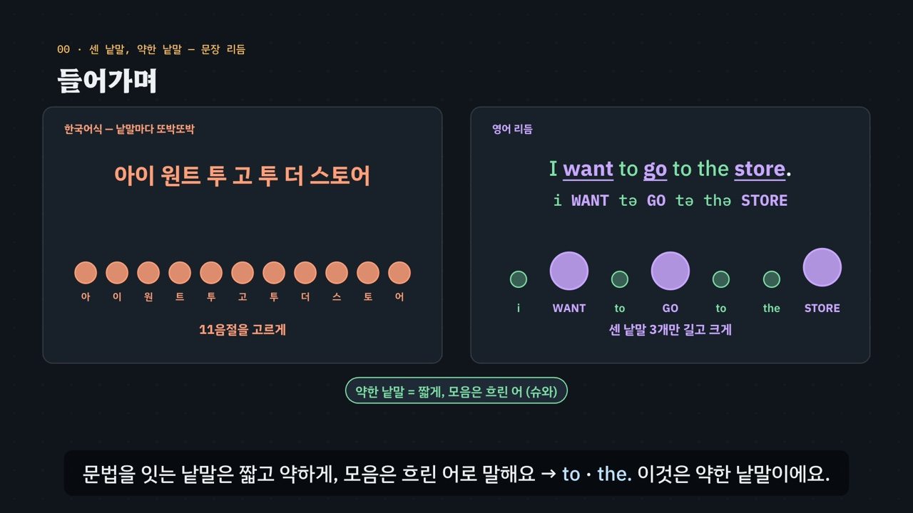

# 센 낱말, 약한 낱말 — 문장 리듬

> [영어 튜토리얼](../README.md) 모음의 **영어 발음 (미국식)** 일곱 번째 꼭지입니다(영역: `pron`, 계획표의 P10 · 유형 20). 발음 영역의 설계도는 [docs/pron-types.md](../docs/pron-types.md)이고, 형식과 음절 공 · 잰 값 그리기는 [낱말 강세](../word-stress/README.md)를 따랐어요. 이 꼭지는 음절 공을 **낱말 하나에서 문장 전체로** 넓혀, 센 낱말과 약한 낱말이 만드는 리듬을 그려요.

영어 문장 *I want to go to the store.*를 한국어식으로 읽으면 *아이 원트 투 고 투 더 스토어* — 낱말마다 같은 세기로 또박또박 나와요. 영어는 뜻을 나르는 **센 낱말**(*want · go · store*)만 길고 크게 말하고, 문법을 잇는 **약한 낱말**(*to · the*)은 짧게, 모음은 흐린 ‘어’(슈와)로 앞뒤에 붙여요 → `i WANT tə GO tə thə STORE`.

- **센 낱말(내용어)** — 명사 · 본동사 · 형용사 · 부사 · 의문사 · 부정의 *can't*. 그 낱말의 센 음절을 길게 · 크게 · 높게.
- **약한 낱말(기능어)** — 관사 · 전치사 · 접속사 · 조동사 · be 동사 · 대명사. 문장 속에서는 **약한 형태**(*to* → tə, *for* → fɚ, *can* → kən), 앞뒤 센 낱말에 붙여 한 덩어리로(*a cup of tea*).
- **강한 형태로 돌아오는 자리** — 문장 끝의 전치사(*Where are you from?*) · 혼자 대답(*Yes, I can.*) · 강조(*I can swim!*) · 낱말 자체(*the word “to”*). 대명사는 끝에서도 보통 약해요(*Call them.*).
- **can · can't**(미국식) — *can't*의 t는 거의 들리지 않을 때가 많아요. t를 기다리지 말고 **모음과 세기**로 가름(*I kən GO* · *I CAN'T GO*).
- **센 낱말 사이 간격** — 약한 낱말이 끼면 짧게 줄어드는 **경향**(*Cats chase mice → The cats have chased the mice → The cats will have been chasing the mice*). 똑같은 간격은 아니에요.

3단계 발음법: ① **듣고 가르기**(센 낱말 · 약한 낱말 · can과 can't, 목소리 넷) → ② **소리 만들기**(약한 형태 · 덩어리) → ③ **문장 속에서**(늘어나는 문장 · 강한 형태로 돌아옴 · 긴 문장).



## 바로 보기

`index.html`을 더블클릭하면 끝이에요. 설치도, 서버도 필요 없어요.

## 소리와 마이크에 대해 (꼭 읽어 주세요)

- 녹음 파일이 없어요. 영어는 모두 **합성 음성**이에요. 글이 정해진 말(문장 · 짝 문장 · 연습 문제 · 따라 말하기)은 **VoiceStudio로 미리 만든 미국식 목소리 넷**(`audio/dialogue/`)으로, 나머지는 브라우저에 들어 있는 영어 음성(speechSynthesis)으로 읽어요. 합성 음성은 실제 사람의 말소리와 조금 다르게 들릴 수 있고, 강조(*I can swim!*)를 약하게 낼 수도 있어요.
- **목소리 넷**: 밝은 선생님(미국 여성) · 차분한 선생님(미국 여성) · 미국 여성 · 미국 남성. *can · can't* 듣기 시합 · 연습 문제는 문제마다 목소리를 바꿔요. 비교용 **한국어식 소리**(*아이 원트 투 고 투 더 스토어* · *더 캣츠 윌 해브 빈 체이싱 더 마이스* · *어 컵 오브 티*)는 한국어 내레이터 목소리로 만들어요(`voices.json`의 `"lang": "ko"`). 한국어식 소리는 00장 · 06장(과 그 장의 직접 해 보기) · 연습 문제 ‘한국어식은 어느 쪽’에만 나와요.
- 튜토리얼 전용 목소리 부품 `assets/js/voices.js`(`SRV`)는 낱말 강세의 `WSV`를 그대로 가져왔어요(잰 값 `SRV.meas` 포함, 늘이기 문장의 길이 `dur`를 설명에 더함). 말하는 사람마다 파일을 찾고, 없으면 브라우저 음성(en-US, 한국어식은 ko-KR)으로 읽어요. 읽기 전에 음성 해설 · 발음 듣기 · 녹음 재생을 멈추고 영상을 일시정지해요.
- **내 발음 확인 · 따라 말하기**: 브라우저에 음성 인식(`SpeechRecognition` · `webkitSpeechRecognition`, en-US)이 있으면 말을 글로 바꿔 **후보 글 여러 개**에서 *can · can't*(*cannot · can not · cant*도 *can't*)를 찾아요(`SR.heard`: 말하려던 쪽 · 반대쪽 · 후보에 있음 · 찾지 못함). 리듬이나 발음의 질은 판정하지 않아요 — 인식기는 앞뒤 낱말로 짐작하고 흔한 말 쪽으로 기울어요. 크롬(Chrome) 같은 브라우저는 소리를 브라우저 회사의 서버로 보내 글로 바꿔요. 음성 인식이 없으면 녹음(`MediaRecorder`)으로 ‘내 목소리’와 ‘본보기’를 이어서 들어요. 녹음은 메모리에만 두고, 이 사이트는 아무것도 저장하지 않아요(듣기 시합의 기록만 이 브라우저의 `localStorage`에).

## 무엇을 배우나요

| 장 | 시각 | 내용 | 직접 해 보기 |
| --- | --- | --- | --- |
| 00 들어가며 | 0:00 | 한국어식 또박또박 vs 영어 리듬(*I want to go to the store.*), 음절 공 줄 둘 · 대문자 띠 | 먼저 들어 보기(한국어식 · 영어 공 나란히) |
| 01 들어 보기 · 구별되나요? | 0:36 | ① *I can go · I can't go*, 목소리 넷, 공으로 답 공개 | *can · can't* 맛보기(무작위 짝 × 목소리) |
| 02 센 낱말 · 약한 낱말 | 1:16 | 내용어 · 기능어 갈래 표, *The kids are waiting for the bus.* 가르기 | 문장 하나 갈라 보기(낱말마다 갈래 · 형태 · 까닭 표) |
| 03 약한 형태 | 1:58 | ② 강한 형태 → 약한 형태 카드 열 장(*to · for · of · and · can · a · the · at · from · have*) | 약한 형태 카드 열여덟 |
| 04 can · can't | 2:42 | ① 작은 민트 공 vs 큰 보라 공, t보다 모음과 세기, 짝 문장 넷 | 짝 문장 고르기(목소리 넷) |
| 05 붙여서 한 덩어리 | 3:24 | ② *a cup of tea · bread and butter · rock and roll · salt and pepper · a lot of people · I want to go.* | 덩어리 고르기 |
| 06 센 낱말 사이 간격 | 4:04 | ③ *Cats chase mice* 늘이기 셋 + 한국어식 하나, 음절 수 막대 · 잰 문장 길이 막대, ‘경향’ | 늘어나는 문장 견주기(막대 표) |
| 07 강한 형태로 돌아올 때 | 4:48 | ③ 문장 끝 · 혼자 대답 · 강조 · 인용, 대명사는 약한 채로 | 문장 고르기(낱말마다 형태 · 까닭) |
| 08 문장 속에서 | 5:32 | ③ 긴 문장 셋 칠하기 · 대문자 띠 · 공 줄 | 문장 고르기(28 + 3) |
| 09 정리 | 6:12 | 3단계 발음법 · 센 낱말과 약한 낱말 | 이제 직접(아래 칸으로) |

- **can · can't 듣기 시합**(놀이터 왼쪽): 짝 문장 여섯 × 목소리 넷에서 하나를 무작위로 들려주고(짝 둘이 모두 확인을 통과한 목소리만), *can*인지 *can't*인지 고르면 **그 목소리의 공 줄**이 짝과 나란히 나타나요(잰 값이 없으면 엔진의 기본 모양). 목소리를 고를 수 있고, 문장마다 · 들은 쪽마다 · 목소리마다 맞힌 비율을 보여 줘요. 기록은 `localStorage` `en-sr-cc-v1`(지우기 단추). 키보드 R 듣기 · 1 *can* · 2 *can't* · Space/Enter 다음.
- **센 낱말 찾기**(놀이터 오른쪽): 따라 말하기 28문장 + 긴 문장 셋 가운데 하나를 들려주고, 센 낱말을 눌러 표시하면 엔진의 갈래와 맞춰 맞은 · 빠진 · 더 누른 낱말과 그 까닭(강한 형태로 돌아온 자리 포함)을 보여 줘요. 키보드 R 듣기 · Enter 확인 / 다음.
- **내 발음 확인**(놀이터 아래): 짝 문장과 말할 쪽(*can · can't*)을 골라 말하면 음성 인식의 후보 글로 어느 쪽으로 들렸는지 알려 줘요. 녹음해서 본보기와 번갈아 듣기도 있어요.
- **따라 말하기 28문장**: 약한 형태 · *can*과 *can't* · 덩어리 · 강한 형태로 돌아옴, 묶음마다 일곱 문장. 문장마다 듣기 · 천천히 · 따라 말하기. 들린 낱말을 원래 문장과 맞춰 맞은 낱말 초록 · 빠진 낱말 주황(`SR.compareWords`, *for → four · to → two · can't → cannot*도 같은 낱말로 침).
- **듣고 리듬 가르기 16문제**(`PDrill`, `.edr` 모양): *can · can't* 5 · 센 낱말이 몇 개 3 · 어느 낱말이 세게 3 · 한국어식은 어느 쪽 2 · 끝의 전치사가 강한가 약한가 3. 소리 먼저, 힌트 세 단계(① 듣고 가르기 · ② 소리 만들기 · ③ 문장 속에서)는 엔진이 문장에서 만들어요. 보기 둘 문제 10개의 정답 위치 5 / 5, 보기 셋 문제 6개 2 / 2 / 2. 키보드 A~C(1~3) · H 힌트 · R 다시 듣기 · S 천천히 · Enter.
- **퀴즈 10문제**: 영상 순서대로. 그림 문제 둘(*I can't go.*의 공 줄 고르기 · *The cats have chased the mice.*의 공 줄 고르기)은 무늬를 엔진의 음절 세기로 그려요. 정답 위치 2 / 3 / 3 / 2.
- **핵심 정리**: 센 낱말 · 약한 낱말과 약한 형태 · 덩어리 · *can · can't* · 강한 형태로 돌아옴 · 센 낱말 사이 간격 표 + 용어(① 듣고 가르기 · ② 소리 만들기 · ③ 문장 속에서).

### 플레이어 조작

다른 튜토리얼과 같아요. 스페이스(재생/일시정지), ← →(5초), Shift + ← →(장), C(자막), V(음성 해설), F(전체 화면). 화면 속 문장 · 공 · 한국어식 표기를 누르면 그 소리를 들려줘요(같은 곳을 곧바로 다시 누르면 천천히).

**미리 만든 목소리**: VoiceStudio(OmniVoice 엔진, 비상업용 라이선스)로 만든 합성 음성 파일이에요. 파일이 없거나 못 읽으면 그 줄 · 조각만 브라우저 음성으로 읽어요.
- **영어는 0.9배로 재생해요**(낱말 강세와 같음, `voices.js`의 `EN_RATE`). 한국어 해설과 한국어식 읽기는 1배.
- **늘어놓은 낱말은 쉬어 가며 읽어요.** 자막에 · 로 늘어놓은 영어 낱말(*want · go · store*)은 낱말마다 따로 만들고 사이에 쉼표만큼 쉬어 한 파일로 이어요(`--word-lists`). 해설 읽기 규칙: 대문자로만 쓴 낱말은 소문자로 읽고, ` = ` · ` + `는 쉼으로 읽어요. 해설의 영어 조각 46개는 받아쓰기(Whisper)로 모두 맞게 적히는 것을 확인했어요. 그 가운데 두 조각(*I can swim, I can't swim, She can drive, She can't drive.* · *Yes, I am.*)은 다른 조각보다 소리가 훨씬 낮게 나와(다른 목소리처럼 들림) seed를 바꿔 다시 만들었어요. 이 꼭지의 문장 줄에는 낱말 하나만 재는 줄이 없어서(*to · for · an · are*는 받아쓰기만 하는 줄), 낱말만 읽는 해설 조각은 처음 만든 소리 그대로예요(`tools/measure-syllables.py sentence-rhythm --narration`이 다시 이은 조각 0개). 한국어 조각 103개도 받아쓰기로 확인했어요. ‘셋 · 두 · 여섯 · 스물여덟’을 숫자로 적거나 ‘끝의 → 끝에’, ‘늘여요 → 느려요’, ‘넷이에요 → 내시에요’, ‘세게 → 3개’처럼 소리가 같은 다른 글자로 적은 조각은 그대로 썼어요. ‘큰 공 → 큰 콩’, ‘가운데 → 다음’으로 적힌 두 조각은 seed를 바꿔 다시 만들었어요. 낱말 *of*를 한국어식으로 읽은 ‘어브’는 네 번 다시 만들어도 받아쓰기가 ‘오브’로 적어서 첫 모음의 F1 · F2를 쟀고, 어(ㅓ) 쪽에 가장 가까운 소리(F1 약 620Hz · F2 약 1040Hz, seed 51)를 골랐어요.
- 음성 해설(`audio/narration/`): 한국어 조각은 「튜토리얼 내레이터 (젊은 여성)」, 영어 조각은 「영어 선생님 (밝은 미국 여성)」.
- 문장(`audio/dialogue/`): 말하는 사람 → 프로필은 `voices.json` — `tc` 「영어 선생님 (밝은 미국 여성)」 · `tf` 「영어 선생님 (미국 여성)」 · `uf` 「길 묻기 · 나 (미국 여성)」 · `um` 「길 묻기 · 길에서 만난 사람 (미국 남성)」 · `ko` 「튜토리얼 내레이터 (젊은 여성)」(한국어).

만드는 법(VoiceStudio가 있는 맥에서, 이미 만든 파일은 건너뛰어요):

```bash
node tools/narration-pieces.cjs sentence-rhythm     # 해설의 읽기 조각 목록 (자막을 고쳤을 때만)
node tools/dialogue-lines.cjs sentence-rhythm       # 문장 줄 목록 · 잴 줄 정보(measure-meta.json)
python3 tools/voicestudio-narration.py sentence-rhythm --en-profile "영어 선생님 (밝은 미국 여성)" --word-lists
python3 tools/voicestudio-dialogue.py sentence-rhythm
```

### 잰 값 — 음절 공과 문장 길이

음절 공(음절마다 공 하나)은 **미리 만든 음성 파일을 프로그램으로 따로 재서** 그려요(`audio/dialogue/measure.js`의 `window.PRON_MEASURE`). 공의 넓이는 음절의 길이와 크기, 공의 높이는 소리의 높이(반음)예요. 잰 값이 없는 문장은 엔진의 기본 모양(센 낱말의 센 음절 크게 · 그 낱말의 다른 음절 중간 · 약한 낱말 작게)으로 그리고, 화면에 ‘이 목소리를 잰 값’이라고 적지 않아요.

- **잴 줄**(`window.__measureMeta`): 2~6음절의 짧은 구(*can · can't* 짝 문장, 약한 형태 카드의 보기 구, 덩어리, 강한 형태 문장)는 `kind: 'word'` — 음절 수 `n` · 핵 강세 `at`(강조 · 인용한 낱말이 있으면 그 낱말, 아니면 마지막 쉼표 뒤 마디의 마지막 내용어의 센 음절) · 약한 음절 번호 `weak`. 측정 도구는 `weak`가 있으면 약한 음절이 센 음절보다 모두 짧은지로 확인해요. 늘이기 문장 셋은 `kind: 'other', dur: true`(문장 길이만), 한국어식은 `kind: 'ko'`(한글 글자 수 = 음절 수, 원래 영어 문장 `en`, 늘이기 한국어식은 `dur: true`도), 그 밖의 문장은 받아쓰기만.
- **06장의 길이 막대**는 잰 `dur`가 늘이기 문장 셋 모두에 있을 때만 그려요. 없으면 길이 막대를 숨기고 음절 수 막대만 그린 뒤 ‘잰 값이 아직 없어요’라고 적어요. 잰 값이 있으면 음절이 는 배수와 길이가 는 배수를 견주어, 길이가 음절만큼 늘지 않았을 때만 그렇게 말해요(그렇지 않으면 ‘이 목소리는 음절만큼 늘었어요’).

- 처음 쟀을 때 146줄 가운데 35줄이 통과하지 못했어요.
  - 약한 음절이 짧지 않음 21줄: 음절 경계를 어림하다 센 음절을 아주 짧게 자른 줄이 많았고(*We can come tomorrow.* 짝에서 센 음절이 40~70ms로 재어짐), 끝의 약한 낱말이 길게 늘어난 소리도 있었어요(*See you!*).
  - 받아쓰기가 다름 6줄: 한국어식 2줄은 한국어로 듣게 해도 Whisper가 원래 영어 문장(*I want to go to the store.*)으로 적었고, 혼자 읽은 기능어 *an · to · for · are*는 강한 형태라 Anne · 2 · Four · R로 적혔어요.
  - 음절을 나누지 못함 5줄, 끝이 묻는 말처럼 올라감 3줄
- seed를 여섯 번 바꿔 19줄을 바꿨어요.
- 측정 도구의 소리가 같은 낱말에 *an = Ann · to = two · for = four · are = R*를 더하고, 한국어식 줄은 받아쓰기가 원래 영어 문장으로 적어도 통과하게 했어요(줄 정보의 `en`). 그래서 6줄이 통과했고, seed를 여섯 번 더 바꿔 1줄(*See you!*)이 통과했어요.
- *We can come tomorrow.* 짝은 tomorrow 속 음절 경계를 목소리 넷 모두에서 잘 나누지 못해 짝을 바꿨어요 → *We can come today.* · *We can't come today.*(낱말 사전에 *today*를 더함, misaki와 같은 소리). 새 8줄은 모두 통과했어요(1줄은 seed를 한 번 바꿔). 연습 문제 ‘어느 낱말이 세게’의 *Where are you from?* → 미국 남성 목소리가 통과하지 못해 미국 여성 목소리로 옮겼어요.
- **끝내 통과하지 못한 3줄**: 밝은 선생님의 *Where are you from?* · *We are late.*(음절을 나누지 못함 — 모음과 울림소리가 이어지는 구), 차분한 선생님의 *He can cook.*(약한 음절이 짧지 않음). 소리 파일은 그대로 두고 잰 값만 뺐어요. 이 줄의 음절 공은 엔진의 기본 모양으로 그려요.
  - can · can't 듣기 시합, 01장 맛보기, 04장 짝 듣기는 짝 문장 둘이 모두 통과한 목소리로만 들려줘요. 그래서 *He can cook · He can't cook* 짝은 차분한 선생님 목소리로 나오지 않아요.
  - 연습 문제 16개의 소리는 모두 확인을 통과한 파일이에요. 음절을 재는 짧은 구(*can* 짝 · 약한 형태 보기 · 덩어리 · 강한 형태 문장)가 아닌 문장 5문제(*The kids are waiting for the bus.* 등)는 받아쓰기만 확인해요.
- 같은 그림에서 견주는 한국어식 공은 영어 줄도 잰 값이 있을 때만 잰 값으로 그려요(*a cup of tea* · 어 컵 오브 티). 00장 · 06장의 영어 문장은 음절을 재는 짧은 구가 아니라서(06장은 문장 길이만 재요) 잰 공이 없고, 그 장의 한국어식 공도 엔진의 기본 모양(음절마다 같은 크기)이에요. 한쪽만 잰 값이면 견주기가 어긋나요.
- 06장의 문장 길이(밝은 선생님, 들려주는 빠르기 0.9배로 셈): *Cats chase mice.* 1.40초 · *The cats have chased the mice.* 1.62초 · *The cats will have been chasing the mice.* 1.89초 → 음절은 3배, 길이는 1.3배. 한국어식 *더 캣츠 윌 해브 빈 체이싱 더 마이스*(14음절)는 2.26초예요.

## 무엇이 규칙 계산인가요

- **규칙 엔진** `assets/js/grammar.js`(`SR`)가 낱말마다 적은 발음 사전에서 계산해요. 영상 · 직접 해 보기 · 놀이터 · 연습 문제 · 퀴즈가 모두 같은 결과를 써요.
  - 낱말 사전 `SR.DICT`(**108낱말**: 기능어 34 · 내용어 74. 철자 조각 · 음절로 나눈 넓은 IPA(내용어는 센 음절 ˈ) · 품사 · 기능어의 약한 형태 · 뜻 · 뿌리).
  - 낱말 갈래 `SR.POS` · `SR.CLS`(내용어: 명사 · 본동사 · 형용사 · 부사 · 의문사 · 부정 조동사 · 대답말 / 기능어: 관사 · 전치사 · 접속사 · 조동사 · be 동사 · 대명사 · 한정어 · 존재의 *there*).
  - **강한 형태 · 약한 형태와 그 까닭** `SR.analyze` · `SR.formOf`: 내용어 → 셈 · 강조로 적은 낱말 → 강한 형태(`focus`) · 따옴표 속 낱말 자체 → 강한 형태(`quote`) · 뒤에 동사가 없는 조동사 · be 동사 → 강한 형태(`alone`) · 문장 끝의 전치사 → 강한 형태(`end`) · 나머지 기능어 → 약한 형태. 대명사는 끝에서도 약하고(*Call them. · See you!*), 질문을 여는 조동사도 약해요(*Can you …?*).
  - 음절마다 세기 `SR.sylls` · `SR.levels`(1 센 낱말의 센 음절 · 2 그 낱말의 다른 음절 · 3 약한 낱말), 센 낱말 수 `SR.strongCount`, 약한 음절 `SR.weakIdx`, 핵 강세 `SR.nuclear`, 센 음절 사이의 약한 음절 수 `SR.gaps`, 대문자 띠 `SR.caps`(`i WANT tə GO tə thə STORE`), 칠하기 조각 `SR.segs`, 음절 공의 기본 모양 `SR.schematic` · `SR.koSchematic`, 한국어식 음절 `SR.koSyl` · `SR.koN`.
  - *can · can't* 받아 적기 가르기 `SR.canForm` · `SR.heard`, 따라 말하기 맞추기 `SR.compareWords`, 연습 문제의 정답 `SR.drillAnswer`과 힌트 `SR.hints`.
  - 문장 데이터: 들어가며 `SR.INTRO` · *can* 짝 `SR.CAN`(6) · 약한 형태 카드 `SR.WEAK`(18, 영상에 10) · 덩어리 `SR.CHUNKS`(6) · 늘이기 `SR.STRETCH`(3) + `SR.STRETCH_KO` · 강한 형태 `SR.STRONG`(7) · 약한 채로 `SR.STAY_WEAK`(2) · 긴 문장 `SR.LONG`(3) · 따라 말하기 `SR.SENT`(28 = 7 × 4) · 센 낱말 찾기 `SR.FIND_POOL`(31) · 연습 문제 `SR.DRILL`(16).
- **어긋남 경고** `SR.check()`(0이어야 해요): 철자 조각과 음절 수, 음절마다 모음 하나, 내용어의 센 음절 하나, 기능어는 한 음절에 약한 형태 · 대문자 띠 표기, 모든 문장의 낱말이 사전에 있는지, 강한 형태로 돌아오는 낱말과 까닭이 데이터와 같은지, 끝의 대명사가 약한지, *can* 짝이 그 낱말만 다르고 *can*은 약하고 *can't*는 세며 센 낱말 수가 하나 차이인지, 약한 형태 카드가 보기 구에서 약한지, 덩어리에 센 낱말 둘과 약한 음절이 있는지, 늘이기 문장의 센 낱말이 *cat · chase · mouse*이고 음절이 3 · 6 · 9인지, 한국어식의 낱말 수 · 음절 수(11 · 14 · 5), 대문자 띠, 따라 말하기 묶음, 잴 구가 2~6음절인지, 연습 문제의 정답과 정답 위치. 퀴즈의 정답도 엔진으로 다시 계산해 어긋나면 콘솔에 경고가 떠요.
- **발음 사전 대조**(커밋 전에 따로): 내용어 74낱말의 음절 수 · 센 음절의 자리 · 소리 전체를 misaki 미국 발음 사전(VoiceStudio에 들어 있는 `us_gold.json` · `us_silver.json`)과 맞췄어요. 기능어 34낱말의 **강한 형태는 misaki의 인용 형태와 같아요**. 다른 곳은 사전에 없는 *wants · students* 둘뿐이고, 뿌리 *want · student*의 소리는 같아요. (*wash*는 대조에서 다르게 나와 사전대로 ˈwɔʃ로 고쳤어요.)
- **손으로 적은 약한 형태**(misaki에 약한 형태가 없어서 교재의 표준 약한 형태를 적었어요): *a* ə · *an* ən · *the* ðə · *to* tə · *for* fɚ · *of* əv · *at* ət · *from* frəm · *and* ən · *or* ɚ · *but* bət · *can* kən · *will* wəl · *have* həv · *do* də · *been* bən · *am* əm · *are* ɚ · *was* wəz · *were* wɚ · *you* jə · *them* ðəm · *your* jɚ · *some* səm · *there* ðɚ. 모음이 크게 줄지 않는 기능어(*is · I · he · she · we · they · it · me · my*)는 약한 형태를 강한 형태와 같게 적었어요(짧고 약하게만). 모음 앞의 *the* ði, 자음 앞의 *of* ə, *and*의 n만 남는 소리처럼 자리에 따라 더 줄어드는 소리는 다루지 않았어요.
- **단순하게 줄인 부분**
  - 리듬은 **경향**이에요. 센 낱말 사이가 똑같은 간격이라는 것은 측정으로 뒷받침되지 않았어요(Lee & Song 2019의 서론). 화면과 자막은 ‘비슷하게 맞추려는 경향’으로만 말해요.
  - 어느 낱말을 세게 말할지는 뜻과 강조에 따라 달라요. 엔진은 품사와 자리로 정하고, 강조(*I can swim!*)는 문장 데이터에 `focus`로 적었어요. 합성 음성이 강조를 약하게 낼 수 있어요.
  - 핵 강세(`at`)는 규칙으로 어림해요: 강조 · 인용한 낱말(*I **can** swim!* · *Circle the word “to”.*)이 있으면 그 낱말, 아니면 마지막 쉼표 뒤 마디에서 **마지막 내용어**의 센 음절. 강한 형태로 돌아온 기능어(문장 끝 전치사, 혼자 대답하는 조동사)는 세기 1(센 음절)로 그리지만 핵 강세는 가져가지 않아요 — *What are you looking at?*의 핵 강세는 *looking*, 끝의 *at*은 강한 형태지만 덜 두드러져요. 마디에 내용어가 없을 때만(*Yes, I **can**.*) 돌아온 기능어가 핵이에요. 의문사 말고는 내용어가 없는 물음(*Where are you **from**?* · *Who is it **for**?*)은 끝으로 돌아온 전치사를 핵으로 잡아요(의문사에 힘을 주어 말할 때도 있어요). 기본 모양에서는 높이만 달라지고, 측정 도구는 `weak`가 있으면 `at`을 쓰지 않아요.
  - 이어 말할 때 소리가 바뀌는 연음과 억양은 다른 꼭지(P11 · P12)에서 다뤄요.
  - 엔진은 소리를 듣지 않아요. 음절 공과 문장 길이는 미리 만든 파일을 따로 잰 값이고(자동으로 잰 값이라 음절의 경계는 어림), 내 발음 확인은 음성 인식이 적은 후보 글에서 *can · can't*를 찾아볼 뿐이에요.
- **근거로 삼은 연구**(초록 · 요약으로 확인한 범위, 자세한 목록은 [docs/pron-types.md](../docs/pron-types.md)):
  - 약한 기능어 — [Yoo 2014, 영어학연구 20(1)](https://scholar.kyobobook.co.kr/article/detail/4010023710842): 글 읽기에서 원어민은 약한 기능어의 모음을 고르게 줄였지만 한국인 학습자는 들쭉날쭉했어요(03장 자막).
  - 문장 강세와 리듬 — [Lee & Song 2019, *Applied Psycholinguistics* 40(6)](https://www.cambridge.org/core/product/A178EB2FFB5074628F1D1C0DE81DDD4B): 한국인 중학생 학습자에서 숙달도가 낮을수록 문장 강세를 더 많은 낱말에 두었어요(02장 자막). 서론에서 리듬 단위의 같은 간격은 측정으로 뒷받침되지 않았다고 정리해요(06장 · 퀴즈 8).
  - 리듬의 옮겨 옴 — [Choe 2019, *Phonetics and Speech Sciences* 11(4)](https://koreascience.or.kr/article/JAKO201909255111462.page?lang=en): 부산 화자의 영어에서 말 빠르기를 맞춘 뒤에도 모국어 리듬이 옮겨 온 경향(방언의 영향일 수도 있음). 페이지 각주에만.
  - 관사와 명사의 모음 길이 — [Park, Mo & Rhee 2020, 말소리와 음성과학 12(3)](https://koreascience.kr/article/JAKO202029462558891.page?lang=ko): 초등학생 대상이라 방향(숙달도가 높을수록 명사 모음이 관사 모음보다 더 김)만 각주에 적고 숫자는 옮기지 않았어요.
  - *can · can't* 짝은 연구를 인용하지 않고 교재의 표준 설명으로만 다뤄요.
- **예문과 문제**: 모두 직접 만든 것이에요.

## 폴더 구조

```
index.html              페이지 (영상 · 직접 해 보기 · can · can't 듣기 시합 · 센 낱말 찾기 · 내 발음 확인 · 따라 말하기 · 듣고 고르기 · 퀴즈 · 핵심 정리)
assets/js/grammar.js    규칙 엔진(SR.tokens · SR.analyze · SR.formOf · SR.sylls · SR.levels · SR.strongCount · SR.weakIdx · SR.nuclear · SR.gaps · SR.caps · SR.segs ·
                        SR.schematic · SR.koSchematic · SR.canForm · SR.heard · SR.compareWords · SR.drillAnswer · SR.hints), 발음 사전(SR.DICT) · 문장 데이터 · 점검(SR.check)
assets/js/voices.js     문장 목소리(SRV): 목소리 넷 + 한국어식(미리 만든 파일 → 없으면 브라우저 음성), 잰 값(SRV.meas)
assets/js/scenes.js     영상 장면 10개(SRS), 장 목록과 자막, 문장 칠하기 · 대문자 띠 · 음절 공(잰 값 → 없으면 기본 모양) · 문장 길이 막대
assets/js/app.js        플레이어, 직접 해 보기, can · can't 듣기 시합(기록 표), 센 낱말 찾기, 내 발음 확인, 따라 말하기(음성 인식 · 녹음), 듣고 고르기(PDrill), 퀴즈, 영상 추출(EN_EXPORT)
video/                  자막 원고(SRT)
audio/narration/        음성 해설의 읽기 조각 목록(pieces.json) · 파일 목록(clips.js) · 음성 파일
audio/dialogue/         문장 줄 목록(lines.json) · 말하는 사람 → 프로필(voices.json) · 파일 목록(clips.js) · 잰 값(measure.js) · 음성 파일
docs/poster.jpg         사이트 카드 그림
```

## 영상 다시 만들기

```bash
node tools/render-video.cjs sentence-rhythm                       # → sentence-rhythm/video/sentence-rhythm.mp4 + .srt
node tools/render-video.cjs sentence-rhythm --frames 20,280       # 몇 장면만 그림으로
node tools/render-video.cjs sentence-rhythm --poster 20           # 카드 그림
node tools/render-video.cjs sentence-rhythm --srt                 # 자막 원고만
```

MP4에는 소리가 없어요(자막이 그림에 들어가요).
