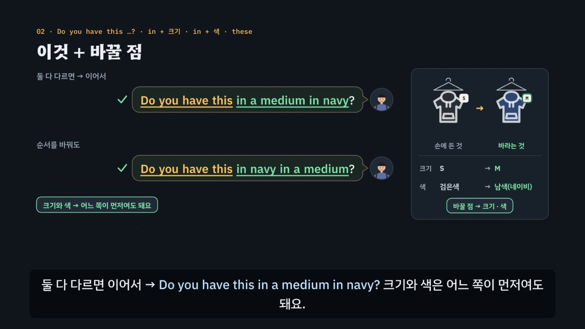

# 쇼핑, 이것에 바꿀 점만 더한다

> [영어 튜토리얼](../README.md) 모음의 **상황별 영어 회화** 여섯 번째 꼭지입니다(영역: `talk`). 형식은 [공항](../airport/) · [카페](../cafe/) · [호텔](../hotel/) · [식당](../restaurant/) · [길 묻기](../directions/)를 따르고(식당을 복사해 시작), 형식의 결정은 [CLAUDE.md](../CLAUDE.md)의 ‘회화 튜토리얼이 갖출 것’에 적었어요.

옷 가게에서는 직원이 먼저 말을 걸지만, 정말 필요한 말은 **내가 먼저** 꺼낼 때가 많아요. 물건이 어디 있는지, 다른 크기 · 색이 있는지, 입어 봐도 되는지, 얼마인지, 바꿀 수 있는지요. 한국 학생이 가장 자주 막히는 곳은 ‘이거 M 있어요?’예요. 낱말 순서대로 옮기면 *M size is there?*가 되고, 묻는 틀이 없어서 직원이 무엇을 바라는지 알아듣기 어려워요. 그래서 이 튜토리얼의 중심은 **이것 + 바꿀 점** 한 줄이에요. 손에 든 옷을 보여 주며 *Do you have this*로 시작하고, 손에 든 것과 **다른 점만** 더해요(*in a medium · in navy*). 같은 점(지금 색)을 말하면 무엇을 바꾸려는지 헷갈리고, 청바지 · 운동화 · 양말처럼 둘이 짝인 물건은 *these*(대답에서는 *they · them*)예요. 여기에 한국어를 그대로 옮긴 말(아이쇼핑 → *eye shopping* · 후드 티 → *hood T* · 패딩 → *padding* · 프리 사이즈 → *free size* · 피팅 → *Can I fitting?* · 디시 → *D.C.* · 원 플러스 원 → *one plus one* · 비닐봉지 → *vinyl bag* · 교환 → *change*)과 빠르게 지나가는 값(*fifteen* · *fifty* · *twenty-nine forty*)을 더했어요. 약 6분 36초짜리 인터랙티브 모션그래픽으로 **3단계 말하기 법**을 가르쳐요.

- ① **열쇠 낱말 + 질문의 모양 잡기** — 무엇을 묻나, 그리고 어떤 모양인가? *or*가 들리면 고르는 질문(*Cash or card?*), *what · how*로 시작하면 정보 질문(*What size …? · How did everything fit?*), *Are you · Do you · Would you · Can I help you*면 Yes/No 질문. 질문이 아닌 안내(*Let me know if you need anything! · The fitting rooms are right over there.*)는 **내가 먼저** 말할 차례예요. 모양마다 그림 표시가 있어요: 스위치(Yes/No) · 갈림길(고르기) · 빈 상자(정보) · 말풍선(안내).
- ② **틀에 내 정보 넣기** — 짧은 대답 틀 + 쇼핑 카드와 맞는 정보. *A medium, please. · Navy, please. · It's a little tight. · Card, please. · I'd like to exchange these.* 다른 크기 · 색은 한 줄로(*Do you have this in a medium in navy?*) 말하면 직원이 크기 · 색 질문을 건너뛰어요.
- ③ **공손하게 끝내기** — *please · thanks · Excuse me, could I …?* 못 알아들었으면 *Sorry? Could you say that again, please?* 일부만 들렸으면 *Sorry, did you say a bag?* 값이 헷갈리면 *Sorry, did you say fifteen dollars?* 가게 규칙이라 안 된다고 하면 따지지 말고 *I see. Thank you anyway.*



## 바로 보기

`index.html`을 더블클릭하면 끝이에요. 설치도, 서버도 필요 없어요.

## 소리와 마이크에 대해 (꼭 읽어 주세요)

- 녹음 파일이 없어요. 영어는 모두 **합성 음성**이에요. 글이 정해진 말(영상의 말풍선 · 영어 칩, 직접 해 보기의 듣기, 듣고 대답 고르기, 따라 말하기)은 **VoiceStudio로 미리 만든 목소리**(`audio/dialogue/`)로, 쇼핑 시뮬레이터처럼 카드마다 바뀌는 말과 내가 칩으로 만든 문장은 **브라우저에 들어 있는 음성(speechSynthesis)** 으로 읽어요. 브라우저 음성은 기기마다 목소리가 다르고, 둘 다 실제 가게의 소리와는 달라요.
- 튜토리얼 전용 목소리 부품 `assets/js/voices.js`(`SHV`)가 말하는 사람마다 목소리를 정해요. 미리 만든 목소리는 매장 직원 = 미국 남성 · 탈의실 직원 = 캐나다 여성 · 계산대 직원(교환 · 환불도) = 호주 남성 · 영국 가게의 직원 = 영국 여성 · 손님(나) = 미국 여성, 화면의 영어 칩(발음 듣기)과 음성 해설의 영어는 밝은 미국 여성 선생님 목소리예요(길 묻기 · 식당과 같은 목소리들). 한 번에 읽는 줄 안에서 한 사람의 말 중 하나라도 파일이 없으면 그 사람의 말은 모두 브라우저 음성으로 읽고(한 사람의 목소리가 중간에 바뀌지 않게), 시뮬레이터는 처음부터 끝까지 브라우저 음성이에요. 브라우저 음성은 매장 직원(en-US) · 탈의실 직원(en-CA) · 계산대 직원(en-AU) · 영국 가게의 직원(en-GB) · 손님(나, 직원과 다른 목소리)을 골라요. 없으면 다른 영어 목소리의 높낮이 · 빠르기를 바꿔 구별해요. ‘아주 빠르게’ 문제는 일부러 빠르게(1.35배) 읽어요. 값은 가게식으로 읽어요(`SH.spoken`): *$29.40* → twenty-nine forty, *$15.00* → fifteen dollars. 공통 부품(`shared/`)은 바꾸지 않았어요.
- 소리가 겹치지 않게: 대화를 읽기 전에 발음 듣기 · 음성 해설 · 녹음 재생을 멈추고 영상을 일시정지해요. 음성 인식을 시작할 때도 다른 소리를 모두 멈춰요.
- **따라 말하기 · 말로 대답하기**: 브라우저에 음성 인식(`SpeechRecognition` · `webkitSpeechRecognition`)이 있으면 말을 글로 바꿔 **낱말만** 맞춰 봐요(발음의 질은 판정하지 않아요). 숫자는 *15*든 *fifteen*이든, 값은 *29.40*이든 *twenty-nine forty*든 같은 숫자로 맞춰요(`SH.canon`). 크롬(Chrome) 같은 브라우저는 소리를 브라우저 회사의 서버로 보내 글로 바꿔요. 음성 인식이 없으면 녹음(`MediaRecorder`)으로 ‘내 목소리’와 ‘원래 문장’을 이어서 들어요. 둘 다 없으면 마이크 단추를 숨기고 ‘세 번 소리 내어 따라 해 보세요’라고 안내해요. 이 사이트는 소리도 글도 저장하지 않아요(녹음은 화면에만 잠깐 있다가 페이지를 닫으면 사라져요). 가게 이름(*Maple & Thread*)은 인식이 다르게 적기 쉬워서 따라 말하기에서 알림을 붙여요.
- 가게 이름(*Maple & Thread*) · 직원 이름(*Jess*) · 물건 · 값 · 할인 · 영수증 · 교환과 환불 규칙(30일 안 · final sale 물건은 안 됨 · 영수증이 없으면 가게 포인트로만)은 모두 지어낸 것이에요(실제 가게 · 체인과 상관없어요). 영수증 합계에는 세금을 넣지 않았어요(나라 · 주마다 달라요). 옷 크기는 미국 크기(S · M · L, 허리 숫자, 신발 US 9)로만 보여 줘요 — 크기를 매기는 법은 나라마다 달라요. 탈의실에서 몇 벌인지 묻는지, 회원 카드 · 봉투 값, 값을 깎을 수 있는지도 나라와 가게마다 달라요.

## 무엇을 배우나요

| 장 | 시각 | 내용 | 직접 해 보기 |
| --- | --- | --- | --- |
| 00 들어가며 | 0:00 | 검은색 S 후드 티를 들고 M을 찾을 때 *M size is there?* → 직원이 고개를 갸웃(묻는 틀이 없음) → *Do you have this in a medium?*, 손에 든 것에 바꿀 점만, 3단계 | 먼저 골라서 대답해 보기 (영국 가게, 듣고 대답 고르기) |
| 01 옷 가게 길 지도 | 0:26 | 옷 가게 평면도의 일곱 곳(입구 · 물건 찾기 · 진열대 · 탈의실 · 값 · 계산대 · 교환과 환불)을 쇼핑하는 차례대로, 곳마다 한두 마디, 내가 먼저 말을 꺼내는 곳(보라 테두리), 가게마다 차례와 규칙이 달라요 | 곳을 골라 한두 마디 듣기 (평면도의 곳을 눌러도 됨) |
| 02 이것 + 바꿀 점 | 0:56 | 손에 든 것과 바라는 것 견주기, *Do you have this in a medium? · in navy? · in a medium in navy?*(크기와 색은 어느 쪽이 먼저여도 됨), 같은 점(*in black*) ×, 둘이 짝 → *these*(*Do you have these in a 32?*), 긴 말(*in medium size in navy color*)보다 짧게 | 바꿀 점 한 줄 만들기 (상황 셋 · 누르는 차례대로, 순서 · 같은 점 · this와 these 판정과 건너뛸 질문) |
| 03 입구와 물건 찾기 | 1:32 | *Can I help you find anything?* → *I'm just looking, thanks.* · *Yes, I'm looking for a hoodie.*, *Just eye shopping.* ×, 그냥 *No.*는 무뚝뚝, 영국 *Are you alright there?*, 안내(*Let me know if you need anything!*) → 내가 먼저 *Excuse me, where can I find jeans?*(is · are 고민 없음), 후드 티 · 원피스 · 패딩 · 와이셔츠 | 질문의 모양 맞히기 + *Yes, please.*로 대답하면? |
| 04 크기와 색 | 2:06 | *What size are you looking for?* → *Yes, please.* × → *A medium, please.* · *I'm a medium.*, *Free size* × → *one size*, *M size*는 통하지만 보통 *a medium*, 허리 *a 32* · 신발 *a size 9*, *Would you like it in navy or gray?* → *Navy, please.*, *this in* → *thi-sin*, *Give me a bigger one.* × | 크기 말하기 (물건 · 내 크기 · 틀 · 칸) |
| 05 탈의실 | 2:40 | 안내 → *Could I try this on?*, *Can I fitting?* · *Can I wear this?* ×, *How many items do you have?* → *Two.*, *How did everything fit?* → *Yes, it did.* × → *It's a little tight.* · *They're a little loose.* · *It fits great.*, *Would you like to try a different size?* → 꽉 끼면 한 칸 큰 것 *Yes, could I try a large?* | 입어 보니 어떤지 말하기 (물건 · 맞음새 · 틀 · 칸 → 다음 크기) |
| 06 값과 할인 | 3:14 | *Excuse me, how much is this? · are these?*, *How much money?* · *D.C.* × → *Is this on sale?*, *It's $15.00 today. That's fifty percent off.*, fifteen(뒤를 세게) · fifty(앞을 세게), *Sorry, did you say fifteen dollars?*, *Too expensive. Cheaper, please.* ×, *buy one, get one free*(원 플러스 원) | 값 묻고 듣기 (물건 · 할인 → `SH.salePrice`, fifteen · fifty 짝 셋, 값 되묻기 한 문제) |
| 07 계산대 | 3:48 | *Did you find everything okay?* → *Yes, I found.* × → *Yes, I did. Thanks.*, *rewards card* → *No, I don't.*(*I don't have.* ×), *vinyl bag* ×, *Your total is $21.00. Cash or card?* → *Card, please.*, 영수증(후드 티 $15.00 + 양말 두 켤레 $6.00, 세금 없이), *Would you like your receipt?* → *Yes, please.* | 계산대에서 합계 듣기 (물건 · 할인 · 양말 · 내는 방법 → `SH.bill`의 영수증과 직원의 말) |
| 08 교환과 환불 | 4:20 | *Hi, how can I help you?* → *change* × → *I'd like to exchange these.* · *return*, *Refund me.* ×, *Do you have your receipt?* → *Yes, here it is.*, *What's the reason?* → *They're too small.*, *What size would you like instead?* → *A 32, please.*, *refund or store credit*(모르면 *what's store credit?*), 30일이 지나면 → *I see. Thank you anyway.* | 교환 · 환불 규칙 따라가기 (하려는 일 · 며칠 뒤 · 영수증 · final sale → `SH.returnRule`의 차례와 직원의 말) |
| 09 3단계 말하기 법 | 4:56 | 상자 셋, 일곱 곳에 한 줄씩 모양 표시와 함께 단계별로 채워짐 | 곳을 골라 3단계 보기 |
| 10 실전 쇼핑 | 5:24 | 쇼핑 카드 하나(청바지 30 → 32)로 넷(진열대 · 탈의실 · 계산대 · 교환), 보기마다 엔진이 ①②③ 몇 단계에서 지우는지 | 대화 골라 보기 |
| 11 정리 | 6:14 | 곳 · 열쇠 낱말과 모양 · 대답 틀 표 + 이것 + 바꿀 점 + 값 되묻기 | 아래 칸으로 가는 길 |

영상 아래에는 다섯 가지가 더 있어요.

- **놀이터 — 쇼핑 시뮬레이터**: 누를 때마다 새 쇼핑 카드(들어갈 때 둘러보기 · 찾는 물건, 손에 든 것과 바라는 것(크기나 색, 또는 둘 다 다름), 탈의실의 벌 수와 맞음새, 값 묻기 · 할인 묻기, 양말 받기, 회원 카드 · 봉투 · 내는 방법 · 영수증, 며칠 뒤 교환이나 환불)가 만들어져요. 차례: 입구(*Can I help you find anything?*, 찾는 물건까지 말하면 물건 찾기의 질문을 건너뜀) → 물건 찾기(둘러보던 카드면 직원의 안내 뒤 내가 먼저 묻기) → 진열대(*Are you finding everything okay?* → **바꿀 점 한 줄**(L)로 크기 · 색을 한 번에 말하면 직원이 크기 · 색 질문을 건너뜀) → 탈의실(내가 먼저 입어 보기 → 몇 벌 → 어땠는지 → 맞지 않으면 다른 크기) → 값(내가 먼저 값 · 할인 묻기 → **직원이 말한 값을 듣고** 사기 → 양말 하나 더) → 계산대(다 찾았나 · 회원 카드 · 봉투 · 합계와 내는 방법 · 영수증) → 며칠 뒤 교환 · 환불(무엇을 하려나 → 영수증 → `SH.returnRule`에 따라 바꿀 크기 · 돈이나 가게 포인트 · 가게 포인트로만 · 30일이 지나 안 됨). 값은 카드에 없어요 — 직원이 말한 값(*fifteen* · *fifty*)을 듣고 써야 해요. 대답은 ① 대답 틀 칩(맞는 틀 하나 · 함정 하나(Yes만 · 한국어 그대로 · 콩글리시 · 무례한 말) · 다른 질문의 틀 하나)과 ② 칸 칩(카드의 값 + 헷갈리기 쉬운 값)으로 만들어요. 엔진이 ①에서 걸리면 직원이 질문만 다시 말하고(*Sorry — cash or card?*), ②에서 걸리면 *Hmm, are you sure?*(카드와 다름) · *Hmm, isn't that the same as the one you have?*(같은 점) · *Sorry — eye…?* 같은 반응, ③이면 *… Okay.* 매번 단계와 까닭, 모범 대답(듣기)을 보여 줘요. 다시 묻기(*Sorry, did you say fifteen dollars?* · *Sorry, what's store credit?* · *Could you say that again?*)에는 직원이 확인해 주거나 쉬운 말로 풀어 주거나 천천히 한 번 더 말해요. 음성 인식이 있으면 마이크로 말해서 대답할 수 있어요. 끝나면 영수증(할인 · 양말 · 합계), 한 번에 통과한 수, 한 번에 말해서 건너뛴 질문 수(건너뛴 게 없으면 바꿀 점 한 줄의 본보기), 며칠 뒤의 결과, 대화 전체와 듣기. 키보드: R 듣기 · S 천천히 · T 대본 · 1~3 대답 틀 · A~C 내 정보 · Enter 대답하기 · Backspace 지우기 · L 바꿀 점 한 줄 · M 말로 대답하기 · N 새 카드.
- **쇼핑 표현 따라 말하기**: 곳마다 넷씩, 직원의 말과 내 말 28문장. 듣기 · 천천히 · 따라 말하기(음성 인식 → 녹음 → 소리 내어 따라 하기). 인식 결과는 원래 문장의 낱말마다 초록(들림) · 주황(빠짐)으로 보여 줘요.
- **듣고 대답 고르기**(튜토리얼 전용 `SDrill`, `EN.drill`과 같은 모양 · 키보드): 16문제, 일곱 곳 + 빠른 말 · 다시 묻기, 정답 위치 A · B · C · D 넷씩. 문제마다 곳 아이콘과 한 줄 상황, 직원의 말은 소리 먼저(글은 답한 뒤 또는 대본 보기), 대답 넷은 글. 힌트 = 3단계 — ① 열쇠 낱말과 질문의 모양(직원의 말 옆에 모양 표시) ② 틀 · 칸(함정은 주황) ③ 공손한 말(보라)과 정답. 답하면 보기마다 엔진의 까닭, 해석, 줄마다 듣기, 대화 듣기(직원 → 나). 키보드: A~D(1~4) 고르기 · H 힌트 · R 다시 듣기 · S 천천히 · T 대본 · Enter/→ 다음.
- **퀴즈**: 10문제(그림 문제 3개: 질문의 모양 표시 고르기, 크기 줄에서 다음에 입어 볼 크기 누르기, 영수증에서 합계 줄 누르기).
- **핵심 정리**: 곳 × 열쇠 낱말 · 모양 × 대답 틀 표, 용어(① 질문의 모양 셋과 안내 · ② 이것 + 바꿀 점 · 크기 · 맞음새 · 값 · 할인 · ③ Excuse me, could I …? · 구경만 할 때 · 다시 묻기 · 무례하게 들리는 말 · ④ 한국어와 다른 점 · 콩글리시).

### 플레이어 조작

다른 튜토리얼과 같아요. 스페이스(재생/일시정지), ← →(5초), Shift + ← →(장), C(자막), V(음성 해설), F(전체 화면). 화면 속 말풍선을 누르면 그 사람의 목소리로, 영어 칩을 누르면 발음을 들려줘요. 01장 평면도의 곳을 누르면 직접 해 보기와 함께 바뀌어요. 주소 끝에 `#c-장면이름`(예: `index.html#c-change`)을 붙이면 그 장면에서 시작해요.

음성 해설은 자막의 `(A)`~`(D)`를 ‘에이 · 비 · 씨 · 디’, 값(`$15.00`)을 ‘15달러’처럼 한국어로 읽고(앞의 영어와 붙어 읽히지 않게 끊어서), `Yes/No`는 *Yes or No*로 읽어요.

**미리 만든 목소리**: VoiceStudio(OmniVoice 엔진, 비상업용 라이선스)로 만든 합성 음성 파일이에요. 파일이 없거나 못 읽으면 그 줄 · 조각만 브라우저 음성으로 읽어요.
- 음성 해설(`audio/narration/`): 한국어 조각은 「튜토리얼 내레이터 (젊은 여성)」, 영어 조각(본보기 영어 문장)은 「영어 선생님 (밝은 미국 여성)」. 화면의 영어 칩(발음 듣기, 말하는 사람 `tc`)도 같은 목소리예요(다른 회화 · 토익 튜토리얼과 같음).
- 대화(`audio/dialogue/`): 말하는 사람 → 프로필은 `voices.json`(길 묻기와 같은 프로필 — 이름의 ‘길 묻기’는 처음 만든 곳일 뿐이에요). 프로필은 VoiceStudio 목소리 보관함(archetype)에서 고른 목소리를 한 번 만든 소리로 복제(clone)한 것이라, 줄마다 같은 사람 목소리가 나요. 파일 이름은 말하는 사람과 읽을 글로 정해져요(`SHV.lineId`). 값은 읽을 글(`SH.spoken`)로 만들어요(*$15.00* → *fifteen dollars*).
- 합성 엔진은 가끔 무음 · 잡음을 내거나, 세 낱말 이하의 짧은 말을 0.3초 안에 뭉개 읽어요. 도구가 말소리 1초에 읽은 글자 수로 이런 소리를 걸러 seed를 바꿔 다시 만들고(짧은 말은 다섯 번까지), 그래도 이상하면 ‘확인 필요’로 알려 줘요. 지금 파일은 받아쓰기(Whisper)와 높낮이로 모두 다시 확인했어요(영어 335개 · 한국어 133개). 소리가 나지 않은 한국어 조각 ‘값’, 숫자를 흐리게 읽은 ‘15달러’ · ‘21달러’(‘이십일 달러’로 풀어 써서), ‘와이셔츠’는 seed를 바꿔 다시 만들었어요. 밝은 선생님 목소리로 아주 높게 읽은 짧은 말 10개(*forty* · *thirty* · *fifty* · *Two.* · *Great.* · *Can I wear this?* 들)도 seed를 바꿔 다시 만들었고, *fifty*는 길 묻기 · 식당과 같은 `--seed 11` 소리예요. 매장 직원(미국 남성)은 짧은 말(*Great choice.* · *Sorry?*)을 원래 빠르게 말하고, 밝은 목소리라 고르는 대답 · 부르는 말(*Gray, please.* · *Cash, please.* · *Hiya, are you alright there?*)은 원래 높게 읽어요. *thi-sin*은 이어 읽는 소리를 보여 주는 조각이라 받아쓰기는 *Thiessen*으로 적어요. 한 파일만 다시 만들려면 그 파일을 지우고 `--seed`를 바꿔 다시 실행하세요.

만드는 법(VoiceStudio가 있는 맥에서, 이미 만든 파일은 건너뛰어요):

```bash
node tools/narration-pieces.cjs shopping     # 해설의 읽기 조각 목록 (자막을 고쳤을 때만, 클라우드에서도 됨)
node tools/dialogue-lines.cjs shopping       # 대화 줄 목록 (대화 · 문제 · 따라 말하기를 고쳤을 때만, 클라우드에서도 됨)
python3 tools/voicestudio-narration.py shopping --en-profile "영어 선생님 (밝은 미국 여성)"   # 해설 (한국어 + 영어 조각)
python3 tools/voicestudio-dialogue.py shopping             # 대화
```

## 무엇이 규칙 계산인가요

- **규칙 엔진** `assets/js/grammar.js`가 맞고 틀림과 까닭, 3단계 가운데 몇 단계에서 걸리는지를 정해요. 영상 속 ✓·×와 실전 쇼핑에서 지워지는 순서, 질문의 모양, 바꿀 점 한 줄의 판정과 건너뛰는 질문, 크기를 한 칸 올리고 내리는 계산, 할인한 값과 영수증, 교환 · 환불 규칙, 직접 해 보기 채점, 시뮬레이터의 판정과 직원의 반응, 듣고 대답 고르기의 힌트와 보기별 해설, 퀴즈 대부분의 정답이 여기서 나와요.
  - 직원의 말(`SH.Q`)마다 곳 · 뜻(`intent`) · **모양**(`shape`: `yn` · `or` · `wh` · `note`, 고르는 질문은 고를 것 `choices`) · 열쇠 낱말(`key`, 말 안에 꼭 있음) · 빠른 말(`fast`) · 알려 준 사실(`fact`: 값 · 할인 · 합계) · 대답 대신 해도 되는 다시 묻기(`allow`: *what's store credit?*)를 적었어요. `SH.shapeGuess`(마지막 물음 문장 → *or*가 있으면 고르기, 의문사로 시작하면 정보, 나머지는 Yes/No, 물음표가 없으면 안내)가 글과 맞는지 점검해요.
  - 대답은 틀(`SH.FRAME`) + 칸 값(`SH.SLOT`)이에요. 틀 글의 `___`은 내 정보 칸, `{…}`는 공손한 말이고, 틀마다 표시가 있어요: ok · literal(한국어를 그대로 옮김 · 콩글리시) · wrong(틀린 문장) · blunt(명령 · 조르기 · 따지기) · plain(그냥 *No.*로 끊김). **Yes · No만 하는 대답**은 `bare` 틀(*Yes. · Yes, please. · No, thanks.*)이에요. 칸 값도 콩글리시일 수 있어요(*hood T* · *padding* · *one-piece* · *Y-shirt* · *free size* → `bad`). 값은 정해져 있지 않은 칸(`dyn`)이에요.
  - **바꿀 점 한 줄** `SH.changeLine(줄, 카드)` — 조각(`SH.OW`: 묻는 틀 *Do you have* · *Could I try* · *Give me* / 이것 *this* · *these* / 바꿀 크기 *in a medium* / 바꿀 색 *in navy*)을 누르는 차례대로 이은 줄을 판정해요. 같은 갈래는 한 번만, 차례는 묻는 틀 → 이것 → 바꿀 점(크기와 색은 어느 쪽이 먼저여도 됨), *this* · *these*는 물건이 둘이 짝인지와 맞아야, 바꿀 점은 손에 든 것과 다른 것만(같은 점 → `same`), 크기는 물건의 크기 방법(윗옷 · 허리 · 신발)과 맞아야, *Give me*는 ③. `SH.covered`가 그 줄이 이미 답한 질문(크기 · 색, 입구에서 말한 찾는 물건)을 돌려주고, 시뮬레이터는 같은 곳 안에서만 건너뛰어요. 대화 전체에서 한 번만 나오는 질문(찾는 물건, `SH.CROSS`)은 입구에서 말했으면 물건 찾기에서도 건너뛰어요.
  - `SH.judge(말, 대답, 카드)` — ① 빠른 말이면 다시 묻는 말만 통과, **Yes · No만 하는 대답은 고르는 질문 · 정보 질문 · 안내에서 탈락**, 고르는 질문에서 직원이 말하지 않은 것을 고르면 탈락, 다른 질문의 대답이면 탈락(*How did everything fit? → Yes, it did.*처럼 모양이 다른 대답 `wrongShape`도) ② 틀이 literal · wrong이거나 칸 값이 콩글리시면 탈락, Yes/No 질문에 Yes · No만 했으면 카드가 바라는 쪽인지(`yn.yes`) 보고 *Would you like to try a different size?*에는 *Yes.*만으로 모자라 탈락(`strict`), 칸의 정보가 카드(또는 직원이 말한 값)와 다르면 탈락, *this* · *it* 과 *these* · *them*이 물건과 맞지 않으면 탈락 ③ blunt · plain이면 탈락. 값을 되묻는 말(*Sorry, did you say fifteen dollars?* · *Sorry, was that $21.00?*)은 직원이 말한 값과 같으면 통과해요(숫자가 헷갈릴 때 되묻는 것도 좋은 대답이에요). 말로 되물으면 시뮬레이터의 직원이 값을 확인해 주고 대답을 기다려요. `SH.model`은 카드에 맞는 모범 대답(진열대는 바꿀 점 한 줄), `SH.steps`는 힌트 세 단계와 색칠할 낱말을 만들어요.
  - `SH.ITEMS` · `SH.SIZES` · `SH.sizeFor` · `SH.salePrice` · `SH.bill` · `SH.returnRule` — 지어낸 물건(값 · 크기 방법 · 둘이 짝인지 · 색), 크기 줄(윗옷 XS~XL · 허리 28~34 · 신발 US 7~10)에서 맞음새에 따라 한 칸 올리고 내리기(꽉 끼거나 작거나 짧으면 위로, 헐렁하거나 크거나 길면 아래로), 할인한 값(센트까지 반올림), 영수증(물건 + 하나 사면 하나 더 받는 양말, 세금 없이), 교환 · 환불 규칙(final sale → 안 됨, 30일이 지나면 → 안 됨, 교환 → 바꿀 크기, 영수증 있음 → 돈이나 가게 포인트, 없음 → 가게 포인트로만). 영상의 값표 · 영수증 · *Your total is $21.00.* · 시뮬레이터의 영수증과 직원의 말이 모두 같은 계산이에요.
  - `SH.matchSpoken(들린 글, 말, 카드)` — 음성 인식이 글로 바꾼 말에 그 말의 표시 낱말과 카드의 사실이 들어 있으면 받아들여요. **모양 규칙도 같아요**: 고르는 질문 · 정보 질문에 *yes* · *no*만 들리면 ①. 숫자 낱말은 숫자 줄로 모아(`SH.canon`: *fifteen* → 15, *twenty-nine forty* → 2940, *size nine* → 9) 크기 · 값 · 벌 수를 맞춰요. 다른 크기 · 다른 색 · 다른 값(*fifty*) · 반대로 한 일(교환인데 *return*) · *eye shopping* · *hood T* · *free size* · *Can I fitting?* · *DC* · *one plus one* · *vinyl bag* · *change* · 둘이 짝인데 *this*는 ②, 다른 질문의 대답만 들리면 ①. 같은 값을 되물으면 직원이 확인해 줘요. 말투는 판정하지 않아요.
  - `SH.compareWords(원래 문장, 들린 글)` — 낱말마다 맞춤(가장 긴 공통 부분열, 숫자는 같은 숫자로).
- **어긋남 경고** `SH.check()`: 열쇠 낱말이 말에 없거나, 적어 둔 모양이 글의 모양과 다르거나, 고르는 질문에 고를 것이 없거나, 사전에 없는 뜻 · 칸을 쓰거나, 함정 틀에 까닭이 없거나, 맞는 보기가 하나가 아니거나 정답과 다르거나, 정답 위치가 4/4/4/4가 아니면 콘솔에 경고가 떠요. 값 읽기와 숫자 맞추기(*twenty-nine forty* · *$29.40* · *fifty percent* · *size nine*), 크기 바꾸기 · 할인 · 교환과 환불 규칙, 영상 · 직접 해 보기의 대화(02~08장), 바꿀 점 한 줄과 건너뛰는 질문, 데모 영수증($21.00), 실전 쇼핑에서 단계마다 지워지는 보기와 화면 글, 시뮬레이터 카드 50장(바꿀 점이 있는지, 모범 대답이 통과하는지, 말로 해도 통과하는지, 틀 칩 가운데 맞는 것이 하나뿐인지, 맞는 틀의 칸 칩에 카드 값이 있는지, 매번 바뀌는 직원의 말도 모양과 열쇠 낱말이 맞는지, 바꿀 점 한 줄을 말로 해도 같은 질문을 건너뛰는지), 말로 한 대답 수십 가지(고르는 · 정보 질문마다 *yes* · *yes please* · *yeah sure*, 콩글리시 · 다른 크기 · 같은 색 · *these* 하나 · *fifty* · 반대로 한 일 …), 따라 말하기 문장(곳마다 넷, 숫자를 낱말로 말해도 맞는지)도 점검하고, 퀴즈 정답은 `app.js`에서 따로 점검해요.
- **단순하게 줄인 부분과 엄격함의 기준** (직원이 틀리다 · 헷갈린다 · 무례하다고 느낄 말만 거르고, 알아듣지만 더 흔한 말이 있으면 통과 + 알림)
  - 엔진은 소리를 듣지 않아요. 말의 뜻 · 모양 · 열쇠 낱말, 대답의 틀과 칸은 사람이 적어 두었고, 엔진은 그것을 카드의 사실과 맞춰요. 대답 틀은 옷 가게에서 자주 쓰는 것만 골랐어요. 같은 뜻의 다른 자연스러운 대답도 많아요(*Do you have this in a medium?* 말고도 *Does this come in a medium?* · *Is there a medium in this?*).
  - **바꿀 점 한 줄의 차례**(묻는 틀 → this · these → 바꿀 점)와 ‘같은 점은 빼요’는 자주 쓰는 경우를 단순하게 줄인 규칙이에요. 실제로는 *Do you have this in navy, in a medium?*처럼 쉼표로 이어도, 같은 색을 덧붙여도(*in a medium, in black too*) 알아들어요. 엔진은 ‘다른 점만 말하면 헷갈리지 않는다’는 쪽으로 엄격하게 봤어요. 긴 말(*this hoodie in medium size in navy color*)도 통하지만 영상에서 ‘짧게’를 보여 주는 데만 썼어요.
  - **질문의 모양 (①)**: 고르는 질문(*Would you like it in navy or gray? · Cash or card? · Would you like a refund or store credit?*)과 정보 질문(*What are you looking for? · What size …? · How many items …? · How did everything fit? · What's the reason …?*)에 *Yes.* · *Yes, please.* · *Yes, it did.*만 하면 ①. 도와주겠다는 Yes/No 질문(*Can I help you find anything?*)에는 찾는 것만 말해도 통과해요.
  - **콩글리시 · 한국어 그대로 (②)**: *Just eye shopping.* · *hood T* · *padding* · *one-piece* · *Y-shirt* · *free size* · *M size is there?* · *Can I fitting?* · *Can I wear this?* · *How much money?* · *D.C. is possible?* · *Oh, one plus one?* · *Vinyl bag, please.* · *Receipt, no need.* · *Change, please.*(교환) · *Yes, I found.* · *No, I don't have.*(틀린 문장). **통과 + 알림**: *M size*(크기 칸으로 말할 때 → 보통 *a medium*). *I'm a medium.*은 그냥 통과해요.
  - **공손함 (③)**: *Give me a bigger one.* · *Too expensive. Cheaper, please.* · *Refund me.* · *That's not fair! Give me my money back.* · *What?* 과 그냥 *No.*(도와주겠다는 말에)는 ③. 실제로는 말투 · 표정으로도 공손함이 전해지고, 값을 깎을 수 있는 곳(시장 · 작은 가게)도 있어요. 말로 한 대답은 말투를 판정하지 않아요.
  - 맞음새는 한 칸 올리고 내리는 것만 다뤄요(실제로는 브랜드마다 크기가 달라 두 칸을 바꾸거나 다른 모양을 고르기도 해요). 양말은 늘 ‘하나 사면 하나 더’예요.
  - 시뮬레이터의 직원은 늘 같은 차례에 작은 변화만 주게 만들었어요(둘러보기 · 바꿀 점 · 맞음새 · 할인 · 교환이나 환불). 실제 가게에서는 차례가 바뀌거나 묻지 않고 넘어가기도 해요.
  - 말로 대답하기와 따라 말하기는 낱말만 맞춰요. 발음과 공손함은 판정하지 않고, 음성 인식이 숫자 · 이름을 다르게 적을 수도 있어요.
  - 사람 · 평면도 · 옷 · 값표 · 영수증은 도형으로 그린 그림이에요. 이어서 들리는 소리 상자(*thi · sin*, *fif · TEEN*)는 대략의 모양이에요.
- **예문과 대화**: 모두 직접 만든 것이에요.

이웃 튜토리얼: 같은 형식의 [공항](../airport/) · [카페](../cafe/) · [호텔](../hotel/) · [식당](../restaurant/) · [길 묻기](../directions/). 질문의 모양(Yes/No · 고르기 · 정보)은 식당에서, fifteen과 fifty는 카페 · 길 묻기와 토익 듣기 [T15](../listening-part1-2/)에서도 다뤄요.

## 폴더 구조

```
index.html              페이지 (영상 · 직접 해 보기 · 쇼핑 시뮬레이터 · 따라 말하기 · 듣고 대답 고르기 · 퀴즈 · 핵심 정리)
assets/js/grammar.js    규칙 엔진(SH.judge · SH.model · SH.shapeGuess · SH.changeLine · SH.covered · SH.matchSpoken · SH.compareWords · SH.canon),
                        물건과 계산(SH.ITEMS · SH.SIZES · SH.sizeFor · SH.salePrice · SH.bill · SH.returnRule · SH.priceWords · SH.spoken), 곳(SH.PLACES) · 모양(SH.SHAPE) · 말(SH.Q) · 틀(SH.FRAME) · 칸(SH.SLOT) · 조각(SH.OW),
                        연습 문제(SH.DRILL), 영상 대화(SH.INTRO · SH.LINE · SH.METHOD · SH.PRACTICE · SH.DEMO · SH.EXCARD · SH.REFCARD), 쇼핑 카드(SH.newCard · SH.simQs · SH.simQ · SH.simFrames),
                        따라 말하기(SH.SHADOW), 힌트(SH.steps), 점검(SH.check)
assets/js/voices.js     대화 목소리(SHV): 매장 직원 · 탈의실 직원 · 계산대 직원 · 영국 가게 · 손님(나) 다른 영어 목소리(미리 만든 파일 → 없으면 브라우저 음성), 빠른 말, 값 읽기, 다른 소리와 겹치지 않게
assets/js/scenes.js     영상 장면 12개, 장 목록과 자막, 곳 아이콘과 모양 표시(SHS.ICON · SHS.iconSVG · shapeMark · shapeTag), 얼굴(avatar), 말풍선(talk · answer), 낱말 조각(lay · morph),
                        옷 가게 평면도, 옷 그림(clothDraw · hung · handWant), 크기 줄(sizeRow), 값표(priceTag), 영수증(receiptDraw), 쇼핑 카드(shopCard), 이어서 들리는 말
assets/js/app.js        플레이어, 직접 해 보기, 듣고 대답 고르기(SDrill), 쇼핑 시뮬레이터, 따라 말하기(음성 인식 · 녹음), 퀴즈, 영상 추출(EN_EXPORT)
video/                  자막 원고(SRT)
audio/narration/        음성 해설의 읽기 조각 목록(pieces.json) · 미리 만든 음성 파일 목록(clips.js) · 음성 파일(조각 id.m4a)
audio/dialogue/         대화 줄 목록(lines.json) · 말하는 사람 → 프로필(voices.json) · 파일 목록(clips.js) · 음성 파일(말하는사람-id.m4a)
docs/poster.jpg         사이트 카드 그림
```

## 영상 다시 만들기

```bash
node tools/render-video.cjs shopping                      # → shopping/video/shopping.mp4 + .srt
node tools/render-video.cjs shopping --frames 80,290      # 몇 장면만 그림으로
node tools/render-video.cjs shopping --poster 73.2        # 카드 그림
node tools/render-video.cjs shopping --srt                # 자막 원고만
```

MP4에는 소리가 없어요(자막이 그림에 들어가요). 말은 말풍선 속 낱말이 하나씩 나타나는 모습으로 보여 줘요.
