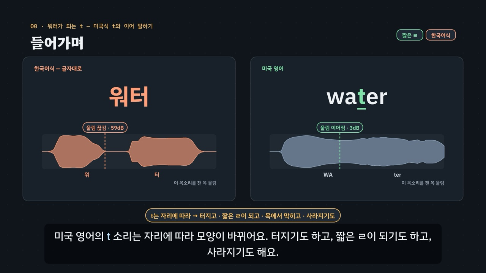

# 워러가 되는 t — 미국식 t와 이어 말하기

> [영어 튜토리얼](../README.md) 모음의 **영어 발음 (미국식)** 여덟 번째 꼭지입니다(영역: `pron`, 계획표의 P11 · 유형 21). 발음 영역의 설계도는 [docs/pron-types.md](../docs/pron-types.md)이고, 형식과 잰 값 읽기는 [문장 리듬](../sentence-rhythm/README.md)을 따랐어요. 이 꼭지는 음절 공 대신 **목 울림 띠**를 그려, t 자리에서 소리가 이어지는지 끊기는지를 보여 줘요.

영어 낱말 *water*를 한국어식으로 읽으면 *워터* — t 자리에서 목 울림이 끊기고 ㅌ이 터져요. 미국 영어는 모음 사이 · 약한 음절 앞의 t를 **혀끝으로 한 번 톡** 치는 짧은 ㄹ로 내서 *워러*에 가깝게 들려요. t의 모양은 자리가 정해요.

- **숨이 터지는 t** — 낱말 처음이나 센 음절의 처음(*top · ten · hotel · attack*).
- **s 뒤의 t** — 숨이 거의 나오지 않아 ㄸ에 가깝게(*stop · style*).
- **짧은 ㄹ 같은 t** — 앞이 모음이나 r 소리, 뒤가 약한 음절(*water · city · better · party*). d도 같은 자리에서 짧은 ㄹ이 돼서 *metal · medal*, *writer · rider*는 거의 같은 소리예요.
- **강세가 정하는 t** — 센 음절이 t 바로 뒤로 옮겨 가면 터져요(*Italy · Italian, atom · atomic, photo · photographer, thirty · thirteen*).
- **목에서 막는 t** — 뒤에 ‘은’처럼 약한 소리(*button · mountain · certain · written*). **사라지는 t** — n 바로 뒤에서 빠지기 쉬워요(*twenty · internet · center*). 둘 다 경향이고, 또박또박 말하면 t를 살려요.
- **끝의 t** — 터뜨리지 않고 막은 채 끝내요(*cat · hot*). 뒤에 모음으로 시작하는 낱말이 오면 짧은 ㄹ로 이어져요(*get it · what about · a lot of*).
- **이어 말하기** — 낱말 끝 자음은 다음 낱말의 모음에 붙여요(*pick it up · an apple · turn off · check it out*). t · d 뒤에 *you*가 오면 바뀌기 쉬워요(*did you → 디쥬 · would you → 우쥬*).

3단계 발음법: ① **듣고 가르기**(t 자리에서 목 울림이 이어지나 끊기나, 목소리 넷) → ② **소리 만들기**(혀끝으로 한 번 톡 · 센 음절 앞은 터뜨리기 · 막기와 빠지기) → ③ **이어 말하기**(낱말 사이 · 문장 속 · 외래어 함정).



## 바로 보기

`index.html`을 더블클릭하면 끝이에요. 설치도, 서버도 필요 없어요.

## 소리와 마이크에 대해 (꼭 읽어 주세요)

- 녹음 파일이 없어요. 영어는 모두 **합성 음성**이에요. 글이 정해진 말(낱말 · 짧은 구 · 문장 · 연습 문제 · 따라 말하기)은 **VoiceStudio로 미리 만든 미국식 목소리 넷**(`audio/dialogue/`)으로, 나머지는 브라우저에 들어 있는 영어 음성(speechSynthesis)으로 읽어요. 합성 음성은 실제 사람의 말소리와 조금 다르게 들릴 수 있고, 빠지기 쉬운 t(*twenty*)를 살려 읽을 수도 있어요.
- **목소리 넷**: 밝은 선생님(미국 여성) · 차분한 선생님(미국 여성) · 미국 여성 · 미국 남성. t 듣고 가르기 훈련 · 연습 문제는 문제마다 목소리를 바꿔요. 비교용 **한국어식 소리**(*워터 · 겟 잇 · 픽 잇 업 · 메탈 · 호텔* 등, 글자대로 읽은 소리)는 한국어 내레이터 목소리로 만들어요(`voices.json`의 `"lang": "ko"`). 한국어 목소리도 받침을 다음 모음에 이어 읽어서(*턴 오프 → 터노프*, *컴 온 → 커몬*, seed 여섯 개 모두), 낱말이 둘 이상인 한국어식 줄은 낱말 사이에 쉼표를 넣어 끊어 읽게 만들어요(`"pauseWords": true` — 화면 글은 그대로, 쉼표 없이도 끊어 읽은 *겟 잇 · 왓 어바웃 · 픽 잇 업 · 언 애플*은 처음 파일 그대로). 끝 t를 *랏 · 앳*으로 적으면 한국어 목소리가 다음 모음에 이어 *레노브 · 낮에*로 들려서, *a lot of · not at all*은 *어 로트 오브 · 낫 애트 올*로 적었어요.
- 튜토리얼 전용 목소리 부품 `assets/js/voices.js`(`ATV`)는 문장 리듬의 `SRV`를 그대로 가져왔어요(잰 값 `ATV.meas` 포함). 말하는 사람마다 파일을 찾고, 없으면 브라우저 음성(en-US, 한국어식은 ko-KR)으로 읽어요. 읽기 전에 음성 해설 · 발음 듣기 · 녹음 재생을 멈추고 영상을 일시정지해요.
- **내 목 울림 띠 · 따라 말하기**: 내 목 울림 띠(시험 기능)는 녹음한 낱말을 **브라우저 안에서** 측정 도구와 같은 방법(낮은 소리 60~500Hz만 남기고 10ms마다 크기)으로 재서 띠로 그려요. 녹음은 메모리에만 두고 아무 데도 보내지 않아요. 발음의 질은 판정하지 않아요 — 마이크 · 방의 울림 · 말 빠르기에 따라 띠가 달라져요. 따라 말하기는 음성 인식(`SpeechRecognition` · `webkitSpeechRecognition`, en-US)이 있으면 들린 낱말을 원래 문장과 맞춰요. 크롬(Chrome) 같은 브라우저는 소리를 브라우저 회사의 서버로 보내 글로 바꿔요. 음성 인식이 없으면 녹음(`MediaRecorder`)으로 ‘내 목소리’와 ‘본보기’를 이어서 들어요. 이 사이트는 아무것도 저장하지 않아요(훈련 기록만 이 브라우저의 `localStorage`에).

## 무엇을 배우나요

| 장 | 시각 | 내용 | 직접 해 보기 |
| --- | --- | --- | --- |
| 00 들어가며 | 0:00 | 한국어식 *워터* vs 미국식 *water*, 목 울림 띠 둘 | 먼저 들어 보기(한국어식 · 미국식 띠 나란히) |
| 01 들어 보기 · 구별되나요? | 0:36 | ① *metal · medal · writer · rider*(거의 같은 소리), *water · hotel*(이어짐 · 끊김) | 목소리 바꿔 듣기 |
| 02 t의 지도 | 1:16 | ① 자리마다 여섯 가지 모양(터지는 t · s 뒤 · 짧은 ㄹ · 막는 t · 사라지는 t · 끝의 t) | 낱말 고르기(모양마다 까닭 표) |
| 03 짧은 ㄹ 같은 t | 2:00 | ② 입 옆 단면도(혀끝 한 번 톡), 띠 여섯(*water · city · better · medal · ladder · rider*) | 짧은 ㄹ 낱말 고르기(t · d) |
| 04 강세가 정해요 | 2:44 | ② *Italy · Italian, atom · atomic, photo · photographer, thirty · thirteen* 띠 견주기 | 강세 짝 고르기 |
| 05 막는 t · 사라지는 t | 3:26 | ② *button · mountain · certain · written*, *twenty · internet · center · winter · interview*(재지 않은 교재의 설명, 경향) | 막는 t · 사라지는 t |
| 06 낱말 사이의 t | 4:08 | ③ *get → get it, what about, a lot of, not at all, put it on*, 한국어식 *겟 잇* | 낱말 사이의 t 고르기 |
| 07 이어 말하기 | 4:48 | ③ *pick it up · an apple · turn off · check it out · come on*, t · d + *you* | 이어 말하기 고르기 |
| 08 문장 속에서 | 5:32 | ③ 긴 문장 셋 칠하기, 외래어 함정(*컴퓨터 → 컴퓨러* 등 여섯) | 문장 고르기(28 + 3) |
| 09 정리 | 6:12 | 3단계 발음법 | 이제 직접(아래 칸으로) |

- **t 듣고 가르기 훈련**(놀이터 왼쪽): 낱말 스물셋 × 목소리 넷에서 하나를 무작위로 들려주고(그 낱말이 확인을 통과한 목소리만), 가운데 t가 **짧은 ㄹ**인지 **숨이 터지는 t**인지 고르면 그 목소리를 잰 **목 울림 띠**가 나타나요(짝 낱말이 있으면 짝의 띠도). 목소리를 고를 수 있고, 모양마다 · 목소리마다 맞힌 비율을 보여 줘요. 기록은 `localStorage` `en-at-hvpt-v1`(지우기 단추). 키보드 R 듣기 · 1 짧은 ㄹ · 2 터지는 t · Space/Enter 다음.
- **t 바꾸기 실험실**(놀이터 오른쪽): 낱말 하나를 바꿨을 때 t의 모양이 어떻게 바뀌는지 A ↔ B로 견줘요 — 센 음절을 옮기면(*Italy → Italian*) · 뒤에 모음을 붙이면(*get → get it*) · t를 d로 바꾸면(*metal → medal*) · 앞에 n을 넣으면(*writer → winter*). 두 쪽의 띠 · 모양 · 까닭을 엔진이 계산해요. 짝 둘이 모두 확인을 통과한 목소리만 써요.
- **내 목 울림 띠**(시험 기능, 놀이터 아래): *water · city · better · party · hotel · attack · thirty · thirteen* 가운데 하나를 녹음하면 내 소리의 띠를 본보기 띠와 나란히 그려요.
- **따라 말하기 28문장**: 짧은 ㄹ · 강세와 t · 막고 빠지는 t · 이어 말하기, 묶음마다 일곱 문장. 문장마다 듣기 · 천천히 · 따라 말하기.
- **듣고 t 가르기 16문제**(`PDrill`, `.edr` 모양): 짧은 ㄹ인가 터지는 t인가 6 · 짝에서 짧은 ㄹ은 어느 쪽 4 · 몇 낱말로 들리나 4 · 한국어식은 어느 쪽 2. 소리 먼저, 힌트 세 단계(① 듣고 가르기 · ② 소리 만들기 · ③ 이어 말하기)는 엔진이 만들어요. 보기 둘 문제 12개의 정답 위치 6 / 6, 보기 셋 문제 4개 1 / 2 / 1. 키보드 A~C(1~3) · H 힌트 · R 다시 듣기 · S 천천히 · Enter.
- **퀴즈 10문제**: 영상 순서대로. 그림 문제 하나(*hotel*의 목 울림 띠 고르기). 정답 위치 3 / 3 / 2 / 2.
- **핵심 정리**: t의 모양 여덟 줄 표 + 용어(① 듣고 가르기 · ② 소리 만들기 · ③ 이어 말하기).

### 플레이어 조작

다른 튜토리얼과 같아요. 스페이스(재생/일시정지), ← →(5초), Shift + ← →(장), C(자막), V(음성 해설), F(전체 화면). 화면 속 낱말 · 띠 · 한국어식 표기를 누르면 그 소리를 들려줘요(같은 곳을 곧바로 다시 누르면 천천히).

**미리 만든 목소리**: VoiceStudio(OmniVoice 엔진, 비상업용 라이선스)로 만든 합성 음성 파일이에요. 파일이 없거나 못 읽으면 그 줄 · 조각만 브라우저 음성으로 읽어요.
- **영어는 0.9배로 재생해요**(`voices.js`의 `EN_RATE`). 한국어 해설과 한국어식 읽기는 1배.
- **늘어놓은 낱말은 쉬어 가며 읽어요.** 자막에 · 로 늘어놓은 영어 낱말(*water · city · better · party*)은 낱말마다 따로 만들고 사이에 쉼표만큼 쉬어 한 파일로 이어요(`--word-lists`). 해설 읽기 규칙: 대문자로만 쓴 낱말은 소문자로 읽고, 한국어 속에 홀로 쓴 *t · d · s · n · r*은 글자 이름(티 · 디 · 에스 · 엔 · 알)으로, ` = ` · ` + `는 쉼으로 읽어요.
- **해설 소리 확인**: 영어 조각 46개는 받아쓰기(Whisper)로 모두 맞게 적히는 것을 확인했어요. *metal , medal*은 Metal. Metal.로 적혔는데, t가 짧은 ㄹ이 되면 둘이 거의 같은 소리라는 이 꼭지의 내용 그대로예요. 낱말만 늘어놓은 조각 25개는 확인을 통과한 낱말 파일(밝은 선생님)로 다시 이었어요(`tools/measure-syllables.py t-and-linking --narration`). *you · at · it · about*이 들어간 4조각은 그 낱말만 읽은 줄이 없어서 처음 만든 소리 그대로예요. 조각마다 높이 가운데값이 낱말 하나 · 짧은 구에서 3반음 넘게 달랐지만, 확인된 낱말 파일로 이은 조각도 같은 폭(약 180~350Hz)이어서 다른 목소리가 아니라 억양(묻는 말처럼 올리기 · 끝 내리기) 차이로 봤어요.
- 한국어 조각 97개도 받아쓰기로 확인했어요. 숫자 · 영어 글자로 적거나(*티 → T*), ‘끝의 → 끝에’, ‘푸리론 → 풀이론’, ‘터노프 → 턴오프’처럼 소리가 같은 다른 글자로 적은 조각은 그대로 썼어요. 글을 바꾼 곳은 넷이에요.
  - ‘ㄸ에 가깝게’ → 자모 이름을 엉뚱하게 읽어서(흐레) ‘된소리 따에 가깝게’로
  - ‘뒤에 약한 은 소리’ → ‘야카는 소리’로 이어 읽어서 ‘뒤에 은처럼 약한 소리’로
  - ‘막고’ → seed를 바꿔도 받아쓰기가 늘 ‘맞고’로 적어서 ‘막은 채 · 막아요’로
  - ‘하나 · 둘 · … · 여섯,’ → ‘넷,’으로 시작하는 조각은 다섯 번 만들어도 받아쓰기에 ‘넷’이 빠져서(따로 시험한 세 번 가운데 한 번만 ‘4’로 적힘) ‘넷째’로 바꿨고(세 번 모두 적힘), 나란히 맞추려고 여섯 모두 ‘첫째 · 둘째 · … · 여섯째’로
- 한글 어림(어내플 · 체키라웃 · 커만 · 디쥬 · 츄 · 쥬)은 Whisper가 철자에 가깝게(언애플 · 체킷아웃 · 커먼 · 티쥬 · 7 · 줄) 고쳐 적어서, seed를 네 번 바꿔 만들고 받아쓰기가 원래 글에 가장 가깝게 적힌 것을 골랐어요. *어내플*은 ‘언애플’(같은 소리를 이어 적은 것)로 적힌 소리를, *체키라웃 · 디쥬*는 다섯 번 모두 같게 적혀 처음 소리를 썼어요. 사람이 귀로 다시 듣지는 않았어요.
- 음성 해설(`audio/narration/`): 한국어 조각은 「튜토리얼 내레이터 (젊은 여성)」, 영어 조각은 「영어 선생님 (밝은 미국 여성)」.
- 낱말 · 문장(`audio/dialogue/`): 말하는 사람 → 프로필은 `voices.json` — `tc` 「영어 선생님 (밝은 미국 여성)」 · `tf` 「영어 선생님 (미국 여성)」 · `uf` 「길 묻기 · 나 (미국 여성)」 · `um` 「길 묻기 · 길에서 만난 사람 (미국 남성)」 · `ko` 「튜토리얼 내레이터 (젊은 여성)」(한국어).

만드는 법(VoiceStudio가 있는 맥에서, 이미 만든 파일은 건너뛰어요):

```bash
node tools/narration-pieces.cjs t-and-linking     # 해설의 읽기 조각 목록 (자막을 고쳤을 때만)
node tools/dialogue-lines.cjs t-and-linking       # 낱말 · 문장 줄 목록 · 잴 줄 정보(measure-meta.json)
python3 tools/voicestudio-narration.py t-and-linking --en-profile "영어 선생님 (밝은 미국 여성)" --word-lists
python3 tools/voicestudio-dialogue.py t-and-linking
"$HOME/Library/Application Support/VoiceStudio/runtime/project/.venv/bin/python" tools/measure-syllables.py t-and-linking
"$HOME/Library/Application Support/VoiceStudio/runtime/project/.venv/bin/python" tools/measure-syllables.py t-and-linking --narration   # 늘어놓은 낱말 해설 조각을 통과한 낱말 파일로 다시 잇기
```

### 잰 값 — 목 울림 띠

목 울림 띠는 **미리 만든 음성 파일을 프로그램으로 따로 재서** 그려요(`audio/dialogue/measure.js`의 `window.PRON_MEASURE`). 소리에서 낮은 쪽(60~500Hz, 목이 떨리며 나는 소리가 대부분 여기 있어요)만 남겨 10ms마다 크기를 재고(`vb`, 가장 큰 곳 = 0dB, −50dB까지), 띠의 두께로 그려요. 목 울림이 이어지면 띠가 두껍게 이어지고, 혀나 목으로 막아 소리가 끊기면 가늘어져요. 잰 값이 없는 낱말은 엔진의 그림 모양(이어지는 자리는 높게, 끊기는 자리는 바닥까지)으로 그리고 ‘그림으로 줄인 모양 · 잰 값 아님’이라고 적어요.

- **잴 줄**(`window.__measureMeta`): 낱말 하나는 `kind: 'word'` — 음절 수 `n` · 센 음절 `at` · t 자리 `t: [{k, want}]`(k = 음절 경계, want = `flap` 짧은 ㄹ · `gap` 숨이 터지는 t). 둘 이상 낱말의 짧은 구(*get it · pick it up*)는 `stress: false`(센 음절은 보지 않음), 한국어식은 `kind: 'ko'`(한글 글자 수 = 음절 수, 끊겨야 하는 자리 `gap` = 영어에서 짧은 ㄹ이 되는 자리 + 다음 낱말이 모음(첫소리 ㅇ)으로 시작하는 낱말 사이, `AT.koMarks`), 그 밖의 문장은 받아쓰기만.
- **t 자리 확인**: 두 음절 핵의 가운데 사이에서 낮은 띠가 낮은 쪽 핵보다 얼마나 떨어지나(dB, `tk`). 짧은 ㄹ은 **10dB 이하**로 이어져야, 숨이 터지는 t · 한국어식으로 끊어 읽은 t는 **15dB 이상** 떨어져야 통과해요. 받아쓰기(Whisper)로 다른 낱말이 아닌지, 낱말이면 사전의 센 음절이 길이 · 크기 · 높이 셋 가운데 둘 이상에서 가장 큰지, 끝이 묻는 말처럼 올라가지 않는지도 봐요.
- 목에서 막는 t · 사라지는 t · *you*와 이어짐은 재지 않아요. 띠로는 막는 t(콧소리로 이어짐)와 빠진 t를 가르기 어려워서, 교재의 설명으로만 다뤄요.
- 처음 쟀을 때 227줄 가운데 35줄이 통과하지 못했어요.
  - 센 음절이 사전과 다름 20줄: 혼자 읽은 *thirteen · fourteen · eighteen*을 숫자를 셀 때처럼 앞 음절에 세게 읽은 소리가 많았고, *computer · attack · photo · Italy · better · center · twenty*도 있었어요.
  - 끝이 묻는 말처럼 올라감 10줄: 낱말과 짧은 구(*did you · what · lot · not · what about · not at all · attack · photo*)를 혼자 읽을 때 끝을 올린 소리예요.
  - 받아쓰기가 다름 3줄: *atom*이 셋 모두 Adam으로 적혔어요 — t가 짧은 ㄹ이 되면 *atom · Adam*이 거의 같은 소리라는 이 꼭지의 내용 그대로예요.
  - 음절을 나누지 못함 2줄(*battery*)
- seed를 여섯 번 바꿔 19줄을 바꿨어요.
- 측정 도구의 소리가 같은 낱말에 *atom = Adam*을 더해(*metal = medal · writer = rider*와 같은 까닭) 3줄이 통과했어요.
- **끝내 통과하지 못한 13줄**: 밝은 선생님의 *fourteen*, 차분한 선생님의 *computer*, 미국 여성의 *computer · attack · fourteen*, 미국 남성의 *photo · battery · fourteen · twenty · what about · lot · not · not at all*. 소리 파일은 그대로 두고 잰 값만 뺐어요.
  - t 듣고 가르기 훈련 · t 바꾸기 실험실 · 강세 짝 고르기는 낱말(짝이면 둘 다)이 통과한 목소리로만 들려줘요. 그래서 *fourteen*은 차분한 선생님 목소리로만 나오고, 강세 짝 고르기의 *forty · fourteen*도 차분한 선생님 목소리예요(나머지 짝은 밝은 선생님).
  - 한국어식 17줄은 모두 통과했어요(끊겨야 하는 자리마다 22~70dB 떨어짐 — 낱말 사이 쉼표로 읽게 한 까닭은 위의 ‘미리 만든 목소리’).

## 무엇이 규칙 계산인가요

- **규칙 엔진** `assets/js/grammar.js`(`AT`)가 낱말마다 적은 발음 사전에서 계산해요. 영상 · 직접 해 보기 · 놀이터 · 연습 문제 · 퀴즈가 모두 같은 결과를 써요.
  - 낱말 사전 `AT.DICT`(**105낱말**: 철자 조각 · 음절로 나눈 넓은 IPA(센 음절 ˈ) · 한국어식 표기 · 들리는 쪽 어림 · 뜻).
  - **t · d의 모양과 그 까닭** `AT.kinds` · `AT.kindWhy` · `AT.mainT`: 같은 음절의 s 뒤 → `st` · 낱말 처음 · 센 음절의 처음 → 숨이 터지는 t(`asp`) · 약한 음절의 처음에서: 낱말 끝 음절이 t + 약한 은(ən · ɪn) → 목에서 막는 t(`glot`), n 바로 뒤 → 사라지는 t(`drop`), 모음이나 r 뒤 → 짧은 ㄹ(`flap`) · 낱말 끝: 다음 낱말이 *you*(j)면 `yu`, 다음 낱말이 모음으로 시작하고 앞이 모음이나 r이면 낱말 사이의 짧은 ㄹ, 아니면 끝의 t(`final`). d는 짧은 ㄹ과 `yu`만 따로 가르고 나머지는 그대로(`plain`).
  - 낱말 사이 `AT.links` · `AT.linkAt`(끝 자음 + 다음 낱말의 모음 → 이어짐 ‿, 끝의 t + 모음 → 짧은 ㄹ), 칠하기 `AT.segs`, 대문자 띠 `AT.capsW`, 한국어식 음절 `AT.koN` · `AT.koMarks`(끊어 읽은 자리), 따라 말하기 맞추기 `AT.compareWords`, 연습 문제의 정답 `AT.drillAnswer`과 힌트 `AT.hints`.
  - 데이터: t의 지도 `AT.MAP`(6) · 짧은 ㄹ `AT.FLAPS`(6) + d `AT.DFLAPS`(3) · 강세 짝 `AT.STRESS`(6) · 막는 t `AT.GLOT`(4) · 사라지는 t `AT.DROP`(5) · 낱말 사이 `AT.ACROSS`(5) · 이어 말하기 `AT.LINK`(5) · t · d + you `AT.YU`(4) · 외래어 함정 `AT.LOAN`(6) · 실험실 `AT.SWITCH`(4묶음) · 훈련 낱말 `AT.HV`(23) · 따라 말하기 `AT.SENT`(28 = 7 × 4) · 긴 문장 `AT.LONG`(3) · 연습 문제 `AT.DRILL`(16).
- **어긋남 경고** `AT.check()`(0이어야 해요): 철자 조각과 음절 수, 음절마다 모음 하나, 센 음절 하나, 철자에 표시한 t · d 글자와 소리의 자리, 모든 낱말 · 문장이 사전에 있는지, 데이터마다 적어 둔 모양이 엔진의 계산과 같은지(지도 · 짧은 ㄹ · d의 짧은 ㄹ · 막는 t · 사라지는 t · t · d 짝 · 01장 견주기), 강세 짝에서 앞은 짧은 ㄹ · 뒤는 터지는 t이고 센 음절이 다른지, 낱말 사이에 가로지르는 짧은 ㄹ · 이어지는 곳 · *you*와 이어짐이 있는지, 외래어마다 한국어식 표기와 어림 · 짧은 ㄹ이나 사라지는 t, 한국어식 줄의 끊는 자리와 낱말 수, 실험실 짝이 그 묶음의 바뀜(t ↔ d는 둘 다 짧은 ㄹ · 모음 붙이기는 끝의 t → 짧은 ㄹ · n 넣기는 짧은 ㄹ → 사라지는 t)을 보이는지, 훈련 낱말마다 가를 t가 하나인지, 따라 말하기 묶음(7 × 4)과 묶음의 소리, 연습 문제의 정답과 정답 위치. 퀴즈의 정답도 엔진으로 다시 계산해 어긋나면 콘솔에 경고가 떠요.
- **발음 사전 대조**(커밋 전에 따로): 내용어의 음절 수 · 센 음절의 자리 · 소리 전체를 misaki 미국 발음 사전(VoiceStudio에 들어 있는 `us_gold.json` · `us_silver.json`)과 맞췄어요. misaki는 짧은 ㄹ 같은 t를 ɾ, 목에서 막는 t를 ʔ로 따로 적어서, 이 대조에서는 둘을 t로 바꿔 소리 전체를 견주고, 엔진이 계산한 짧은 ㄹ · 막는 t의 자리는 ɾ · ʔ와 따로 맞춰 봤어요. 105낱말 가운데 101낱말이 같았고, 다른 넷은 misaki가 d의 짧은 ㄹ(*medal · ladder · rider*)을 d로 적고 *mountain*의 t를 막는 소리로 적지 않은 것이에요(엔진은 교재의 설명대로 둘 다 그대로 둬요). *button · certain · written*은 misaki도 막는 소리(ʔ)로 적어요. 기능어(*a · of · you …*)는 문장 속에서 쓰는 약한 형태로 적었어요.
- **단순하게 줄인 부분**
  - t의 모양은 **경향**이에요. 말 빠르기 · 말투 · 사람마다 달라서, 또박또박 말할 때는 짧은 ㄹ이 될 자리에서도 t를 살리고, 빠지기 쉬운 t도 살려요. 엔진의 자리 규칙은 미국 영어의 흔한 경향을 단순하게 줄인 것이에요.
  - *thirty · thirteen*은 t의 모양과 강세로 가를 수 있지만, 문장 속에서는 강세가 옮기기도 해요(*THIRteen PEOple*).
  - 한국어식 표기의 어림(*게릿 · 피키럽 · 디쥬*)은 들리는 쪽을 한글로 가깝게 적은 것이지 정확한 소리가 아니에요.
  - 엔진은 소리를 듣지 않아요. 목 울림 띠는 미리 만든 파일을 따로 잰 값이고(자동으로 잰 값이라 음절의 경계는 어림), 내 목 울림 띠는 녹음을 같은 방법으로 재 볼 뿐이에요.
- **근거로 삼은 연구**(초록으로 확인한 범위, 자세한 목록은 [docs/pron-types.md](../docs/pron-types.md)):
  - 짧은 ㄹ 같은 t · d — [Oh 2016, 말소리와 음성과학 8(3)](https://www.koreascience.or.kr/article/JAKO201630762632130.page): 한국인 학습자의 영어에서 d보다 t를 짧은 ㄹ로 덜 바꾸는 방향을 보였고, 사람마다 차이가 컸어요(03장 자막).
  - 낱말 사이 이어 말하기 — [Kim & Kim 2014, 말소리와 음성과학 6(1)](https://koreascience.kr/article/JAKO201411560020667.page): 영어 원어민은 낱말 끝 자음을 다음 모음에 이어 읽었지만, 한국인 학습자는 대부분 끊어 읽으며 목에서 막거나 터뜨리지 않는 끝 자음을 냈어요. 숙달도에 따라 모국어의 영향이 달랐어요(07장 자막).
  - 숫자는 옮기지 않고 보여 준 방향만 적었어요.
- **예문과 문제**: 모두 직접 만든 것이에요.

## 폴더 구조

```
index.html              페이지 (영상 · 직접 해 보기 · t 듣고 가르기 훈련 · t 바꾸기 실험실 · 내 목 울림 띠 · 따라 말하기 · 듣고 고르기 · 퀴즈 · 핵심 정리)
assets/js/grammar.js    규칙 엔진(AT.kinds · AT.kindWhy · AT.mainT · AT.links · AT.linkAt · AT.segs · AT.capsW · AT.koN · AT.koMarks ·
                        AT.switchSet · AT.compareWords · AT.drillAnswer · AT.hints), 발음 사전(AT.DICT) · 데이터 · 점검(AT.check)
assets/js/voices.js     낱말 · 문장 목소리(ATV): 목소리 넷 + 한국어식(미리 만든 파일 → 없으면 브라우저 음성), 잰 값(ATV.meas)
assets/js/scenes.js     영상 장면 10개(ATS), 장 목록과 자막, 칠하기 · 대문자 띠 · 목 울림 띠(잰 값 → 없으면 그림 모양) · 입 옆 단면도
assets/js/app.js        플레이어, 직접 해 보기, t 듣고 가르기 훈련(기록 표), t 바꾸기 실험실, 내 목 울림 띠, 따라 말하기(음성 인식 · 녹음), 듣고 고르기(PDrill), 퀴즈, 영상 추출(EN_EXPORT)
video/                  자막 원고(SRT)
audio/narration/        음성 해설의 읽기 조각 목록(pieces.json) · 파일 목록(clips.js) · 음성 파일
audio/dialogue/         낱말 · 문장 줄 목록(lines.json) · 잴 줄 정보(measure-meta.json) · 말하는 사람 → 프로필(voices.json) · 파일 목록(clips.js) · 잰 값(measure.js) · 음성 파일
docs/poster.jpg         사이트 카드 그림
```

## 영상 다시 만들기

```bash
node tools/render-video.cjs t-and-linking                       # → t-and-linking/video/t-and-linking.mp4 + .srt
node tools/render-video.cjs t-and-linking --frames 20,280       # 몇 장면만 그림으로
node tools/render-video.cjs t-and-linking --poster 20           # 카드 그림
node tools/render-video.cjs t-and-linking --srt                 # 자막 원고만
```

MP4에는 소리가 없어요(자막이 그림에 들어가요).
