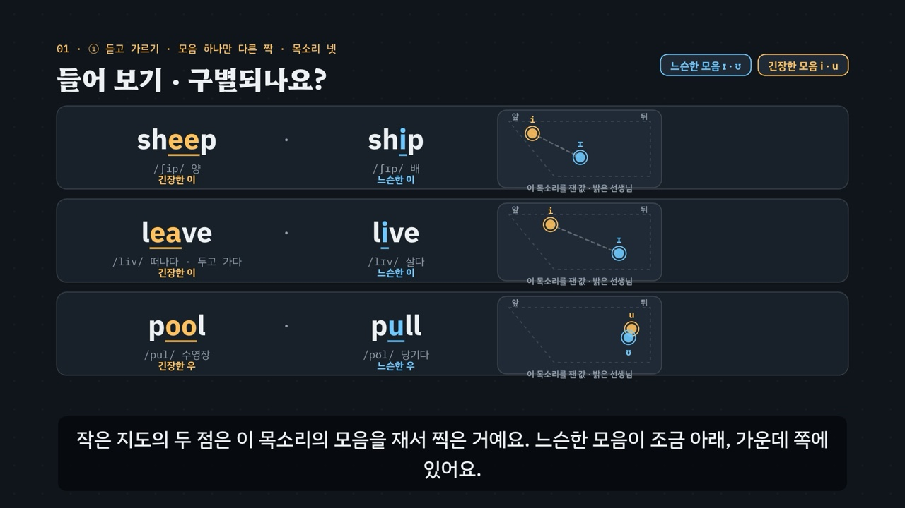

# 긴장한 모음, 느슨한 모음 — i · ɪ · u · ʊ

> [영어 튜토리얼](../README.md) 모음의 **영어 발음 (미국식)** 네 번째 꼭지입니다(영역: `pron`, 계획표의 P06 · 유형 12 · 13). 발음 영역의 설계도는 [docs/pron-types.md](../docs/pron-types.md)이고, 형식은 [끝소리와 자음 묶음](../final-consonants/README.md)을 복사해 시작했어요. 이 꼭지가 **모음 지도**(실제 음성에서 잰 F1 · F2)와 **내 모음 찍기**(브라우저 안에서 재는 시험 기능)를 처음 그렸어요.

양 · 배 → 영어로 *sheep · ship*. 한국어식으로 쓰면 둘 다 같은 표기(**십**)가 되지만, 영어에서는 모음 하나로 두 낱말이 갈려요 — 입꼬리를 당긴 팽팽한 **긴장한 이**(i)와, 혀를 조금 내리고 힘을 뺀 **느슨한 이**(ɪ). 우도 마찬가지예요(*pool · pull*). 흔히 ‘긴 이 · 짧은 이’로 배우지만, 모음의 길이는 끝 자음에 따라 크게 바뀌어서 믿을 만한 단서가 아니에요.

- **긴장한 이 i** — 혀 앞을 높이 들고, 입꼬리를 옆으로 당겨 힘을 줘요(*sheep · seat · leave · feel*).
- **느슨한 이 ɪ** — 혀를 조금 내리고 가운데 쪽으로, 입꼬리의 힘을 빼요. 짧은 이가 아니라 이와 에 사이(*ship · sit · live · fill · is · this*).
- **긴장한 우 u** — 입술을 동그랗게 앞으로 내밀고, 혀 뒤를 높이 들어요(*pool · food · school*).
- **느슨한 우 ʊ** — 입술을 덜 모으고, 혀를 조금 내려 힘을 빼요. 우와 어 사이(*pull · good · book · could*).
- **길이는 믿지 마세요** — 같은 끝 자음 앞에서는 긴장한 모음이 대체로 더 길지만, 끝 자음이 목을 울리면(*bead · bid*) 모음이 길어져요. 길이보다 소리의 색으로 가르세요.

3단계 발음법: ① **듣고 가르기**(짝 낱말 · 목소리 넷 · 길이보다 소리의 색) → ② **입 모양 만들기**(당기기 · 내밀기 · 힘 빼기) → ③ **낱말 · 문장 속에서**(외래어 · 짧은 낱말 · 내 모음 찍기).



## 바로 보기

`index.html`을 더블클릭하면 끝이에요. 설치도, 서버도 필요 없어요.

## 소리와 마이크에 대해 (꼭 읽어 주세요)

- 녹음 파일이 없어요. 영어는 모두 **합성 음성**이에요. 글이 정해진 말(낱말 · 문장 · 연습 문제 · 따라 말하기)은 **VoiceStudio로 미리 만든 미국식 목소리 넷**(`audio/dialogue/`)으로, 나머지는 브라우저에 들어 있는 영어 음성(speechSynthesis)으로 읽어요. 합성 음성은 실제 사람의 말소리와 조금 다르게 들릴 수 있어요.
- **목소리 넷**: 밝은 선생님(미국 여성) · 차분한 선생님(미국 여성) · 미국 여성 · 미국 남성. 듣고 가르기 훈련 · 연습 문제는 문제마다 목소리를 바꿔요. 비교용 **한국어식 소리**(*십 · 풀 · 치킨 · 쿠키* …)는 한국어 내레이터 목소리로 만들었어요(`voices.json`의 `"lang": "ko"`).
- 튜토리얼 전용 목소리 부품 `assets/js/voices.js`(`TLV`)는 끝소리의 `FCV`와 같아요(말하는 사람마다 파일을 찾고, 없으면 브라우저 음성 en-US · 한국어식은 ko-KR, 잰 값 `TLV.meas` — F1 · F2와 모음 길이). 읽기 전에 음성 해설 · 발음 듣기 · 녹음 재생을 멈추고 영상을 일시정지해요.
- **내 발음 확인 · 따라 말하기**: 브라우저에 음성 인식(`SpeechRecognition` · `webkitSpeechRecognition`, en-US)이 있으면 말을 글로 바꿔 **후보 글 여러 개**를 짝 낱말과 맞춰 봐요(*sheep*을 말하려다 *ship*으로 적히면 ‘짝 낱말로 들었어요’). 모음을 맞게 냈는지는 판정하지 않아요(인식기는 흔한 낱말 쪽으로 기울어요). 크롬(Chrome) 같은 브라우저는 소리를 브라우저 회사의 서버로 보내 글로 바꿔요. 음성 인식이 없으면 녹음(`MediaRecorder`)으로 ‘내 목소리’와 ‘본보기’를 이어서 들어요.
- **내 모음 찍기(시험 기능)**: 짝 낱말 둘을 2초씩 녹음하면 **브라우저 안에서** 두 모음의 F1 · F2를 재서 지도에 찍어요. 소리는 어디로도 보내지 않고, 녹음은 메모리에만 둬요. 이 사이트는 아무것도 저장하지 않아요(듣고 가르기 훈련의 기록만 이 브라우저의 `localStorage`에).

## 무엇을 배우나요

| 장 | 시각 | 내용 | 직접 해 보기 |
| --- | --- | --- | --- |
| 00 들어가며 | 0:00 | *sheep · ship* = 한국어식 십 하나 · 길이가 아니라 소리의 색 | 먼저 들어 보기(한국어식 · 목소리 넷) |
| 01 들어 보기 · 구별되나요? | 0:36 | ① 모음 하나만 다른 짝 셋(*sheep · ship, leave · live, pool · pull*) · 목소리 넷 | 짝 고르기(스물한 쌍) · 목소리 고르기 |
| 02 모음 지도 · 한국어 이는 하나 | 1:16 | ① 혀의 높이와 앞뒤 · 그림 지도(한국어 이 · 우와 영어 넷) · 잰 지도(*heed · hid · who'd · hood*) | 잰 지도 · 목소리 고르기 |
| 03 긴장한 이 · 느슨한 이 | 1:56 | ② 입 옆 단면도 둘 + 입술 앞모습: i는 당기고, ɪ는 혀를 조금 내리고 힘을 빼요 | 앞 모음 낱말 고르기 |
| 04 긴장한 우 · 느슨한 우 | 2:40 | ② u는 입술을 내밀고, ʊ는 덜 모아요 | 뒤 모음 낱말 고르기 |
| 05 길이는 믿지 마세요 | 3:24 | ① *beat · bit · bead · bid*의 잰 모음 길이 · 끝 자음이 길이를 바꿔요 · 연구 둘 | 목소리마다 잰 길이 |
| 06 목소리마다 지도는 달라요 | 4:08 | ③ 목소리 넷의 잰 지도 — 자리는 달라도 차례(긴장 → 느슨이 아래 · 가운데 쪽)는 같아요 | 한 목소리 크게 |
| 07 외래어 함정 | 4:48 | 외래어 카드 열여섯 장(치킨 · 빌딩 · 비디오 · 티켓 / 피자 · 미팅 · 크림 · 치즈 / 쿠키 · 북 · 굿 · 푸딩 / 수프 · 주스 · 스쿨 · 스푼) | 외래어 하나씩 |
| 08 문장 속에서 | 5:32 | *Is this seat free?* — 짧은 낱말(*is · it · this*)에 느슨한 이가 많아요 | 문장 고르기(따라 말하기의 28문장) |
| 09 정리 | 6:16 | 3단계 발음법 · 길이보다 소리의 색 | 이제 직접(아래 칸으로) |

- **듣고 가르기 훈련**(놀이터 왼쪽): 목소리 넷 × 짝 낱말 스물한 쌍(이 짝 열여섯 · 우 짝 다섯)에서 하나를 무작위로 들려주고, 짝 가운데 고르면 **그 목소리를 실제로 잰 모음 지도**와 한국어식 표기가 나타나요(잰 값이 없으면 그림 자리). 짝 묶음(모두 · 이 짝 · 우 짝) · 목소리를 고를 수 있고, 짝 묶음 · 들은 쪽(긴장 · 느슨) · 목소리마다 맞힌 비율을 표(막대)로 보여 줘요. 기록은 `localStorage` `en-tl-hvpt-v1`(지우기 단추). 키보드 R 듣기 · A · B(1 · 2) 고르기 · Space/Enter 다음.
- **내 발음 확인**(놀이터 오른쪽): 흔히 쓰는 짝 열하나(*sheep · ship, leave · live, seat · sit, feel · fill, cheap · chip, eat · it, heat · hit, sleep · slip, pool · pull, fool · full, Luke · look*) 중 하나를 말하면, 음성 인식의 후보 글을 짝과 맞춰 알려 주고, 짝이 엇갈리면 고칠 점(긴장한 쪽 → 힘을 주어, 느슨한 쪽 → 혀를 조금 내리고 힘을 빼고)을 보여 줘요.
- **내 모음 찍기**(놀이터 아래, 시험 기능): 짝 일곱(*sheep · ship, seat · sit, feel · fill, heat · hit, pool · pull, fool · full, Luke · look*)과 목소리 높낮이(높은 편 = 재는 범위 5500Hz · 낮은 편 = 5000Hz)를 고르고 두 낱말을 2초씩 녹음하면, 두 점과 긴장 → 느슨 화살표를 지도에 찍고 ‘두 점이 떨어져 있어요 · 거의 겹쳐요 · 방향이 달라요’를 알려 줘요(판정 기준은 측정 도구의 짝 확인과 같아요 — 아래).
- **따라 말하기 28문장**: 이 짝 · 우 짝 · 외래어 · 섞어서, 묶음마다 일곱 문장. 센 음절의 목표 모음 글자를 노랑(긴장) · 하늘(느슨)으로 칠했어요. 들린 낱말을 원래 문장과 맞춰 맞은 낱말 초록 · 빠진 낱말 주황(`TL.compareWords`).
- **듣고 긴장 · 느슨 가르기 16문제**(`PDrill`, `.edr` 모양): 어느 낱말 8 · 문장 속 어느 낱말 4 · 같았나 2 · 외래어 센 음절의 모음 2(정답 위치 A 8 · B 8). 소리 먼저, 힌트 세 단계는 엔진이 낱말에서 만들어요. 답하면 그 목소리를 잰 짝의 모음 지도와 같은 목소리로 견줘 듣기. 키보드 A · B(1 · 2) · H 힌트 · R 다시 듣기 · S 천천히 · Enter.
- **퀴즈 10문제**: 영상 순서대로. 그림 문제 둘(모음 지도의 점 넷에서 느슨한 이 고르기 · 입 옆 단면도 넷에서 느슨한 이의 입 고르기).
- **핵심 정리**: 긴장한 이 · 느슨한 이 · 긴장한 우 · 느슨한 우 · 길이 · 외래어와 문장 표 + 용어(① 듣고 가르기 · ② 입 모양 만들기 · ③ 낱말 · 문장 속에서).

### 플레이어 조작

다른 튜토리얼과 같아요. 스페이스(재생/일시정지), ← →(5초), Shift + ← →(장), C(자막), V(음성 해설), F(전체 화면). 화면 속 낱말 · 지도의 점 · 한국어식 표기를 누르면 그 목소리로 들려줘요(같은 단추를 곧바로 다시 누르면 천천히). 03 · 04장의 입 그림은 영상을 멈춰도 계속 움직여요(플레이어만, 영상 추출은 시각 t만으로 그려요).

**미리 만든 목소리**: VoiceStudio(OmniVoice 엔진, 비상업용 라이선스)로 만든 합성 음성 파일이에요. 파일이 없거나 못 읽으면 그 줄 · 조각만 브라우저 음성으로 읽어요.
- **영어는 0.9배로 재생해요**(`voices.js`의 `EN_RATE`). 한국어 해설과 한국어식 읽기는 1배.
- **늘어놓은 낱말은 쉬어 가며 읽어요.** 자막에 · 로 늘어놓은 영어 낱말(*heed · hid · who'd · hood*)은 낱말마다 따로 만들고 사이에 쉼표만큼 쉬어 한 파일로 이었어요(`--word-lists`). 해설의 영어 조각 23개는 받아쓰기(Whisper)로 모두 맞게 적히는 것을 확인했어요. 그 가운데 낱말만 읽는 조각 19개는 확인(받아쓰기 · 끝 올림 · 짝의 방향 · 모음 자리)을 통과한 밝은 선생님(`tc`) 낱말 파일을 쉼표만큼 쉬어 이어 다시 만들었어요(`tools/measure-syllables.py tense-lax-vowels --narration`). 문장 4개(*Did he leave or live?* · *Is this seat free?* · *Don't pull me into the pool.* · *The meeting is in that building.*)는 처음 만든 소리 그대로예요. 한국어 조각 77개도 받아쓰기로 확인했어요. ‘느슨한 이’ 하나는 ‘느슨함이’로 적혀 seed를 바꿔 다시 만들었어요. 홀로 쓴 ‘이 · 우’를 받아쓰기가 *E* · ‘우애’처럼 적거나 ‘미팅의 이’를 ‘미팅 A’로 적는 일이 있어서(다시 만들어 봐도 비슷했어요), 그 글자만 다르게 적힌 조각은 받아쓰기의 한계로 보고 그대로 썼어요.
- 음성 해설(`audio/narration/`): 한국어 조각은 「튜토리얼 내레이터 (젊은 여성)」, 영어 조각은 「영어 선생님 (밝은 미국 여성)」. 해설은 ` + `와 ` = `를 쉼으로, h_d를 ‘h, d’로 읽어요. 자막에는 발음 기호 대신 ‘긴장한 이 · 느슨한 이 · 긴장한 우 · 느슨한 우’를 써요(음성 해설이 기호를 읽지 못해서).
- 낱말 · 문장(`audio/dialogue/`): 말하는 사람 → 프로필은 `voices.json` — `tc` 「영어 선생님 (밝은 미국 여성)」 · `tf` 「영어 선생님 (미국 여성)」 · `uf` 「길 묻기 · 나 (미국 여성)」 · `um` 「길 묻기 · 길에서 만난 사람 (미국 남성)」 · `ko` 「튜토리얼 내레이터 (젊은 여성)」(한국어).

만드는 법(VoiceStudio가 있는 맥에서, 이미 만든 파일은 건너뛰어요):

```bash
node tools/narration-pieces.cjs tense-lax-vowels     # 해설의 읽기 조각 목록 (자막을 고쳤을 때만)
node tools/dialogue-lines.cjs tense-lax-vowels       # 낱말 · 문장 줄 목록 + 잴 줄의 정보 (낱말 · 문제 · 따라 말하기를 고쳤을 때만)
python3 tools/voicestudio-narration.py tense-lax-vowels --en-profile "영어 선생님 (밝은 미국 여성)" --word-lists
python3 tools/voicestudio-dialogue.py tense-lax-vowels
```

### 잰 값 — 모음 지도 · 모음 길이

모음 지도의 점(F1 · F2)과 모음 길이 막대는 미리 만든 음성 파일을 `tools/measure-syllables.py`로 따로 재서 그려요(`audio/dialogue/measure.js`의 `window.PRON_MEASURE`). 잰 값이 없는 낱말은 엔진의 그림 자리(`TL.SCHEM`)로 그리고, 화면에 ‘잰 값’이라고 적지 않아요. 지도의 범위는 목소리마다 그 목소리의 *heed · hid · who'd · hood*(+ 그 장면의 낱말)로 잡아서(`TLS.mapRange`), 목소리끼리 Hz를 바로 견주지 않아요. 이 꼭지에서 측정 도구에 더한 것은 둘이에요(줄 정보 `measure-meta.json`의 `formant` · `fpair`).

- **모음의 공명**(`formant`): 센 음절의 모음 핵(가장 큰 곳보다 10dB 안쪽으로 이어진 가장 긴 조각 → 길이 `vd`, 그 안의 6dB 안쪽 가운데 절반)에서 5밀리초마다 LPC(10차, 표본율 = 상한 × 2 — 미국 남성 5000Hz · 나머지 5500Hz, 25밀리초 해밍 창, 앞 강조 0.97)로 근을 구해, F1 = 180~1100Hz의 가장 낮은 공명, F2 = 그보다 250Hz 넘게 높은 첫 공명(대역폭 600Hz 아래) → 프레임들의 가운데 값. 프레임이 셋 미만이면 재지 못한 것으로 둬요.
- **짝의 방향**(`fpair`): 같은 목소리의 짝에서 이 짝은 느슨한 쪽의 F2가 80Hz 이상 낮고 F1이 25Hz 넘게 낮지 않아야, 우 짝은 느슨한 쪽의 F1이 25Hz 이상 높아야 해요. 어긋나면 그 짝의 두 파일을 seed를 바꿔 다시 만들고, 끝내 어긋나면 둘 다 잰 값을 빼요.
- 받아쓰기(Whisper large-v3)로 다른 낱말로 들리지 않는지(*sheep*이 *ship*으로 적히면 탈락)도 함께 확인해요. 통과하지 못한 파일은 seed를 바꿔 다시 만들어 통과하는 첫 소리를 써요(`--regen`).
- **내 모음 찍기**는 같은 방법을 브라우저에서 줄여 계산해요(녹음 → `OfflineAudioContext`로 상한 × 2의 표본율 → 같은 모음 핵 · 같은 창 · 같은 공명 고르기). LPC는 자기상관 · 레빈슨으로 풀고 근은 뒤랑-케르너로 구해요. 합성 모음 넷(공명을 아는 소리)에서 측정 도구와 1Hz 안에서 같은 값을 냈어요.

- **모음 자리 확인**(이 꼭지에서 더함): 잰 F2가 그 모음에 있을 수 없는 자리면(앞 모음 이의 F2가 1000Hz 아래 · 뒤 모음 우의 F2가 2200Hz 위) 자동 측정이 다른 공명을 잡은 것으로 보고 탈락시켜요. 미국 남성 *pull*이 F2 2807Hz로 재어져 지도에서 앞 모음 자리에 찍히던 것을 이 확인으로 잡아 다시 만들었어요.
- **소리가 같은 낱말**(이 꼭지에서 더함): 받아쓰기가 *heel*을 *Heal*로 적는 것처럼 소리가 같은 낱말(*heal · heel, peal · peel, weak · week* …)은 맞게 들은 것으로 봐요.
- 처음 쟀을 때 285줄 가운데 25줄이 통과하지 못했어요 — 받아쓰기가 다름 9줄(*who'd* 네 목소리 모두 *Hood · Hoot · Hoode*로, *it* → Thank you, *full* → 4., *heel* → Heal, 문장 하나, 한국어식 *굿* → 구찌), 짝의 방향 7줄(밝은 선생님 *pool · pull, peel · pill, heel · hill, reach*), 끝이 묻는 말처럼 올라감 7줄(*rich · look · sit · ship*), 센 음절 2줄(*pizza · city*).
- seed를 바꿔 다시 만들어(seed 여섯 개) 18줄을 바꿨고, 위의 두 확인을 더해 다시 잰 뒤 seed를 더 바꿔 *who'd* 차분한 선생님 · *heel* 차분한 선생님 · *pull* 미국 남성도 통과했어요.
- **끝내 통과하지 못한 2줄**: *who'd* 미국 여성 · 미국 남성 — seed를 스무 번 넘게 바꿔도 받아쓰기가 매번 *Hood · Hoode · Hoot*로 적었어요. 소리 파일은 그대로 두고 잰 값만 뺐어요. 그래서 02 · 06장과 직접 해 보기의 지도는 그 두 목소리에서 잰 점 셋(*heed · hid · hood*)만 찍고 ‘who'd 없음’이라고 적으며, 지도를 눌러 듣거나 ‘셋 이어서’ 단추로 들을 때도 그 *who'd*는 빼요. 듣고 가르기 훈련은 짝의 두 낱말이 모두 통과한 목소리로만 들려줘요(그 두 목소리에서는 *who'd · hood* 짝이 나오지 않아요).
- **잰 값으로 확인한 것**: 짝 스물한 쌍을 네 목소리로 잰 값(위의 2줄 빼고)에서, 이 짝 열여섯 쌍은 모두 느슨한 쪽의 F1이 더 높고 F2가 더 낮았어요(지도에서 아래 · 가운데 쪽). 우 짝 다섯 쌍은 모두 느슨한 쪽의 F1이 더 높았어요(지도에서 아래). 모음 길이는 네 목소리 모두 *beat*가 *bit*보다 길고(밝은 선생님 185 · 135ms), *bid*가 *beat*보다 길었어요(205ms) — 05장의 ‘끝 자음이 목을 울리면 모음이 길어져요’(*bead*는 네 목소리 모두 *bid*보다 길었어요). 다만 *leave · live*처럼 느슨한 쪽이 더 길게 재어진 짝도 있어서, 영상은 길이보다 소리의 색으로 가르라고 말해요.

## 무엇이 규칙 계산인가요

- **규칙 엔진** `assets/js/grammar.js`(`TL`)가 낱말마다 적은 발음 기호에서 계산해요. 영상 · 직접 해 보기 · 놀이터 · 연습 문제 · 퀴즈가 모두 같은 결과를 써요.
  - 낱말 사전 `TL.DICT`(90낱말: 철자 조각(목표 모음 글자 `[ ]`) · 음절로 나눈 넓은 IPA · 한국어식 표기 · 뜻 · 묶음). 모음 넷 `TL.V`(이름 · 긴장인지 · 앞인지 · 짝 · 요령).
  - 센 음절 `TL.stressAt` · 목표 모음 `TL.vowel` · 긴장 · 느슨 `TL.isTense` · 앞 · 뒤 `TL.side`, 칠할 글자 `TL.spellSegs`(`[ ]` 글자 = 센 음절의 목표 모음), 끝 자음과 울림 `TL.after` · `TL.afterVoiced`, 모음 길이의 기본 모양 `TL.lenGuess`.
  - **짝 낱말** `TL.PAIRS`(스물한 쌍 — 목표 모음 하나만 다르고 그 둘이 짝 모음인지 `TL.pairDiff`), `TL.pairOf` · `TL.partner`, 한국어식 표기가 같은지 `TL.koSame`.
  - 외래어 줄 `TL.LROWS` · `TL.LOAN`(네 줄 × 넷), 문장 속 칠하기 `TL.wordsIn` · `TL.segs` · `TL.countIn`, 들린 말 맞추기 `TL.heard`, `TL.compareWords`, 연습 문제의 힌트 `TL.hints`.
- **어긋남 경고** `TL.check()`: 철자 조각의 `[ ]`와 센 음절의 목표 모음, 음절 수, 한국어식 표기의 이 · 우, 짝이 모음 하나만 다르고 한국어식 표기가 같은지, h_d 낱말, 외래어 줄의 모음, 문장 묶음마다 일곱 문장과 묶음의 조건, 연습 문제의 보기 · 정답 · 목소리, 한쪽에 몰린 정답 위치, 입 그림(네 모음 모두 혀가 입천장에 닿지 않음 · 긴장한 쪽의 혀가 더 높음 · 입술 모으기 u > ʊ > ɪ · 느슨한 쪽의 턱이 더 벌어짐)이 어긋나면 콘솔에 경고가 떠요. 퀴즈의 그림 문제도 엔진 · 입 그림으로 정답을 다시 계산해 어긋나면 경고해요.
- **입 옆 단면도**: 공통 부품 `../shared/mouth.js`에 이 꼭지가 느슨한 모음의 자세 둘(`ih` · `uh`)을 더했어요. 긴장한 쪽(`i` · `u`)보다 혀의 가장 높은 곳이 낮고 턱이 조금 더 벌어지며, `uh`는 입술을 덜 모아요.
- **발음 사전 대조**(커밋 전에 따로): 90낱말의 음절 수 · 센 음절 · 자음 차례 · **센 음절의 모음**을 misaki 미국 발음 사전(VoiceStudio에 들어 있는 `us_gold.json` · `us_silver.json`)과 맞췄어요. 사전에 있는 89낱말이 모두 같았고(*live*는 사전의 기본값이 형용사 /laɪv/라 동사 쪽과 견줌, *video*는 사전 표기에서 음절을 나누는 방식만 다름), 사전에 없는 *Luke*는 *look*의 짝으로 /luk/이에요.
- **단순하게 줄인 부분**
  - ‘긴장한 · 느슨한’은 *tense · lax*를 쉽게 옮긴 이름이고, 칠하는 것은 센 음절의 목표 모음 넷뿐이에요(약한 음절의 ɪ · 슈와는 다루지 않음).
  - ‘이와 에 사이 · 우와 어 사이’는 한국어 화자를 위한 쉬운 어림이에요. 미국 영어의 긴장한 이 · 우는 조금 미끄러지는(이중모음처럼 들리는) 때가 있지만 다루지 않아요.
  - 모음 지도는 F1 · F2 두 값만 써요. 실제 모음의 차이에는 길이 · 미끄러짐 · 다른 공명도 있어요.
  - 엔진은 소리를 듣지 않아요. 모음 지도 · 모음 길이는 미리 만든 파일을 따로 잰 값이고, 내 발음 확인은 음성 인식이 적은 후보 글을 짝 낱말과 맞춰 볼 뿐이며, 내 모음 찍기는 두 점의 거리와 방향만 봐요.
- **근거로 삼은 연구**(초록으로 확인한 범위, 자세한 목록은 [docs/pron-types.md](../docs/pron-types.md)): 길이와 높은 모음 — [Lee 2008, *Kansas Working Papers in Linguistics* 30](https://journals.ku.edu/kwpl/article/download/17826/16078/42403)(h_d 낱말의 네 모음을 재고, 모음 길이를 바꾼 낱말을 들려준 작은 실험에서 한국인 청자는 영어 화자보다 길이에 더 기대어 두 모음을 갈랐어요). 배우는 흐름 — [Kim, Clayards & Goad 2018, *Journal of Phonetics*](https://dkim.rbind.io/pdf/Kim-Clayards-Goad_2018_JPhon.pdf)(캐나다에 온 한국인 학습자를 첫해 동안 따라가며 긴장한 이 · 느슨한 이와 에 · 애를 가를 때 길이와 소리의 색을 얼마나 쓰는지 본 연구로, 에 · 애가 더 어려웠고 두 짝을 배우는 흐름이 서로 달랐어요). 연구마다 대상 · 방법이 달라 두 연구가 보여 준 방향만 말하고 숫자는 옮기지 않았어요.
- **예문과 문제**: 모두 직접 만든 것이에요.

## 폴더 구조

```
index.html              페이지 (영상 · 직접 해 보기 · 듣고 가르기 훈련 · 내 발음 확인 · 내 모음 찍기 · 따라 말하기 · 듣고 고르기 · 퀴즈 · 핵심 정리)
assets/js/grammar.js    규칙 엔진(TL.phones · TL.stressAt · TL.vowel · TL.isTense · TL.side · TL.spellSegs · TL.afterVoiced · TL.lenGuess · TL.pairDiff · TL.koSame · TL.segs · TL.heard · TL.compareWords · TL.hints),
                        모음 넷(TL.V) · 낱말 사전(TL.DICT) · 짝(TL.PAIRS · TL.MP_PAIRS) · 외래어(TL.LROWS · TL.LOAN) · 문장(TL.SENT) · 목소리(TL.VOICES) · 연습 문제(TL.DRILL) · 점검(TL.check)
assets/js/voices.js     낱말 · 문장 목소리(TLV): 목소리 넷 + 한국어식(미리 만든 파일 → 없으면 브라우저 음성), 잰 값(TLV.meas — F1 · F2 · 모음 길이)
assets/js/scenes.js     영상 장면 10개, 장 목록과 자막, 모음 지도(잰 값 → 없으면 그림 자리) · 모음 길이 막대, 입 옆 단면도 둘 + 입술 앞모습, 외래어 카드, 문장 칠하기
assets/js/app.js        플레이어, 직접 해 보기, 듣고 가르기 훈련(기록 표), 내 발음 확인, 내 모음 찍기(브라우저 안의 LPC), 따라 말하기(음성 인식 · 녹음), 듣고 고르기(PDrill), 퀴즈, 영상 추출(EN_EXPORT)
../shared/mouth.js      입 옆 단면도 부품(EN.mouth) — 느슨한 모음 ih · uh
video/                  자막 원고(SRT)
audio/narration/        음성 해설의 읽기 조각 목록(pieces.json) · 파일 목록(clips.js) · 음성 파일
audio/dialogue/         낱말 · 문장 줄 목록(lines.json) · 잴 줄의 정보(measure-meta.json) · 말하는 사람 → 프로필(voices.json) · 파일 목록(clips.js) · 잰 값(measure.js) · 음성 파일
docs/poster.jpg         사이트 카드 그림
```

## 영상 다시 만들기

```bash
node tools/render-video.cjs tense-lax-vowels                       # → tense-lax-vowels/video/tense-lax-vowels.mp4 + .srt
node tools/render-video.cjs tense-lax-vowels --frames 106,230      # 몇 장면만 그림으로
node tools/render-video.cjs tense-lax-vowels --poster 57           # 카드 그림
node tools/render-video.cjs tense-lax-vowels --srt                 # 자막 원고만
```

MP4에는 소리가 없어요(자막이 그림에 들어가요).
