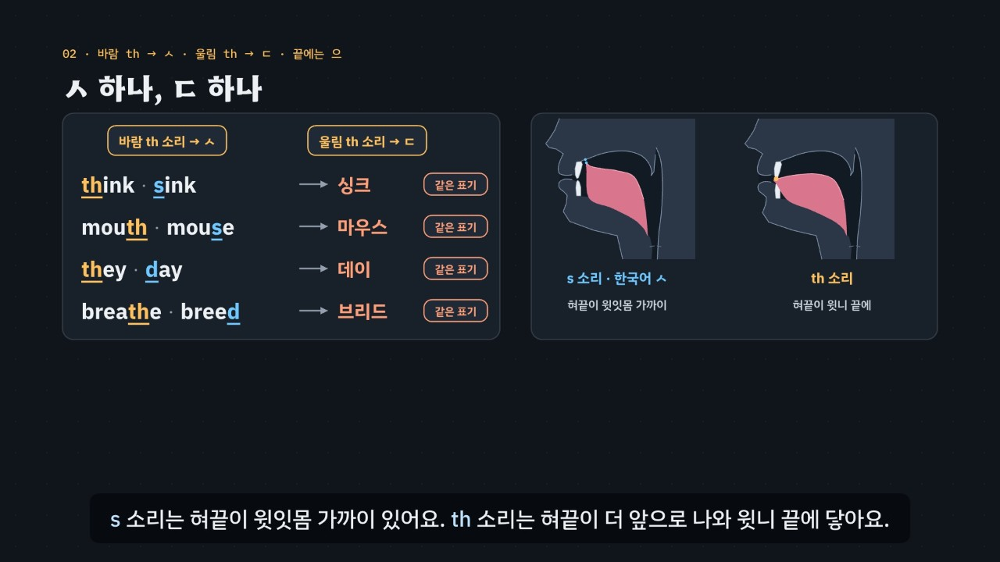

# 혀끝을 이 사이로 — th 소리 둘

> [영어 튜토리얼](../README.md) 모음의 **영어 발음 (미국식)** 열두 번째 꼭지입니다(영역: `pron`, 계획표의 P03 · 유형 7). 발음 영역의 설계도는 [docs/pron-types.md](../docs/pron-types.md)이고, 형식은 [ㅅ · ㅈ 너머 — s · sh · z · zh · y](../s-sh-z-j/README.md)를 복사해 시작했어요(목소리 부품은 [끝소리와 자음 묶음](../final-consonants/README.md)과 같아요). 이 꼭지가 입 옆 단면도에 **th 자세**(혀끝을 윗니 끝에)와 혀 · 윗니 닿음 계산을 더하고, 측정 도구에 **첫 · 끝 자음의 바람 소리 세기** 재기를 더했어요.

생각하다 · 가라앉다 → 영어로 *think · sink*. 한국어로 적으면 둘 다 **싱크**예요. 그들 · 하루 → *they · day*, 둘 다 **데이**예요. 한국어에는 th 소리가 없어서, 외래어 표기법이 바람만 내는 th 소리(θ)를 ㅅ으로, 목을 울리는 th 소리(ð)를 ㄷ으로 적기 때문이에요. 둘을 가르는 열쇠는 **혀끝의 자리**예요.

- **바람 th 소리**(*think · three · mouth*) — 턱을 조금 내리고 혀끝을 윗니 끝에 가볍게 대요. 세게 물지 않고, 그 틈으로 약한 바람을 흘려요. 목은 울리지 않아요. 함정은 **ㅅ** — 혀끝을 잇몸 쪽에 두면 s 소리가 돼요(*think* → *sink*, *mouth* → *mouse*).
- **울림 th 소리**(*the · this · they · mother*) — 같은 혀 + 목 울림. 함정은 **ㄷ** — 혀끝으로 막으면 d 소리가 돼요(*they* → *day*, *breathe* → *breed*).
- **s · z 소리**는 혀끝이 이에 닿지 않고(윗잇몸 가까이) 바람이 훨씬 세요. **f 소리**는 혀가 아니라 윗니 끝과 아랫입술이에요 — 바람의 세기가 th 소리와 비슷해 귀로는 가장 헷갈려요(*three · free*). **t · d 소리**는 혀끝으로 막았다가 떼요(*three · tree*).
- **끝의 th 소리**(*bath · teeth · breathe*)는 약한 바람이나 떨림으로 끝내요. 한국어식(배스 · 티스 · 브리드)처럼 으를 붙이지 않아요 — 끝 자음은 [끝소리 튜토리얼](../final-consonants/index.html)에서 더 다뤄요.
- **알아듣기에 주는 영향은 작은 편**이라는 연구가 있어요(아래 근거). 그래서 발음 꼭지 가운데 맨 마지막에 두었고, 영상도 ‘너무 긴장하지 않아도 된다’고 말해요.

3단계 발음법: ① **듣고 가르기**(짝 낱말 · 여러 목소리) → ② **혀끝의 자리 만들기**(윗니 끝 · 막지 않기 · 목 울림) → ③ **낱말 · 문장 속에서**(자리 · 외래어 · 문장).



## 바로 보기

`index.html`을 더블클릭하면 끝이에요. 설치도, 서버도 필요 없어요.

## 소리와 마이크에 대해 (꼭 읽어 주세요)

- 녹음 파일이 없어요. 영어는 모두 **합성 음성**이에요. 글이 정해진 말(짝 낱말 · 문장 · 연습 문제 · 따라 말하기)은 **VoiceStudio로 미리 만든 미국식 목소리 넷**(`audio/dialogue/`)으로, 나머지는 브라우저에 들어 있는 영어 음성(speechSynthesis)으로 읽어요. 합성 음성은 실제 사람의 말소리와 조금 다르게 들릴 수 있고, 특히 **브라우저 음성은 기기마다 th 소리의 약한 바람이 잘 들리지 않을 때**도 있어요(머리말 각주에도 적음).
- **목소리 넷**: 밝은 선생님(미국 여성) · 차분한 선생님(미국 여성) · 미국 여성 · 미국 남성. 같은 짝을 여러 목소리로 들으며 가르는 것이 듣기 훈련의 핵심이라, 훈련 · 연습 문제는 문제마다 목소리를 바꿔요. 비교용 **한국어식 소리**(*싱크 · 마우스 · 데이 · 스리* …)는 한국어 내레이터 목소리로 만들었어요(`voices.json`의 `"lang": "ko"`).
- 튜토리얼 전용 목소리 부품 `assets/js/voices.js`(`THV`)는 끝소리의 `FCV`와 같아요(말하는 사람마다 파일을 찾고, 없으면 브라우저 음성 en-US · 한국어식은 ko-KR, 잰 값 `THV.meas`). 읽기 전에 음성 해설 · 발음 듣기 · 녹음 재생을 멈추고 영상을 일시정지해요.
- **내 발음 확인 · 따라 말하기**: 브라우저에 음성 인식(`SpeechRecognition` · `webkitSpeechRecognition`, en-US)이 있으면 말을 글로 바꿔 **후보 글 여러 개**를 짝 낱말과 맞춰 봐요(*think*를 말했는데 *sink*로 적히면 ‘짝 낱말로 들렸어요’). 발음의 질은 판정하지 않아요 — 인식기는 흔한 낱말 쪽으로 기울어요(*den*보다 *then*, *fin*보다 *thin*). 크롬(Chrome) 같은 브라우저는 소리를 브라우저 회사의 서버로 보내 글로 바꿔요. 음성 인식이 없으면 녹음(`MediaRecorder`)으로 ‘내 목소리’와 ‘본보기’를 이어서 들어요. 녹음은 메모리에만 두고, 이 사이트는 아무것도 저장하지 않아요(듣고 가르기 훈련의 기록만 이 브라우저의 `localStorage`에).

## 무엇을 배우나요

| 장 | 시각 | 내용 | 직접 해 보기 |
| --- | --- | --- | --- |
| 00 들어가며 | 0:00 | *think · sink* = 둘 다 싱크, *they · day* = 둘 다 데이 · th 소리 둘(바람 · 울림)을 ㅅ과 ㄷ이 맡음 | 먼저 들어 보기(한국어식 싱크 · 데이와 함께) |
| 01 들어 보기 · 구별되나요? | 0:30 | ① 짝 낱말(*think · sink, mouth · mouse, three · free, they · day*) · 바람 th 소리를 f 소리로, 울림 th 소리를 d 소리로 듣는 경향(듣기 연구) | 짝 듣고 고르기(맛보기 — 네 짝 × 목소리 넷) |
| 02 ㅅ 하나, ㄷ 하나 | 1:08 | 바람 th → ㅅ · 울림 th → ㄷ · s 소리는 혀끝이 잇몸 가까이, th 소리는 윗니 끝에 · 마우스 → *mouse*로 들리기 쉬움 · 끝에는 으 | 짝의 한국어식 표기(20쌍, 같은 표기인지 엔진이 계산) |
| 03 th 소리 — 혀끝을 윗니 끝에 | 1:50 | ② 입 옆 단면도 · 위에서 본 혀 · 입술 앞모습(윗니 아래로 혀끝이 보임) · 목소리 넷의 바람 소리 세기(*think · sink*, 잰 값) · 거울로 확인 | 혀끝의 자리 바꿔 보기(th 소리 · s 소리) |
| 04 입술도 아니고, 막지도 않아요 | 2:38 | ② f 소리(윗니 끝과 아랫입술 — 바람의 세기는 비슷, *thin · fin* 잰 값) · t 소리(혀끝으로 막기) · *three · free, three · tree* | 입 모양 바꿔 보기(th · f · t 소리) |
| 05 울림 th 소리 — 같은 혀 + 목 울림 | 3:22 | ② 같은 혀 + 목 울림 · 아주 흔한 낱말(*the · this · that · they*) · d 소리 · 한국어 ㄷ은 막음 · *they · day, then · den, breathe · breed* | 혀 · 목 바꿔 보기(울림 th · 바람 th · d 소리) |
| 06 z 소리와도 달라요 | 4:06 | ② z 소리는 혀끝이 잇몸 가까이 · *breathe · breeze, clothing · closing* · 낱말 끝 · 센 음절 뒤가 더 어려움(듣기 연구) · 끝(*breathe · with*) | 혀끝의 자리 바꿔 보기(울림 th · z 소리) |
| 07 낱말 속 자리 | 4:46 | ③ 처음(*think · thank · this*) · 묶음(*three · throat · thriller* — th 뒤에 바로 r) · 가운데(*nothing · method · mother*) · 끝(*bath · teeth · with · breathe*, 끝에 으 없이) | 낱말 속 자리(낱말을 고르면 영어 음절 · 한국어식 음절) |
| 08 외래어 함정 | 5:30 | 외래어 카드 열여섯 장(처음의 th → ㅅ · 가운데와 끝의 th → ㅅ · 스 · 울림 th → ㄷ · 철자는 th인데 t 소리) · *three* 스리 ≠ *free* 프리 | 외래어 하나씩(소리마다 혀끝의 자리) |
| 09 문장 속에서 | 6:14 | *Thank you so much.* · *This is my brother.* · *Take a deep breath.* · *There are three things.* · 약하게 지나가는 *the · this · that* | 문장 고르기(따라 말하기의 28문장) |
| 10 정리 | 6:58 | 3단계 발음법 · 알아듣기에 주는 영향은 작은 편(연구) · 목표는 듣는 사람이 헷갈리지 않는 소리 | 이제 직접(아래 칸으로) |

전체 7분 34초.

- **듣고 가르기 훈련**(놀이터 왼쪽): 목소리 넷 × 짝 낱말 20쌍(th ↔ s 7 · th ↔ f 4 · th ↔ t 3 · th ↔ d 4 · th ↔ z 2)에서 하나를 무작위로 들려주고 둘 중 하나를 고르게 해요(짝의 두 낱말이 모두 확인을 통과한 목소리로만 — 아래 ‘낱말 파일 점검’). 짝 종류 · 목소리를 고를 수 있고, 답하면 두 낱말을 같은 목소리로 이어서 들어 보고 엔진의 듣기 힌트를 보여 줘요. 기록은 **자리(처음 · 묶음 · 가운데 · 끝)마다 · 짝마다 · 목소리마다** 맞힌 비율로, `localStorage` `en-th-hvpt-v1`(지우기 단추). 키보드 R 듣기 · 1 · 2 고르기 · Space/Enter 다음. 여러 목소리로 듣는 훈련의 근거는 [r · l 튜토리얼](../r-and-l/index.html)의 각주를 이어서 가리켜요.
- **내 발음 확인**(놀이터 오른쪽): 짝 20쌍 가운데 하나와 말할 낱말을 고르면 입 그림 · 말하는 요령이 나오고, 말하면 음성 인식의 후보 글을 짝과 맞춰 ‘그 낱말로 들렸어요 · 짝 낱말로 들렸어요 · 다른 말로 들렸어요’를 알려 줘요. 소리가 같은 철자(*sum · some*, *there · their*, *dough · doe* …, `TH.SAME`)는 같은 낱말로 봐요.
- **따라 말하기 28문장**: 바람 th 소리 · 울림 th 소리 · 가운데와 끝의 th 소리 · 두 소리를 섞은 문장, 묶음마다 일곱 문장. th 소리를 적은 글자는 노랑(글자 색 + 밑줄). 들린 낱말을 원래 문장과 맞춰 맞은 낱말 초록 · 빠진 낱말 주황(`TH.compareWords`).
- **듣고 고르기 16문제**(`PDrill`, `.edr` 모양): 어느 낱말? 6 · 문장 속 어느 낱말? 4 · 같은 낱말? 다른 낱말? 4 · 한국어식은 어느 쪽? 2. 정답 위치 8/8, 목소리마다 4문제. 소리 먼저, 힌트 세 단계(① 들을 곳 → ② 혀끝의 자리 → ③ 낱말 속 자리)는 엔진이 짝의 종류 · 자리에서 만들어요. 키보드 A · B(1 · 2) · H 힌트 · R 다시 듣기 · S 천천히 · Enter.
- **퀴즈 10문제**: 영상 순서대로. 그림 문제 둘(th 소리의 혀 · f 소리의 입 — 입 옆 단면도 넷 중 고르기). 그림 문제의 정답은 `app.js`가 입 그림에서 다시 계산해요(혀끝이 윗니에 닿은 유일한 그림 · 아랫입술이 윗니에 닿은 유일한 그림).
- **핵심 정리**: 바람 th · 울림 th · s와 z · f · t와 d, th → ㅅ · th → ㄷ · 묶음 · 끝 · 철자 th와 소리 t 표 + 용어(① 듣고 가르기 · ② 혀끝의 자리 만들기 · ③ 낱말 · 문장 속에서).

### 플레이어 조작

다른 튜토리얼과 같아요. 스페이스(재생/일시정지), ← →(5초), Shift + ← →(장), C(자막), V(음성 해설), F(전체 화면). 화면 속 낱말을 누르면 발음을 들려줘요(같은 단추를 곧바로 다시 누르면 천천히). 03 · 04 · 05 · 06장의 직접 해 보기에서 자세를 고르면 영상이 멈추고 그 장의 장면이 고른 자세로 바뀌어요(영상 추출은 늘 기본 자세).

### 음성 해설

- 해설은 154조각이에요(한국어 107 · 영어 47). 영어 낱말만 읽는 42조각은 **확인을 통과한 밝은 선생님의 낱말 파일**을 그대로 이어 만들었어요(`tools/measure-syllables.py th-sounds --narration`). 나머지 영어 5조각은 문장 넷과 *Thomas, Thailand, thyme, Thames*예요.
- 영어 47조각을 받아써 보니 낱말이 모두 글과 같았어요. 다르게 적힌 것은 *sink* → Sync, *three* → 3, *thyme* → Time(소리가 같은 말)과, 이어 붙인 조각 ‘think, thank, this’의 *thank* → Think 하나예요. 같은 *thank* 파일은 혼자 받아쓸 때와 다른 두 조각 안에서는 thank로 적혔어요.
- 한국어 107조각도 모두 받아썼어요. 받아쓰기가 ‘티에이치 · 에스 · 에프 · 디 · 제트’를 TH · S · F · D · Z로, ‘으를’을 소리가 같은 ‘을을’로, ‘섬네일 · 서드 · 스리’를 흔한 표기 ‘썸네일 · 써드 · 쓰리’로 적은 것은 그대로 뒀어요. 글과 다르게 들린 열 조각(‘셋과’ → 색과, ‘버스데이’ → 퍼스테이, ‘리듬’ → 믿음, ‘재어 보면’ → 외워보면, 빠진 ‘정리해요’ · ‘그러면’ 등)은 seed를 바꿔 다시 만들어 글대로 적히는 소리로 바꿨어요. 다시 만든 조각만 따로 다시 받아썼어요.
- 혼자 읽는 ‘데이’는 여섯 번 만들어도 글대로 적히지 않아(테이 · 페이 · 테이프), 자막을 ‘*they · day* → 둘 다 데이’로 고쳐 긴 조각으로 읽게 했어요.

### 낱말 파일 점검

측정 도구는 낱말 파일이 정말 그 낱말로 들리는지(받아쓰기), 센 음절이 사전과 맞는지, 끝이 묻는 말처럼 올라가지 않는지, th · s 짝의 바람 소리 세기가 기준만큼 갈리는지도 확인해요. **확인을 통과하지 못한 낱말 파일은 어디에서도 들려주지 않게** 해 뒀어요(`app.js`의 `badTake` · `speak`). 이번에는 영어 낱말 180줄이 모두 통과해서 막힌 소리가 없고, 짝 스무 쌍이 모두 네 목소리로 나와요.

- 처음에 264줄을 받아썼고, 낱말 · 한국어식 232줄 가운데 24줄이 통과하지 못했어요.
  - 끝이 묻는 말처럼 올라감 11줄(밝은 선생님 5 · 미국 남성 4 · 차분한 선생님 1 · 미국 여성 1)
  - 받아쓰기가 다름 10줄: 소리가 같은 말로 적힌 7줄(*sink* → Sync 2, *sum* → Some 2, *fin* → Finn 2, *thyme* → Time), *thumb* → Some, *fin* → Thin, 엉뚱한 문장으로 적힌 한국어식 ‘데이’
  - 센 음절 2줄(*thriller* · *theater*)
  - th · s 바람 세기 차 1줄(차분한 선생님의 *faith · face* 9.9dB — 기준 10dB. *faith*는 끝 올림에도 걸림)
- 고친 것
  - *sink* = sync, *sum* = some, *fin* = Finn, *thyme* = time, *theater* = theatre는 같은 말로 보게 했어요. 다만 앞의 일곱 줄은 표를 고치기 전의 결과로 다시 만들기에 들어가, 새로 만든 소리로 바뀌었어요.
  - 나머지는 seed를 바꿔 다시 만들었어요 — 여섯 번씩 세 차례. 첫 차례 뒤 5줄, 둘째 차례 뒤 2줄(밝은 선생님의 *theater*, 미국 남성의 *fought*)이 남았어요.
  - 셋째 차례에서는 후보가 하나도 재어지지 않았어요. 만드는 도구가 ‘글자 수에 비해 너무 짧은 소리’로 본 후보를 다시 만들기가 재지 않고 건너뛰기 때문이에요(*fought*는 글자 여섯에 한 음절). 그래서 두 줄은 후보를 따로 만들어 같은 측정 함수로 쟀어요. *fought*는 넷째 후보가 통과했고(앞의 셋은 Thought로 적히거나 끝이 올라감), *theater*는 첫 후보가 센 음절 확인을 통과했어요(받아쓰기는 Theatre).
  - 그 뒤 다시 만들기를 고쳤어요. 이제는 그렇게 걸린 후보도 소리가 있으면 버리지 않고 재서 판정해요. 고친 도구에 두 줄의 옛 파일을 넣고 돌려 보니, 손으로 고른 것과 같은 후보(*theater* seed 11, *fought* seed 51)를 골랐고 잰 값도 같았어요.
- **바람 소리의 세기**(1~11kHz, 그 낱말에서 가장 큰 곳 = 0dB): th 소리 −41.5~−17.1dB(44줄), s 소리 −12.8~−4.0dB(28줄), f 소리 −35.3~−11.8dB(16줄).
  - th · s 짝 일곱 쌍 × 목소리 넷에서 s 쪽이 14.2~35.9dB 더 셌어요. 03장의 막대(*think · sink*)는 17.9~26.8dB 차이예요.
  - th · f 짝 네 쌍 × 목소리 넷에서 f 쪽 − th 쪽은 −7.5~+9.4dB였어요. 04장의 막대(*thin · fin*)는 세 목소리가 2dB 안쪽이고, 미국 여성은 th 쪽이 9.4dB 약해요.
  - **04장 자막을 고쳤어요.** 처음에는 ‘재어 보면 이렇게 가까워요’라고 적고 8dB 안쪽인지 확인했는데, 미국 여성의 값이 그 기준을 넘었어요. 그 목소리의 *thin*을 여섯 번 더 만들어 보니 통과한 넷이 −29.1 · −34.2 · −36.5 · −37.8dB로 흩어져서, 소리를 골라 맞추지 않고 자막을 ‘재어 보면 둘 다 s 소리보다 훨씬 약해요’로 바꿨어요. 지금 확인하는 것은 *thin · fin*이 둘 다 같은 목소리의 *sink*보다 10dB 이상 약한지예요(잰 값으로는 14.6~23.9dB). ‘바람의 세기는 비슷해요’는 잰 값으로 확인한 말이 아니라 일반적인 설명이에요.
- **한국어식 낱말은 하나씩 따로 다시 받아썼어요**(52줄). 도구는 한국어 글자 하나까지 다른 것을 봐줘서, 짧은 낱말은 다르게 들려도 통과하기 때문이에요. 15줄이 글과 다르게 적혔어요.
  - seed를 바꿔 다시 만들어 5줄(데스 · 디스 · 싱 · 섬 · 더)은 글자 그대로 적힌 소리로 바꿨어요.
  - 된소리 표기로 적힌 4줄(스리 → 쓰리, 배스 → 배쓰, 섬네일 → 썸네일, 서드 → 써드)은 같은 말로 봤어요.
  - ‘데이’ → 테이, ‘덴’ → 텐: 첫소리 뒤 모음의 높이가 203 · 238Hz로, 같은 목소리의 ㄷ 낱말(207~241Hz)과 같고 ㅌ 낱말(340~402Hz)보다 훨씬 낮아서 ㄷ으로 봤어요.
  - **‘너싱 · 댓 · 토머스 · 머더’는 미리 만든 파일을 두지 않아요**(`app.js`의 `KO_NO_CLIP`). ‘너싱’과 ‘댓’은 seed 다섯 개와 문장 부호를 바꾼 여덟 번을 더해도 다른 말로 적혔어요(도씽 · 넛신 · 롯신 …, 탭 · 택 · 됐다 …). ‘토머스’는 열네 번 가운데 열세 번 토마스로, ‘머더’는 여섯 번 가운데 네 번 ‘뭐 더?’로 적혔어요. 받아쓰기가 흔한 말로 고쳐 적은 것일 수도 있지만 가려내지 못했어요. 이 넷은 브라우저의 한국어 음성으로 읽어요.
  - 지금 있는 48줄 가운데 6줄(데이 · 마우스 · 클로징 · 시어터 · 블루투스 · 페이스)은 음절을 나누지 못해 `measure.js`에 값이 없어요.
- 점검에 쓴 따로 받아쓰기 · 여러 번 만들어 재 보기 스크립트는 저장소에 넣지 않았어요.

## 무엇이 규칙 계산인가요

- **규칙 엔진** `assets/js/grammar.js`(`TH`)가 낱말마다 적은 발음 기호에서 계산해요. 영상 · 직접 해 보기 · 놀이터 · 연습 문제 · 퀴즈가 모두 같은 결과를 써요.
  - 낱말 사전 `TH.DICT`(78낱말: 철자 조각(th 소리를 적은 글자 `[ ]` · 짝 낱말의 짝 소리 글자 `{ }`) · 음절로 나눈 넓은 IPA · 한국어식 표기 · 뜻 · 묶음). 음절 `TH.syl` · `TH.nSyl` · `TH.stressAt`.
  - **소리의 자리** `TH.sounds`: 바람 th · 울림 th 소리가 음절의 어디에 있나 — 처음 · 묶음 · 가운데 · 끝.
  - **짝 낱말** `TH.pairDiff`: 한 소리만 다르고 그 차이가 th ↔ s · f · t(바람 th) · th ↔ d · z(울림 th)인지, 그 자리. `TH.PAIRS` 20쌍(th ↔ s 처음 4 · 끝 3, th ↔ f 처음 2 · 묶음 1 · 끝 1, th ↔ t 처음 1 · 묶음 1 · 끝 1, th ↔ d 처음 3 · 끝 1, th ↔ z 끝 1 · 가운데 1). 짝 낱말의 짝 소리(`TH.partnerOf`)도 짝에서 계산해요.
  - **외래어 표기** `TH.koParts` · `TH.koMarks`: 한국어식 표기의 ㅅ · ㄷ(짝 낱말은 ㅍ · ㅌ · ㅈ)이 영어의 어느 소리를 표기법대로 적은 것인지, 넣은 으 `TH.koInserted`, 두 낱말이 **같은 표기**가 되는지 `TH.koSame`(20쌍 중 11쌍이 같은 표기 — th ↔ s 7쌍과 th ↔ d 4쌍. *three · free*(스리 · 프리), *both · boat*(보스 · 보트), *breathe · breeze*(브리드 · 브리즈) 같은 짝은 다른 표기). 영상 · 페이지가 ‘같은 표기 · 다른 표기’라고 말하는 짝(`TH.CLAIMS`)은 `check()`가 엔진으로 확인해요.
  - 외래어 줄 `TH.LOAN`(처음의 th → ㅅ: *thriller · theater · thumbnail · third*, 가운데와 끝의 th → ㅅ · 스: *health · Bluetooth · method · birthday*, 울림 th → ㄷ: *rhythm · smoothie · weather · leather*, 철자는 th인데 t 소리: *Thomas · Thailand · thyme · Thames*), 문장 속 칠하기 `TH.spans` · `TH.segs`(문장에서는 th 소리만), 들린 말 맞추기 `TH.heard`(소리가 같은 철자 `TH.SAME`), `TH.compareWords`, 연습 문제의 힌트 `TH.hints`.
- **어긋남 경고** `TH.check()`: 철자 조각의 `[ ]` · `{ }`와 엔진의 소리, 한국어식 표기가 소리와 맞는지, 짝이 한 소리만 다른지와 자리 · 종류, 같은 표기 주장, 낱말 묶음의 갈래, 외래어 줄, 문장 묶음마다 일곱 문장과 문장 속 소리, 엔진과 어긋나는 연습 문제의 정답 · 한쪽에 몰린 정답 위치 · 목소리마다 네 문제(퀴즈의 정답은 `app.js`가 엔진 · 입 그림으로 따로 확인), 입 그림(th는 혀끝이 윗니에 닿고 입천장에는 닿지 않음 · s는 이에 닿지 않고 윗잇몸 가까이 · t는 윗잇몸에 닿음 · f는 아랫입술이 윗니에 닿음)이 어긋나면 콘솔에 경고가 떠요. 지금 경고 0개.
- **입 옆 단면도**: 공통 부품 `../shared/mouth.js`에 이 꼭지가 더한 것 — 자세 `th`(턱을 조금 내리고 혀를 평평하게 앞으로, 혀끝을 윗니 끝에 · `dent: 1`), 혀 · 윗니 닿음 계산 `EN.mouth.tongueTeeth`, 닿는 곳 표시 `teethMark`, 위에서 본 혀의 `top: 'teeth'`(혀끝이 앞니까지 · 얇은 바람 세 줄), 입술 앞모습의 혀끝(윗니 아래로 보임). 원래 자세와 그림은 그대로라 다른 발음 튜토리얼의 그림은 바뀌지 않아요. ‘닿아요 · 닿지 않아요’는 그림에서 계산해 영상 · 퀴즈가 같은 값을 써요.
- **발음 사전 대조**(커밋 전에 따로): 78낱말의 음절 수 · 센 음절 · 자음 차례 · th와 짝 소리를 misaki 미국 발음 사전(VoiceStudio에 들어 있는 `us_gold.json` · `us_silver.json`)과 맞췄어요. th 소리와 짝 소리는 모두 같았고, 다르게 나온 곳은 표기 방식 차이뿐이에요.
  - r 모음을 한 기호로 적음(*thriller · third · birthday · weather · leather · mother · brother · together · father · Thursday · thirty · worth*의 ɚ · ɝ = 사전의 əɹ · ɜɹ).
  - *theater*(사전 θˈiəɾəɹ의 iə를 대조 스크립트가 한 모음으로 센 것 — 세 음절은 같아요), *together*의 g 글자 모양(g = 사전의 ɡ).
  - *Bluetooth*는 사전에 없어요.
  - 사전 대조 스크립트는 저장소에 넣지 않았어요.
- **단순하게 줄인 부분**
  - 입 그림은 쉽게 줄여 그린 것이에요(혀끝의 자리 · 닿는지 · 입술만 강조). 혀끝을 이 사이로 얼마나 내미는지는 사람마다 달라요.
  - 바람 소리 · 막았다 떼는 소리 띠와 목 울림 물결은 설명을 위한 그림이에요. 03 · 04장의 ‘바람 소리의 세기’ 막대만 잰 값이에요(아래).
  - 자리는 음절로 나눠 정해요(첫 음절의 홀로 선 첫소리 = 처음 · 다른 자음과 붙은 첫소리 = 묶음 · 둘째 음절부터의 첫소리 = 가운데 · 음절 끝 = 끝).
  - 외래어 표기는 국립국어원 외래어 표기법(국제 음성 기호와 한글 대조표 · 영어의 표기 제3항)을 따랐어요. 그래서 흔히 쓰는 ‘씽크 · 마더 · 브라더’ 대신 ‘싱크 · 머더 · 브러더’로 적었어요. 엔진은 th 소리와 짝 소리 자리의 한글만 맞춰 봐요.
  - *with*는 끝을 울림 th 소리(wɪð)로 적었어요. 바람 th 소리(wɪθ)로 말하는 사람도 많아요.
  - 엔진은 소리를 듣지 않아요. 내 발음 확인은 음성 인식이 적은 후보 글을 짝 낱말과 맞춰 볼 뿐이에요.
- **근거로 삼은 자료**(원문 또는 초록으로 확인한 범위, 자세한 목록은 [docs/pron-types.md](../docs/pron-types.md)):
  - 외래어 표기 — [국립국어원 외래어 표기법](https://korean.go.kr/kornorms/regltn/regltnView.do?regltn_code=0003)(제2장 표 1 · 제3장 제1절 제3항). 바람 th 소리는 모음 앞 ㅅ · 자음 앞과 끝 ‘스’, 울림 th 소리는 모음 앞 ㄷ · 자음 앞과 끝 ‘드’.
  - 듣기 — [배문정 · 김정오 2009](https://doi.org/10.22172/cogbio.2009.21.2.004)(한국심리학회지: 인지 및 생물 21(2)) · [Jang 2014](https://doi.org/10.13064/KSSS.2014.6.1.011)(말소리와 음성과학 6(1)) · [초미희 2010](https://doi.org/10.5392/JKCA.2010.10.5.460)(한국콘텐츠학회논문지 10(5)). 바람 th 소리는 주로 f 소리로, 울림 th 소리는 d 소리로 잘못 들었고, s 소리를 th 소리로 듣는 일도 많았어요. 낱말 끝과 센 음절 뒤에서 더 어려웠어요. 세 연구 모두 뜻 없는 음절로 실험했고, 앞의 두 연구는 참여자가 스무 명 남짓이에요.
  - 말하기 — [신동일 · 김진아 2011](https://cau.scholarworks.kr/handle/2019.sw.cau/27506?mode=full)(현대문법연구 65, 초록): 학습자들이 s 소리를 가장 무난한 대체 소리로 여겼어요. [이신숙 2011](https://scholar.korea.ac.kr/handle/2021.sw.korea/114222?mode=full)(음성음운형태론연구 17(2), 초록): 상급 학습자에게도 바람 th 소리가 가장 내기 어려웠어요. **울림 th 소리를 한국 학습자가 무엇으로 바꿔 말하는지 직접 잰 연구는 확인하지 못했어요.** 그래서 영상 · 페이지는 ‘ㄷ으로 적는다’(표기법)와 ‘d 소리로 듣는다’(듣기 연구)만 말해요.
  - 알아듣기에 주는 영향 — [Suzukida & Saito 2021](https://doi.org/10.1177/1362168819858246)(Language Teaching Research 25(3)). 낱말을 많이 가르는 자음 짝을 틀리면 알아듣기 쉬움이 떨어졌지만, th 소리를 s · z 소리로 바꾼 것 같은 짝은 영향이 작았어요. 일본인 학습자를 대상으로 한 연구예요.
  - 연구마다 대상 · 방법이 이 튜토리얼과 달라 보여 준 방향만 말하고 숫자는 옮기지 않았어요.
- **예문과 문제**: 모두 직접 만든 것이에요.

## 폴더 구조

```
index.html              페이지 (영상 · 직접 해 보기 · 듣고 가르기 훈련 · 내 발음 확인 · 따라 말하기 · 듣고 고르기 · 퀴즈 · 핵심 정리)
assets/js/grammar.js    규칙 엔진(TH.sounds · TH.syl · TH.pairDiff · TH.partnerOf · TH.koParts · TH.koMarks · TH.koSame · TH.koInserted · TH.spans · TH.segs · TH.heard · TH.compareWords · TH.hints),
                        낱말 사전(TH.DICT) · 짝(TH.PAIRS) · 외래어(TH.LOAN) · 문장(TH.SENT) · 목소리(TH.VOICES) · 입 그림(TH.MOUTH) · 연습 문제(TH.DRILL) · 점검(TH.check)
assets/js/voices.js     낱말 · 문장 목소리(THV): 목소리 넷 + 한국어식(미리 만든 파일 → 없으면 브라우저 음성), EN_RATE 0.9, 잰 값(THV.meas)
assets/js/scenes.js     영상 장면 11개, 장 목록과 자막, 입 옆 단면도 · 위에서 본 혀 · 입술 앞모습 · 소리 띠 · 바람 소리 세기 막대 · 짝 표 · 외래어 카드 · 문장 칠하기
assets/js/app.js        플레이어, 직접 해 보기, 듣고 가르기 훈련(기록 표), 내 발음 확인, 따라 말하기(음성 인식 · 녹음), 듣고 고르기(PDrill), 퀴즈, 영상 추출(EN_EXPORT)
../shared/mouth.js      입 옆 단면도 부품(EN.mouth) — 이 꼭지가 th 자세 · 혀와 윗니의 닿음 계산을 더함
video/                  자막 원고(SRT)
audio/narration/        음성 해설의 읽기 조각 목록(pieces.json) · 파일 목록(clips.js) · 음성 파일
audio/dialogue/         낱말 · 문장 줄 목록(lines.json) · 잴 줄의 정보(measure-meta.json) · 말하는 사람 → 프로필(voices.json) · 파일 목록(clips.js) · 잰 값(measure.js) · 음성 파일
docs/poster.jpg         사이트 카드 그림
```

## 영상 다시 만들기

```bash
node tools/render-video.cjs th-sounds                     # → th-sounds/video/th-sounds.mp4 + .srt
node tools/render-video.cjs th-sounds --frames 83,130     # 몇 장면만 그림으로
node tools/render-video.cjs th-sounds --poster 83         # 카드 그림
node tools/render-video.cjs th-sounds --srt               # 자막 원고만
```

MP4에는 소리가 없어요(자막이 그림에 들어가요).
