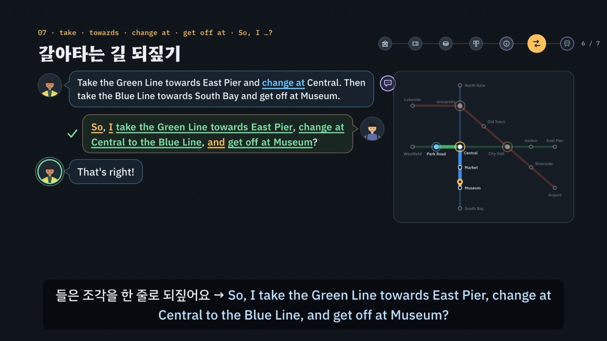

# 대중교통, 표는 골라 말하고 길은 되짚는다

> [영어 튜토리얼](../README.md) 모음의 **상황별 영어 회화** 일곱 번째 꼭지입니다(영역: `talk`). 형식은 [공항](../airport/) · [카페](../cafe/) · [호텔](../hotel/) · [식당](../restaurant/) · [길 묻기](../directions/) · [쇼핑](../shopping/)을 따르고(쇼핑을 복사해 시작, 길 묻기의 되짚기와 식당의 질문의 모양을 섞음), 형식의 결정은 [CLAUDE.md](../CLAUDE.md)의 ‘회화 튜토리얼이 갖출 것’에 적었어요.

기차역 매표소에서는 직원이 짧은 질문을 빠르게 이어서 해요. 어디까지 가는지(정보 질문 *Where are you traveling to?*), 편도인지 왕복인지(고르는 질문 *Single or return?* · *One-way or round trip?*), 몇 명인지(*How many people are traveling?*), 시간대와 자리(*Off-peak or anytime? · window or aisle*), 할인 카드가 있는지(Yes/No 질문 *Do you have a student card?*). 대부분 고르기 · 정보 질문이라 *Yes.*만 하면 대답이 되지 않아요. 그다음 값 · 승강장 · 출발 시각은 직원이 **한 번 말하고 끝**이에요(*It leaves at 10:15 from platform 4.*). 질문이 아니라 안내이니, 들은 숫자를 **되짚어** 확인해요 → *So, platform 4 at 10:15?* 지하철 안내 데스크에서는 **내가 먼저** 길을 묻고(*How do I get to Museum, please?*), 길고 빠른 갈아타기 안내를 조각으로 들은 뒤 들은 차례대로 되짚어요 → *So, I take the Green Line towards East Pier, change at Central to the Blue Line, and get off at Museum?* 여기에 한국어를 그대로 옮긴 말(왕복표 → *a go-and-back ticket* · 카드 충전 → *charge my card* · 나 혼자 → *me alone* · 길 가르쳐 줘요 → *Teach me the way* · 내리다 → *get down* · 이 열차 가요? → *Is this train go …?*)과 헷갈리는 숫자(*fourteen* · *forty*, *ten fifteen* · *ten fifty*)를 더했어요. 약 6분 34초짜리 인터랙티브 모션그래픽으로 **3단계 말하기 법**을 가르쳐요.

- ① **열쇠 낱말 + 질문의 모양 잡기** — 무엇을 묻나, 그리고 어떤 모양인가? *or*가 들리면 고르는 질문(*Single or return?*), *where · how many · how much*로 시작하면 정보 질문, *Do you · Have you got · Is anyone*이면 Yes/No 질문. 물음표가 없는 안내(*It leaves at 10:15 from platform 4. · Next, please! · Please stand behind the yellow line.*)는 들은 것을 되짚거나 **내가 먼저** 말할 차례예요. 모양마다 그림 표시가 있어요: 스위치(Yes/No) · 갈림길(고르기) · 빈 상자(정보) · 말풍선(안내).
- ② **틀에 내 정보 넣기 · 들은 것 되짚기** — 짧은 대답 틀 + 여행 카드와 맞는 정보. *To Oakbridge, please. · A return, please. · Two adults and one child, please. · No, I don't.* 들은 숫자와 길은 **조각으로 되짚어요**: *So, platform 4 at 10:15?* · *So, I take … towards …, change at … to …, and get off at …?* 엔진이 조각마다 맞춰 보고, 틀린 조각에는 그 조각만 고쳐 줘요(*Not quite — towards East Pier, not Westfield.*).
- ③ **공손하게 끝내기** — *please · thanks · Excuse me.* 못 알아들었으면 *Sorry? Could you say that again, please?* 일부만 들렸으면 *Sorry, which platform? · Sorry, where do I change?* 값이 헷갈리면 *Sorry, did you say fourteen fifty?* 안내방송을 놓쳤으면 옆 사람에게 *Excuse me, what did the announcement say?*



## 바로 보기

`index.html`을 더블클릭하면 끝이에요. 설치도, 서버도 필요 없어요.

## 소리와 마이크에 대해 (꼭 읽어 주세요)

- 녹음 파일이 없어요. 영어는 모두 **합성 음성**이에요. 글이 정해진 말(영상의 말풍선 · 영어 칩, 직접 해 보기의 듣기, 듣고 대답 고르기, 따라 말하기)은 **VoiceStudio로 미리 만든 목소리**(`audio/dialogue/`)로, 대중교통 시뮬레이터처럼 카드마다 바뀌는 말과 내가 칩으로 만든 문장은 **브라우저에 들어 있는 음성(speechSynthesis)** 으로 읽어요. 브라우저 음성은 기기마다 목소리가 다르고, 둘 다 실제 역의 소리 · 안내방송과는 달라요.
- 튜토리얼 전용 목소리 부품 `assets/js/voices.js`(`TRV`)가 말하는 사람마다 목소리를 정해요. 미리 만든 목소리는 매표소 직원 = 미국 남성 · 지하철 안내 데스크 직원 = 캐나다 여성 · 지하철에서 만난 사람 = 호주 남성 · 영국 역무원과 안내방송 = 영국 여성 · 여행자(나) = 미국 여성, 화면의 영어 칩(발음 듣기)과 음성 해설의 영어는 밝은 미국 여성 선생님 목소리예요(길 묻기 · 식당 · 쇼핑과 같은 목소리들). 한 번에 읽는 줄 안에서 한 사람의 말 중 하나라도 파일이 없으면 그 사람의 말은 모두 브라우저 음성으로 읽고(한 사람의 목소리가 중간에 바뀌지 않게), 시뮬레이터는 처음부터 끝까지 브라우저 음성이에요. 브라우저 음성은 매표소 직원(en-US) · 안내 데스크 직원(en-CA) · 지하철에서 만난 사람(en-AU) · 영국 역무원(en-GB) · 여행자(나, 직원과 다른 목소리)를 골라요. 없으면 다른 영어 목소리의 높낮이 · 빠르기를 바꿔 구별해요. ‘아주 빠르게’ 문제와 안내방송은 일부러 빠르게 읽어요. 숫자는 역에서 말하는 꼴로 읽어요(`TR.spoken`): *$14.50* → fourteen fifty, *10:15* → ten fifteen, *9:05* → nine oh five, *platform 4* → platform four. 공통 부품(`shared/`)은 바꾸지 않았어요.
- 소리가 겹치지 않게: 대화를 읽기 전에 발음 듣기 · 음성 해설 · 녹음 재생을 멈추고 영상을 일시정지해요. 음성 인식을 시작할 때도 다른 소리를 모두 멈춰요.
- **따라 말하기 · 말로 대답하기**: 브라우저에 음성 인식(`SpeechRecognition` · `webkitSpeechRecognition`)이 있으면 말을 글로 바꿔 **낱말만** 맞춰 봐요(발음의 질은 판정하지 않아요). 숫자는 *4*든 *four*든, 값은 *14.50*이든 *fourteen fifty*든, 시각은 *10:15*든 *ten fifteen*이든 같은 숫자로 맞춰요(`TR.canon`). 크롬(Chrome) 같은 브라우저는 소리를 브라우저 회사의 서버로 보내 글로 바꿔요. 음성 인식이 없으면 녹음(`MediaRecorder`)으로 ‘내 목소리’와 ‘원래 문장’을 이어서 들어요. 둘 다 없으면 마이크 단추를 숨기고 ‘세 번 소리 내어 따라 해 보세요’라고 안내해요. 이 사이트는 소리도 글도 저장하지 않아요(녹음은 화면에만 잠깐 있다가 페이지를 닫으면 사라져요). 역 이름(*Oakbridge · Millbrook · East Pier* 같은)은 인식이 다르게 적기 쉬워서 따라 말하기에서 알림을 붙여요.
- 도시(*Kellport*) · 기차역(*Kellport Central*) · 행선지(*Oakbridge · Millbrook · Ashby*) · 값 · 출발 시각 · 승강장 · 지하철(*Kellport Metro*)의 노선 셋(*Green · Blue · Red Line*)과 역 열다섯은 모두 지어낸 것이에요(실제 도시 · 철도 회사와 상관없어요). 어린이 반값 · 학생 카드 20% 할인(10센트 단위로 반올림)도 지어낸 규칙이고, 값에 세금은 넣지 않았어요. 표의 종류와 부르는 말은 나라마다 달라요 — 영국은 *single · return · off-peak · railcard*, 미국은 *one-way · round trip*. 지하철 카드 · 안내방송 · 승강장의 노란 선도 도시마다 달라요.

## 무엇을 배우나요

| 장 | 시각 | 내용 | 직접 해 보기 |
| --- | --- | --- | --- |
| 00 들어가며 | 0:00 | 매표소 직원의 *Single or return?*에 *Yes, please.* → 직원이 다시 물음(고른 것이 없음) → *A return, please.*, 갈아타는 길을 듣고 *Okay. Thanks.*로 끝내지 말고 되짚기, 3단계 | 먼저 골라서 대답해 보기 (영국 매표소, 듣고 대답 고르기) |
| 01 여행 길 지도 | 0:26 | 왼쪽 기차역(매표소 · 표 종류 · 할인 · 승강장)과 오른쪽 지하철 노선도(안내 데스크 · 갈아타기 · 열차 안)의 일곱 곳, 곳마다 한두 마디, 내가 먼저 말을 꺼내는 곳(보라 테두리), 이름 · 값 · 시각은 지어낸 것 | 곳을 골라 한두 마디 듣기 (지도의 곳을 눌러도 됨) |
| 02 매표소 · 질문의 모양 | 0:56 | *Where are you traveling to today?*(정보) → *Yes.* × → *To Oakbridge, please.*, *Single or return?*(고르기), *Do you have a student card?*(Yes/No), *It leaves at 10:15 from platform 4.*(안내 → 되짚기), *I go to Oakbridge.* · *Give me a ticket …* ×, *A single to Oakbridge, please.* · 영국 *Morning! Where to?* | 질문의 모양 맞히기 + *Yes, please.*로 대답하면? |
| 03 표 종류와 사람 수 | 1:30 | 편도 → *single* · *one-way*, 왕복 → *return* · *round trip*, *go-and-back ticket* ×, *How many people are traveling?* → *Just me, please.*(*me alone* ×) · *Two adults and one child, please.*(*two persons*는 통과 + 알림), *Off-peak or anytime?* → 모르면 *Sorry, what's an off-peak ticket?* | 표 종류 · 사람 수 · 시간대 · 자리 (나라 · 표 · 사람 · 시간대 · 자리 → 첫 질문에 대답하는 방법 셋과 이어지는 질문) |
| 04 할인과 값 | 2:04 | *Do you have a student card?* → *No, I don't.*(*No, I don't have.* ×), 영국 *Have you got a railcard?* → *Sorry, what's a railcard?*, *Okay, that's $14.50, please.* → fourteen fifty, *-teen* 뒤를 세게 · *-ty* 앞을 세게, *Sorry, did you say fourteen fifty?*, *Can I pay by card?*(*Card is okay?* ×), *So expensive. Cheaper, please.* × | 값 듣기와 되묻기 (가는 곳 · 표 · 사람 · 할인 → `TR.fareRows`의 값 목록과 직원의 말, fourteen · forty 짝, 되묻기) |
| 05 승강장과 출발 시각 | 2:38 | 숫자 둘(시각 · 승강장), *Platform where?* ×, *So, platform 4 at 10:15?*(10:50으로 잘못 되짚으면 직원이 고침), 시각 읽기(*ten fifteen · nine oh five · three o'clock*), 영국 *the 10:50 from platform 2*, 빠른 안내 *platform change!* → *Sorry, which platform?*, 출발 안내판 읽기 | 승강장과 시각 되짚기 (안내판의 줄을 골라 직원의 말 → 되짚는 말 셋 중 고르기) |
| 06 지하철 안내 데스크 | 3:10 | *Next, please!*(안내) → 내가 먼저 *Hi. How do I get to Museum, please?* · *Which line goes to Museum?*(*Teach me the way* ×), *Would you like a new metro card?* → *No, thanks. I'd like to top up my card.*(*charge* ×), 노선도 읽기 — 노선은 색 이름, 방향은 끝 역 이름(*towards East Pier*), 갈아타는 역(흰 동그라미) | 길 묻고 노선도 읽기 (지금 있는 역 · 가려는 역을 고르면 `TR.route`가 계산한 직원의 안내와 한국어 풀이, 카드 충전 대화) |
| 07 갈아타는 길 되짚기 | 3:44 | 긴 안내를 조각으로(탈 노선 → 방향 → 갈아타는 역 → 갈아탈 노선 → 내릴 역), *change at*의 이어 읽기, *So, I take the Green Line towards East Pier, change at Central to the Blue Line, and get off at Museum?* → *That's right!*, 조각 하나가 틀리면 *Not quite — towards East Pier, not Westfield.*, *Okay. Thanks.* ×, *get down* × → *get off*, *Sorry, where do I change?*, *No, that's all. Thank you so much!* | 들은 길을 한 줄로 되짚기 (길 셋 · 조각 칩을 누르는 차례대로, `TR.checkLine`의 판정과 직원이 고쳐 주는 말) |
| 08 열차 안과 승강장 | 4:20 | 안내방송(*The next station is Central. Change here for the Blue Line. Doors open on the left.*) → 놓쳤으면 *Excuse me, what did the announcement say?*, *Please stand behind the yellow line.* → 내가 먼저 *Excuse me, does this train go to Museum?*(*Is this train go …?* ×) · *Is this the right platform for Museum?*, *No, this one goes to North Gate. You need the train on the other side.* → *Oh, the other side. Thank you!*, *Is anyone sitting here?* → *No, go ahead.*(*Yes, sit down.* ×) | 승강장과 열차 안에서 (상황 넷 · 옆자리 · 대답 틀 → 엔진의 판정과 상대의 반응) |
| 09 3단계 말하기 법 | 4:54 | 상자 셋, 일곱 곳에 한 줄씩 모양 표시와 함께 단계별로 채워짐 | 곳을 골라 3단계 보기 |
| 10 실전 여행 | 5:22 | 여행 카드 하나(Ashby 왕복, 어른 두 명 · Park Road → Museum)로 넷(표 종류 · 승강장 · 갈아타기 되짚기 · 끝인사), 보기마다 엔진이 ①②③ 몇 단계에서 지우는지 | 대화 골라 보기 |
| 11 정리 | 6:12 | 곳 · 열쇠 낱말과 모양 · 대답 틀 표 + 되짚기 + 못 알아들었을 때 | 아래 칸으로 가는 길 |

영상 아래에는 다섯 가지가 더 있어요.

- **놀이터 — 대중교통 시뮬레이터**: 누를 때마다 새 여행 카드(가는 곳 · 편도나 왕복 · 사람 수, 시간대 · 자리, 학생 카드 · 내는 방법, 지하철 카드를 새로 살지 가진 카드에 넣을지, 지하철에서 지금 있는 역과 가려는 역, 열차 안 옆자리)가 만들어져요. 차례: 매표소(*Where are you traveling to?*) → 표 종류 · 몇 명 · 시간대 · 자리(영국 매표소면 *Single or return?*, 미국이면 *One-way or round trip?*) → 할인 카드 → 값(**직원이 말한 값을 듣고** 내기 · 되묻기) → 승강장 안내(**들은 승강장과 시각을 되짚기**) → 다른 날 지하철 안내 데스크(내가 먼저 길 묻기 → 지하철 카드 → 넣을 돈) → 갈아타기 안내(**조각 칩으로 들은 길을 되짚기**, 노선도가 함께 나와요) → 더 도와줄 것 → 승강장(내가 먼저 열차 확인) → 열차 안(*Is anyone sitting here?*). 값 · 승강장 · 출발 시각은 카드에 없어요 — 직원이 말한 숫자를 듣고 써야 해요. 대답은 ① 대답 틀 칩(맞는 틀 하나 · 함정 하나(Yes만 · 한국어 그대로 · 콩글리시 · 무례한 말) · 다른 질문의 틀 하나)과 ② 칸 칩(카드의 값 + 헷갈리기 쉬운 이웃 값: *fourteen fifty* · *forty fifty*, *10:15* · *10:50*, 이웃 역)으로 만들어요. 갈아타기 안내에서는 조각 칩(되짚는 틀 · 탈 노선 · 방향 · 갈아타는 역 · 갈아탈 노선 · 내릴 역)을 들은 차례대로 누르고(같은 자리의 조각은 바꿔 끼워져요, Backspace 하나 지우기), 틀린 조각이 있으면 직원이 그 조각만 고쳐 주고 맞는 조각은 그대로 둬요. *Okay. Thanks.*로 넘어가면 들은 길을 확인하지 못한 것으로 남아요. 엔진이 ①에서 걸리면 직원이 질문만 다시 말하고(*Sorry — single or return?*), ②에서 걸리면 *Hmm, are you sure?*(카드와 다름) · *No — I said platform 4 at 10:15.*(들은 숫자와 다름) · *Sorry — a go-and…? Oh, a return?* 같은 반응, ③이면 *… Okay.* 매번 단계와 까닭, 모범 대답(듣기)을 보여 줘요. 다시 묻기(*Sorry, did you say fourteen fifty?* · *Sorry, what's a railcard?* · *Could you say that again?*)에는 직원이 확인해 주거나 쉬운 말로 풀어 주거나 천천히 한 번 더 말해요. 음성 인식이 있으면 마이크로 말해서 대답할 수 있어요. 끝나면 기차표(값 · 승강장 · 시각을 읽는 법과 함께), 노선도 위의 길, 한 번에 통과한 수, 대화 전체와 듣기. 키보드: R 듣기 · S 천천히 · T 대본 · 1~4 대답 틀 · A~C 내 정보 · Enter 대답하기(되짚기에서는 되짚기) · Backspace 지우기(되짚기에서는 조각 하나) · M 말로 대답하기 · N 새 카드.
- **대중교통 표현 따라 말하기**: 곳마다 넷씩, 직원 · 안내방송의 말과 내 말 28문장. 듣기 · 천천히 · 따라 말하기(음성 인식 → 녹음 → 소리 내어 따라 하기). 인식 결과는 원래 문장의 낱말마다 초록(들림) · 주황(빠짐)으로 보여 줘요.
- **듣고 대답 고르기**(튜토리얼 전용 `TDrill`, `EN.drill`과 같은 모양 · 키보드): 16문제, 일곱 곳 + 빠른 말 · 안내방송 · 다시 묻기, 정답 위치 A · B · C · D 넷씩. 문제마다 곳 아이콘과 한 줄 상황, 직원의 말은 소리 먼저(글은 답한 뒤 또는 대본 보기), 대답 넷은 글. 되짚기 문제는 보기마다 한 조각만 달라요. 힌트 = 3단계 — ① 열쇠 낱말과 질문의 모양(직원의 말 옆에 모양 표시) ② 틀 · 칸 · 되짚는 조각(함정은 주황) ③ 공손한 말(보라)과 정답. 답하면 보기마다 엔진의 까닭, 해석, 줄마다 듣기, 대화 듣기(직원 → 나). 키보드: A~D(1~4) 고르기 · H 힌트 · R 다시 듣기 · S 천천히 · T 대본 · Enter/→ 다음.
- **퀴즈**: 10문제(그림 문제 4개: 질문의 모양 표시 고르기, 출발 안내판에서 탈 열차의 줄 누르기, 노선도에서 갈아타는 역 누르기, 노선도에서 방향(towards 뒤의 끝 역) 누르기).
- **핵심 정리**: 곳 × 열쇠 낱말 · 모양 × 대답 틀 표, 용어(① 질문의 모양 셋과 안내 · ② 표 종류 · 사람 수 · 값 · 시각 · 승강장 · 노선 · 방향 · 갈아타기 되짚기 · ③ Excuse me, does this train …? · 다시 묻기 · 무례하게 들리는 말 · ④ 한국어와 다른 점 · 콩글리시).

### 플레이어 조작

다른 튜토리얼과 같아요. 스페이스(재생/일시정지), ← →(5초), Shift + ← →(장), C(자막), V(음성 해설), F(전체 화면). 화면 속 말풍선을 누르면 그 사람의 목소리로, 영어 칩을 누르면 발음을 들려줘요. 01장 지도의 곳을 누르면 직접 해 보기와 함께 바뀌어요. 주소 끝에 `#c-장면이름`(예: `index.html#c-route`)을 붙이면 그 장면에서 시작해요.

음성 해설은 자막의 `(A)`~`(D)`를 ‘에이 · 비 · 씨 · 디’, 값(`$14.50`)을 ‘14달러 50센트’, 시각(`10:15`)을 ‘10시 15분’처럼 한국어로 읽고, 영어 문장 속 시각 · 승강장(*at 10:15 · platform 4*)은 영어 낱말(*ten fifteen · platform four*)로 읽어요. `Yes/No`는 *Yes or No*로 읽어요.

**미리 만든 목소리**: VoiceStudio(OmniVoice 엔진, 비상업용 라이선스)로 만든 합성 음성 파일이에요. 파일이 없거나 못 읽으면 그 줄 · 조각만 브라우저 음성으로 읽어요.
- 음성 해설(`audio/narration/`): 한국어 조각은 「튜토리얼 내레이터 (젊은 여성)」, 영어 조각(본보기 영어 문장)은 「영어 선생님 (밝은 미국 여성)」. 화면의 영어 칩(발음 듣기, 말하는 사람 `tc`)도 같은 목소리예요(다른 회화 · 토익 튜토리얼과 같음).
- 대화(`audio/dialogue/`): 말하는 사람 → 프로필은 `voices.json`(길 묻기와 같은 프로필 — 이름의 ‘길 묻기’는 처음 만든 곳일 뿐이에요). 프로필은 VoiceStudio 목소리 보관함(archetype)에서 고른 목소리를 한 번 만든 소리로 복제(clone)한 것이라, 줄마다 같은 사람 목소리가 나요. 파일 이름은 말하는 사람과 읽을 글로 정해져요(`TRV.lineId`). 숫자는 읽을 글(`TR.spoken`)로 만들어요(*$14.50* → *fourteen fifty*, *10:15* → *ten fifteen*).
- 합성 엔진은 가끔 무음 · 잡음을 내거나, 세 낱말 이하의 짧은 말을 0.3초 안에 뭉개 읽어요. 도구가 말소리 1초에 읽은 글자 수로 이런 소리를 걸러 seed를 바꿔 다시 만들고(짧은 말은 다섯 번까지), 그래도 이상하면 ‘확인 필요’로 알려 줘요. 지금 파일은 받아쓰기(Whisper)와 높낮이로 모두 다시 확인했어요(영어 328개 · 한국어 138개). 한국어 조각 ‘아래 대중교통 시뮬레이터에서 … 해 보세요.’는 seed를 바꿔 다시 만들었어요. 밝은 선생님 목소리로 아주 높게 읽은 짧은 말(*Morning!* · *Where to?* · *Morning! Where to?* · *Thank you!* · *Sorry, did you say fourteen fifty?*)과 속삭이듯 읽은 말(*Twenty dollars, please.* · *charge?*)도 seed를 바꿔 다시 만들었고, *forty* · *fifty* · *thirty* 같은 숫자 칩은 쇼핑에서 확인한 소리와 같은 파일이에요. 미국 남성 직원의 *Where are you traveling to today?*는 낮게 갈라져 다시 만들었어요. 호주 승객의 *Thanks!*는 seed와 읽을 글(*Thanks,* · *Thanks.*)을 바꿔 스무 번 넘게 다시 만들어도 속삭이듯 나와(받아쓰기는 *Thanks.*로 맞게 적어요) 그대로 두었어요. 밝은 목소리라 감탄하는 말 · 부르는 말은 원래 높게 읽어요. 받아쓰기가 숫자 · 시각을 *1450 · 10.15*로, 역 이름을 *Oak Bridge*로 적는 것은 적는 방식만 다를 뿐이에요. 교환학생 생활 튜토리얼부터는 받아쓰기는 맞지만 속삭이듯 읽은 소리까지 찾으려고 말하는 사람마다 목소리가 울린(성대가 떨린) 비율도 함께 재요. 이 튜토리얼도 그렇게 다시 확인해서 속삭이듯 읽거나 아주 높게 끽 소리를 낸 선생님 조각(*Yes.* · *Yes, sit down.* · *So expensive.* · *three o'clock* · *Okay, thanks.* · *have* · *So* · *is* · *or* · *Yes / No*)과 직원의 *Sure. Just tap your card here.*, 나의 *Okay. Thanks.* · *Yes.*를 다시 만들었어요. seed를 바꿔도 낫지 않던 짧은 말은 읽을 글 끝에 쉼표를 붙이거나(*Okay, thanks,* · *three o'clock,* · *Yes, sit down,* · *have,* · *So,* · *is,*) *Sure.*를 *Sure!*로 바꿔 읽혀 다시 만들었어요. 화면의 글은 그대로예요. 한 파일만 다시 만들려면 그 파일을 지우고 `--seed`를 바꿔 다시 실행하세요.

만드는 법(VoiceStudio가 있는 맥에서, 이미 만든 파일은 건너뛰어요):

```bash
node tools/narration-pieces.cjs transit     # 해설의 읽기 조각 목록 (자막을 고쳤을 때만, 클라우드에서도 됨)
node tools/dialogue-lines.cjs transit       # 대화 줄 목록 (대화 · 문제 · 따라 말하기를 고쳤을 때만, 클라우드에서도 됨)
python3 tools/voicestudio-narration.py transit --en-profile "영어 선생님 (밝은 미국 여성)"   # 해설 (한국어 + 영어 조각)
python3 tools/voicestudio-dialogue.py transit             # 대화
```

## 무엇이 규칙 계산인가요

- **규칙 엔진** `assets/js/grammar.js`가 맞고 틀림과 까닭, 3단계 가운데 몇 단계에서 걸리는지를 정해요. 영상 속 ✓·×와 실전 여행에서 지워지는 순서, 질문의 모양, 표 값, 출발 안내판, 지하철 길과 직원의 안내, 되짚는 한 줄의 판정과 고쳐 주는 말, 직접 해 보기 채점, 시뮬레이터의 판정과 직원의 반응, 듣고 대답 고르기의 힌트와 보기별 해설, 퀴즈 대부분의 정답이 여기서 나와요.
  - 직원의 말(`TR.Q`)마다 곳 · 뜻(`intent`) · **모양**(`shape`: `yn` · `or` · `wh` · `note`, 고르는 질문은 고를 것 `choices`) · 열쇠 낱말(`key`, 말 안에 꼭 있음) · 빠른 말(`fast`) · 알려 준 사실(`fact`: 값 · 승강장 · 시각 · 길) · 대답 대신 해도 되는 다시 묻기(`allow`: *what's an off-peak ticket? · what's a railcard?*)를 적었어요. `TR.shapeGuess`(마지막 물음 문장 → *or*가 있으면 고르기, 의문사로 시작하면 정보, 나머지는 Yes/No, 물음표가 없으면 안내)가 글과 맞는지 점검해요.
  - 대답은 틀(`TR.FRAME`) + 칸 값(`TR.SLOT`)이에요. 틀 글의 `___`은 내 정보 칸, `{…}`는 공손한 말이고, 틀마다 표시가 있어요: ok · literal(한국어를 그대로 옮김 · 콩글리시) · wrong(틀린 문장) · blunt(명령 · 조르기) · plain(그냥 *No.* · *Okay. Bye.*로 끊김). **Yes · No만 하는 대답**은 `bare` 틀(*Yes. · Yes, please. · No, thanks.*)이에요. 칸 값도 한국어를 옮긴 말일 수 있어요(*a go-and-back ticket* · *me alone* → ②, *two persons* → 통과 + 알림). 값 · 승강장과 시각은 정해져 있지 않은 칸(`dyn`)이에요.
  - **기차 값** `TR.fare` · `TR.fareRows` — 지어낸 행선지 셋(편도 · 왕복 값)에 어른 수 + 어린이 반값, 학생 카드면 20% 할인(10센트 단위). 영상의 값 목록 · *Okay, that's $14.50, please.* · 시뮬레이터의 직원의 말과 기차표가 모두 같은 계산이에요.
  - **지하철 길** `TR.route(출발, 도착)` — 지어낸 노선 셋 · 역 열다섯(갈아타는 역 Central · City Hall · University)에서 갈아타기 한 번을 정거장 100개로 쳐서 갈아타기가 적은 길 → 정거장이 적은 길을 찾아요(구간마다 노선 · 방향(그쪽 끝 역) · 정거장 수). `TR.verifyRoute`가 다른 방법(같은 노선이면 바로, 아니면 두 노선이 만나는 역을 모두 견줘서)으로 다시 계산해 `check()`에서 모든 역 쌍을 맞춰 봐요. 직원의 안내 `TR.say` · `TR.sayKo` · 빠른 말 `TR.sayFast`, 노선도 그림 · 퀴즈 그림 · 시뮬레이터의 노선도가 모두 같은 계산이에요.
  - **되짚는 한 줄** `TR.checkLine(줄, 카드)` — 조각(`TR.OW`: 되짚는 틀 *So, I* / 탈 노선 *take the Green Line* / 방향 *towards East Pier* / 갈아타는 역 *change at Central* / 갈아탈 노선 *to the Blue Line* / 내릴 역 *get off at Museum*)을 누르는 차례대로 이은 줄을 판정해요. 같은 갈래는 한 번만, 차례는 들은 차례대로, 되짚는 틀이 꼭 있어야 하고, *get down*은 ②(한국어 ‘내리다’를 옮긴 말). 들은 길과 다른 조각이 있으면 첫 번째 틀린 조각과 바른 조각(`TR.fixLine` → *Not quite — change at Central.*)을 돌려주고, 갈아타지 않는 길에 갈아타기 조각을 넣으면 ‘이 길은 갈아타지 않아요’. 일부만 되짚어도(탈 노선 · 내릴 역이 있으면) 맞게 받아들여요. 방향은 그 노선의 끝 역 이름만 받아요(반대쪽 끝 역이면 ‘반대 방향’).
  - `TR.judge(말, 대답, 카드)` — ① 빠른 말이면 다시 묻는 말만 통과, **Yes · No만 하는 대답은 고르는 질문 · 정보 질문 · 안내에서 탈락**, 고르는 질문에서 직원이 말하지 않은 것을 고르면 탈락, 다른 질문의 대답이면 탈락 ② 틀이 literal · wrong이거나 칸 값이 콩글리시면 탈락, 칸의 정보가 카드(또는 직원이 말한 값 · 승강장 · 시각 · 길)와 다르면 탈락, *Is anyone sitting here?*에 비어 있는데 *Yes*면 탈락 ③ blunt · plain이면 탈락. 들은 숫자를 되짚는 말(*So, platform 4 at 10:15? · Sorry, did you say fourteen fifty?*)은 직원이 말한 숫자와 같으면 통과해요. `TR.model`은 카드에 맞는 모범 대답(갈아타기 안내는 되짚는 한 줄), `TR.steps`는 힌트 세 단계와 색칠할 낱말을 만들어요. `TR.REACT` · `TR.reply`가 단계마다 직원의 반응을 만들어요.
  - `TR.matchSpoken(들린 글, 말, 카드)` — 음성 인식이 글로 바꾼 말에 그 말의 표시 낱말과 카드의 사실이 들어 있으면 받아들여요. **모양 규칙도 같아요**: 고르는 질문 · 정보 질문에 *yes* · *no*만 들리면 ①. 숫자 낱말은 숫자 줄로 모아(`TR.canon`: *fourteen fifty* → 1450, *ten fifteen* → 10:15, *platform four* → 4) 값 · 시각 · 승강장을 맞추고, 되짚는 한 줄은 들린 글에서 조각을 찾아(`TR.parseLine`) `TR.checkLine`으로 판정해요. 다른 값(*forty fifty*) · 다른 시각 · 다른 역 · *go-and-back* · *charge my card* · *get down*은 ②, 다른 질문의 대답만 들리면 ①. 말투는 판정하지 않아요.
  - `TR.compareWords(원래 문장, 들린 글)` — 낱말마다 맞춤(가장 긴 공통 부분열, 숫자는 같은 숫자로).
- **어긋남 경고** `TR.check()`: 열쇠 낱말이 말에 없거나, 적어 둔 모양이 글의 모양과 다르거나, 고르는 질문에 고를 것이 없거나, 사전에 없는 뜻 · 칸 · 조각을 쓰거나, 함정 틀 · 조각에 까닭이 없거나, 맞는 보기가 하나가 아니거나 정답과 다르거나, 정답 위치가 4/4/4/4가 아니면 콘솔에 경고가 떠요. 숫자 읽기와 맞추기(*fourteen fifty* · *$14.50* · *ten fifteen* · *nine oh five* · *platform four*), 기차 값(행선지 · 사람 수 · 할인마다), 모든 역 쌍의 길을 두 방법으로, 직원의 안내 글, 되짚는 한 줄(모범 줄 통과 · 조각마다 틀린 경우의 고쳐 주는 말), 영상 · 직접 해 보기의 대화(02~08장), 실전 여행에서 단계마다 지워지는 보기와 화면 글, 시뮬레이터 카드 여러 장(모범 대답이 통과하는지, 말로 해도 통과하는지, 틀 칩 가운데 맞는 것이 하나뿐인지, 맞는 틀의 칸 칩에 카드 값이 있는지, 매번 바뀌는 직원의 말도 모양과 열쇠 낱말이 맞는지, 조각 칩으로 모범 줄을 만들 수 있는지), 말로 한 대답 여러 가지, 따라 말하기 문장(곳마다 넷)도 점검하고, 퀴즈 정답은 `app.js`에서 따로 점검해요.
- **단순하게 줄인 부분과 엄격함의 기준** (직원이 틀리다 · 헷갈린다 · 무례하다고 느낄 말만 거르고, 알아듣지만 더 흔한 말이 있으면 통과 + 알림)
  - 엔진은 소리를 듣지 않아요. 말의 뜻 · 모양 · 열쇠 낱말, 대답의 틀과 칸은 사람이 적어 두었고, 엔진은 그것을 카드의 사실과 맞춰요. 대답 틀은 역에서 자주 쓰는 것만 골랐어요. 같은 뜻의 다른 자연스러운 대답도 많아요(*A return, please.* 말고도 *Return, please.* · *A return ticket, please.*).
  - **지하철 길**은 갈아타기가 가장 적은 길(같으면 정거장이 적은 길) 하나만 계산해요. 실제 직원은 걷는 거리 · 혼잡 · 공사를 따져 다른 길을 알려 주기도 해요. 갈아타기는 한 번까지만 나오게 행선지를 골랐어요.
  - **되짚는 한 줄의 차례**(탈 노선 · 방향 → 갈아타는 역 → 갈아탈 노선 → 내릴 역)는 자주 쓰는 차례를 단순하게 줄인 규칙이에요. 갈아탄 뒤의 방향(*towards South Bay*)은 넣어도 되고 빼도 돼요. 실제로는 *So, Green Line to Central, then Blue Line to Museum?*처럼 더 짧게 되짚어도 알아들어요.
  - **질문의 모양 (①)**: 고르는 질문(*Single or return? · One-way or round trip? · Off-peak or anytime? · Would you like a window or an aisle seat?*)과 정보 질문(*Where are you traveling to? · How many people …? · How much would you like to put on it?*)에 *Yes.* · *Yes, please.*만 하면 ①. 권하는 Yes/No 질문(*Would you like a new metro card?*)에는 원하는 것을 바로 말해도 통과해요.
  - **콩글리시 · 한국어 그대로 (②)**: *I go to Oakbridge.* · *a go-and-back ticket* · *me alone* · *No, I don't have.*(틀린 문장) · *Card is okay?* · *Platform where?* · *Teach me the way to Museum.* · *Museum, how?* · *I'd like to charge my card.* · *get down at Museum* · *Is this train go to Museum?*(틀린 문장) · *This train, Museum?* · *Yes, sit down.*(*Is anyone sitting here?*에). **통과 + 알림**: *two persons*(보통 *two adults · two people*).
  - **공손함 (③)**: *Give me a ticket to Oakbridge.* · *So expensive. Cheaper, please.* · *What?* · 그냥 *No.*(더 도와줄 것이 있느냐는 말에) · *Okay. Bye.*는 ③. 실제로는 말투 · 표정으로도 공손함이 전해져요. 말로 한 대답은 말투를 판정하지 않아요.
  - **되짚지 않기**: 갈아타기 안내에 *Okay. Thanks.*만 하면 틀린 대답은 아니지만 ‘들은 길을 확인하지 못했어요’로 남겨요(시뮬레이터에서는 건너뛴 질문으로 표시).
  - 값은 세금 없이, 할인은 학생 카드 하나만(영국의 *railcard*는 무엇인지 묻는 연습으로만) 다뤄요. 출발 안내판의 시각 · 승강장도 지어낸 것이에요.
  - 시뮬레이터의 직원은 늘 같은 차례에 작은 변화만 주게 만들었어요(영국 · 미국 매표소, 지하철 카드, 옆자리). 실제 역에서는 차례가 바뀌거나 묻지 않고 넘어가기도 해요.
  - 말로 대답하기와 따라 말하기는 낱말만 맞춰요. 발음과 공손함은 판정하지 않고, 음성 인식이 숫자 · 역 이름을 다르게 적을 수도 있어요.
  - 사람 · 매표소 · 승강장 · 노선도 · 기차표는 도형으로 그린 그림이에요. 이어서 들리는 소리 상자(*chain-jat*, *four-TEEN*)는 대략의 모양이에요.
- **예문과 대화**: 모두 직접 만든 것이에요.

이웃 튜토리얼: 같은 형식의 [공항](../airport/) · [카페](../cafe/) · [호텔](../hotel/) · [식당](../restaurant/) · [길 묻기](../directions/) · [쇼핑](../shopping/). 질문의 모양(Yes/No · 고르기 · 정보)은 식당에서, 들은 길 되짚기는 길 묻기에서, fourteen과 forty는 쇼핑 · 카페와 토익 듣기 [T15](../listening-part1-2/)에서도 다뤄요.

## 폴더 구조

```
index.html              페이지 (영상 · 직접 해 보기 · 대중교통 시뮬레이터 · 따라 말하기 · 듣고 대답 고르기 · 퀴즈 · 핵심 정리)
assets/js/grammar.js    규칙 엔진(TR.judge · TR.model · TR.shapeGuess · TR.checkLine · TR.fixLine · TR.matchSpoken · TR.parseLine · TR.compareWords · TR.canon),
                        표와 길(TR.TOWNS · TR.PARTY · TR.fare · TR.fareRows · TR.LINES · TR.STN · TR.route · TR.verifyRoute · TR.say · TR.priceWords · TR.timeWords · TR.spoken),
                        곳(TR.PLACES) · 모양(TR.SHAPE) · 말(TR.Q) · 틀(TR.FRAME) · 칸(TR.SLOT) · 되짚기 조각(TR.OW · TR.OCAT),
                        연습 문제(TR.DRILL), 영상 대화(TR.INTRO · TR.SCENE · TR.METHOD · TR.PRACTICE · TR.DEMO · TR.PCARD), 여행 카드(TR.newCard · TR.simQs · TR.simQ · TR.simFrames · TR.lineChips),
                        따라 말하기(TR.SHADOW), 힌트(TR.steps), 반응(TR.REACT · TR.reply), 점검(TR.check)
assets/js/voices.js     대화 목소리(TRV): 매표소 직원 · 안내 데스크 직원 · 지하철에서 만난 사람 · 영국 역무원 · 여행자(나) 다른 영어 목소리(미리 만든 파일 → 없으면 브라우저 음성), 빠른 말, 숫자 읽기, 다른 소리와 겹치지 않게
assets/js/scenes.js     영상 장면 12개, 장 목록과 자막, 곳 아이콘과 모양 표시(TRS.ICON · TRS.iconSVG · shapeMark), 얼굴(avatar), 말풍선(talk · answer), 낱말 조각(lay · morph),
                        기차역과 지하철 지도, 출발 안내판(departureBoard), 값 목록(fareTable), 기차표(ticketDraw), 지하철 노선도(metroMap · mapAt), 지하철 카드, 여행 카드(tripCard), 이어서 들리는 말
assets/js/app.js        플레이어, 직접 해 보기, 듣고 대답 고르기(TDrill), 대중교통 시뮬레이터(되짚기 조각 칩 · 노선도), 따라 말하기(음성 인식 · 녹음), 퀴즈, 영상 추출(EN_EXPORT)
video/                  자막 원고(SRT)
audio/narration/        음성 해설의 읽기 조각 목록(pieces.json) · 미리 만든 음성 파일 목록(clips.js) · 음성 파일(조각 id.m4a)
audio/dialogue/         대화 줄 목록(lines.json) · 말하는 사람 → 프로필(voices.json) · 파일 목록(clips.js) · 음성 파일(말하는사람-id.m4a)
docs/poster.jpg         사이트 카드 그림
```

## 영상 다시 만들기

```bash
node tools/render-video.cjs transit                       # → transit/video/transit.mp4 + .srt
node tools/render-video.cjs transit --frames 80,250       # 몇 장면만 그림으로
node tools/render-video.cjs transit --poster 239.6        # 카드 그림
node tools/render-video.cjs transit --srt                 # 자막 원고만
```

MP4에는 소리가 없어요(자막이 그림에 들어가요). 말은 말풍선 속 낱말이 하나씩 나타나는 모습으로 보여 줘요.
