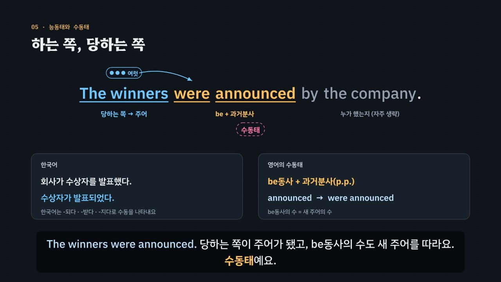

# 주어가 수를, 목적어가 태를 정한다

> [영어 튜토리얼](../README.md) 모음의 세 번째 꼭지(T03)입니다. 영역: 토익 문법 · 다루는 유형: [100개 유형](../docs/toeic-100-types.md)의 9–11번(수 일치), 13–15번(능동·수동). 12번(주격 관계대명사 뒤 동사의 수)은 [T01](../relative-pronouns/)에서 다뤘어요.

토익 Part 5에서 같은 동사의 여러 모양(posted · was posted · were posted · was posting) 가운데 하나를 고르는 **동사 문제**를 약 6분 30초짜리 인터랙티브 모션그래픽으로 설명합니다. 핵심은 두 질문이에요. **진짜 주어가 하나인가 여럿인가(수 일치), 그리고 빈칸 뒤에 목적어가 있는가(능동·수동).** 이것을 **3단계 풀이법(주어 → 수 → 뒤)** 으로 묶습니다.

한국어와 다른 점을 함께 보여 줘요. 한국어 동사는 주어가 여럿이어도 그대로이고(그는 간다 · 그들은 간다), 수동을 -되다 · -받다 · -지다로 나타내서 ‘발생되었다’를 그대로 옮기면 *was occurred*(×)가 돼요.



## 바로 보기

`index.html`을 더블클릭하면 끝이에요. 설치도, 서버도 필요 없어요.

## 무엇을 배우나요

| 장 | 시각 | 내용 | 직접 해 보기 |
| --- | --- | --- | --- |
| 00 들어가며 | 0:00 | 같은 동사 post의 네 모양, 두 질문(주어의 수 · 빈칸 뒤 목적어) | 먼저 풀어 보기 |
| 01 주어를 따라 바뀌는 동사 | 0:24 | 그는 간다 · 그들은 간다 ↔ He goes · They go, 명사 -s(여럿)와 동사 -s(하나), is·are 같은 짝 | 주어 바꿔 보기 (He · They · The managers …) |
| 02 진짜 주어 찾기 | 0:54 | 바로 앞 명사의 함정, 전치사구 · 관계사절 · 분사구 지우기 | 수식어 지우기, 빈칸 문제 |
| 03 수를 정하는 앞말 | 1:28 | a number of(복수) ↔ the number of(단수), each · every · one of(단수), several · both(복수) | 수량 표현 바꿔 보기 |
| 04 덩어리 주어는 하나 | 2:02 | 동명사 · 명사절 · 셀 수 없는 명사 주어는 단수 | 빈칸 문제 둘 |
| 05 하는 쪽, 당하는 쪽 | 2:32 | 목적어가 주어 자리로 → be + p.p., be동사의 수 = 새 주어의 수, 목적어 자리가 빔 | 문장 · 능동/수동 바꾸기 |
| 06 빈칸 뒤를 보라 | 3:03 | 목적어가 있으면 능동, 없으면 수동, 시간·장소 표현은 목적어가 아님 | 목적어일까 아닐까, 빈칸 문제 |
| 07 목적어가 남는 수동태 | 3:35 | 주는 동사(4형식) 수동태 뒤의 목적어, consider(5형식) 수동태 뒤의 보어 | 빈칸 문제 둘 |
| 08 수동태가 없는 동사 | 4:09 | 발생되었다 → was occurred(×), 자동사 occur · arise · rise · take place, rise ↔ raise | 수동태가 되는 동사일까, 빈칸 문제 |
| 09 3단계 풀이법 | 4:41 | 주어 → 수 → 뒤 흐름도 | 3단계 판정기: 주어 · 동사 종류 · 빈칸 뒤를 고르면 흐름도에 길이 켜짐 |
| 10 실전 문제 풀이 | 5:11 | 토익 형식 세 문제 (were posted · was awarded · has risen) | 문제 고르기 |
| 11 정리 | 6:07 | 한눈에 보는 표 | 아래 칸으로 가는 길 |

영상 아래에는 다섯 가지가 더 있어요.

- **놀이터 — 능동·수동 변환기**: 문장 열 개(타동사 넷, 주는 동사 둘, 목적어 + 보어 동사 둘, 자동사 둘)를 골라 능동과 수동, 시제(현재 · 과거 · 현재완료 · 미래)를 바꿔 봐요. 낱말이 자리를 옮기는 그림과 함께 규칙 엔진이 풀어 쓴 단계, 수나 태를 틀리게 쓴 ‘틀린 쌍둥이’와 그 까닭이 나와요. 주는 동사는 사람과 물건 가운데 무엇을 주어로 올릴지 고를 수 있고, 자동사는 왜 바꿀 수 없는지 알려 줘요.
- **놀이터 — 진짜 주어 누르기**: 문장 열두 개 가운데 여덟 개를 섞어 내요. 동사가 수를 맞추는 진짜 주어를 누르면, 지울 수식어에 줄이 그어지고 동사가 표시돼요. 틀리면 그 낱말이 왜 아닌지(수식어 안의 말, 동사, 꾸미는 말) 알려 줘요.
- **연습 문제**: 토익 Part 5 형식 16문제(정답 위치 4·4·4·4). 힌트 = 3단계 풀이(주어 → 수 → 뒤)와 단계마다 지워지는 보기, 보기마다 모양(단수·복수, 능동·수동)과 까닭, 해석, 발음.
- **퀴즈**: 개념 확인 10문제(그림 문제 2개: 진짜 주어 고르기, 수동태 뒤에 남은 목적어 고르기).
- **핵심 정리**: 한눈에 보는 표, 용어(주어와 수 · 능동·수동 · 동사의 종류 · 한국어와 다른 점).

### 플레이어 조작

T01 · T02와 같아요. 스페이스(재생/일시정지), ← →(5초), Shift + ← →(장), C(자막), V(음성 해설), F(전체 화면). 화면 속 영어 문장을 누르면 발음을 들려줘요. 주소 끝에 `#c-장면이름`(예: `index.html#c-voice`)을 붙이면 그 장면에서 시작해요.

음성 해설은 `be + 과거분사(p.p.)`의 괄호를 빼고 읽고, `진짜 주어 = results`의 `=`는 쉬어 읽어요.

## 무엇이 규칙 계산인가요

- **규칙 엔진** `assets/js/grammar.js`의 `VA.judge(보기 모양, 문장)`이 맞고 틀림과 까닭, 그리고 3단계 가운데 몇 단계에서 지워지는지를 정해요. 보기 모양은 ‘태.수’(능동 · 수동 · be동사 · 진짜 동사가 아님 · 명사 / 단수 · 복수 · 수와 상관없음)로, 문장은 진짜 주어의 수, 동사의 종류(타동사 · 주는 동사 · 목적어 + 보어 동사 · 자동사 · be동사), 빈칸 뒤(목적어 하나 · 둘 · 목적어 + 보어 · 보어만 · 없음)로 적어요. 영상 속 ✓·×와 실전 문제에서 지워지는 순서, 직접 해 보기 채점, 연습 문제의 힌트와 보기별 해설, 퀴즈 대부분의 정답이 모두 이 함수에서 나와요.
- **진짜 주어의 수** `VA.SUBJ`: 단수 · 복수 명사, a number of, the number of, each · every, one of, several · both, 동명사, 명사절, 셀 수 없는 명사.
- **능동·수동 변환기** `VA.build`, `VA.explain`: 문장 쌍을 시제와 수에 맞춰 만들고, 일부러 수나 태를 틀린 ‘쌍둥이’를 만들어 `VA.judge`의 까닭을 보여 줘요. 영상 05·07장도 같은 함수로 그려요.
- **어긋남 경고** `VA.check()`: 연습 문제 정답이 규칙 엔진과 다르거나, 정답이 둘 이상이거나, 단서 글자가 문장에 없거나, 동사 종류가 사전과 다르거나, 정답 위치가 몰리거나, 변환기가 만든 문장이 기대와 다르거나 규칙 엔진과 어긋나면 콘솔에 경고가 떠요. 실전 문제의 ‘탈락’ 표시와 퀴즈 정답도 따로 점검해요.
- **단순하게 줄인 부분**
  - 진짜 주어의 수와 동사의 종류는 문제마다 정해 두었어요. 규칙 엔진은 문장을 스스로 분석하지 않아요.
  - ‘주는 동사 뒤에 명사가 하나만 남으면 수동’은 토익 기준의 줄임이에요. 실제로는 *gave a bonus to her*처럼 목적어 하나로 쓰는 능동도 있어서, 주어가 받는 쪽인지 뜻도 함께 봐야 해요.
  - *grow · increase*처럼 자동사와 타동사로 다 쓰는 동사, *team · staff*처럼 단수·복수로 다 받는 집합 명사, *most of · some of* + 명사, A and B 주어는 문제에 넣지 않았어요.
  - a number of를 ‘많은’으로 보고 뒤의 복수 명사에 맞추는 것은 뜻에 따른 일치예요. 시험에서 쓰는 규칙 그대로 정리했어요.
  - 시제는 판정하지 않아요. 그래서 보기는 시제가 문장과 맞는 것만 넣었어요(시제는 [T04](../verb-tense/)).
  - be + -ing(진행형)는 능동으로 봐요.
- **예문과 문제**: 모두 토익 형식을 본떠 직접 만든 것이에요.

## 폴더 구조

```
index.html              페이지 (영상 · 직접 해 보기 · 놀이터 · 연습 문제 · 퀴즈 · 핵심 정리)
assets/js/grammar.js    규칙 엔진(VA.judge), 진짜 주어의 수, 동사 사전, 능동·수동 변환기(VA.build), 연습 문제(VA.DRILL), 진짜 주어 누르기(VA.FIND)
assets/js/scenes.js     영상 장면 12개, 장 목록과 자막, 변환기의 작은 무대(VS.stage)
assets/js/app.js        플레이어, 직접 해 보기, 놀이터, 퀴즈, 영상 추출(EN_EXPORT)
video/                  자막 원고(SRT)
audio/narration/        미리 만든 음성 해설 · 발음 듣기: pieces.json(조각 목록) · clips.js(window.EN_CLIPS) · 조각 id.m4a
docs/poster.jpg         사이트 카드 그림
```

## 미리 만든 목소리

음성 해설과 발음 듣기는 VoiceStudio(OmniVoice 엔진, 비상업용 라이선스)로 미리 만든 합성 음성 파일(`audio/narration/`)로 읽어요. 파일이 없거나 못 읽는 글만 브라우저 음성으로 읽어요.
- 음성 해설: 한국어 조각은 「튜토리얼 내레이터 (젊은 여성)」, 영어 조각(본보기 영어 문장)은 「영어 선생님 (밝은 미국 여성)」.
- 발음 듣기(`EN.say`): 영상 속 영어나 스피커 단추를 누르면 같은 「영어 선생님 (밝은 미국 여성)」 파일로 읽어요(천천히는 같은 파일을 0.75배로). 글은 `tools/say-sweep.js`가 영상 · 처음부터 있는 스피커 단추 · 직접 해 보기의 예문(예문 단추를 하나씩 눌러 가며)에서 모아요. 놀이터에서 조각을 골라 만든 문장, 문제를 푼 뒤에 나오는 문장처럼 조합이 많은 글은 브라우저 음성으로 읽어요.
- 합성 엔진은 가끔 무음 · 잡음을 내거나 짧은 말을 뭉개 읽어요. 도구가 이런 소리를 걸러 seed를 바꿔 다시 만들어요. 지금 파일은 받아쓰기(Whisper)와 높낮이로 모두 다시 확인했고, 다시 만들어야 할 파일은 없었어요. 한 파일만 다시 만들려면 그 파일을 지우고 `--seed`를 바꿔 다시 실행하세요.

만드는 법(VoiceStudio가 있는 맥에서, 이미 만든 파일은 건너뛰어요):

```bash
node tools/narration-pieces.cjs verb-agreement-voice     # 해설의 읽기 조각 + 발음 듣기 글 목록 (자막 · 예문을 고쳤을 때만, 클라우드에서도 됨)
python3 tools/voicestudio-narration.py verb-agreement-voice --en-profile "영어 선생님 (밝은 미국 여성)"
```

## 영상 다시 만들기

```bash
node tools/render-video.cjs verb-agreement-voice                    # → verb-agreement-voice/video/verb-agreement-voice.mp4 + .srt
node tools/render-video.cjs verb-agreement-voice --frames 74,173    # 몇 장면만 그림으로
node tools/render-video.cjs verb-agreement-voice --poster 173       # 카드 그림
node tools/render-video.cjs verb-agreement-voice --srt              # 자막 원고만
```
