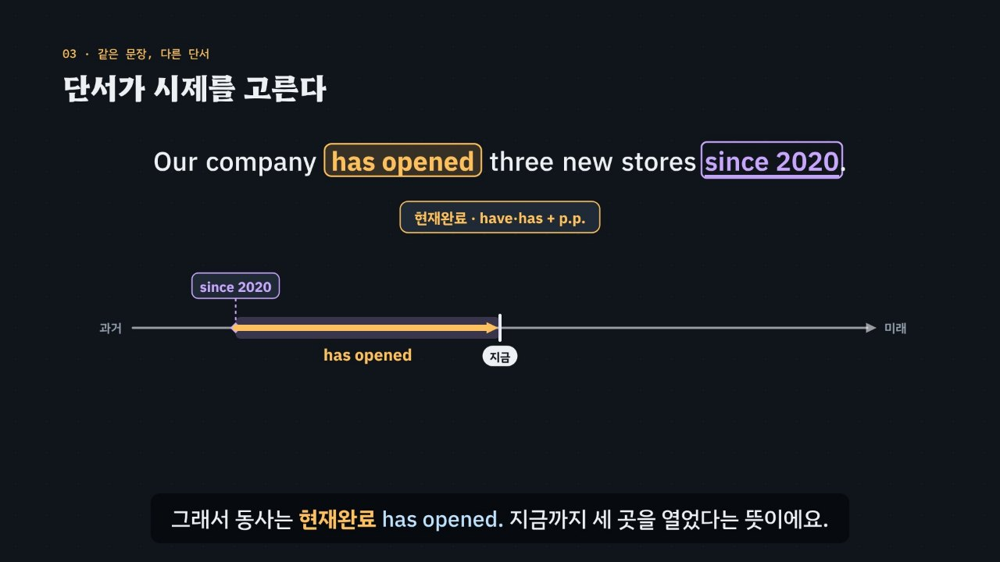

# 시간선 위에 동사를 놓아라

> [영어 튜토리얼](../README.md) 모음의 네 번째 꼭지(T04)입니다. 영역: 토익 문법 · 다루는 유형: [100개 유형](../docs/toeic-100-types.md)의 16–20번

토익 Part 5의 **시제 문제**를 약 6분 30초짜리 인터랙티브 모션그래픽으로 설명합니다. 핵심은 하나예요. **동사의 시제는 해석이 아니라 문장 속 시간 단서가 정한다.** 단서를 시간선(과거 — 지금 — 미래) 위에 놓으면 들어갈 모양이 보여요. 이것을 **3단계 풀이법(단서 → 시간선 → 모양)** 으로 묶고, 시간과 상관없이 모양이 정해지는 두 함정(시간·조건 부사절의 현재 시제, 요구·제안 that절의 동사원형)을 ③ 단계에서 확인합니다.



## 바로 보기

`index.html`을 더블클릭하면 끝이에요. 설치도, 서버도 필요 없어요.

## 무엇을 배우나요

| 장 | 시각 | 내용 | 직접 해 보기 |
| --- | --- | --- | --- |
| 00 들어가며 | 0:00 | 같은 동사의 시제 네 개, 시간 단서 since 2020 | 먼저 풀어 보기 |
| 01 시간선 위의 동사 | 0:24 | 과거의 한 점 · 지금(되풀이) · 미래의 한 점, 한국어 어미(일했다 · 일한다 · 일할 거예요)와 비교 | 시제 하나만 골라 시간선에서 보기, 발음 듣기 |
| 02 ‘일했다’가 둘로 갈라진다 | 0:52 | 한국어 ‘-했다’ 하나가 영어의 과거(끝난 일)와 현재완료(지금까지)로 갈라짐, since 2020 + 과거 시제 실수 | 지금도 일하나요? → 두 문장을 규칙 엔진이 채점 |
| 03 단서가 시제를 고른다 | 1:24 | 같은 문장에서 단서만 바꾸면(two years ago → since 2020 → next year) 동사가 opened → has opened → will open | 단서 바꾸기, 네 시제를 규칙 엔진이 채점 |
| 04 시간 단서 모아 보기 | 1:58 | 과거의 한 점 · 지금까지의 구간 · 미래의 한 점에 단서 모으기, ago + 현재완료 · since + 과거 함정 | 단서를 보고 시제 고르기 |
| 05 부사절의 현재 시제 | 2:26 | When the shipment arrives, we will call you. 한국어 ‘도착하면’도 미래형을 안 씀, 부사절을 여는 말 | 빈칸 문제 둘 |
| 06 기준점보다 먼저 | 3:00 | 미래완료(by next March → will have p.p.), 과거완료(by the time … arrived → had p.p.) | 빈칸 문제 둘 |
| 07 that절의 동사원형 | 3:34 | recommend · request · suggest · insist · ask + that + 동사원형, (should)가 빠진 모양, It is essential that | 빈칸 문제 둘 |
| 08 시제와 짝인 부사 | 4:06 | recently · shortly · soon · currently · already · yet | 빈칸 문제 둘 |
| 09 3단계 풀이법 | 4:38 | 단서 → 시간선 → 모양 흐름도 | 단서 판정기: 단서를 고르면 흐름도에 길이 켜짐 |
| 10 실전 문제 풀이 | 5:08 | 토익 형식 세 문제 (has worked · arrives · attend) | 문제 고르기 |
| 11 정리 | 6:04 | 단서 · 시간선 · 모양 표 | 아래 칸으로 가는 길 |

영상 아래에는 네 가지가 더 있어요.

- **놀이터 — 시간선 시제 기계**: 문장 넷(Our company · open three new stores 등)과 시간 단서 열네 개(yesterday, since January, so far this year, every month, next month, by the end of this year, by the end of last year, When …, If …, The board requested that … 등)를 골라 조합하면, 기계가 단서를 시간선에 놓고 규칙 엔진으로 동사 모양을 정해요. 일곱 가지 모양(과거 · 현재 · 현재완료 · 미래 · 미래완료 · 과거완료 · 동사원형)이 왜 맞고 왜 틀리는지도 함께 보여 줘요. ‘먼저 맞히기’를 켜면 무작위 문제가 나오고 모양을 직접 고른 뒤 확인해요. 키보드 ← → 단서, ↑ ↓ 문장, 1~7 고르기, R 또는 Enter 다음 문제.
- **연습 문제**: 토익 Part 5 형식 16문제(유형 16·17·18·19·20을 고루). 힌트 = 3단계 풀이(단서 → 시간선 → 모양), 단서 · 기준점 · 함정에 색, 보기마다 시제 이름과 까닭, 해석, 발음.
- **퀴즈**: 개념 확인 10문제(그림 문제 3개: 현재완료를 시간선에 놓은 그림 고르기, 시제를 정한 단서 덩어리 고르기, 미래완료가 끝나는 자리 고르기).
- **핵심 정리**: 단서 · 시간선 · 모양 표, 시간선과 시제, 함정 두 가지, 시제와 짝인 부사.

### 플레이어 조작

T01·T02와 같아요. 스페이스(재생/일시정지), ← →(5초), Shift + ← →(장), C(자막), V(음성 해설), F(전체 화면). 화면 속 영어 문장을 누르면 발음을 들려줘요. 주소 끝에 `#c-장면이름`(예: `index.html#c-adv`)을 붙이면 그 장면에서 시작해요.

음성 해설은 과거분사 표시 `p.p.`를 ‘피피’로 읽어요.

## 무엇이 규칙 계산인가요

- **규칙 엔진** `assets/js/grammar.js`의 `VT.judge(모양, { time, clause })`가 맞고 틀림과 까닭을 정해요. 시간선 위의 자리(time)는 과거의 한 점 · 과거 → 지금 구간 · 지금·늘 · 미래의 한 점 · 미래 기준점보다 먼저 · 과거 기준점보다 먼저 여섯 가지, 절(clause)은 주절 · 시간·조건 부사절 · 요구·제안 that절 세 가지예요. 시제와 짝인 부사는 `VT.judgeAdv(부사, { form, neg, end })`가 정해요. 영상 속 ✓·×, 직접 해 보기 채점, 시제 기계의 답과 까닭, 연습 문제의 힌트와 보기별 해설, 퀴즈의 정답이 모두 이 두 함수에서 나와요.
- **시간 단서 사전** `VT.CLUES`는 단서 낱말이 시간선의 어디를 가리키는지 적어 둔 표예요(04장 직접 해 보기, 퀴즈).
- **어긋남 경고** `VT.check()`: 연습 문제 정답이 규칙 엔진과 다르거나, 정답이 둘 이상이거나, 단서 글자가 문장에 없거나, 정답 위치가 몰리거나, 시제 기계의 단서에 맞는 모양이 하나가 아니면 콘솔에 경고가 떠요. 영상 속 예문과 실전 문제, 퀴즈도 페이지를 열 때 규칙 엔진과 대조해요.
- **단순하게 줄인 부분**
  - 정해진 일정은 현재 시제로도 미래를 말해요(The train leaves at nine tomorrow). 엔진은 토익 Part 5의 기본 답(미래 단서 + will)만 맞다고 해요. 그래서 연습 문제에는 이런 보기를 넣지 않았어요.
  - 미국 영어 구어에서는 already · just · so far와 과거 시제를 함께 쓰기도 해요. 이 튜토리얼은 표준 문법(현재완료)을 기준으로 해요.
  - 시간·조건 부사절에서도 완료를 강조할 때는 현재완료를 써요(once you have finished). 엔진은 단순 현재만 정답으로 다루고, 연습 문제에는 현재완료 보기를 넣지 않았어요.
  - 명사절의 when · if(I don't know when he will arrive)는 부사절이 아니라서 will을 써요. 엔진의 ‘부사절’은 시간·조건을 나타내는 부사절만 뜻해요.
  - suggest · insist가 ‘사실이라고 주장하다’는 뜻일 때는 that절에 보통 시제를 써요. 영국 영어에서는 that절에 should를 넣어 말하는 일이 더 흔해요. 엔진은 요구·제안의 뜻만 다뤄요.
  - 현재진행과 ‘지금·늘’ 단서(currently, every month)는 현재 시제와 함께 한 칸(지금·늘)으로 묶었어요.
- **예문과 문제**: 모두 토익 형식을 본떠 직접 만든 것이에요.

## 폴더 구조

```
index.html              페이지 (영상 · 직접 해 보기 · 놀이터 · 연습 문제 · 퀴즈 · 핵심 정리)
assets/js/grammar.js    규칙 엔진(VT.judge · VT.judgeAdv), 시간 단서 사전, 연습 문제(VT.DRILL), 시제 기계의 문장·단서(VT.VPS · VT.MCLUES)
assets/js/scenes.js     영상 장면 12개, 시간선 그리기, 장 목록과 자막
assets/js/app.js        플레이어, 직접 해 보기, 놀이터(시간선 시제 기계), 퀴즈, 영상 추출(EN_EXPORT)
video/                  자막 원고(SRT)
docs/poster.jpg         사이트 카드 그림
```

## 영상 다시 만들기

```bash
node tools/render-video.cjs verb-tense                    # → verb-tense/video/verb-tense.mp4 + .srt
node tools/render-video.cjs verb-tense --frames 104,232   # 몇 장면만 그림으로
node tools/render-video.cjs verb-tense --poster 104       # 카드 그림
node tools/render-video.cjs verb-tense --srt              # 자막 원고만
```
