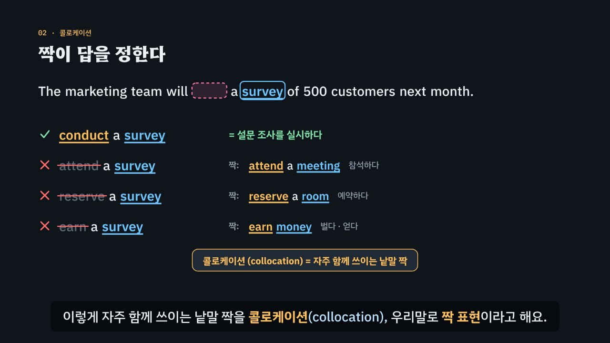

# 낱말에도 단짝이 있다

> [영어 튜토리얼](../README.md) 모음의 열세 번째 꼭지(T13)입니다. 영역: 토익 문법 · 다루는 유형: [100개 유형](../docs/toeic-100-types.md)의 59번(동사 + 목적어 짝), 60번(명사 표현 · 업무 관용구), 61번(모양이 비슷한 형용사), 62번(부사 어휘), 63번(헷갈리는 동사).

토익 Part 5의 **어휘 문제**는 보기 네 개가 대개 품사도 모양도 같아서(*conduct · attend · reserve · earn*) 문법으로는 가려지지 않아요. 답을 정하는 것은 빈칸과 늘 함께 다니는 말, 곧 **짝(콜로케이션)** 이에요. 이 튜토리얼은 낱말 목록을 늘어놓는 대신, 약 5분짜리 인터랙티브 모션그래픽으로 **어휘 문제를 푸는 법과 외우는 법**을 보여 주고, 연습의 중심은 놀이터의 **짝 카드**(틀린 카드가 더 빨리 돌아오는 라이트너 상자)와 **짝 사전**에 두었어요. [튜토리얼 계획](../docs/toeic-100-types.md)의 말처럼 어휘는 규칙보다 양이 중요하기 때문이에요.

한국어와 다른 점을 첫 장면에서 보여 줘요. 한국어는 ‘회의를 하다 · 조사를 하다 · 결정을 하다 · 발표를 하다 · 주문을 하다’를 모두 **하다** 하나로 말하지만, 영어는 명사마다 짝이 되는 동사가 달라요(*hold a meeting · conduct a survey · make a decision · give a presentation · place an order*). 그래서 ‘하다’를 그대로 *do*로 옮기면 틀려요(*do a decision* ×). 낱말 뜻도 짝이 정해요. *meet a deadline*은 마감을 ‘만나는’ 게 아니라 지키는 것, *address an issue*는 ‘주소’가 아니라 문제를 다루는 것이에요.



## 바로 보기

`index.html`을 더블클릭하면 끝이에요. 설치도, 서버도 필요 없어요.

## 3단계 풀이법

1. **짝 찾기** — 빈칸의 품사로 짝을 찾을 곳을 정해요. 동사 빈칸 → 뒤의 목적어(*___ a survey*), 형용사 빈칸 → 꾸밈 받는 명사 · 뒤의 전치사(*a ___ amount*, *be ___ on*), 부사 빈칸 → 숫자 · 형용사(분사) · 동사(*___ 200 people*, *___ qualified*, *respond ___*), 명사 빈칸 → 앞뒤의 덩어리(*until further ___*).
2. **짝 맞추기** — 그 짝과 함께 쓰는 보기를 골라요(짝 사전). 한국어를 그대로 옮기지 않아요. 짝이 다른 보기와 뜻의 무리가 다른 보기(오르다 · 올리다가 필요한데 *arise* · *lie*)는 여기서 지워요.
3. **함정 확인** — 꼬리만 다른 닮은꼴(*considerable · considerate*, *hard · hardly*), 품사가 다른 보기(*considerably · consideration*), 뒤의 구조(목적어가 있으면 *raise*, 없으면 *rise* · 사람이 먼저 오면 *tell*, 내용이 바로 오면 *say* · *remind* + 사람 + *to*), 빌리는 방향(*lend* 주어 → 남, *borrow* 남 → 주어)을 한 번 더 봐요.

## 무엇을 배우나요

| 장 | 시각 | 내용 | 직접 해 보기 |
| --- | --- | --- | --- |
| 00 들어가며 | 0:00 | 토익 어휘 문제(*conduct · attend · reserve · earn*), 문법 검사로는 넷 다 통과, 열쇠는 짝 *survey* | 먼저 풀어 보기 |
| 01 하다 하나, 짝은 여럿 | 0:22 | 한국어 ‘하다’ 하나 ↔ *hold · conduct · make · give · place*, *do a decision* × | 한국어 표현 고르기(영상 속 줄이 켜짐, 발음), *make*일까 *do*일까 |
| 02 짝이 답을 정한다 | 0:50 | 보기마다 짝과 붙여 읽기, 각 보기의 진짜 짝(*attend a meeting · reserve a room · earn money*), 콜로케이션, 빈칸별 짝의 자리 네 가지 | 보기 하나씩 넣어 보기(영상 속 그 줄이 켜지고 진짜 짝이 보임) |
| 03 동사의 짝, 덩어리 표현 | 1:22 | 유형 59 · 60: *implement a plan* 등, *meet a deadline* ≠ 만나다, *address an issue* ≠ 주소, 덩어리 표현, *out of stock* / *out of order* | 동사의 짝 · 덩어리 완성하기 (여섯 문장) |
| 04 꼬리만 다른 형용사 | 1:56 | 유형 61: 닮은꼴 여섯 쌍과 각각의 짝 | 쌍 고르기(영상 아래 칸의 두 짝이 바뀜), 둘 가운데 고르기 |
| 05 부사의 짝 | 2:26 | 유형 62: *approximately* + 숫자, *highly qualified*, *respond promptly*, *shortly after*, *hard · hardly*, *most · mostly* | 부사의 짝 · 닮은꼴 (여섯 문장) |
| 06 헷갈리는 동사 | 2:54 | 유형 63: *rise · raise*(목적어), *lie · lay*, *say · tell*(사람), *lend · borrow*(방향), *remind · remember*, *affect · effect* | 목적어 있음 · 없음 바꾸기, 둘 가운데 고르기 (여섯 문장) |
| 07 3단계 풀이법 | 3:26 | 짝 찾기 → 짝 맞추기 → 함정 확인 흐름도 | 빈칸 종류를 고르면 흐름도에 길이 켜짐, 짝 판정기(동사 × 목적어를 사전에 물어보기: ✓ · × · ?) |
| 08 실전 문제 풀이 | 3:51 | 토익 형식 세 문제 (*address · considerable · raise*) | 문제 고르기, 빈칸 문제 |
| 09 정리 | 4:39 | 유형별 짝의 자리 표 | 아래 칸으로 가는 길 |

영상 아래에는 네 가지가 더 있어요.

- **놀이터 — 짝 카드**: 유형 59–63의 카드 89장(59번 21 · 60번 19 · 61번 18 · 62번 14 · 63번 17). 카드 앞면의 빈칸에 들어갈 말을 네 보기 가운데 골라요. 앞면은 ‘문장’ 또는 ‘짝만’(*___ a survey*처럼 짝 표현만)으로 바꿀 수 있고, 유형별로 골라 풀 수 있어요. **라이트너 상자** 다섯 개로 반복해요. 처음 보는 카드를 맞히면 상자 2, 이후 맞힐 때마다 한 상자씩 올라가 7 · 15 · 30 · 60장 뒤에 다시 나오고, 틀리면 상자 1로 내려가 3장 뒤에 다시 나와요. 상자마다 카드 수를 막대로 보여 줘요. ‘짝 찾기 힌트’는 문장 속 짝을 하늘색으로 칠해요. 답하면 짝 표현과 뜻, 보기마다 짝 사전의 까닭, 해석, 완성 문장의 발음이 나와요. 기록은 이 브라우저의 `localStorage`(`en-vocab-cards-v1`)에만 남고, 저장 공간을 쓸 수 없으면 이번 방문 동안만 기억해요. ‘기록 지우기’는 두 번 눌러야 지워져요. 키보드: 1~4(또는 A~D) 고르기, H 힌트, Enter · → 다음 카드.
- **놀이터 — 짝 사전**: 규칙 엔진의 짝 사전을 그대로 보여 줘요. 낱말 123개 · 짝 229개를 유형별로 묶었고, 낱말 · 짝 · 우리말 뜻으로 찾을 수 있어요. 낱말과 짝마다 발음 단추가 있고, 닮은꼴 표시와 헷갈리는 동사의 예문도 있어요.
- **연습 문제**: 토익 Part 5 형식 16문제(59번 4 · 60번 3 · 61번 3 · 62번 3 · 63번 3, 정답 위치 4 · 4 · 4 · 4). 짝 카드와 겹치지 않는 문장이에요. 힌트 = 3단계 풀이(짝은 하늘색, 구조 단서는 보라색으로 칠함), 보기마다 짝 사전의 까닭, 해석, 발음.
- **퀴즈**: 개념 확인 10문제(그림 문제 3개: 문장에서 동사 빈칸의 짝 고르기, *approximately*가 들어갈 짝 카드 고르기, 노트북이 오가는 그림으로 *lend · borrow* 고르기).
- **핵심 정리**: 유형별 짝의 자리 표, 용어(3단계 풀이법 · 짝 표현 · 덩어리 표현 · 닮은꼴 · 자동사와 타동사 · 한국어와 다른 점 · 라이트너 상자).

### 플레이어 조작

다른 튜토리얼과 같아요. 스페이스(재생/일시정지), ← →(5초), Shift + ← →(장), C(자막), V(음성 해설), F(전체 화면). 화면 속 영어 문장과 짝 표현을 누르면 발음을 들려줘요. 주소 끝에 `#c-장면이름`(예: `index.html#c-adjs`)을 붙이면 그 장면에서 시작해요.

## 무엇이 규칙 계산인가요

- **규칙 엔진 = 짝 사전** `assets/js/grammar.js`. 낱말마다 품사 · 뜻 · 함께 쓰는 짝(`friends`)을 적고, 짝 열쇠마다 함께 쓰지 않는다고 하나하나 확인한 낱말(`KEY[짝].no`)을 적었어요. `VC.judge(낱말, 빈칸 틀)`이 아래 순서로 판정하고 까닭과 ‘몇 단계에서 지워지는지’를 돌려줘요.
  1. 품사가 빈칸과 다르면 × (③ 함정 확인) — *considerably*는 부사라서 명사 앞 형용사 자리에 못 와요.
  2. 뜻의 무리가 다르면 × (② 짝 맞추기) — 오르다 · 올리다가 필요한데 *arise*(생기다).
  3. 뒤의 구조가 맞지 않으면 × (③) — 목적어가 있는데 자동사 *rise*, 사람이 먼저 오는데 *say*.
  4. 빌리는 방향이 반대면 × (③) — 주어가 빌려 오는데 *lend*.
  5. 짝 사전에 있으면 ✓, 함께 쓰지 않는다고 적어 둔 조합이면 ×(닮은꼴이 바로 이 짝의 답이면 ③, 아니면 ②), 둘 다 아니면 **? (판정하지 않음)**.
  영상 속 ✓ · ×와 실전 문제에서 지워지는 순서, 직접 해 보기 채점, 짝 카드의 정답과 까닭, 짝 판정기, 연습 문제의 힌트와 보기별 해설, 퀴즈의 정답이 모두 이 함수에서 나와요.
- **어긋남 경고** `VC.check()`: 카드 · 연습 문제 · 직접 해 보기 문장마다 ✓가 꼭 하나이고 그것이 적어 둔 정답인지, 판정 못 하는 보기(?)가 없는지, 짝 글자가 문장에 있는지, 같은 짝에 ✓와 ×가 함께 있지 않은지, 카드와 연습 문제 문장이 겹치지 않는지, 연습 문제 정답 위치가 고른지, 카드가 80장 이상인지 점검하고, 어긋나면 콘솔에 경고가 떠요. 영상의 실전 문제와 퀴즈 정답도 따로 점검해요.
- **단순하게 줄인 부분 (꼭 읽어 주세요)**
  - 짝 표현은 문법처럼 딱 잘라 맞고 틀리는 규칙이 아니라 **얼마나 자주 · 자연스럽게 함께 쓰느냐**의 문제예요. 그래서 ✓는 토익 비즈니스 영어에서 분명히 자연스러운 짝만, ×는 함께 쓰지 않는다고 하나하나 확인한 조합과 위의 분명한 규칙에 걸린 것만 표시해요. 사전에 없는 조합은 ‘틀렸다’고 하지 않고 ?로 남겨요. 실제로는 사전에 없는 짝도 쓰여요(*have a meeting*, *conduct a meeting*, *reach a decision* 등).
  - 문제마다 보기 네 개 가운데 답이 하나만 되도록 보기를 골랐어요. 예를 들어 *meet the deadline*을 묻는 문제에는 함께 쓸 수 있는 *beat · make*를 보기에 넣지 않았어요.
  - *effect*는 ‘(변화를) 이루다’라는 동사로도 쓰지만, 토익에 자주 나오는 명사 쓰임만 다뤘어요. *economic*을 ‘돈이 되는’이라는 뜻으로 쓰는 영국식 쓰임, *take a decision*(영국식) 같은 지역 차이는 다루지 않았어요.
  - *say · tell · speak · talk*, *remind · remember*의 구조는 토익에 자주 나오는 모양만 담았어요(예: *say* + 내용 / *say to* + 사람의 다른 쓰임은 넣지 않음).
  - 짝 카드의 반복 간격은 날짜가 아니라 ‘몇 장 뒤’로 셌어요. 한 번 앉은 자리에서 틀린 카드가 돌아오는 것을 바로 볼 수 있게 하려는 것이에요.
  - 전치사 짝(*responsible for*, *access to*)은 [T11 ‘전치사’](../prepositions/)에서, 품사 꼬리(*-tion · -ive · -ly*)는 [T02](../parts-of-speech/)에서 다뤄요.
- **예문과 문제**: 모두 토익 형식을 본떠 직접 만든 것이에요.

## 폴더 구조

```
index.html              페이지 (영상 · 직접 해 보기 · 짝 카드 · 짝 사전 · 연습 문제 · 퀴즈 · 핵심 정리)
assets/js/grammar.js    규칙 엔진(VC.judge · VC.judgePair), 짝 사전(VC.LEX · VC.KEY), 짝 카드 89장(VC.CARDS), 연습 문제(VC.DRILL), 직접 해 보기 데이터
assets/js/scenes.js     영상 장면 10개, 장 목록과 자막
assets/js/app.js        플레이어, 직접 해 보기, 짝 카드(라이트너 상자), 짝 사전, 퀴즈, 영상 추출(EN_EXPORT)
video/                  자막 원고(SRT)
audio/narration/        미리 만든 음성 해설 · 발음 듣기: pieces.json(조각 목록) · clips.js(window.EN_CLIPS) · 조각 id.m4a
docs/poster.jpg         사이트 카드 그림
```

## 미리 만든 목소리

음성 해설과 발음 듣기는 VoiceStudio(OmniVoice 엔진, 비상업용 라이선스)로 미리 만든 합성 음성 파일(`audio/narration/`)로 읽어요. 파일이 없거나 못 읽는 글만 브라우저 음성으로 읽어요.
- 음성 해설: 한국어 조각은 「튜토리얼 내레이터 (젊은 여성)」, 영어 조각(본보기 영어 문장)은 「영어 선생님 (밝은 미국 여성)」.
- 발음 듣기(`EN.say`): 영상 속 영어나 스피커 단추를 누르면 같은 「영어 선생님 (밝은 미국 여성)」 파일로 읽어요(천천히는 같은 파일을 0.75배로). 글은 `tools/say-sweep.js`가 영상 · 처음부터 있는 스피커 단추 · 직접 해 보기의 예문(예문 단추를 하나씩 눌러 가며)에서 모아요. 놀이터에서 조각을 골라 만든 문장, 문제를 푼 뒤에 나오는 문장처럼 조합이 많은 글은 브라우저 음성으로 읽어요.
- 합성 엔진은 가끔 무음 · 잡음을 내거나 짧은 말을 뭉개 읽어요. 도구가 이런 소리를 걸러 seed를 바꿔 다시 만들어요. 지금 파일은 받아쓰기(Whisper) · 높낮이 · 소리 크기로 모두 다시 확인했고, 너무 높게 읽은 9개(*shortly* 두 조각 · *shortly after* · *take effect* · *pay* · *style* · *creation* · *say that …* · *order*)와 받아쓰기에서 다른 말로 들린 3개(*make a decision* 두 조각 · *ahead of schedule*)는 seed를 바꿔 다시 만들었어요. *fare*는 다른 seed가 모두 더 높게 읽어서, *considerate*는 어느 seed로 만들어도 받아쓰기가 consider it으로 적어서(받아쓰기 쪽의 버릇) 그대로 두었어요. 한 파일만 다시 만들려면 그 파일을 지우고 `--seed`를 바꿔 다시 실행하세요.

만드는 법(VoiceStudio가 있는 맥에서, 이미 만든 파일은 건너뛰어요):

```bash
node tools/narration-pieces.cjs vocabulary     # 해설의 읽기 조각 + 발음 듣기 글 목록 (자막 · 예문을 고쳤을 때만, 클라우드에서도 됨)
python3 tools/voicestudio-narration.py vocabulary --en-profile "영어 선생님 (밝은 미국 여성)"
```

## 영상 다시 만들기

```bash
node tools/render-video.cjs vocabulary                    # → vocabulary/video/vocabulary.mp4 + .srt
node tools/render-video.cjs vocabulary --frames 66,230    # 몇 장면만 그림으로
node tools/render-video.cjs vocabulary --poster 69        # 카드 그림
node tools/render-video.cjs vocabulary --srt              # 자막 원고만
```
