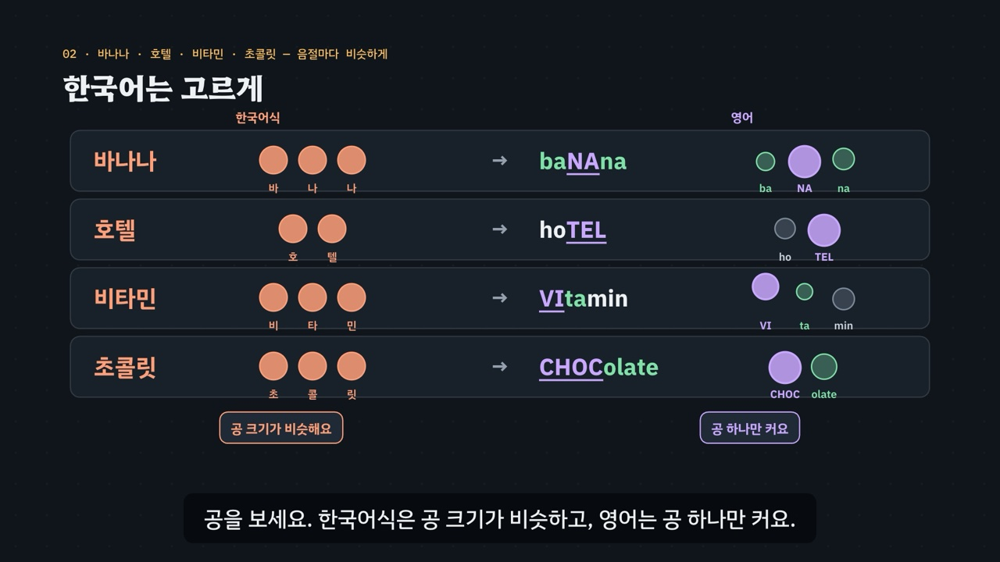

# 센 음절은 하나 — 낱말 강세와 슈와

> [영어 튜토리얼](../README.md) 모음의 **영어 발음 (미국식)** 두 번째 꼭지입니다(영역: `pron`, 계획표의 P09 · 유형 18 · 19). 발음 영역의 설계도는 [docs/pron-types.md](../docs/pron-types.md)이고, 형식은 시범 편 [r · l](../r-and-l/README.md)을 따랐어요. 이 꼭지가 **실제 음성을 재서 그린 음절 공 · 높낮이 선**을 처음 세웠어요.

한국어 *바나나*는 세 음절을 고르게 말해요. 영어 *banana* → 둘째 음절 하나만 길고 크고 높게 말하고, 나머지 둘은 짧고 흐린 ‘어’로 지나가요. 영어 낱말마다 이렇게 **센 음절(강세)이 하나** 있고, 약한 음절의 모음은 흔히 흐린 어 — **슈와(ə)**가 돼요.

- **센 음절** — 길게 · 크게 · 높게, 모음은 줄이지 않고 또렷이. 요령: 센 음절에서 책상을 톡, 손을 크게 펼치기(*baNAna*).
- **약한 음절** — 짧게 · 작게 · 낮게, 모음은 흔히 슈와. 철자(a · o · e · i · u)와 상관없어요(*about · today · pencil · support*).
- **자리를 지키기** — 외래어(호텔 → *hoTEL*, 비타민 → *VItamin*, 아이디어 → *iDEa*), 강세로 갈리는 짝(*desert · dessert*, *thirty · thirteen*, 명사 *REcord* · 동사 *reCORD*), 끝이 붙으면 옮겨 가는 센 음절(*CAnada → caNAdian*).

3단계 발음법: ① **듣고 가르기**(센 음절 하나 찾기 · 여러 목소리) → ② **소리 만들기**(센 음절 · 약한 음절과 슈와) → ③ **낱말 · 문장 속에서**(외래어 · 짝 · 낱말 가족).



## 바로 보기

`index.html`을 더블클릭하면 끝이에요. 설치도, 서버도 필요 없어요.

## 소리와 마이크에 대해 (꼭 읽어 주세요)

- 녹음 파일이 없어요. 영어는 모두 **합성 음성**이에요. 글이 정해진 말(낱말 · 문장 · 연습 문제 · 따라 말하기)은 **VoiceStudio로 미리 만든 미국식 목소리 넷**(`audio/dialogue/`)으로, 나머지는 브라우저에 들어 있는 영어 음성(speechSynthesis)으로 읽어요. 합성 음성은 실제 사람의 말소리와 조금 다르게 들릴 수 있어요.
- **목소리 넷**: 밝은 선생님(미국 여성) · 차분한 선생님(미국 여성) · 미국 여성 · 미국 남성. 강세 공 놓기 · 연습 문제는 문제마다 목소리를 바꿔요(목소리가 바뀌어도 센 음절을 찾는 귀). 비교용 **한국어식 소리**(*바나나 · 호텔 · 비타민 · 아이디어* …)는 한국어 내레이터 목소리로 만들었어요(`voices.json`의 `"lang": "ko"`).
- 같은 철자의 명사 · 동사(*record · present · object · increase*)는 낱말 하나만으로는 어느 쪽으로 읽을지 정할 수 없어서, 낱말 대신 예문(*She broke the world record. · Can I record your answer?*)으로 들려줘요(`WS.HOMO_SENT`).
- 튜토리얼 전용 목소리 부품 `assets/js/voices.js`(`WSV`)는 r · l의 `RLV`를 그대로 가져와 **잰 값**(`WSV.meas`)을 더했어요. 말하는 사람마다 파일을 찾고, 없으면 브라우저 음성(en-US, 한국어식은 ko-KR)으로 읽어요. 읽기 전에 음성 해설 · 발음 듣기 · 녹음 재생을 멈추고 영상을 일시정지해요.
- **내 발음 확인 · 따라 말하기**: 브라우저에 음성 인식(`SpeechRecognition` · `webkitSpeechRecognition`, en-US)이 있으면 말을 글로 바꿔 **후보 글 여러 개**를 강세로 갈리는 짝과 맞춰 봐요(*dessert*를 말했는데 *desert*로 적히면 ‘짝 낱말로 들렸어요’). 센 음절을 제대로 살렸는지는 판정하지 않아요(인식기는 흔한 낱말 쪽으로 기울어요). 크롬(Chrome) 같은 브라우저는 소리를 브라우저 회사의 서버로 보내 글로 바꿔요. 음성 인식이 없으면 녹음(`MediaRecorder`)으로 ‘내 목소리’와 ‘본보기’를 이어서 들어요. 녹음은 메모리에만 두고, 이 사이트는 아무것도 저장하지 않아요(강세 공 놓기의 기록만 이 브라우저의 `localStorage`에).

## 무엇을 배우나요

| 장 | 시각 | 내용 | 직접 해 보기 |
| --- | --- | --- | --- |
| 00 들어가며 | 0:00 | 바나나 = 고르게, *banana* = 둘째 음절 하나만 | 먼저 들어 보기(한국어식 *바나나*와 함께) |
| 01 들어 보기 · 어디가 센가요? | 0:36 | ① 듣고 가르기 · 음절 공 · 목소리 넷 | 센 음절 찾기(맛보기, 무작위 목소리) |
| 02 한국어는 고르게 | 1:16 | 바나나 · 호텔 · 비타민 · 초콜릿 — 음절마다 비슷하게 | 한국어식 · 영어 견주기(공 나란히) |
| 03 센 음절 만들기 | 1:56 | ② 길게 · 크게 · 높게 · 모음은 또렷이 | 센 음절의 신호 보기(길이 · 크기 · 높이 하나씩) |
| 04 약한 음절과 슈와 | 2:38 | ② 짧게 · 작게 · 흐린 어 · 입과 혀는 쉬는 자리 | 슈와가 들어 있는 낱말(철자 속 슈와 글자) |
| 05 강세로 갈리는 짝 | 3:22 | *desert · dessert · thirty · thirteen* · 명사와 동사 | 짝 고르기(짝 · 목소리) |
| 06 외래어 함정 | 4:04 | 첫음절 · 둘째 음절 · 마지막 음절이 센 외래어, 음절이 줄어드는 외래어 | 외래어 하나씩(한국어식 공과 함께) |
| 07 옮겨 가는 센 음절 | 4:48 | *Canada · Canadian · photograph · photographer · photographic* | 낱말 가족(옮겨 간 자리 · 같은 철자의 바뀐 모음) |
| 08 문장 속에서 | 5:32 | *I'd like a banana, please. · It's fifteen dollars.* | 문장 고르기(따라 말하기의 28문장, 센 음절 칠하기) |
| 09 정리 | 6:16 | 3단계 발음법 · 센 음절과 약한 음절 | 이제 직접(아래 칸으로) |

- **강세 공 놓기**(놀이터 왼쪽): 목소리 넷 × 낱말 일흔 개 남짓에서 하나를 무작위로 들려주고, 센 음절을 고르면 **그 목소리를 실제로 잰 음절 공**이 나타나요(잰 값이 없으면 엔진의 기본 모양). 낱말 묶음(외래어 · 약한 모음 · 낱말 가족 · 숫자 · 짝 낱말) · 목소리를 고를 수 있고, 센 음절의 자리(첫음절 · 둘째 음절 · 셋째 음절 뒤) × 목소리마다 맞힌 비율을 표(막대)로 보여 줘요. 기록은 `localStorage` `en-ws-balls-v1`(지우기 단추). 키보드 R 듣기 · 1~5 고르기 · Space/Enter 다음.
- **내 발음 확인**(놀이터 오른쪽): 강세로 갈리는 짝 11쌍(`WS.MP_PAIRS`: *desert · dessert*, 숫자 일곱 쌍, *human · humane* …) 중 하나를 말하면 음성 인식의 후보 글을 짝과 맞춰 ‘그 낱말로 들렸어요 · 짝 낱말로 들렸어요 · 다른 말로 들렸어요’를 알려 줘요. 철자가 같은 명사 · 동사는 인식기가 같은 글로 적어서 빼고 따라 말하기의 문장으로 연습해요.
- **따라 말하기 28문장**: 외래어 · 짝 · 슈와 · 옮겨 가는 센 음절 묶음마다 일곱 문장, 문장마다 듣기 · 천천히 · 따라 말하기. 들린 낱말을 원래 문장과 맞춰 맞은 낱말 초록 · 빠진 낱말 주황(`WS.compareWords`).
- **듣고 센 음절 찾기 16문제**(`PDrill`, `.edr` 모양): 센 음절은 어디인지 6 · 어느 낱말인지(짝) 3 · 몇 음절인지 4 · 문장 속 어느 숫자인지 3. 소리 먼저, 힌트 세 단계는 엔진이 낱말에서 만들어요. 키보드 A~C(1~3) · H 힌트 · R 다시 듣기 · S 천천히 · Enter.
- **퀴즈 10문제**: 영상 순서대로.
- **핵심 정리**: 센 음절 · 약한 음절과 슈와 · 외래어 · 강세로 갈리는 짝 · 옮겨 가는 센 음절 표 + 용어(① 듣고 가르기 · ② 소리 만들기 · ③ 낱말 · 문장 속에서).

### 플레이어 조작

다른 튜토리얼과 같아요. 스페이스(재생/일시정지), ← →(5초), Shift + ← →(장), C(자막), V(음성 해설), F(전체 화면). 화면 속 낱말을 누르면 발음을 들려줘요(같은 단추를 곧바로 다시 누르면 천천히).

**미리 만든 목소리**: VoiceStudio(OmniVoice 엔진, 비상업용 라이선스)로 만든 합성 음성 파일이에요. 파일이 없거나 못 읽으면 그 줄 · 조각만 브라우저 음성으로 읽어요.
- **영어는 0.9배로 재생해요**(r · l과 같음, `voices.js`의 `EN_RATE`). 한국어 해설과 한국어식 읽기는 1배.
- **늘어놓은 낱말은 쉬어 가며 읽어요.** 자막에 · 로 늘어놓은 영어 낱말(*about · today · pencil · support*)은 낱말마다 따로 만들고 사이에 쉼표만큼 쉬어 한 파일로 이었어요(`--word-lists`). 해설의 영어 조각 29개는 받아쓰기(Whisper)로 모두 맞게 적히는 것을 확인했어요. 그 가운데 낱말만 읽는 조각 24개는 강세가 중요해서, 센 음절 확인을 통과한 밝은 선생님(`tc`) 낱말 파일을 쉼표만큼 쉬어 이어 다시 만들었어요(22개, `tools/measure-syllables.py word-stress --narration`). 통과하지 못한 낱말이 든 조각 2개(*violin*이 든 줄 · *Japanese*)는 처음 만든 소리 그대로예요.
- 음성 해설(`audio/narration/`): 한국어 조각은 「튜토리얼 내레이터 (젊은 여성)」, 영어 조각은 「영어 선생님 (밝은 미국 여성)」.
- 낱말 · 문장(`audio/dialogue/`): 말하는 사람 → 프로필은 `voices.json` — `tc` 「영어 선생님 (밝은 미국 여성)」 · `tf` 「영어 선생님 (미국 여성)」 · `uf` 「길 묻기 · 나 (미국 여성)」 · `um` 「길 묻기 · 길에서 만난 사람 (미국 남성)」 · `ko` 「튜토리얼 내레이터 (젊은 여성)」(한국어).

만드는 법(VoiceStudio가 있는 맥에서, 이미 만든 파일은 건너뛰어요):

```bash
node tools/narration-pieces.cjs word-stress     # 해설의 읽기 조각 목록 (자막을 고쳤을 때만)
node tools/dialogue-lines.cjs word-stress       # 낱말 · 문장 줄 목록 (낱말 · 문제 · 따라 말하기를 고쳤을 때만)
python3 tools/voicestudio-narration.py word-stress --en-profile "영어 선생님 (밝은 미국 여성)" --word-lists
python3 tools/voicestudio-dialogue.py word-stress
```

### 잰 값 — 음절 공과 높낮이 선

음절 공(음절마다 공 하나)과 높낮이 선은 **미리 만든 음성 파일을 프로그램으로 따로 재서** 그려요(`audio/dialogue/measure.js`의 `window.PRON_MEASURE`). 공의 넓이는 음절의 길이와 크기, 공의 높이는 소리의 높이(반음)예요. 잰 값이 없는 낱말은 엔진의 기본 모양(센 음절 크게 · 슈와 작게)으로 그리고, 화면에 ‘이 목소리를 잰 값’이라고 적지 않아요.

**잰 결과**(2026-11-13): 낱말 · 한국어식 줄 300개 가운데 239개의 잰 값을 써요. 처음 쟀을 때 104개가 통과하지 못했고, seed를 바꿔 다시 만들어(`--regen`) 50개가 통과했어요. 끝내 통과하지 못한 54개는 소리 파일은 그대로 두고 잰 값만 뺐어요(화면은 엔진의 기본 모양).

- 가장 많이 걸린 것은 센 음절 확인(39개)이에요. 홀로 말한 -teen 숫자(*fourteen · fifteen · sixteen · seventeen · nineteen*, 14개)는 첫음절이 길이 · 크기 · 높이 가운데 둘 이상에서 더 크게 재어지는 일이 많았어요. 합성 음성이 첫음절을 세게 낸 것인지, 모음마다 원래 다른 크기를 잰 것인지는 가르지 못했어요. *violin · Japanese · seventeen*은 네 목소리 모두 통과하지 못했어요.
- *incite*는 받아쓰기가 *insight*로 적어 탈락했어요(네 목소리 모두). 두 낱말은 소리가 같고 센 음절의 자리만 달라서 받아쓰기로는 가를 수 없어요.
- 그 밖에 음절을 나누지 못한 9개(이어진 모음 · 흐린 음절), 끝이 묻는 말처럼 올라간 1개(*about*의 미국 남성, +8.8반음).
- **센 음절을 찾는 연습은 확인한 소리로**: 연습 문제는 센 음절 확인을 통과한 목소리로 들려줘요(*violin* → *personnel*, 짝 문제 *personal · personnel* → *eighty · eighteen*, *computer · internet*은 목소리를 바꿈). 강세 공 놓기와 01장의 맛보기도 통과한 목소리 가운데서 고르고, 통과한 목소리가 하나도 없는 낱말(*violin · Japanese · seventeen · incite*)은 내지 않아요. 영상 · 직접 해 보기의 낱말 단추는 그대로 들려줘요.
- **한국어식 공은 그림이에요.** 한국어식 공은 ‘정해진 센 음절이 없고 모음을 줄이지 않는다’를 보여 주는 고른 모양(`WS.koSchematic`)으로 그려요. 한국어식으로 읽은 파일을 재 보면 말 덩어리의 끝 쪽이 길고 높아지기도 해서(*바나나* 90 · 250 · 310ms, 낮음 → 높음) 잰 값으로 그리면 ‘고르게’와 맞지 않았어요. 한국어식 파일도 받아쓰기로 한국어 표기와 같은지는 확인해요(*재패니즈*는 ‘제페니즈’로 적혀 탈락 — 소리는 그대로).

## 무엇이 규칙 계산인가요

- **규칙 엔진** `assets/js/grammar.js`(`WS`)가 낱말마다 적은 발음 기호에서 계산해요. 영상 · 직접 해 보기 · 놀이터 · 연습 문제 · 퀴즈가 모두 같은 결과를 써요.
  - 낱말 사전 `WS.DICT`(73낱말: 철자 조각 · 음절로 나눈 넓은 IPA(센 음절 ˈ · 제2 강세 ˌ) · 한국어 표기 · 뜻 · 묶음). 같은 철자의 명사 · 동사는 `record:n` · `record:v`처럼 따로 적어요.
  - 음절 수 `WS.nSyl`, 센 음절의 자리 `WS.stressAt` · `WS.ordSyl`(첫음절 · 둘째 음절 · 마지막 음절), 강세 모양 `WS.pattern`(oOo), 대문자 표기 `WS.caps`(baNAna), 약한 음절과 슈와 `WS.weakIdx` · 철자 속 슈와 글자 `WS.schwaLetters`.
  - 한국어 표기의 음절 수 `WS.koSyl` · `WS.nKo`(아이디어 = 넷 · idea = 셋), 외래어 줄 `WS.LOAN`(첫음절 · 둘째 음절 · 마지막 음절이 센 것 · 한국어식 음절이 더 많은 것).
  - **강세로 갈리는 짝** `WS.PAIRS`(15쌍: *desert · dessert*, 숫자 일곱 쌍, *human · humane · personal · personnel · insight · incite*, 명사 · 동사 넷) — 음절 수가 같고 센 음절의 자리만 다른지 엔진이 확인해요. `WS.pairOf` · `WS.partner`.
  - **낱말 가족** `WS.FAMS`(*Canada · Canadian*, *photograph · photographer · photographic*, *economy · economic*, *Japan · Japanese*)에서 옮겨 간 센 음절과 바뀐 모음 `WS.vowelShift`(*Canada*의 첫 a: æ → *Canadian*에서 ə).
  - 문장 속 칠하기 `WS.wordsIn` · `WS.segs`, 들린 말 맞추기 `WS.heard`(후보 글 → 그 낱말 · 짝 낱말 · 다른 말), `WS.compareWords`, 연습 문제의 힌트 `WS.hints`, 음절 공의 기본 모양 `WS.schematic` · `WS.koSchematic`.
- **어긋남 경고** `WS.check()`: 철자 조각과 음절 수가 다르거나, 센 음절이 하나가 아니거나, 음절에 모음이 하나가 아닌 낱말, 짝의 음절 수 · 자리, 낱말 가족에서 겹치는 자리, 외래어 줄과 엔진의 자리, 슈와가 없는 슈와 예, 사전에 없는 낱말뿐인 문장 · 품사를 적지 않은 명사 · 동사, 엔진과 어긋나는 연습 문제의 정답, 한쪽에 몰린 정답 위치, 입 그림에서 슈와의 턱이 i와 a 사이가 아니면 콘솔에 경고가 떠요.
- **발음 사전 대조**(커밋 전에 따로): 손으로 적은 73낱말의 센 음절 자리와 음절 수를 misaki 미국 발음 사전(VoiceStudio에 들어 있는 `us_gold.json` · `us_silver.json`, 명사 · 동사는 품사별 발음)과 맞췄어요. 센 음절의 자리는 모두 같았고, 음절 수가 다른 곳은 둘 — *chocolate · family*(사전은 줄어들 수 있는 슈와를 따로 표시해 세 음절, 이 꼭지는 흔한 두 음절)예요.
- **단순하게 줄인 부분**
  - 센 음절은 사전을 따르지만 사전마다 조금씩 달라요(*chocolate* 두 음절 또는 세 음절). 약한 음절이 줄어드는 낱말(*chocolate · business · family · orange*)은 흔히 쓰는 짧은 쪽으로 적었어요.
  - 제2 강세(*photographic*의 pho)는 따로 가르치지 않고, 슈와가 아닌 약한 음절(짧은 이 ɪ 등)과 함께 회색 공으로 그려요.
  - ‘끝이 붙으면 그 앞 음절이 세다’(-ian · -ic)는 어림 규칙이고 예외가 있어요.
  - 문장 속의 강세 이동(*thirTEEN* → *THIRteen MEN*)과 문장 리듬 · 억양은 다른 꼭지(P10 · P12)에서 다뤄요.
  - 엔진은 소리를 듣지 않아요. 음절 공은 미리 만든 파일을 따로 잰 값이고, 내 발음 확인은 음성 인식이 적은 후보 글을 짝 낱말과 맞춰 볼 뿐이에요.
- **근거로 삼은 연구**(초록 · 요약으로 확인한 범위, 자세한 목록은 [docs/pron-types.md](../docs/pron-types.md)): 낱말 강세와 알아듣기 — [김현진 2004](https://scholar.kyobobook.co.kr/article/detail/4010017074882)(원어민이 한국인 학습자의 영어를 평가한 연구에서 낱말 강세 오류가 가장 잦았고 알아듣기 쉬운 정도를 가장 잘 설명함). 약한 모음 — [Lee, Guion & Harada 2006](https://www.cambridge.org/core/services/aop-cambridge-core/content/view/S0272263106060207)(한국인 학습자는 약한 음절의 모음을 원어민보다 덜 줄이는 경향). 연구마다 대상 · 방법이 달라 두 연구가 보여 준 방향만 말하고 숫자는 옮기지 않았어요.
- **예문과 문제**: 모두 직접 만든 것이에요.

## 폴더 구조

```
index.html              페이지 (영상 · 직접 해 보기 · 강세 공 놓기 · 내 발음 확인 · 따라 말하기 · 듣고 고르기 · 퀴즈 · 핵심 정리)
assets/js/grammar.js    규칙 엔진(WS.phones · WS.nSyl · WS.stressAt · WS.pattern · WS.caps · WS.weakIdx · WS.schwaLetters · WS.koSyl · WS.pairOf · WS.vowelShift · WS.wordsIn · WS.segs · WS.heard · WS.compareWords · WS.hints · WS.schematic),
                        낱말 사전(WS.DICT) · 짝(WS.PAIRS) · 명사 · 동사 예문(WS.HOMO_SENT) · 낱말 가족(WS.FAMS) · 외래어(WS.LOAN) · 문장(WS.SENT) · 목소리(WS.VOICES) · 연습 문제(WS.DRILL) · 점검(WS.check)
assets/js/voices.js     낱말 · 문장 목소리(WSV): 목소리 넷 + 한국어식(미리 만든 파일 → 없으면 브라우저 음성), 잰 값(WSV.meas)
assets/js/scenes.js     영상 장면 10개, 장 목록과 자막, 음절 공(잰 값 → 없으면 기본 모양) · 높낮이 선 · 크기 띠, 슈와 입 그림, 짝 · 외래어 · 낱말 가족 카드, 문장 칠하기
assets/js/app.js        플레이어, 직접 해 보기, 강세 공 놓기(기록 표), 내 발음 확인, 따라 말하기(음성 인식 · 녹음), 듣고 고르기(PDrill), 퀴즈, 영상 추출(EN_EXPORT)
../shared/mouth.js      입 옆 단면도 부품(EN.mouth) — 슈와(혀와 턱이 가운데)를 그릴 때 씀
video/                  자막 원고(SRT)
audio/narration/        음성 해설의 읽기 조각 목록(pieces.json) · 파일 목록(clips.js) · 음성 파일
audio/dialogue/         낱말 · 문장 줄 목록(lines.json) · 말하는 사람 → 프로필(voices.json) · 파일 목록(clips.js) · 잰 값(measure.js) · 음성 파일
docs/poster.jpg         사이트 카드 그림
```

## 영상 다시 만들기

```bash
node tools/render-video.cjs word-stress                       # → word-stress/video/word-stress.mp4 + .srt
node tools/render-video.cjs word-stress --frames 30,97        # 몇 장면만 그림으로
node tools/render-video.cjs word-stress --poster 97           # 카드 그림
node tools/render-video.cjs word-stress --srt                 # 자막 원고만
```

MP4에는 소리가 없어요(자막이 그림에 들어가요).
